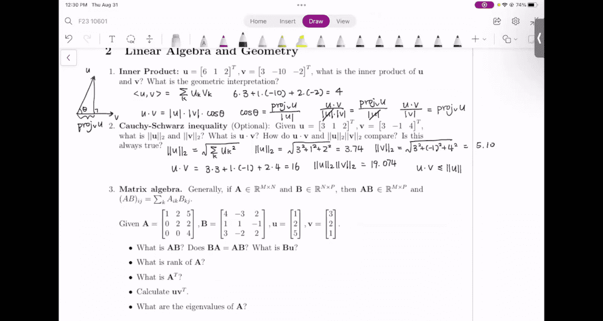
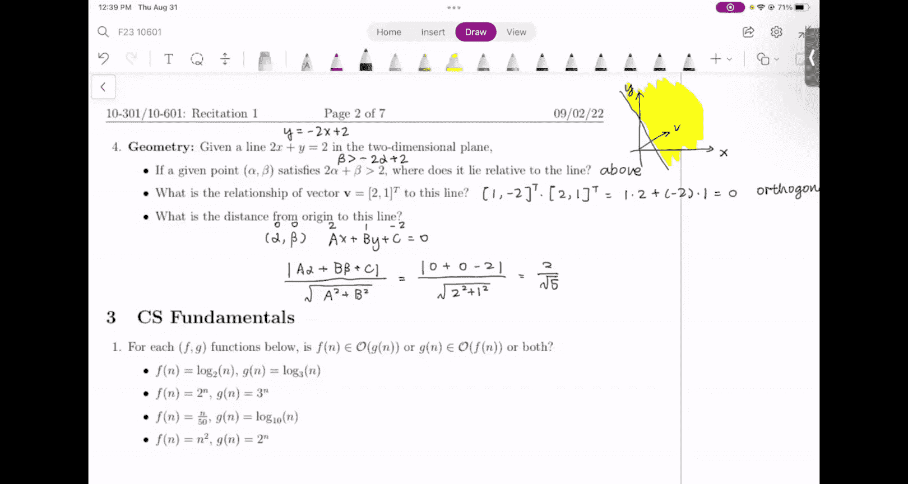

# 机器学习导论：1：线性代数与几何基础 🧮

在本节课中，我们将要学习机器学习中至关重要的数学基础：线性代数与几何。我们将从向量的基本运算开始，逐步深入到矩阵操作和几何概念，为后续的机器学习算法理解打下坚实的基础。

## 1.1：内积

内积是两个向量之间的一种基本运算。对于两个向量 **U** 和 **B**，其内积定义为它们对应元素的乘积之和。

**公式**：`U · B = Σ (U_i * B_i)`

## 1.2：几何解释

上一节我们介绍了内积的代数定义，本节中我们来看看它的几何意义。内积的数值与向量 **U** 在向量 **B** 方向上的投影长度成正比。

## 1.3：点积

点积是内积在几何上的另一种表达。它等于两个向量的模长（长度）乘积，再乘以它们之间夹角的余弦值。

**公式**：`U · V = ||U|| * ||V|| * cos(θ)`

## 1.4：规范化

为了进行长度无关的比较，我们常常需要将向量规范化，即计算其范数（长度）。向量的范数是其各分量平方和的平方根。

**公式**：`||U|| = sqrt( Σ (U_i^2) )`

## 1.5：规范化乘积

两个向量的范数乘积 `||U|| * ||V||`，在几何上代表了以这两个向量为边构成的平行四边形的面积。

## 1.6：点积不等式

点积有一个重要的性质，即其绝对值不会超过两个向量范数的乘积。这被称为柯西-施瓦茨不等式。

**公式**：`|U · V| ≤ ||U|| * ||V||`

---

理解了向量的基本运算后，我们接下来将学习由向量组成的矩阵的代数运算。

## 2.1：矩阵乘法

矩阵乘法是线性代数中的核心操作。矩阵 **A** 和 **B** 的乘积 **AB**，其每个元素是 **A** 的一行与 **B** 的一列的点积。

## 2.2：矩阵转置

矩阵的转置是一个简单但重要的操作，它将矩阵的行和列互换。矩阵 **A** 的转置记作 **A^T**。

## 2.3：特征值

特征值和特征向量是理解矩阵性质的关键。对于一个方阵 **A**，如果存在一个非零向量 **v** 和一个标量 λ，使得 **Av = λv** 成立，那么 λ 就是 **A** 的一个特征值，**v** 是对应的特征向量。

**公式**：`A v = λ v`

---

掌握了代数的工具后，我们现在可以运用它们来理解一些基础的几何概念，这些概念在机器学习（如分类器的决策边界）中非常有用。

## 3.1：直线方程

在二维空间中，一条直线可以用一个线性方程来表示，例如 `2x + y = 2`。

## 3.2：点与直线的相对位置

给定一个点 (α, β)，我们可以通过将其坐标代入直线方程来判断其位置。如果 `2α + β > 2`，则该点位于直线的上方。

## 3.3：向量与直线的平行关系

如果一个向量 **V** 的方向与直线的方向相同或相反，则称该向量与直线平行。

## 3.4：向量与直线的垂直关系

如果一个向量 **V** 与直线的法向量（即与直线垂直的向量）方向相同，则称该向量与直线垂直。

## 3.5：原点到直线的距离

最后，我们学习如何计算一个点到一条直线的距离。对于直线 `Ax + By + C = 0` 和点 (x0, y0)，其距离公式如下：

**公式**：`d = |Ax0 + By0 + C| / sqrt(A^2 + B^2)`

这个公式计算的是点到直线的最短垂直距离。

---

本节课中我们一起学习了线性代数与几何的核心基础。我们首先定义了向量的内积与点积，并探讨了它们的几何意义。接着，我们学习了矩阵的乘法、转置以及特征值的概念。最后，我们将这些代数工具应用于几何，理解了直线方程、点线关系以及距离的计算。这些概念是构建和理解复杂机器学习模型的基石。