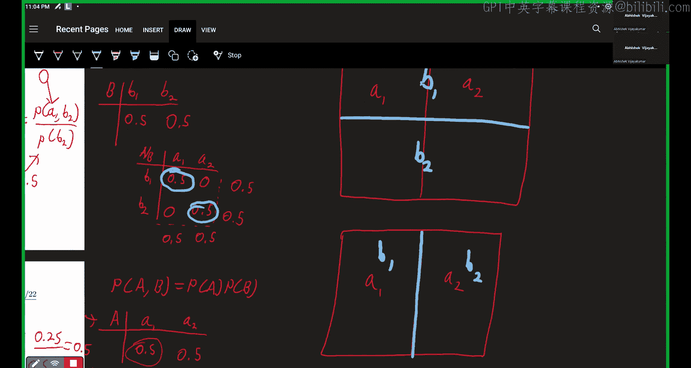

# 机器学习导论：1：概率与统计学基础 🎲

在本节课中，我们将学习概率和统计学的基本概念，这些是理解机器学习算法的数学基础。

## 1.1 基本概念

你应该已经熟悉一些概率的基本概念，例如样本空间中的事件或结果。

然而，在本课程中，我们将主要关注随机变量及其分布。

## 1.2 本节内容

本节将涵盖两个核心概念：**不相交性**和**独立随机变量**。

## 1.3 符号说明

对于我们将使用的符号，如果你不熟悉某些用书面形式表达的思想，请参阅课程网站上本课程的符号指南。

---

上一节我们介绍了本节的学习目标，本节中我们来看看具体的随机变量与分布。

## 2.1 随机变量A和B

假设我们有两个随机变量A和B。A有两种可能的结果，A1或A2。B也有两种可能的结果，B1或B2。

给定A等于A1的概率为0.5，B等于B1的概率为0.5。

由于A的可能结果只有A1和A2，B的可能结果只有B1和B2，因此这些被称为**二元随机变量**。

我们知道所有不在第一个结果上的概率都必须在第二个结果上。

因此，我们可以推断出A2的概率为0.5，B2的概率同样为0.5。

在本课程中，我们将经常看到二元随机变量，它们的输出通常是0和1。

## 2.2 A和B之间的关系

现在让我们考虑A和B之间的关系。

首先，假设A1和B2是**不相交**的结果。这意味着如果A1发生，B2就不能发生。

然后我们可以同时为A和B绘制一个概率表。

以下是A和B的联合概率表：

*   A1的总概率必须是0.5，所以这一列的总和必须是0.5。
*   A2的总和也必须是0.5。
*   B1和B2的总和也必须是0.5。

现在，我们知道如果A1发生，B2就不能发生，因为A1和B2是不相交的。

所以这个表中的A1 B2单元格必须是0。

**公式：** `P(A=A1, B=B2) = 0`

这是0，因为A1和B2被定义为不相交的。

然后让我们看看A1和B1的概率。

我们知道这一列的总和必须是0.5，而这个值是0，所以这个值必须是0.5。

使用这个，我们可以填写整个表格的其余部分。

我们现在知道第一行的总和必须是0.5，所以这个单元格必须是0。

这迫使这个单元格也是0.5，这样剩余的总和才能工作。

所以，根据这个，我们可以回答我们的第二个问题，即A1和B1同时发生的概率必须是0.5。

我们的下一个问题有点棘手。我们现在要问的是**条件概率**。

条件概率的定义告诉我们我们要求的是。

**公式：** `P(A1 | B2) = P(A1, B2) / P(B2)`

B2的概率在这里给出为0.5，正如我们之前讨论的那样。

A1和B2的概率在我们的表中为0。

所以这实际上也是一个0，即给定B2发生，A1发生的概率必须是0。

这又是一种谈论不相交性的方式。

因此，重要的是要注意，第一个问题和第三个问题之间有一个区别。

第一个问题是问，A1和B2发生的概率是多少。

在第三个问题中，我们说我们告诉你B2已经发生了。

现在，A1发生的概率是多少。

在这种情况下，它们都恰好是0。

对于我们的第二个问题，我们将考虑A和B是**独立**的情况。

也就是说，A和B某些结果的概率等于A的概率乘以B的概率。

让我们看看这在我们概率表中是如何体现的。

我们的A和B的概率表仍然有效。

所以A的概率仍然是A1为0.5，A2为0.5。

B的概率仍然是B1为0.5，B2为0.5。

但是我们的A和B的联合表可能不同，因为我们已经改变了A和B之间的关系。

所以，就像之前一样，A1的结果的总和必须是0.5。

A2的结果的总和也必须是0.5。

B1和B2也是这样。

只是要注意，我在这里的A和B上做了交换。

所以我要把它们放回去，以反映原始表中的相同顺序。

所以现在我们有一个额外的约束，即给定情况下A和B的概率必须等于该情况下A和B的概率。

所以让我们看看我们要求计算的概率。

**公式：** `P(A=A1, B=B2) = P(A=A1) * P(B=B2)`

查看我们的表，我们看到这些值都是0.5。

所以这个概率实际上等于0.25。

所以我们可以直接从这两个表中读取这些信息，然后将其插入到表中。

所以结果是我们表中的四个单元格都有相同的概率0.25。

接下来是我们的第二个问题。

A1 B1的概率，再次查看我们的表。

这是A1的概率0.5乘以B1的概率，我们再次得到0.25。

最后，我们来到这个条件概率的情况。

现在我们正在查看A1在B2发生的概率。

等于A1和B2发生的概率除以B2发生的概率。

对于B2的概率，我们查看我们的表，我们得到B2的概率为0.5。

我们查看我们的表，我们得到A1和B2的概率为0.25。

所以我们的答案是0.5。

所以现在我们已经使用这些概率表形象地完成了所有这些练习。

但我们可以更直观地看待不相交性和独立性。

所以假设我们有样本空间或所有可能结果的某种图形表示。

独立-依赖情况看起来像这样。

我们将空间平均分配给A1，A2事件。

让我们使用小写字母i来保持我们的符号一致。

以及B1和B2事件。

查看这里。

我们看到每个单元格都占据样本空间的一部分。

并且知道我们只在这个B1的一半中，这不会告诉我们关于我们更有可能处于A1还是A2的任何更多信息。

因为我们已经平均分配了空间，这样A和B不会相互影响。

这就是我们的独立性。

我们的不相交结果或互斥的概念看起来更像是这样。

我们用A1和A2划分空间，但现在我们说A1和B2是不相交的。

在这种情况下，如果A1发生，B2就不能发生，B2必须只发生在A2的情况下。

由于B2和A2的概率都是0.5，那么这个区域必须与我们的样本空间相同大小。

所以现在我们有A1 B1占据空间的一半，A2 B2占据空间的一半。

告诉我们我们在A1，这正好告诉我们我们必须在B1的情况下，这在我们表中的这里表示为0.5和0.5，其他情况下是0。

---

本节课中我们一起学习了概率论的两个核心概念：**不相交性**（互斥）和**独立性**。我们通过二元随机变量的例子，使用概率表和直观的图形，理解了它们的定义、区别以及如何计算联合概率与条件概率。在下一节中，我们将探讨这些概率概念在机器学习中的具体应用。