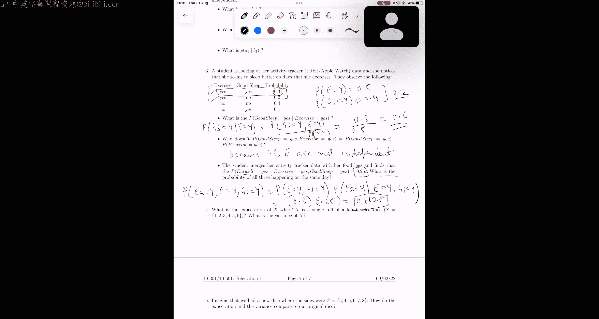
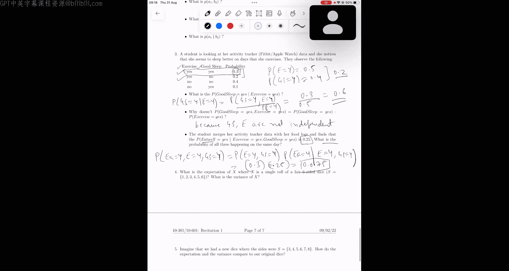
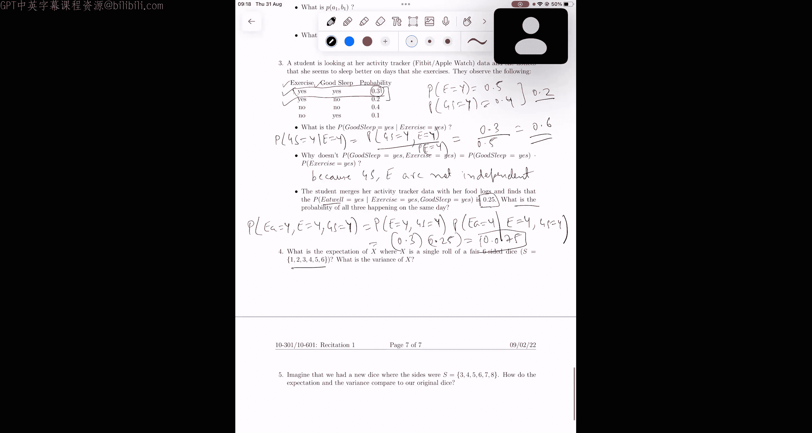
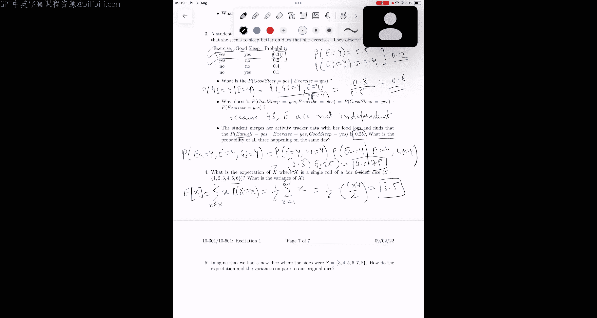
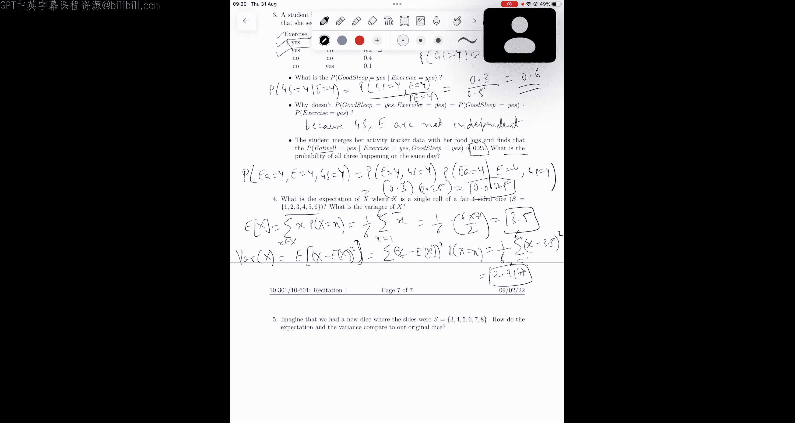
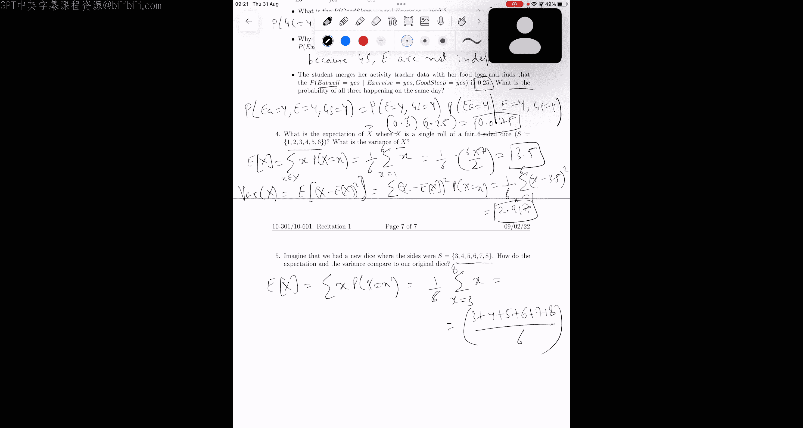
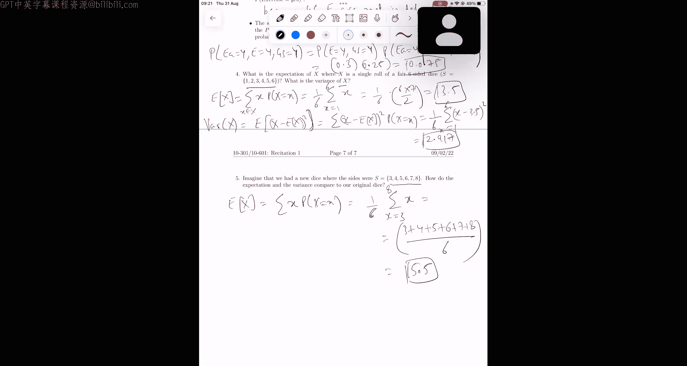
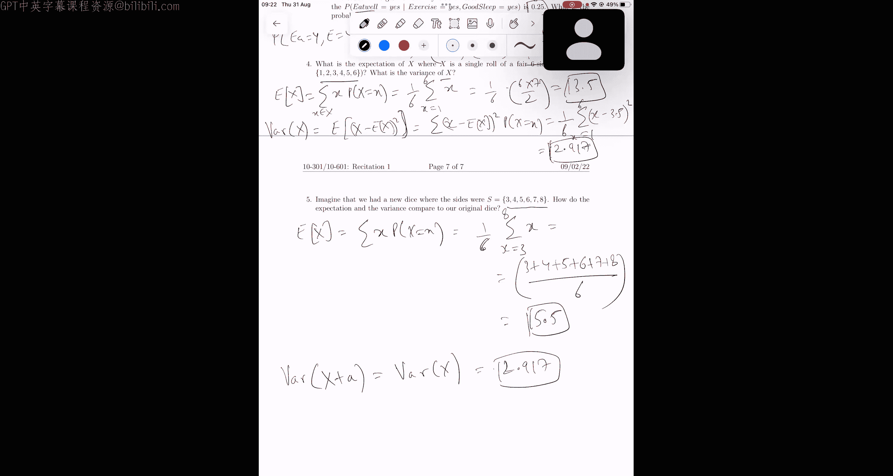

# 机器学习导论：练习：概率与统计问题 🎲

在本节课中，我们将学习如何解决概率和统计中的基础问题，涵盖条件概率、独立性、期望值与方差等核心概念。通过具体的计算示例，我们将掌握这些概念的应用方法。

---

## 1. 联合分布与条件概率

上一节我们介绍了概率的基本概念，本节中我们来看看如何利用联合分布计算条件概率。

**问题**：给定两个随机变量X和Y的联合分布，计算条件概率 `P(Y=是|X=是)`。

**解答**：
条件概率的计算基于以下公式：
`P(Y=是|X=是) = P(X=是, Y=是) / P(X=是)`

以下是计算步骤：
*   **联合概率**：`P(X=是, Y=是) = 0.3`
*   **边际概率**：`P(X=是) = 0.5`
*   **条件概率**：`0.3 / 0.5 = 0.6`

因此，在X为“是”的条件下，Y也为“是”的概率是0.6。

---

## 2. 独立性与边际概率

理解了条件概率后，我们自然要问：如何判断两个事件是否独立？本节我们来探讨独立性的检验方法。

**问题**：为什么 `P(Y=是, X=是)` 不等于 `P(Y=是) * P(X=是)`？

**解答**：
检验两个随机变量是否独立，需要检查其联合概率是否等于各自边际概率的乘积。

以下是检验步骤：
*   **边际概率**：`P(Y=是) = 0.4`， `P(X=是) = 0.5`
*   **独立情况下的计算**：`P(Y=是) * P(X=是) = 0.4 * 0.5 = 0.2`
*   **实际联合概率**：`P(Y=是, X=是) = 0.3`

由于 `0.2 ≠ 0.3`，我们可以得出结论：X和Y不是相互独立的随机变量。

---

## 3. 条件概率与联合概率

现在，我们引入第三个随机变量，学习如何计算涉及多个变量的联合概率。

**问题**：给定一个额外的随机变量E2，计算 `P(E2=是, X=是, Y=是)`。

**解答**：
根据条件概率的定义，多个变量的联合概率可以分解。对于此问题，公式为：
`P(E2=是, X=是, Y=是) = P(X=是, Y=是) * P(E2=是|X=是, Y=是)`

以下是计算步骤：
*   **已知联合概率**：`P(X=是, Y=是) = 0.3`
*   **已知条件概率**：`P(E2=是|X=是, Y=是) = 0.25`
*   **计算新联合概率**：`0.3 * 0.25 = 0.075`

因此，三个事件同时发生的概率为0.075。

---

## 4. 随机变量的期望值与方差

接下来，我们将目光从概率转向统计量，学习描述随机变量分布特性的两个关键指标：期望值和方差。

**问题**：计算一个公平六面骰子点数的期望值和方差。

**解答**：
**期望值**是随机变量所有可能取值的加权平均。
其公式为：
`E(X) = Σ [x * P(X=x)]`

以下是计算骰子期望值的步骤：
*   **x的可能值**：1, 2, 3, 4, 5, 6
*   **每个值的概率**：`P(X=x) = 1/6`
*   **计算期望值**：`E(X) = (1+2+3+4+5+6) * (1/6) = 3.5`

**方差**衡量随机变量取值与其期望值的偏离程度。
其公式为：
`Var(X) = E(X^2) - [E(X)]^2`

以下是计算骰子方差的步骤：
*   **计算E(X^2)**：`E(X^2) = (1^2+2^2+3^2+4^2+5^2+6^2) * (1/6) = 91/6 ≈ 15.167`
*   **计算方差**：`Var(X) = E(X^2) - [E(X)]^2 = 15.167 - (3.5)^2 = 15.167 - 12.25 = 2.917`

---

## 5. 改变骰子值的影响

最后，我们通过一个变化来巩固对期望值和方差的理解，看看当随机变量的取值发生变化时，这两个统计量如何变化。

**问题**：如果将骰子的值改为3, 4, 5, 6, 7, 8，计算新的期望值和方差。

**解答**：
新的取值集合相当于在原骰子每个面的点数上统一加2。
*   **新的期望值**：`E(X_{new}) = E(X_{old}) + 2 = 3.5 + 2 = 5.5`
*   **新的方差**：由于方差衡量的是取值的离散程度，所有值同时增加一个常数不会改变这种离散性，因此方差保持不变，仍为 **2.917**。

**原因总结**：为随机变量的每个取值增加一个常数 `c`，会使期望值增加同样的常数 `c`，但方差保持不变。

---

本节课中我们一起学习了概率与统计中的几个核心问题。我们掌握了如何计算条件概率、检验随机变量的独立性、求解多变量联合概率，以及计算随机变量的期望值与方差。理解这些基础概念是后续学习更复杂机器学习模型的重要基石。