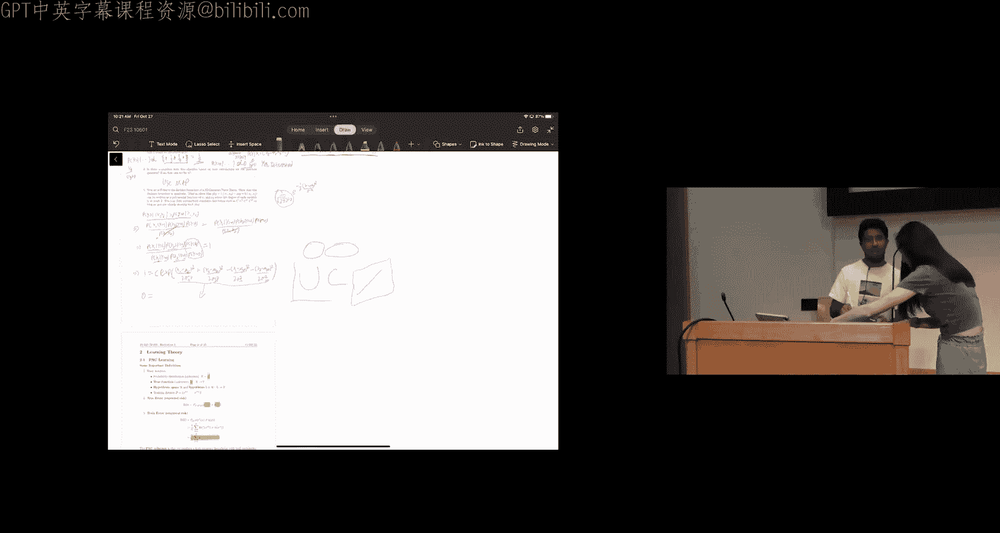
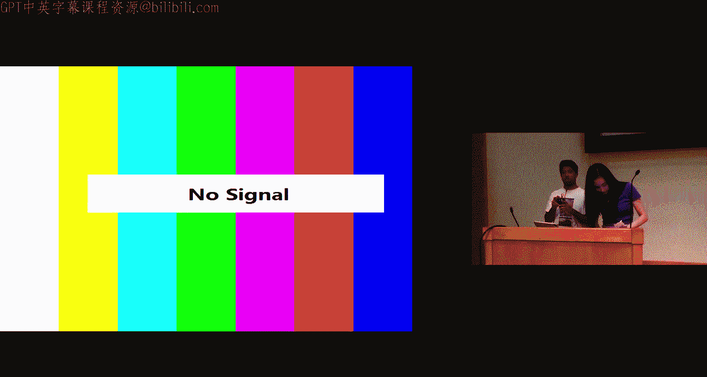
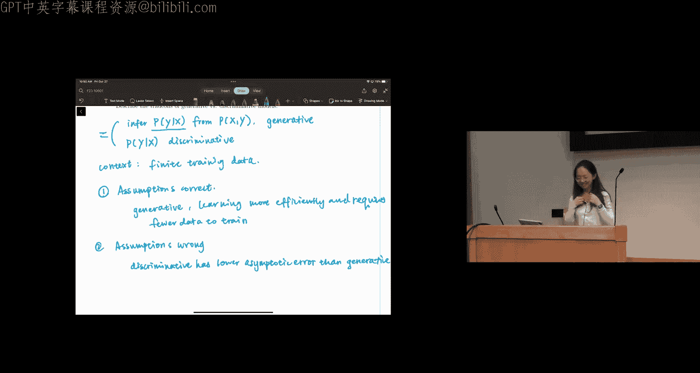

# 机器学习导论：第6章：概率学习与朴素贝叶斯 🧠

在本节课中，我们将要学习概率学习的基本框架，包括如何学习概率分布的参数，以及如何利用这些分布构建分类器。我们将重点介绍最大似然估计和贝叶斯估计，并探讨朴素贝叶斯分类器的原理与应用。

---

## 1. 概率学习 📊

概率学习是一种机器学习框架，其目标是学习数据的概率分布，例如正态分布或伯努利分布，而不是直接学习一个输入到输出的函数。

上一节我们介绍了概率学习的目标，本节中我们来看看两种核心的参数估计方法。

### 1.1 最大似然估计 (MLE)

最大似然估计通过寻找一组参数，使得观测到的数据在该参数下的概率最大，来学习概率分布的参数。

**公式**：
```
θ_MLE = arg max P(D | θ)
```

### 1.2 贝叶斯估计 (MAP)

贝叶斯估计在估计参数时，不仅考虑观测数据，还结合了关于参数的先验知识。

**公式**：
```
θ_MAP = arg max P(θ | D) = arg max P(D | θ) * P(θ)
```

---

## 2. 概率分类器 🎯

概率分类器利用学习到的概率分布来预测样本的类别。MLE和MAP是学习这些分类器参数的两种主要方法。

以下是概率分布中常见的参数：
*   对于正态分布，参数是均值（μ）和方差（σ²）。
*   对于伯努利分布，参数是成功的概率（θ）。

---

## 3. 应用示例 💡

为了更好地理解上述概念，我们来看一个具体的例子。

### 3.1 广告点击率估计 (MLE)

假设一个广告被展示了N次，其中有K次被点击。我们的目标是估计点击率θ。使用MLE方法，我们寻找使观测到K次点击最有可能发生的θ值。

**公式**：
```
θ_MLE = K / N
```

### 3.2 广告点击率估计 (MAP)

现在，假设我们根据历史经验，相信点击率大约在6%左右。我们可以将这个信念作为先验知识，使用贝叶斯估计来更新θ值。

**公式**：
```
θ_MAP = (α + K) / (α + N)
```
其中，α是先验知识的强度体现。

---

## 4. 简单朴素贝叶斯 📝

朴素贝叶斯是一种基于贝叶斯定理的简单而有效的概率分类器。它的核心假设是：在给定类别的情况下，所有特征都是条件独立的。

以下是构建朴素贝叶斯分类器所需的步骤：
1.  **参数估计**：对于每个特征，我们需要估计其在每个类别下的条件概率分布。
2.  **预测**：给定一个新样本的特征，我们使用贝叶斯公式计算它属于每个类别的后验概率，并选择概率最高的类别作为预测结果。

**预测公式**：
```
y_pred = arg max_y P(y) * Π_i P(x_i | y)
```

---



## 5. 高斯朴素贝叶斯 🔔

高斯朴素贝叶斯是朴素贝叶斯的一个特例，它假设连续特征服从高斯（正态）分布。



由于每个特征的高斯分布会引入二次项，因此高斯朴素贝叶斯的决策边界是二次的，其形状可以是线性的、抛物线或椭圆。

---

## 6. 学习理论 📚

学习理论研究机器学习算法的理论基础，例如它们需要多少数据才能学好，以及泛化性能如何保证。

### 6.1 PAC 学习

PAC（Probably Approximately Correct）学习是学习理论中的一个框架。它要求一个学习算法能够在有限的数据集上，以高概率学习到一个近似正确的假设。

### 6.2 VC 维度

VC维度是衡量一个假设集合（模型）复杂度的重要指标。VC维度越高，模型的表示能力越强，但也可能需要更多数据来避免过拟合。

---

## 7. 生成模型与判别模型 ⚖️

根据对数据建模方式的不同，机器学习模型可以分为生成模型和判别模型。

### 7.1 生成模型

生成模型试图学习数据的联合概率分布P(X, Y)。它通过建模数据是如何“生成”的来进行分类。朴素贝叶斯就是一个典型的生成模型。

### 7.2 判别模型



判别模型则直接学习决策边界，即条件概率分布P(Y | X)或直接学习一个从X到Y的映射函数。逻辑回归和支持向量机是判别模型的代表。

---

## 8. 总结 🎓

本节课中我们一起学习了概率学习的核心思想，包括最大似然估计和贝叶斯估计两种参数学习方法。我们深入探讨了基于这些思想的概率分类器，特别是朴素贝叶斯及其高斯变体。此外，我们还简要介绍了学习理论的基本概念（PAC学习、VC维度），并区分了生成模型与判别模型的不同建模哲学。掌握这些内容是理解许多现代机器学习算法的基础。