# 机器学习导论：第10节：卷积神经网络和循环神经网络 🧠

## 概述

在本节课中，我们将学习卷积神经网络（CNN）和循环神经网络（RNN）的基本概念，并了解它们在图像识别和序列数据处理中的应用。

## 卷积神经网络（CNN）

上一节我们介绍了神经网络的基础，本节中我们来看看专门用于处理图像等网格数据的卷积神经网络。

### 滤波器

滤波器是卷积神经网络中的基本组件，用于提取图像特征。滤波器是一个小型矩阵，用于卷积层中。滤波器具有宽度、高度、深度、填充和通道等属性。

### 卷积

卷积是将滤波器在输入张量上滑动，并根据滤波器大小、填充和步长进行元素级乘积和。卷积操作的结果是一个新的张量，它是卷积层的输出。

### 卷积输出形状

卷积层的输出形状可以通过以下公式计算：
*   **输出宽度** = (输入宽度 - 核宽度 + 2 × 填充) / 步长 + 1
*   **输出高度** = (输入高度 - 核高度 + 2 × 填充) / 步长 + 1

### CNN的优势

以下是CNN相较于传统全连接网络的主要优势：
*   **图像识别**： CNN适用于图像相关机器学习，因为它具有进行特征提取和特征工程的内核。
*   **平移不变性**： CNN可以识别图像中不同位置的同一对象。
*   **参数高效**： CNN的参数数量比全连接层少得多。

### 卷积网络中的通道数

通道数决定了数据的维度。以下是常见的通道数配置：
*   **灰度图像**： 1个通道。
*   **彩色图像**： 3个通道（红、绿、蓝）。
*   **卷积滤波器**： 与输入通道数相同，输出通道数与滤波器数量相同。

## 循环神经网络（RNN）

了解了处理空间数据的CNN后，我们转向处理序列数据的循环神经网络。

### RNN的特点

RNN的节点之间具有循环连接，输出可以影响后续计算。RNN适用于序列或时间数据，例如语言和视频。

### RNN的隐藏节点

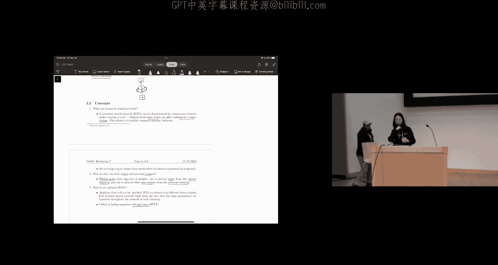

RNN的隐藏节点具有两个权重集，一个用于处理当前时间步的输入，另一个用于处理先前时间步的输出。RNN的优化类似于前馈神经网络，但需要使用时间反向传播。

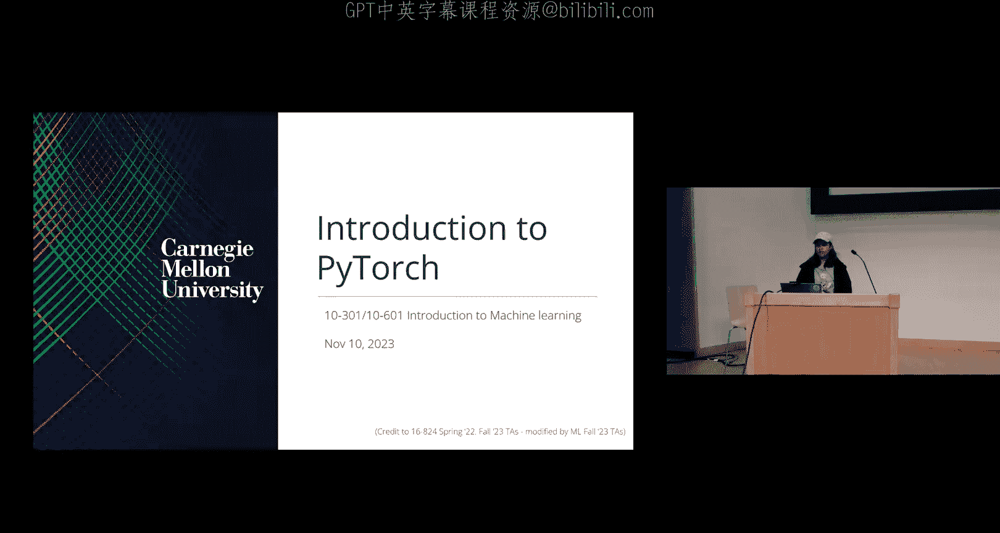

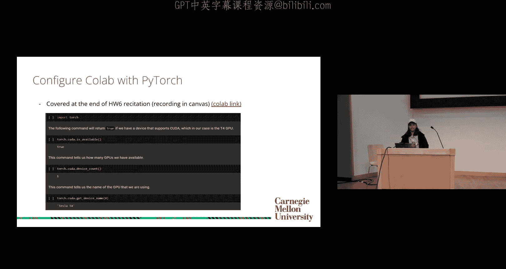

### RNN的紧凑表示

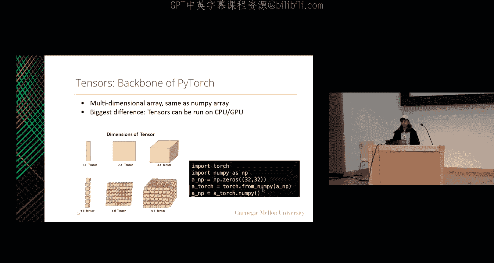

RNN可以通过将隐藏层输出连接到自身来紧凑地表示，从而避免在时间维度上完全展开网络结构。

## PyTorch基础

理论需要实践来巩固，接下来我们学习一个常用的深度学习框架PyTorch的基础知识。

### 张量

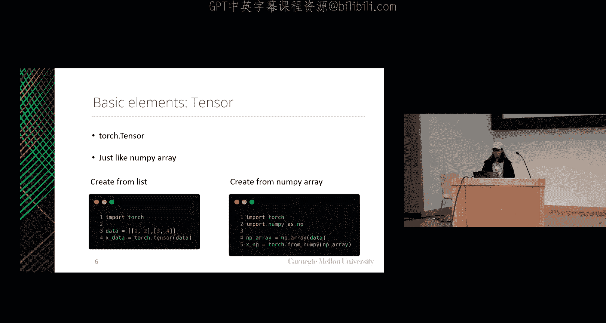

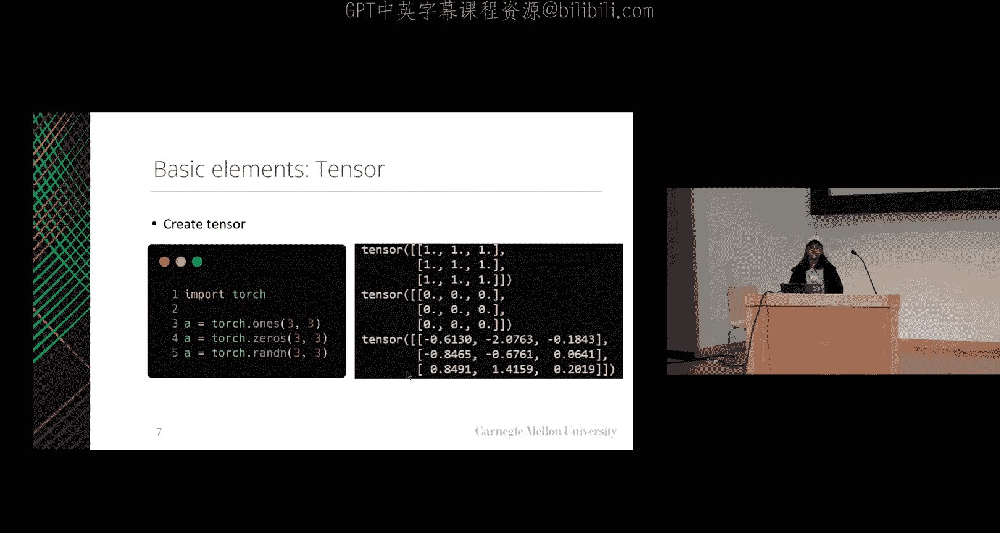

张量是PyTorch中的多维数组，类似于NumPy数组。使用`torch.tensor()`函数可以创建张量。张量支持切片、索引、加法、减法、乘法、除法等操作。

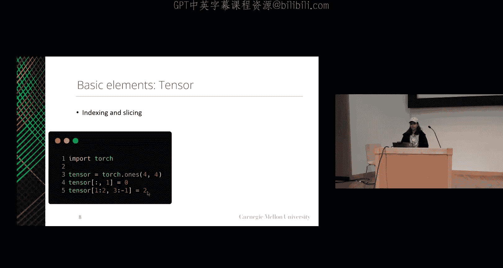

```python
import torch
# 创建一个张量
x = torch.tensor([[1, 2], [3, 4]])
```

### 设备和类型

张量可以存储在CPU或GPU上。张量具有数据类型，例如浮点数或整数。

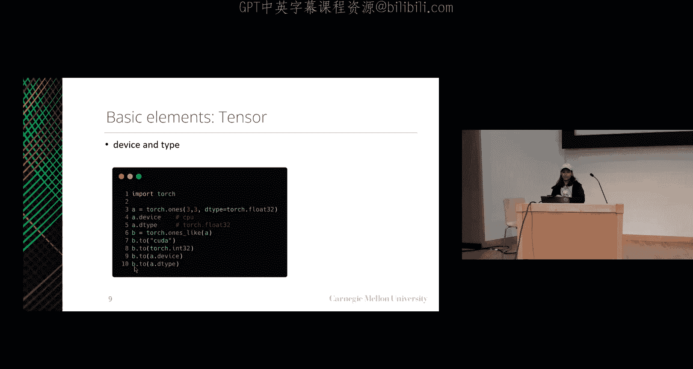

```python
# 指定设备（如GPU）和数据类型
x_gpu = x.to(‘cuda’).float()
```

### 基本操作

以下是PyTorch中张量的一些基本操作：
*   **切片**： 使用索引或切片操作符访问张量的子集。
*   **转置**： 使用`torch.transpose()`函数转置张量。
*   **矩阵乘法**： 使用`torch.matmul()`函数执行矩阵乘法。

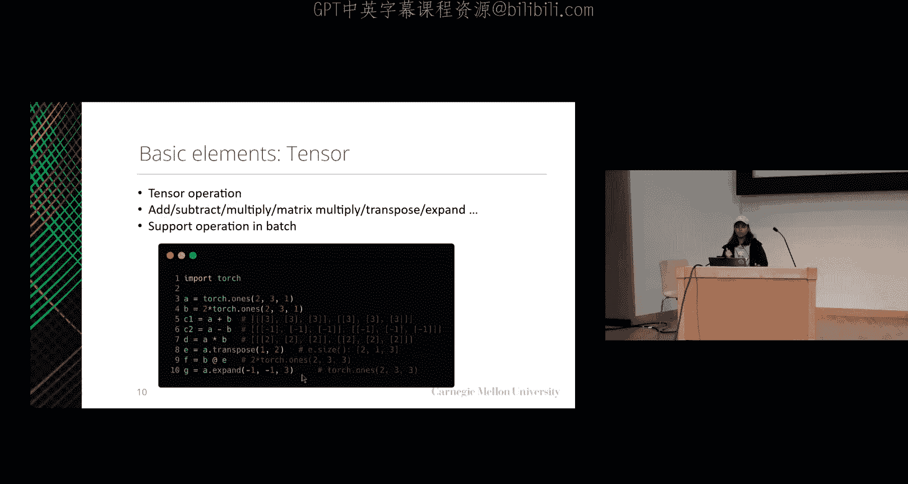

```python
# 矩阵乘法示例
A = torch.randn(3, 4)
B = torch.randn(4, 5)
C = torch.matmul(A, B) # 结果形状为 (3, 5)
```

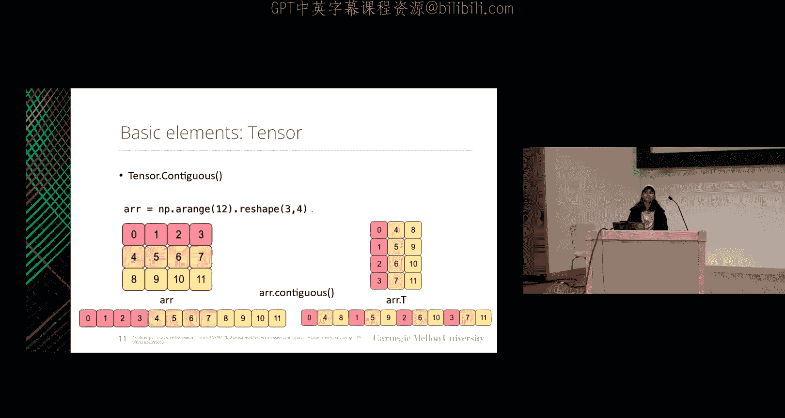

### 模型定义

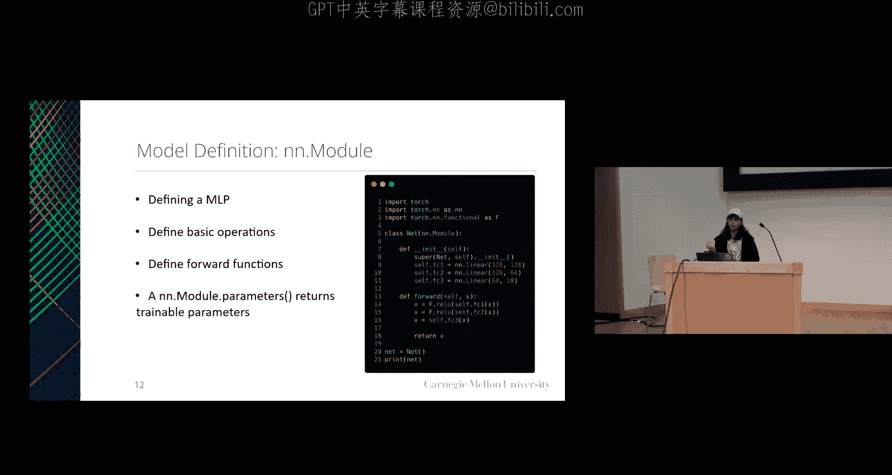

在PyTorch中，我们通过继承`torch.nn.Module`类来定义模型。
*   **初始化函数 (`__init__`)**： 初始化模型层和参数。
*   **前向函数 (`forward`)**： 定义数据从输入到输出的传播过程。

```python
import torch.nn as nn

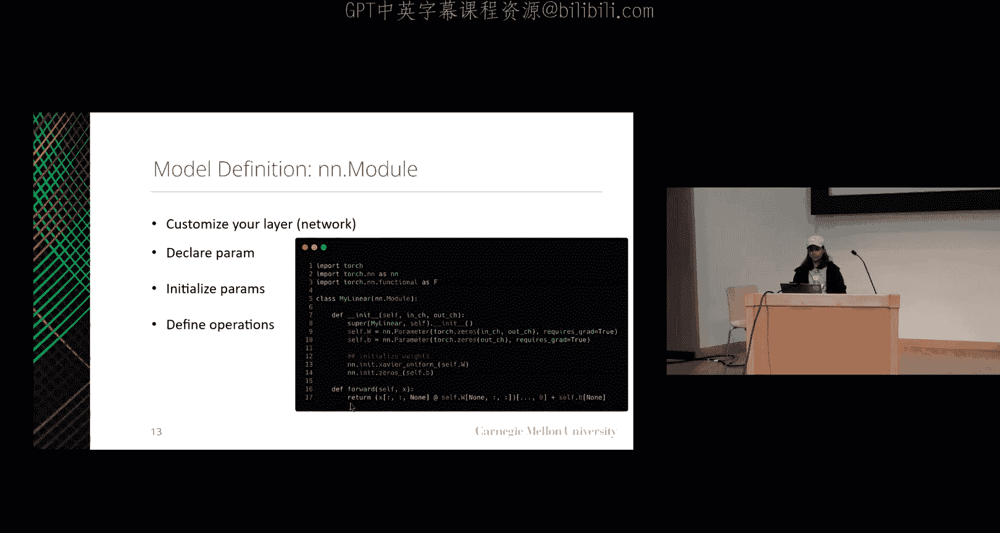

class SimpleNN(nn.Module):
    def __init__(self, input_size, hidden_size, output_size):
        super(SimpleNN, self).__init__()
        self.layer1 = nn.Linear(input_size, hidden_size)
        self.layer2 = nn.Linear(hidden_size, output_size)

    def forward(self, x):
        x = torch.relu(self.layer1(x))
        x = self.layer2(x)
        return x
```

### 训练模型

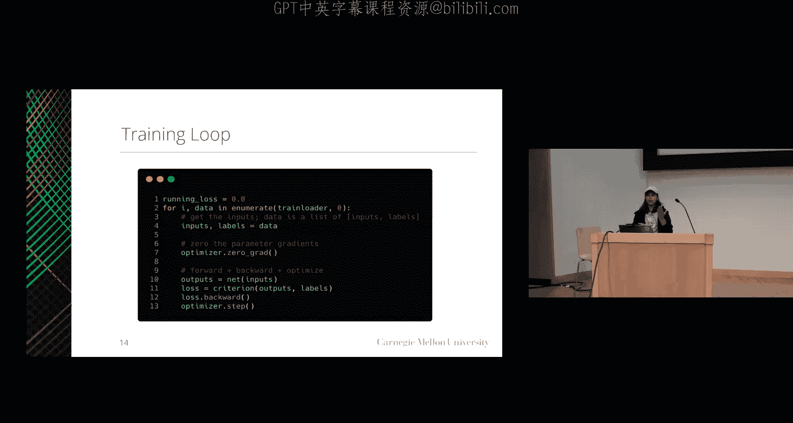

训练一个模型通常包含以下步骤：
1.  **数据加载器**： 使用`DataLoader`加载和批处理数据。
2.  **优化器**： 选择优化器（如`torch.optim.SGD`）来更新模型参数。
3.  **损失函数**： 选择损失函数（如`nn.CrossEntropyLoss`）来评估模型性能。
4.  **训练循环**： 在循环中进行前向传播、计算损失、反向传播和参数更新。

```python
model = SimpleNN(10, 5, 2)
criterion = nn.CrossEntropyLoss()
optimizer = torch.optim.SGD(model.parameters(), lr=0.01)

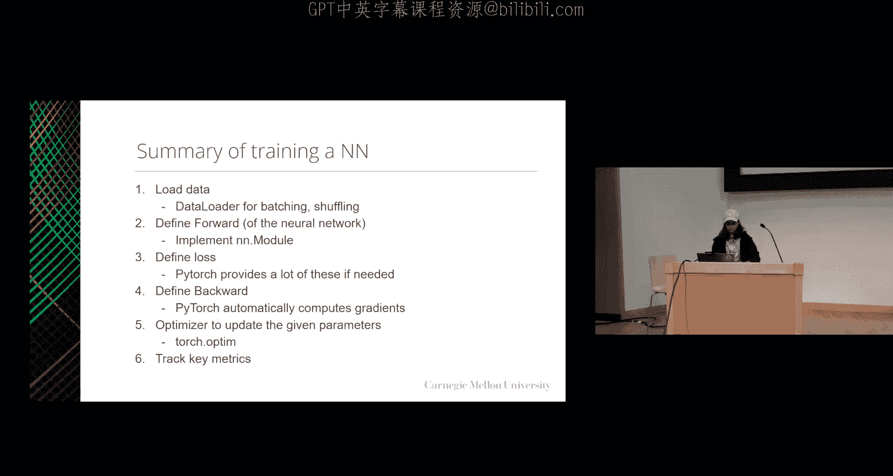

# 假设有数据加载器 `train_loader`
for epoch in range(num_epochs):
    for data, labels in train_loader:
        optimizer.zero_grad()
        outputs = model(data)
        loss = criterion(outputs, labels)
        loss.backward()
        optimizer.step()
```

## 总结

在本节课中，我们一起学习了卷积神经网络和循环神经网络的基本概念。CNN通过卷积核有效提取图像特征，适用于图像识别任务。RNN通过循环连接处理序列数据，适用于语言和视频分析。最后，我们介绍了PyTorch框架的基础，包括张量操作、模型定义和训练流程，为动手实现这些网络打下了基础。