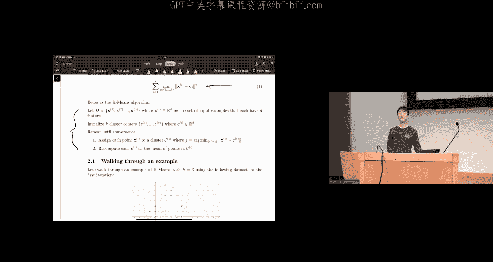
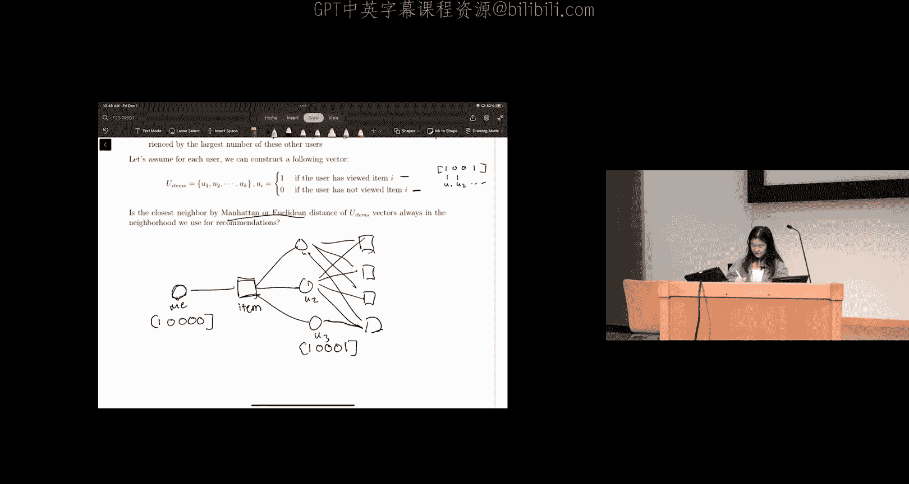
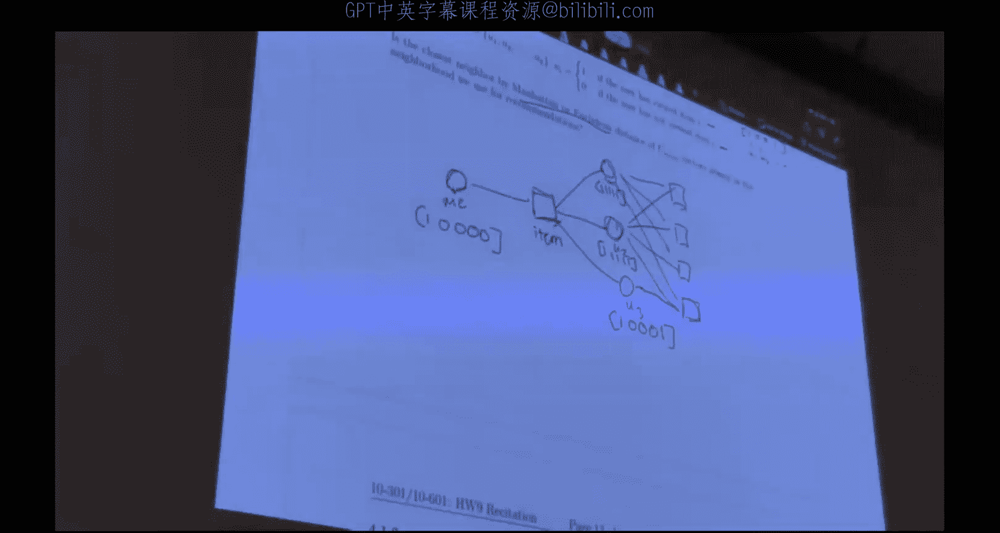
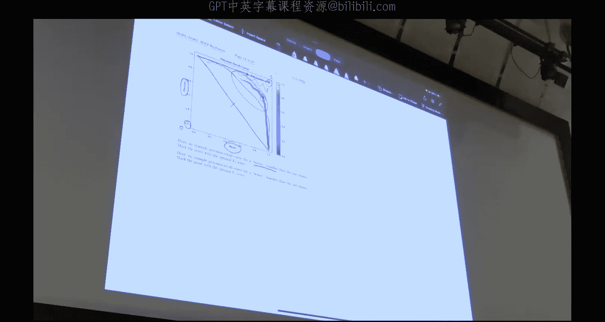

# 机器学习导论：HW9：核心概念复习教程 📚

在本节课中，我们将一起复习机器学习中的几个核心概念，包括主成分分析、K-means聚类、随机森林、AdaBoost、推荐系统以及模型评估指标。这些概念是理解更复杂机器学习模型和应用的基础。

## 1. 主成分分析 (PCA) 🔍

上一节我们介绍了降维的概念，本节中我们来看看主成分分析的具体实现。PCA的目标是将数据投影到更低维度，同时保留尽可能多的信息。

其核心方法是找到一个正交基作为数据的新坐标系，然后删除不重要的维度，使得保留的维度能最小化平方误差，从而重建原始数据。

以下是PCA的关键步骤：
*   找到一个正交基，即数据的新坐标系。
*   删除不重要的维度，使得保留的维度最小化平方误差。
*   重建原始数据。

在低维空间（例如二维）中，可以通过可视化找到主成分。而在高维空间（例如三维或更高）中，则需要使用数学方法来解决问题。

## 2. K-means 聚类 🧩

了解了无监督学习中的降维后，我们转向另一种无监督学习任务：聚类。K-means聚类算法用于将数据点划分为K个簇。

其核心目标是找到K个簇中心，并将每个数据点分配到最近的簇中心，通过迭代优化使簇内距离最小化。

以下是K-means算法的步骤：
*   初始化K个簇中心。
*   将每个数据点分配到最近的簇中心。
*   重新计算簇中心。
*   重复步骤2和3，直到簇中心不再变化。

例如，使用K-means算法将数据点划分为3个簇。可以初始化簇中心为(0,0)、(1,1)、(2,2)。然后将每个数据点分配到最近的簇中心，接着重新计算簇中心（取每个簇中所有数据点的平均值），并重复分配和更新步骤，直到簇中心稳定。

## 3. 随机森林 🌲

从单个模型过渡到模型组合，我们进入集成学习领域。随机森林是一种集成学习方法，通过组合多个决策树来提高预测性能。

其核心思想是利用“集体智慧”，通过构建多棵差异化的树并汇总结果，以降低过拟合风险并提升泛化能力。

以下是随机森林的构建方法：
*   使用随机抽样和特征随机化来训练多个决策树。
*   将每个决策树的预测结果进行聚合，以获得最终的预测结果。

例如，使用随机森林对数据集进行分类或回归。通过自助采样法抽取多个训练子集，并在每个节点分裂时随机选择部分特征，以此训练多棵决策树。最终通过投票（分类）或平均（回归）来聚合所有树的预测结果。

## 4. AdaBoost ⚡

另一种强大的集成学习方法是AdaBoost。它通过迭代地训练多个弱学习器，并调整数据权重，来逐步提高整体模型的预测性能。

其核心机制是关注之前被错误分类的样本，让后续的弱学习器更专注于这些难题。

以下是AdaBoost的工作流程：
*   使用权重方案来调整每个弱学习器的重要性。
*   使用权重方案来更新数据点的权重。
*   重复训练多个弱学习器，并更新权重方案。

例如，使用AdaBoost对数据集进行分类。初始时所有样本权重相同。在每一轮中，训练一个弱分类器，然后根据其错误率计算该分类器的权重（性能越好权重越高），并增加被错误分类样本的权重。最终预测时，所有弱分类器的结果按其权重进行加权投票。

## 5. 推荐系统 🎯

学习了预测模型后，我们来看一个重要的应用场景：推荐系统。它是一种用于向用户推荐相关项目的系统。

推荐系统主要依赖两种思想：利用群体的行为模式，或者分析内容和用户本身的特征。

以下是两种主流的推荐方法：
*   **协同过滤**：基于用户和项目的相似性来推荐项目。例如，因为用户A和用户B喜好相似，所以将用户B喜欢而A未看过的电影推荐给A。
*   **基于内容的过滤**：基于用户和项目的特征来推荐项目。例如，根据用户过去喜欢的新闻关键词，推荐具有类似关键词的新文章。

## 6. 精确率、召回率和 F1 分数 📊

最后，我们需要可靠的方法来评估模型性能。精确率、召回率和F1分数是评估分类模型，尤其是正负样本不平衡时的重要指标。

这三个指标从不同角度衡量模型识别正类样本的能力，并提供一个综合评分。

以下是这三个指标的定义：
*   **精确率**：预测为正类的样本中，实际为正类的比例。公式为：`精确率 = TP / (TP + FP)`。
*   **召回率**：实际为正类的样本中，预测为正类的比例。公式为：`召回率 = TP / (TP + FN)`。
*   **F1 分数**：精确率和召回率的调和平均，用于综合评估。公式为：`F1 = 2 * (精确率 * 召回率) / (精确率 + 召回率)`。

例如，在疾病筛查中，我们使用这些指标来评估模型的性能：高召回率意味着很少漏诊病人，而高精确率意味着诊断出的病人中误诊较少。F1分数则试图在两者间取得平衡。

---

本节课中我们一起学习了主成分分析、K-means聚类、随机森林、AdaBoost、推荐系统以及精确率、召回率和F1分数等机器学习核心概念。理解这些概念有助于我们构建、应用并评估有效的机器学习模型。