# CMU《深度学习系统｜CMU 10-414714 Deep Learning Systems 2022 fall》中英字幕 p01 -01-Lecture 1 - Introduction and Logistics.zh_en -BV1ERtYepEpy_p1-

Hi， everyone。And welcome to the first lecture of our online course on deep learning systems。

 algorithms and implementation。I'm Zika Colultter， I'm going to be giving this lecture。

But I'm teaching this course with my co instructor， Tiianchi Chen。

 who will be giving some of the later lectures。We're both faculty at Carnegie Mel University。

And we're also offering this course this fall at CMU。

But we're making all the material public as part of this online course。

This lecture is going to be a basic introduction to the topics of this course。

 as well as cover some of the logistics of the course。As such。

 it's going to be a bit different from other lectures while we're rushing to into detail about the methods。

 the math， the code， etc。This is really just a lecture with slides in it。

Butre to cover a bit about why this course might be of interest to you。

 why we think these are important topics to know about。

And also cover a bit of background on the logistics and setup of this course。Alright， so as I said。

 this lecture really has two parts。 The first part is about why you should study deep learning systems at all。

 why you might want to take this course。And the second will be more about the course info and logistics。

So let's jump right in and get started talking about why you might want to study deep learning systems。

Now the aim of this course is to provide you with an introduction to the functioning of modern deep learning systems。

And what that means is you're going to learn about how these things work internally。

You're going to learn about methods like automatic differentiation。

A number of basic neural network architectures。Optimization。

 as well as methods for efficient operations on systems like GPUs。

 this is how these modern deep learning systems actually are run efficiently on modern hardware。

To solidify your understanding。The main effort that you'll put in throughout this course。

Is that through the homeworks， you will develop the needle library。

Needle stands for the necessarys El of deep Learning。

And it's a deep learning library loosely similar to Pytorrch。

You're going to incrementally throughout your assignments。

Implement many common architectures and many of the aspects of this library， really from scratch。

So why should you do this， why might you want to study deep learning and why might you want to study deep learning systems？

Well，'ll start off with， let's answer the easier question first。

 why do you want to study or why might you want to study deep learning？Now。

 chances are if you're taking this course， you probably already like deep learning or at least know about deep learning and probably have a pretty good idea about why you might want to study deep learning。

But I will give a few quick examples anyway， many of which you've probably already seen。

 but it wouldn't really be a deep learning course if we didn't start off the first lecture with some cool pictures about the things that deep learning can currently do。

So maybe you heard about the famous Alex Ne architectureit， which was developed in 2012。

 which performed very， very well on the IageNe imageage classification challenge。

I need to highlight right off the bat， this is not a history of deep learning。

 nor is it assigning credit to any sort of first elements that first architectures of deep learning。

 that's an argument I did not want to get into， but this was a very。

 very famous architecture that really at least is as a field and as a technique in the public view。

Really did。Turn a corner on availability and power of deep learning by essentially building an architecture that could classify images into one of100 classes much better than standard computer vision techniques at the time。

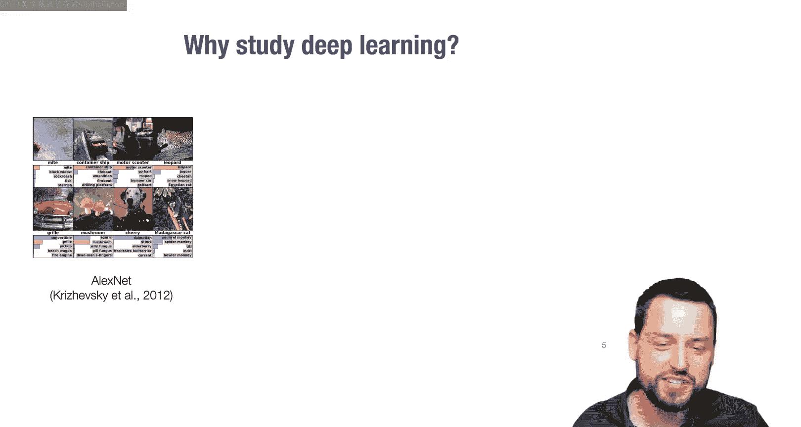

You probably also heard about the Algo system， which was developed in 2016。

And defeated not quite the world champion， I guess， or number one， but very， very highly ranked。

 essentially one of the world's best players at the game of Go。

Now the game of Go for a long time was viewed as a grand challenge for computer play of games。

Because the number of possible moves at each location is very。

 very large and standard techniques like those used in chess just weren't very applicable here。

But using techniques from deep learning， this team at Deep Mind was able to build a system that could defeat。

Essentially， at the time， one of the best players in the world and soon after。

 all the best human players in the world。Much， much faster than I think anyone in the field really expected it to happen。

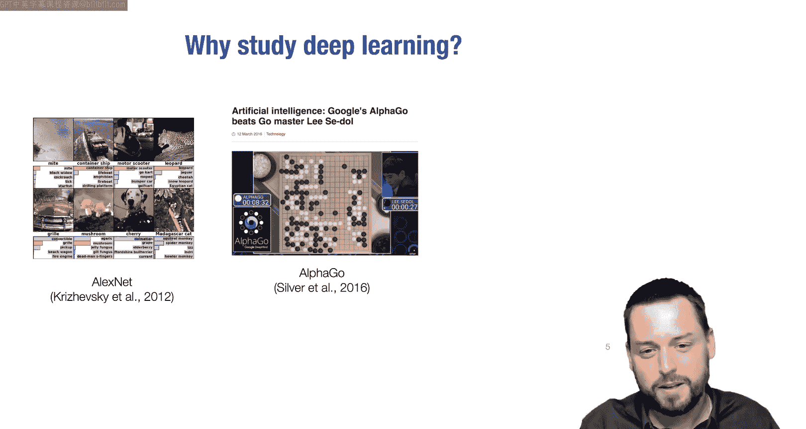

Maybe you've also heard or seen about images like these。

These are images of faces generated by the style GAN system。

And I know we're all used to seeing these things now。

 we're actually quite used to seeing faces that are not real。 we see them everywhere now。

 but I remember when this post was first made on Twitter。

 people were advertising this paper on Twitter and I thought people were joking I thought actually this was just a set of pictures from the training set that people were joking about and saying they were generated by the G by the adversarial network。

 but no they really were right these are actually fake images generated by this network and I think that we almost take it for granted now just how easy it is to generate pictures of fake people。

 which was a capability we did not have four or five years ago。😊。

A little bit more recent history now， you've likely heard about the GT3 system。

 this is a system built by open AI that can generate text。

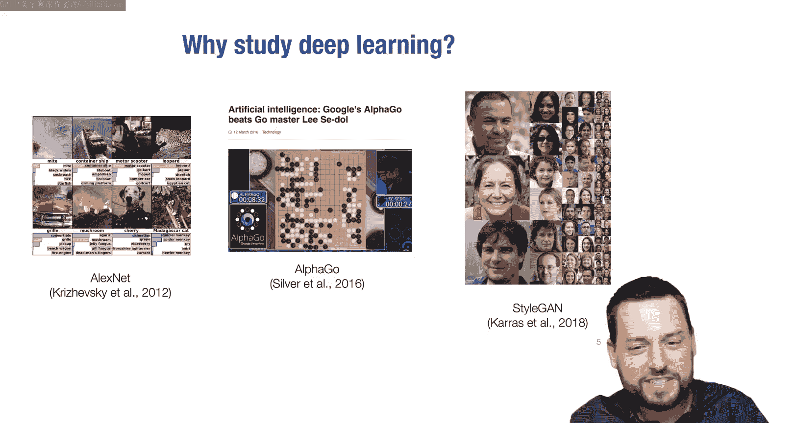

And the way it generates text is essentially writes text one word or one token at a time。

 so given all the previous tokens in a sentence。It predicts the next one。

 and then it adds appends that to the text and predicts the next one。

And from this very simple seeming process， we are nonetheless able to generate amazingly complex and coherent pieces of text just from essentially a deep learning system that's meant to predict really a distribution over next possible tokens in text and in fact here it hopefully is legible in video here。

 but this I actually asked G3 to write a。😊，Summary of this course and it spit out a very reasonable summary of a deep learning course In fact。

 it's actually a very bad summary of this course because its about says we're going to talk about the theory and the math and then we're going to cover unsupervised learning and reinforcement learning。

 but it would be a very good summary of a kind of generic deep learning course that would be offered that is offered in fact here and will be offered at many many universities。

😊，You've also probably seen Alpha fold and the Alpha fold 2 system。

 this is a system that predicts the 3D structure of proteins from their DNA sequence。This for a very。

 very long time has been a grand challenge in biology。

 understanding how DNA sequences form the 3D structure of proteins that actually carry out tasks in the body。

And for a very， very long time， this is a chart here of the progress and accuracy of these systems over many years at sort of a well known competition on this task of protein folding prediction。

And over the course of four years， this system， Al fold built by Deep mind。Again。

 was able to really produce a amazing scientific breakthrough in the quality and accuracy of this prediction。

 to the point where effectively you could argue that at least in some restricted cases。

 this problem is in fact， effectively solved。And finally。

 it wouldn't be 2022 if I didn't include a picture of。An image generated by a deep learning system。

This is a picture generated by the stable diffusion system。

 which actually was released like a week and a half ago， in fact。

 it was released on the same day we announced， we also posted the video announcing this public course。

 so they really stole our thunder here。Of course， this also relates to the work done by the Dolly2 system and going back for the Dolly system and many papers before then。

But。These systems are amazing and that they can take a text prompt and generate that probably no one has ever really thought of before and generate a very realistic painting in many cases or image in many cases that corresponds to that text so here I wrote the text prompt of a dog dressed as a university professor nervously preparing his first lecture of the semester 10 minutes before the start of class。

 I don't know why I would have thought of that thing you can imagine it yourself。😊。

And it was an oil painting on canvas and you see what the system generated was， well。

 it looks like a dog dressed as a university professor。Preparing a lecture。

 I guess 10 minutes before class， that part maybe is， is you know。

 evident in his expression and looks kind of like an oil painting。And this is just so amazing。

The capabilities have that we have in these systems。Now。

 one thing you may notice about all these examples I've given。

 except the very first one is that they are all done essentially at companies。

 not actually the last one， so stable diffusion actually is done at a relatively small company。

 but they still have a fair amount of resources that were behind this effort。

And the other point I want to make， though， is in case you're a little bit concerned saying， oh。

 you know all this stuff is just happening at big companies。

 what can one person or a small group of people really do to influence this？

I would first of all point to that first paper and disabled division paper actually is bookend examples of what a few people can do with the right methods and the right cleverness。

 but I want to highlight a few examples too， of smaller efforts that I think have still been amazingly impressive at shaping the field of deep learning。

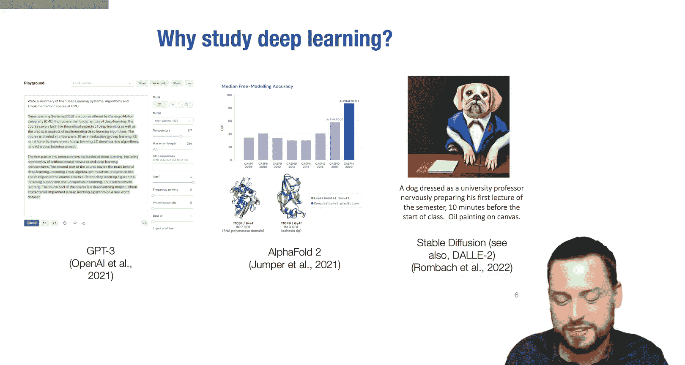

So the deolify work essentially done by two people is more or less or was。

 I believe still is more or less a state of the art technique for taking old pictures。

 old photographs in black and white， and creating color versions of these Now image colorization has been research as a topic for a long time。

 but this system really is an effort of a few people that ultimately achieves。

 I think the visually best version of this sort of task that I have seen from this then essentially by two people with very limited resources。

 at least in the initial versions。If you work in computer vision these days。

 you've probably heard of the Pytorrch image models or Tim Library。

This is essentially work by one person that wanted to implement a whole bunch of wisdom help now。

 but at least starting out one person， Ross Whiteman， who wanted to implement a whole lot of。

Deep learning image classification models。From many。

 many papers and test them all out on benchmark data and in many cases using pretrained weights from those papers or in many cases training them from scratch and this has started at least as a relatively small effort by。

By one person and has become really the dominant image classification library that we all use academically when we are building these vision systems。

And finally， I won't highlight these other ones， actually， because these， these， in fact， are。

 you know， community efforts。 But there's been many other examples of。Libraries， systems。Big。

 big sort of code endeavors that are essentially community driven and that they are for both libraries and frameworks that have been community driven that have really driven the field forward and I'll actually mention some of these again when I introduce briefly my co teacher in this course Tiianchi。

So all of this that I've talked about so far probably is not news to you。If you're watching this。

 you probably say yes， I get it， deep learning is great。

 that's why I'm taking this course that's why I'm listening to this video so far if you haven't skipped forward already。

But why should you learn about deep learning systems。

 why do you actually want to study deep learning systems， not just deep learning。

 but the actual architectures behind enable these systems。

And the way I'm going to motivate this is I'm going to show a chart here。

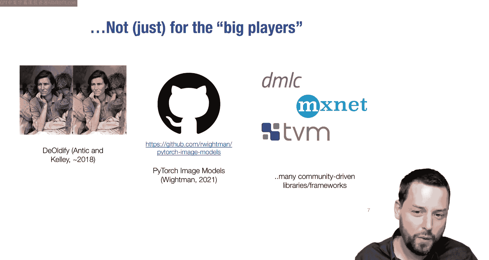

Of such a Google trends chart of the interest measured somehow in deep learning。

 the term deep learning over the past 15 years or so 14 years。

And I'm going to annotate this chart with a few events of note。So， in。The late 2000s。

This is actually when the field of deep learning， in some sense， took off academically。

 So I was going to conference zone at this time， and I remember at conferences like Ns this。😊。

Deep learning became a thing， a field where there was lots of papers in every year in the late 2000s。

But still， I mean， maybe this is always how academic work happens。 Still。

 there wasn't much as measured by Google trendsrens relative at the current day。

 there wasn't a whole lot of interest in deep learning。

 It was just sort of an academic trend like many others that you've probably not heard of because they were 15 years old and no one's using them anymore。

Then in 2012， as I mentioned， the AlexNet network was released， which again。

 this is not a history of the field of deep learning， and I' of course should also mentioned， I mean。

 though I should of course mention that the actual mathematics of deep learning and neural networks goes back well into the '80s and probably before then to the '70s。

This is just a sort of recent history， of course。 and again， I'm only annotating a few events。

 not trying to make claims about who was first to do what， etc cetera。

 It's a game I don't want to don't want to play it。

But the Alexnet was a very popular architecture yet still and little a little bit of uptick in interest and deep learning and you know not but still not too much happened。

 so you know state of the art performance on image classification and still not too much happened。

So then what happened？When did this start to really take off， Well。

 a few other things happened in the later years。 So in 2015 and 2016。

Some libraries like Caris and Tensorflowlow and Pytorrch were released。

And if you actually look at the timing of when deep learning became truly popular。

It coincides much more with the release of these libraries。

Then the actual sort of what we think of as some of the big notable papers or events in the field。

And so I kind of want to make the controversial， but maybe not that controversial claim that the single largest driver。

Of the widespread adoption of deep learning。Has been the creation。

Of what essentially amount to easy to use automatic differentiation libraries。

 that's a little bit too simplified of course。The， the actual deep learning systems。

 which we're going to talk about in this course， involve much more than automatic differentiation。

But this。Core technology， which again goes back to the 70s， not a new technology。

 but the wise but available and there were frameworks before that。 So before Ptorrch。

 there was torch， just not many people used it because you had to learn a whole new language called Lua to implement your models there so。

The availability of Python based frameworks。That lets you quickly prototype new architectures。

 new models。This， I think， was the single biggest driver of the explosion of interest in deep learning。

Now one thing you may also see from this chart is maybe you know we're in bad territory recently。

 maybe something's happening recently， I don't think it is。

 I think there's often issues with sort of the latest data in Google trendsren。But more than that。

 I think probably was also happening is that a lot of these things are just now falling under the umbrella of AI。

 which I will try to avoid that term I'll try to be specific about deep learning as much as possible。

 but probably love was happening because people were just using the term AI to talk about a lot of these things and not the term deep learning always。

So another way of sort of emphasizing this exact same point。 I'm actually going to。

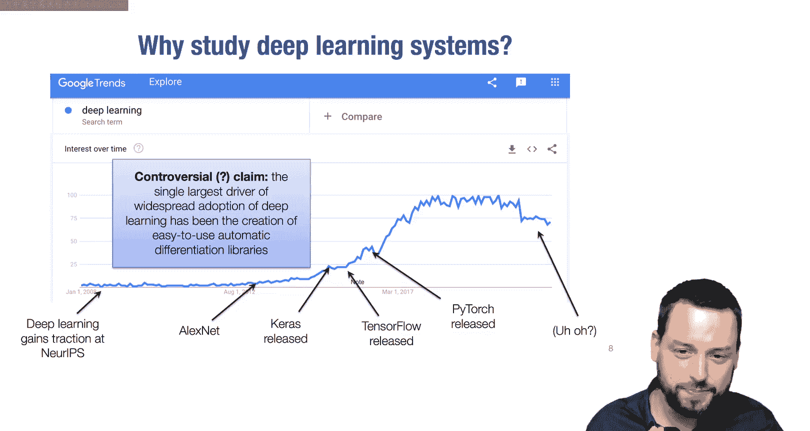

Reference a story from Tiianchi's work。And he， I actually was quite， I admit。

 I was quite late to the game when it came to deep learning。

Despite being around people that were using it some of the pioneers in the field。

 I actually didn't start working in deep learning until about 2015。

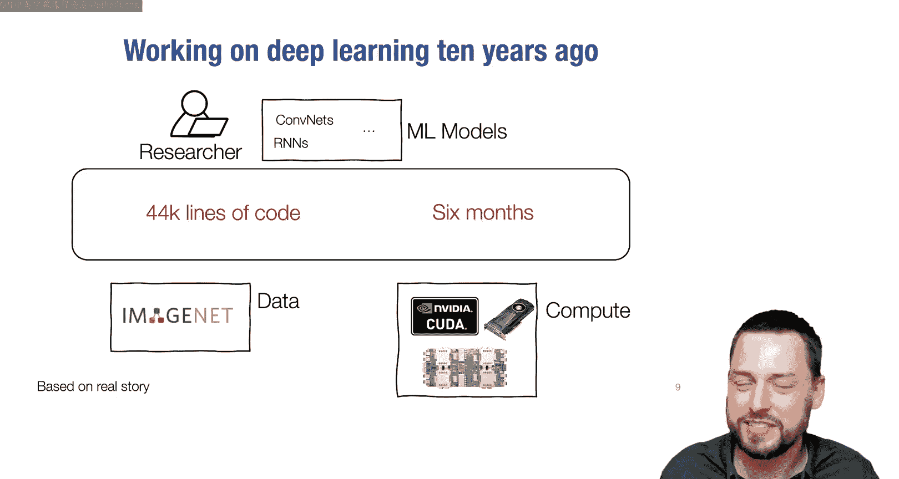

Maybe not surprisingly about when I could easily prototype stuff。

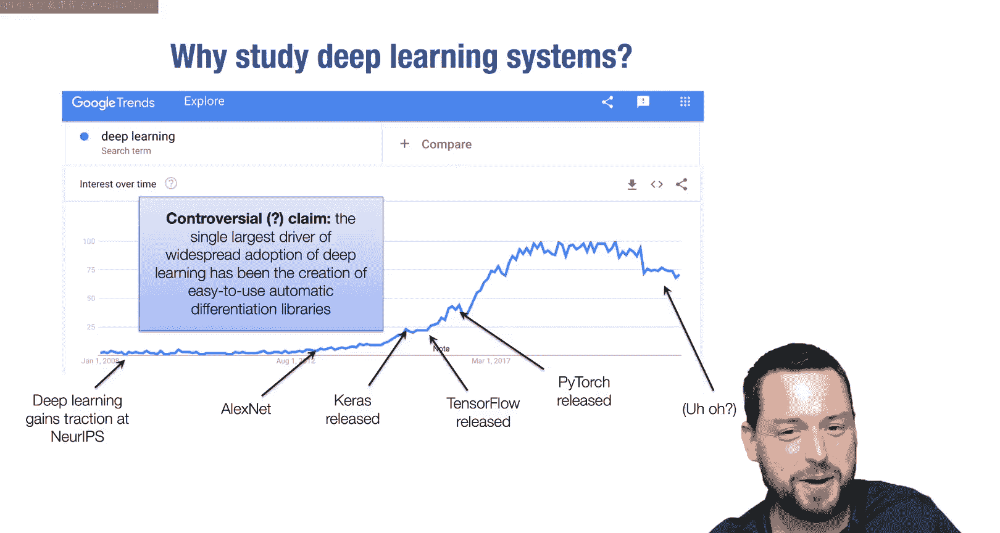

But Tiianchi， he was actually working on deep learning back in the day。

 back in 2012 when a lot these were first being developed。And in fact。

 one of his first projects as a PhD student was to write。

Code for convnets that would accelerate their development on GPUs。

 This is around the same time that Alexces was being developed。

 and so he was doing similar things at the time。And the figures he gives is that to implement。

Really a capable。Convolutional architecture for image classification on a data set like ImageNet at the time。

It took him about 44，000 lines of code and about six months of coding to do so。

 and I'll make this point later， but Tiianchi' is a really good coder。

 and it still took him this long to write a working deep learning architecture。

Contrast that with today。Today， if you want to do the same thing。

You would probably have to write about 100 lines of code。And you could probably do it in a few hours。

And the reason why is because of deep learning systems like Pytorch， like TensorFlow。

 and now like jacks。And I think we often don't fully appreciate just how much of an enabling factor it is to be able to iterate this quickly。

We think of deep learning models as being slow to train and slow to development。

 especially large ones， but this is amazingly fast。

We have an amazingly fast current iteration time enabled by these deep learning systems。

But this still doesn't answer the question that I set out to answer， which is。

 why should you take this course。 So maybe you agree now that deep learning systems are great。

Why don't you just use them right， You can just use， I'm sure you already do， right。

 you probably use Pytorrch and Tensorflowlow and jacks。Why should you take a course？

About how these systems actually work。And there， I actually think。

There are three reasons I'm going to give。For why this course might be right for you to take if youre interested in deep learning。

😡。

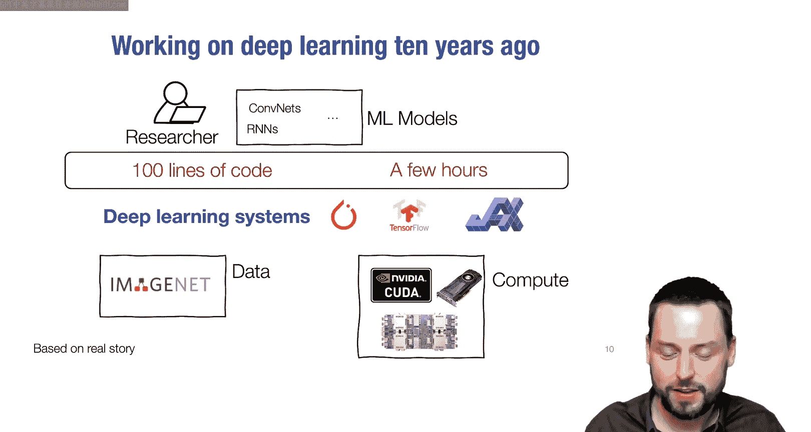

The first reason， of course， is。Maybe obviously， if you want to build deep learning systems。

 you better understand them。So。Despite the current state of deep learning libraries。

 where you may say that， okay， libraries like TensorFlow and Pyri kind of one。

 they're the standards everyone uses， it's actually not really true。

I think actually the field of deep learning systems is remarkably fluid。

As evidenced by the relatively recent emergence as Jack of Jacks as a dominant framework for a lot of research in deep learning。

 Its a relatively new things。 This has happened last couple of years。But I don't think。

We're done yet in some way， I think there's actually a lot of work to be done in developing new systems。

 maybe more specialized systems， maybe systems that specialize in some different different area or different paradigm for deep learning。

 but I don't think we're finished with what the final state of deep learning systems is going to look like and if you want to develop your own frameworks or build upon existing frameworks。

 and by the way， all the frameworks out there essentially are open source so you could definitely just download them the source currently and start contributing to it if you understand them。

If you want to do all that。Then this course and some practice will prepare you to do this。

So this is maybe the most obvious reason why you might want to take this course if you want to build and contribute to these libraries as well。

But。That's not the only reason。

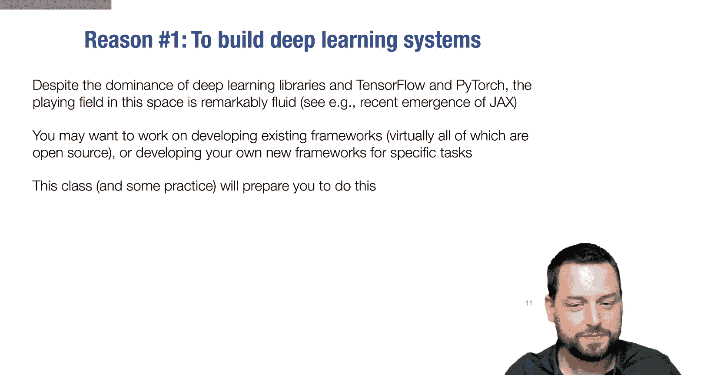

And the second reason fl this course is actually the one that I would emphasize most heavily for practitioners in the field。

And that reason is。Understanding。How the internals of deep learning systems work。

Lets you use them more efficiently and more effectively。

And I really do mean that right so if you want to build the scalable models， efficient models。

 models that execute quickly or that make full utilization of a GPU。

 you really do want to understand how these systems are working underneath the hood。

 what is really being executed， how are they translating your high level description of a network architecture to something that really executes on hardware。

And then。Trains and differentiates that system and adjust parameters and all that。

 How does that work and understanding how that works will actually enable you to write more efficient and more effective code。

And this is especially true if you're doing research in deep learning。

 so especially if you are doing things like developing new kinds of layers， new architectures。

 new structures and deep learning。This will be vastly improved if you understand。

The logic and the mechanisms behind these systems。I've always kind of referred to understanding deep learning systems as a kind of superpower that can let you accomplish your research aims。

Even if your research aims are not about system building can enable you to accomplish them much more efficiently。

This is probably the main reason why most of you。I think can and should take this course。

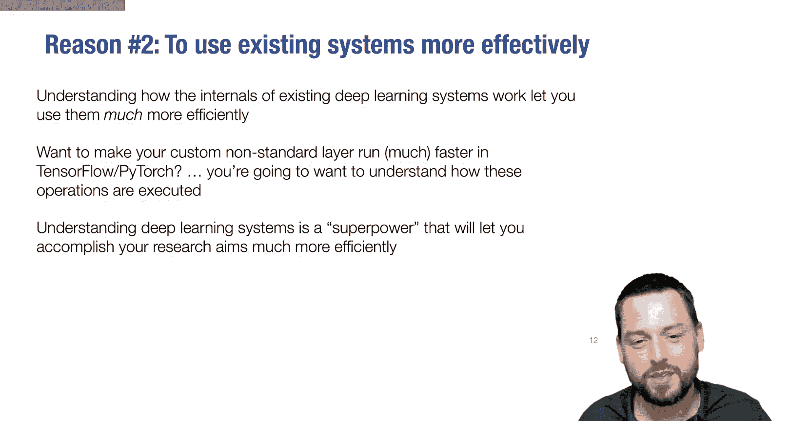

But I would be remiss if I didn't add one more reason to this pile。

Which is that deep learning systems are really， really cool。

And the reason why these systems are so much fun。Is actually very simple。And that is。

That despite the seeming complexity of these things。

Pythors and Tensorflowlow at this point are millions of lines of code。

But despite the seeming complexity of these libraries。

The core underlying algorithms behind deep learning systems。

 behind quite capable deep learning systems， to be honest。Are extremely， extremely simple。Really。

 the core algorithms behind。Every single deep learning architecture。

 every single all those advances in machine learning models that you saw that I put up on those previous screens。

At least algorithmically， they're all essentially based upon automatic differentiation and gradient based optimization。

 at least from a mathematical standpoint， right， Those are the。

Two or a handful of algorithms that actually underlie all of this。

And then on the implementation side。Essentially they are built upon efficient linear algebra。

 especially efficient matrix multiplies on GPU systems。Unlike。Say an operating system。

 where if you want to build an operating system， you really have to build quite a bit of code。

You have to write a lot of code。嗯。And so courses on operating systems that take you through operating usually build a very。

 very basic one。 and you have to write even for that， you to write a lot of codes。

 do anything at all reasonable。But you actually can write and you will write a reasonable deep learning library。

 if you want to be really compact with your code， you could probably do it in less than 2000 lines of code。

Something that will run on a GPU that will do automatic differentiation that will have operations like convolutions and convolutional networks。

 recurrent networks， transformers， all this kind of thing， right。

 You can do it in almost no code because the actual ideas underlying these systems are simple。And。

They're also， and I say this， you know， a little bit tongue and cheek。

 but they're also kind of magical。Before I worked in deep learning。

 I sort of was brought up in traditional machine learning when we derived all our gradients by hand。

 and that was the big effort you went through when you derived some new model as you wrote out a bunch of gradients by hand。

I remember the first time I built an I advantage library。

 and I realized that I could take form some complex expression。Take its gradient。

And then form an even more complex expression of its gradient。And differentiate through that thing。

And do all that， despite the fact that I actually would really struggle to even derive that by handmp。

I mean， I probably could do it， but it would take me quite a while to drive this manually。

 yet I could write some code that did it。This is really， really cool and his experience。

 I think everyone working in deep learning should have。All right， so with all that being said。

 let me give a little bit more now boring information about this course and the logistics of this course。

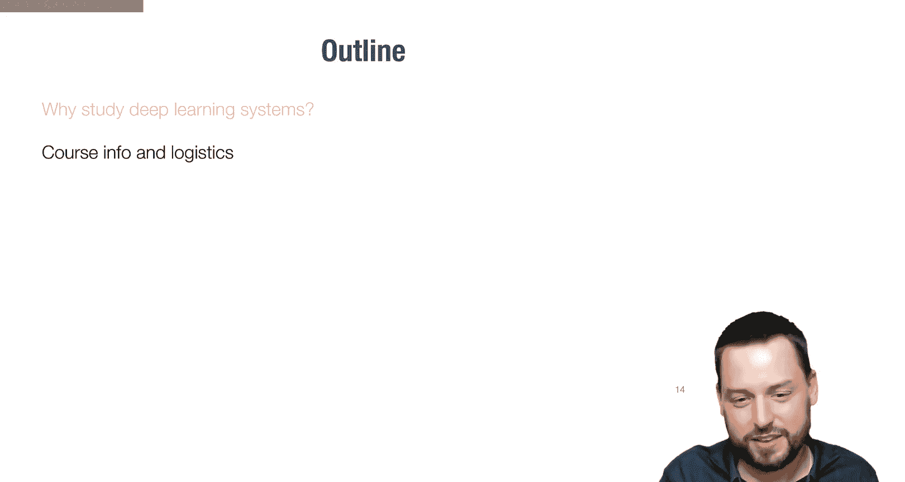

First up。To introduce myself and my coinor， Tiianchi。I am a faculty member at Carnegie Mellon。

 I've been there since 2012。But in addition to working in industry or at CMU。

 I've also done a fair amount of work in industry， so I was previously at a company called C3 AI now I work I'm a chief scientist in AI research at Bosch and the Bosch Center for AI。

And my research in academics focuses on a lot of techniques for new algorithms and new methods now in deep learning。

So I've done a lot of work on adversarial robustness， done a lot of work。

 especially certified and provable defenses against adversarial attacks。

Also done a lot of work in in what we call implicit layers。 These are layers that， instead of just。

Being formed by some sort of stacking of traditional operations。

You form them by actually solving a more complex operator like an optimization problem or like a fixed point equation。

And you actually differentiate those analytically。 In fact， we'll corner the current schedule。

 at least if there is time， we will have a lecture on implicit layers at the very end of this course。

 implemented， of course， in our own framework。I was also an early pieytorrch adopter and one of my marks of pride。

 I don't I'm going to quickly sort of not hold a candle to the systems work Tiianchi has done。

 and I'm about to show in a second。But myself in my group。

 we were early Pythforch adopters we were actually mentioned as the first group releasing。

Third party library is for Pytorrch。And one of my claims to fame there is that as part of our efforts to release an optimization layer。

 this was a， a third party library that would solve optimization problems as a layer in a deep networks。

 like quadratic programs， if you know what those are。And to do so。

 I wrote a Kuta kernel as part of Pytorrch that could do batch parallel solving of multiple linear systems as one step of our optimization solver。

And the real claim to fame there， of course， is that in doing so。

I messed up or rather I didn't I wouldn't standardize somehow the matrix str that Pytorch assumes coming out of its kuta kernels。

 And I introduced a bug in Pytorrch's linear solver that I think persisted for like a year after that。

 that just everyone was so confused about why this linear solver would is randomly crash at times。

 So' that's my claim to fame， I guess， sadly， about deep learning systems。

Now the other instructor is a bit different， so Satianchi Chn is also a faculty member at CMU and also addition to this has a foot in industry so he was the cofounder of the Octo MLL Company。

 which is accompanied and' a lot of support and development for the TVM Library。😊。

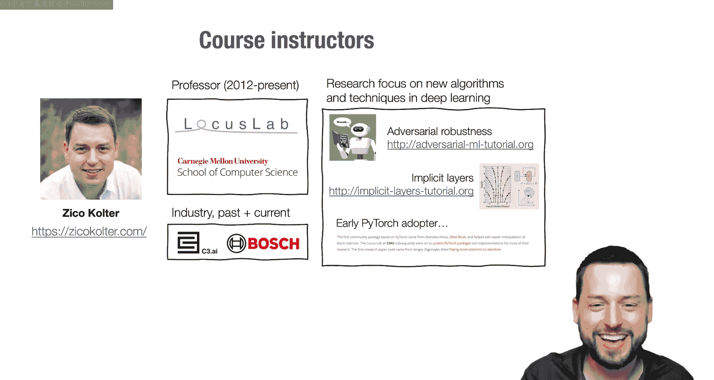

But the real claim to fame is the following so I've。You。

 I'm giving this lecture so I can suitably embarrass Tanji a little bit in our。

 in our introduction hereem for a long time， I sort of the the standard story I will give about。

About him is that in deep learning systems or machine learning systems as a whole。

 there really are three big players in this field right there is there is Google， of course。

 releasing Tensorflowlow， jacks and many of other libraries。

 there's Facebook of course from Pytorrch， but also things like it like profits at Time series library and then there's Tiianchi so Tiianchi has been he was the original developer of XG boost。

 one of the most frequently used libraries for gradient boosting and still one of the most widely used libraries for tiular data。

He was a lead developer for the MXN Library， which was another deep learning framework like Pytorrch and TensorFlow。

 and then most recently one of the founding developers and core developers of the Apache TVM Library。

 and so he has done kind of an amazing number of things in machine learning systems as a whole and actually quite quite excited to be able to teach this course with him。

So before now I jump into the details of this course and these lectures。

 I want to offer a big disclaimer。

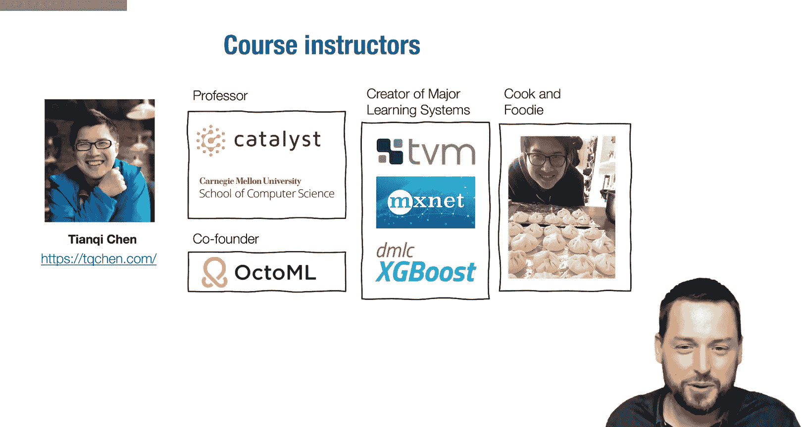

Which I think needs to be said here and what I'm saying here is that we are offering this course online for the first time we have not done this before。

😊，And a lot of the material。Especially the assignments。

 which is the most complex part of this course。Is being revamped from the previous version。

 actually being revamped even for the CMU version， and then you know that will be they kind of beta testing this and then you'll be given the assignment soon after that。

But。As par for the course here， there aret par of。No pun intended， but as par for the course。

 there are going to be bugs in the content and the assignments。

Or just in the logistics of how we run things right this is the first time we're offering this is an online course。

 there are going to be bugs， there are going to be hiccups。Please bear with us。

 There's a saying that you get what you pay for right And and this course is free。

 It's free because we want people to be taking it and want this material to be out there。

 But we are doing this ourselves and we are putting it together ourselves and and there will be bugs in it。

 So， so we apologize kind of ahead of time for this。 Please bear with us。

 We will do our best to fix these things and extend deadlines as needed to account for these bugs。

 but they will be there。 and we we appreciate you are all beta testers for this course as we create it。

 So， so part of the fun of taking an online course to be for the first time is that you become a beta tester for for the course。

😊。

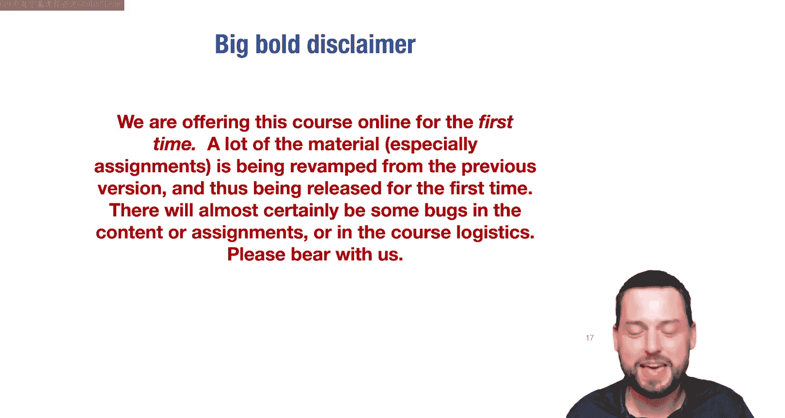

All right， now。Learning objectives。 What are you going to learn in this course。

 I've probably made this clear from from past slides。

 but let me lay it out just in very hopefully clear terms here。

If if you stay through this whole course， do all the assignments and do a final project。

 then by the end of this course， you will understand the basic functioning of modern deep learning libraries。

 including concepts like automatic differentiation and grade based optimization from an algorithmic standpoint。

You will be able to implement。Really from scratch， right。

 because we're talking about implementing these you know without pytorrch or without Tensorflow behind you。

 but just really just from raw Python。You'll be able to implement several standard deep learning architectures。

 things like MLPs， Kfnets， RNNs， or LSTMs， various kinds of RNs。

 and the transformers and do it truly from scratch。

And you will also understand and implement how hardware acceleration works under the hood。

And be able to develop your own highly efficient code。Now， it's not going to be。

 I should emphasize it's not going to be nearly deficient as libraries like Pytorrch or Tensorflowlow。

 There is still a big gap between the very best that optimization can do and the the code optimization can do。

 I should should emphasize And what you can do those liness of code。No question。

 so we're not going to break any speed records here。

But you will be able to create libraries that work on reasonable medium sized data data like CFR。

 right， reasonably sized networks and architectures， you'll be able to develop them。W。

 medium size architecture that actually work for these systems and do it entirely from scratch on GPU with automatic ver with nice optimizers。

 all that。

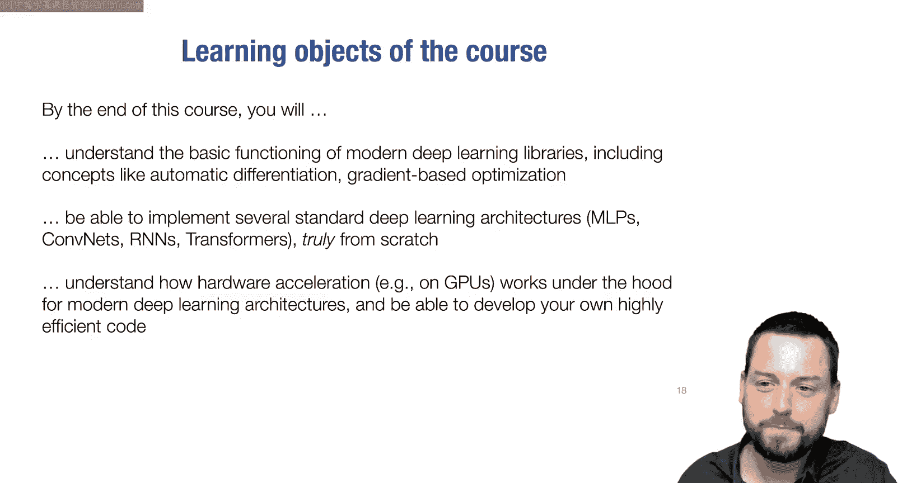

Now。The course website， which is Dl ciysCourse。org。

Has all this information and will have a listing and also posting of all the lectures for the course。

And you can look at the schedule of topics to see what you'll be learning there Now。

 one thing to emphasizes that that schedule， at least the schedule here that I'm listening is the schedule for the CMU version。

 which is about two weeks ahead of the online version。

 but we will also post the dates and the videos for all the online lectures as they become available and it will follow the same structure as the main CMU course。

 actually only this lecture has slightly different slides because there's different logistics for the online course versus the CMU course。

But the rest of the schedule will follow the same schedule between。

The CMU version of the course and the online course and the schedule is up on the website。

 it talks about things like。Covering an ML refresher and background onmic differentiation。

Different types of architectures， et cetera。Now one thing you will see is a lot of the lectures are broken down between algorithm lectures。

 so lectures covering kind of the methodological。ethological algorithms or techniques used to solve some to accomplish some task and deep learning。

 and then implementation lectures where we will actually implement some portions of this or walk you through some simple live coding of how these things actually are done in practice。

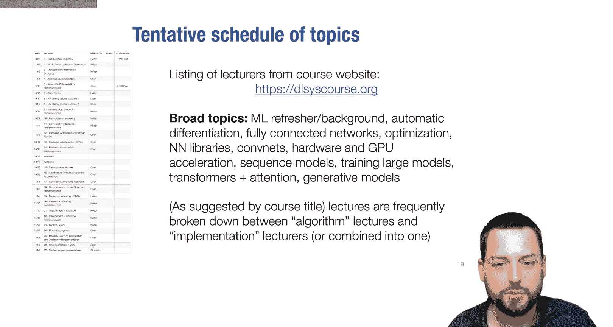

Now， in order to take this course。What should you know ahead of time？And。To be honest about this。

 there is some reasonable prerequisites you should have here in order to get the most out of this course。

😡，That's not to say that if you don't have all these things。

 the course is impossible if you're really excited about it and want to learn some of these things。

Concurrently as to go through the course， you are welcome to just know that it will be more effort to do so。

But to take this course， you should have some background in systems programming。

 that means physically， you know。C++ coding， how to compile things。

 how to compile things not just run Python scripts。

 but actually compile executable code that sort of runs natively on hardware。Lininear algebra。

 So you should be familiar with。Vectctor and matrix notation so we're going there's no math I mentioned in this lecture。

 but later lectures will actually require you know I will write things like a bunch of matrices and vectors multipied against each other I will do things like take gradients or derivatives of these things and you should know what that means。

That means also and probably the biggest requirement really is linear algebra。

 but there's other things to like calculus really to be clear just taking derivatives。

 we don't really do any integrals there's some integrals in probability I guess。

 but we don't do any integrals in deep learning， but you should know when when I write things like gradient symbols and stuff like that。

 you should know what these things mean or have some understanding of it。

 we can provide some links to refreshers or background material on this。

 but is never if this is really brand new to you， this could be somewhat challenging to become familiar with。

As well as sort of basic proofs now we're not going to do many proofs in this course to be very clear。

 it's really a systems course， but you should be familiar with sort of the basic constructs of how you go about deriving things mathematically。

 like how do you derive a gradient and stuff like this？

You need some Python and C++ development background。

And a common question is asked is how much C++ background do you need？TheThe answer is。

I don't think that much。 We're not using any advanced features of C++ or anything。

 We're not even using C++， it's certainly not c+ 20 and not even c++ 11 or like that。

 I don't even know if that's the right year to be to be honest。 I don't know those things very well。

 We're not using unique pointers or anything like that。

 it's really just see with a few classes in addition So IC this is actually very minimal C or C+ experience but what you should know how to do is if we give you a template for writing a matrix multiplication call in C+ so that the template would take in a bunch of float pointers and float pointers and stuff like that the sizes of these matrices。

 things like this where those pointers point to the raw underlying data in the matrix in the matrices。

 you should know how to write quickly matrix multiplication routine that would multiply these two matrices together and then。

😊，Most importantly， because this will happen when you mess up your indexing in C++ because there's no safe indexing there and you have a SeG fault of your program。

 you should know how to debug it either through a debugger or if you're like me then through at least at the very at least through printf statements that this is how I debug honestly C++ code。

 but you should know how to fix things when you' codes Seg faults。

Right so that's kind of the level of C++ background you need。

 Python you should probably be familiar with classes and such in Python too because you will be implementing most of the structure of this library in Python and that you have to be familiar with。

 but C C++ is really sort of for the low level background You don't need to know who to programming ahead of time we will cover what you need to know for the course。

 but you need to understand basic C++ programming。And then finally。

 you do need to have prior experience with machine learning。

 if all of this if machine learning is really new to you。

 you're much better off taking a machine learning course first and then taking this course afterwards。

 you will get much， much more out of this if you're already familiar with machine learning and probably already familiar with deep learning to a large degree and then take this course to understand more how these things actually work。

So if you are unsure about your background， then what I would say is take a look at the first three lectures。

 I guess not including this one， the next three， and look at homework zero。

 which is going to be released two days after we officially start the class。

This homework0 is essentially meant to be a refresher on some basic ideas of sort of traditional ways of running things。

 we basically you will implement softmax regression and a simple two- layerer neural network and you should be familiar with a a two layer neural network using kind of manual backpro and you should be familiar with that。

 you should have seen this before and maybe with a bit of refresher。

 be able to do that relatively quickly to know this courses right for you so if if and one of these you actually will also write and see with a C++ backend。

 but if that is very challenging for you then probably should take some other material before you take this course but if all those things are straightforward or really can be made more straightforward again if you brush up a little bit then this course is likely the right level for you。

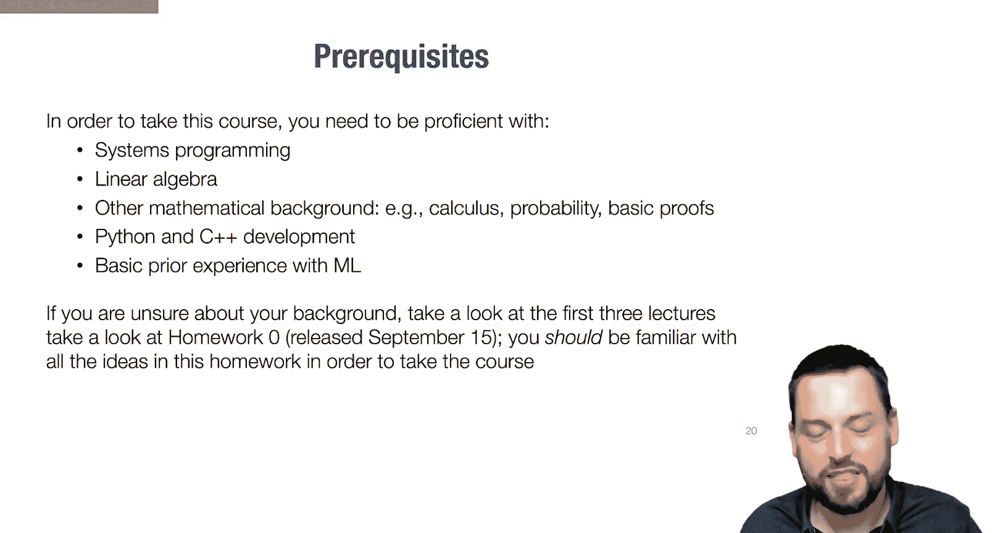

Now there are four main elements to this course， the video lectures of which you are watching the first one。

Programming based homeworks， a final project done in groups and interaction in the course forum。

And it's important to take part in all of these in order to get the full value of the course。

 I really think that each of these components plays a crucial。

 crucial role in really understanding the material， even if， for example。

 lectures are not directly using the homework， they're still very important to know and。😊。

Even if the forum is， in some sense optional， it's very valuable to sort of get interaction with other students taking the course in order to get the most out of it possible。

I do want to emphasize that this this online public course is offered really independently of the CMU version so we can't offer CMU credit or things like this for taking this course。

 even if you pass and do well in the course， but what we will do is for everyone in the course who completes the assignments gets an average of 80% or higher and submits a final project。

 you'll receive a certificate of completion for the course to sort of。Indicate you've completed it。

 we'll somehow make it official to probably post it on the website or something so you can have an official link to it and things like that。

 but you will receive a certificate completion for personalized toU that in some sense certifies you've taken and completed this course。

 even in an online， even just in some sense in the online public version because it is a lot of effort and we do want to ensure that you have some of the show and some sort of record that you've completed this and done it successfully。

Now， I'll end by just describing each of these a little bit in know each of these four elements in a bit more detail here。

 So the video lectures themselves are going to be essentially in the format you're watching right now so they will be they will be。

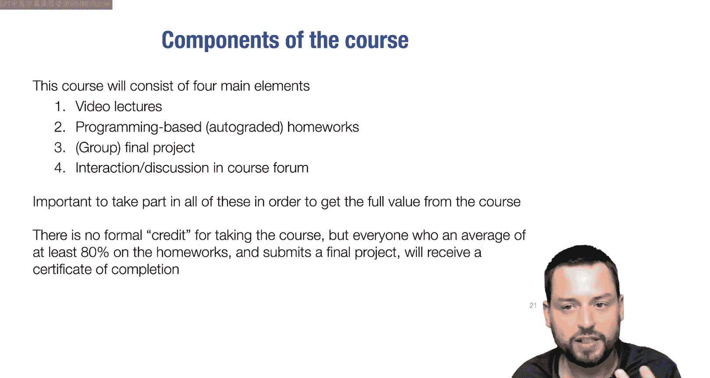

Live recordings of the lecture， they will consist of slide presentations like this one。

 but most won't just be this。 I think this is the only lecture that is just nothing but slides。

 the rest will all also have things like mathematical notes to them derivations and in many cases。

 live coding to illustrate some ideas videos for all the lectures will be posted to YouTube or other video sites we're going try to make them available on video sites so that they can be accessed globally according to the course schedule and videos will be available to everyone So because they're on YouTube。

 anyone can watch them so you can actually watch without officially enrolling in the course many of you probably are watching without officially enrolling in the course。

They don't require register for the course。One thing I will mention。

 which you can probably tell from this if you've made it this far through the lecture so far。

 is that these these lectures are taken in one take。 we're not doing a lot of editing here。Essential。

 we are recording these live and we will with minimal cutting at the beginning at the end or if something really goes bad cropping in the middle we're mostly going do these in one take and with all the hiccups and such to happen in a real lecture。

 So this is sort of a online version but still kind of。Live stream。

 think of them as live streams of lectures。

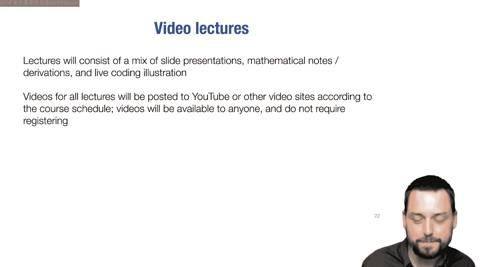

The second component that I mentioned was programming assignments and this is actually if I was just say this is probably the most important component of the class。

 so it isn't a homework zero， which is kind of a separate a separate thing in and of itself。

 there are four homeworks， homeworks one through four and these four homeworks。

Take you through the process of building different aspects of this needle library。

 this minimal Python。Deep learning framework。And in particular。

 if you're going to first develop an automatic differentiation framework for needle。

 then you will use this to build a simple neural network library with things like。

Moduuleles for neural networks， optimization techniques， data loading， that kind of stuff。

You will then implement。Linear algebra backends on both CPUs and GPU systems。 And finally。

 you'll use these things， implement a number of in the fourth assignment， a number of。

Common architectures， like con networks or current networks and possibly transformers。嗯。

Each of these assignments builds on previous ones， and you actually have to complete them in order。

 you have to complete the first assignment before you can do later ones because they build on each other。

And this process of building this library really is the key component of the course。

 and it is how you will learn the most through it。So you， you。Anyone can watch the lecture videos。

 but in order to submit the assignments， you do need to officially sign up for the course so you have to actually register for the course。

 So if you're watching this video just on YouTube and have not signed up for the course yet if you want to submit the assignments。

 which is really the way you learn this material， then you set up for the course and you will get an account to submit assignments to our auto grading setup。

Now， one thing I want to mention is that the。Homeworks are entirely coding based。

There's no derivations， nothing like this in the homeworks， or whatever deviationrivation we have。

 it's sort of implicit because then you have to code it up afterwards to know if it actually works or not。

The homeworks are entirely codingd based and they're all auto graded。

 this is actually true for the CM version2， this is the exact same in the CM version of the course。

 everything there's no theory questions on the homework。

 it is just program assignments all code based。😊，And it's graded through our own auto grading system that I've actually been developing for a few years。

And this autograding system works a bit differently from others you might have seen。

 I'll document this a lot in a future lecture actually a separate video about the autograding system I'll post soon after this one I'll run the process of submitting code to this autograr the big difference that I'll just highlight right now is in this autograder。

 you actually run all your code locally rather than submitting like your code and having it run on the autograr。

 which causes offers or problems because the environment and the autograr is never the same as the one you've coded on locally。

 so we you actually run all your sketch locally and you only submit answers the answers and check against reference solutions in the autograding system which makes it much more efficient much faster to run as well as sort of makes it a little bit less painful in terms of debugging like environment setups So I'll go through that in a second in a later lecture It also means that essentially running in code。

😊，Enviments at least currently， I know coab's changing monthly。

 so we may run into some issues with hiccups to collab， but。

At least currently you can do all the assignments in coLab and submit them。

 execute them all in coLab and do all the auto grading and use that and as I said I will go through that the setup and at least the desired workflow for how you should do assignments I'll go through that in a separate video in a few。

😊，Probably post is actually concurrently with this one， but few more in a few days。

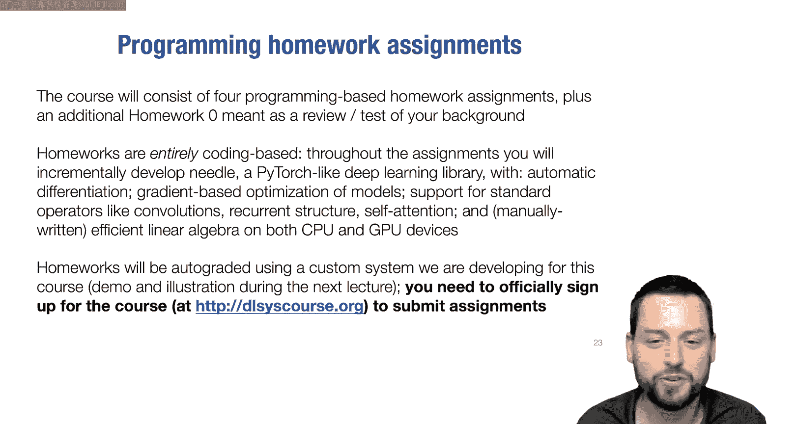

Alright， the second to last component is the final project， so in addition to Homes。

 there will be a final project and unlike the homeworks which are to be done individually。

The final project can be should be done in groups， so you will form groups that will be posting in the forums to form groups as the time comes done in groups of three。

 especially for the online course， if you want to find a group of one or if you find bigger groups that it's certainly find the point is is to form a group and do a final project。

 And the idea here is the final project involved developing some new piece of functionality for needle。

 So it's like kind of homework 5 designing homework 5 right Well。

 to be clear it's homework 0 and homework 4 or the homework。 So your final is like homework 5。

 you develop some new。😊，Functionality capability to the needle framework。

 It's really important though that this final project involves some kind of extension to needle。

 not just implementing some architecture。 and certainly not just implementing an architecture in Pyth worth Chsorflow。

 You can't just do that as a final project。 It really has to be an extension of the needle library。

 Add a different kind of hardware acceleration to the back end。 know。

 our GPU work is going work on on Kuta using Kuta libraries。

 So you could do one that uses open C or maybe optimizes for the M1 Apple chip stuff like this。

 right， all these things are possible， or maybe you do sort of hardware a fued。😊。

Optimization for fused operators and things like this is are all potential projects will also post a few more possibilities。

 but the idea is that you want to do some extension of needle as your final project。

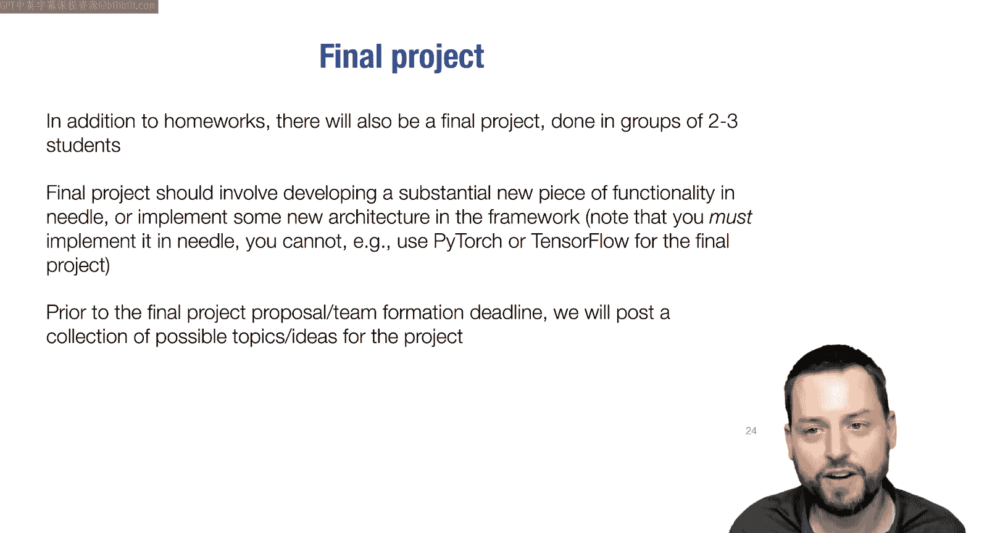

And finally， the last thing is the course forum so for those the of the course and actually again。

 this part requires you to actually enroll in the course， when you enroll in the course。

 you will soon thereafter get an invitation to join the class forum。

Where you can log in after this class watching this lecture if you haven't done so yet。

And you should use this course forum essentially as a resource to discuss and talk about the aspects of the course。

You can and should ask for help， for example， with assignments in the forum。

 we won't be able to answer all questions we， the instructors and the Ts won't be able to answer all of them just due to sort of availability。

 but but please do upvote questions that you find important and relevant that you are struggling with maybe and we will try to answer the most upvoted or the most liked questions to be sure that they're not sort of widespread issues that everyone's encountering but then also please do help by answering questions from other students we want to form somewhat of community around this course here so please do not just post questions but also see if you can answer questions from other students the more you're able to do that the more everyone kind of benefits。

You can ask for help and that does include income cases post and code。

 but please we have further let just say further instructions are posted in the main welcome message in the forum。

 but we do have some sort of formal rules， but the reality is you can do things like postcode and stuff and you can even share small amounts of code but please be reasonable don't just。

Verbatim share entire solutions on the course forum you get the most out of this course by implementing the assignments yourselves and if you post your code then that you makes other people not able to have that experience where they just then end up copying the code and not writing it themselves and so be reasonable when it comes to what you post in the forums。

 you can absolutely share code and share at least snippets of code and things like this again it's an online course so you know。

You could in some sense， do whatever you want， but at least in the public forum， please， please be。

 please do be。sortrt of reasonable in terms of not trying to give away content for people that would rather not sort of see full solutions posted for the for the assignments。

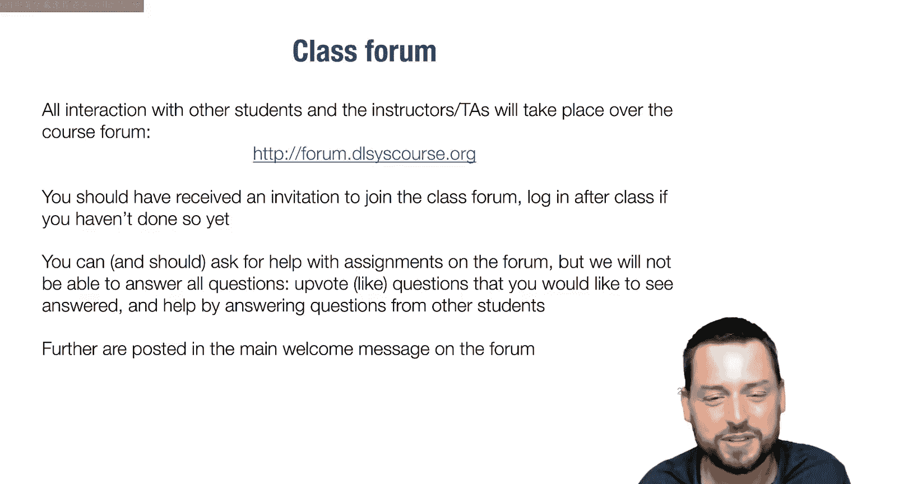

All right。With that， I'm ending the first lecture here。Withhi a few parting words。

 so we're really excited to be able to offer this course publicly and we really look forward to having you in the course。

And if you do have feedback or comments from us for us。

 please let us know now it may not be possible to make changes during's offering。

But we really we were making this course public because we want it to be a resource for those that are interested in deep learning systems or just interested in deep learning as a whole。

If you can give us feedback， they can help us improve。At that mission， we appreciate it。

So we look forward to having in the course as I said I promise the next lecture is much more contentful so if you got through this and said。

 hey where's the I haven't learned anything yet， where's all the content look at the next lecture next it will cover some of the basics of machine learning and then soon we'll get into automatic f after that but we really look forward to having you and we hope you enjoy this course as much as we're enjoying putting it together。

😊。

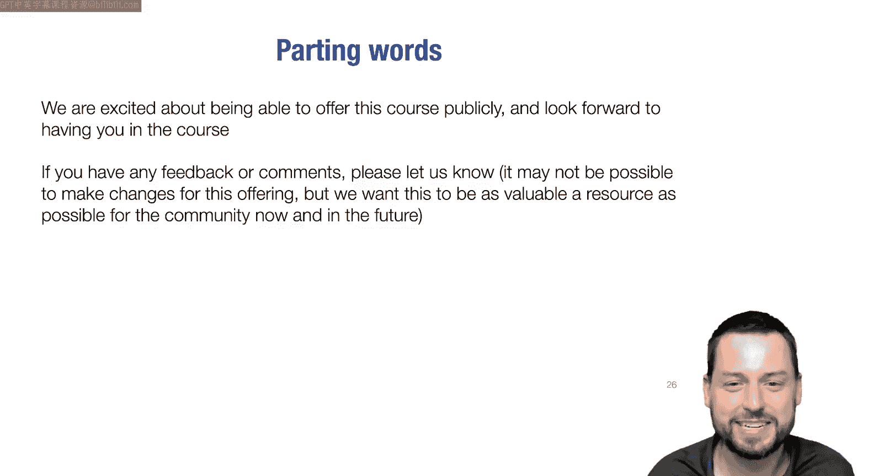