# CMU《深度学习系统｜CMU 10-414714 Deep Learning Systems 2022 fall》中英字幕 p02 -02-Lecture 2 - ML Refresher _ Softmax Regression.zh_en -BV1ERtYepEpy_p2-

Hi everyone， and welcome to the second lecture of Deep learninging Systems， algorithms and I。

This lecture is going to be a refresher on the basics of machine learning。

 as well as a walkthrough of softmax regression as an example illustration of all the ingredients of a machine learning algorithm。

Now this lecture is going to be a fairly quick run through of kind of basic machine learning and the expectation here is that this should be a refresher for you you should have seen this in some form or another beforehand Now if you haven't。

 you've seen it in a different form， that's okay， but if this is all brand new information to you。

 then you probably want to look at kind of a more basic machine learning course before taking this more systems focused and a little bit more advanced course。

So let's jump right in talking about two things today。

 we're going to talk about the basics of machine learning and then as I said。

 using this example of soft mass regression or multiclass logistic regression as kind of an illustrative example of these ideas。

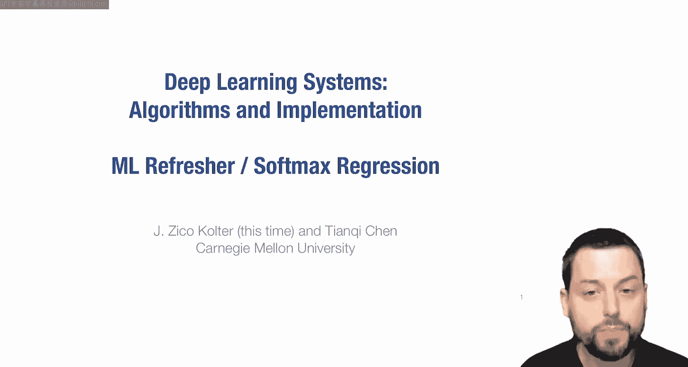

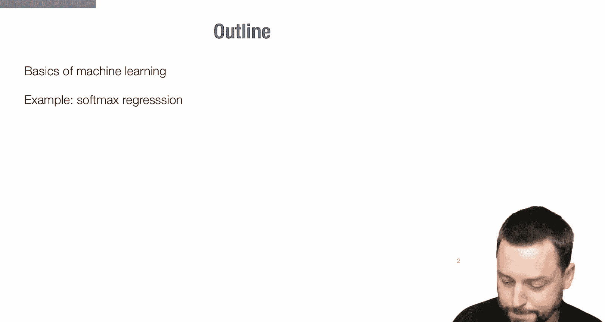

All right， so first of all， the basics of machine learning。Let's suppose you have the following task。

 which in fact you will have in your homework。Suppose you want to take images of digits like the one you see here on the right and write a program that will classify these into one of nine。

 10 different categories， the digits zero through nine。

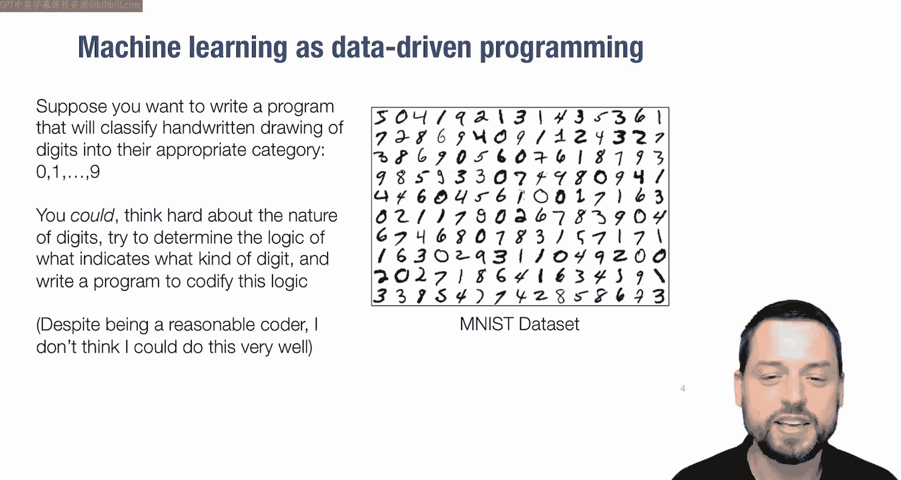

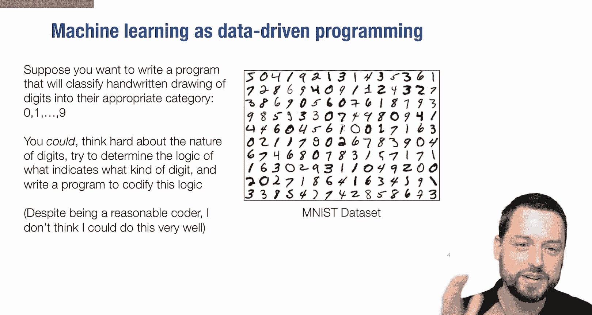

Now， there are a few ways you could do this， but kind of the traditional， I would say。

Basic programming way to deal with this problem。Is you sort of think hard for a little while about the nature of digits。

 right you think kind of what makes a0， a0， at least as far as an image is concerned。

 what makes a1 a1， etc。

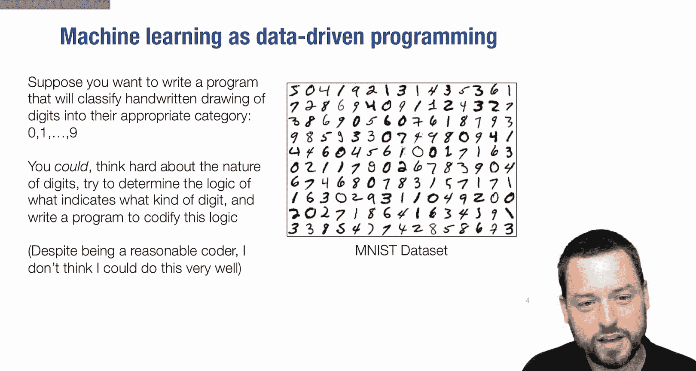

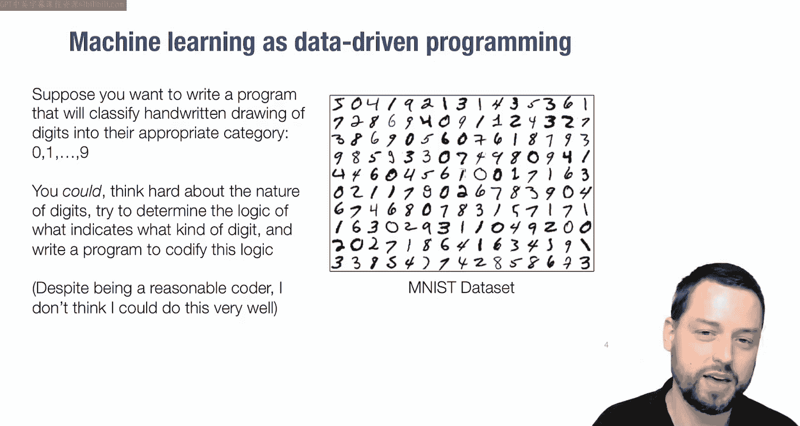

And you try to encapsulate this logic in a computer program。

 this is how we sort of learn to code most things。And when this is something like writing a program to sort of list。

 this is actually a great way to do things right because we can kind of structure logically the steps of what it takes to sort of list。

 right， the preconditions， the post conditionsitions of each step and build the logic that way。

But for many tasks like this image task， for example， this ends up being a pretty hard problem。

So I consider myself a reasonable coder， at least normalized the professor level and also I guess excluding some outliers like the other instructor of this course。

 but normal across all professors， I'm a pretty good coder。And I would find this task very hard。

 I don't think I could do it very well because again， computers don't see images the way we do。

 we look at these data， we immediately see their form， their structure， all this kind of stuff。

 but computers don't see that。😡，And to build all the logic about how you create a what makes a three。

 a three and things like this， what are the shapes involved， what what pixel values， right。

 how do you turn a grid of pixel values into an actual classification of a digit？

That would be quite hard for me， actually to program。We need to look。

 or at least we would like to look at some other way of solving these kinds of problems。

 and this is exactly what machine learning gives us。

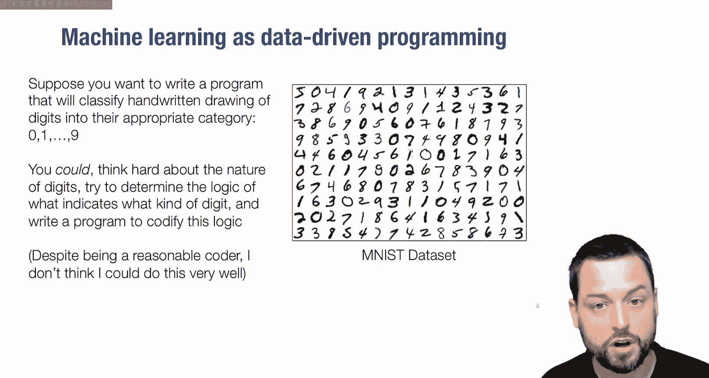

Now。The machine learning approach to this problem and I should be clear this is really the supervised machine learning approach to this problem。

 Supervised learning is the majority of what we'll cover in this class that we will cover a bit of unsupervised learning later on in the class。

 but the supervised learning paradigm for this problem is to say。

It's hard for us to write a program that can classify those digits。

But what's pretty easy for us to do relatively speaking。Is collect a bunch of images of digits。

Along with their known labels or their known target that we want to predict。😡。

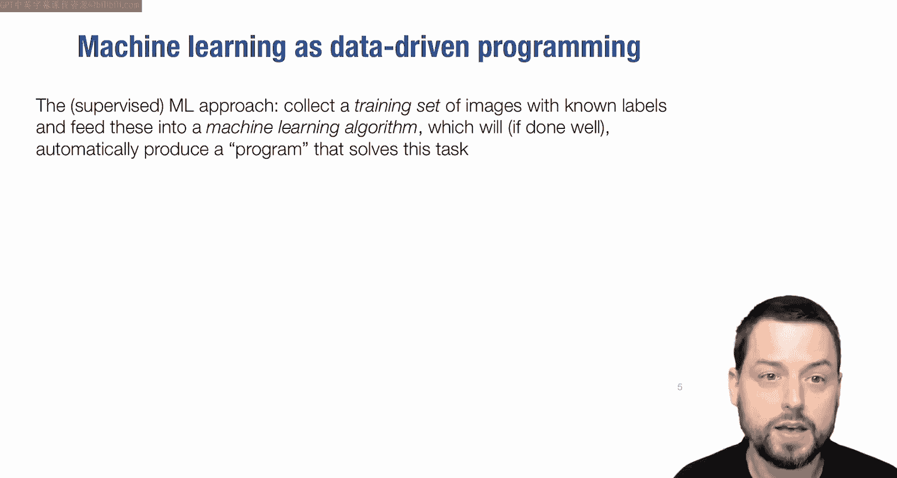

And then so we take a collection of these things， which we call our training data。

 right and our training data essentially consists of these images。

 so this thing on the left here is supposed to be an image of a four along with its true label4。

And precisely because we are good at this。As as humans。

 we can do a good job with this and so there's it's fairly straightforward to do this at the collective training set like this。

Now， what we did there is we take those training data and we feed it into a machine learning algorithm。

And from what this algorithm produces that is a model H produces some model。

 which we call H or hypothesis， or really you can think of this as a mini program。

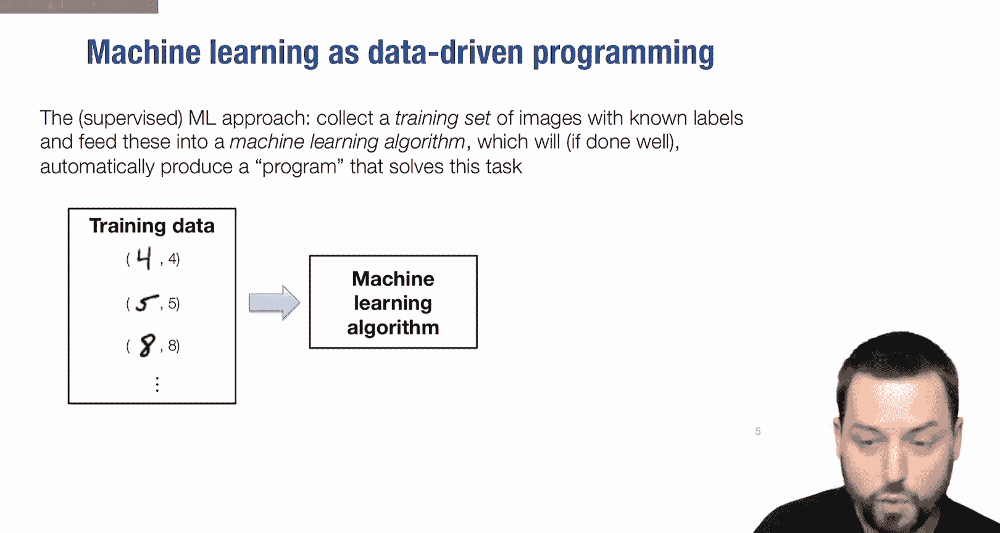

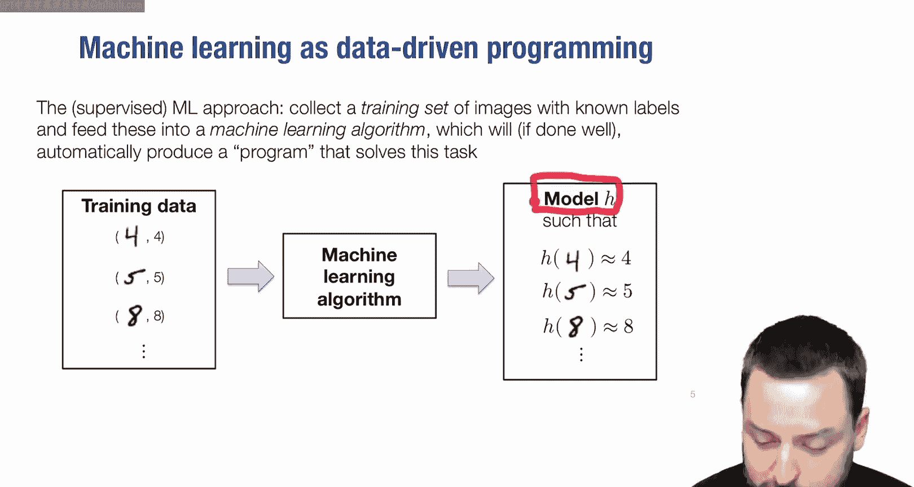

And the way this program works is that if you feed in examples like these images。

 it will produce the output for， at least approximately speaking。

So if I feed in examples like we see in the training set in the training data。

 this will produce the desired output Now， of course。

 what's important about this if you do this well， it will work not just for examples that were in our training data。

 but it will also work for pictures in general of digits。

And we actually won't talk about sort of the intricacies here of generalization and what makes a good and generalizable function。

Because what we're going to cover really in the majority of this class and really this course is this box here。

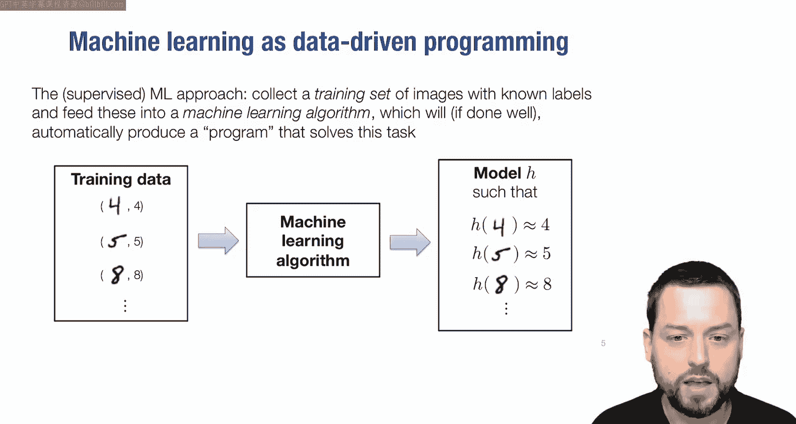

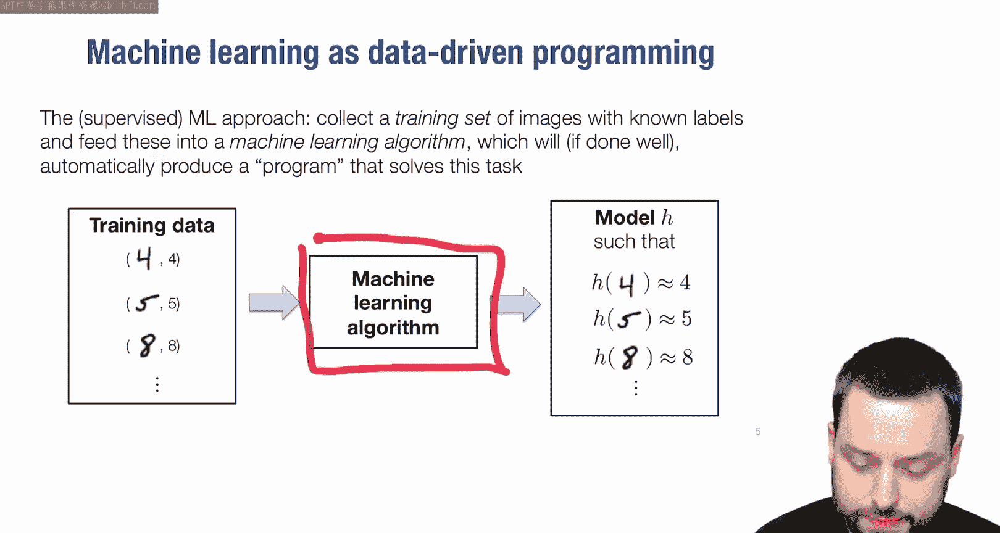

And what I want to run through today is basically what is this boss campaign。

 what does it actually have inside of it？

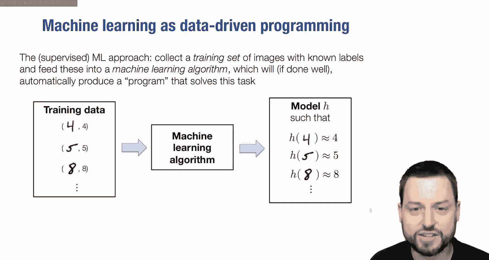

And so what this boss contains is really three things。

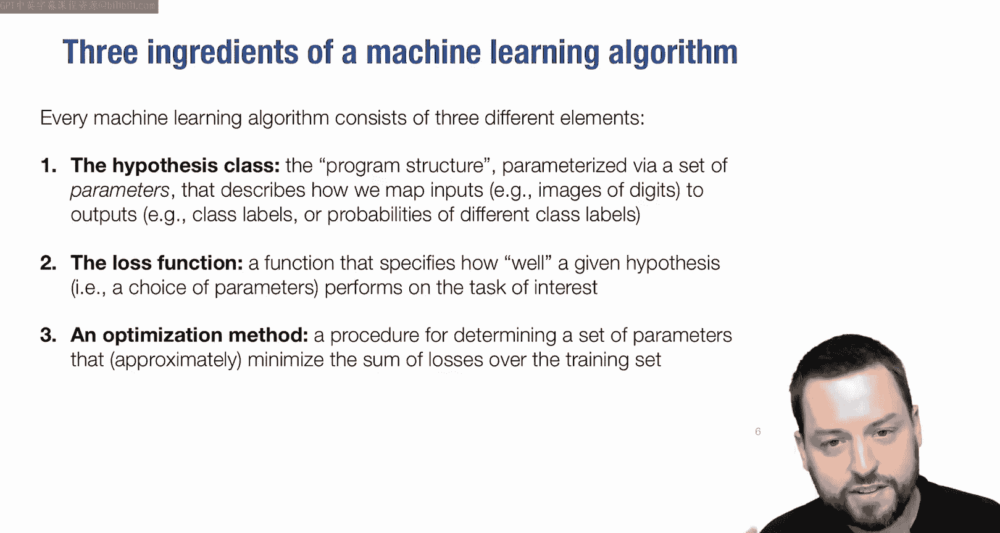

And in fact， every machine learning algorithm more or less。

 consists of just three different elements。And the three different ingredients are the following。

The first is the hypothesis class， so this basically specifies what is the structure of that model H that we actually are going to create with our machine learning algorithm。

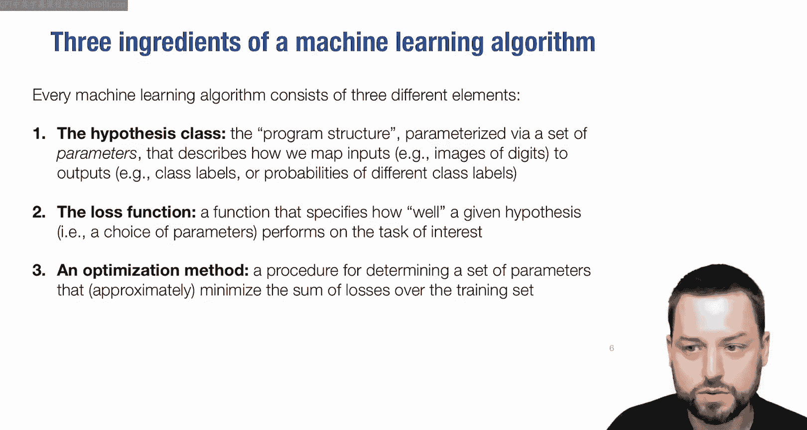

Now， typically， we say that this model is parameterized by a set of parameters。

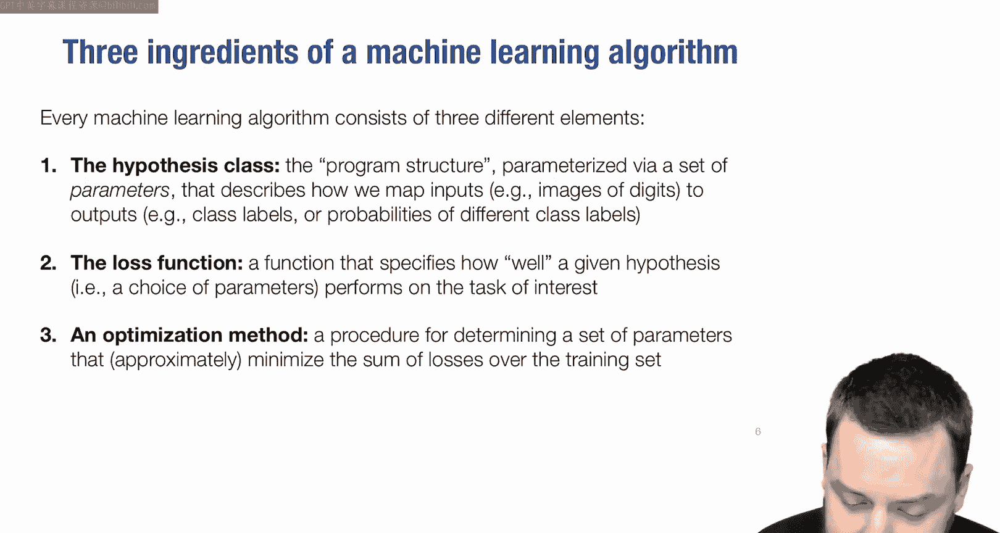

And what these parameters do is these parameters specify the exact nature of this mapping。

 they specify sort of how a particular instance of a model will map from its input to its outputs。

That's the first ingredient of machine learning。The second ingredient is the loss function。

 and the loss function specifies what makes a good hypothesis。

 how do we characterize when a hypothesis is performing well on this problem？

And the last element of machine learning is an optimization procedure。

 and this essentially a way that we optimize over the parameters to find a set of parameters that approximately minimize the sum of losses on our training set。

And what's really amazing is that all machine learning algorithms。

 whether they be deep learning algorithms or simple sort of linear classifiers or gradient boosting or really anything you can propose。

All of them at least supervised learning， though unsupervised learning actually also fits this mold to a certain degree as well。

All the algorithms that we have in machine learning fit this basic structure。

And so even though there seem to be hundreds， thousands of machine learning algorithms sometimes。

 it's kind of hard to keep up with just how many there are。

One thing that's very helpful is understanding how each of these algorithms fits into this framework。

 because there aren't really thousands of machine learning algorithms， there's basically one。

 there's one algorithm that sort of has to just specify these three different components。

 and then you have your actual sort of instantiation of a machine learning algorithm。

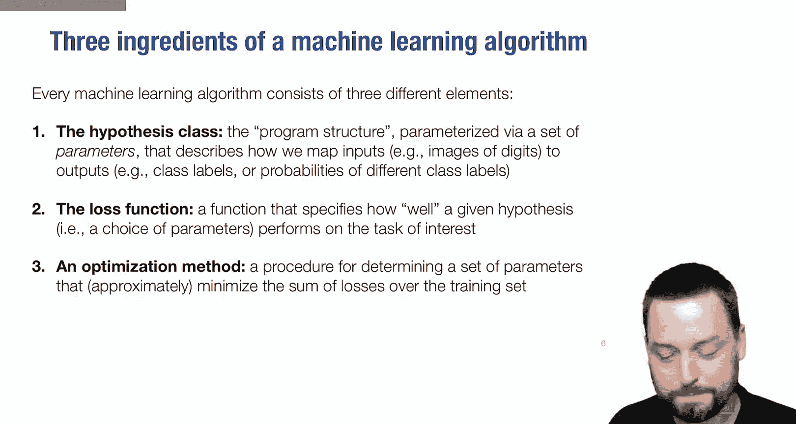

All right， so what we're going to do with the rest of this class then is look in some detail at softmax regression。

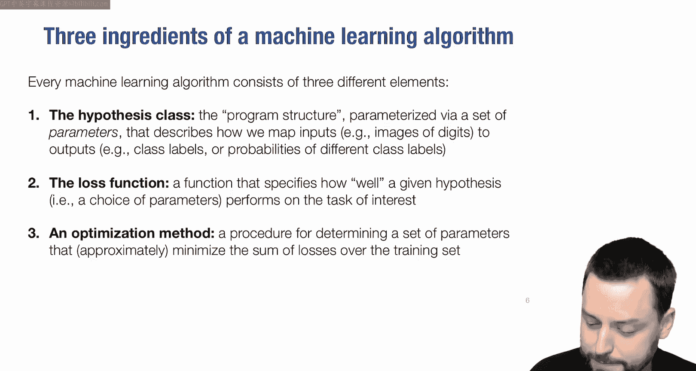

Also known as I mentioned， as multiclass logistic regression。

And illustrate these basic components in the context of softm regression。Now， as I said， again。

 I'm going to repeat， we're going to go through this quite quickly。

And some of these topics of you have not seen before， this would likely be too fast to go through。

But what I want to do is just highlight how softmax regression exemplifies these different elements。

And really you can do the same sort of thing for any algorithm。

 but we're going to use soft mass regression as an example before next class then moving to basic neural networks。

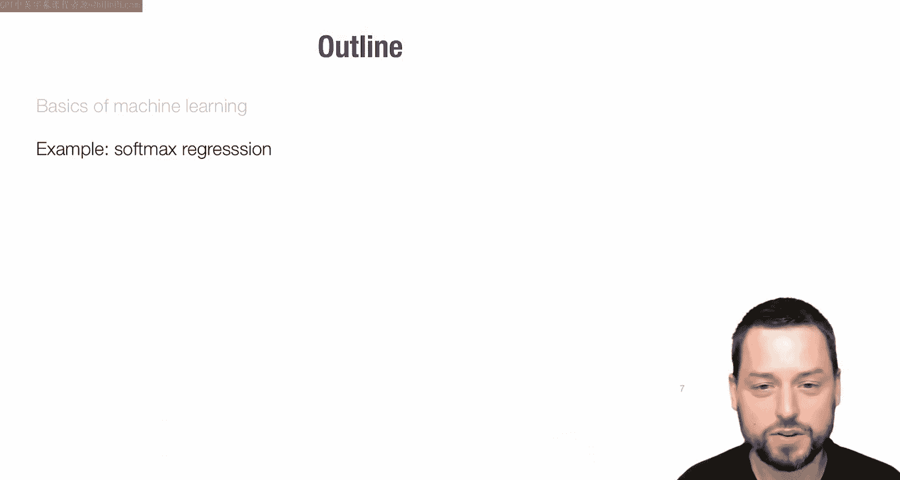

All right， before I actually define these three ingredients though for soft mass regression。

 I want to start off with our basic setting。😊。

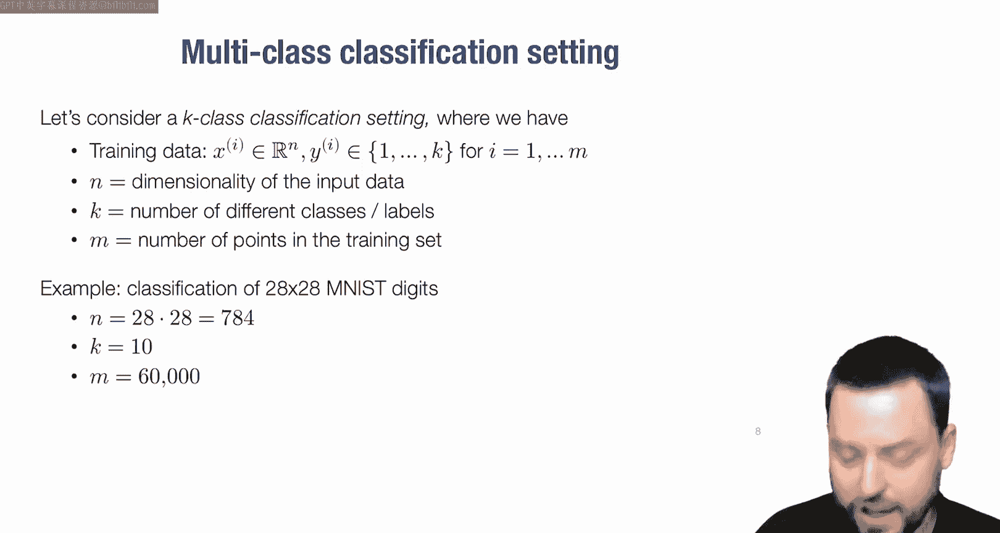

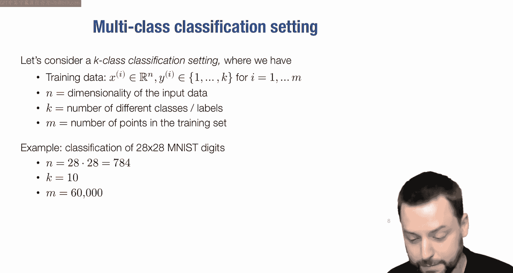

So our setting here that we're talking about is multiclass classification。In particular。

 a K class classification is something where I say there's K different classes。

And what we have in the settings， we have training data where the inputs to our system are vectors X notation here of X being in Rn means that X are n dimensional vectors with real value quantities。

 so essentially each X would look something like this。 it would look like a big vector。

Specifying the different elements。From XI1 to X IN， let is find the different elements of X。

And in the case of， for example， these images， these images of digges you just saw。

 this could be these elements here would be the different pixel value intensities in the image。

The next thing we have is the outputs or desired sort of the desired outputs of our algorithm all or the calls of the targets or outputs。

 or they're called several things like this。

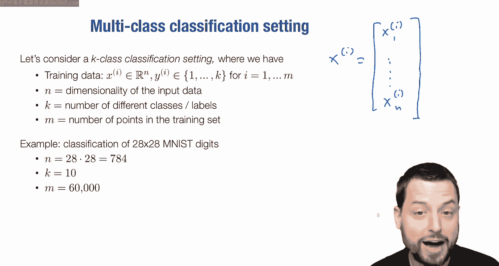

And these outputs， Yi are scalar quantities， which really theyre because we're talking about classification challenge。

 or classification problem， these are discrete values that range from one to K where k is our number of classes。

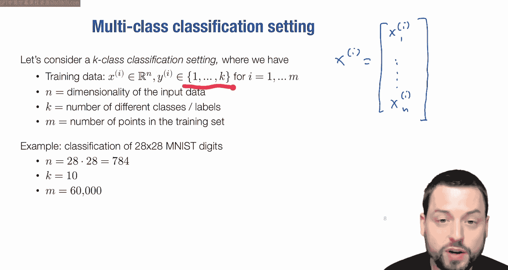

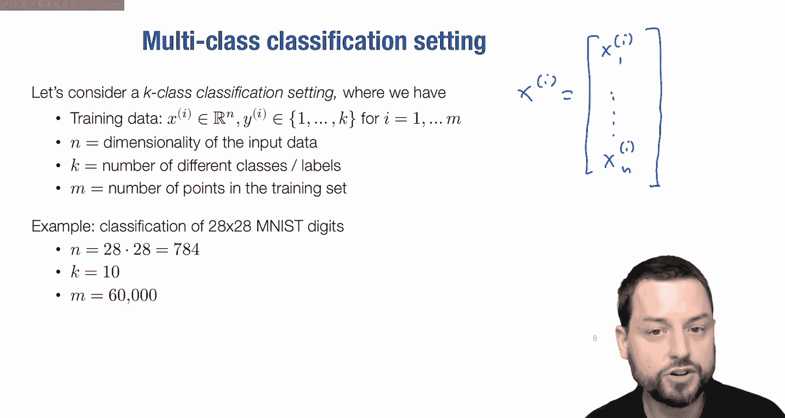

And finally， I hear indexes over the examples in our training set。

 so I ranges from1 to M and it indexes over the different samples or examples in our training set。

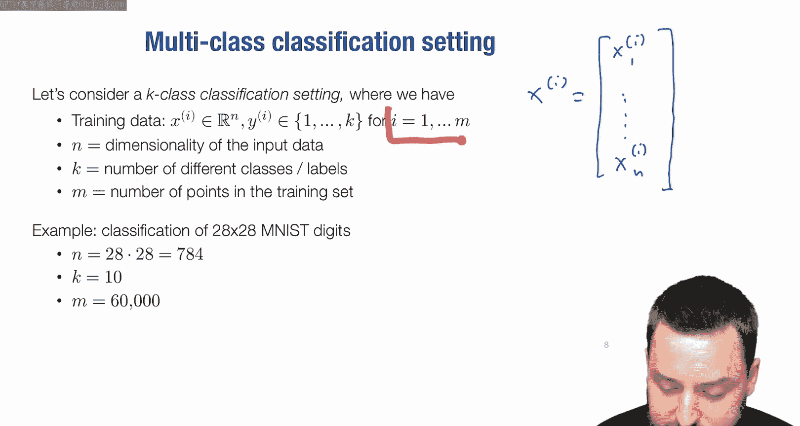

So this particular notation， I'm going to be consistent with throughout the course here。

 and it's important to sort of remember these different things because they will do things like affect the dimensionality of the vectors we care about。

But throughout this lecture and for the majority of this course。

N is going to represent the dimensionality of the input data。

 so this is how big of a vector is our input。K will be the number of classes。

 how many outputs are we trying to predict？And or how many different classes do the Als take on。

 and M is going to be the number of points in our training set。

 the number of examples we have in our training data。And so for example。

 in the case of our MNISist digit classification problem。In that particular example。

 n is equal to 784。

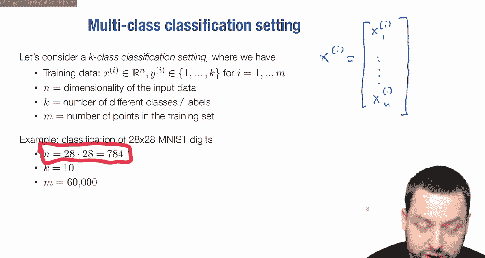

Because our digits in that case are actually represented as grids of 28 by 28 pixels and each position。

 each pixel position has a。A gray scale scalar value actually ranges from zero to1， think of it as。

And this is how we represent our image， so there are 784 dimensions of our image。

There are 10 classes。In our example there， because we have 10 different categories we're trying to categorize each digit as。

 namely the numbers 0 through 9。And finally， in this case， there happened to be 60。

000 examples in our training set。So K， N， K and M， take on these values for the example of the MIS data you will work with。

 but of course， for other problems， they'll take on different values。

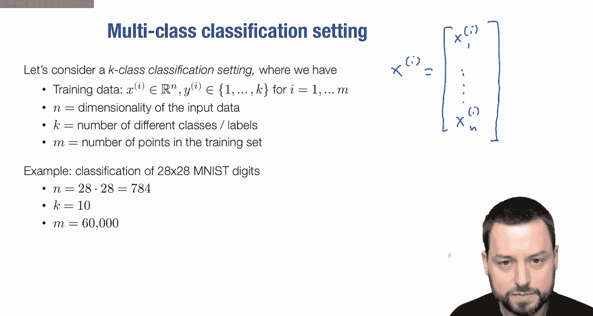

All right， now let's talk about the hypothesis function that we think of when we talk about K dimensional classification。

And in particular， we'll also talk about the linear hypothesis class that Softmax or Russian uses。

But first， more generally speaking。

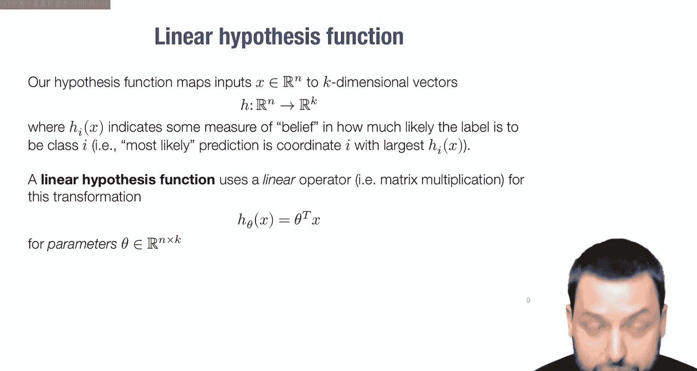

A hypothesis function， remember， this is called of that first ingredient of our machine learning program。

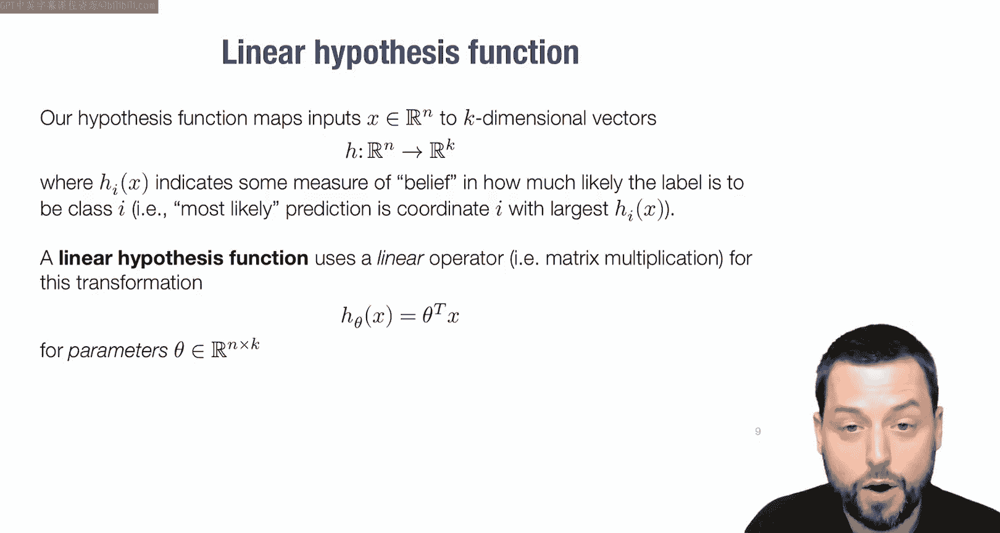

Is a function that maps vectors in RN， those are the inputs， that's the dimensionality of our input。

 to real valued vectors in RK。Now this is a bit confusing or might be a bit seem a bit counterintuitive at first because we think of hypothesis as generating our outputs。

 right， which are the numbers1 or1 through k。But in this case， for various reasons。

 which we'll cover in a second， we really want hypothesis classes that output a bit more smooth indications of how likely in some sense。

 in some very informal sense， we think each output is。And so in the classification setting。

 we don't actually have outputs that are just the discrete classes。

 we have the output of a hypothesis function， again。

 being this K dimensional vector where k here is the number of classes。And in particular。

 in this setting， h sub i， so that would be the I element of our output right so our output remember is vector valued。

 so we would write something like h of x equals a vector where the first component is h1 of x all the way down to h k of x。

And here， the I component。Indicates in some sense， how likely。The class is to be class I。

So for example， this component here would give some indication of how likely the class was to be class1。

Next one class two and up down the class K。And I'm using the term sort of likely or belief here in very big quotation marks because these are not yet probabilities or anything like that we're going to actually talk about sort of。

A probabilistic interpretation in a moment。 But for now。

 these are just to be thought as some indication of the likelihood or the shouldn't even use that word。

 the belief that the output is， in fact， class I for this element H。Now。

 in the case of a linear hypothesis class， it is a particular instantiation of this general hypothesis function。

Where H takes the following form。😡，Allright， we see the H sub theta。

 and we use this notation H sub theta here to denote the fact that theta are our parameters and H is really a。

 even though we think of H as a function of inputs， outputs。

 H is really also a function the parameters。 It depends on our parameters。 So we write H sub theta。

And in this case， we're going to write that h sub theta of x is equal to just at theta transpose times x。

 where theta here。Is a matrix which has N， rows and K columns。

And just sort to make sure these sizes make sense， right let's make sure that in fact。

 this all is a legitimate operation。Theta would be an n by K matrix。 So theta transpose。

 And we just use the transpose actually kind of for， for。

Reasons of convention in in the one dimensional case there there's sort of a this makes a bit more sense。

 So we often use a transpose here。 you don't have to use it。 In fact。

 we'll give it up shortly when we talk about the more standard notation for deep learning but but transpose just swaps the rows and columns of the matrix。

 And so the the。The theta transpose would be a K by n dimensional。Matrix。Times on well。

 we think of vectors as being column vectors， this would be an n by one dimensional matrix。

 so their product as desired would be a k by one dimensional matrix or the I。

e a K dimensional vector， so we are in fact correctly mapping from n dimensional inputs to K dimensional outputs。

And in fact， in some sense， this is a linear transform between those two dimensions。

 it's in some sense， one of the simplest possible mappings or hypothesis functions you could really have that maps between these two quantities。

Okay。So before we move on to the， this is actually going to be the hypothesis function for。

Soft max regression。But before we move on to the second element， which is the loss function。

We want to take a brief detour and talk about matrix batch notation。😡。

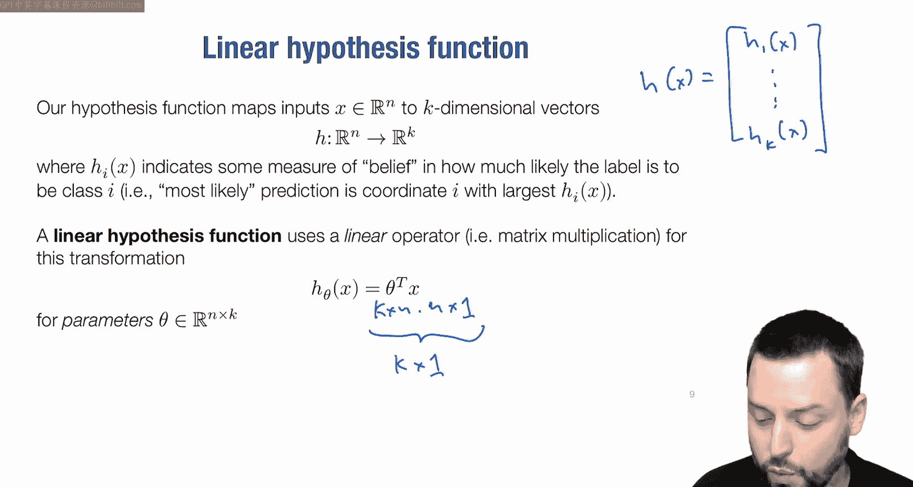

So it's often more convenient。We sort of in the previous slide。

 wrote out the hypothesis as a function of a single example。

 so applied to this single example in our training set， this is the form of the hypothesis function。

But it turns out in many settings to be more convenient to write things。

 not in terms of sort of the application of the hypothesis to a single example。

 but to many examples at once and we're going to do this with matrix notation for our operations。Now。

 it turns out this is actually more than just kind of a mathematical nice study as well。

This is also going to be really important when we come to implementing these operations efficiently。

Basically， because matrix operations are much more efficient than carrying out many vector operations。

And because of this， it winds up not just on GPUs， but also on CPUs。

 being incredibly important to implement things in matrix batch form for efficiency of execution。

And so this matrix batch notation， I'm sort of harping on a little bit here because I don't just want to emphasis it's not just a notational nicety。

 though it is once you get used to it， it's very nice。

What it really is is it's a way also of carrying out these operations more efficiently in code。

And so you want to be familiar not just with how to write these things as a bunch of forlips。

 but how to write them really as efficient matrix operations。So we're going to define。

The a batch matrix big X， which is going to be a matrix which is M by n。 remember。

 M is the number example of examples and n is the dimensionality of the input。

And what this matrix is， is this matrix is just a stacking of all the examples in our training set。

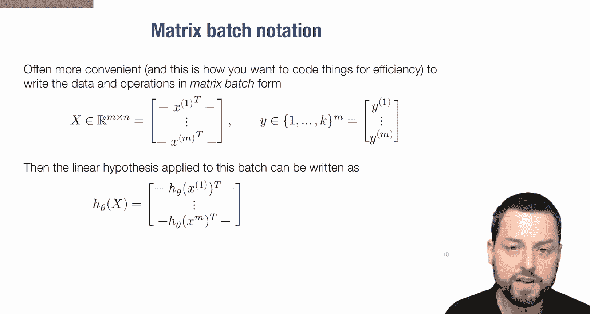

So in particular， the first element or the first row in this matrix。

Is equal to the first example x1， but because x are examples。

 we typically think of vectors as column vectors to make it a row vector， we have to transpose it。

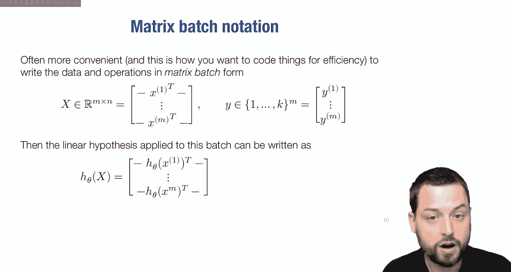

So the first row is this transposed vector。

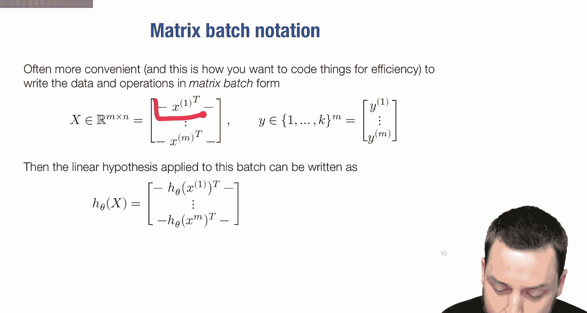

Second row would be the second example transposed down to the em example transposed。

And that's going to be our design matrix containing all the examples in our training set。

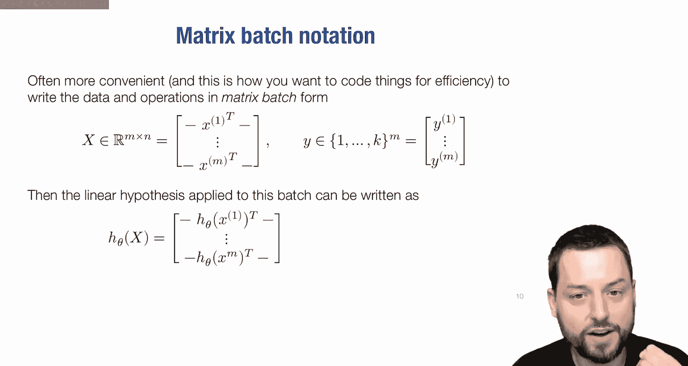

We're going to do a similar thing for the outputs， the targets。

We're going to form a M dimension now it just a vector， in fact。

 because each output is scalar valued， they're discrete。

 but they're still scalar value between 1 and k。And so we think of a stacking of all these things。

As just a vector。An M dimensional vector， which contains as its first element。

 y1 and y2 all the way down to yM。And the nice thing about this notation is that not only can we apply it to the basics matrices X and Y。

 we can also think of the hypothesis function as applying to an entire batchche of time。

So for example， we can write h theta of x， overload a notation a little bit。

 we can write h theta of big x as being equal to the stacking of all the elements H applied to each different element in our training set。

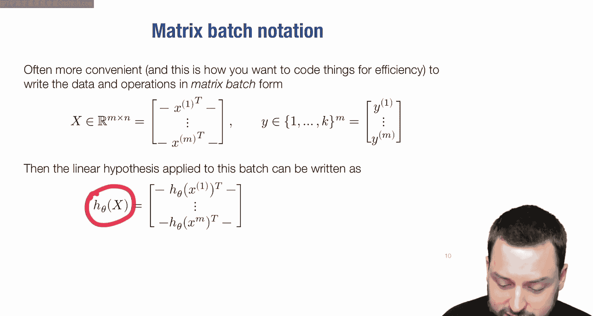

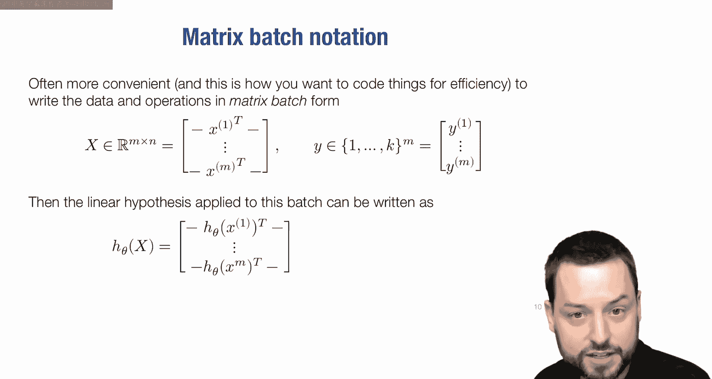

So the first row of this quantity here is just equal to the hypothesis applied to the first example。

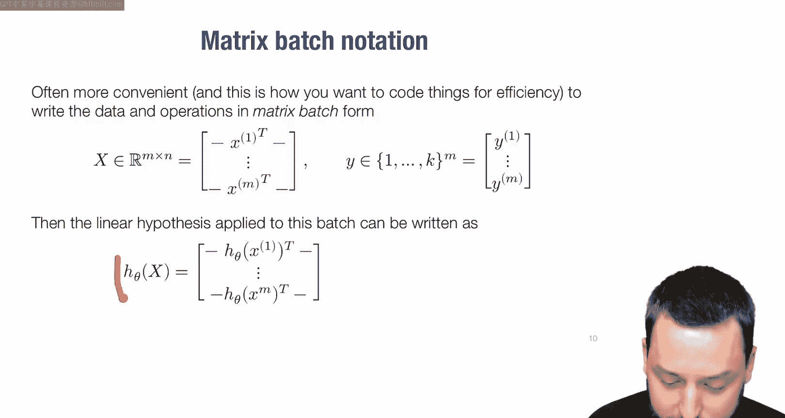

Next row is the second example all the way down to the emF example。But the really nice thing。

 of course， is that we can write this in much more efficient， much more compactly than even this。

If we look at what this actually is， Well， what is this， this is just going to be。 Well。

 the first row of this thing， our hypothesis applied to x1 would be。That would be theta transpose X1。

 but that whole thing transposed。So let's just write that a little bit more briefly as X1 X X1。

Transpose times theta。That's the first row of this matrix。And similarly for all the other rows。

 right， So the second row would be x2 transpose。Times theta。

All the way down to XM transpose times theta。Ext these a bit。

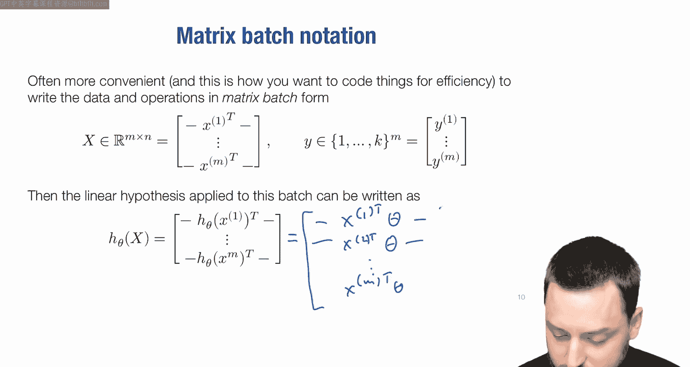

Those lines there just mean that of I'm emsizing the fact that it's a row， the whole row。

 they're not negative signs or anything。

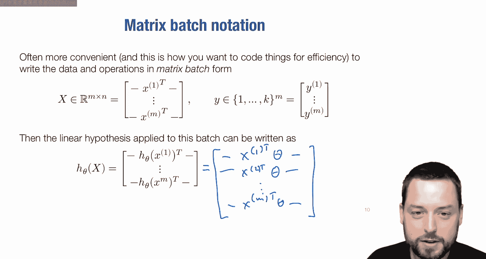

But now if we look at this also we can see well this is just kind of the definition of a major multiplication。

 so this thing here just equals first the first element is x1 times theta and next x2 times theta。

 et ce， this is just of course equal to our big matrix x times theta。

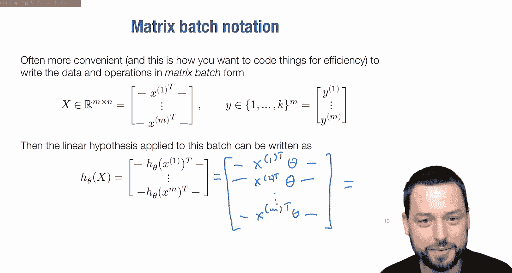

So the nicety of all this is that we can find very efficient ways to write these。

Seeingly complex expressions， like our hypothesis applied to every element of our data。

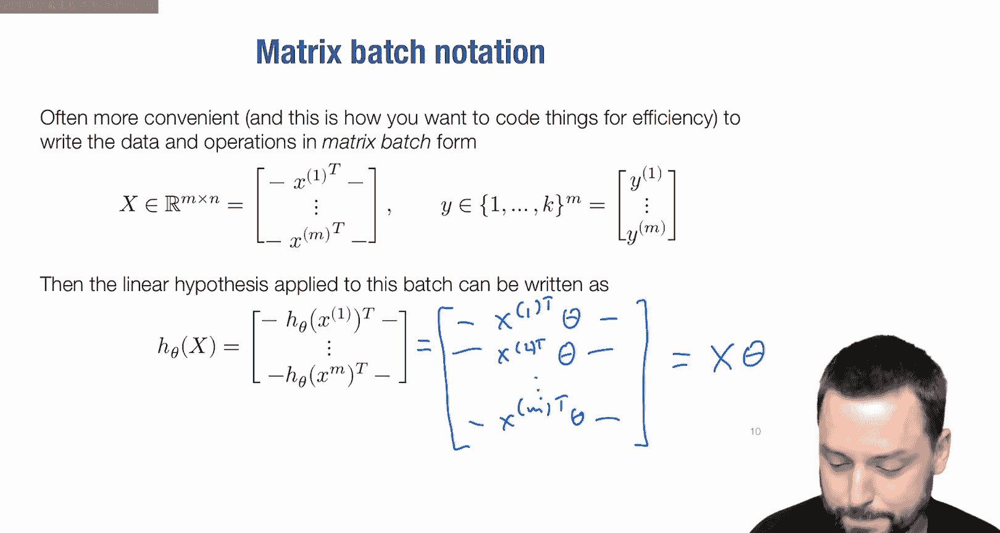

All right。So let's now move to the second element of the。Softmax progression algorithm。

 which is a loss function。How are we going to evaluate the quality of our predictions？Well。

 the most obvious thing we could do in some sense is just。His classification。

 let's just measure the prediction by whether or not it's correct。

This is something called just the error of the classified， right， it's a very sort of simple。

 it's the most obvious loss function。And so all it is。

 so we can measure sort of the error between our prediction here and the true label。

Via a loss function that we just call sort of the these either the01 loss or the error。

 I'm going to call here is call it the error loss， right？

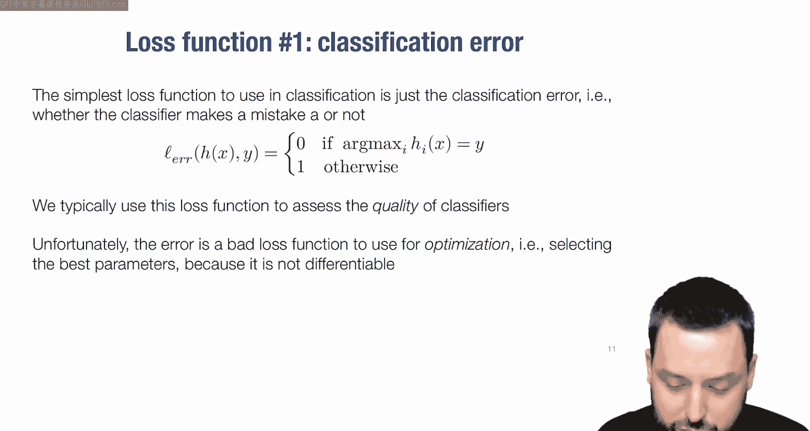

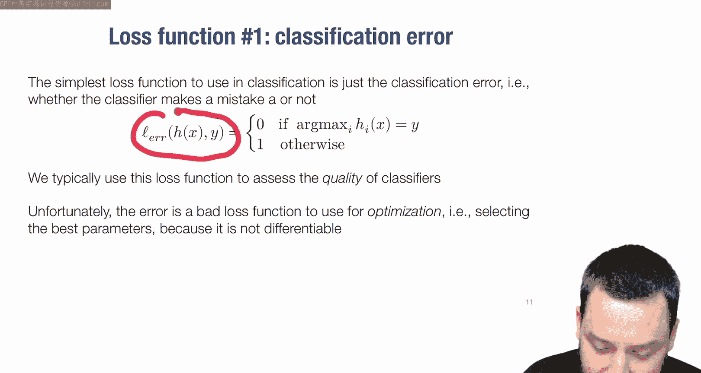

And this is sort of a very intuitive loss function， but we can write it formally too， right。

 we can write it formally as this， the prediction， the loss that we suffer on the prediction。

Is going to be zero， basically if our prediction is right， but for classification。

 remember what it means to be right。Is that。We should be most confident in some sense about the correct class。

And again， with our hypothesis function， mapping from RN to RK。

 what this means is that this quantity x HX， we for a prediction to be correct。

 we want that quantity to be the largest at the true class Y。

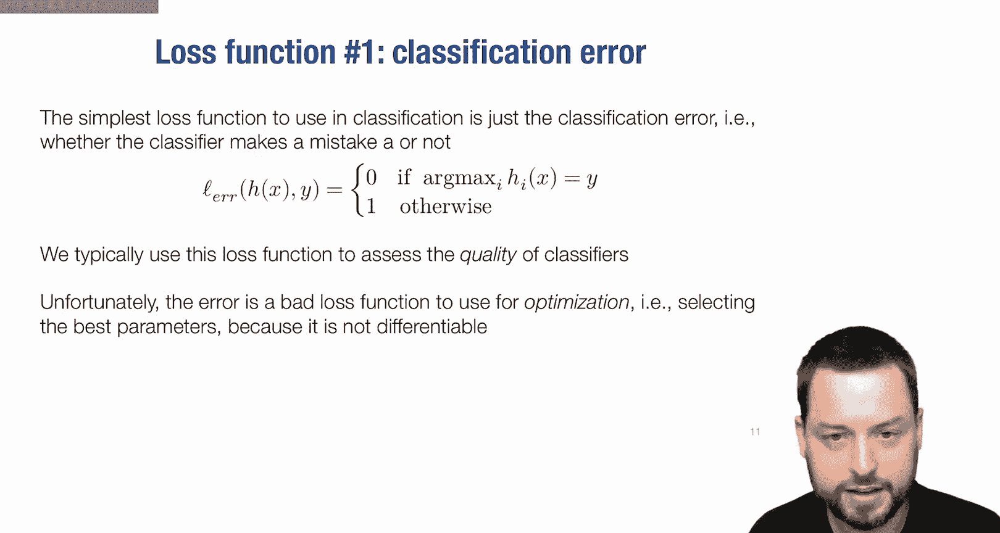

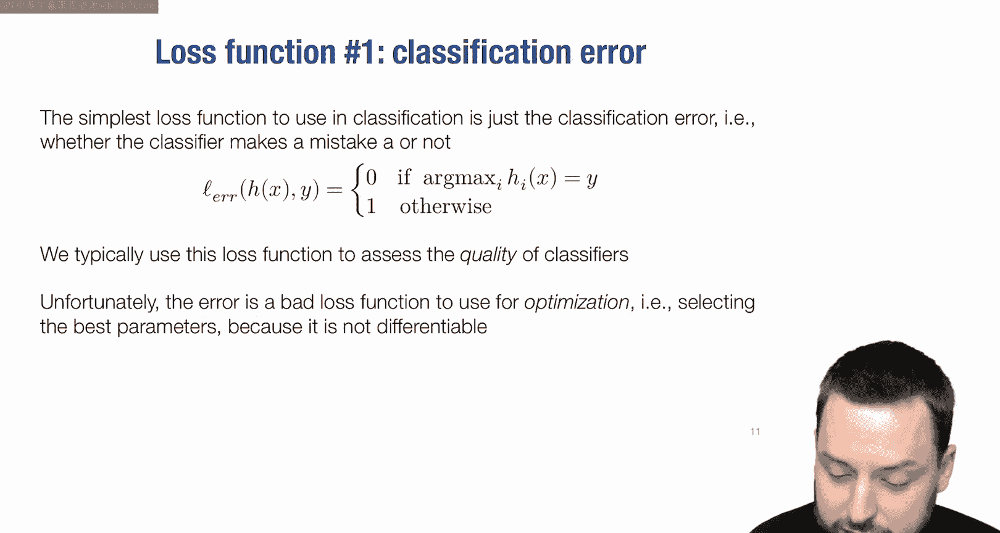

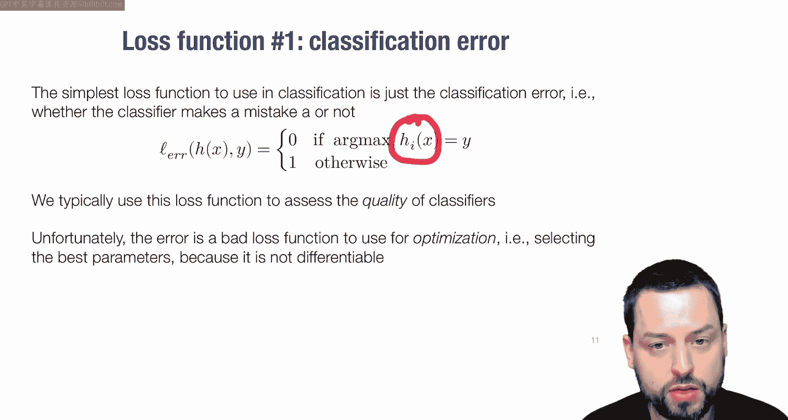

And the way we can write this formally is we say this loss is zero if the arg max。

 so if the maximum index。

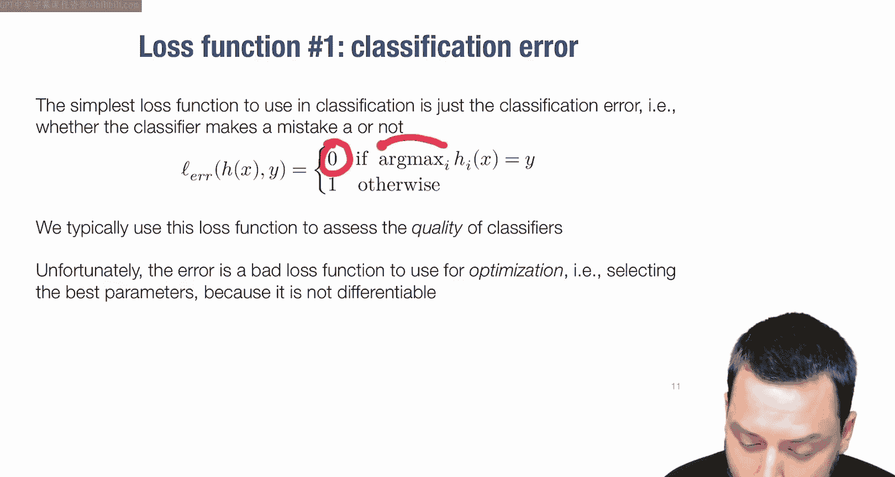

The index correspond to the maximum value of H。

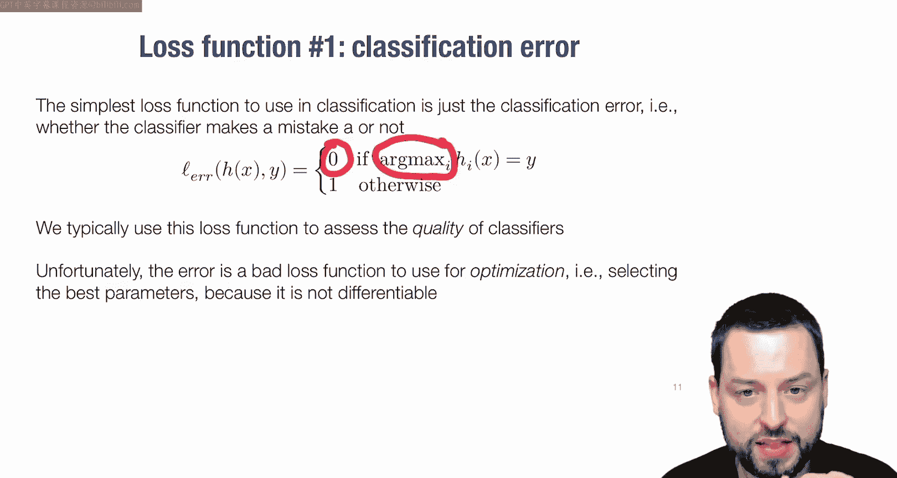

Is equal to y。And this is very simple， I mean all this is saying is that if the biggest entry in our prediction is equal to correspond to the correct class。

 we suffer loss zero， otherwise we suffer loss one。

And really actually this is very often how we assess the quality of classifiers。

 it almost goes without saying it's almosts almost so obvious that we don't even bother saying this in some sense。

 but this is very frequently how we actually assess the quality of classifiers if you ever whenever you report error of your classifier or accuracy of your classifier。

 this is how we do it， of course， accuracy being one minus the error right？

what the average error of a classifier is， is's just the average loss。

 this loss averaged over the whole data set。So this is a very intuitive loss function to use for classification。

The problem is this loss function is very bad for optimization。

It's not very easy to find a set of parameters that minimize this。Error loss。

As she winds up being for even a linear classifier。

 an NP hard problem to find a classifier that choose the minimum number of errors。

But maybe more fundamentally。Another sort of very annoying thing about this loss is that it doesn't provide any information。

 it's not actually what we call differentiable。And what this means is that。

If we vary our hypothesis a little bit， this loss typically won't change it won't change locally around our current set of parameters because you're probably not right on like a switching point where one thing switches from one to the other and even if you are in switching point。

 that's sort of a point of also a non- differentfferiable point because its sort of switches back and forth immediately between zero or one loss and this is very bad for're actually optimizing parameters because as we'll speak in a second。

In really all， not all of machine learning， but in probably all of deep learning。

 the most common way of of optimizing parameters， finding parameters that are good are via gradient based methods。

 via derivative based methods， and so this loss function is very bad for actually optimizing over parameters。

 even though it might be good for quantifying the performance of classifiers。

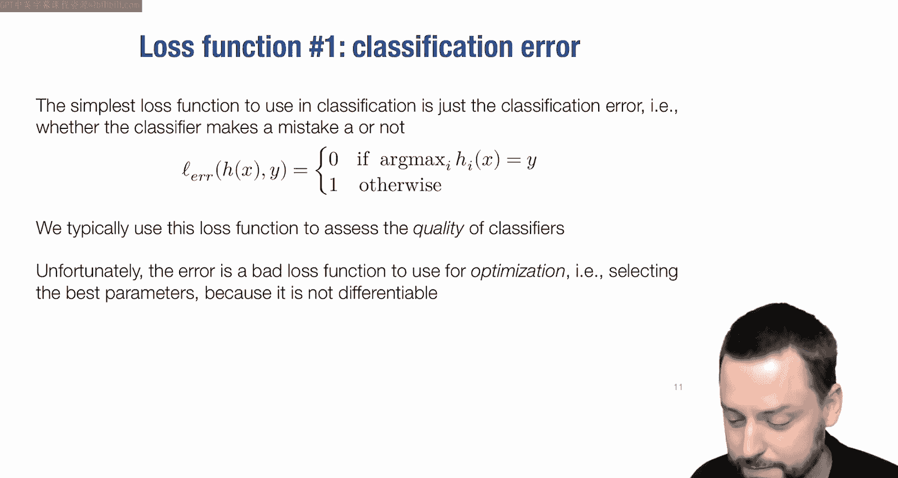

And so what this leads us to is another。A different loss function that we're going to use for softmax regression called either the softmax or the cross entropy loss。

 this term cross entropy loss has become kind of the standard in most machine learning these days and so we will define it in fact as the cross entropy loss。

And in order to define this loss， we're going to convert between our hypothesis output。

 right is these these in some sense， these predictions that correspond to some kind of vague notion of belief。

We want to convert that in something that looks more like a normal probability All right so we' going to take our hypothesis function this this。

These real value quantities and we want to convert that into a。Probability。

And the way we're going to do this is we're going to define the probability that the label is equal to I。

 and we're also going to call this term sometimes just ZI just for convenience here。Now。

 what do you need from a probability？Well， a probability has to be positive。And has to sum to one。

RightAnd our hypothesis output， H。That is not positive， it can be negative two。

 and it doesn't add to sum to one。So how do we make it somethingtime more？And be positive。

The first thing we can do is we can just take our hypothesis， H， take this term H。

 and just exponentiate it。So now that will make it positive。Okay so we just exponentiate any number。

 positive negative， it will always there or will always be positive。But they won't always sum to one。

 so that sort of solves the first problem， probably have to be positive。

 but that doesn't solve the second problem or probably have to sum to one。

So the thing we can do next is just normalize this quantity。By the sum of all the outputs。 right。

 So we're going to take our。Hypothesis at。At index I。Exsponentiateiate it。

And then we're going to normalize it by the sum over all our exp hypotheses。And now this quantity is。

 in fact， at least obeys the basic principles of a probability， it is positive。

 and the sum over all the probabilities of all the labels will always equal one。

Another way of writing this is to say in kind of in vector form is to say that Z。

 the vector of all the probabilities。Is the normalized function that just means we divide by their sum applied to the exponential of the hypothesis function？

One thing that will come up a lot is that whenever we take kind of a scalar function here。

Like the exponential and apply it to a vector。All this means。

 all this term here means that it just means the exponential applied to each element in that vector h of x。

 right？And so we're going to frequently apply kind of non or scalar functions to this。

 and you kind of have to infer what we mean just by by the context here。

 So normalize actually is a little more complex because it looks at the entire vector。

 but all this normalized function does is for a vector， it makes the vector normalized to sum to one。

All right， so that's how we're going to and you may be familiar with this operator。

 this is also called a softmax operator。😡。

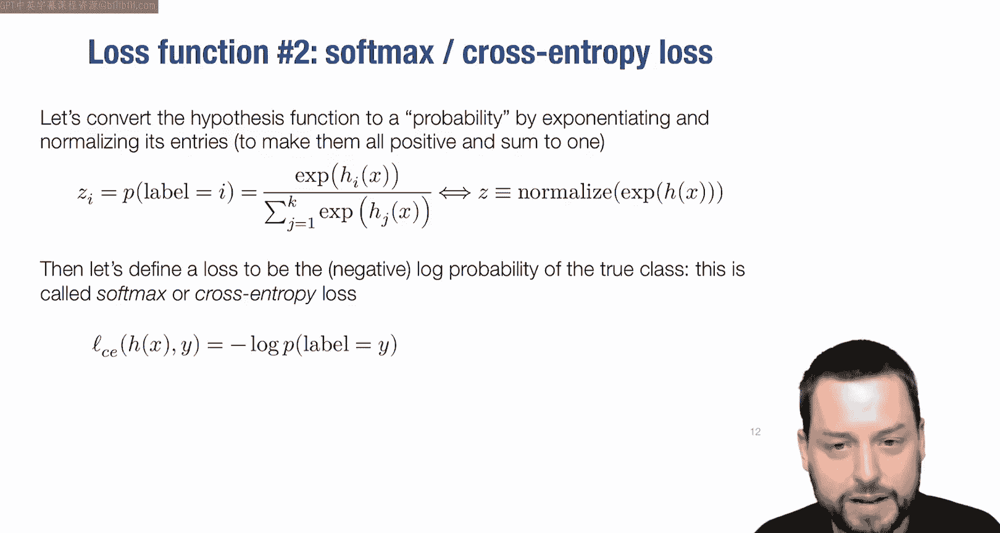

嗯。It's sort of a standard way of mapping between arbitrary real value components and the output of or in a probability distribution。

Now， you may， if looking forward a little bit here， if you are familiar with neural networks。

 you may have seen things like this where people often take this operation。

 which they also this is also called a softmax operation。

 I to say this is also equivalent to the softm called。Of just H of X。

 So softftmax is just the combination of the exponential and then normalizing。

You may see sometimes in neural networks， people define the output of a network to be the softmax applied to something before that。

 that actually for various reasons，Thats actuallyly not the right way of doing things， in my opinion。

 the output， and even in a setting like this， right。

 the output of a linear classifier is just the linear function。😊。

Not the softm applied that linear function， The softm and these sort of things。

 at least at the final level final sort of loss function layer becomes a。

An operation that sort of is embedded in the loss itself。

 not the not non operation you apply to the network。

 I'll come back to the back to that in a second though。All right。

 so now that we have a probability here that we' we sort of mapped from our arbitrary hypothesis output to a probability。

We need some way of quantifying whether our probabilities are good or not。

 whether our vector probabilities is a good set of predictions or not。

 and this is now fairly obvious what we might do。A good measure of how good our prediction is is just is the probability of the true class high。

Right， so what's the probability of。

Our under the cit was that probably the label being the true target， why。

And so we want to make that probably as large as possible。But for sort of reasons of convention。

 we typically think of loss functions as being things that we minimize。

 so we want to make something small， some error small right。

 so we could minimize them I guess the negative probability。

But minimizing probability actually for various reasons is a is a bit。

Not very well numerically conditioned， so what we typically do is we take the log of this thing。

And this is a very common thing， this is called the negative log loss or sort of very common way of deriving loss functions。

Where we define our loss function and we in fact define the cross entropy loss function as just the negative log probability of the label being the true class under this。

Distribution here。And we can write that on a bit more explicitly。

 we can just sort of write this out a little bit more concretely here as also equal to well it's just sort of。

😊，Take the log of this thing。 So we have the negative log of the numerator first。

 which is exponentials， the log in the cancel， and we just have negative H Y of x it's a negative。

The white component。 Remember y here is a discrete value between1 and K。

 We take the white component of our output。嗯。Then minus the log of the denominator。

 but then we also subtract off because we're taking the log of the denominator， we track that off。

 so in fact， adding the log of the sum from J equals 1 to K of the exponential of HJ。X。

And that is called the cross entropy loss。Or sometimes the softm loss or just the multiclass logistic loss。

 sometimes it's called， but these are all the the same thing。

 and the name cross entropy loss is the most common these days in machine learning。

And that's how we define the loss function we're going to use in soft max regression。Now。

 as I said before。The right way to think about this is as this loss function applied to a linear hypothesis class。

Not。sortrt of this negative log being the loss or this negative log here being the loss applied to some softm of this thing and there are subtle reasons for that。

 for example， if you look at the convexity properties of this thing this problem ends up being well for soft mass regression will end up being a convex problem that's much easier to see here。

 you also typically unless you really have to don't want to actually form a softmax operation because if the number becomes。

Nummerically zero and you're taking the log of a zero then things can blow up so it's much better to think of the output of a hypothesis class being a linear function in this case these things are for those that have heard of the certain importance they're also called the output of the hypothesis class will also be called the logics sometimes and then fed when they are then fed into a this cross entropy loss but this is right the right way of doing things both I think conceptually but also numerically it ends up being much nicer to sort of。

You don't want to actually compute this softftmax operation here explicitly。

 you want to compute this lost function。Apped to a linear hypothesis class。

Allright， so now with that， let's talk about the final ingredient of softmax regression。

 which is actually going to take the most time to cover because we have to sort of discuss a little bit about how you optimize these things。

 but before we do so， let's again this is gonna to be the third and final ingredient of softm regression which is going to be the optimization problem。

 how do we find good values for those parameters the。😊，But before I do that。

 I sort of want to specify or just mention the fact that what the third ingredient of our machine learning algorithm really is doing is solving the following optimization problem。

We are minimizing over theta， so what this notation means that this notation here is nottation for an optimization problem。

 that means we're searching over all possible values or at least trying to search over all possible values。

To find some value of theta that minimizes the quantity here on the right。

And this quantity is just going to be the sum from I equals 1 to M， I guess really the average。

 so the average from I equals 1 to M。Of our loss function， so our loss here。

Applied between our prediction on the I output and the actual。Ike output。

so I want to take a little bit of time to emphasize this problem here because this problem。

Kind of stated it as such。I kind of think of this as the core machine learning optimization problem that describes all machine learning algorithms。

Every machine learning algorithm in one way or another is trying to find a set of parameters that minimize the sum of or the average loss。

Between some predictions。And the true labels on the training set。And in fact。

 this really this formulation here really includes。Therefore。

 all the aspects of a machine learning algorithm， right includes the hypothesis function。

It includes the loss function。And it includes the optimization problem。So really this problem。

 maybe with some slight changes like adding regularization， but。

Typically don't even do that in deep learning that much。But this problem。

Really is the core machine learning problem。And every algorithm。

 every machine learning algorithm that there is in one way。

 one way or another solves a problem like this， at least every supervised algorithm。

Probably every provides algorithm too， and arguably every reinforcement learning algorithm or not。

 that one's a little trickier bit。Certainly have supervised learning out with them。

It's just a different take on solving this problem。And so we can even look sort of concretely。

 what does that look like then for something like softm regression？And in sort of the。

Sys's way of writing it， it's just pretty similar， right。

 we're minimizing over theta that part's the same。 we're trying to find a good values of theta。

That minimize。All we're going to do here is plug in the specifics of。Of the softm regression。

 so we're minimizing the cross entropy loss。And our hypothesis class happens to be a linear one。

 so it's going to be theta transpose times X I。And wide eye。

And this is the definition problem we want to solve for softmax regression。Now。

 of course the question is， well， how do we actually find that？How do we。

 how do we find the value of theta that minimizes this or at least a value of theta that。

Is this sort of matrix of parameter remember， the way we define our hypothesis function。

 how do we find the values that provide good mapping between inputs and outputs？

And so the way we're going to do this is via a technique called gradient desent。

But to cover gradient descent， I first want to I first to go a little bit of a digression about a quantity called the gradient。

And so let's suppose that we have a matrix input scalar output function All right。

 so a mapping from in this case I'll just use our actual mapping theta。

 which is an n by K vector to a real valued vector and actually going back to the previous slide for a second the thing I want to emphasize is that this whole quantity here。

😊。

In fact， the thing that we're trying to minimize。For the purposes of minimization。

 we can think of this as just a function。

Of theta。So the quantity that we're going to be taking the gradient of。

Later on is exactly going to be this optimization objective。

But four is such a function， so4 is some function F beta。How do we actually？

Start to minimize that function over theta。Well， one sort of very nice thing you can do is use this quantity called the gradient。

And what the gradient is is that the gradient is a vector sorry a matrix of。

Partial derivatives of this function。And in particular， if the function， if theta itself。

 or the input of the function is n by k dimensional， then importantly here， the gradient。

 which we write as this little upside on triangle， the gradient with respect to theta of f of theta。

 that's how we sort of write this， this is also going to be an n by k matrix。

And it's going to just be a matrix of all partial derivatives of this function。

So the first element would just be the partial derivative of F of theta with respect to。Data 1，1。

Going to the the last element in the first row would be the partial derivative of f of theta with respect to theta 1 k。

喂。Down here， partial derivative with respect to F theta。Data。N1， and finally。

 all the way down to the partial derivative of。F of theta with respect to theta and K。

And these partial derivative signs， what the partial derivative just means is that for the purposes of that derivative。

 for the purposes say of this derivative here， you are treating every other element of theta besides theta 11。

 as if it were a constant， so every other element that you differentiate you would just treat as if it were a constant term that were not a function of theta 11。

That's what the partial derivative here means。嗯。Okay， so this is。

 this is the definition of the gradient。 and now one thing I really should mention here is that this notation here。

Is admittedly really bad？But it's the thing people use。

 And so we're gonna have to get used to it to a certain extent。

 And the reason why it's so bad is that this first usage of theta here。

 this is actually saying what parameter we're differentiating with respect to。

 So if F has one argument， you actually don't even need that subscript you you're always taking the gradient of the of its argument。

 But as we'll see later， if a function of a lot of arguments。

 you want some way of specifying which argument you're differentiating with respect to。

 And so this is sort of what the subscript is saying here。

 it's just saying which argument we're differentiating with respect to。

This argument here is an actual value of theta that we're differentiating at。

 the point that we're differentiating at。And so it causes quite a bit of confusion。

 But the reality is you have to just get used to this。 So sorry， notation is bad。

 We use a lot of bad notation and machine learning。

 but I'm intentionally including bad notation rather than interesting better notation。

 Some people use like like like an index here。 They'll use like one or zero or things like that。

 And that's objectively better notation， but it's not common。

 So I'm gonna use the common but bad notation， and you'll have to just kind of unfortunately get a bit used to it。

😊，Now， the nice thing about this gradient what this gradient does is the points。

 remember from sort of one D calculus， right the gra or the derivative of a function was equal to the slope of that function。

Well that same intuition holds in higher dimensions too， and so if we have some function。

 so this function here is like a function where you know this would be like the minimum and these would be like points of the function getting bigger and bigger。

What the gradient does， remember the gradient is sort of itself a matrix or for you know a vector case for if the input function was vector value would be a vector。

 it points in the direction of greatest increase of F。

 at least locally so if we you know if we're right here， this is theta。😊。

The theta value were value in the gradient that， then the gradient would point in the direction of maximal increase。

And that's a very， very powerful notion， right， we don't need to somehow search all possible values of F for the one that actually causes it to increase the most。

With a little bit of calculus， you at least in a local sense， have the direction。

 already immediately have the direction in this parameter space that increases the function the most。

And that's sort of amazing， you can get it basically and as we'll see。

 know there typically exists ways of computing gradients very efficiently。

 this is what the whole lectures of I differentiationation will cover。

 but we can compute it very efficiently and in doing so we can really easily figure out how to change or how to optimize our parameters data。

😊。

So how do we do that， Well， this leads us very immediately to the。Kind of the core algorithm。

 I would argue of almost all machine learning。So how do we then use this fact to optimize our function？

Well， if the gradient points in the direction of maximal increase。

Then if we want to minimize our function， which is again the convention for sort of minimizing losses。

What we can do is we can set theta。To be equal to theta。Minus some multiple of its gradient。

 So here alpha is what's called a step size or a learning rate。It's just some small。

 positive quantity。

So we subtract off some small positive multiple of the gradient。

And it should make sense but these are all the correct size here， right。

 because theta here in our case is n by k and the gradients also n by k。

Mp on by Scalar just scales the whole thing， and so this is sort of a valid update we can do。

 all the sizes check out。And the key idea though， is because the gradient points in the direction of greatest increase。

If we went to minimize the function， then so tracking off a small amount of the gradient。

Causeed that function to decrease。Now， and this， actually， before I go into the details of this。

 I should just take a moment to say that。To sort of appreciate the power of this approach。

 so it is not an exaggeration to say that this basic idea of gradient disent。

Powers all deep learning。

Maybe not there's probably a few gradient free approaches that people occasionally use。

 but 99% of all。

Deep learning and because deep learning is so prevalent here， yet， 99% of all。

90% say all AI that you see right， so those those images of dogs， dog professors。

 you saw last last lecture。These large language models， these alpha fold， they're all。

Basically built using this one line of math。😡，for some reason actuallyley is also still not often taught in basic their first undergraduate course。

 which I think is crazy， this is such a fundamental algorithm that is really hard to overstate just how impactful。

Grading descent has been on really the field of machine learning。

 but arguably even the world as a whole right now， right。

 So it's really an amazing algorithm that that is， is foundational。😊。

At this point to all deep learning。And of course， my state gradient decent。

 I mean gradient decent and its variance， really any gradient based optimization technique， but。

It is still amazing。How prevalent these things really are。Now。

 the one sort of big question you have here you may have looking at this and you will continue to have it。

 even as you get very experience with machine learning。

 probably is what value we should take for this alpha here。

 how big of a step do we take And it turns out what lu happens a lot in the course。

 But the choice of alpha here， really very greatly affects kind of the behavior of this method。

 So if you take a small alpha。 So I'm showing here just another simple function。

 So this is these blue lines here， correspond to level sets of the function。

 I' just kind of bold out like this。 And if you take small gradient steps， you sort of make small。

 slow progress， you sort of go here and then here and you kind of make small studies progress toward the optimum。

😊，If you take bigger step to sort of make pretty good， fast rapid progress。

 much more rapid progress toward the optum or if you take two， but if you take two large steps。

 you start kind of bouncing around and not being off anymore and in fact。

 if we take much bigger step， we can take such a big step that we actually overshoot and increase our function each time and kind of diverge off to wouldn't quite follow that path it would bounce around a bit differently。

 I guess it would go like here and here and whatever we did that last one but。😊。

Here and it would sort of shoot around this thing somehow。

Whenn't do that， I have a hard time drawing their paths， but basically you will start to diverge。

And not converge to anything。 so the choice of step size here is really。

 really important when it comes to choosing how we optimize this function。

And in fact， as a quick preview for a few lectures from now。

 if you if you've heard about o methods like like Adam or。gradient extent with momentum。

 things like this， what those essentially are are those are ways to try to accelerate this process without having to worry quite as much about step size。

 That is a huge simplification I know， but basically a lot of slightly more advanced optimization methods are just ways of trying to optimize these thing with a little bit less effort in picking step sizes。

All right， and now finally， what I'll say is even the last algorithm we described is not quite the thing that we really do in deep learning。

Because。If we look at our loss function， what is our what is the thing we're trying to optimize again。

 we're trying to minimize。Over theta。This is now again， for sort of general machine learning。

 not just soft mass regression。The average。Of the loss applied between the hypothesis。I'm sorry。

 not X speech， X I。Each of X I。And why I。And if we were to take the gradient of this whole thing。

Well， the gradient of this whole thing。Would just be equal to。The sum of all the gradients of it。

 So the gradient of this whole thing would be equal to the sum from I equals 1 to M of the gradients with the theta of that thing。

And the problem there。Is that？If I get more data。

So this is to be clear， this is a sum from one。M。

Veryquently。If I get more and more data。To apply gradient descent to my kind of core optimization procedure。

 I would have to do more and more work for each gradient step。

Which is really kind of wasteful It's little of bizarre to think that if in the limit of having infinite data。

 we will actually make no progress because we will just forever be computing our gradient。

 which doesn't seem to be the right thing right and there's also other issues too right like if in deep learning in particular if we try to compute the gradient over all your data you will run out of memory。

 you can't fit all your data in memory let alone the terms you need to compute the gradients in memory and so you will actually not be able to do this。

😊，So what deep learning really does is not running classical gradient descent。

 but it runs a variant called stochastic gradient descent。

Or SGD now SGD kind of in theory is can be formulated as as kind of this this stochastic minimization procedure where you have。

You sort of sampling random variables which are an expectation have the expectation of the the true gradient。

 but have some variance to them， that's sort of a mathematical interpretation of SGD。

 what SGD in practice means is that you just split up your data set into what we call mini batches。

So these basically are what these are are these are subsets of your data of size B， so B。

 big B here is what we call the batch size or the mini batch size。

And what we do in stochastic gradientdingscent is we first sample a mini batch of data。

 so we sample B examples， or maybe more than even sampling them what we reallyre typically do is divide the whole data set up into however money we need to have each one besides B and then just。

Cycle over all these subsets of size B。

So we take this up to the size B where we have both I guess we should emphasize we have both the input。

 the input now matrix of the stacked form is B examples and the corresponding outputs。

And we update the parameters by taking a gradient step as if our loss was just those B examples。

And so the way to think about this is that each step we take here is sort of a rough approximation to our true gradient。

 but one that we can take much more quickly and actually there're even sometimes of an advantage of this in the case of deep learning in particular because we often can having a little bit of noise that can be helpful in some cases too so it's sort of a noisy approximation of a thing we think we would ideally like to optimize but it's one that we can optimize much。

 much quicker so basically rather than something over just to emphasize it on our equation here。

 rather than something over M， we could just sum overall B and that's much faster to compute right because there are only B of them。

Which is you know， hundreds， say instead of millions potentially of examples。

And now I can sort of more formally say that， in fact。

 this is the algorithm that drives all those advances you've seen in deep learning over recent years。

This and very minor variants are how for the most part。

 we train every single deep learning algorithm。But we will talk later about。

About how we actually some of the more kind of common methods like momentum or like atom and things like this。

All right， so that's it， this is the optimization procedure。

 it's the third ingredient of our soft mass regression algorithm， but to finalize it。

 we have one last step which is how do we actually compute the gradient？😊。

Of our objective， of the sum of losses with respect to our parameters， theta。In other words。

 how do we compute the gradient with respect the theta？Of the thing we want to optimize。

 which is the sum of a bunch of these terms， but you know we can take the if we can compute the gradient of one such term。

 we can just sum them all together to get the gradient of our entire objective。So how do we do this？

😊，Well， turns out it's actually not。Not that hard， but it's not that easy either。And in fact。

When I learned machine learning， this is what you did， right。

 you devise a new objective and you go through by hand and derive all the gradients。

We live in better times now and the reality is most of the time when you develop models。

 you will not have to do this， in fact， the whole point of automatic differentiation。

 which is what we're going to cover in a few lectures。

 is an algorithmic way of defining just what the hypothesis and loss function look like and then basically letting the program automatically compute gradients for us。

😊，I at differentiation is just a programmatic way to create a gradients。

But for this lecture and for the next lecture， actually I'm show you what you've maybe seen before before we don't know that yet。

 I'm going to show you kind of what you may have seen before if you've taken the machine learning course because to write an automatic differentiationation tool。

 you will have to at least take some gradients。😊，So you will have to compute some gradients here and I'm going to take you through kind of I guess how we used to do machine learning。

 which is mainly deriving the gradients for all these things and yes。

 we really did do this back in the day， the dark ages。

 even though IT presentation go back to the 70s， it really did not take hold until deep learning really took off。

 this was sort of the genesis of of these tools being really widely popular。All right。

 so how do we compute this gradient Well， it turns out it's actually not that easy。

 but we can break it down step by step。It's not that hard either。So。Let's first do the following。

 So's completing this whole thing actually it is a bit tricky。

 doing it correctly is actually very cumbersome if I'm honest。

 but let's start off and we're going to do it of incorrectly in a moment。

 but let's start off with doing a simpler problem know this is this term here is is a matrix this here in terms of vectors it gets a bit know sort of you get to play a chain roll of kind of stuff。

 let's take a simpler problem and first just。😊，Think about treating H， not as the hypothesis class。

 but just as an arbitrary vector。 it's going actually going to be one step of our derivation。

And let's see if we can differentiate just the compute just the gradient of our cross entropy loss。

Treating its argument H as a vector。So basically we want to compute this thing here。But remember。

 the elements of the gradient are just equal to the partial derivatives。This thing here。

So I'm going to just going to first。To compute my gradient。

 I'm going to first compute what the partial derivatives are。

So let's just do that， so this is going to be equal to the partial derivative with respect to H。😊。

Of well， what， Well， it's， I'm just going to write our loss function again。

 this would be negative H Y because。You can go back a few slides， but just trust me。

 I'm just going to be rewriting now what the cross entropy loss actually is。

Plus， the log。S from I equals 1， or I should use J。

Because I use Id index over examples so J equals 1 to m to K。Of the exponential of HJ。

AsI'm just writing the definition of the question be loss using Hs now as arbitrary vectors。Okay。

 so what is this， Well， this first term， let's just do this。 what's， what's the。

 what's this derivative of this first term here。 Well， that will be。Zero unless I equals y。

Otherwise it'll be one or otherwise it'll be negative one， actually， right？So if y equals I。This。

Terrative of this term is negative1， otherwise it's0。

The way we can write this is as the negative indicator， for one indicator of I being equal to y。

All right， what about this next term， what is the derivative with respect to H of this？Term。

Well now we have to just sort of do it， so I'll apply the basic chain rule so the derivative of the log of something is the derivative of the thing inside。

Divided by that thing， right so this is going to be equal to plus the derivative of this thing。

 you think inside the log。So that's going to be the derivative with respect to H of sum from J equals 1 to K of the exponential of Hj。

All divided by the sum from J equals。Like this。J1 to K of。Exponential。Of。H， J。嗯。But now。

This numerator here， well， if I'm picking the derivative of the sum of all these exponentials。Again。

 I'm picking a partial derivative with the H of this sum。

And because all the terms but H are considered to be。Considered to be constants。In fact。

 here I'm actually， I mean， the reason why I use J there， by the way。

 in this case was because I'm different with with the H not not not actually because of the example so this is just because I'm differentiating with with the H here。

 so I had to use the sum over J。

But taking the derivative of this inside thing here， well。

 that's going to be zero for all J except j equals I。And for that one J equals i term。Well。

 the exponential the derivative exponential is just that same thing。

 So this whole thing here is going to be equal to the exponential。Of H there of H。Divided by。

 see if I can write this without getting in the way of it。

The sum from J equals 1 to K of exponential。Of HJ。Thatd bit nicer。H J。But。This thing here。

Should look very familiar to you。It's just that same softmax operator we had before。

 it's the exponential of the hypothesis divided by the sum of these exponentials， I eat a softmax。

 I even normalization of the exponential of H。So we can write this whole thing much nicer。

 the whole derivative now much nicer in vector form。In particular。

 we can write this whole thing as the gradient of the cross entropy loss with respect to H which is equal to Z。

 which is going to be here z equals。Normalizing。The exponential old。Weirdly。Exponential of H。

Or the softm of H。Minus a term that has a。Mine is this term here。

 which this term here is going to have a0 everywhere except the one in the width position。

 and the very common way of writing that is as。

C minus e sub y where E is called the unit basis。Okay， so just to highlight everything in the end。

This term here。Is our。Final。Graadient of the cross entropy loss with respect to。The the。Input。

 it's input， creating its input， it's a vector。

Okay。So are we there yet？Like so close， but so far in a way。

Because how do we compute what we really want， we actually don't want the gradient respect of the input to the loss function。

 want the gradient respect to theta？Of this thing， how do we compute that？And。It's， I mean。

 the way you would do it， right， is you use something like a chain rule。

Okay because we want the gradient of what's expect to something inside， you can use the chain rule。

But the dimensions here are nasty。I mean， and it's like the simplest possible。

 you know thing you can imagine right， it's a linear hypothesis function。

 but this term here is a matrix。This term here is a vector。

 so we want like the derivative of a vector with a matrix， it's like some odd tensor。

 it turns out this gets really cumbersome really quickly。And so we need some sort of more。

Powerful or more un。Kind of。😊，Almost say rigorous because but which Is see on the slide sort of throws that out the window。

 but we need some sort of more general and generic way to take derivatives when we have multivariate。

 multidimensional matrix， matrix quantities， etc。Eventually tensor quantity and stuff like that。

So how do we do this， well there's two things we can do。😊，We can first do the right thing。

And to be clear， the right thing is。You can define generalizations of gradients like Jacobians that actually are the derivative of a vector output withtu a vector。

Or the matrix of all partial derivatives there， but when you had the matrices are differential with spec you need to use things like chronicer products and vectorization。

 but you can formalize all of this using matrix differentialial calculus so there really are ways to sort of go through formally what every single derivative you want to compute here every single sort of gradient and partial derivative and Jacobbian and here it is you can also these out term by term that's even worse。

 but you can dissolve very formally with matrix differentialial calculus。

We're not going to do that， though。 What we're gonna do is the。Horrifying。

 but thing that everyone actually does。Which is the following if you haven't seen this before。

 this is going to be like a a revelation to you if you've done these derivations before and never realized that what people actually do is this thing so I'm like pulling the cover back here on you know。

😊，big secret， but it is not even a useful secret because it's how we used to do these things。

 So this is how we used to do them。 and now it's now as useless。 but anyway。

 pulling back the big secret here。Um，The thing you do。To compute multivariate。Jacobians， gradients。

 thrives， whatever。So just pretend everything's a scalar。

Apply the normal chain rule and then rearrange or transpose your outputs such that everything works in terms of the sizes。

And I really want to highlight this sort of horror emoji here。

 it is suitably should be suitably horrified by this。Okay。嗯。😊。

So this is what actually is done in practice and it is a bit horrifying。

 but this is what people that do and and it actually gets you get sort of。You do it quickly。

 the thing I will say though， is what's very important to do if you ever do this is to check your answer and check your answer numerically so we'll show actually in the next lectures how you go about checking derivatives numerically。

 you'll it in the second homework。Um this is because。So much can go wrong with this first approach。

 you can use it as a hack， but then check your answers after the fact。

 but this is literally what we do when we want to compute nasty gradients or nasty high dimensionional derivatives。

 whatever， doesn't always work， but it works a surprisingly large amount of the time and so always at least try this first。

Okay， so how does this actually work？

So。Let's say let's try to compute this quantum， let's try to compute the derivative of the cross entropy loss of our hypothesis function。

So this is the thing we actually want to compute the gradient of。

 but let's do it assuming everything is kind of a scalar and I'm still going to need the partial derivative sign here。

 even though I should probably use like just there's the normal not scripted Ds at this point。

 but I'm going to the partial derivative sign that can to remind me that I' that I'm horribly cheating here and should never actually do this but let's just do it let's pretend all of this really is scalar valued and kind of go from there。

All right， so what is this？Well， now we can apply the normal， so if we're completing this derivative。

 now we can apply kind of the normal chain rules， the thing would be the derivative of the loss。

 the cross entropy loss of theta transpose x。They trans x and y with respect to theta transpos x。

 that argument to the question be loss。Times and it doesn't matter what this what times means here because they're scalar。

 it just means scalar multiplied by the derivative of theta transpos x。

 and obviously we don't need transposes are're all scalars now。

 but we'll still just include it because you can always transpose the scalar if that's fine。

With respect data。Okay， so that's， that's what we do。 So， so what what are those things。

 Well now if they're all scar， we actually can this out really easily， right。

 So this first thing here， this first term。This is actually just the derivative of the cross entropy loss with respect to its argument。

It's exactly what we。Had last time。So this is actually going to be equal to exactly what's on the two slides ago。

 it's going to be z minus E Y。Where here's Z just like before， is equal to normalizing。

The exponential， in this case， the hypothesis was going to be theta transpose y。Times， well。

 this one here when they're all scales is really easy， the derivative of theta。

Times x the theta is just x。All right。Now we're almost done。

All we have to do now is talk about what size these things are。All right， so this thing here。

Z and E Y， those are both K dimensional vectors。 So this is a。

K dimensional vector， really a K by one。Dimenssional matrix。And this term here。Is x。

 that's just going to be an n by one。N by one dimensional vector or again n dimensional vector and n by one dimensional matrix。

All right， so how do we？Compute。This gradient here。The gradient we want is n by K。

So how do we arrange those two terms， this term and this term？To make an n by K dimensional output。

Well。The way we would have to do it， and the only option we have is to take this and say this is going to be x。

Times。Z minus E Y transpose。 that makes an n by K dimensional matrix， and that， in fact。

 is the correct gradient that we are after。So yes， this is。Very embarrassing that we do it this way。

 but we do it this way。And in fact， even in of the deriving some of the gradients for individual operations andomic differentiationation。

 you will also do it this way。Okay， so so the funny thing about this is the seem works for like the batch case too so we can again kind of abusebu the notation a bit。

 we can write the loss function we really want for a whole mini batch right which is sort of the loss function applied to the hypothesis of a whole mini batch which is X times the we can write this all in the exact same way so things actually are are exactly the same as before。

😊，If I want the derivative of this with respect to theta of loss， cross entropy loss of。

X theta and y。 Well that just will equal derivative the partial derivative of the cost entropy loss of x theta。

Um， and why this is now matrices， it's the only difference from before。啊。Partial。

Derivative with respect to x times theta and then。Derivative of x theta with respect theta。Okayum。

This thing here。Would equal， well， I'll write it like。I'll write it like。Big Z。Minus。

Like I subscript Y。 what this is saying here is this is big Z here would be something like normalizing。

Taking the hypothesis applying to all the elements in our matrix x and then normalizing by rows。

 so it would be like normalize。

And I mean， normalize here by。Re。Im run out of space whens myself of X。Of x theta。Okay。

 that's what big Z is and I Y， that's like a one hot encoding。

 like the EY in each row so it''s like a one hot encoding of the output classes。

But then times x is before。Alright， so this and， and now we just do the same exact thing。

 So this matrix here， kind of running out space right below。 But like this matrix here would be。

M by K， because we would have each row would be kind of these terms。 And we already know that X here。

X here is M by K。Right so how do we get our final product， which again。

 our final product is still n by K？Well。What we do is， we take。

Things。To transpose them properly， it would be x transpose。 All， So x is M by K。 So we want K by M。

And then， times。This thing here。Times z minus5 y。And that。

ops let me I should just highlight it this here。

Is the actual gradient we want， so you know like five， how many characters this is， you know。

 10 or so characters， that's the actual gradient we want。

And now you might sort of curious like like why why is this transpose like why are these transposes here kind of reversed from this one。

 remember that our big matrix X here， we had the rows are already kind of the transpoposed versions of of the individual entries and so to compete this sort of properly。

 you have to。

Transpose them， depending on how you set up these matrices， but but this thing here。

Is the final expression we're after？

And that's actually somewhat confusing， I mean I mean you know this is now a matrix。

 this is another matrix here， it's quite cumbersome to do this properly with chronicker products and tensizational or vectorizational that kind of stuff but again。

Once you've derived it， you can in fact check numerically this is the correct thing and it is in fact the correct greedy。

So I just want to call you out to the title of this slide again it is rather embarrassing that we do things this way you will eventually not do this at all and this course because of course this course is going to be about how you build automatic differentiate tools that lets you avoid this。

 but this is how we used to do machine learning this used to be other the trick that everyone sort of data machine learning and maybe no one really talked about。

 but now you know the secret too if you want to do kind of old old style machine learning。😊。

One thing I will mention here before I go on， and we're pretty much done now。

 but the one thing I will mention here is that it's really easy to screw this up so。

Like these sizes are really important， so if if you for example， choose K equal to n。

 then it's really easy to mess up the dimensions here so you have to choose the dimensions as different as possible as you could be to make this all work。

All right。But now we are done。So despite what I admit is a fairly complex derivation。

What we are left with。For soft mass regression is something incredibly simple。

And I really want to emphasize this simplicity。Okay。

 what does the final softm regression algorithm look like？Well。

 you split up your data and turning set into batches， you iterate over these batches。

Of size B， so you iterate over your training batches of size B。

And for each batch。You just update the parameters。According to this gradient rule。

 I guess there's there's sort of one， I mean， obviously you have to compute what Z is to really do this。

But this is。Five， six lines of Python code。All those derivations you saw ultimately translate to an incredibly straightforward。

 simple algorithm to implement。

But you will actually implement on the first homework。

And that is the entirety of the soft mass regression algorithm。 So despite， you know。

Some nontrivial math to get there。 And。should be acknowledge the fact that this is not completely trivial these derivations here。

 even though we kind of cheated our way into the hard part of the derivation。This is ultimately。

Kind of a one line description of the actual resulting algorithm。

 which you can implement again in a few lines of Python code。

And if you do it and implement this on the M this data。

 you'll find you get about a little bit less than 8% error， so that is probably better again。

10 and weight classification in one of 10 classes。With a linear of this class。

 you're able to get 8% error that is probably better。Maybe I'm not quite sure。

 but that's probably better。Then what I could do by hand。So that's really。Really impressive。

And what we're going to do next lecture。😡，Is we're going to do the same thing。

Basically in the exact same way。The only difference is we're going to use neural networks。

 but what that means。It's just a fancy hypothesis class。

We're going to use the same basic loss function， cross entropy loss。

We're going to use the same optimization procedure， gradient decent or stochastic gradient decent。

 naturally computing the gradients is a bit trickier。The procedure is the same。

And the only difference for deep learning in some sense or for neural networks is that we use a fancier nonlinear hypothesis class instead of the linear hypothesis class of soft mass regression。

That's going to be next time。And for one more lecture next time， we are going go through this。

 the old。Tedious way。And after that， we'll go through it the nice way where you can now。

 after next lecture， and I guess after you've implemented automatic De2。

 you can forget about gradients and let the automatic depression tool that you write actually do these all this math for you in the proper way I should mention too。

😊。

All right， see you next time。