# CMU《深度学习系统｜CMU 10-414714 Deep Learning Systems 2022 fall》中英字幕 p06 -07-Lecture 6 - Fully connected networks, optimization, initialization.zh_en -BV1ERtYepEpy_p6-

Hi everyone and welcome back。We're going to talk today about three different topics。

 which are a bit distinct。But it's also a good order to sort of have one lead into the other。

 we're going to talk about public connected networks now that we've gone through the exercise of automatic differentiation。

😊，Then we' want going to talk about basically how we actually。

Start making these networks in practice， in practice。

So we're going to talk pretty about optimization of these networks and then initialization。😊。

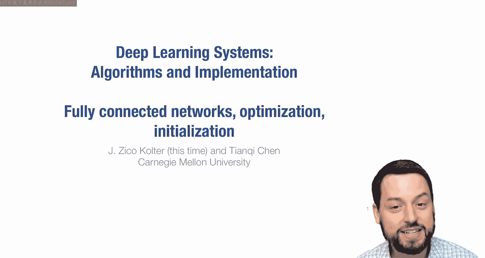

All right， so let's jump right in。And first， start talking about fully connected networks。

This is actually going to be， in some sense just kind of a rehashing of the same material we covered in lecture three so two。

Three lectures ago now。Um but the basic idea here is that now that we've covered automatic differentiation。

 we can actually be much simpler in our definition of the Li connecteded networks。

And we can also be a bit more flexible， too， we can add a few more elements to them that are kind of common in practice。

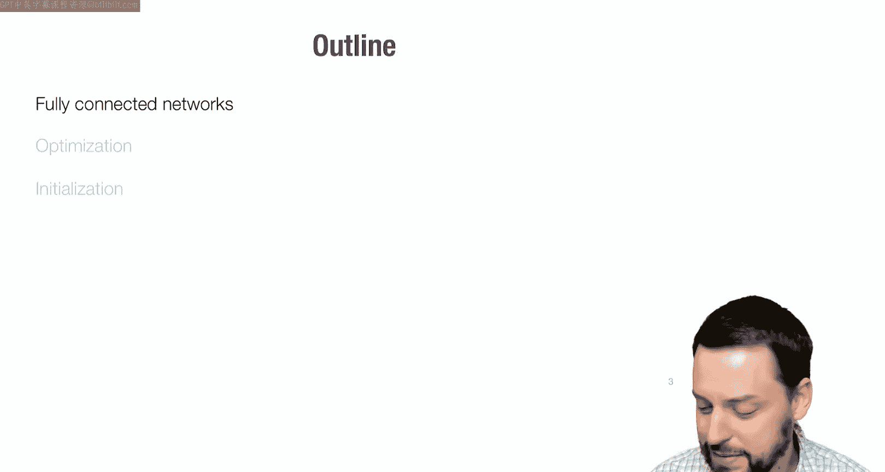

So in particular， we're going to define a L layer fully connected network also called a multilayer perceptron or MLP。

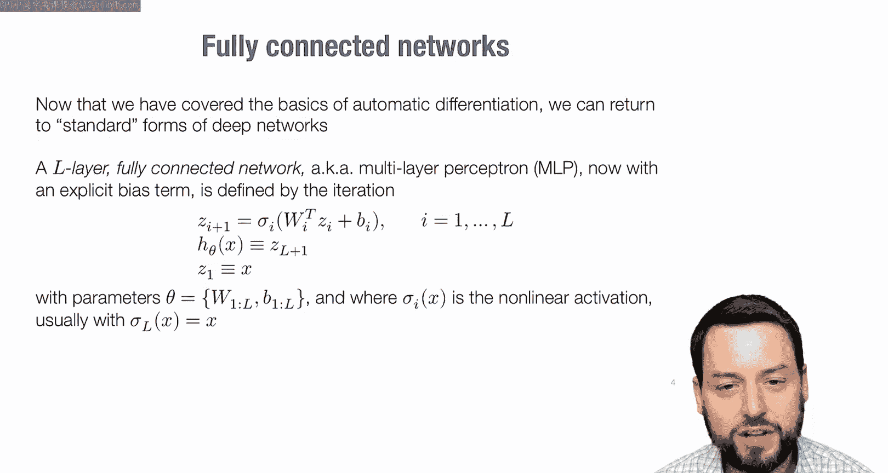

In the following link way。We're going to say that Z。

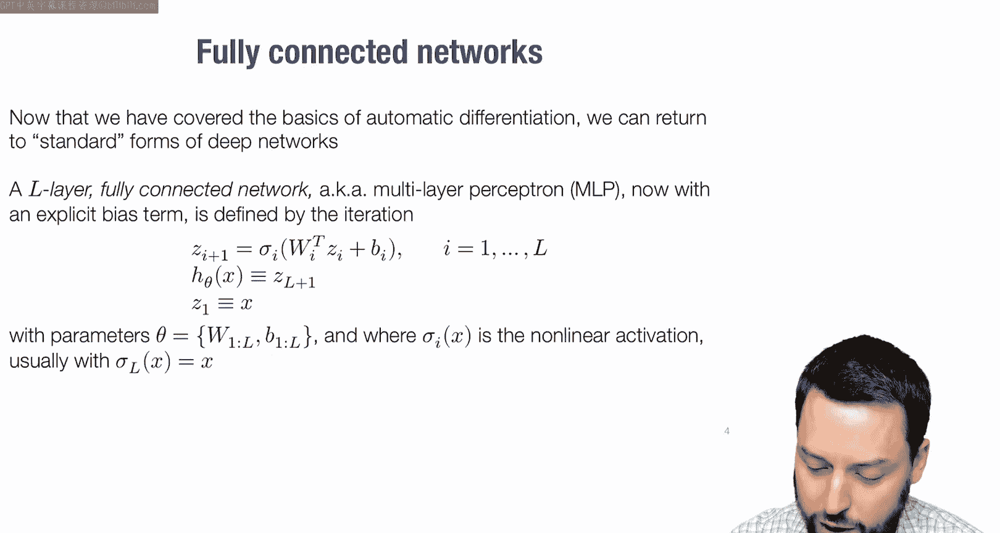

The I plus1 activation or just layer in the network is equal to some nonlinear function sigma of a linear function of the previous layer plus a bias term B and now this in this case。

 we're actually going to be explicit about， including this bias term B。

 which we didn't include before， mainly because when we went to the exercise of manually driving men driving back。

 it was just one more term to deal with。But now that we've sort of simplified this using automatic differentiation。

 or at least how we do these things， we're going to include it because it's pretty standard。

We're going to define the output of the network as just the L plus one layer。

 so we repeat this iteration at first L times， and then the output is just the last value of that iteration。

And we also define the first layer being equal to x the input of the network。

Now the parameters of our network here are W1 through L and B1 through L that makes up our set of all the parameters theta。

And sigma I is some nonlinearity， so that's the nonlinear activation function。

 like a re or a sigmoid， we're typically going to use res for most of these examples in this course。

So at least for the first bit。And then usually it's also the case， though。

 this sigma I can vary depending on I here， and usually it's the case that we choose the last layer to just be a linear。

 linear the last on layer to be a linear function so that our lodgees essentially are a linear function of the last layer。

All right， so this is going to be our network and just to find a few more things here。

 I want to mention that if we look at the sizes of these things。Z I。

 if we say we're not going to dwell too much on this because the reality is for the most case。

 you don't really need to worry about these things because you can just define them once。

 and then that sort of works。 but let's let's let's give names to all these things here。

 Let's say that Z I would be a vector in N。 So N would be the size of the Ih layer。Well。

 in that case， WI then would be a matrix， well， WI transpose has to map。N I to NI+ 1。

 So W I would be N I by N I plus 1。And of course， B would also then be vectors in N plus1 It's important to note here that B is a vector in N plus1 because we're adding it to sort of the output of our linear transformation and so it has to be the size of the next layer。

And the nice thing is that now that we've defined automatic differentiation， we are now done。

So this is a full complete definition now of a fully connected network。And unlike before。

 we don't have to worry about deriving the back prop equations for this of finding ingredientss of all these things when it's connected to larger as part of a larger network。

Because now we can just implement these operations in the forward path of a network。

And let our automatic differentiation tool give us a way of automatically computing the gradients and that's an amazingly powerful thing right and it sort of shows the power of automatic differentiation is that now we are done with our layer definition。

😊，Almost not quite because there is one little issue that I want to mention here， which。

Seems like a minor point， but which you actually end up spending a lot of time on when you implement some of your networks。

 you probably already started to encounter you've encountered homework one already on my differentiation。

 you will encounter things relating to the size of these various operations。

 especially when and vectors interestsric here， especially when you use the matrix form of these expressions。

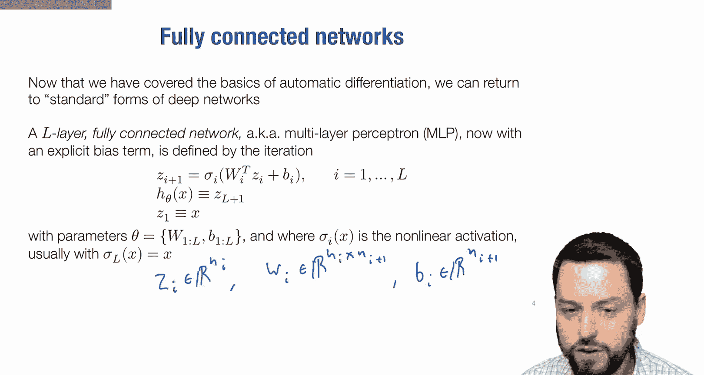

So let's talk about the matrix form of these expressions The most obvious thing here to do is say well。

 you know we have our our matrix form is before， remember we have our termszi I here。

 so Z I is going to be like a stacking of all the Z's right so we have like in the first row it would have Z1 transpose。

😊，G it would be the I1 transpo and the second row would have Z。2。I transpose， etc。

Sort of the list of all our activations for that layer in the rows。

And we have this sort of now very simple matrix form that we saw before。 right。

 so we're going just apply these things in matrix form。 and this is now the。

Because these things are already transposed here， you actually don't include a transpo。

 and you include WI after it， but this is all the same as in our original poly connectedic networks。

The difference here though comes in the bias term here。So remember， B。Is a vector in RN+ 1。Sorry。

 R I。And i+ one。and what this means is if we just， if we didn't write this， so if we just instead。

 if we sort of crossed this out for a moment and just wrote this in terms of BI right so sort of copying thenotation from the previous slide。

This really wouldn't work， right， because this matrix here。Would be in， well。

 it would be M by N plus 1。And that's a matrix and you can't add to it a vector。

 right these sizes don't sort of compute here。So what we need to do linear algebra wise is adjust this slightly。

And this is actually exactly the operation we're going to have here。

 the operation is going to be1 times bi， where here one signifies the vector of all ones。

 which in this case would be a M by one vector of all ones。

And then we would transpose B so that bi transpose here would be a1 by ni plus1 matrix matrix or essentially a row vector of dimension n plus1。

And their product then would be a M by N plus1 matrix， this product then。Is an M by N+1 matrix？

Where each row of that matrix just includes basically a copy of B right。

 so basically this matrix here。Is just equal to。A matrix that has B。

I transpose in the first row and also B I transpose in the second row。

All the way down to M copies of this。And that's kind of the linear algebra way we form these things。

 we have to do that in linear algebra to write this sort of precisely in order for these matrices to actually make sense or these operations to make sense。

 it's made to operations。Now， in practice， though， you don't want to actually do this。

 you don't want to form a M。Or at least explicitly form a。

M by one dimensional row vector multiply as a matrix multiply with a transpo version of your bias all this kind of stuff。

Because in practice， you actually don't form these matrices。

You don't want to do that because essentially it just wastes space we'll actually talk a lot about space and memory kind of waste later on because there are some cases where you want to kind of form these in the fly for more efficient operations but here let's just say that you know if we're talking just about kind of memory。

 we wouldn't want to form this matrix right this matrix that just contained a bunch of copies of the same thing。

And so what we're going to do instead。Is。Talk about broadcasting。

Broadcasting is a topic that you will deal with a lot in you deal with it starting homework One when you actually implement the automatic differentiation through broadcasting operators。

 which actually is quite subtle and take some struggling through and you will struggle through it a bit in your first homework。

But the basic idea is that instead of explicitly copying this vector many times。

We use this technique called matrixtrix Broadcasting。

And matrixtrix Broing is you may have seen it already if you've used libraries like NumbPI before。

 NI has sort of a very advanced but confusing set of matrix broadcasting routines that can be quite confusing if you haven't seen them before。

But the basic idea is broadcasting treats matrices that have singleton dimensions。

As make did that kind of automatically expand their singleleton dimension。To repeat multiple times。

 such that they sort of match the sizes of other matrices。And nuy included sort of very。As I said。

 sort of very involved broadcasting rules。But in needle， the framework Gil'll be writing。

 we're actually going to use a much more explicit form of broadcasting。So for example， in needle。

 if you wanted to take a N plus one dimensional vector， so if you want to take。

 say this BI vector here。And treat it as a essentially M by n dimensional matrix。

You wouldn't do the following。 You would call something like B。

 You'd first have to explicitly reshape it because B starts out as a just a。

An NI+ one dimensional tensor， essentially。And our 1 D tensor with an i+ 1 dimensions。

 And so you want to call something like reshape。To first pass a new size to it。

 which would be in this case one by。I'm going to sort of mix math and code here。

 but that's sort of the variable for N+1。 So you have to call it sort of first reshape it to the proper size and of course this is valid because this doesn't change the number of elements in it right it just sort of adds one more dimension to our tensor。

And then you would need to broadcast it to some other shapes。

 So anyone has to call the function broadcast2。M。It's a size here。

 so it would be in a couple of M and N plus1。And something like that right now this is not an implementation lecture。

 so I'm just going to say this here， but these are the sort of operations I'm going to say this briefly。

 but these are sort of operations you sort you want to do to resize this this properly and I'll just mention it because this is something you will have to do for for the first assignments。

😊，But more importantly， you're gonna to have to think about how these reshape operations and these broadcast operations actually are implemented in automatic differentiation sense because that actually is not that trivial you have to sort of think about what's if you have an operation that broadcast。

 how do I compute the adjoints of this and it's somewhat tricky but if you think about it for a while you'll be able to figure it out and you will in fact implement this in your first homework so you will work this in your first homeworkmark？

But that's just a quick note because。These seem like kind of details。

 but they actually are very important from the sense of implementation because you need to know what you are copying and what you are not copying and this is sort of the basics of how we do that in linear algebra。

 at least when we implement them in a library like Numie or like Ne。

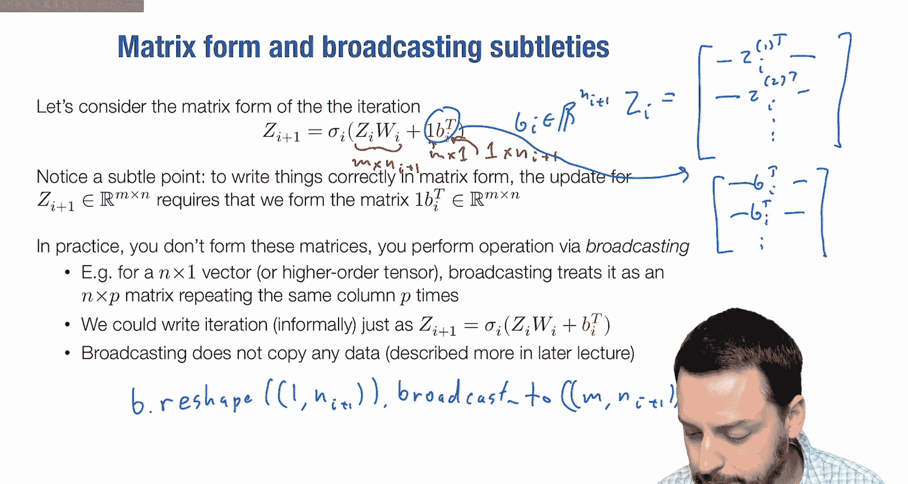

All right， so now that we have these ph networks， we have a bunch of questions we can kind of ask about these things。

To be honest， the next several lectures are going to be about how we both。

Kind of mathematically train networks like this to solve some task。

But then also how we implement them so this lecture is going to kind of cover things like how we you know how we can optimize the parameters for networks like this actually is going to be about optimization in general。

 but really applied now to the problem of optimizing this sort these sorts of problems。And。And。

We're also going to talk a bunch about sort of the other details。

 like how do you actually implement kind of a Python library that does these things all in a very nice and modular fashion。

 how do you ensure that this， how do you what layers or what aspects can you add this library to ensure that optimization initialization all these things kind of play nicely together。

And these are going to be a bunch of sort of in some sense， very problem specific answers。

 but by going through all these points in the next several lectures。

 you'll be able to get a sense of sort of how you accomplish these things。😊，All right。

 let's jump right in then to optimization。

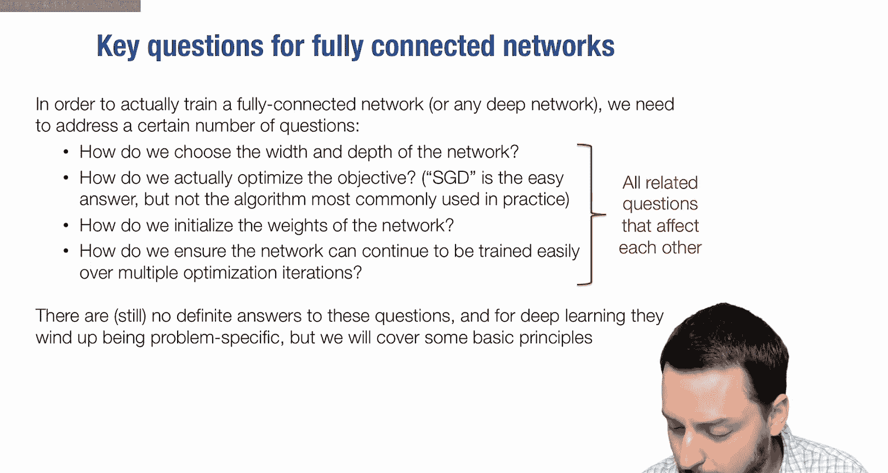

Remember the basic problem that we have of a network， no matter what。

 and I'll just try this here because you've seen it before， but I'll sort of write it again briefly。

 This is the core optimization problem。 you'll see it actually in several in several slides again。

 but our core optimization problem remember is that we want to minimize。Over our parameters theta。

The average。Mimize。The average。Of our loss， of our hypothesis。On this example。And the output。

That is our goal。And for the purposes of this section， though。

 I'm going to call this whole thing here。Just f of theta because it's just some function the function we're trying to optimize over as in terms of the optimization。

 it just some function of our parameters， and we want to find the parameters that minimize this value。

 in this case， the parameters， for example， in the case of a fully network， the parameters would be。

 as I said， W1 through L and B1 through L， but really what's important here is that we're just trying to optimize some function。

And so what we're going to do now is we're actually going to take a deeper look at some of the optimization methods that are youth in practice for a lot of deep deep learning training。

 essentially。And before I said that， oh， we used。Gdian descent or schastic gradient descent that's not entirely true。

 there actually are a bunch of modifications of SGD and gradient descent that we use very commonly in deep learning。

 so we're going to cover these in this next section now。

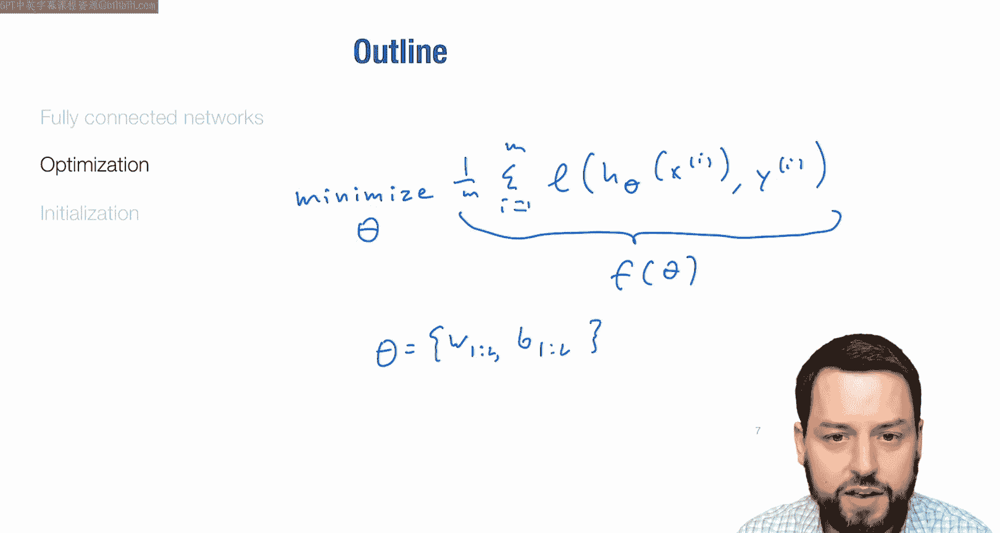

Let's first start off by this recapping gradient descent。So。

 our gradient descent algorithm was an algorithm that took our current values of the parameters and just set them equal to those values minus some small multiple of this gradient term。

Where before we computed this gradient term kind of。But by hand， but now this gradient term here。

The beauty is that we can get it kind of done automatically for us through automatic differentiation。

Now before when I wrote things， I wrote them as our parameters theta were equal to theta minus some multiple of the gradient。

 right， this is how I wrote things before。Um， but all I want to say here is that for this section。

 I'm going to be a bit more explicit and I'm going to have explicit subscripts that indicate whichum which。

Iteration of our algorithm orre in。 So T here is going to be the iteration number of our algorithm。

 And the reason we do that is just easier。 this is sort of the this would be like the implementation view of these things as a bit sort of how we implement encode code or sort of algorithmically the gradientcent algorithm。

 but mathematically， it's nice to think about these in terms of sort of a progression of these parameters over time。

 Of course， you don't want to store all the parameters right you don't want to store all the parameters that t plus1。

 all your parameters from your first iteration gradient the and you want to overwrite them。

 of course， but mathematically it's nice to think about these things being kind of evolutions over time。

😊，I also want to sort of remind everyone about this weird gradient notation where this theta here indicates which parameter we're differentiating in respect to。

 we don't really need that here because there's only one parameter of a function F。

 but it indicates sort of which parameter we're differentiating with respect to and this parameter here is the value that we are evaluating the gradient at。

 so this notation also makes more clear kind of what this gradient really means this one I've always found a bit a bit confusing again。

 despite the fact that we have to use it because it's what people use。And remember， and and here。

 of course， Al was our， was our step size。 So this was the gradient algorithm we covered in a few lectures ago and。

😊，It's sort of the basis for in some sense， all optimization and what it does remember the gradient points in the direction of steepest increase of the function。

 so subtracting off the gradient here actually decreases our function in the steepest direction and small enough step size this will then cause a decrease in our function under various assumptions。

All right， so that is our sort of basic starting point for optimization。

 that's the same as you've seen before。

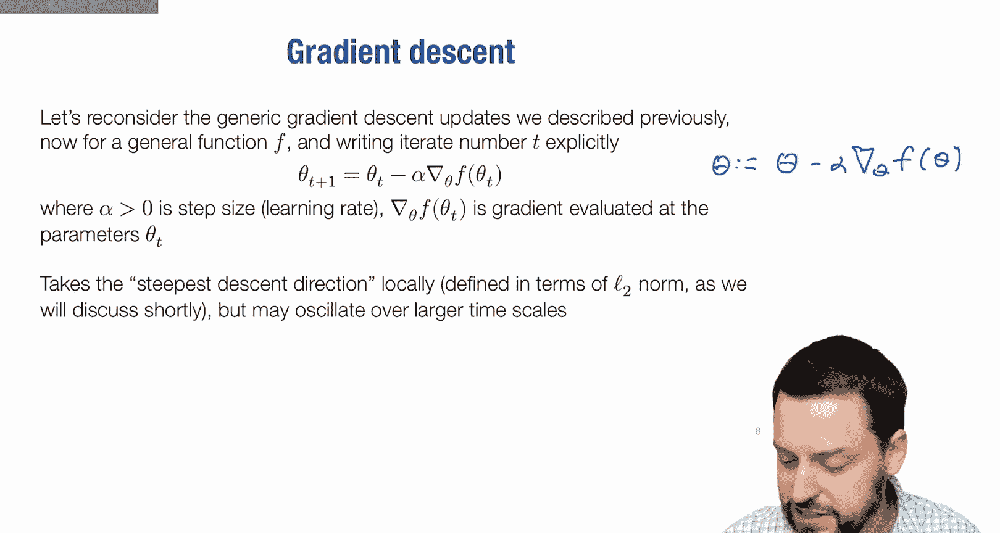

But now let's sort of take a few more looks into this in a specific case because we're going to use this case when we talk about other methods。

 other optimization methods instead。So I'm going to actually consider a very simple quadratic function here。

 they were optimizing， so I'm going to consider here theta。😊，In this case。

 just actually be a two dimensional vector just so I can easily visualize these things。

Where in these plots here， for example， when I show this plot like like the ones you have here。

 I'm going to show this plot in terms of the evolution of theta so the as of this plot are theta 1 and theta 2 In other words。

 I'm showing the actual parameter slip so I should say that this is really in。😊，R2。Or n equals  two。

 I guess。Thats right， so it's written here too。This function now is a quadratic function。

 is a function that has a quadratic term in P， and so this is you know the the inner product of theta with a in this case P P I P would be a。

And alright， sorry， a2。By  two matrix， and Q would be a。2。Dimenssional vector， so that。

When you take all these products here， you get a scalar output。

And what these plots show here is these plots show the evolution of our parameters and the evolution of our function for in this case。

 two different step sizes。So in the case of the step size， alpha equals 0。35。

We get sort of our function our parameter values are kind of bouncing back and forth right so they start over here。

 we take a gradient step winds up here， then a gradient step here， here。

 etc ceter until we sort of reach the off of this function again this function what I'm showing here are sort of these circles here or ellipses here rather are the level sets of the function so that they are points of constant value of the function So the function kind of is curving out up from these from these points and this shows know the evolution of the parameters here they kind of bounce around in space like this over the iteration of gradient descent So this one here would be theta 1 this would be theta 2 theta 3 etc。

And then this function here shows the evolution of our objective F theta so what's the actual value of f theta at different iterations and that decreases as you would expect right so we're getting closer and closer to the optimum as we go here。

 but essentially this point here cometh corresponds to like this point in the graph。😊。

And what I'm showing here is this for two different values of alpha。

 So what we see is with a larger value alpha， you converge actually fairly quickly。

 but then you also kind of bounce around a bit in parameter space whereas if I take a smaller alpha alpha equals 0。

1 I converge more slowly but I don't bounce around as much in parameter space and these are actually the kind of tradeoffs we talked about last time when it can descent when you kind of decide between do we want to try to converge quickly do we want to try to not have a parameters change too much。

 how can we trade off the different dimensions of optimization。

 these sorts of things and this is all very hard to do kind of our priori because if you didn't know what this function looked like and it wasn't a2D function but an ndisal function how would you know how to pick your step size probably to just try out different things and see how fast they converge。

 see what caused divergence， this kind of stuff。And so in some sense。

 what the rest of the section is going to be about and the rest of what a lot of optimization in deep learning deals with is how we create updates that are able to more quickly reach low points or good points of our objective value without too much effort in tuning step sizes or maybe different step sizes and these sorts of things。

 this is really what a lot of practical optimization is about。

So what we're going to do now is cover several alternative methods for optimizing this function。

 which may have different rates of convergence or different sort of。

I guess there's sort of sort different behavior of convergence。

We're going to focus for the most part， at least for the first part on this simple function here。

 which is in some sense， quite misleading because this is a simple。

 in this case convex quadratic function and the behaviors you see here are not always indicative of the behaviors you get for。

 I would say real deep learning optimization， but it's nonetheless a that kind of instructive to think about how these algorithms would work on these simple objectives but of course the real proof is and their operation is how well they will work in sort of real。

😊，Deep learning and the optimization of real deep learning。

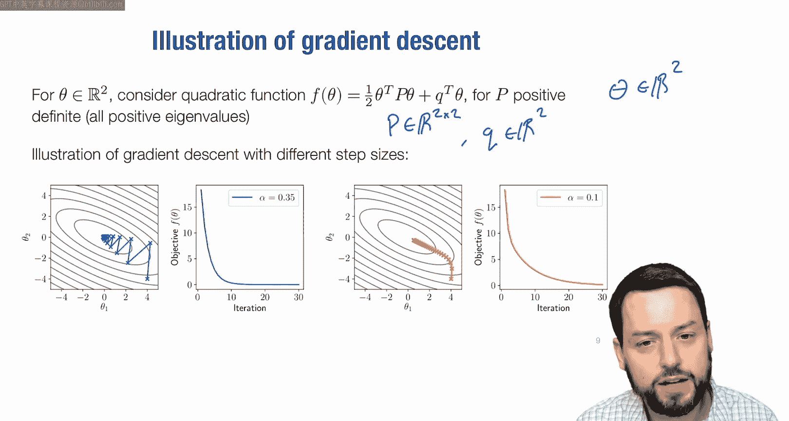

So the first method that we're going to talk about as an alternative method for optimization is Newton's method。

Now News method is kind of the classical second optimization method you typically see if you take an optimization course。

 so you first learn about well maybe you first learn about like these ques。

 but then when you learn about iterative optimization you typically learn about gradient descent。

 then you learn about Newton's method and so because of that I do want to highlight what newss method is here but before I even highlight it I want I want emphasize on the next slide too but before I even write it here I want to emphasize that this is not very heavily used in deep learning and I'll get the reasons in a second but Newton's method despite being kind of in many cases the right approach to traditional optimization。

 it really does form the backbone for a lot of classical methods and convex optimization it's not that heavily used in deep learning for reasons we'll discuss in a second。

But let me just jump right in then and talk about what newss method is。

 so News methodod is another kind of update and write it I'll just write it here。

 it's also written out in normal typing normal types setting the slides。

 but I'm going to write it here in the slides you can download。

 but I'm going to write it here just to sort of repeat these things and go slightly enough。

The idea of this methodist is we're going to do a similar update to gradient descent。

 so we're going to have our parameters minus essentially some scaling of the gradient。

So we're going to have our gradient term here， as we did before。

But we're going to scale the gradient and we're actually also going to have a step size as we did before。

But we're going scale the gradient by a matrix。 we're going apply a matrix to this gradient before we take a step in it。

 which is going to in some sense， give us the the right direction for at least functions like the one you saw above which are quadratic functions So actually maybe to motivate this I'm going to go back to this previous slide for a second and one to the fact that gradient the sense。

 you know it seems like it's kind of。😊。

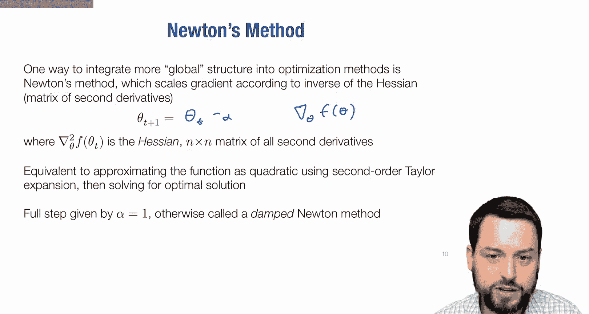

Kind of taking a lot of time to do something very simple here。

 we sort of know in this function that the optimum is right here。

 So if're if we're starting over here， you know the fact that this function has sort of different magnitudes in different directions。

 This causes the gradient to kind of not be very aligned with the proper direction to the optimum。

 And it turns out for quadratic functions or really for convex functions in general when they're approximated by a quadratic。

 you can directly correct for this using what's called the hessian or which is essentially a set of second order derivative to the function let me just write out what I mean by that。

 what we are going to do in Newton's method is we are going to scale this gradient by a matrix。

 which I'm going to write like this， I'm going to write it as。

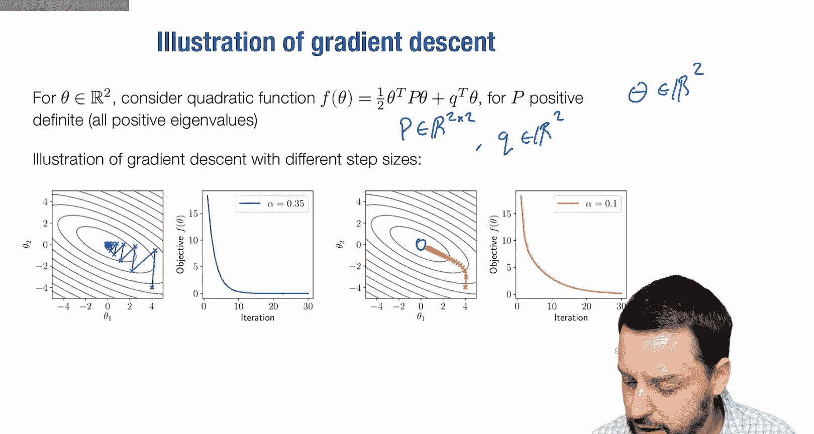

Looking like the gradient， but a little squared sign here。Of theta T this is going to be theta T。

 this hessian matrix here。 and I'm going to invert it。

 And just without getting into into too much details here。

 the Hessian matrix is sort of like a second derivative analog for multi multivariate vector input。

 scalar output functions。 So just like the gradient was the multivariate analog of the derivative。

 The hessian is the multivariate analog of the second derivative。 And in particular。

 the hessian is defined as a matrix or the hessian。

 I should say something like this for for F mapping between Rn and R。 So a scalar value function。

 supporting this takes this function takes vector inputs and produces scalar outputs。😊。

The hessian is defined as a matrix of sort of all possible second derivatives of this function。

Allright， so it would be equal to a matrix of， first of all， the derivative of。

Theta with respect to theta1， actually in this case， it would be。There one。

And then the derivative with respect to。TheNext column would be the derivative。

 second derivative of F theta with respect to theta 1， theta 2。

 so I essentially would be square should be over here。Then and then sort of et cetera。

 So this this and this this next one would be， you know。

 all the way up to the derivative of F theta with respect to theta 1 and theta n and similarly。嗯。

Down here。Would be the derivative second derivative of F theta with respect to theta 1。

 theta n I aator is theta n， theta 1， but of course， that's the same as this thing。All right。

 so I'm writing this quickly and after even I don't even have this formula on the on the slides you can go back and kind of。

Or rather， you can go to sort of any standard reference on matrix Calculus and look up passions。

What this is is this is basically just a matrix of second derivatives and the way to interpret this update rule here。

 which again， I I won't want to get into too much because。

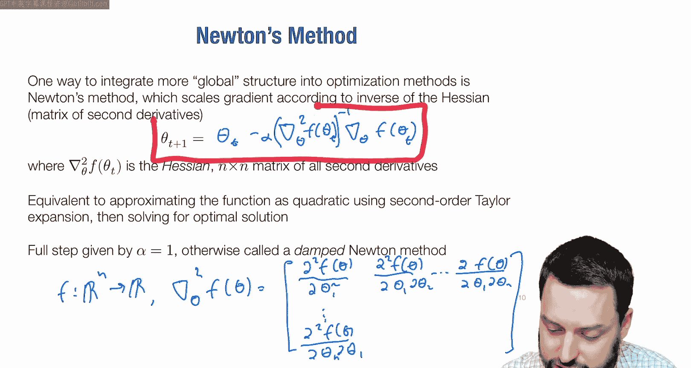

It doesn't really matter for deep learning， but I one of these put it up here is what this update actually does is this update approximates the function F using what's called it second order tailor expansion。

 so this approximates it using essentially as a quadratic function that involves the hessian and the gradient of that function。

 so it involves a second order Tayloror expansion， which essentially is this approximation of the function F and then for this second order approximation it solves this sort of exactly the quadratic form of this second order of second order function。

😊，And that's the basic Ideence method again， I'm actually not intentionally not being too detailed about sort of covering it here because it's not that relevant。

 but what I want to highlight here， and I should also finally mention that if you take a step size alpha equals one。

 this actually corresponds to what's called a full Newton step。

 but if you take alpha less than one this is what's called a damped Newton step。

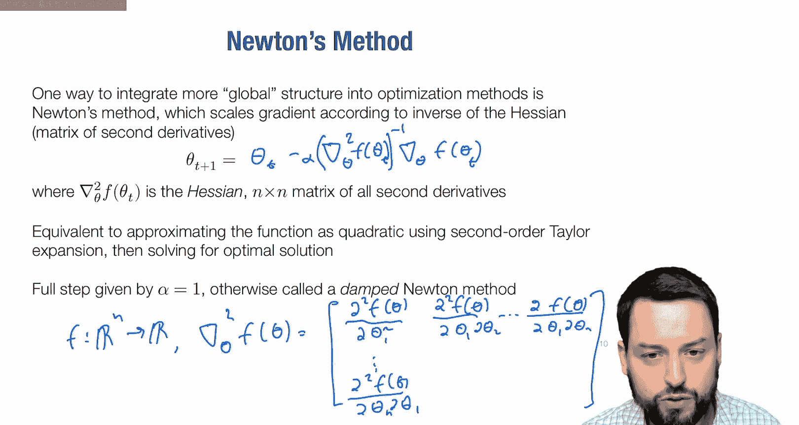

The point I actually want to make is this slide here， which is to say the following。

 it turns out that the direction for a quadratic function。

 remember this function that that we have on our previous slide this is a quadratic function that has just a quadratic term and a linear term so we these slides ago right it had a quadratic term here and a linear term。

😊。

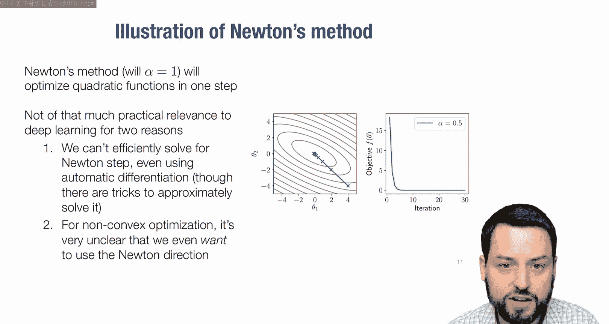

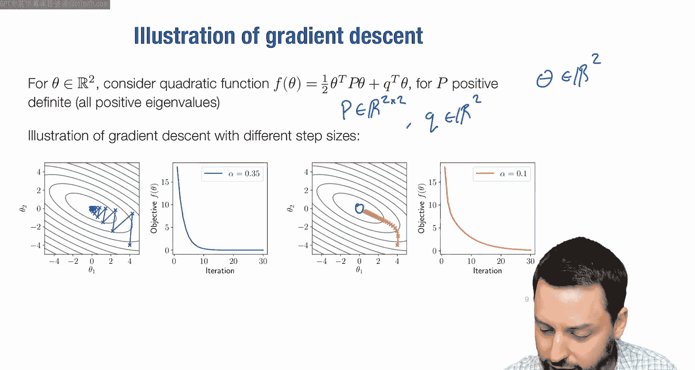

4 quadratic functions， Newton's method actually gives an exact solution to our Newton method with alpha equals1 willll actually get to the solution in the exact right way。

 So what you see here is the steps that were sort of following point exactly to the optimum。

 So like at each point we're sort heading directly toward the optimum。 And in fact。

 if we took a step size alpha equals 1， I'm showing out alpha equals five here。

 So we start here and take like half the way to the optimum， then the next half， etc ce。

 But if we took an alpha equal to one step， we would go right to the optimum here。😊。

And this you can it's not very hard to prove this you just sort of what ends up happening is that the update for for the quadratic approximation of F for querytic function actually is just the function F and newsement that just solves that exactly maybe I'll write that out briefly so if our just just in the case of a quadratic right so if F theta is equal to1 half theta transpose P theta plus Q transpose theta。

😊，嗯。😊，Then then we can actually solve， then the gradient with respect to the theta of f theta is equal to in this case。

 actually P theta plus Q。And we can actually solve this exactly because we can just set this just means that theta star is equal to p inverse Q negative p inverse  Q and actually it turns out that this term P here is exactly the hessian that we have and Q is exactly the gradient or rather this update when terms cancel。

 give give this exact expression here and you should just get your next expression actually equals this you can verify this essentially actually quite easy to show this is the gradient here but when you multip the gradient by the hessian which is in this case P then form a newton update terms cancel out and so you this exact solution here。

But you can do that as an exercise if you want to。The point is that newss method will solve this quadratic exactly for a or will solve this function exactly for a quadratic and what that means。

 though in in our really the important point I want to emphasize in terms of our discussion here is what this means is that in some sense we are news is finding the right direction of descent for this function so it's always going directly towards our optimum and that contrasts with gradient descent which was sort of bo around this function it was not finding that gradient descent was not finding the actual kind of right corrected directions。

 the optimum whereas Newton methodod does。However， and this is why I am was sort of intentionally brief about some of these things and not going through a long sort of lecture on Newton's method。

 This approach is not all that common in deep learning and I know I'm going to get a few sort of objections here and people say well okay not exact Newton's method but approximate Newton's methods are really popular in deep learning you know we have all these great methods we just we see all these papers about how second order optimization is is great for deep learning and and my response to that is I I am very skeptical of second order methods for deep learning。

 at least anything beyond sort of or I guess anything beyond adaptive gradient methods which you might argue our second order in some way but which we'll cover in a second。

😊，The high level point here is the reason why this method is so hard to apply for deep learning is that we can't。

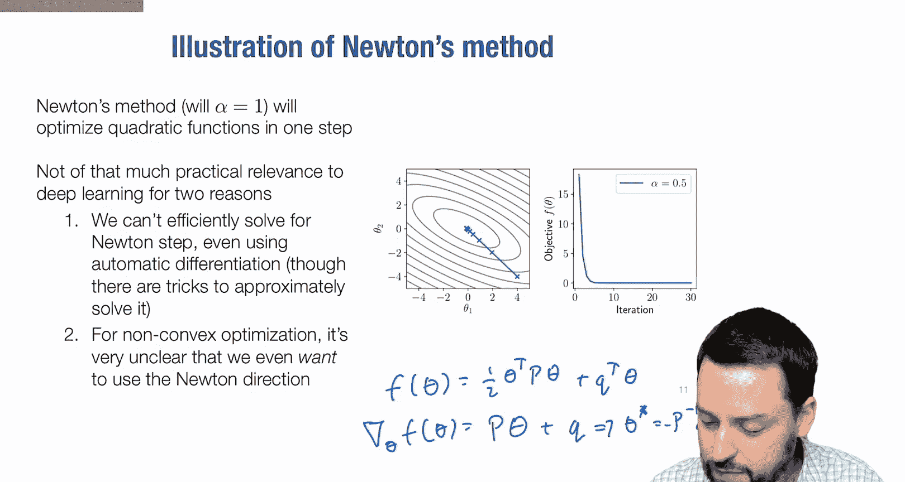

Using using sort of for deep networks， right， think about how big this matrix here would be。

 It's a n by n matrix， which is a so so this matrix here would be， of course。

 because it's the number of rows by the number of columns。

 then this is a this is an n by n matrix here。Number sorry。

 the number of parameters by the number of parameters。 N by n matrix。 And so in deep learning。

 it's not uncommon to have millions of parameters， right， billions of parameters。

 some models even have trillions of parameters And and this is just impractical to even form this hessian。

 right We're talking about a matrix that's you know has has more storage that you can ever fit on like a trillion by trillion matrix。

 you can't can even talk about that。 you also now there and so you know actually computing the Hesian。

 let alone inverting it is's completely impractical。😊。

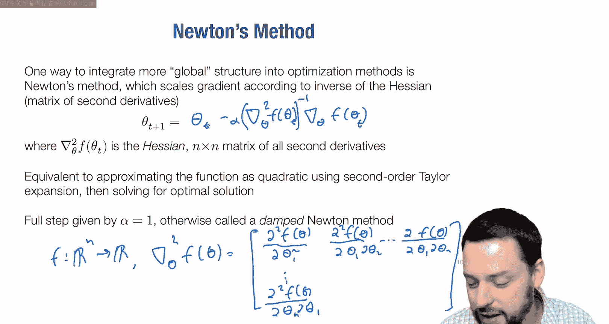

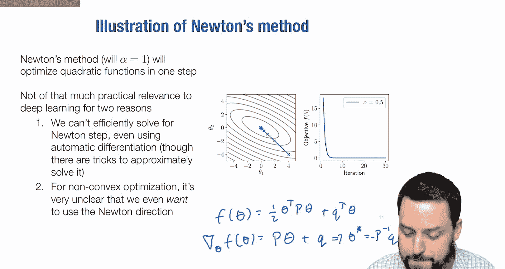

You can't even multi the goal we want to do in some here is we want to multiply our vector with the inverse of the hessian。

 you can't do that either Now you can actually implement a product with the Hessian itself so I can actually multiply a vector not with the inverse of the hessian。

 but but using automatic differentiation， this is just sort of an aside this is not something we're going to do here。

 but it turns out you can using automatic differentiation multiply vectors。

 arbitrary vectors with the hessian So if I have some vector V I could form this product。

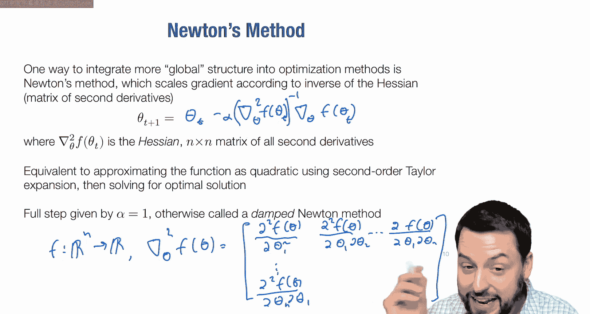

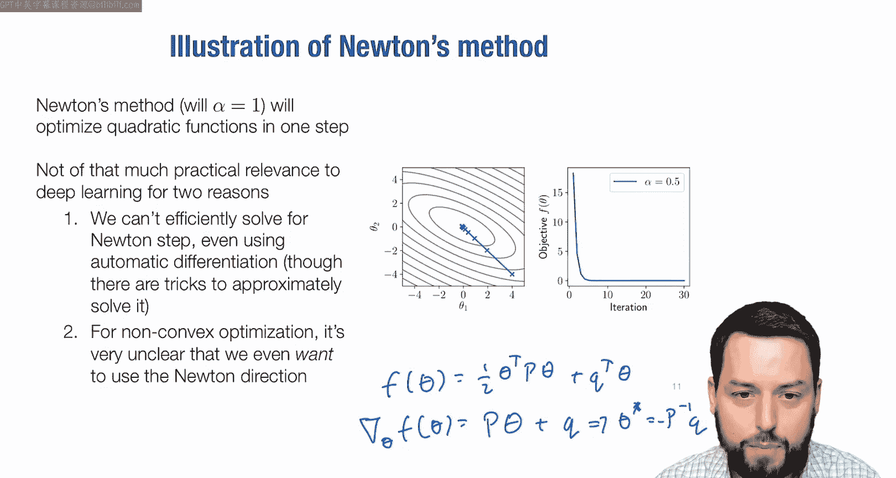

But now if I want to form an inverse of the Hessian。

 I need to do approximate inversion using what are called indirect methods that use as products with the matrix you're trying to invert。

It's all doable。But I've never seen。A truly compelling example unless you sort of know a lot of structure about your matrix。

 And this will be a debate。 People will will disagree with me on this。 And I'm sure people will。

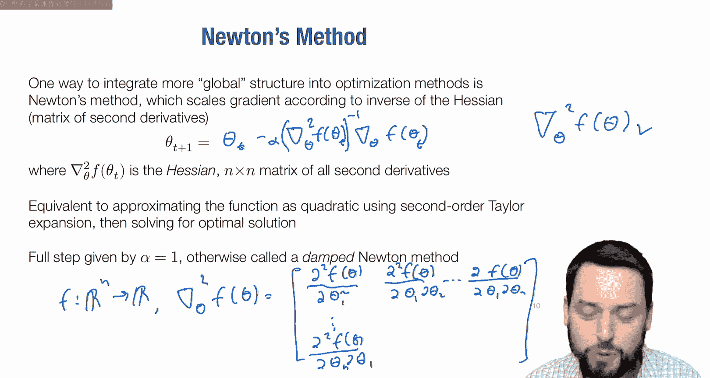

Well some people might have examples where news method or approximate methods do work they're also harder to make stochastic so you have to make these stochastic too it's just all in all a real pain and the last one I would say is that you know while news method in some sense for a lot of convex optimization problems is the right algorithm for nonconvex optimization which what we deal with in deep learning it's unclear that you even really want the Newton direction it's unclear that this sort of second information gives you all that much and so for all these reasons we're actually going to very quickly move away from actual Newton's method。

😊，But what we're going to do with the rest of the section is talk about alternative approaches that start to still get at maybe accounting for the deficiencies of gradient descent。

 this tendency to bounce around too much or go in bad directions that can account for that without sort of going all the way to Newton's method or the second order terms。

 or the second order approaches。You couldn't make the argument that some of these approach some of the methods we're going to talk about even approach things that are called quasi Newton methods。

 which are sort of the things that live in between Newton method and gradient descent。

 but I'm actually just going to avoid that discussion entirely and just say that we're not going to consider true Newton E methods。

 we're just going to consider kind of additions to gradient descent that try to solve some of the same problems that Newton method gets after without anything like the computational costs of this。

 but just the same computational costs as gradient descent。

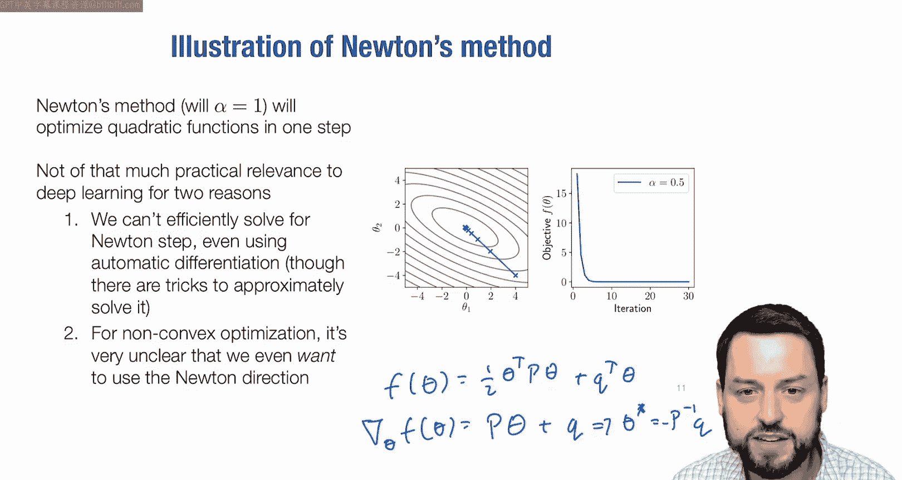

All right， so let me now talk about the first one of these， which is very common in deep learning。

 which is momentum。So essentially as it said momentum in some senses is you can think of it trying to get at a middle ground between gradient descent and Newton's method。

 but really it's much closer to gradient descent because because it's purely a first order method that it only uses gradient terms and has the same complexity as gradient descent。

So the idea of momentum updates is that in addition to our parameters。

 So we're going to have our parameters there， we're also， though。

 going to carry around a copy of what we're calling momentum terms and these momentum terms are going to be。

Additional terms that are sort of going to。Help us make better updates than just the gradients themselves。

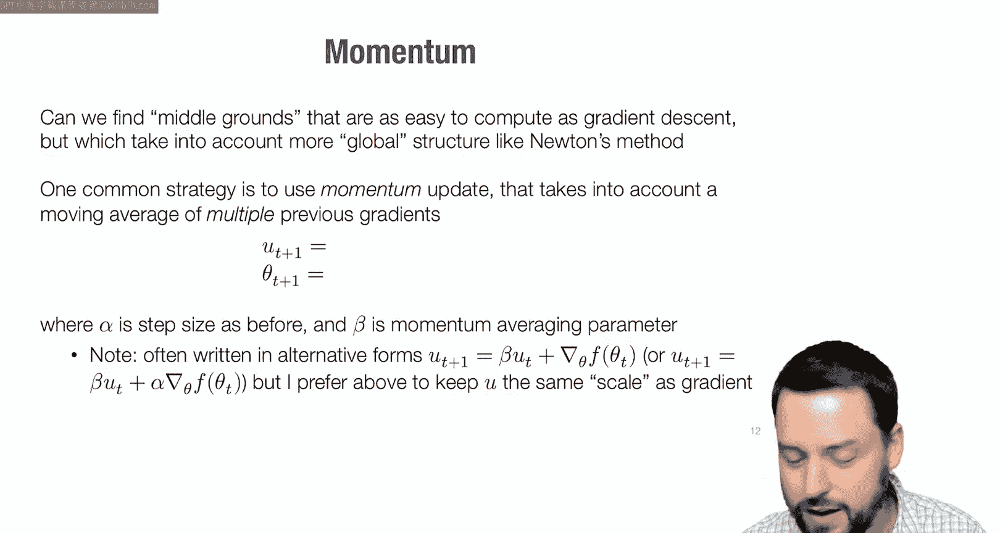

And the idea of momentum。 And I'm going to go again a few slides back for this。

 The idea of momentum is that when we had gradient descent。

 we and running with a sort of a reasonably large step size here， we kind of bounced around a lot。

 So our first gradient pointed this way。Our second gradient pointed back the other way or back a different way than our third gradient actually was very similar in direction to our first gradient right it's just sort of you know kind of repeating ourselves and in some sense。

 it you sort of take into account the behavior of this thing over multiple iterations。

 you sort of get some sense that know what what we what you should be doing is kind of averaging between these two directions this direction here and this direction here in order to find a better update and that's kind of exactly what momentum does So momentum forms this other second vector U which is in some sense a kind of averaging I mean not in some sense it actually is exactly an averaging of kind the gradients you've seen before。

😊。

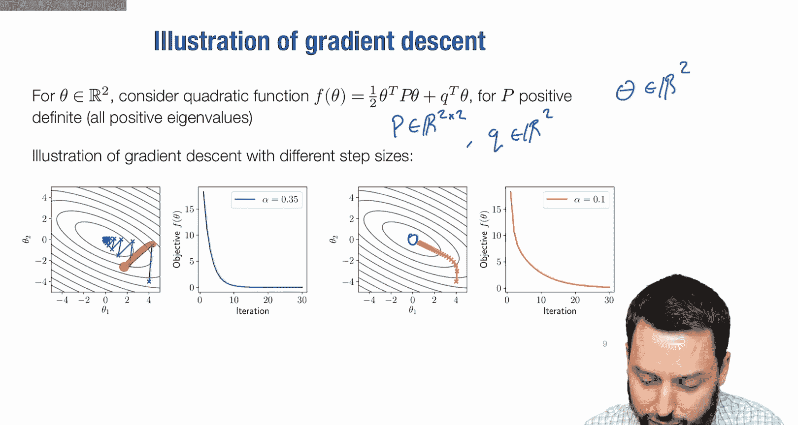

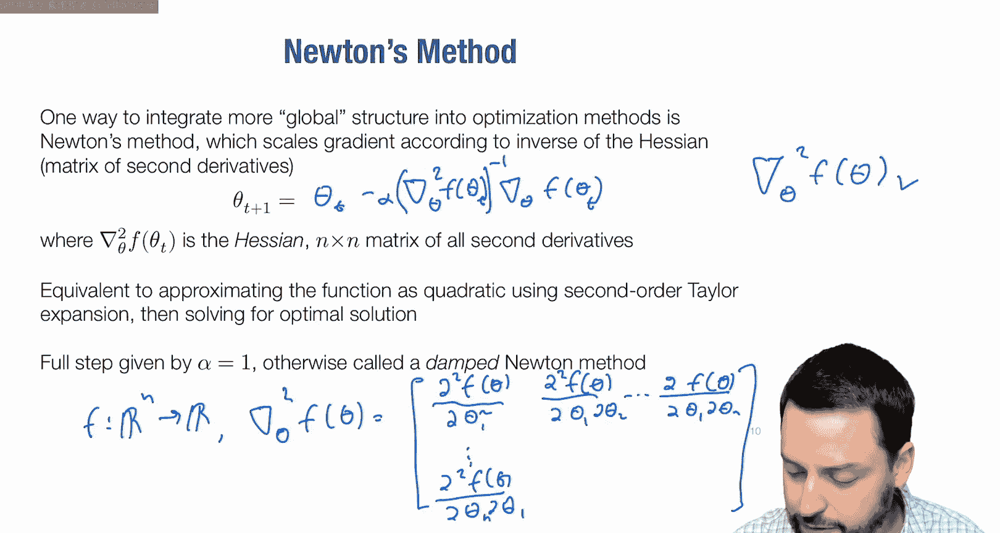

Such that you can take steps in this direction instead。

AndNow the thing I should actually mention before I start is there are many forms people write momentum in。

 so if you see momentum before or if you actually look it up in a package。

 it might be written in a different way， but I like this way of writing it because it kind of emphasizes the fact that we're averaging between parameters and it keeps also momentum in a similar scale to the gradient。

Here's how we write momentum， we say that u T plus1， which is going to be our momentum term。

 is equal to some multiple beta times our previous mu times our previous momentum term。Al。

 so it's going to be some sort of where where beta here is some scale some scalar value that's typically not not always actually。

 but typically less than one。 there actually are some crazy schemes of like。Larger than one momentum。

 but this is not what we're doing here。So we're going to put a scale down， so it's positive。

 but it's a term where we scale down， I guess it could be equal to0 then we're just doing gradient de。

 but scale down our previous momentum term， and then we're going to add kind of the other portion one minus beta to be our gradient。

😊，That's going to be our update for a momentum term so what the momentum term does is it computes what's called an exponential moving average of our gradients。

As we go。Um， because we sort of， you know， ends up being sort of。

 essentially a geometric series of the past gradients that we've seen。

Maybe I'll write this down actually this was later。

 but and then what we're going to do is we're going to take our update。

 not in terms of our gradient but we're going to make our update in terms of the。😊。

This momentum parameter， so it's going to be u T plus1。 and that's our update for momentum。

Itly called Poc momentum and has a bunch of other names that' been discovered many。

 many times called the heavy ball method， stuff like this， it has many different names。

 but it's called momentum typically。Now this is often written in other forms too so people could often write it as you know beta here。

 but there's no beta on the scaling or maybe you add alpha on the scaling there you have to just if you're encountering implementation of momentum you have to just look it up to see what it's doing。

 but is this is the way I'm going to write it and the reason why I like doing it this way is it sort of keeps you here at a similar scale to our gradients right so because it's an exponential moving average of our gradient it keeps the same scale。

Now to see this just to sort of write it out explicitly for this one case I'm not going to do this after this。

 but what we can do now is it can kind of look at what this sort of momentum really would be here right so if we look at sort of is what is UT plus1 well that would be equal to I'm going to write sort of in the other order now it would be sort of equal to one minus beta times the gradient。

Of our current term。Plus， beta times U T， but let's also expand Ut out， right， So Ut。

Eals plus beta times Ut and Ut equals you know beta Ut minus1 plus this term。

 so this would then be beta times 1 minus beta of the gradient at the previous time。

F of theta T minus1 right plus it would be again I。Then， you know， beta squared plus。

 I guess beta squared times U T minus-1。 But we can expand that 2 to make that， say， equal to。

1 minus beta。Times the gradient at times。T minus2， etcter right so we're computing in some senses we're computing kind of a geometric sum because we have this beta terms to the beta term there well we have a bit cube term。

 etctera， a geometric sum of all of our past gradients groups。

And that's sort of what we're doing here is we're computing kind of weight again。

 it was called an exponential moving average so sort of a weighted average of not just our current gradient but all our past gradients and that's what a momentum momentum term is and because of this it's sort of able to capture better。

 what our actual like which direction we actually want to move in sort of average is out our past gradients in a way that lets us move in a better direction。

Right， so this is this is sort of the basic the basic approach。

 And what you see here is that on the left here， I am showing our old grade descent method。

 which kind of balances back and forth。 So this is actually hopefully should be apparent that if you pick beta equals 0。

 this would just be then this term would be equals to the gradient。

 So beta equals 0 sort is just grade descent。 beta equals one doesn't do anything because a factor in the gradient So so beta has to be less than one again。

 typically there are crazy methods that actually have beta greater than one these don't make any sense。

 but sometimes people people can use these with the right weight。

 You definitely have to have a different you can't do this update exactly with beta greater than1 but you can do sort of modified update sometimes。

😊。

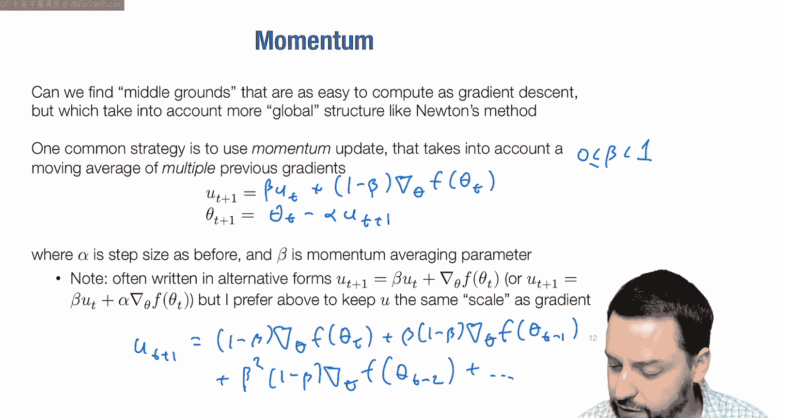

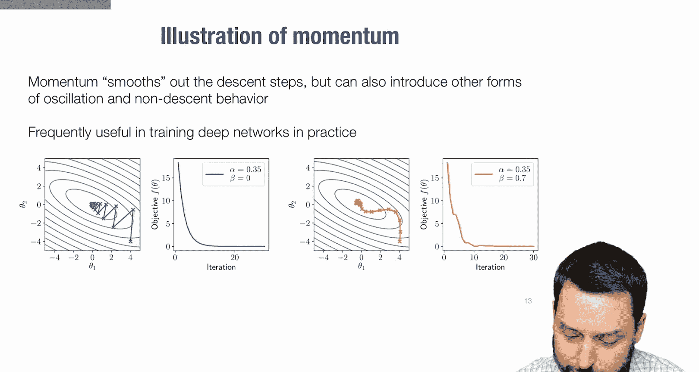

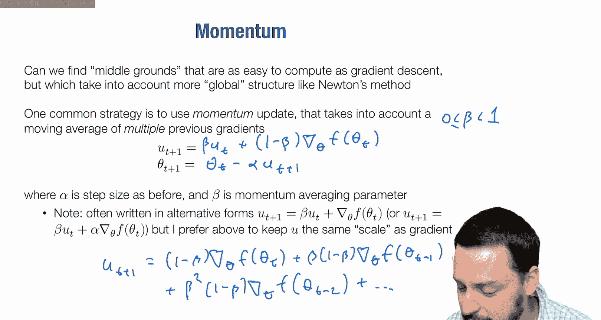

But but the point being that beta equals 0 obviously is created descent and things you know gradientcent here just bounce around like we before。

 But if we pick beta equals 0。7， what we see is to sort of know instead of this to kind of smoothly start averaging these things and eventually kind of converge。

 So that's sort of the idea there。 Now you may sort of notice that we actually you because we have a bunch of things or kind of some history kind our of our momentum built up。

 we often overshoot the optimum and things like that。

 but but these are just sort of effects momentum is just a very common approach in practice。😊。

Alright， Now one thing you might notice about momentum is there is sort of an interesting effect here。

 which is that at earlier iterations， U T is smaller than the gradient， right， Because for example。

 at， you know， what's common to do is to initialize momentum term， say it 0。

 So you'd have something like U 0 equals just 0， right， And then you'd have U。

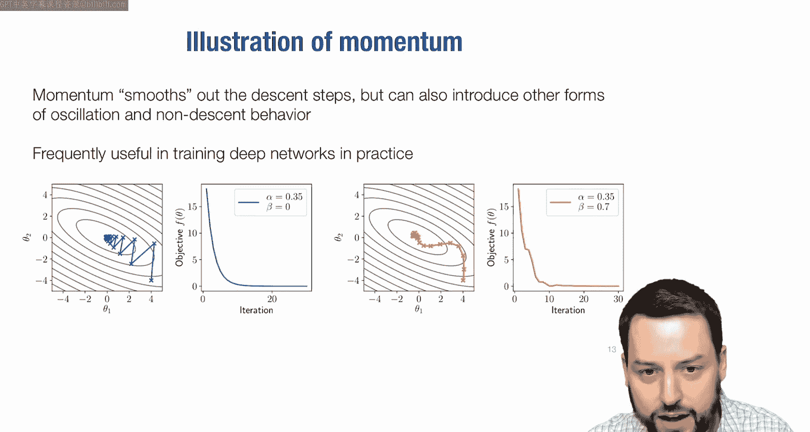

1 equals well， beta u0， but that's just 0， so that term doesn't play into account times1 minus beta times the gradient。

Of S。It initial parameter right wherever again， we'll talk about neutralization in a second。

 but theta is zero is however you initialize the。And what you notice here is that this is a lower。

Value then this is sort of you know essentially a scaling on the gradient that makes this first gradient step smaller in in value right。

 So this sort of， you know， if you remember the previous slide here。

 the first gradient step kind of takes a step like that。

 but the first momentum step takes only a little step because it's kind of warming up。

 the gradient still kind of getting sorry， the momentum terms kind of warming up。

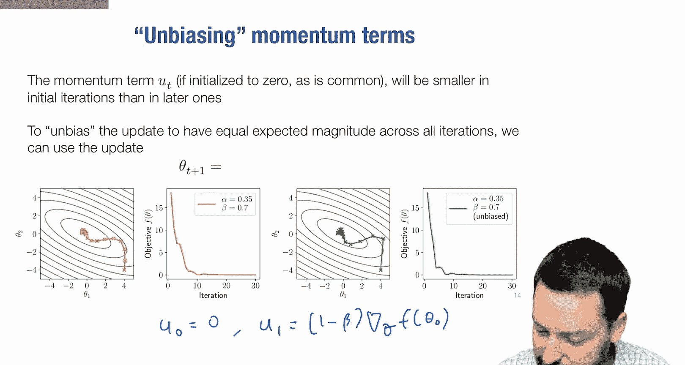

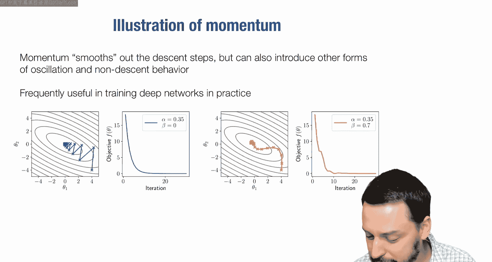

so what's common to do and this is sometimes called sort of a bias or a biased momentum term。

 so it's an expectation it's actually smaller magnitude than the gradient is which sometimes you don't want you might want to sort of rescale it and it turns out we can we can correct this if you want to correct it and the idea would be we just replace our update as that we had before。

 so our update before was theta t minus alpha times our momentum term。

What we just do is we divide this momentum term by a scaling factor that sort of corresponds to how far along we are in our optimization because sort this sort of biasing you see here。

 this will decrease the longer we go right the more kind of past history we have。

 the closer and closer our momentum gets to the same scales our gradient and so the correct factor essentially to do and you can check this this is sort of the right factor to do is you divide this should we write it up。

Like this， you divide this term by one minus beta to the T。Plus one， so for example， when。

When you have u1 here， actually this might be just beta T depends on your notation here。

 I don't know because this is right this is sorry this is U T plus1 So this would be at iteration 0 essentially you would be you would be dividing it by beta etc。

 So this term here I want to emphasize so this term kind of correct the scaling。

 And basically for u1 what this would do is this would divide this term here by one minus beta And so that cancel Latin you would actually have the first gradient。

😊，The thing I want to emphasize here is that this dissenttation here。

 this actually is not a subscript， this is a superscript and it is actually a exponentiation。

 so I am taking B to the power of T plus1 and that actually is the correct term to scale our momentum by in order to cancel out kind of the expected downsizing you have due to initial iterations。

😊，And what we see here is we run this you kind of get what you would expect right so our first term here is in fact。

 there our normal gradient step actually， so this this term almost actually looks exactly the same as our first one because we've rescaled our term to be that first step。

😊，And then subsequent terms kind of kind of you know are similarly corrected。

 so you aren't taking small steps of taking after just kind of kind of larger， larger steps here。

And what we find is actually this does typically converge faster。

 So just like and I don't think you need mention it but just like momentum converges faster than grain descent。

 this converge a little bit faster。 Sometimes you want to it sometimes you don't。

 but if you do want to unbiass your terms that sort of take similarly size steps So at all iterations you can do that It actually it's not always a great idea。

 I mean， sometimes maybe you want to take smaller steps at first because you don't have a good estimate of the right direction。

 say maybe you want to take smaller steps， it's really kind of up to up to choice。😊。

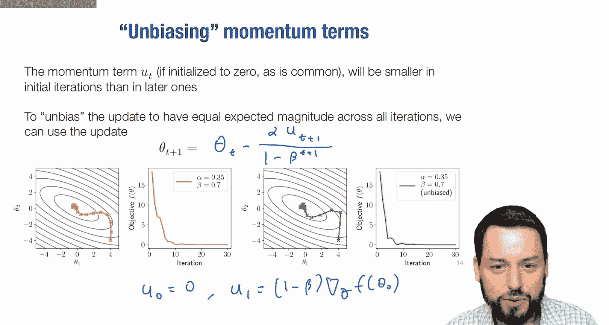

あん。One more type of momentum， which I just want to add here because it is sometimes used in deep learning is nester of momentum。

Which actually for various reasons is a。A very useful sort of tool both actually in practice in some cases but also it's a very nice theoretical tool。

 So I should admit now that there are a ton and I can never cover all of them but there are a ton of tricks that people use to accelerate grade descent and things like this to sort of make an decent converge faster we are not going to go over all of them at all。

 we're going go over the sort of the most common ones for deep learning momentum being one of them。

 but another common one is Netro of momentum。 So Ne of momentum does is actually takes our normal kind of momentum update and makes a minor tweak to it。

 which winds up being a fairly good idea。 So what it does is it takes are kind of our normal our normal。

😊，Momentum update。So that would be  one minus beta times the gradient。That's。Data T。

 but instead of actually just doing the gradient at a current point。

 we actually kind of take the step that we would take。based upon our current momentum term。

Evaluate the gradient there。And then update based upon that term。 right。

 So that's that seems kind of odd， I know， but。And I actually don't want to get in and then so our gradient update is the same then so it's the T minus alpha U T minus1 and you can do of course。

 you know bias correction for all these things too that also works。

Now this seems like kind of an odd thing。 It's not quite clear why this is the right thing to do。

 but without going into this at all， what I will say is that for certain convex optimization problems。

 it turns out this is actually a very good idea for sort of somewhat technical reasons you can get better conversionvergence you can prove better conversion rates for this kind of updates than you can for normal gradient decent and so this is sort of a good thing I mentioned that here not because it's actually not because it' actually we don't really care about the conversion properties again just like with Newton's method。

 how much those really extend to nonconvex optimization we deal with deep learning is somewhat unclear。

 but this is a nice trick sort of know about that you can compute kind of gradients kind of look ahead points in some sense and that often is a good idea。

Okay， sos that's the basic idea of N momentum and it can be implemented in a few different ways there are a few different variants of it that have slightly different takes。

 but but that's sort of the core idea of no momentum is that you're sort of evaluating your gradients at not quite at the current iterate。

 but at some updated point， some sort of like semi small updated point before you form your final update。

😊，Okay， and and you know， in this case， actually it converges quite a bit sort of more smoothly right。

 so you sort of get that nice kind of convergence pattern and it does in fact。

 just sort of converge faster for the same kind of values of。😊，Your stuff has momentum。

 it kind of has a smoother trajectory and it convertverges nicely。All right。

 so the last element I will talk about， and I guess the last one I talk about before we talk about。

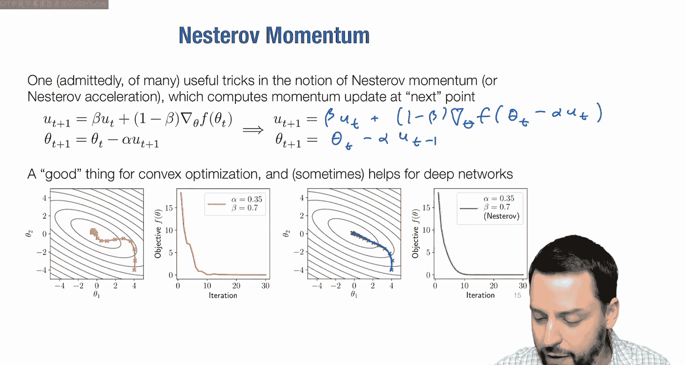

Before we talk about stochastic methods or just mentioned stochastic methods is about atom。

So Adam probably。🤢，If you look kind of at the history of a lot of deep learning。

 there's the sort of different oistic methods have come and gone。

 they become trendy and untreny for a while。 I have to give it to Adam it really has preserved as one of these methods that kind of everyone tries I'll talk this to also in a second but it's possible to is just sort of this for historical reasons maybe the world could have evolved very differently。

 but we're at a point at least right now where Adam is probably one of at and just kind of pure SGD with momentum are probably the two optimizes you really need to know about in practice in deep learning and then you can try other ones if you wants to。

And and so so it has really been an extremely successful algorithm。

 There are a lot of very similar algorithms I should mention that are just slight variants of it。

 And so there's many ways you can do similar things。

 but but but this one has preserved for whatever reason。😊，So the idea of atom。

 which belongs to a class methods is called adaptive gradient methods and there are other adaptive gradient methods。

 but again it's a fairly successful one is that the one sort of fundamental problem with gradient descent is that the scale of the parameters that you care about can vary but the scale of the parameters and the scale of the gradients can vary over over optimization right so I mean if you just again look at our even these simple examples here the。

😊。

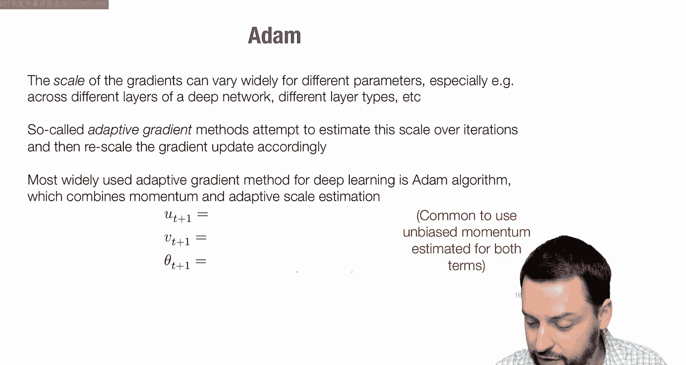

The objective changes differently in different dimensions， right。

 so sort of more stretched out along more stretched out along this dimension。

 say even just on the actual dimension themselves， obviously it's sort of actually stretched along this dimension。

 but even just considering theta theta 1 it's sort of more elongated along this dimension than it is along this dimension。

And we want to somehow account for these things when we talk about these gradient descent。

 you want somehow， it would be nice if you could in some sense kind of account for the different scales of the gradients。

 so as to update your gradients or up to your parameters in a uniform way kind of regardless of the scale of their versus the scale of their gradients。

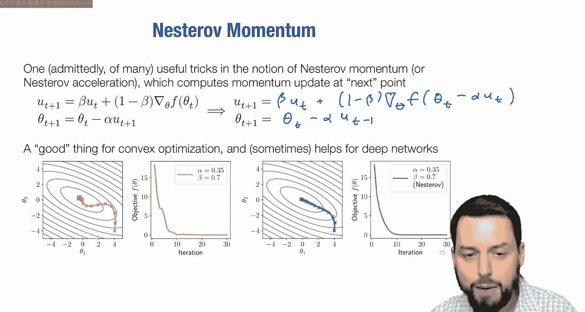

Right。And this is the idea of adaptive gradient methods。

And what Adamom does is it just uses momentum， actually two momentum terms so it's going to use rather than just one momentum term that'll actually be the same as our previous approach because instead of one momentum is going to use two。

 one momentum term to capture sort of the magnitude or to track the gradients itself and another magnitude term to track the square of the gradient which captures in some sense kind of the magnitude of the gradient and then we're going to normalize by these respective things so let me make that of explicit now。

So what the what the U T in atom is is's just a normal normal gradient term。

 It's just gonna to be our gradient。 I'm going to say beta 1 here because there's actually going to be two different momentum parameters。

 but it's going to be our same momentum update as we had before。 So beta times1 plus1 minus beta of。

😊，那个。Earth are gradient at theta T。And that's our and that's our。First update。

What our second update will do is it wants to estimate in some sense。

 what is the magnitude of the average and the average magnitude of this gradient of this gradient vector in some sense。

 and it's going to this element Y， so' it's not like measuring it's normal or anything it's measuring what is the magnitude of each。

 the average magnitude of some sense each individual element in our gradient vector or gradient。

 tensor or whatever。And the way's going to do that is it's going to have another momentum term。

 which where we we're going to have a different momentum constants on each of these two terms。

But B two times V2。BT。Plus1 minus b2 times， and now we're going to take the same gradient term。

Data T。But we're going to square it。And this in particular， I want to emphasize this is。This is。

Element wise。Squaing。Right today。I don't know why it's square。

So what this does is this computes a running average of the square of the gradients。

And what this kind of corresponds to is in some sense。

 assuming the gradient is zero mean for example， so you're sort of bouncing around the point you want to be at。

 this is going to estimate essentially the variance or more generally kind of the second moment of the gradients。

😊，and now what we're going to do is we're going to scale our gradients。

 are really in sometimes our momentum terms， so our u terms by their respective magnitudes it's captured by the V terms。

 and so in other words， the final update for atom says that theta T plus 1 equals theta t minus our step size alpha。

Times。U T plus 1。Divided by。Um the sort of normalized magnitude and then the way you do that is you would take the sort of square root of Vt plus one。

And because we don't want to if that happens to be zero， we don't want to divide by zero。

 so we'll add an epsilon you could add the epsilon inside the square root or not。

 but the convention is to not add add inside the square root。

And the other thing I want emphasize emphasize here too is that these operations are all being done element wise to。

 So this is element Y。 So again， you know， these things here。

Are both vectors that are the same size as our。As our as our gradient。

 so this is all sort of operations。 So these here are all operations on vectors。

 and they're all element wise operations。 So both the division and the square root are all done also element wise。

😊，All right so what we're doing is we're taking each component of our gradient or really of our momentum term and we're scaling it by its magnitude。

 its sort of average magnitude really the square root of its average squared values and so what that does is that puts all the gradient terms in a onto a similar scale。

😊，And this approach in practice sometimes works very well so sometimes making them all the same scale。

 sort of avoiding different big differences in scale over the gradients is a very good idea and it helps us to sort of get better convergence of our algorithm and we can see that sometimes So again this is atom is not a great well。

 it is it is not often the best method for sort of pure quadratic functions or rather is doesn again。

 we're sort of reasonably the limits what we can learn from quadratic functions here。

 but what you do see actually is that atom very nicely after the first step sort of accounts for the relative scales of the gradients very well and proceeds in this very nice sort of direction that looks actually a lot in a new in direction。

😊。

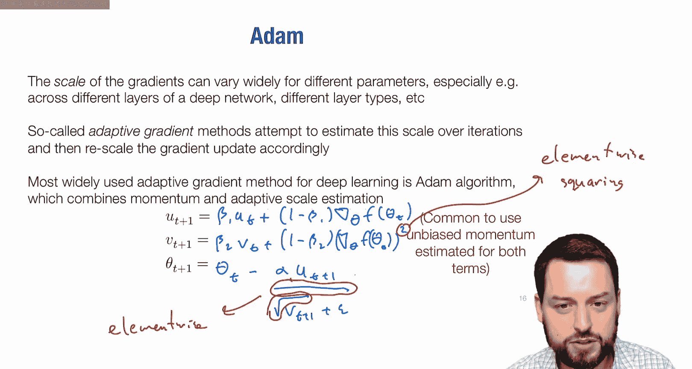

嗯。And you know， he have pretty nice convergence here。

 maybe he could get it even a bit faster by increasing the step size and things like that。All right。

 so。This is Adam and actually that's gonna to be the end of the algorithms of sort of the specific optimization methods we're going to talk about because it kind of covers at least algorithmically what are the main approaches now I haven't about I'm going to talk a second about the fact that we're doing all these actually in the stochastic setting。

 not in the batch setting， but these are sort of the standard algorithmms that we're going to use。嗯。

😊，Again， as I said， sort of at seems to work pretty well in a lot of cases it and just sort of plain SD。

 I would argue at this point are kind of the two optimizes you really need to know about。

 And after you you want to you know， after you want to。If you want to sort of try out other things。

 certainly can。 And and this is， in some sense， arbitrary。 I want should mention。 So。

 so I like to think that you know they're sort of their alternate universes where a different algorithm was published in 2014 and kind of became the dominant algorithm for optimizers like maybe you would use the absolute magnitude of of the gradient instead of their squared value。

 the square root right， Maybe you would use nestrop acceleration in it by default。

 Maybe they wouldn unbiased I should mention too that if you see the updates for atom。

 you typically see more than just this。 And that's because they are doing this unbiasing of momentum。

 So that actually is quite important here because these terms if they're too small won't always make sense。

 And so。😊。

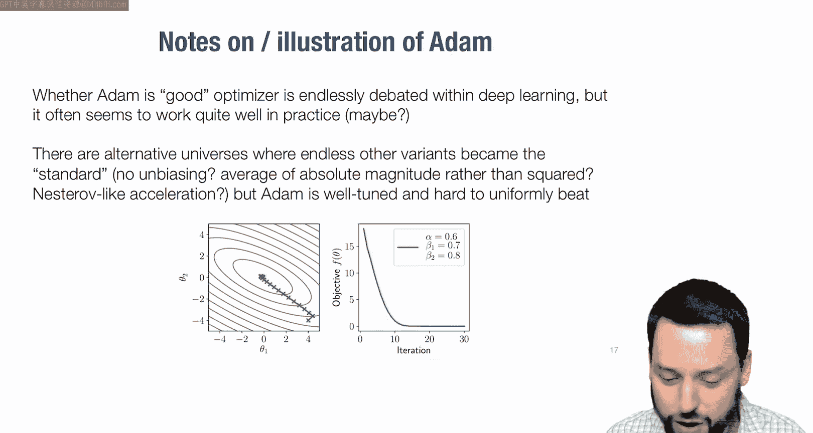

that that unbiasing， which essentially divides， which takes this term。

 I'll only write it briefly here， but takes， know， for example。

 this term and would divide by1 minus beta 1 to the t plus1。

 you will typically see that term included in the definitions of atom。

 but that's all it is is's just applying that unbiasing to the updates Okay so so。

You actually in your homework will implement the unbiased version of Adam because it is the standard。

 and if you see the equi of Adam written out， that's just what those things are doing but this is the idea of that。

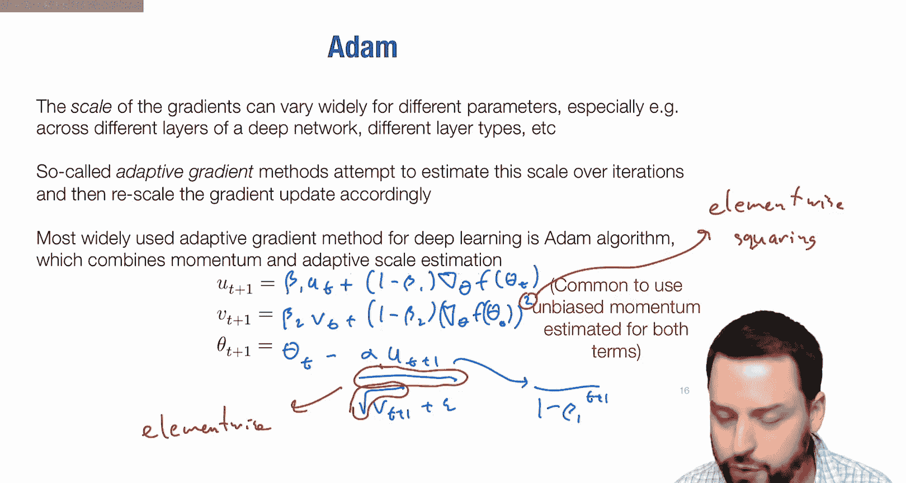

But there are other universes where maybe like they didn't do un biasing because it's actually okay enough to do un biasasing because the two terms U and V are biased in the same way and you're dividing one by the other。

Or other ones？You're taking the square root of1 see have to sort of do it in different ways。

 but they're all in sort of different universes where slightly different variances of these things became dominant instead of atom。

 But you know， we are where we are。 and atom is well tuned and hard uniformly be。

 I I know there there are constantly new optimizers that come out that people in their paper show just just completely reliably that this thing beats at in all cases。

 And yeah， for some reason， they never really become dominant as sort of the go to default。

 And I think that they really work better those cases， they probably wouldn't become a default。

 maybe not， maybe be able to just so set in their ways that doesn't happen。

 but we sort of are where we are in this in in this world。

 even if other universes are possible this is where we are。😊。

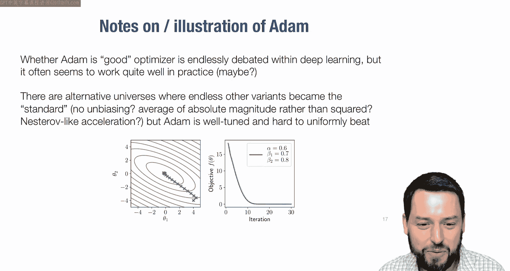

All right， so the thing I want to sort of end on here in the optimization section is that actually。

We don't use any of the algorithms like I showed you before。

 so I think at this point we sort of reached you know and the figures I was showing you before converge and all that kind of stuff。

 we've honestly reached the limit of how much you can get intuition from just like looking at these optimizes on simple simple quadratic convex problem because the reality is we don't implement sort of gradient descent like you saw there or algorithmms like you saw there what we actually do is implement stochastic variants of all of them。

I talked about this before， but the core idea， of course is that。

The optimization problem we actually care about it's not just any optimization problem。

 it is a optimization problem that involves a sum or an average of many losses over many different examples。

And so to get an an approximation to these descent directions。

 we can often just use a very small number of these these examples called a mini batch right actually can be as small as one。

 you often use more for numerical reasons， but you can get sort of good descent directions by taking a smaller smaller batch of these things。

😊。

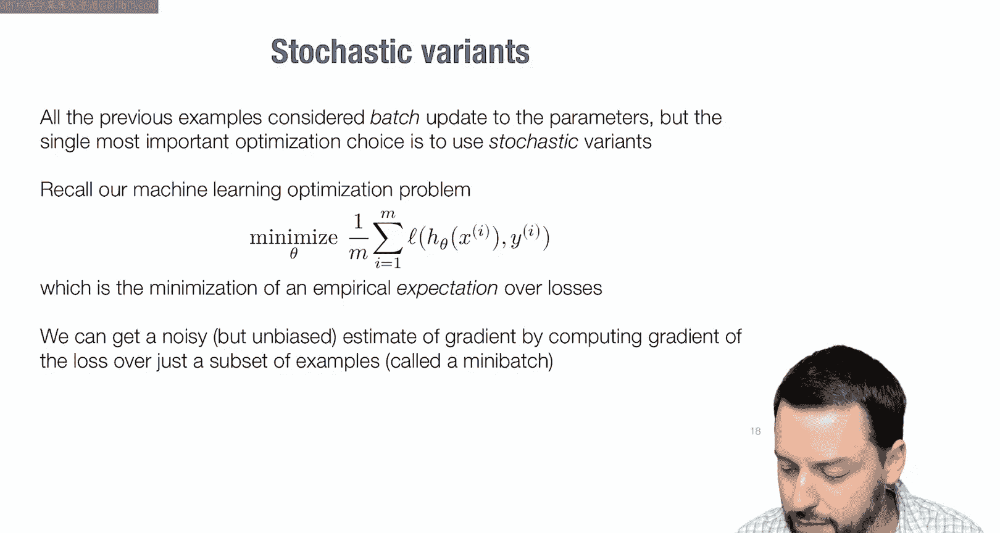

And so what we really do in practice is not the sort of single step update you saw before where we sort of take a gradient over everything。

 but what we actually do here is we actually take set our updates to be theta p plus point equal theta T minus for some subset of our examples B。

We sum instead over are just the examples in our subset B and take their gradients， right。

 So this is， you know， every time and to be clear here， when when I write gradients when this update。

 you know， you would just do the equivalent thing for。

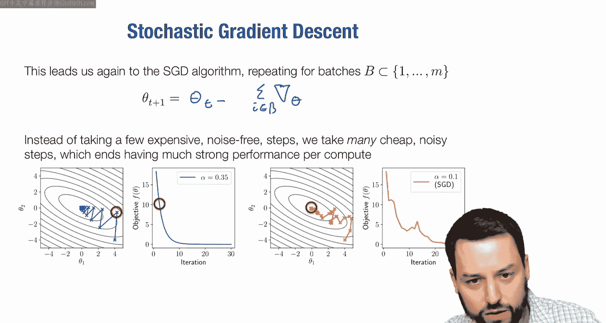

For momentum or for atom or whatever else， those all involve gradients。

 and this is just the gradient that you use now instead。So you have your hypothesis。H。Data X。

 I and Y， I。Now you take it sort of normalized properly。

 So before we would normalize by the before we would normalize by the。

Sort of number of examples because that's our average and think of as alpha。

 but so here we have to normalize by the size of B。

and that becomes our new update and that actually is the update and as I said。

 all our other algorithms work in the same way if you just replace， you know whatever。

 whenever you see the gradient， you don't use the gradient of the whole function。

 you use this term as your gradient。The one exception is Newton's method where you have to come up with an analog of second order derivative for this thing too。

 which is actually not that easy is it really is a pain so you again why we often don't use tech methods。

But whenever for first one isn the message， they just use the gradients。

Use replace gradient term with this term here。And the difference here， I mean， again。

 the idea as we talked about last time we've talked about this before a little bit。

 but again the idea is that you're taking many smaller steps in the approximate direction of your objective。

 even though each one is noisy and we can even view this in our old example it's an imperfect example here because our old sample was not actually a sum of multiple losses。

 it was just a single quadratic function though you could come up with a sum that leads to that quadratic function sort of neither here nor there。

But if we sort of take a if you think about like approximating this thing。

 what SGD is really doing is it' taking sort of multiple smaller， noisier steps。

 and often you'll find that， you know。Even if gradient descent is sort of seems to be sort of a more precise algorithm sometimes if you do SGD in other settings。

 you know what you're doing instead of taking these like single maybe bigger steps in the exact gradient direction and still balance around a lot。

 what SGD does is it takes much many more cheaper smaller step to noisy directions。

 which you can kind of know bounce all around but the point is that there are many cases where this iteration could be many。

 many infinitely so if you have infinite data faster then actually computing a a full batch gradient step So there are cases like where after the same number of actual work done with gradient descent you would be have taken one update and so you'd be here on your curve whereas with SGD you'd be going all the way to your final update in other words you'd be here on your curve。

😊，If say one iteration was。30 times more complex or cheaper than in the other setting。

RightSo this is going be a really， really stark different sometimes where it's extremely beneficial to take many small。

 noisy steps over waiting to take one big correct step。

 which isn't even that correct because grades of sense not even that correct。

 the because we care about and and sometimes even want noise because noise can even help you get out of escape sort of nasty regions and the loss function and stuff like this。

 And so this is really what actually use it are the stochastic variants。

 And so whenever you see a gradient， don't take the actual gradient， take this thing here。

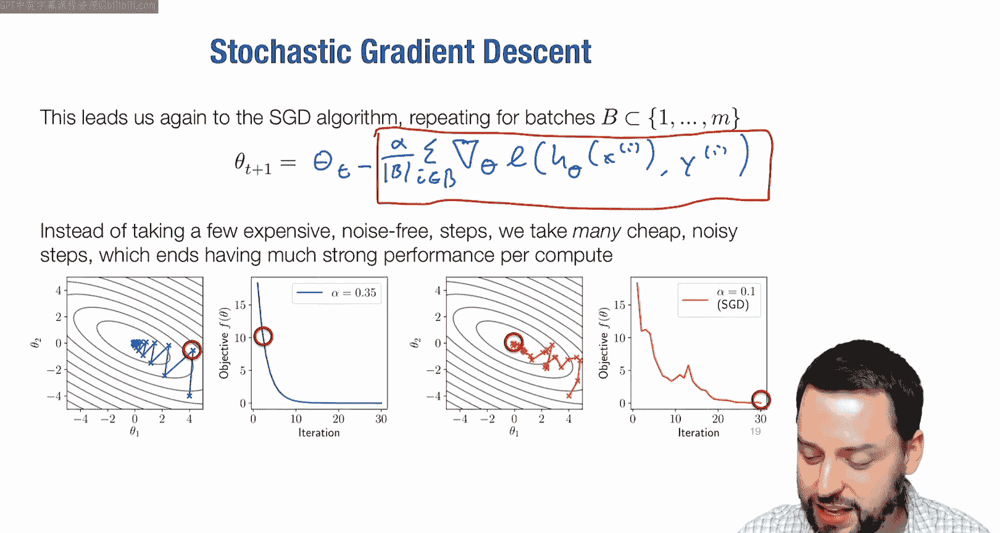

All right， so again， important takeaways， all methods we use that you saw before。

 you will actually use them in their stochastic form， not in the form。

 not in their sort of full batch form。And the last thing I'll say is that。

We have reached you know while those， I think those plots of showing these functions operating on simple quadratic functions are very instructive。

 we also know probably have reached the limit of what you can really learn from that because deep networks are not convex quadratics。

 if they were， we would be in a very different spot optimization wise and probably machine learning wise。

 they are very nonconvex， very non quadratic， very weird functions that we don't even fully understand。

 to be honest。And so the reality is to really understand how these methods operate on deep networks and practice。

 you just need to experiment and get an intuition of how they actually work on different deep network types。

😊。

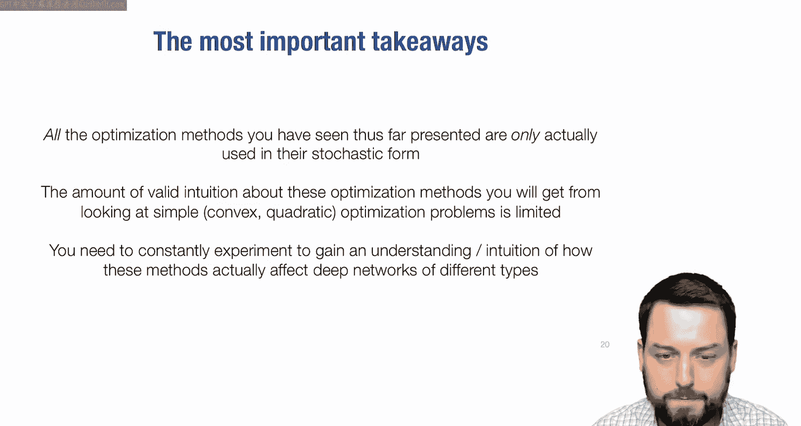

Okay， and with that， I just want to start the final section of this lecture。

 which is going to be actually just a brief introduction to initialization in optimization。😊。

TQ' is going to cover this a little bit more in some of the next lectures also when it comes to implementing deep networks。

 but I want to mention it here because when we talk about optimization。

 it really is a key point that ties into optimization and so it's worth emphasizing this here。😊。

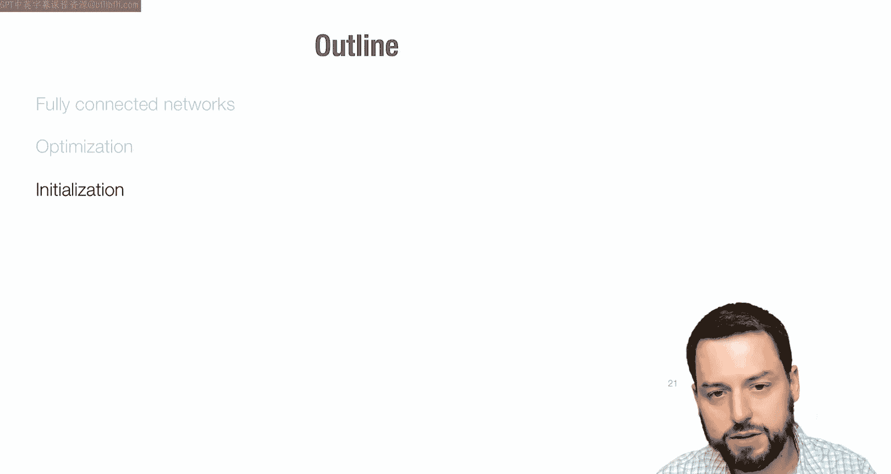

Okay， so。One of the key questions that we will have when optimizing a network actually is what do you choose for your initial values of W I and B。

 so those are our parameters in the network And in the pre example。

 I just started theta like at some point right I just started theta theta is this value but doesn't doesn't really tell us anything right。

How do we pick those initial values for our parameters？And in a real neural network。

 how we predict our initial dye for those parameters。

And what you may have seen in optimization is in combat optimization a very common thing to do is just initialize your parameters to zero right so if you have softmax regression。

 for example， you can initialize data to be zero and that that's going to be fine it's sort of a nice easy value finishized too it's you know maybe not going be too big or something like that it'll also there's no randomness involved stuff like this and so it's very nice。

But unfortunately， initializing your parameters to zero。

 which is sort of standard in complex optimization does not work for deep networks and so why is this the case。

 well let's think about what happens if we initialize our parameters to be zero。

Well what we would get is we would get the fact that。

If we take sort of our if we just think about our sort of iterations of our network and take our iterations of our network as as as just iterates。

 right， so we would just take take like our even without our bias term for now because a bit simpler。

 adding a bias does not fix this problem to be very clear if adding a non-zero bias still does not fix this problem but also we can think of this as just sort of if we initialize both our weights and biases is0。

 So what would our sort of forward pass be， So our forward pass would be Z Z I plus1 equals sigma Z w which is going to be because wY0。

 this is also just going be zero。😊，Alway。嗯。We also have the case that the GI would be G plus1。

 had a marred with I。See， I。W I。WI transpose， and so those after the first iteration for any sort of because we're multiplying here with WI。

 this would also equal zero。And unfortunately， what this means is that all of your gradients。

Are also zero。And so if initialize your parameters to be zero。You have more than one layer network。

Your gradients will also be zero。And this is very bad right。

 because this means that none of really other than the last layer。

 actually then the last layer they'll be too because the last layer your your x00 also your sort of inputs are also zero because there's zero0 so all your gradients will be zero and you will not be able to learn very much right you will just。

😊，If Grs are all zero， you will not update your parameters。And so what this sort of means。

 in other words， when， another way of putting this is that。

We've sort of heard this notion before that neural networks have many local optimum。

And this is not quite， I mean， should be precise here。

 it's actually technical speaking these zeros are a saddle point， not an optimum。

 but basically they mean roughly speaking this point。

 the point where all the parameters are zero is actually sort of a fixed point of the gradient update。

 it's a point where the gradients don't make any changes。

Which you know we think of those often as like local optima or you I guess local saddle points and things like this。

 but it's a really bad one right because printing all zeros is probably not a very good model and if you initialize to be all zeros you will never move from there so this is a really bad thing to do and you don't want to initialize your parameters to be all zeros unlikeing Com optimization。

So the question is what do we do instead？

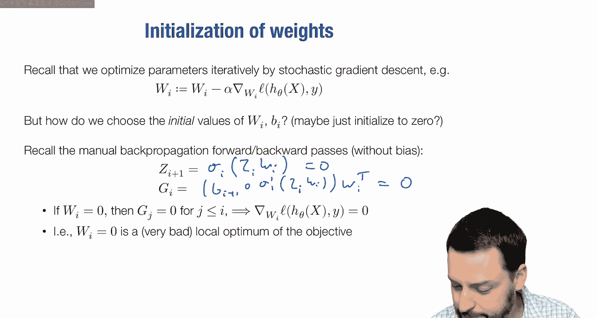

Have to those parameters instead， so let's just initialize them randomly。That's a good good choice。

 right， but nothing else to do。 Let's just pick them randomly。 For example。

 let's pick let's imagine just pick our parameters to be normally distributed with mean 0 and some covarianceigma sorry some variance Sigma squared。

 So whenever like this， what I mean is that each sigma squared I。

 what that means is that each individual element of our weights are sampled a little bit of abuse notation here。

 because this is this is gonna be a tensor and matrix。

 but whatever all this means here is that each element in our entire weight matrix or weight tensor or whatever is sampled according to an independent Gaussian with variance sigma squared。

😊，嗯。Now， the key point here is that。you can do this and this is actually what typically does happen or variance this or typically how networks are initialized。

 just again with random with random numbers， either it' not be normal。

 it could be uniform so like that too， but you'll implement some of these in your homeworks。

But what's important to emphasize here is that the choice of our variance now is not just a。

It's not just something where you can choose a lot of different parameters in the artwork the choice of the variance has huge implications for the resulting performance and weights and everything and magnitudes of the gradients and everything else for your network。

😊，So to illustrate this， I'm going to actually take a illustration on MIS with 50 layers。

And really done in the early。And I'm going to plot and this plot here。

What I'm plotting is I'm plotting the norm of the activations， that's like the norm of the ZI terms。

As we progress。Through the layers of this network， so this this term here will be that the first layer。

 this term here would be the 50th layer。And I'm showing this for three different values of our variance。

 So for one over n， for2 over n and for3 over n。And what we find is that this choice of variance leads a very different performance for our very different sort of behavior of our of our networks。

 what happens in the case of， you know。😊，Sigma squared equals 2 over adds the norms stay roughly the same throughout all the iterations。

And the gradients are all at sort of magnitude one。Another hand for。3 over n。

 the norms increase as we go， and the gradients get very large。And for。1 over n。 So again。

 they're just， you know， within a constant fact of each other， they aren' not that different。

 I'm dividing the same by n。 I mean if you just pick a random number， who knows where it would be。

 right。For whatever N， they go down。So there's something， there's a few weird things happening here。

 right， this seems kind of odd。

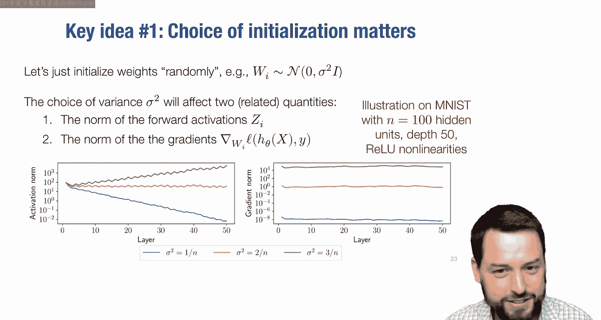

And the few sort of key points I want to make， so the few points of the end the choice of initialization matters。

 how this work matters。

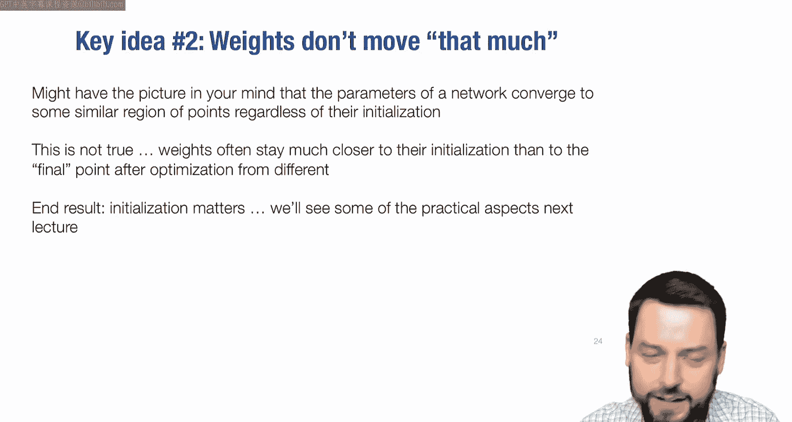

But the other key point of initial is so I guess the thing I want to highlight here is that this is very different。

Again， from our intuitions that we have may have in sort of traditional convex optimization。

 say where initializations often don't matter that much I mean to a first approximation maybe they don't matter that much here it really matters So initialization you know zero just doesn't work at all。

 but。😊。

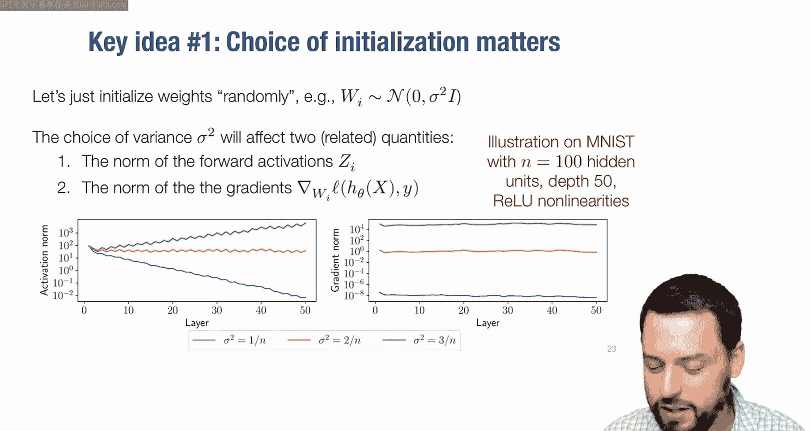

Random sort of only works when you have the right variance。

The other thing that I want to sort of mention， I'll come back to this actually in a later lecture as well。

 is that weights don't actually move that much in deep learning。

We have this notion right that you know doesn't matter where you start or at least I for a long time had this notion that with optimization doesn't really matter where you start because you know eventually all points will converge the same optimum and maybe with neural networks it's not quite the same optimum。

 but maybe it's a few optimum you conversege to or things like that right and that is really。

 really untrue。 So so sort of take。The reality is when you actually look at how much weights change over the course of optimization。

 the differences in initializations can far outweigh the differences you actually see in optimization so so you know weights。

😊，The way I'll put it briefly again， we'll call to this later so I won't believe it this point too much。

 but weights don't change that of course they change somewhat because they make the network law small。

 but the initial value of the weights， they stay relatively close to it and then sort of in some other sense。

 and this is very important sort of for gathering intuition about what o is really doing in networks。

 but we'll move to that come back to that actually in a later lecture when well talk about normalization of these things。

Okay， so then the last thing I'll sort of mention is I'll。

 I'll look at this effect we saw this this previous time and try to explain what's happening here。

 So like， you know， why is2 over N the right variance to have in this case。

 and how does this maybe motivate how we should initialize weights。

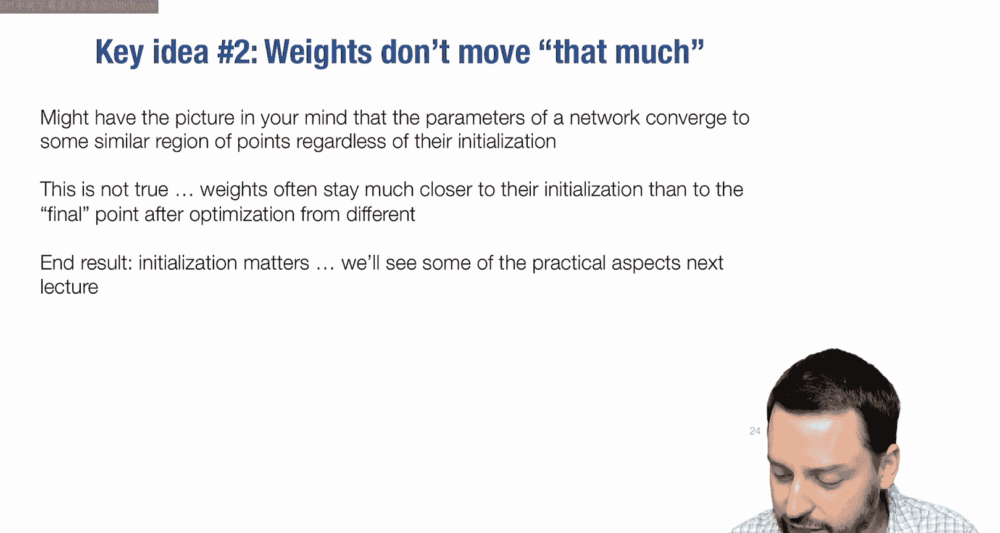

So the idea is that。Because when we think of weights initialize randomly。

Then it turns out we can actually think of sort of the product or think of the intermediate terms in a network in loose terms because this is not quite exactly correct。

 but we can think of them roughly as sort of random variables that have means and variances themselves and we can actually show a lot about what's going to happen to these things by the central limit theorem so central limit theorem says the average value of the sum or I guess the expectation to be precise here。

 it says that if you take a bunch of random variables kind of in distribution and average them altogether。

 that average as treated a new random variable upper multiple draws as integrational variables approaches the Gaussian。

If you have the proper scaling now， things like this。Um，So， so， and under lots of conditions that I。

 you know， I won't， I won't get into。So what we can do in some sense is we can sort of you know。

 be a bit be sort of a bit more than a bit， but this can all be formalized actually。

 but we're going to be very， very informal here and think of like all our intermediate aspects of our network as being kind of normal random variables and we sort of want to see what happens here。

So first of all， let's think of our input to a layer， this is holding for x right now。

 but this is holding for layer layers too as being normal with with mean0 and variance 1 and let's think of our weights as being normal with mean zero and variance1 over n All right so this is sort of the one over n case。

 not the two over n case， but we'll come back to that in a second。So if this is the case。

 then the expectation。Of the product of these two things well the they're going to be independent random variables here。

 obviously our weights are independent from our from our examples again。

 assume this is the case for now， this is like a newly initialized network or something。😊。

This is going to be because the variables of independent this was maybe equal to the product of their expectations。

 so x1 or x actually yeah， so this is be the product their expectations。😊，Keep다。系啊。切。EW I。

 which equals 0。And further， because they're also independent。

 the variance of their sum is going to be equal to the sum of their sorry the variance of the product with the product of the variances。

 So this will be equal to。Aance of。X， I。Ts the variance of WI， we're just going to equal 1 over n。

And that's very single sort of product between Xi and WI。But what we have here。

 what we actually want to compute now is we want to compute， you know。

 what we're doing in the network is' not taking a single sort of inner product between or single product between one weight and one。

Dim of the input， we're actually taking you know an inner product of all our weights and all our inputs here right so we're taking this is inner product here。

😊，And so that that inner product， of course， just， you know， this this inner product here。嗯。Other。

My battery must be dyinging on my pen or something。The this inner product here， of course。

 is equal to the sum from I equals 1 to n of X Iwi so in other words it's a sum of in this case kind of random variables that we think about it right and the sum the expectation of the sum random variables is equal to some of their expectations right and the variance of their of the sum is equal to sum of the variances and so what we have here is we have the expected value of this inner product of all the weights and x is equal to0 and because we're adding up n copies of1 over n variance variables。

 the variance of the inner product is going to be equal to 1。😊，All right， so what this means here？

Is that if sort of very informally speaking。If。SoSo in other words。

 like you know this thing would go to to a random variable here。

 So what this means is that if we have now considered sort of a whole set， not just not just one。

 but consider a whole set of n activations here。 And we think of WI as being initialized in this way。

 then there are iterations of the whole network right So it was Z here would equal WI transpose times Z。

 So in other words， this is the whole bunch of inner products of know weights that look like this a whole bunch of these things look like that。

😊，嗯。😊，This this whole next layer， if we assume that the first layer is normal with means your covariance I I。

e it's a bunch of independent random normals， then actually the same is true for this product here because every element that of this major Victor product is essentially equal to something that looks like this。

So this whole thing would also be normally distributed with mean zero and covariance i。

And this is really the important point here and this is actually probably。

 you know kind of as in some of as deep as probabilities we're going to get in this course。

 but the point here is that if you pick，😊，This value of the covariance， and you have a linear layer。

So if you had a linear layer， so layer with no linearity。

 then this next linear layer would also have the same。

the random variable will the same mean and covariance as our input。In other words。

 choosing this particular initialization maintains the variance of subsequent layers。

If this is our update。Now that's not a very interesting update， that's a linear layer。

 which is there's no point in doing that， but that's what it would be。And then the key point is that。

 which I'm going to say sort of vary informally。Is that each element here of this is normally distributed between zero and1。

And so half we sort of expect half of its values to be negative and have them to be positive。

And so if we use the RE nonlinearity， then like half of those elements will be set to zero。

And to account for that to sort of have the same property that we sort of want to maintain variance over layer to layer。

 we actually need to initialize our weights not with one over n variance。

 but with two over n variant that accounts for the fact that we're sending half them to zero。

This is sometimes called the Kiming normal initialization。

And it is sort of one of the standard weights of initializing weights in a network。

You will see many others as we implement these things， and in fact， in the next lectures。

 Tani is going to go through kind of how you would set up a library to do these things。😊。

But over the next over this and then the next homeworks， you will actually start to。

Implement all these aspects。Into kind of the different component parts， optimization， initialization。

 eventually things like layers， normalizations and linear layers stuff like this。

 into what will make up sort of a first iteration of a deep learning neural network library。😊。

Alright。 See you next time。

