# CMU《深度学习系统｜CMU 10-414714 Deep Learning Systems 2022 fall》中英字幕 p09 -10-Lecture 9 - Normalization and Regularization.zh_en -BV1ERtYepEpy_p9-

Hi， everyone。Today we're going to talk about two topics， normalization and regularization。

So in the past few lectures， we've talked about how to build kind of the internals of a neural network library。

Now we're going to talk talking a little bit about some of the tricks and architectures you can use to help you train these things more efficiently and build better and easier to train architectures。

Normalization organization are sort of two somewhat， somewhat different。Aspects to modern。

 deep networks。We're going to talk about both of these because they're somewhat related and as we'll see later in the last section。

 these things all do have some degree of interaction。

 as well as also interact with things like initialization and optimization。

So to start off with we're going to talk about normalization。

 then we're going to talk about regularization， and then we're going to talk about the interaction of all these things。

 including optimization， initialization， etc。All right。

 so let's jump right in and start with normalization。If you remember from a few lectures ago。

 the initial weights that we chose for a deep network were very important。So for example。

 you may have remembered that we had these， we initialized our weights with Gaussian random variables。

 so often it was， you know we' initialized our weights to be random。

 maybe sometimes uniform or maybe sometimes Gaussian random variables。

But the variance of these Gaussian random variables mattered a lot。

 so this limitation here just says that we're initializing our weights randomly。

 we're initializing them with random samples from a Gaussian distribution with mean0 and variance of C over n。

 where n is the number of the dimensionality of the inputs to this layer。

And remember that for a re network， well， first of all。

 remember two things that the choice here of C is very important and it turns out that for a re network。

 the choice of C equals 2。Is sort of the right choice because it maintains the。

Variance of the activations as you go deeper and deeper into a network and we'll actually you see that in this figure here。

 when you choose the variance here to be 2 over n， then this corresponds to this line here and it maintains variance of the layers I'll discuss what this figure is showing in a second though。

But what I also want to show here is that we can also initialize with other with other variances too right。

 we can initialize the variance of say three over n or one over n etc cetera。

 And these are actually quite pretty close right these are these sort of within the same factor of of。

Of。The same rough order of magnitude as the other as2 over N。

But they lead to very different behavior。And so to show that I'm actually going to show these plots below here。

 so what these plots show here is I'm initializing a 50 layer deep network and applying it to in this case。

 M doesn't really matter what I'm applying it to here。

 but it will matter when I'm training these networks a little bit。

So what I'm showing in these plots here is the layer of the network。

 so this X axis here shows the layer of the network。

 this network is 50 layers deep and on the y axis at least in this plot I'm showing the first one I'm showing the activation norm。

 so what's the norm of the ZI terms so this term here basically is would be like the norm of the different ZI terms as you go through the network。

And what I'm showing here on this next plot is the gradient norms。

 that would be the norm of the gradient values as you go through the network。

 right so something like the norm of the gradient with respect to WI of our loss。

 just abbviate it like that。Okay， so these are the two things that I'm showing here and these are both actually sort of L2 norms。

In this case。All right， so what we see here is sort of two interesting things The first is that the in the case as we kind of expected actually。

 in the case where we pick the right activations for the RE network our norms stay roughly the same throughout throughout optimization or sort sorry throughout the layers of the network I mean。

嗯。They， you know， the norm hovers around， you know。

 the activations themselves kind of hover around kind of a similar value throughout the whole layer。

 the whole depth of the network。But if we pick other values， if I pick one over n， then this is。

 in some sense， too small a weight。 And so what this means is that the the activations decrease in norm a lot throughout throughout the the depth of the network。

 and similar if I pick a larger。Initialization， the values increase over the depth of the network。

That's sort of the first thing to notice。 And second thing to notice is that the gradients。

 those actually are roughly static because just the。We can you can kind of look at this if you want。

 but the formula for the the formula for the gradient， remember。

 you sort of use both the backward pass and the forward pass to compute the gradient with respect of the weights and terms cancel such that these things actually remain constant throughout the whole network。

 but the big difference， of course， here， is that if you initialize with sort of the right。Or。

2 over n， call that the right or the wrong， depending on your perspective。

 But with the right sort of the correct initialization to maintain the norm of the of the activations across depth。

 you get kind of a reasonable scaling to your gradients， whereas for larger values。

 you get sort of much larger values of your gradients here。

 So gradients of 10 to the four for the three over n case or 10 to the minus8 for the。

 for the one over N case。😊，And what this corresponds to， and this is sort of the punch line here。

 is that you may think that sort of the initialization， it matters。

 but it doesn't matter that much because after all， you actually are optimizing these things。

 So you know， maybe after a few iterations， these weights will be kind of fixed and doesn't really matter height initialize them。

 they'll all end up the same。 But this is definitely not true in in deep networks。 So for example。

 if I pick three over n as my variance initialize with。

 I have a very big norm for my for my gradients here。

 and what ends up happening is that my loss just goes to non number。

 I think if you've ever tried with。I've tried to optimize deep networks。

 I'm sure you've in some sense， or in some cases。Had the experience of training a network and all of a sudden the loss becomes NN or your weights become NN values。

 basically you have numerical overflows sometimes everything blows up and things just go wrong and what's happening here is that the gradient normal of the gradients is just too large and so as I optimize these things。

 my weights just sort of start to starts to go unstable and things diverge and you get Ns and no one likes this。

On the flip side， if you try to optimize starting at the one over n。Point nothing ever happens。

 you make you make no progress So you just sort of stall out for a while and whereas of course。

 if you use two over n in this case， it does work and you are able to optimize even this 50 layer deep network。

 it's not actually I should emphasize you don't get a huge benefit from training a 50 layer network on MNIST but it does in fact work so on a fully connected 50 layer network。

 but it it doesn' in fact work。And so this， the big intuition I want to emphasize here is that。I。

 for a long time， had this notion that。The incorrect initialization would be quickly in some sense。

 fixed by optimization， right， because who cares how initialize things to in conve optimization。

 for example， doesn't really matter how you initialize things because your weights kind of go to the correct point no matter what as long as you don't you're not sort of too far out of bounds。

But deep learning is very different and when you're optimizing deep networks。

 we often find that the initial values for our weights matter a whole lot because otherwise things will just never train。

 things doesn't matter how long you train how many gradient steps you take or how many SGD iterations you take。

 they just never train or they diverge。And I want to emphasize this problem actually goes much deeper than just this example of sort of these failure cases of either not making progress at all or of。

or of blowing up and becoming man values because of actually it turns out that if I even initialize things to a more narrow scale。

 we actually get similar effects here so in this case I am showing three more examples with the initialization chosen such that you still have sort of a this is an initialization of 1。

7 over n for the variance which is a little bit less than two then you have two is before and then you have 2。

3 and these networks actually all will train， they will train to some degree of loss you can get the loss down from this。

But the point I want to make here is that the behavior or the effects you have at initialization。

 they persist throughout the whole network。So I'm going to train this network and I'm going to train all three of these networks。

 actually the 5% error on MNIS， and what you see here is that there's a lot of interesting effects to to this plot actually。

One thing you'll see is that the activation dorms actually do。

Change from the initial version so you have activations that no matter what your initialization is。

 you have activations that actually in the later stages the network are a bit a bit more。

 there's they're a bit higher here than they are the initial layers and there is some difference in the different ones so the activations of the blue initialization do remember a bit lower than the other ones。

 but those actually do kind of in some sense become at least fairly similar。

 the gradients also change by the layers， but they are and some effects persist from the initialization。

 but they also kind of say similar the point I actually want to highlight here is is an interesting point and I've always found this very very surprising and it's not really happening in effect here on error。

 but the point that I want to emphasize here is that if you look at the actual weights after training。

Um， you cannot differentiate between these two figures and I actually I had to check this several times to make sure I wasn't making a mistake here because I've always seen this very surprising。

Is that when you train a deep network， it turns out that your weights。Change very little。

Compared to their initial values， or rather the the way， the way I'll it。

 obviously the widths are changing。 I mean， these values are different。 The the。

 I'm just plotting the norm of the weight s layers。 but， but these， you know this。

Line here is actually's essentially indistinguishable from this one And the point on that thes don't change that the weights。

 of course， do change， but in some sense， they change in a relatively small degree relative to their initialization。

 at least for these very deep networks trained in this case with SD Now this isn't always happen。

 there are some cases where you get substantially more。

 And if you look at certain dimensions and this is just plotting their norm So the direction of the weights can still change while sort of keeping a similar norm。

 But this is a really interesting effect of deep networks is that it challenges our normal ideas of optimization and what。

What the weights do in optimization， and so these things have to be taken into account when you think about these networks。

Okay， but moving on from this， the main point I want to emphasize here is that initialization matters。

And initialization matters insofar as it affects the relative norms of the activations and their gradients over time right that's the sort of the the high level takeaway I want to make from these these three sets of slides here so this one here and then this figure here。

 two sets of slides here。😊，Okay， so what can we do about this Well， one obvious idea is that。Yeah。

In thisial edition does matter。And it matters amongst other reasons。

 because when you initialize differently， the norms of your activations may no longer be the same across training。

Rightい。But the high level thing to remember here， and now as you probably have experienced a lot in the last couple lectures。

A layer in deep networks can really do anything at all， right， so we can have a layer that。

 of course computes a you know。lineinear function， a matrix times the activations。

 we can have a layer that computes a nonlinear activation， but we can do whatever we want in layers。

 right layers are just differentiable functions that we plug in and use in our deep network library and so the key idea is that these problems of sort of the weights of activations varying over the course of the depth of a network。

We could add a layer in some sense， that just kind of fixes this。

It's only preventing us from building a layer， if we believe that the norm of the layers kind of changing over time due to bad initialization is a problem。

Let's just go ahead and add a layer that kind of fixes this。

 and this is the key idea of normalization layers。So。

What we're going to do in the first instance of a normalization layer。

 this is a technique called layer normalization or just layer norm。

UmI kind of to be the obvious thing， let's just take our activations at each layer。

And let's just normalize them to have some standardized mean and some standardized variance。

 it's a very natural idea。Because this will then prevent them from having this， you know。

 bad effects kind of as we go through the later layers of a network。

So the way I'm going to write this is I'm going to write this as we have sort of our initial potential activation here。

 I'm going to write Z hat here as sort of just。😊，For convention。

 I'm going to write Z hat here as kind of our tentative layer before normalization。

 so that's going to be just equal to our nonlinearity in this case times a linear function of our previous layer。

 sort plus biased term so this is just our simple our simple sort of fully connected layer here。

We could， of course， also have some more structure in this layer。

 but we won't worry about that similar things apply， of course。

 no matter what this structure of the network is。So the simplest thing we can do in some case is just take this layer and ensure that it has some standardized mean invari and let's just choose to you know in our argument before we wanted to choose our initialization such that the activation had mean zero and variance1 so rather than worrying too much about initialization。

 let's just actually enforce our layer to have mean zero and variance1 and the way we're going to do that we're going to set our next actual layer just be equal to z hat I plus1 minus its expectation。

So minus the expectation the expected value of the i+ 1 wherere here the expected value and also the variance。

 this is just an empirical expected value。 remember this is a vector here。

So this will just be equal to say there are n elements in this vector。

 this would be equal to 1 over n times the sum from I。

 well I shouldn't use I there because I have the other i index， that sum from J equals 1 to n of c。

Hat I plus one。 And I'm going to use this notation here to say like the J element of this vector。

 Remember， Z I plus one is itself a vector。 So we had this kind of a bit odd notation of having two subscripts right。

 I plus1 indicates the layer it is， which I'm I'm doing just for convention。

 we usually use these I to refer to layers。 So if I want to refer to the J element of that vector。

 I'm going to use this notation here of putting it around putting parentheses around it。

 and then all seizing a separate subscript there。 Okay。

 so this is just going to be the empirical kind of。The empirical。Expected value。

Then my layer norm term would take this whole thing and divide it by the standard deviation of this vector right。

 So I'm going to write that actually as the square root。Of the variance。Of Z hat I， where again。

 this is just the empirical variance that should just be equal to。 So the variance of Z hat。

I plus 1 would just be equal to1 over n of the sum from j equals 1 to n of Z hat。I plus1。Jy。mininus。

But' the value of Z hat I plus1。We're not going to worry this is a bias or unbiased estimate of things like that if it's value of this thing squared。

Okay， so then to normalize a vector， you normalize it by the root square root of its variance to make it equal to equal to1。

 And so we're just gonna to do that。 Now one last， let me actually close this up a bit。

 One last thing that I'll mention is that there is a chance that say if you happen to be in this unlucky situation where you you've applied a re say to your vector。

 what if all the values of this term here are 0。 right。

 What if all the values of the inner term just happen for some example。

 for some example to to be negative， And so if these things are all0。

 you would actually be dividing by0。 So a very common thing to do then is just to add a little small epsilon or epsilon is something like say it's something like。

嗯。1end to negative the 5 or something all that matters is that you make it some small constant such that you don't get numerical underflow and you divide actually by the variance plus epsilon square root and you divide by that thing because I thing will not always be positive。

Okay， and that's， and that's， and that's the idea。 That's it。 We've just forced our layers to be。

 to be equal to essentially have the same norm at each layer。

And this does in fact fix the problem we had in the previous slide。

 So what I'm doing again here is showing you a similar initialization we initialized with。

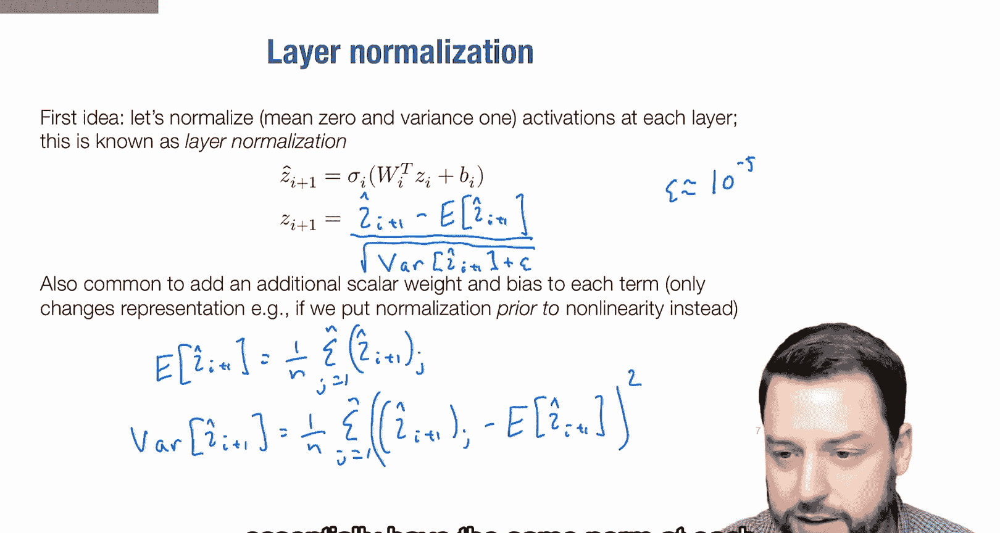

V's one over n，2 over n and3 over n。 And what we see here is that you get roughly the same。Wait。😡。

At each layer of this network， there's some slight variation here。 don't worry about that too much。

 That's just because you're applying things like re use also and also the first layer here is a larger size for MN。

 so it has a bit of a difference there and it's in its activation norm。

 but this is essentially what you're doing here。 you are just normalizing each layer and that problem of exploding or going to zero kind of activations is solved。

 These activations stay all around kind of the same the same rough value here。

The gradients are also very similar across different initializations。

 so we fix the problem of having a gradient that depends on the initialization a lot。

 kind of oddly enough we actually there's more variability to the gradients if you remember a few slides back there was sort of very we have very similar gradients all the way through because you're sort of。

Forcing because you're introducing additional terms into the gradient here into the backward pass。

 you actually。Had to give up that property a little bit but the gradients aren't blowing up here right this is this is not that large difference or arguably and under so these it's not not that larger difference and and they're all the same roughly the same regardless regardless of the initialization。

Okay so that's that's just an illustration of layer norm here。 But there is a problem。

 And actually well before before I go into some of the potential problems。

 I should just say the layer normm is very widely used。 So for example。

 transformer architectures which will cover in later classes which are in some sense the dominant architecture and a lot of deep learning these days。

 they widely use layer norm as their normalization technique and so the the simple approach is extremely common in modern deep learning and it does in fact prevent these big blowups in activations happening and in some sense。

 it's sort of the easy fix you have to worry much less of initialization if you do things if you do things like this Now at the same time。

 I should also mention that for standard fully connected networks it is often harder to train networks to low loss when you add layer norm and。

😊，There's a few reasons for this One of the reasons it's hard to say exactly the reasons a lot of these things are。

 and I'll get to this later in this lecture are not fully understood。

 but one of the reasons here is that。Layer norm is taking each individual example and forcing its norm of the activations。

 including let's say， the last layer to be equal to zero or the。

Mean of that activation is equal to zero and the standard deviation of activation is equal to1 right and it might be that in fact。

 the relative norms of the different examples say you a dig of of one versus the digit of a zero maybe the relative norms and their variances are actually a pretty good feature to classify things it's very possible that the relative sizes may include some information that we want to actually keep and preserve and that' is just honestly one reason why these networks can be can be hard to train there are many reasons why they might be hard to train。

 but。What's been found in practice is at least for just a fully connected MLP。

 it's often harder to train these networks when you introduce layer norm in them than is without layer norm。

 so we're sort of you know maybe not quite getting everything that we want out with this。

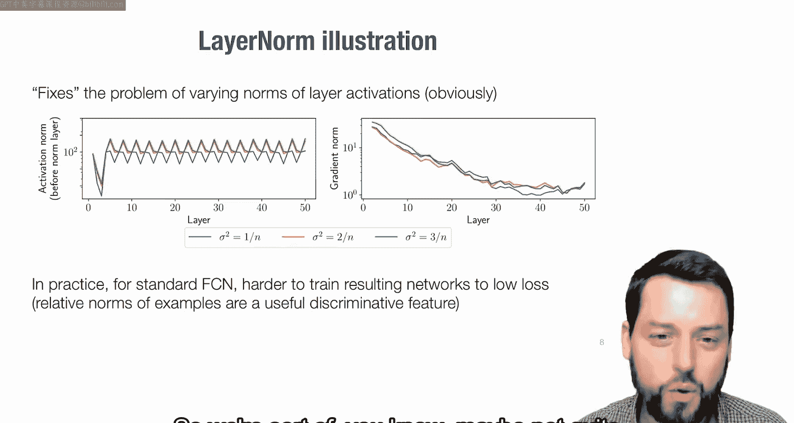

And so because of this， we're actually going to introduce a different kind of normalization。

 which is also useful in many scenarios here， which seems like an odd idea。

 and so I want to emphasize before I start here that this seems like a very odd thing to do。

 but hopefully it will sort of make some amount of sense the way I'm describing it here。

So let's consider。 So before we were considering when I defined the equation for layer norm。

 I was considering kind of a independent mean or an independent normalization that I would apply to each。

Each layer of a single of a single sort of。The network applied to a single example， right。

 so I would take a single input example， look at its activations throughout the network。

 and I would normalize each of these activations。😊。

But let's consider now the matrix form of our updates。

 so remember we wrote it like this where we have a whole matrix now or say say。In this case。

 probably all the examples in a mini batch right so Z the capital Z and its rows contains the examples of each。

Many examples corresponding to all the examples in that mini batch。And so in this setting。

 so if we sort of define Z in matrix form like we do anyway when we run these things。

Then layer norm corresponds taking a single example。

 which are the rows of this matrix and normalizing the rows。Right？But viewed as a matrix。

There are many different ways that we could actually kind of get standardization across these。

 across these features。 And in fact， if you kind of do。

Think about sort of standard normalization of features for a lot of。

Kind of standard machine learning algorithms， an equally common thing to do is to normalize not just the sort of the。

The each row of a of an entry， but it's also very common to initial to attach normalize the columns of these things too。

 So what if instead of normalizing the rows， we normalize the columns instead。

So we actually do this seems kind of odd， but we normalize kind of think of each sort of column of this vector。

 sort of a single activation， kind of like a single feature。

 what if we just normalize those values across the whole mini batch？

This is a technique called batch normalization。And it is also extremely common to use and practice in deep networks and also provides。

 in many cases， a huge benefit for the trainability of these networks。And again。

 I want to emphasize here that there's sort of a lot of ways of motivating what we're doing here。

 but in some level， all we are doing is we are just trying to ensure that the the activations of our network don't blow up as we go deeper and deeper into the network that we' maintain some kind of control over them and we can just as easily normalize over the the rows that do this as normalize the columns over this。

 but but this formizing over the columns here you know maintains the fact that different rows。

 different examples could have different norms and different sort of values。

 sizes of their activations as we go deeper network that might be useful discriminative feature and so this preserves that while still preserving some degree of normalization of your。

Of your layers。And as I said， there's a sort of an obvious analog here to what we often do to prepare data for use in kind of classical machine learning methods。

 oftentimes we will normalize the features， normalize the columns of our data matrix and this sort of takes that to the extreme where we're doing that for each layer in our network for each mini batch of our example。

 and this is a technique called batchstorm。and so this people， this is very， very common。

 people often do this， and you if you've played with Eazole。

 you've likely seen networks that use bash norm of some kind。

But I will add and this fixes the problem too I won't show so many plots here。

 but it does fix the problem just like Leonorm does of course， by definition it fixes the problem。

 but what I actually want to focus on here is is an additional aspect to batchshdo that is very common to fix an odd problem in batchshstorm so one thing that is kind of strange when you normalize like we did here by column。

Um you are making the total predictions of your network in some sense depend on the mini batch。

 right？So with La Nor， you're applying your functions just to each example in your batch or sorry you' applying to each example period。

 right？And apply this function to one example， thanks example in your batch it's the same regardless of what examples you pick。

In your batch， but the oddity about batch norm is that normalizing your your activations by the batch actually introduces a dependency and you can just think of this in terms of the computational graph right it introduces a dependency。

Between。All the examples in the batch。In other words， my predictions on this example here。

 sort of the know example number one， whatever I output in that example will actually through this mechanism。

 depend on my predictions or what the example was in in the second row。

 So this example here depends on this example here。

 and that's very strange right sort of you don't want to network where the output of the network depends on other examples besides the one you're actually classifying right。

 that be that would be very odd。 Maybe it's not that odd to be honest。

 maybe we actually want to to adopt that， at least nightly speaking， this is a very odd effect。

 And so it's commonly done in batchche norm is to。

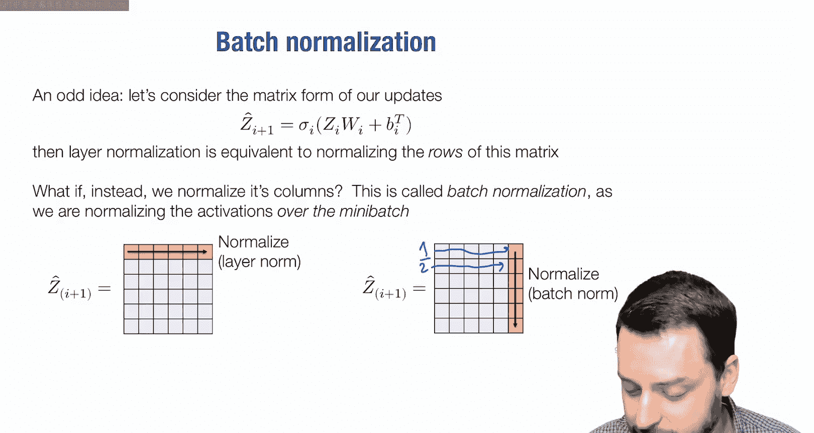

When you apply batch norm at。Test time， you train normalizing by these batches here。

 But when you actually apply batch test time， you don't use the actual norm of the batch。

 you don't use the batch statistics to normalize your example， you use。

Computed average is of the mean invariance you've seen over kind of all your examples so far。

To actually compute that。And so what happens here is these sort of form these empirical what we call kind of empirical running means or running averages。

 I shouldn't use the word mean because mean implies kind of it's the mean term here。

 but running averages of these mean and variance terms right and so what I mean by that is you'll form sort of one of these mu hat terms and here mu hat for example。

 could be just something like as I'm going my mu hat i+ one variable would equal some sort of。

Term beta times my old。Its like representation of like setting it equal to as I'm running my my。

My network here it'll be equal to sort of the old estimate of my mean plus something like1 minus beta times my actual expectation of say the Z hat i plus1。

 right， So this is sort of like momentum kind of running what they actually are technically are is exponential moving average estimates。

 but they are kind of running estimates of what the mean of of these of these parameters looks like。

And similarly for the variance， just averaging the variance over time。

And so what we do that in our update is instead of producing our。Our update。

 just based upon at test time， at least based upon the actual mean and variance of our of our of our batch。

 we subtract off this running estimate of the mean and the variance。 So what we do is we say， again。

 remember our J index here。 So this is the the J。The J。Con sorry。

 the Jde column for the Ih for an example in our batch。That would be equal to in this case。

 Z hat i plus 1 J。Minus not the empirical expectationhoration of that batch。

 but minus this running me。Minus mu hat。I plus one。The Jth column。

 and then divided by the square root of a similar term， I won't write what says it's very similar。

 but the empirical estimate of our variance。For that feature。J， and then plus in epsilon term again。

And that is the standard update you do at test time so to be clear with batch normorm at training time。

 the update looks very similar to the layer norm update。

 but just what it means is different right so this would be the actual expectation over the batch。

 this would be the variance over the batch， but then at test time you run it with these moving averages instead。

And in fact， when you implement your you will implement in your neural network library。

 the batchstorm layer and you will have to sort of track these things as you go and there are all sorts。

 by the way， of very weird oddities that come up when you do this like I've seen all sorts of bugs where people you know run their network in training mode and sort of even though they're not training the network and not taking gradient steps。

 for example， Pythch will actually update the running means and variances when you're running in training mode so you。

Bash normm causes a lot of problems too， but it also sort of solves a lot of problems so so there's there's lots of pluses of minuses to things like bash normm and you'll have to kind of just kind of get used to these things in practice。

 but you will implement this your in in your homework when you implement the neural network library。

All right， let's move on the next topic now， which is regularization and again。

 this might seem a bit。because theyre odd to put together because this is in sometimes a different topic。

 but regularization and normalization are in somewhat some sense similar and they are kind of features that we add to the networks the other make it perform better or to optimize better and things like this。

Um， and they end up having weird interactions that kind of make a lot of sense to talk about these things together。

All right， so。To motivate regularization， I'm going to use the fact that typically deep networks。

 and this is true even for sort of simple two layer networks for the cases you've used in the homework so far。

They are typically what are called over parameteraized models。

And this means the networks have more parameters， more weights， more individual weight values。

Then the number of trading examples in the data。And this means。

 and we can even formal I won't formalize this， but it can be made formal under certain assumptions。

Is that they are capable of fitting the training data exactly。

That means that when you optimize one of these networks。

 they are capable of achieving essentially zero training error or something that leads very。

 very close to zero training error in practice。And in the traditional way of thinking about machine learning and statistics。

 again， with a few big copyats here， I don't want to make two blanket statements。

 but to go ahead and still make a blanket statement。

Traditional kind of machine learning or statistics would imply that the should imply in some sense that these models。

Overfi the training set。 And what that means is that they will perform well on the training set。

 but they will not generalize well。 So essentially in when you give it a new test set。

 they will not perform well on this new test set。 And this is sort of the the classical kind of model of。

 of， of thinking。 now。Of course， sort of we know from a fact that these models sometimes do work well。

 despite this seeming kind of oddity about being overparamatized and silicon well。

 and to be clear there are statistical， very formal models for why this can work。

 I'm not trying to imply here。 This is some big mystery。

 but I also do when it says there there actually is some mystery about this still。

 we don't quite understand everything still about this。 but。From this classical perspective。

 it does seem like our models that we have for deep networks。

 they're just too complex and what's likely is that they're going to fit the training data exactly and not fit。

 not be able to give us good predictions on new examples， which is of course what we really want。

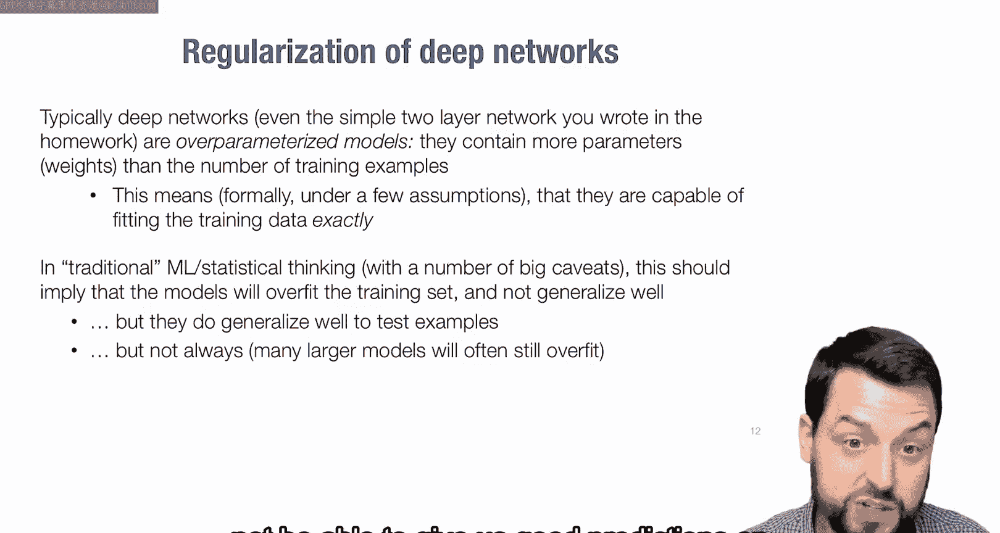

And so to counteract this problem， the traditional way of dealing with this challenge in statistics or in classical machine learning is to apply some form of regularization to our problem。

And speaking very informally here， regularization is in some way the process of limiting the complexity of our function class in order to ensure that our models generalize better and so this is sort of my informal definition of regularization。

Is about limiting the complexity of the function class， so our functions are very complex。

 they have more parameters than they have examples， they can overfit very easily and。😊。

Regularization essentially is the process of controlling that complexity so that our networks generalize better。

Now there are two forms of regularization that are very commonly talked about in deep learning。

 and the first of these is what's called implicit regularization。

So this refers to regularization that kind of comes about not through any explicit means。

 but through kind of just the nature of the architectures or algorithms already considered。

And by the way， this term is vastly overused， I think in deep learning。

 sometimes for things that are not really regularization， but you see it everywhere。😊。

But there is a real value in thinking about some of the processes that we use in deep learning as being a form of regularization。

 even though they are not explicitly trying to control the complexity of our function。

 and the best example I think is actually stochastic gradient descent itself。

And just the way we optimize these networks。Maybe and maybe even more formally。

 SGD with a given weight initialization。Because。When we say that these numbers are over parameter。

 so what we really mean is that function class， the class of all deep networks can easily overfit。

 there are many possible values of the weights that can easily exactly fit a set of examples。

 but which won't generalize at all。But the reality is when we train a network。

 we're not optimizing over the space of all neural networks。

RightWe're not actually optimizing over all neural networks We're actually optimizing over the class of neural networks that in some sense。

 is attainable or considered via SGD reachable via this one optimization procedure with a given weight initialization you remember in our previous example when we initialize with different weights that weights didn't actually change all that much so clearly we're not kind of searching over all possible weight settings。

 we're actually thinking about a very limited class of kind of deviations from our initial values and that is a form of implicit regularization。

😊，Okay， but the kind I'm actually going to talk about here， the kind of and to be clear。

 this happens。Everything that we do。That's a big exaggeration。

 But a whole lot of what we do in designing architectures for deep networks or designing optimizers is about。

Implicitly regularizing the complexity of these functions， such that we can generalize better。

What we're going to talk about here though in this section is actually going to be explicit regularization though。

 which refers to modifications we make to either the network or to training。😊。

That are explicitly intended to regularize the network。

 to control the complexity of the network function class。

 this actually what we're going to talk about here。

 but Indian emphasize these are both very common in deep networks。

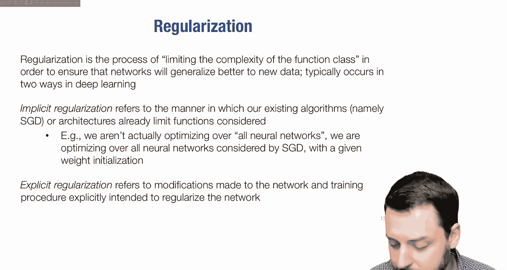

So the most common form of explicit regularization you will see， well。

 I guess I should take that back because both the types I'm going to talk about here are common。

 but the most of the most common form of regularization you see applied to the weights of a network at least。

 is something called L2 regularization， or in deep network is often also called weight decay。

 and I'll talk about why it's called this in a second。So。To define L2 regularization。

 I'm going to sort of bring us back to our classical machine learning optimization problem right。

 So our problem we had before was to minimize。Over。Our in this case。

 I'll make our parameters is going to be explicit， say our parameter just our weights1 through L were my weights。

 I believe。And I want to minimize the。Average value of。

Say over all my examples of the loss between my prediction。

 and I'm going to write my what as a class of a function of1 through L。Apply to X I。And why I。Great。

 that's my classical again。Everything， machine learning， optimization problem。嗯。

The idea behind regularization， L regularization。Is that classically speaking？

A key way of assessing the complexity of。A hypothesis class is via the size。

So just the norm of these parameters。And the reason why。

 and I won't get into this too much because this intuition admittedly does break down a bit when it comes to deep networks。

But one way of thinking about this is imagine your weights were all zero。

Then you basically by the forms we had before， you're essentially predicting with no bias terms。

 say you're going to predict zero everywhere。If your weights are small。

 your functions have to be very smooth， right they can't change very much because you're not applying very large factors to your inputs。

 so your function will be very slowly varying over different inputs with small weights。

And so the smaller your weights are， in some very real sense， the smoother your function has to be。

A bit more formally， this actually the size of the weights imposes restrictions on the smoothness or the lipsitz constant of the function that you're actually using to represent your data。

And what this means is。Because smoother functions in some sense are less complex right they can't change as fast unless they're less kind of highly varying。

 one way to control the complexity of a function is to ensure that the value of the weights themselves are small。

 so we want to make the parameters small。Okay that's one way of making our keep controlling the complexity of our function class。

And a very common way to do that is to do this by adding in our loss function。

 by by augmenting our optimization problem to add what's called a regularization term。

 and the most common way of writing the most sort of。

The form of this term in the case of L2 regularization， is that we're going to add a term。

Plus lambmbda over two。Times the sum from let me a little more space here， the sum from in this case。

 I'll use J because I'm indexing here over the notch， I'll still use I here。

By usings T sums that the sum from I equal here's ening over the layers。

 So the sum from I equals1 else in thising the layers of my network of the。Norm of my I layer。

 And I guess this is actually a matrix。 So technically speaking。

 I should use what's called the Frbinius norm squared here。

 This is just the sum of the squared elements of this vector。So of this matrix。

 so as a vector we would just the L2 norm， it's called a ferbinous norm when you apply it to matrices because。

You don't want to confuse it with the spectral norm and things like this。Okay。

 so that's the form of regularization that we often use in or the sort of most common called L2 regularization。

And I should actually be kind of I' if I'm being fully。Honest here， you know。

 I've previously referred to this thing here as like the optimization problem of all machine learning right。

 I says the you minimizing over your data set， the sum of losses。Vinimizing over your parameters。

 the sum of losses in your data set。And really though， probably more fairly。

 this thing is the actual true machine learning optimization problem because very often there is a form of regularization either built in or explicitly considered in machine learning methods and so really regularized minimization of the losses in the training set is an even more apt description of kind of the single optimization problem that all machine learning uses with of course。

 the possibility other measures of complexity rather than just the norm of the weights。

 you could have other more generic regularizers too， but really this is kind of in some sense。

 even an even better description of the core optimization problem of all machine learning。Okay。

 so what happens when we actually use this？This update， this form of the update here。

So if we define our new optimization problem as this new objective。

 what we get for our gradient descent update is well most of it is like before。

 so before you know our gradient and update takes our old parameters and subtracts off alpha times the gradient of this whole term here。

Right， so it would be the gradient of。The loss， maybe I'll even write it just for one then I' write it。

 I'll write it out with the sum and everything too。

 but of course this applies to many batches and anything else too。

So it would be the gradient with respect to WI of the sum of our losses。

 which I'll actually maybe just write as the I'll write like that。

 Of course you could write as the sum of the gradients too， but it doesn't really matter。

The loss between our hypothesis。W1。Through L。X， I。I， I。

 so that is the exact same thing as we had before in our。Read some update。

But then you would also subtract off。Alpha。Times the gradient of this thing。

But the gradient of the norm of a vector square， this is like one of the standard gradients you probably know or。

I would just say what it is。 The gradient of the normal vector squared is just that that。

 that vector or that matrix， right， So the gradient。 So so what what this is， of course。

 is this is the gradient of。😊，This term。Here。But the gradientd of WI with respect to that whole thing is equal to。

嗯。Lambda times WI。And that's not hard to that's not very hard to show that just is obviously the terms in the sum because I'm becausem taking the gradient set for WI。

 the terms in that sum other than WI don't matter， they fall out and then the gradient the WI perbiius normal WI or for a vectors。

 the square norm is just that vector or that matrix。Okay， so this， this is what our。

Creeen as an update becomes。And if we just refactor your terms here。

 you know we have a WI here and a WI here， so this whole thing can also be written as。

1 minus alpha lambda times WI。Minus alpha times our old gradient， right。

 the gradient with the WI of the sum from I equals 1 to m。 I guess I should have an average here。

 I should have a1 over M in both places doesn't really matter。Of our loss， W。1 through L。

X I going have space here。Why I？Okay。Barely。Didn't quite make it。

Move things over just a little bit here。Hopefully you can see that whole thing， Okay。

 so that's our that's our update。And the key point that I want to make of this update is that what this update does when you combine terms is that it takes。

 instead of just taking our our WI and updating it with our previous WI， we take。

 we set W I equal to。Some factor times the old WI and this factor because alpha is the step size is considered a small number and because Lambda is also what's called a regularization parameter here。

 it's just some factor that trades off between our loss function and the regularization these are both positive and so this。

Think here subtracts a positive number one minus a positive number。

And so this whole update will essentially shrink W。 will be a you know。

 a shrunken version of W I right In other words， we shrink the weight fact by this factor。

1 minus alpha times times lambda。 for again， lambda is our regulation parameter here。

Before taking each gradient step。And because of this。

 because this sort of shrinkage of the weights here， this is often called weight decay。

But it's important to know what this is really doing is that this is taking the gradient。

 not just of our loss， but but also of this regularization term that involves our weights。

And that's how you derive this L2 regularization update。Oftentimes for convention。

 and I'm not quite sure why it evolved this way， but oftentimes for convention。

 we write we sort of implement L to regularization as a feature of the optimizer。

 not as a feature of the loss。 I think that's actually a a bit wrong。

 I personally think that we should kind of define this regularizer as part of our loss function and do things that way。

 but that's not the decision that the community made of deep learning。

 So what you'll really see frequently is optimizers。

SGD or atom of these things have a term that is called the weight the K term。

 and that is exactly just this parameter lambda here， which affects how much you trade off between。

Your weights and and your loss function it's often incorporated in the optimizer itself。

 But if you're uncertain how to incorporate this an optimizer。

' it's really important to know how it's derived this way because if you need to implement like weight decay in atom what you should not do is try to figure out like a different kind of weight decay that is correct for atom。

 what you should just do is take your gradient。 So whenever you have a gradient of your normal system。

 that's this whole thing here。 you just replace it with the way you actually implement weight decay is you replace it with the gradient of the whole thing。

 including the regularization term， and you know for whatever momentum terms or anything else you have。

 you would just use that whole combination as your gradient。

 So that's how you implement weight decay correctly with momentum or with atom or these other things。

 And so that's it's important to know how you come up。

Even though the resulting formula is that you just sort of multiply your weight by a constant less than one before the update。

 it's important to implement that kind of in terms of this regularized optimization problem when you actually do it so that you know how to implement this properly for other optimizers as well。

All right， so L2 regularization is kind of I would argue kind of most common form of weight regularization that people use in deep networks。

 but there is a big caveat here， which is that even though it is very common。

 it's unclear how much it really makes sense because in practice it's unclear how much the norm of the weight really affects the complexity of the resulting underlying function。

 I mean I gave this example where if the weights were all zero， yes。

 the function is not very complex but in terms of the variances you get when it comes to real networks。

 it's much less clear so remember this example I gave before of networks with three different weights。

That all got So this， this 1， I think I didn't actually include it here。 But this one was。

 was a variance of the initialization weights of。嗯。2。3 over n， I think this one was2 over n。

 This was was this blue one here was。1。7 over N Okay。

 so so we had the different initializations and these are very different weights right when it comes down and maybe not very different。

 but they are somewhat different weights， but these networks all get the same loss and the same actually generalization loss on Ms in this case。

And so is it really that important to shrink weights it's sort of unclear right and personally weight to K is very common。

 so when you people run gradient% you will often see some amount of weight to K。

 people have just tuned it over time and you found it small value of one E negative4 is like a maybe a good work slightly better than no weight the K at all。

m but I often ignore it entirely when I trained deep networks。

 I often don't bother with weight decay because。Pameter magnitude that sort of the opposite magnitude the parameters is especially when you include normalization layers and this kind of stuff。

 it's often a very bad proxy for complexity in deep networks。

 And so while this is very common and you should know about it and it is in wide use， you will very。

 very often see it used in practice。😊，I often find that I don't tend to use it that often in deep networks。

The other form of regularization that I want to mention here because it's very common。

 and I do consider this to be a form of regularization is something called strategy called dropout。

So if you can think of L2 regularization as a regularizer that explicit regularizer。

 we apply to the weights of a network， the parameters of a network。

 another common strategy is to apply a kind of regularization to the activations of the network。

And the essential idea here， and this also maybe seems odd first， not unlike other things。

 like say bashhor we considered。Is to， as we are treading our network。

 the idea of dropout is you randomly set some fraction of the activations in each layer to zero。Okay。

 so formally speaking， what I mean by that is， you know， similarly。

 like let my Z hat i plus one here be kind of a。A tentative value for the next layer。

 but my actual value for the next layer would be equal to。

The Jth element here so that the element J in my next layer would be equal to。Z hat。

I plus 1 J just equals that layer with probability。Probability。1 minus p and with probability P。

 I set it to be equal to 0。So this is with。Probability， P。that's the。Idea of dropout。

 but it's actually not quite complete yet， because if I do this and kind of randomm the sentence 0。

 I am， I am going to be changing the。The overall weight of these activationations， right。

 I'm going to be。You know， with the same initialization， I will say no longer can I。

 I will no longer have weights that remain or variances of the weights remain steady over over throughout the network。

 So I have to actually also scale these weights by the probability that I， that I keep them。

 And so actually， the correct scaling for these things that to maintain the variance properly is。

 is just to divide this by one minus P。So if I keep I set half to0。

 then I'll divide the rest by half to make them twice as large， if I set 0。1 to 0。

 I'll divide the rest by 0。9 to make them a little bit larger。And that's the idea of dropout。

Now again， like batch normm， Dout has different performance at training time at test time than at test time。

 so dropout is typically only applied not typically though not always apply at training so you're trying to sort of regularize your network at training time。

 but it typically is not applied at test time， so test time you just leave all your activations in there。

Now， this does seem very odd， right， because it seems like in doing this。

 we are we must be massively changing the function that we're actually approximating here， right。

 aren't we kind of completely destroying the function if we just randomly set some of our features to be equal to 0。

And batch sorry， dropout is often cast as kind of a way of making the networks robust to missing activations is one way it's kind of framed but。

I always didn。 I never really like this characterization because why should it be robust in missing activations that。

 I mean， after all， you don't have。These missing activationations at test time and why does this？

Why should this be thought of as like regularization？

So I think the best way to think about dropout is actually to think of it as a stochastic approximation and just like we did SGD to approximate green descent over our entire objective。

Bstorm can be keeps in batchstorm Dropout can be thought as a very similar thing applied to the individual activations of a network。

 So here's what I mean by this。When we did our sort of SGD approximation， we used the fact。

 we kind of relied on the fact and and the declare second gradientian% it itself kind of I mentioned this sort of implicit form of regularization right。

 it adds kind of noise to our gradients which actually does provide kind of regularization to our function and so what we did in when we approximated things with SGD is we said that you know my my。

My。Kind of overall objective here was kind of equal to some sort of。

Similar loss computed only over a mini batch， so say all I in the batch or something like this of the loss between H。

X， I。And why this was the stochastic gradientcent approximation that we used。And in some sense。

This is very similar to what's being done with Dout。So in Dout。

 you can think of really sort of you know， zooming in a bit more on kind of what's really being computed in a layer。

The way we sort of compute each activation prior to its done nonlinearity is we take the corresponding elements in a column of W and multiply it by the activations of this。

This this this vector here and and and this is so so this notation here means that the J kind of the the Jith row here times。

All aspects of this all so this the sorry the。Row here right because we're transmitting it times the activations of this vector here。

And so that's just sort of the broken down version of this major multiplication that we do。

And so one way to think about this， about dropout is that we are just basically doing a stochastic approximation。

Of this individual kind of activation， we are approximating this thing as similarly equal to Z plus1 times sorry sorry Z plus1 equals our same no nonlinearity applied to。

The sum， not over all the different weight， but just over to sum in some J in some subset。

 say P here， where we're going to multiply WJ。All the。Elements here times Z I J。

 And then we need to normalize this to properly have kind of the correct scale。

 just like we normalized by one over B here instead of one over n we would sort of divide by the size of our set here。

 But of course， you know we didn't normalize this one。

 know this one was not written as as an average， which as a sum。

 And so we need to multiply on the top here by n。 And this factor is exactly kind of the the average factor you get of one over one。

 is this thing here would just be of course， equal to。1 over1 minus p。

 So this is the fact that we multiply our weights by。

And so I think this is the right way to think about dropout it is dropout is a schastic basically takes the idea of stochastic approximation。

Into the activations of the network itself， the individual layers of a network。

 and in doing so provides a similar degree of regularization as stochastic grade consent provides for。

For the sort of traditional training objective， I' necessarily like I like to think about about dropout。

Okay， so that actually covers the majority of the techniques that I want to highlight today。

 So we covered normalization and regularization， both as techniques as ways of sort of。

Making optimization better or making sure that we don't overfit as much to our data and things like this。

But I want to end this with a bit of a more kind of。Higher level picture here。

Talking about kind of the interaction of all these things we've been talking about over the past several lectures right so we talked about optimization。

 initialization， normalization regularization。😊，And the reality is。

There are many design choices we can make。To ease the optimization of deep networks or to make them perform better。

 etc。We have the choice of the optimizer， the learning rate of the optimizer。

 the parameters atim the momentum term， which optimizeim we use。

We have the choice of weight initialization you know what's what's our variance we use there。

 maybe we should use a uniform versus normal distribution。

 all these sorts of things do we add normalization， do we add layer norm。

 do we add batch norm do we regularize do we use weight decay or do we use dropout right and these don't even include the other tricks we might cover in later lectures like residual connections or learning rate schedules or many others that I'm probably forgetting。

😊，And so。If when you sort of are first approaching。The practice of deep learning。

It is very often to it's very common rather to sort of feel like。

 okay you know I don't know what I should choose here。

 So let me you know do a grid search over all possible things here。

 And that's how I'm going find the right parameters my network and this is first of all。

 This is exactly the wrong thing to do definitely don't do that there are wait too many choices here do a grid search and training one network is take a take long enough let alone training you know 10 to the eight networks or something like that right to sort of grid cover your whole choice of parameters here。

But you would be forgiven， you know， especially when you see kind of people's recipes for training where they have some random values of these things。

 you would be forgiven for thinking that， you know。People must have just。

Faied around randomly on GPUs for many thousands of GP or millions of GPU hours。

 and that's what deep learning is all about。嗯。I'm actually going to push back on a little bit。

 I don't think I was actually quite right， but but to to give。

Even a bigger impression about sort of one of these things。

 I want to actually go through an example case that that。It has been confusing to the field。

 to be honest， and that is exactly this case of bashstorm that I talked about。

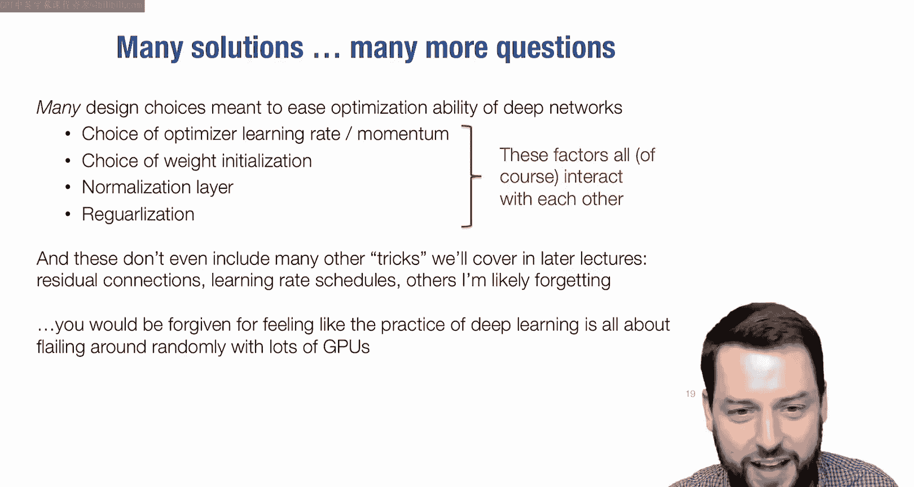

So Basshors proposed in this paper that you see here called called batchsh normalization Aceleating Deep Network Traing by Reding internal Covariate shift。

And the abstract I think actually aptly describes exactly what Bastorm is doing。

 it says training deep networks is complicated by the fact the distribution of each layer's input changes during training as the parameters of the previous layers change。

 this slows down the training by requiring lower learning rates and careful parameter utilizationization and makes it notoriously hard to trade models with saturated no nonlinearities。

We refer to this problem as internal covariate shift and address the problem by normalizing layer inputs。

 Our method draws its strength for making normalization a part of the model architecture and performing normalization for each training mini batch。

It also， by the way they mentioned that it eliminates the need for a dropout。

 so already they're talking about the interaction in some sense between normalization and regularization and these sorts of things。

😊，And batch stormm is a great example because batch norm undeniably。

Was was a good idea right this this has been extremely useful in practice and very oftentimes there are networks that just will not train if you do not use baorm and when you put bashstormm in there。

 all of a sudden they just start training and performance is much， much improved。

But there has been admittedly a lot of discussion and confusion in the community about。

What Bastorm is actually doing， why this is a good idea。

 why this might be a good thing to really do in practice。

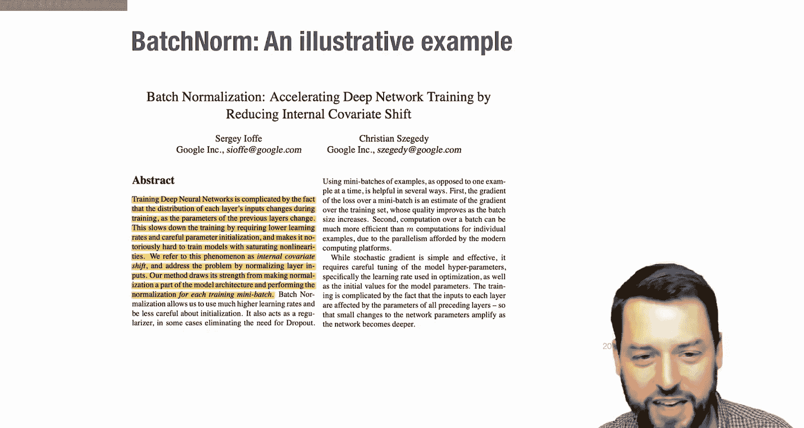

And this was sort of made famous by not， I mean， amongst many other things。

Adi Rahimi actually gave kind of a controversial test of time award at the Nipps 2017 conference。

And he actually he also used basor as an example in some sense of what's wrong with deep learning or the fact his analogy with that deep learning is seemingly like alchemy in a lot of ways and people sort of just trying to cook up interesting things and I actually don't fully agree with this assessment。

 but sort of a worthy worthy thing dimension here as a perspective。

And so part of this talk at the following says here is what we know about bastorm as a field。

 it works because it reduces internal covariate shift。

 wouldn't you like to know why reducing internal covariate shift speeds upgrading the scent？

When you like to see a theorem or an experiment， you like to know。

 wouldn you like to see evidence that bash norm reduces internal covariate shift？

Wouldn't you like to know what internal covari shift is， wouldn't you like to see a definition of it。

 I think that's actually but by the end， he was maybe being a bit tongue and cheek there。

 it's a bit unfair I。

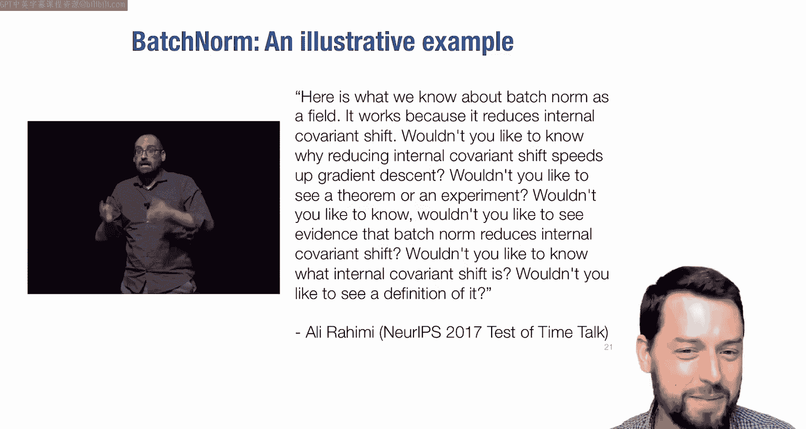

Literally in the abstract， they say they define this right。

 we refer to this phenomenon they just described as internal covariate shift there。

 so so maybe that last statement was a bit I think a bit unwarranted， but it's true。

 Does it speed up optimization， Does it reduce this internal covariate shift that they have here。

 is there a reason why it does it sort of unclear and。😊。

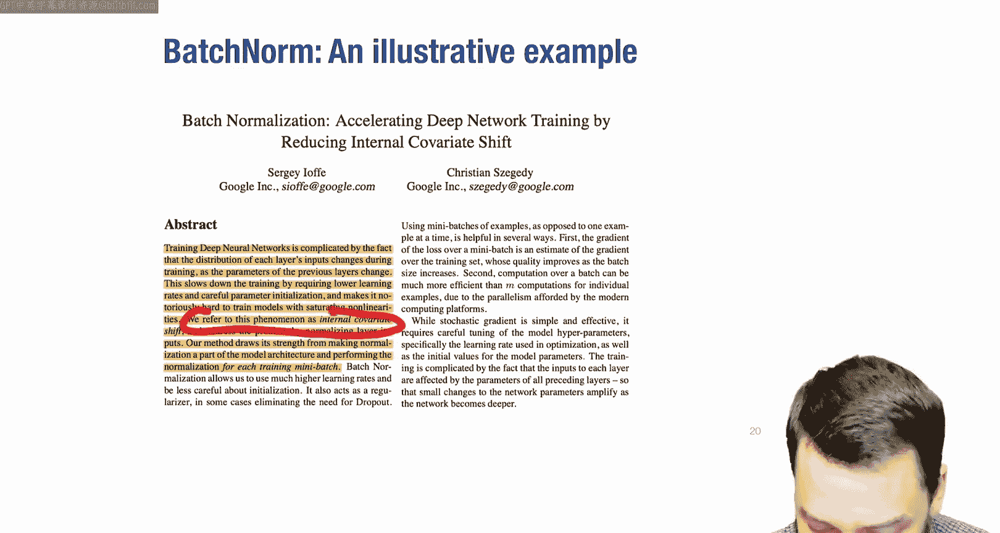

In fact， there have been many papers arguing that， no。

 this reduction of internal careership is actually not what patch stormm is really doing。

 One famous example actually being a paper in， I believe。

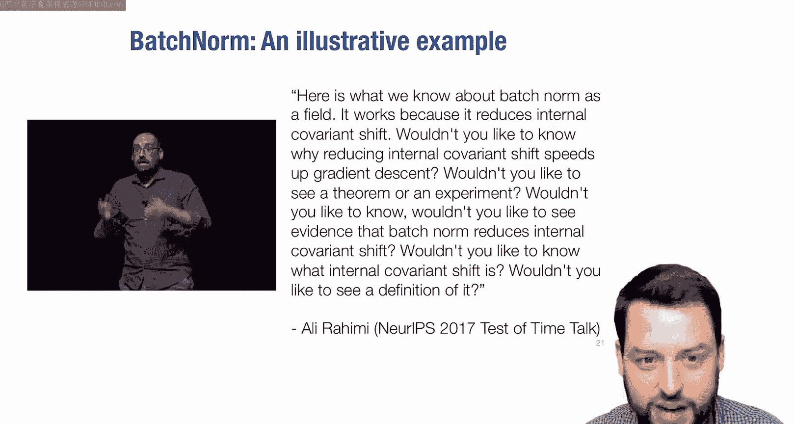

Nur 2018， arguing that instead， rather than the sort of original view of bash normm。

 the actual benefit of bashstorm was in the fact that it makes the landscape of optimization smoother。

 So the relevant part of this paper says that the popular belief is that the effectiveness this。

 this effectiveness of bash norm stems from controlling the change of layers input distributions during training to reduce so-called internal cavariate shift in this work。

 we demonstrate that such distributional stability of layer inputs has little to do with the successive bash normm。

 And instead we uncover of more fundamental impact of bashstormm on the training process。

 and makes the optimization landscape significantly smoother。

 And so now this is an argument that bashstorm is really not about。This sort of。

Making features on putting features on an even level。

 but it's actually about interacting with optimization and speeding up the optimization process。

 But then and I'm and this one I should admit， I'm biased here。 I'm an author on this paper。

 So I take this all with a grain of salt。 But a few years after this。

 actually a student of mine head of paper on the dynamics of optimization of deep networks worth undergrading descent。

 and rather buried in the paper， to be honest， is it's an appendix K1。

 It's where this fact is mentioned。😊，But after a lot of discussion and the paper hunt shows that actually the smoothness of optimization in deep networks does not behave like we are used to when it comes to traditional optimization and a key sentence here is that we conclude that there is no evidence that use of batchization improves either the smoothness or the effective smoothness along the optimization trajectory。

 So maybe the statement that the batch storm helps smoothness is not is not the case。嗯。😊。

So this is now several years。 And it's almost like like you almost can't write a paper on batchnm anymore because people just sort of roll their eyes as like another batch norm paper。

 another paper trying to explain batch norm， you know， haven't we seen a lot of these。 And。

 and this just goes to show that you know， these， these things that are very， very standard。

 They're still a lot of。Unclarity about what they are actually doing despite the fact that they are very widely used throughout all deep learning。

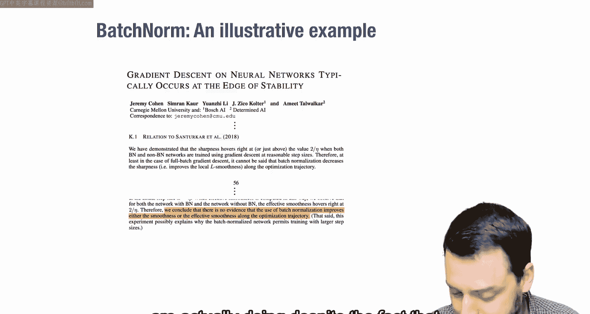

And as the very last point， I just want to make another point， which is that in recent years。

 actually Baslorm has seen another kind of life。As a technique for adapting to shifting distributions。

 so I don't want to get to mention this because it's actually a whole another topic in machine learning。

 but one sort of very common。One kind of growing realization I think amongst deep learning is that it's very important to understand how methods will do。

 not just when they're evaluated on the same distribution as they are trained upon。

 but when they're evaluated on somehow a different distribution。

 this is a setting called distribution shift。And what people have found is that if you this is a paper from a paper called tent based a different approach。

 but they use batch Norm as a baseline in this paper here， so I'm going to use it。

 there are other papers that showing that it actually works as a baseline。

And so what the point I want to make here is that this plot here shows a bunch of performances of different classifiers。

 such showing their error when you give corrupt data in different ways。

 So this sort of shows the error on the original data。

 and then you can corrupt the data with like Gausian noise or different like motion blur stuff like this or zooming and stuff like this。

 So when you corrupt the images in some sense， that performance of the classifiers dropped a lot。

 So you know the original classifier before it got a little less than 25% accuracy。

 And now I think this is on imagenet。 And so when you corrupt it， it goes down to like 60% error。

 So before it was before it was。25% error now it' 60% error。

What people have found is that if you just run batch norm。At test time。

 So so the thing we were trying to avoid doing by completing those running means。

 but if you ignore that and just embrace the kind of chaos of having batch dependency at test time。

This substantially improves。The performance， not to the level， the original data set。

 but it substantially improves performance on distribution shift of your classifiers。

And so bash Norm， all I will say here， this is probably all that's enough detail on this for now。

 but what I will say here is that Bash Norm is getting this kind of second life as a method for improving the performance of classifiers and distribution shifts so this technique developed to help optimization or avoid dropout。

which then got viewed instead as a sort of technique for improving optimization。

 but maybe not is now also getting a second life as or a third life or whatever as a technique for helping networks be more robust to distributional shift so it's just crazy I mean this is a simple one line formula right it's crazy how much life this idea has gotten over the course of over the course of machine learning or the course of the last five years of deep learning。

😊。

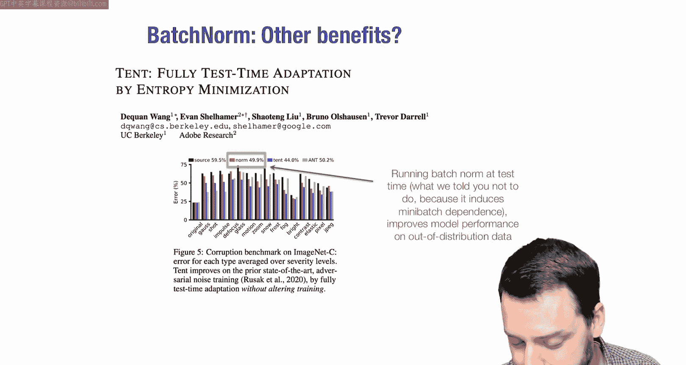

So that's actually all I'm going to say on this for now， but eat。

TheThe last sort of point I want to make on this and before we end for today is that。

This whole discussion， and this was just one example， right。

 I covered a whole set of techniques here， different optimizers， different initializations。

 different normalization techniques， different regularization techniques。

 this discussion just in the case of batch norm。😊，And there are similar discussions， by the way。

 for dropout and for weight the K and such。It may give the impression that these things are just random hacks for which we have no real principled understanding and deep learning in sometimes is all about random hacks right you just try out different things and sometimes they work and how on earth could you figure out what's actually going to work？

And I don't want to give。That impression， actually。

 I think there's been a lot of really excellent scientific experimentation with all of the above。

 So even even if you can't quite analyze it theoretically。

 you can often analyze these things empirically in a very scientific principle manner。

 And there's been a lot of excellent work that does this。😊，However。

It is also true that we do not have yet a complete picture of how all the different empirical tricks and techniques that I've introduced there really are really work and how they interact in the real world。

And so this again might give you the impression that in order to get deep learning systems to work。

 you have to sort of try out all possible combinations to find the one that works。

But I also want to push back against this。Because the good news in many cases is that。

While these things are all useful tools。And you should have all of these different。

 you should get some empirical experience with them， you need the empirical experience understand。

When they may be useful and when they might be coming into play here。The good news。

Is that in many cases， it is actually possible to get similarly good results with very different architectural and methodological choices。

 so you could have one architecture that uses dropout， one that doesn't。

 one that uses normalization and one uses best normally layer norm if you understand how to tune your architecture and kind of take greedy steps along its route。

 there's a very good chance you will end up with very similar performance as potentially a very different method。

 and in some sense， I think that one of the lessons of deep learning over the past several years is that yes。

 there are advantages different methodologies here， but also。😊。

Its sort of shocking how similar a lot and many cases。

 a lot of very different architectures or methods methods really work。

 So these techniques are ones you should all be familiar with。

 we're actually going sort of stop here when it comes to these sort of different tips and training techniques and different variants。

 this is， this is， I think， a sufficient knowledge to proceed now to different architectures and stuff like that。

 but。This is you should know these tricks and these tips。

 but you should also know that you can get good performance with a variety of different methods。

And in fact， next lecture， we're going to start diving into some of these， not just sort of。More。

 more kind of generic but sort of methodological tricks you can use。

 but we're going to instead start talking about kind of standard。

 more structured architectural choices using an example of convolutional networks in the next lecture。

So that's it for these sorts of tricks and we'll see everyone next time。

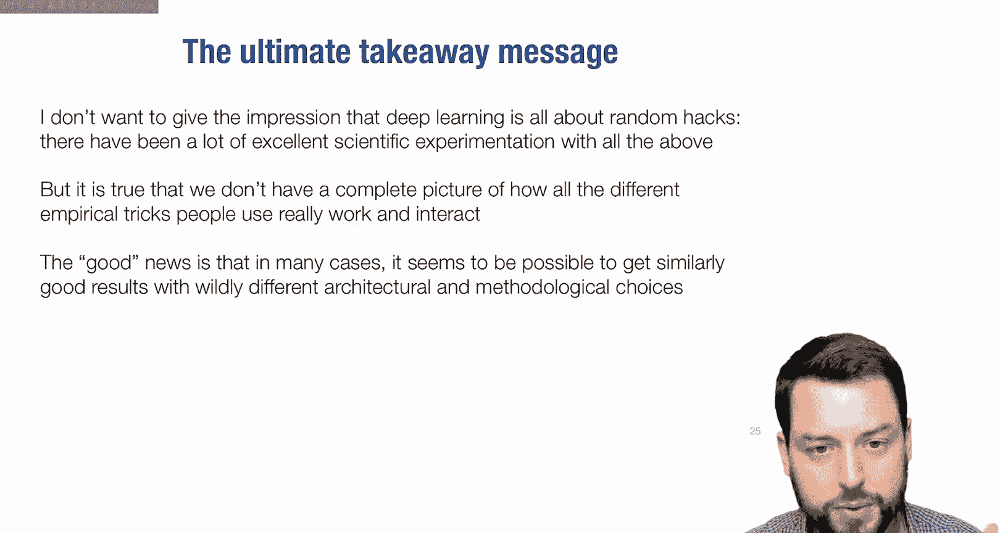