# CMU《深度学习系统｜CMU 10-414714 Deep Learning Systems 2022 fall》中英字幕 p10 -11-Lecture 10 - Convolutional Networks.zh_en -BV1ERtYepEpy_p10-

All right， hello everyone， and welcome to today's lecture on convolutional Network。😊。

Convolutional networks are a structured form of network that is commonly used in images。

 but also used in things like sequences or audio or other similar domains。

And it's not too much of an exaggeration to say that convolal networks are。In some sense。

 historically the most important structured deep network。

 at least in the history of deep learning so far， so I know that things like transformers are getting a bit more popular these days。

 but if you look back at kind of the influence that that networks have had。

It's hard to overstate the impact of convolutional networks on the field of deep learning。

 So we're going to talk about these today。 Now today is going to be a bit of kind of a look ahead to a certain extent。

 Much of our later course is going to focus on different structures of networks right so convolutional networks will' also talk about re currentrent networks and and transformers。

But today， it's going to be a bit of a look ahead。 And we're gonna after this lecture。

 we're going to come back to。More concrete issues of implementation of linear algebra， but this。

 but in order to implement convolutions we'll actually need that。

 and so to motivate in some sense some of the later work that we're going to be doing in efficient linear algebra。

 we're going to first talk about this structured form of network called convolutional networks。

Allright， so let's jump in the outline for today is we're first going to talk about convolutional operators。

 what is a convolutional operator and how do you incorporate it in a deep network。

 then we'll talk about some practical elements of convolutions and finally we'll end talking about how we differentiate convolutions。

 in other words how do we incorporate these things into automatic differentiation tools。All right。

 so let's first talk about convolutional operators in deep networkss。

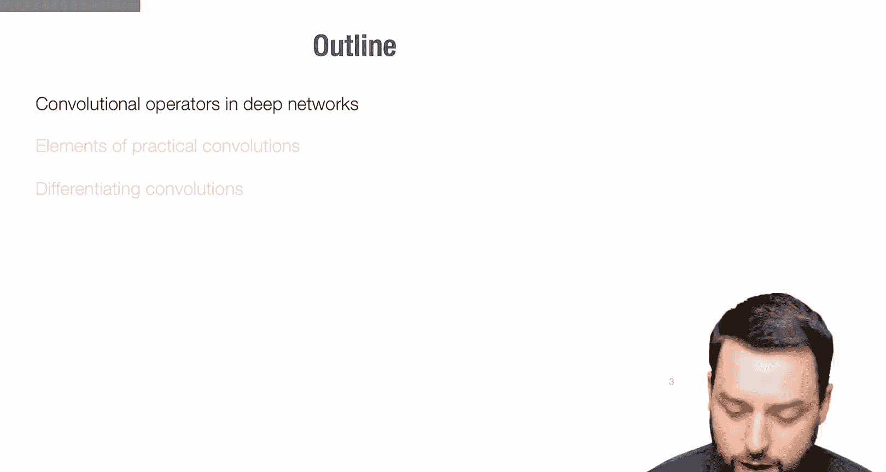

So far in this class， we've been considering networks that essentially treat entire image inputs as vectors。

 so when you implemented if you have yet implemented homework one。

 your fourth or homework 2 rather the first thing you did was when you applied a network to the MNT data set is you first flattened the images so you took all the structure of an image it's a 2D shape and only has one channel in MNIST。

 but you took this whole 2D shape and you just flattened it into one long vector with 784 elements。

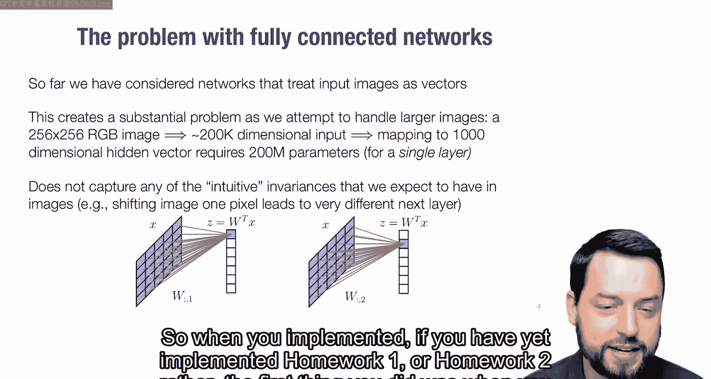

And this works OK for M this size digits that are 28 by 28。

 and therefore the vector representation only has 784 different components。

It's quite a different thing if you have larger images， this does not scale as an approach， right。

 because if you had something like a 2 256 by 256 RGB image，That would result in a about 200，000。

 so three channels times  236。 that's about 200，000 dimensional inputs。

And if you wanted to just map that to a single hidden layer that was say 1000 dimensional that would require 200 million parameters Now this slide used to be more impressive when no one would ever think about a model that big of course now its now it seems a bit less extensive as a network size because people of course trans account networks all the time。

 but for a fully connected layer that is why far， far too much。

 there's way too many parameters for a single hidden layer in a network of process is an image。

And the reality is this would just not capture nearly enough structure in the image to actually capture it very well。

 So it it's a whole lot of parameters for sort of any practical method。

 but the second thing is just wouldn't work that well and the reason why it doesn't work that well besides just involving too many parameters that are going overfit to your data is that it doesn't capture the intuitive invaris of that we couldn expect to have in an image so we kind of know that you take an image and you ship it over by one pixel。

 it's the same image the image itself doesn't change。But if you think about what we're doing here。

 we're sort of taking this whole to create you a single hidden unit， we're taking this whole image。

 multiplying it by the flattening it， multiplying it by a single row we're column in a matrix and we're sort of forming that's all to form this one single entry in our hidden unit right and then the next hidden unit here would have a whole new set of weights multiply by this right and we multiply every single element in the input by a whole another set of weights for this。

And this just doesn't seem to sort of capture the actual structure we know that there ist images and to be clear。

 this notion of trying to embed structure into the architectures of deep networks that is in some sense matched well with the input that is in some sense the key idea that will dominate the design of deep learning architectures in practice we want some sort of design。

 the architecture that preserve the kind of structure that we want that we have in the image。

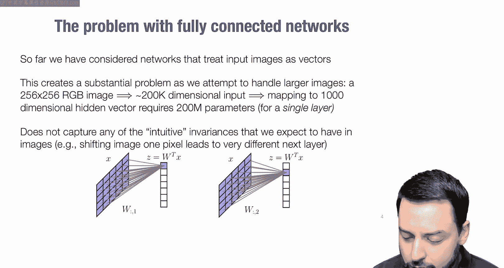

And so what convolutions are， our convolutions are， in some sense， a simplification of this idea。

Byu two basic premises。And the first premise is that instead of well I just said sort of the zeroth premise is that instead of representing our hidden units just as a itself an unstructured vector like our input。

 we're actually going to represent our hidden units also in some sense as an image as I shouldn't let say images because images usually mean to channels we can see but as a 2D really 3D tensor that have kind of spatial locations and then multiple channels eventually。

 here I'm just showing multiple spatial locations we'll later add multiple channels in a second。😊。

But in this case， we're going to think of our hidden vectors here as also 2D objects representing kind of locations in an image。

And convolutions have two properties。The first is that。These interactions happen in some sense。

 in a local manner。 So this hidden unit there is influence。

Primarily or maybe solely by the inputs in the previous layer that are in some sense。

 near that spatial location。Right， so we treat the this is sort of 0。0 and1。

 I suppose we treat the images， we treat the hidden layers as spatial images and we have the weights only apply。

Lally to images and the input to produce the hidden layers and so the sort of vision what that looks like here is that it's only these set of pixels multiplied by our weight that results in the next in this single location in the next layer right so that's the first premise。

 this local interaction。The second premise is that weights are shared across locations。

 so rather than have sort of one set of weights for this hidden unit and a whole other set of weights for this hidden unit。

 we take the same weight and we use that same weight kind of slid across the whole image to produce our next layer。

And this structure is exactly what is known as a convolution。

 so what we're doing here essentially there's sort of slightly more kind of formal look of this is that we are able。

 actually before I do that let me talk about the advantage of convolution first then I'll look at it a little bit more formally。

😊。

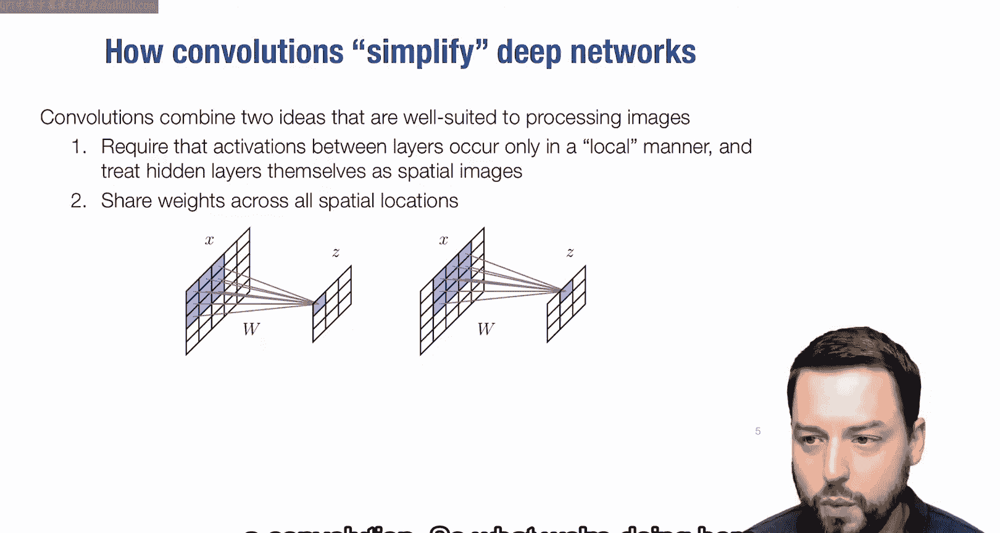

So what are the advantages of doing this， why why might we want to might want to sort of build in the structure here？

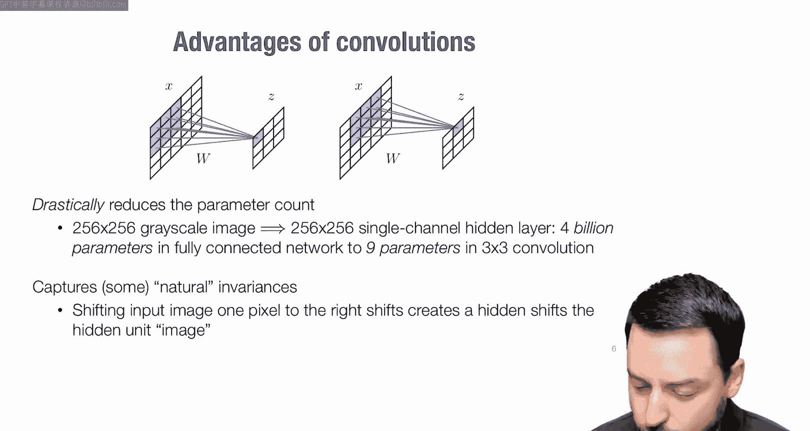

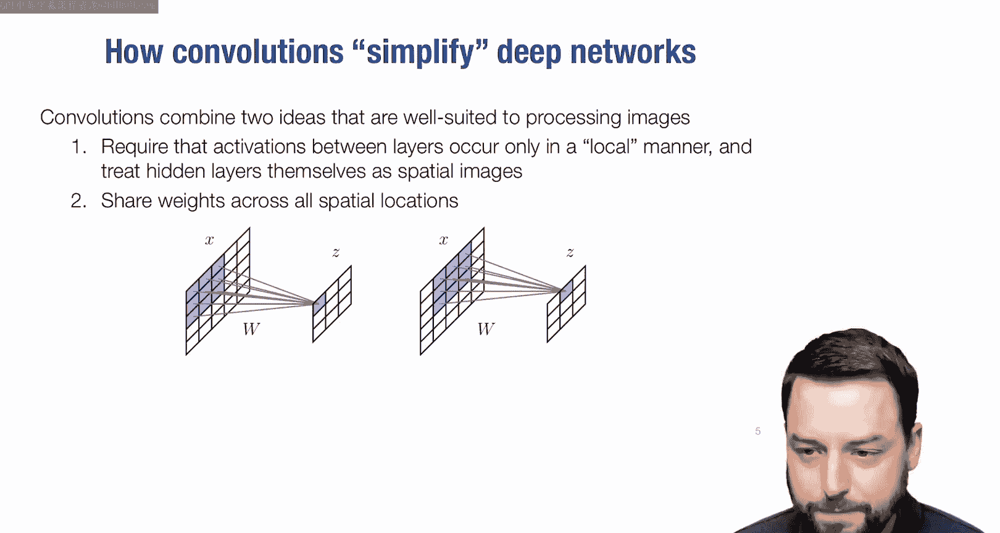

Well， there's a lot of advantages to it the first obvious one is parameter count right so the first kind of obvious thing that we gain from this is we gain a whole lot of parameter efficiency right rather than having this network with 200 million parameters in the simple case here where we're sort of mapping a one channel input to a one channel output via this sort of three by three block of weights here。

We actually only need nine parameters， right， so that's going from you know。

I guess actually if we had even more networks so if we went mapped from a36。

 5 square scale image to a actual hidden unit of the same size。

 that would require 4 billion parameters for sort of a single layer and that is definitely too much on the flip side if you do it with this convolutional structure。

 you need nine parameters right because you just have the same weight that you slide across the whole image and of course this is sort of you。

With that， you have much less fewer functions you can represent， of course。

 your function classes is vastly less than you than you could represent over a fully connected network here。

 but because we're capturing this structure that you actually want to capture。

 it's very beneficial to do so so it's very beneficial to actually capture this structure and kind of a side effect is that you have many fewer parameters you can represent your network much more efficiently。

The other advantage is that this captures some of the actual invariances we want anyway。

 right so fewer parameters and it actually captures these advantages because。

Convolutions at leads to a certain degree。Capture the natural invaris that we kind of think about in images。

 So， for example， I talked about before that an image shifted over by one pixel is the same image。

 But if we had a different set of weights for each location， right。

 each location there and location there， etc ceter。 This wouldn't actually or or each hidden unit。

 Now， that's one set of weights。 It's another set of weights here。

 This would not capture those invaris， right， you could have a very。

 if you shifted your image over by one pixel， now you have a different set of weights applying to each location。

 you might have a very sort of。A very different set of hidden units right and so this really does this with this。

 we're really able to capture the true structure of kind of what we want to have in images anyway and convolutions bring us the benefit。

Okay， so now let me describe what is the a little bit more formal detail。

 what is the actual structure of a convolution？

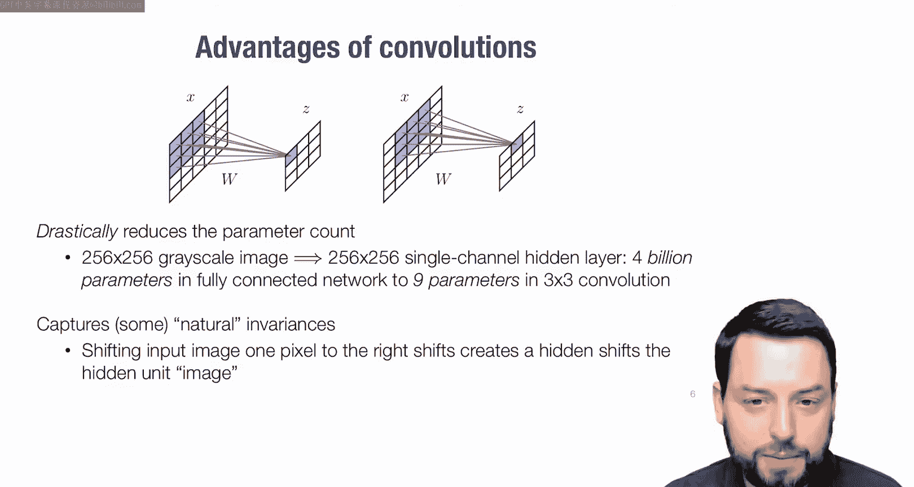

And the idea of a convolution now written out a bit more formally is we have our set of weights here。

And we're going to take these weights and we're going to in some sense slide them across our image all right so this is a three by three set of weights and we're going to going to slide them across all possible positions are in our image to produce the output so for example。

 for the first output y11 we would take this block of weights here。

 sorry of inputs here multiply it by these weights。To get this output。Right。

 so a little bit more formally here， if we want to。Produce the output y11 here。

 so here actually the input is a vector Z， the weights are a filter W and or I should say really a tensor or matrix Z the weights are a tensor or a matrix W we'll talk about sizes in a second and the output is a similar sort of image Y。

Well， in this case， y11 here。Would be equal to the product of corresponding entries in our filter and our input。

 So we'd multiply this term by this term。So it's going to be equal to。Z11 times W11。Plus。

This term times this term。Right so plus z1，2 times W1，2 plus z1，3 times W13， etc cetera。

 so that's the that's the equation。 we just take essentially what it really is， of course。

 is' just the the inner product of this。Uh， this set of inputs treated as a vector and then the set of weights also。

 in this case is sort of locally here treated as a vector。

and then you know next we just slide it across the next location in the image right so now we would have that y12 equals well。

 it would be this position times this position， so it would be z1，2 times w11 plus z1，3 times W。1。

2 plus etc cetera。 that would be you know this location times this location plus this location times this location。

 etc ce。 And then we just keep doing this。 Now have it have it written out here now。

 So next we slide our filter across the next location then the next location etcter。

 and that is the that that's the formal definition of the convolutional operator Now one thing I should highlight here is that if any of you have a background in signal processing you'll notice that this is not actually what you have called a convolution。

 what you have called the convolution involves flipping the weights left to right and upside down。

 that's actually the signal processing definition of a convolution。😊。

But we'll get those actually flipping in a second。What we're doing here in sample processing is actually called the correlation。

 but the problem is that correlation already means something in statistics and machine learning。

 so that was a very bad term to use and convolution just just sounds so cool。

 So we're gonna to steal the term convolution and just defined it to mean the convolution without the flipped filter and I think at this point I hate to say it。

 but I think like machine learnings kind of one it's probably the dominant use of convolution in some sense we in convolutional networks I'm being somewhat tongue in cheek there but this is how we define convolutional networks and so whenever anyone from machine learning talks to you about convolutions。

 they mean this， they do not mean the flipped filters or the reverse filter。

 they mean this which you may have called the correlation before。

But just know that this is a convolution okay now convolutions have actually a long history because they've been used prior to their use in machine learning。

 they were used in signal processing for a very long time。

 so they were used to just do do sort of both I guess classical signal processing but also in kind of computer vision and image processing as well。

😊。

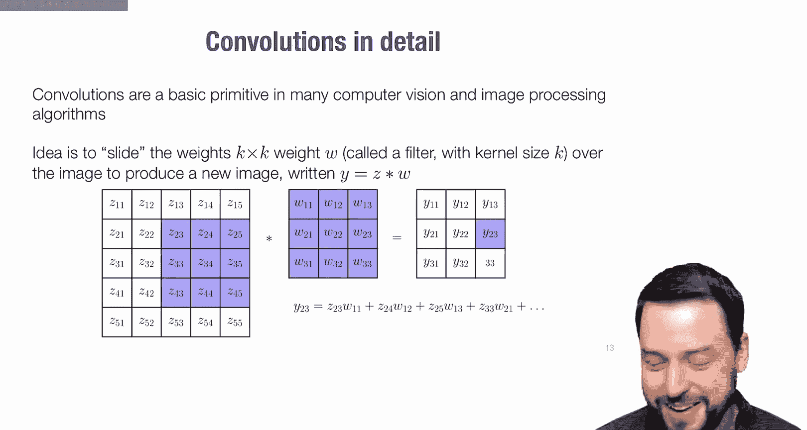

And in particular， in image processing for a very long time convolutions not with learn filters。

 so in deep networks we're of course going to treat the weights of the filter as our parameters but in in。

In image processing， it's been common for a very long time to use convolutions kind of with known prespecified filters as a core operation for sort of doing image processing and image manipulation。

So for example， a common- so if we have this sort of this image here， you see on the left。嗯。

And suppose we convul it with this set of weights here。

So this set ofs is actually a 2D representation of a Gaussian function。

 just sort of the exponential of the sort of xy position squared here。

 so it's centered at this location and then just divided by some number to sort of make it all actually this number here is the sum of all the entries there to make sort of an averaging operator but this filter sort of does a weighted average of pixels right so you this is kind of hard to draw too much but this pixel here would be an average of this pixel and this pixel and this pixel etc。

 it would be an average of all this sort of 25 pixels around that location。

And if you do that what you get is you get a blurred image so you get an image that is more blurry because each pixel in this image is a combination of sort of pixels around that location in the previous image and that's what sort of this blur Gauschim blur operation does and it's accomplished via convolution that's how you can implement these things。

That's a bit sort of a simple example in some cases， or in some sense。

 but a more complex one is using convolutions along with some I should emphasize some sort of nonlinear operations here to represent things like edges or to detect things like edges in the image or to look at the image gradient and things like this。

 so if I convolve if I take my original image Z and I convolve it with this filter here。😊。

This filter sort of you know has positive entries here and negative entries here。

 so that will this compute something known as the image gradient。

 it sort of looks at how much the image is changing in the x direction and outputs sort of an amount that is large if the image is sort of increasing and small if it's decreasing in zero if the image sort of stays constant in the x direction and similarly this one here does it for the y direction。

😊，And so if we take those two filters and look at their squared sum and the square root of this is essentially the magnitude of these two things。

 what you get is you get this image on the right here。

Which is essentially highlighting those portions of the image that where the image changes a lot。

 So this portion here， right， the image is changing from kind of a light color to a darker color。

And and this is therefore going to have know high magnitude of the image gradient。

 whereas know this region here isn't changing very much it's kind of a static a static thing and so the image gradient is relatively small and this sort of thing is often the first step。

 say in classical like edge detection algorithms， often the first step is to compute exactly this image gradient。

So these operations have have been used for a very long time kind of in classical statistical signal processing and classical image processing。

 but in deep networks， we often use a sort of the innovation is that we're going to。😊。

Do the same thing， just use learned filters instead of prespecified filters to accomplish some tasks right so instead of trying to sort of say。

 okay， I want a filter that will blur the image or I want filter little compute gradients well say look。

I just want to have a filter， I'm going to let the algorithm figure out kind of what filters to learn what operations to apply to my images。

 and that's the sometimes the fundamental idea of convolutional networks。

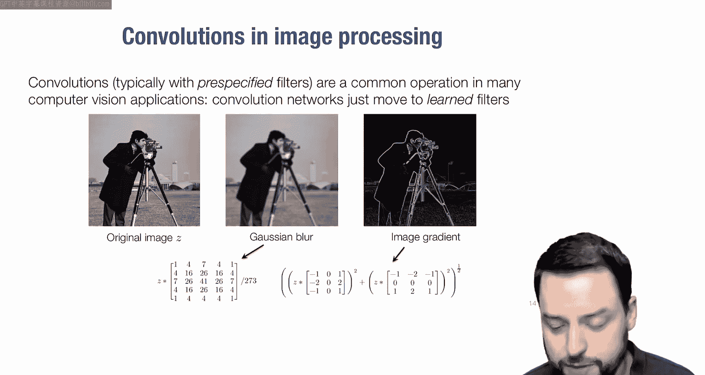

Now， I should mention one thing about convolutional networks。

 which is that they are never applied in， despite the fact that you often see convolutions kind of drawn in that 1D sense that I showed you a few slides back right so they're often drawn kind of like you know a filter sliding across an image in practice。

 they are actually not done or very rarely there's any operations in deep learning that apply kind of to 1D inputs and to 1D outputs right we typically in deep networks have many many different sort of we want to have multiple different sort of。

Layer or multiple different dimensions of the hidden layers。

 and the way we accomplish this in deep networks is that we have what are called multiple channels。

So it's sort of natural to think of the input X as having multiple channels right because for example。

 a color image will have three channels， the red channel， the green channel and the blue channel。

 what we're going to do in deep networks is we're actually going to represent the hidden units also as having multiple channels。

OkayAnd the difference here is that these channels in a hidden layer。

 they don't correspond to like a red， green or blue often we're going have 64 or 1 we often have to use powers of two for some reason that's not really necessary but 64 channels or 128 channels or maybe 1024 channels we use a lot of channels to represent kind of more complex and know more elements in the hidden layer。

 so each each channel is still this 2D spatial array。

 but we're going to use many of them so you know one channel there， one channel there。

 etc ce to represent our hidden units。Okay， so in general we sort of think of our inputs and this could correspond to our input image。

 but also could correspond to intermediate layers in the network as being a rank three tensor with a height and a width。

 but also a number of channel inputs we also think of our output。

As being a height and a width and a number of outputs。

 and so the question is how do we map sort of multiple channel inputs for the convolution to multiple channel outputs？

😊，And the way we're going to do it is we're actually going to have a separate filter。

 separate set of weights W for each possible input output channel pair。All right。

 and then we're going to add them up so if we want to sort of take。

 we want to compute this element here of the first channel okay this would correspond to this would correspond to。

The this first channel here canvol with some filter plus this second channel here can with some filter。

 plus this third channel here can with another filter right and that's how you get this first input if I want this next input in the next channel。

 I would have a same operation applied to all my input channels but a whole nother set of weights and the formal way of thinking about this。

 though I'll describe a better way of thinking about it later， is that if we want to take。

 for example， in our output if I want to compute the S output channel that would be the sum over all my input channels。

 so from R equals1 to cn of my the r input channel times sort of the Rs convolution。So that's the。

 that's sort of the mechanism of this。 But I'm actually not going to write this because。

There is a much better I didn't want to write that one out and have everyone sort of write it down too because there actually is a much better way to think about multichannel convolutions and that is by thinking about the operations of these things and the channels themselves and all their operations as matrix vector operations so the way to think about multichannel convolution kind of in the right way is that in our input image so in this input that we have to our convolutional filter you shouldn't think of these things as individual sort of scalar values like you normally would in a grayscale image you should think about all of these things here as really vectors。

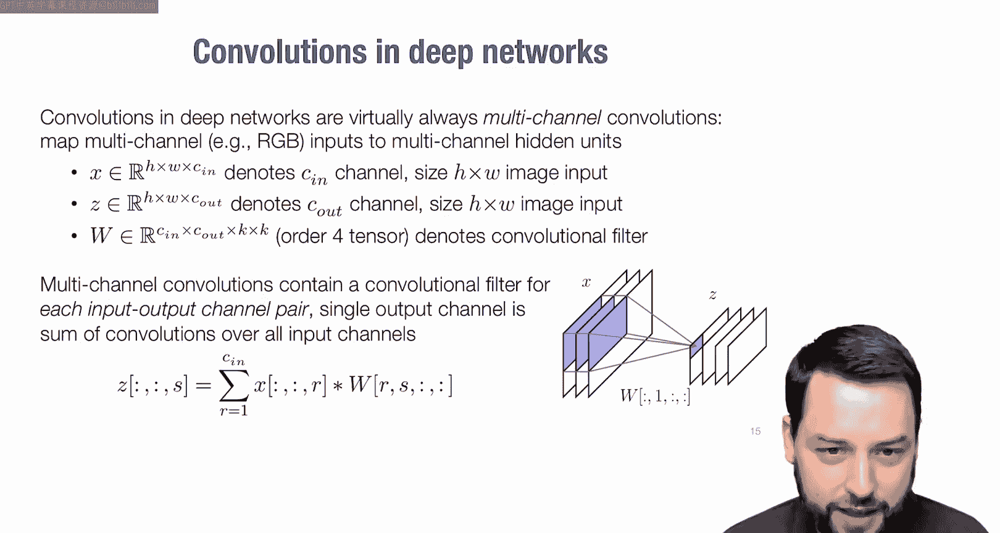

Each component I should say， so may sort of write this like this， like each one of these， so say X。

22， so x22， etc。These are vectors。In R to the C in。 Okay。

 so where C in is our number of channel inputs。 Okay， so that that's pretty natural， right。

 because you think of these things， you know， you think of each of these things as having like a whole bunch of。

U channelss， and that's like thinking of each of these inputs as kind of itself a big vector。Okay。

 and similarly for the output， the output's also going to be vectors not actually in。

And so this one here， for example， these are going to be vectors。Not in the input channel size。

 but actually in the output channel size， is's going to be vectors。In R to the C out。

And now here's the key point。The ways you think about the filters you are convolving with。

Is that each element of your filter is actually a matrix So these terms here say W1，1， etc。

These are going to be matrices。Which map？And I guess in this insertation here I'm using here in R to the C out by C in。

Okay and then what we do， we have our same operation as before， it's just that。

 you know z22 here is equal to sort of the same way W1 times x in this case， 22。

 but this product here is now a matrix vector product。So in some sense。

 the way you think about2D convolutions， I would argue is not like this。

To be clear your sizes are also the same here right so your input is a rank three tensor。

 if you add a batch dimension and it'll be rank for them but sort of a single input is is a rank3 tensor。

 the outputs also a rank3 tensor height by width by either channel input or channel outputs and then your weights here are a rank for tensor because you have a sort of this K by K filter for。

Every pair of inputs and outputs， but the way to think about that is actually not by thinking about this as a rank forten or think of it as a sort of K by K set of filters K here is I should have mentioned before K here is called the kernel size it's sort of in this case in the next case three by3。

 but it can be sort of any any sort of size you want three by three is very common in deep networks。

😊。

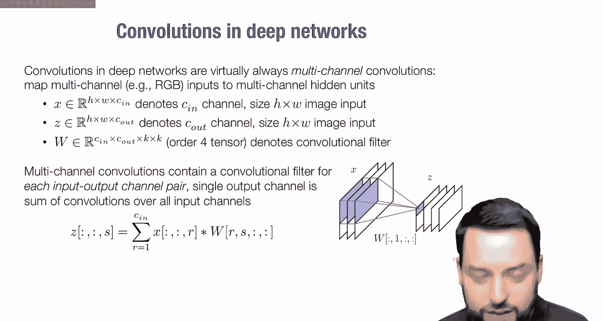

And each element of this three by three filter though is instead of being a single element that's a sort of scalar value。

 it is in fact a matrix， and this is going to be really valuable to think about it this way。

 not just for the purposes of sort of simplifying the equations。

 but also for the purposes of really implementing these things。

 you want to implement these things as matrix operations and so doing it in this form is going to be how we actually implement these things。

😊，Okay， so with that all being said， let me now talk about a few more elements of practical convolutions。

 because the convolution I described there have some issues that need to be addressed or rather some things that need to be added in order to make them kind of fully usable within deep networks。

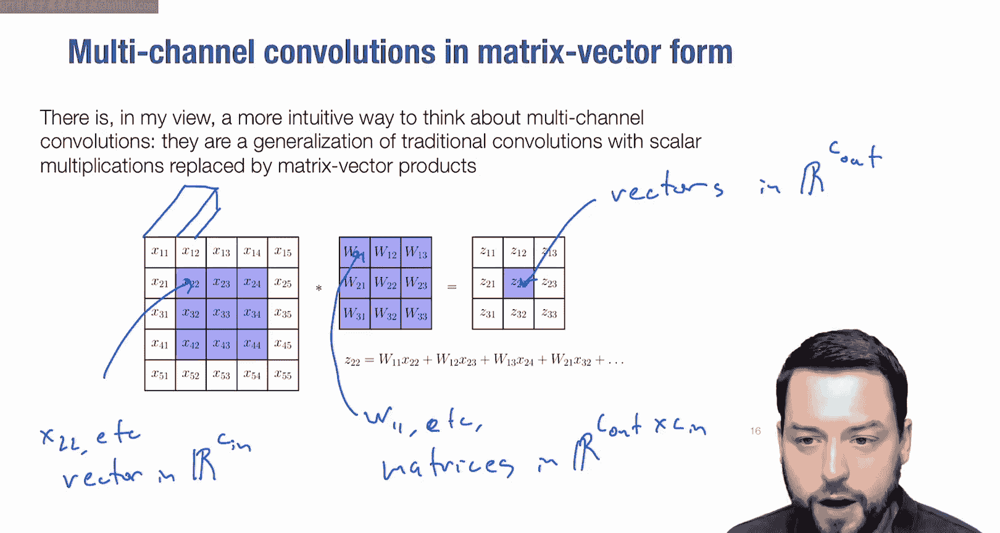

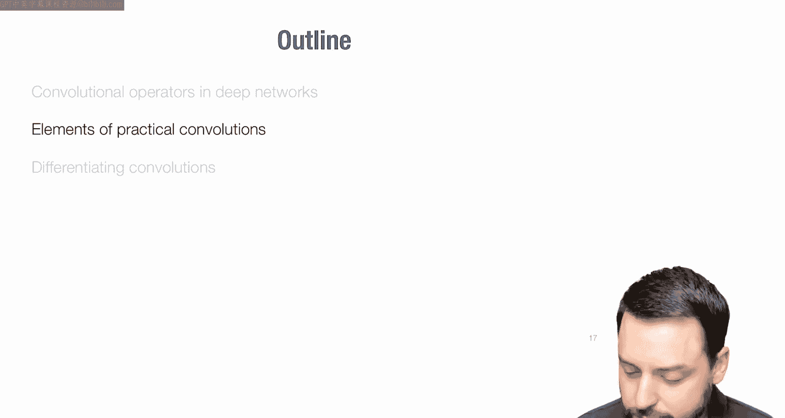

So we actually going to talk about a few different aspects of convolutions that you may have seen before if you've ever used a convolutional library。

Convolutions in a library like Pytorch or TensorFlow the first of these is padding So one thing you may notice about the the convolutions I described before is that these convolutions let me just go back one slide right these and in these convolutions the size of the input。

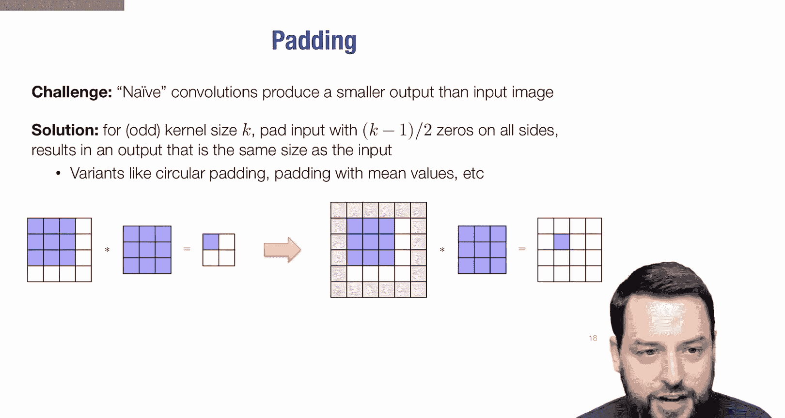

Is different than the size of the output because we only， you know， in a5 by5。

I guess five by5 by however many channels， but think again about these as 1 d things in a five by5 input image。

 there are only sort of nine locations that you can place this filter here without kind of going off the edges right so you can place it here here I this before here。

 etc cetera。 but then you run out of space right so you can only form three by three。😊，Output。

And this is a bit annoying if we do this in deep networks。

 I mean to be clear we actually could do this， it would probably work fine。

But when you have really big networks， it more just gets to be a pain to kind of keep track of whats the size of your image and you know if you're eventually then sort of averaging things together。

 well what's the size that I'm averaging， all these things are kind of kind of annoying to keep track of and so what's very common to do and to be honest I don't know why this is not the default setting in every singlevol and every single library because this is what everyone does in every single architecture you will see。

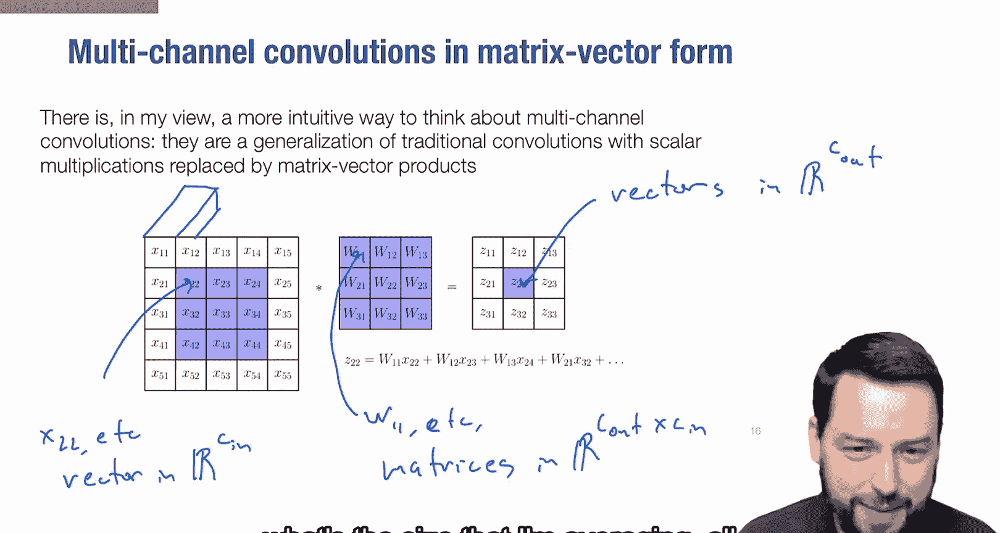

What was simply done in practice is that you pad the input with zeros。

Such that your output is the same size as your original input。 Okay。

 so if I have a4 by four sort of input here and I want to run a three by3 convolution。

 I don't just run it on you the four locations I can resulting in a two by two output what I do is I pad the image with these gray cells here。

 which represents zero values and now when I convolve the image with this。

 I get the outputs that the same size is my input and in fact the precise formula here is if my filter。

 if my compositionvolutional filter here is k by K。

Then I need to pad the image with k minus1 divided by two zeros on all sides This actually works only for odd kernel sizes k we typically don't deal with even kernel sizes because they're precisely because they're a bit more of a pain they have to have read different case for padding on one side and the other side so for this reason we actually typically deal with odd sized kernels。

But this is extremely standard， so essentially everyone uses odd sizeize kernels and uses zero padding such that the output's image size is the same as the input image size。

😊，All， so that's sort of practical property one。

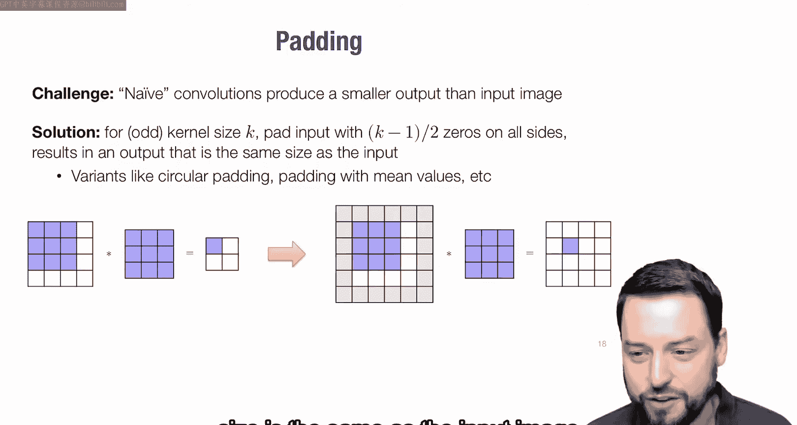

Another practical property deals with pooling operations or strided convolutions。

 and these are actually two ways of solving kind of the same problem。

So one thing you may have noticed with， especially with this past zero padding version of convolutions。

 is that we keep when we apply convolution， we keep the same resolution in our subsequent layer as we had in our original layer。

And this is not always the best thing， right， so to be honest， it's maybe not a horrible idea。But。

In many cases in convolutional networks， we actually， as we go through the network progressively。

 we actually want to create lower and lower resolutions。

 kind of more summarized versions in some sense of our input。And。

 and that kind of represents features in some very abstract sense。

 you might think is sort of represents features at different levels of of。

Of abstraction or different levels of sort of you know， the hierarchical representation。

Though that's kind of debatable maybe whether it's really doing that or whether you do that or it's just about computation。

 but's really computationally， right， you don't want to be dealing with 256 256 images the whole way through It just would be actually quite hard to deal with。

 And so because of that， we often want to downs sampleample these images at internal layers of the network。

 especially when we have lots of channels right because if you have。

A thousand channels guess getting pretty pretty actually memory intensive to represent all thousand channels for a large image。

So we want to down and sample the image and essentially represent the image of different resolutions in our network。

Now there are two ways this commonly is done one is by some sort of pooling operation okay。

 so what we can do and this is showing max pooling here。

 but really you can apply this to average pooling or things like this as well。

 you take some block and commonly it's a four by four block in your image to produce a down sampling by to an image that's half the size in both spatial dimensions。

You take some sort of block in your input often two by two by two block。

 and you somehow combine these quantities here to produce a single quantity in your output and you enter the next channel。

And the max pooling operation， for example， would say which of these four values？

You typically do it individually for each channel now。

 so which of these four values in this one channel has the maximum value。

And you just set this thing here to be equal to that maximum value。

That's called the max billing operation you can also to do average pool。

 so average pooling would just be you take the average of those four things and that becomes your your next layer Okay so both of these are valid operations。

Um， and they're both commonly actually pretty commonly used in prices。

 both max pooling and average pooling are very common operations that people people use in practice。

The second possibility are things called strideed convolutions。

 so the idea here is that if normally we take our filter and we sort of apply it to every possible location in the image as the typical way of applying a convolutional filter。

But if instead of doing that， what if instead we sort of take our image our filter and we move it over by more than one location at a time right。

 we could also do this and this would also result and they down sampling of our input image right because we're sort of you know have only this position and then not this one but then just just this one right so not draw this here so we don't take this one in red here。

 we only take the ones in blue。Os messss that up。That's the one。

Okay and and that obviously will also produce a down sample image because we're going to produce an image that's half the resolution of our original image and so both of these two operations in fact。

 either pooling in this sense or str convolutions produce outputs that are in this case。

 half the size， half the resolution of our input in both spatial dimensions。

So a quarter of the number of pixels， basically。And you can use larger strides too or larger sort of regions for max pooling or average pooling。

 but these sort of things in general are very common。

 it's also common for example in maybe the last layer to do a single whatever filters you have left you do like a single average pooling that collapses to a single vector and things like this so these these are all very sort of common operations and they really play a large role in most networks。

 one of these two types because most networks for both computational and kind of representation regions want to downs sampleamp the image in later layers in the network。

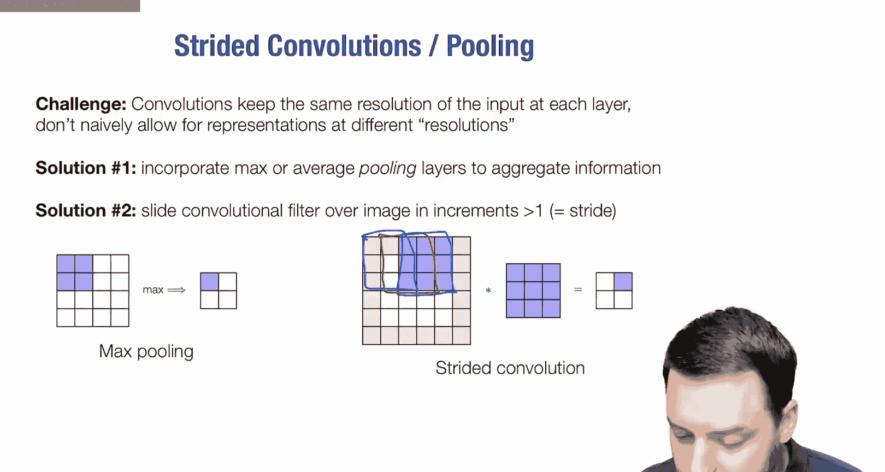

All right， the next feature that you may see in convolutions are groupings。

 so the challenge here is that even with the sort of simplifications of convolutions we talked about for large numbers of inputs and output channels。

 if you have very， very large input output channel combinations。

Filters can still have a large number of weights。 And the way thing about this remember is that each location in a filter is a each location。

 So each sort of know individual filter you should think of as a matrix that is in R C in by C out。

 And so for maybe practical reasons， if you have。😊，10，000 inputs channels， for example。

 or 1000 output channels， this is going to just start to be a very big。

 even with all the simplifications of convolutional networks forming a matrix that big。

 let alone sort of you know K by K of them for for your whole filter。ItMight just be too big。

 it might just be too many parameters for your network。

And so what people often do in these situations is they use something called group convolutions and the idea of group convolutions is that instead of sort of all the input channels here leading to all the output channels。

 we have only some collection of input channels leading to some similar collection of output channels so say you have maybe four channels and four input channels the four output channels。

 maybe only the first two input channels lead to the first two output channels and things like that and this can actually be brought all the way down to the case where maybe you just do the convolutions kind of channel by channel so maybe this channel here only depends on this one input channel and things like this too this is actually done these are called this extreme version of the group size being equal to the number of channels。

😊，So then the number of groups being able with the number of channels。

 is these are sometimes called depthwise convolutions and they actually are becoming we have some work in fact。

 even on my group has some work on sort of using these to great use。

 So these sorts of things are very common as ways to reduce the parameter count of convolutions when even a normal convolution and maybe if you want to use larger filter size stuff like that would still be too many parameters to sort of practically use in a network。

and the last one I'll talk about is dilationations。

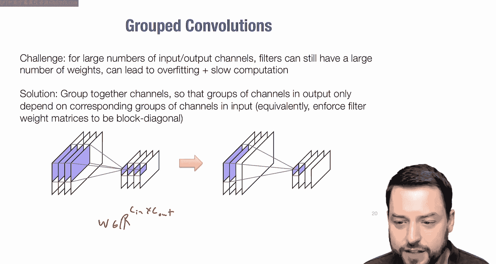

And dis are addressed the sort of the final problem I'll mention about convolutions。

 though I would say that these were very popular for a while， I see them a little bit less。

They're usually less these days， I think people tend to use more sort of just concatenation depatches and things like this these days we'll talk about that a bit more when we talk about transformers but。

TheThe problem that convolutions have or one problem that they have is that especially if you have small kernel sizes。

 so if you have like a three by three filter here， right？

Convolutions have a relatively limited what's called a receptive field。By at each layer。

 what I mean by that is this location here， it only depends on these three locations in the input image and I know I sort of sold this as an advantage originally right so that convolutions capture local effects。

But the reality is there are also downsides to this you might not want this to always be the case。

 you might want your convolutions to have a larger receptive field such that even a single layer can capture more properties of the input right of the previous layer or capture larger spatial properties of the input and you could do this in a lot of ways。

 but you could sort of you know maybe I don't know。

Do some combination of average pooling and sort of larger average convolutions that could all be done。

 but a very common thing which works really well is even simpler。

 which is that you added dilation factor to basically take your same filter size before。

 but instead of applying it to sort of a single group。

 you apply it kind of a spread out so you sort of spread out this filter of or the points that you multiply this filter by by some dilation factor so this is a dilation1 convolution。

Or maybe dilation two， I forget that there' are sometimes zero conventions or one conventions if we'll certainly have habits have very clear if and when you implement it。

 but the idea here is that we sort of spread out the influence of this across multiple points such that our three by three filter。

Produces is able to sort of capture more spatial properties of the input。

One thing you will notice though at least naively， if you just do this。

 then you have a similar problem with padding as you had before so for example。

 using the same zero padding as this one here， you would produce a two by2 image because you could only slide this sort of convolution in a  two by two location in four locations total。

 so in order to make a similarly sized output with di electrons you have to add more zero padding so just be aware of that that you do have to in fact add more padding to do this。

Okay， so that actually are the extent of the sort of practical aspects of convolutions that we're going to talk about and finally what we're going to end this lecture with is discussions on differentiating convolutions。

 how do we go about actually finding how do we go about integrating these sorts of things。

 these sorts of operations into automatic differentiation tools？😊。

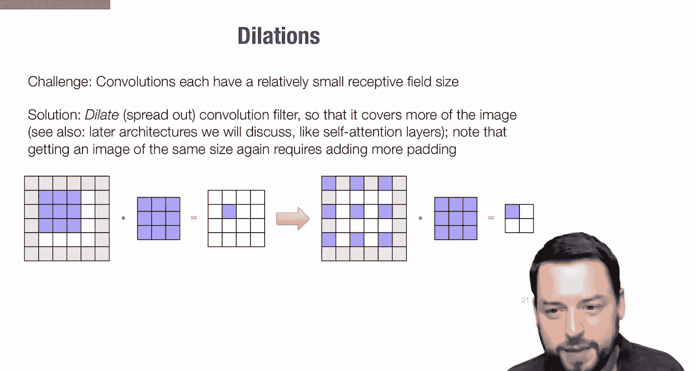

And the first thing I should say before all of this is that you could just knowing what you know now already implement convolutions。

 in fact， it wouldn't even be that bad if you do it in the most efficient way possible where you sort of multiply each each input by sort of one filter at a time and then shift these properly。

 this is actually not that bad way of implementing convolutions。Um。

 but there's a big disadvantage because because they have an automatic differentiation toolkit。

 right and because ultimately convolutions are just。You know。Matrix vector multiplies or really。

 of course， you know， everything boils down to just multiplication in addition， but convolution。

 So you could do it by， you know， on a scalar level， even。

 but even sort of with with with the mouth I showed you。

 you could reduce convolutions to a bunch of matrix vector products or really matrix matrix products to do it and kind of a more and a more。

😊，It's going to do it in a more batch setting。So everything we do here in columns。

 we could do just as matrix vector products。But this is not something we want to do because if you do that。

 you wind up computing kind of a lot of you wind up retaining a lot of sort of duplicated work。

In your compute graph right sort of store all the intermediate products of the convolution then before you add them up and that creates a sort of way too much memory consumption in your compute graph。

 So it's important instead to implement convolutions as atomic operations within your automatic differentiation toolkit。

And that means we need to be able to differentiate them。

 we need to have sort of we need to find them basically as ops in needle。

 not as modules in needle it's another way of putting all of this right So if we're going to implement convolutions as an op as an operator。

 we need to know both how to compute them which is kind of covered so far but we also need to know well we've covered so far but we haven't gotten details of how you actually compute these in practice we need to know how to compute them and we need to know how to compute their gradient or in other words。

 sort of multiply by the ad jointin， compute all the ad jointins that we need。All right， so。

The basic problem here is exactly what I sort of laid at just now is that if we define our operator because we want to have kind of an atomic operator。

 we define our operator as z equals some convolution between our input X and our filters W。

 where again Z here would be sort of a rank3 tensor order three tensor x would be a order also to order three tensor height by width channels and w would be in order for tensor for you all the filter locations plus all the。

Channel inputs by channel outputs。But lets you know let's not worry too much about sizes here of tensors and stuff because it's actually very if you break these all down in sort of individual tensors。

 I mean this is a you know the derivative of a rank three operation with respect to a rank three tensor with which a rank four tensor I mean it it gets pretty complicated right but let's just think sort of sort of an intuitive level how we might go about multiplying these two ad joints because remember in automatic differentiation when we want to do this。

 we want to be able to multiply some ad joint here with these two。

Partial derivatives are really Jacobians more generally， right。

 the derivative with respect to our weights。And derivative derivative with respect to the input right so this operator has two inputs here and one output。

 and so we need to be able to differentiate with respect to either of its two inputs。

 either with respect to the weights or with respect to its input。Okay。

 so how do we go about doing this， How do we go about sort of computing these derivatives。

 Because again， on first glance， these seem quite complicated right these seem like well。

 that's you geez these are these are。Ran the derivative of you know a three a rank3 tensor with respect to a rank4 tensor or another rank3 tensor。

 these get pretty complicated right， and so， and so it's it's important to emphasize that this is you don't want to do this out term by term。

 you want to think kind of conceptually about what these things are really doing and use and use that as your as your way of actually computing these properties。

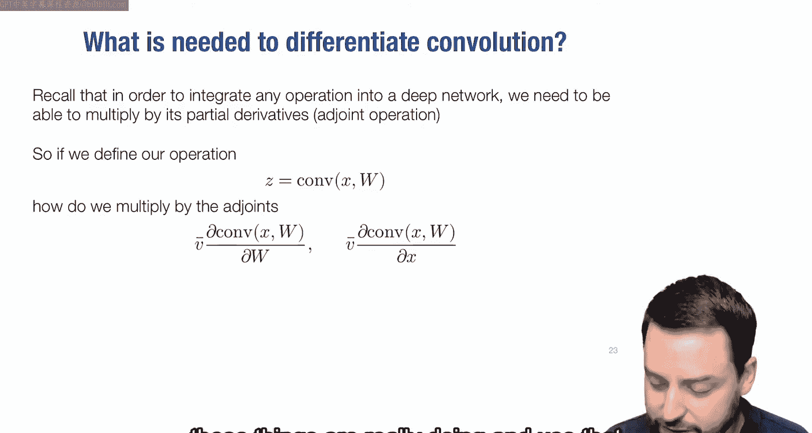

Okay， so to motivate this， I'm going to consider the case of matrix vector products okay and so remember that in the matrix vector product。

 lets let's to simplify things a bit as kind of a motivation because we're going to do in a second we're going to recast we're going to recast convolutions actually as really big kind of blown up matrix vector products and that's how we're going to kind of use as analog。

 but to be clear we're not actually going to form those things we're going to sort of think about them conceptually like that。

Okay， so let's think about sort of a simpler operation here where x is the vector Z is another vector and W is a scalar。

 So let's let's I guess I just you can write these out so let's think about x being a vector that's an RN。

Z a vector in RM， and so W would be a vector or a matrix in RM by n。

let's think about that as our as our starting point now we know from sort of our basic differentiation rules and maybe with our cheating ones or our non cheating ones that the derivative of z with respect to x for this operation here is just equal to W right so that's sort of our our。

😊，A the nature of the operation here and hopefully actually what I'm about to say here makes total sense once you've implemented your homework one here。

 but when we want to compute this the product of our incoming ad joint and we have to in fact transpose it to make this a sort of valid matrix operation we want to multiply this by our matrix W to compute this sort of compute the ad joints we need for automatic differentiation。

 we have to compute this product here right we have to compute our incoming ad joint transpoposed times vector of our matrix of weights here。

But that， of course， really is equivalent。To just taking our matrix transpose times this vector v right so thinking of it in terms of multiplying a vector on on the right。

 this is multiplying the the by the transpose of w and so the only point I want to make from this is that when our forward pass involves computing w times。

The forward variable， our backward pass involves multiplying by the transpose of W。 In fact。

 the transpose of something's called the adjoint in some linear algebra right。

 so these things are all very related， of course。And so again， that's。

 that's the key point multiplying a。Input by a matrix or really any linear operation in fact。

 which is what we're going to exploit here。 if our forward pass multiplies by that operator。

Our backward pass has to multiply by its transpose。That's the only point I'm trying to make here。

So the question is， what is the transpose of a convolution？

What's the equivalent of transposing a convolution？All right， so for this。

 I'm going to now get a bit in some detail and what we're going to do is we're going to actually write out a convolution。

In terms of a matrix operation。All right， so let's let me let me now actually use the use sort of。

A bunch of possible， a bunch of possible sort of inputs here。 Let me take our output。

 these different colors。 In fact， I'm gonna， I'm gonna consider a simplified case where I only have a。

A 1D convolution so I'm going to take a 1D signal and cvol it with a 1D of filters because its easier to view that way。

 but hopefully it's obvious how this will extend to to the 2D case and in fact we will show how to implement this in the 2D case when we talk about in a few lectures from now the the implementation of convolutions so let's let's consider a case where we want to create an output which is a。

😊，The5 the。Vctor here。So it'll be Z1， Z2。Z3， Z4。NC5 and this is going to be equal to。Our input X。

 so I'm actually even going to a zero pad it。 so this would be hopefully I'm getting the sizes okay here。

 so I'm going to have zeros there， and I'm going to have x1， then x2， x3。And zero。

 lets me just make sure I get all the entries here， x3。X 4。X5 and0。 Okay。

 and then I'm going to be convlving this。With in this case， a three dimensional weight matrix。

 Allright， so it'll be。W1。W2。And W3。Okay， so that's my operation I went to apply there。All right。

 so the thing I'm going to do here is I'm going to write this operation out in terms of a matrix。

Equivalent operation。So I'm going to think here of x as a vector， not a zero pad of vector。

 just just a vector itself， just the actual elements of x as a vector。

 and I'm going to create a matrix such that my vector of z sort of treating z as a vector here。

Is equal to this matrix times the vector representation of x。All right。

 so maybe a little bit more formally， what I mean by that is know Z here can be itself a vector。

 right， Z1， Z2， Z3， Z4 and Z。C 5。😔，bit nicer brackets on that。Allright。

 so that's going to be equal to something。You don't quitet know what yet。Times。

I make that something in blue to be consistent here， something。In blue。Times my vector of exits。

 so x1， x2， x3。X4 and x 5。All right， so the question is， what is that something。

 what is this something here？That we actually would would need。

 and I'm going to call this this thing here， I'm going to call this W hat。But what is this matrix？

so what this is， well well， and of course， this is going to have to be equivalent to on some level。

 in the ends， this should be equivalent to are vector x convolved。With W。

So what we need to fill in there， I mean， obviously this shouldn't you know this this thing here should involve entries of W。

 but what should we fill in to make this kind of kind of valid？Well， let's think about it。

 let's think about what do we multiply， what do we multiply by our vector here of x's to produce Z1？

Well， what we do for that vector， and I'm going try to sort of make best use of the medium here is we sort of take our filter and we kind of slide it across different values here right as much as my little drawing here lines up with these things Okay so for the first element we would take this and kind of put it here right。

 we would multiply0 by w1 so we don't multip w1 by anything W2 by x1 W3 by x2。Okay。

 so that in other words would be， well we multiply x1 by W2。X2 by W3。

 and we don't multiply anything the rest right， the rest don don't have any x3 through x5 don't have any impact on Z1。

Now let's think about Z2， okay， so let's think about Z2 while we slide our filter over。Again。

 and Z2 is produced by this sort of element wise product， we multiply x1 by W1。

 x2 by W2 x3 with W3 right and then again matrix form with what this would be is this would be here we multiply x1 here by W1 x2 by W2 and x3 by W3 and we don't multiply x4 or x5 by anything。

Okay and one more time， I'll do this。 So our next element Z3 would be equal to sort of this product x2 times W1。

 x3 times W2 x4 times W3， etcter。 and so what this looks like in in sort of the matrix form is well we don't multiply anything by W1。

 So we would have a0 here。 we multiply w or x2 by w1 So we have a w1 here。

 and then similarly x3 by w2 x4 by W3， etc right And if I just fill this out。

 what you'll get is you'll get this next row is's going to be w1 W2 W3 and the final row would be this W1 W2。

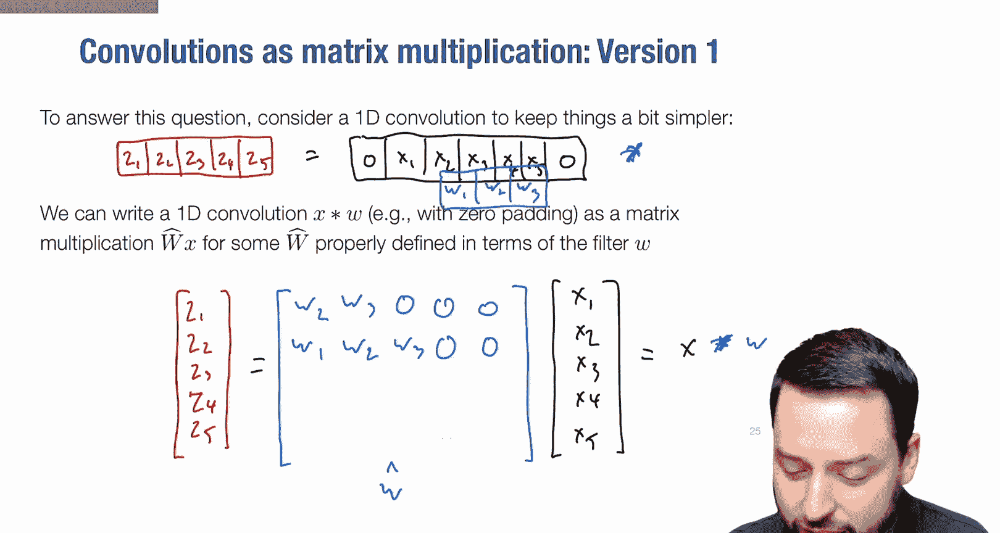

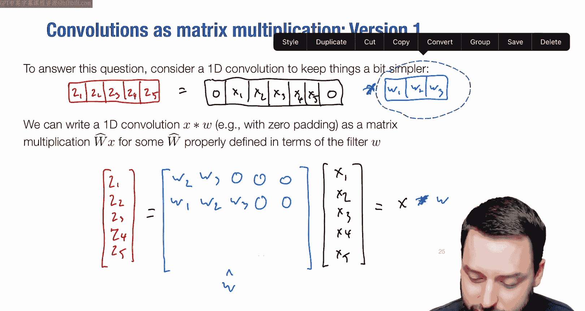

Okay， so this is the matrix form。This matrix operation here produces the exact same output as our convolution。

 it is a matrix way of representing our convolution。Okay。

 I mean that's sort of the key idea here when we think about。

 you know if we want to multiply by the transpose of this convolution， well。

 it's now doable because now we've written out sort of our convolution as just this matrix here。

And so this is a general sort of state this is a very general thing we can really write any convolution just as this sort of matrix of all our weights or matrix containing our weights in different locations。

Now， I want to be very clear about one thing we don't actually want to construct this matrix。

 This is maybe reasonable for this size， but if you have a really long sequence like things like that。

 you would create a mix with a whole bunch of zeros here right， and so to be very clear。

 this is a conceptual thing that we're doing。We are not actually going to create this matrix。

 we actually are going to instantiate kind of a different but similar matrix we for efficiency purposes。

 but we won't be instantating this matrix， what we're actually going to be doing is just using this sort of conceptual idea to represent what the transpose of a convolution is。

Okay， so this is our this is our sort of matrix here and maybe actually let me let me do this again because I'm going to get it on the next page。

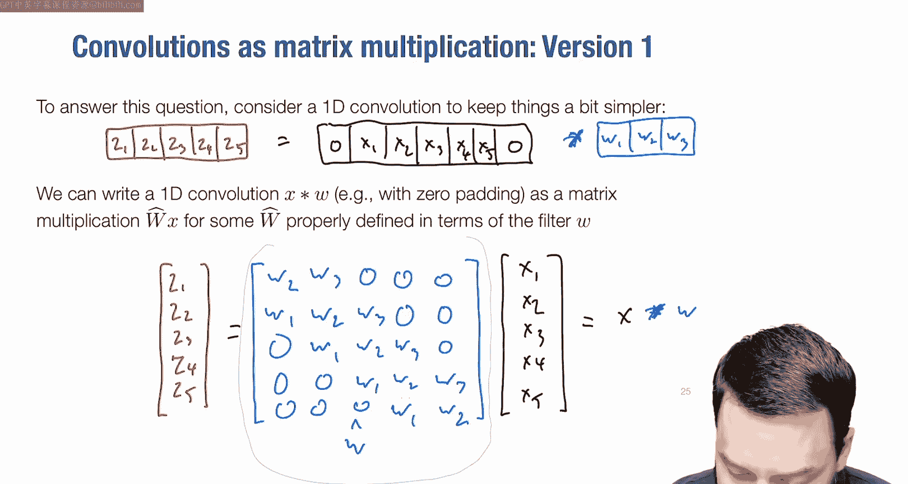

Let me copy it and go to my to my next page So the question I have is that once we know what W is here。

 let me paste it in here， once we know here what W is。

 how do we compute and I'll put it kind of up there。How do we compute W transpose？Well。

 now that we know what W is matrix form now it's easy because now we just transpose W right。

 so let's just create W transpose， I call this W hats， W hat transpose， it be well， what is it？

So the first row would be W2，w1， and then zeros。My pen is flickaking out again。

That's the first row because that's this column here。The next row would be this column。

 so it would be。W3。W， sorry， yeah， W3， W2， W1 and 0，0。 Next， you would have this column here。

 so that would be0， W 3， W2， W1， and 0， and then 0。Zero， W3， W2， W1， and 0，0，0， W3， W。Okay。

 so that's our transpo。But now something really cool happens。Which is that。This。

Mattrix here looks a whole lot like this one。It's just that the order。

OfIt has the exact same sort of。You know。Elements theagon on the sort of diagonal and the bands are that they're all the same。

 just like in this one。The only difference is the ordering， so this one has the ordering W3W2W1。

 this one has the ordering W1WtW3。But the point is。Multiplying by this matrix， the transpose of this。

 well this operator here。Is also a convolution。Mness is exactly convolving。An input。

With the same filter。Just the filter flipped。So instead of convolving kind of with W1， WWW3。

 we convolve with the flipped， left to right version of this filter。And that is。So of and by the way。

 that's that's the relationship I mentioned way before。

 sort of signal processing uses this flipped version they actually call that a convolution。

 that this is why this sort of flipping is actually quite common。The key idea here。

Is that multiplying by the transpose of a convolution？Is equivalent。

To convlving with a flipped version of the filter。So in other words。

 to actually compute this operation， say we're going to compute this sort of derivative here。

We wouldn't actually。Form the Jacobian and anything like that， right， to compute this operation。

 Nor do we inform this matrix， right， What we， what we do to compute this term here is we say that well our。

Product between our。Add joint term。With respect to X， because again， remember。

 to get our original derivative like that they had W in it。 This is a few slides back。

 We were talking about derivatives with respect to。

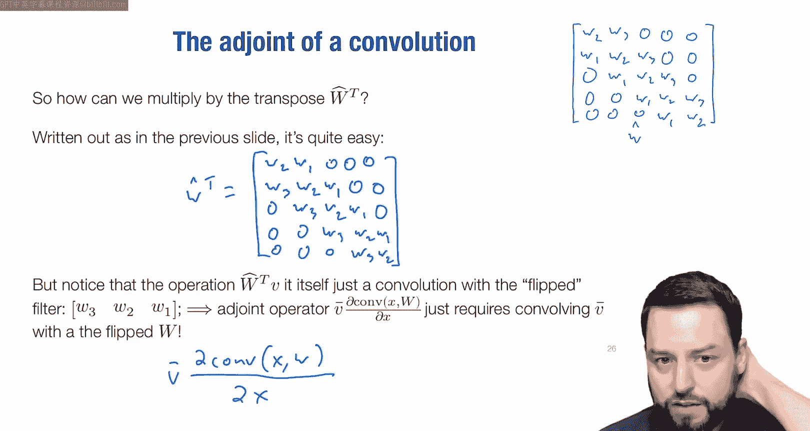

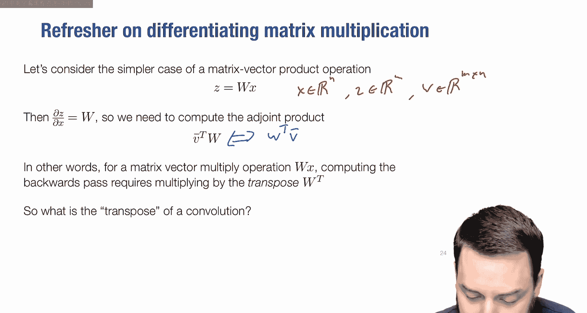

X here， so that's the best of we're doing。Well， this thing is just equal to the convolution。

Of our a joint term。With like， the flip。Of W。That's pretty， that's pretty impressive， right。

 that's pretty neat。Um， that's all we're doing when we're doing a convolution。

 when it's transferred to a convolution， we don't need to form this matrix。

 we don't need to do anything。Other than just flip our filter and convolve with that and of course。

 if you do this twice， you sort of get， you know， goes back to the original filter right？

So that that's sort of really impressive， I think， and a really nice property of convolutions is that couldn't。

In order to multiply by the transposeive convolution， you just convolve with a flipped convolution。

And so this is how we compute in practice our。Add joints。Needed for convolutions。

Without having to actually store you know either compute rank three tensors or stuff like this or rank seven tensors right and without having to even form these matrices because this matrix here。

 this construction that was just sort of for illustration right that was just sort of to derive this fact once we know this about it。

 we can just implement our backward pass as a convolution of。Okay， and this is， by the way。

 this is also actually sort of setting off， setting up alarms that， you know。

You could implement the op then as calling the original function and stuff like this。

 right so there's a lot of very nice things about it。Okay， so this is almost the whole story。

 but the rest of the story actually involves the other adjunct me form。

 namely the derivative with respect to W。

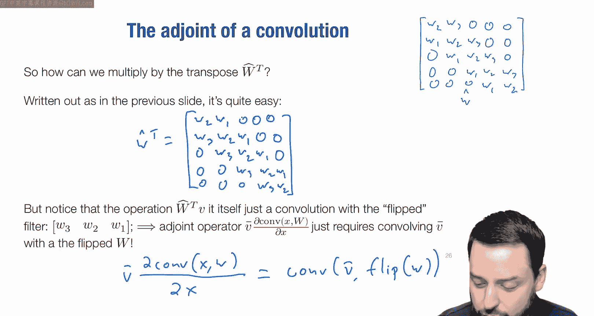

So this whole one was further derivative with respect to x， right。

 because that was sort of how we derived this。

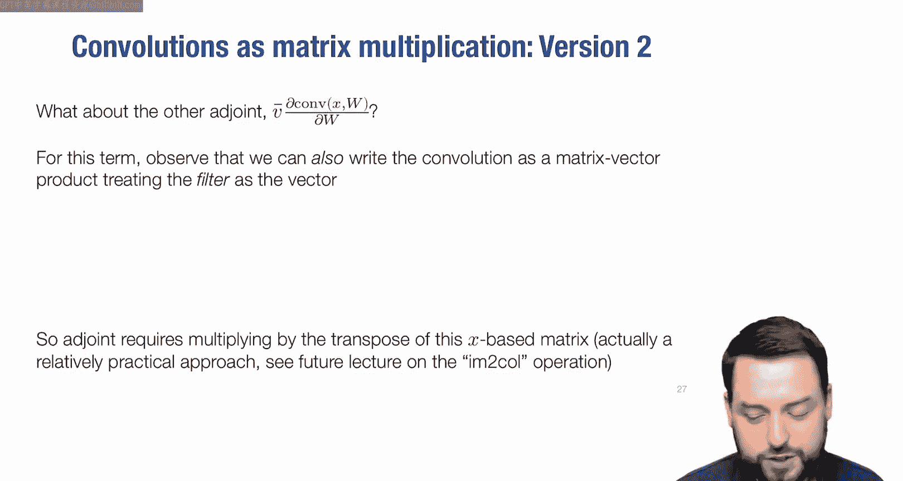

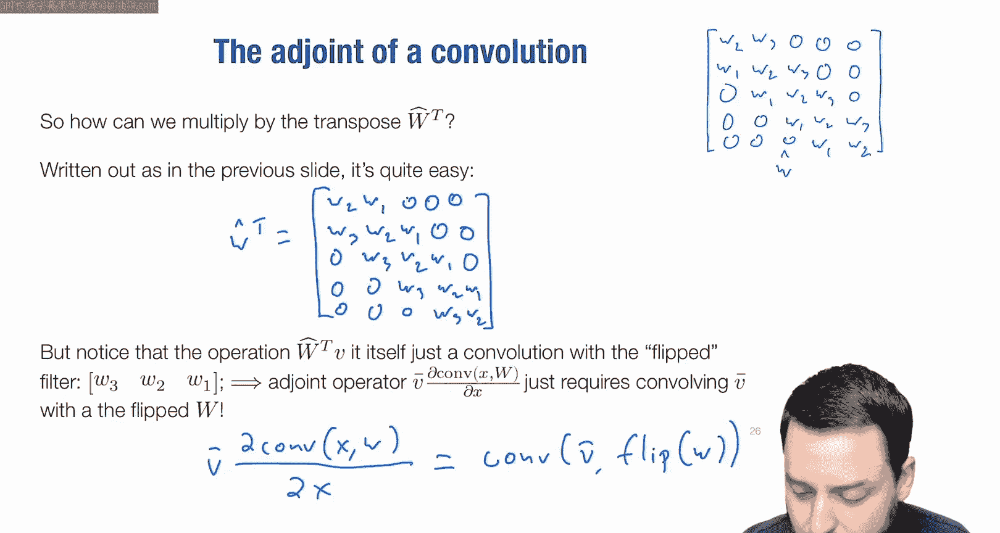

嗯。몰라 derivative double。And for this， but actually not just for this。

 but also for sort of very practical purposes， because it turns out that this is exactly how we're going to。

 in fact， implement convolutions。Um， it turns out that we can also write convolutions in a different way。

So if we have our Z， maybe I'll even copy from our previous slide here。

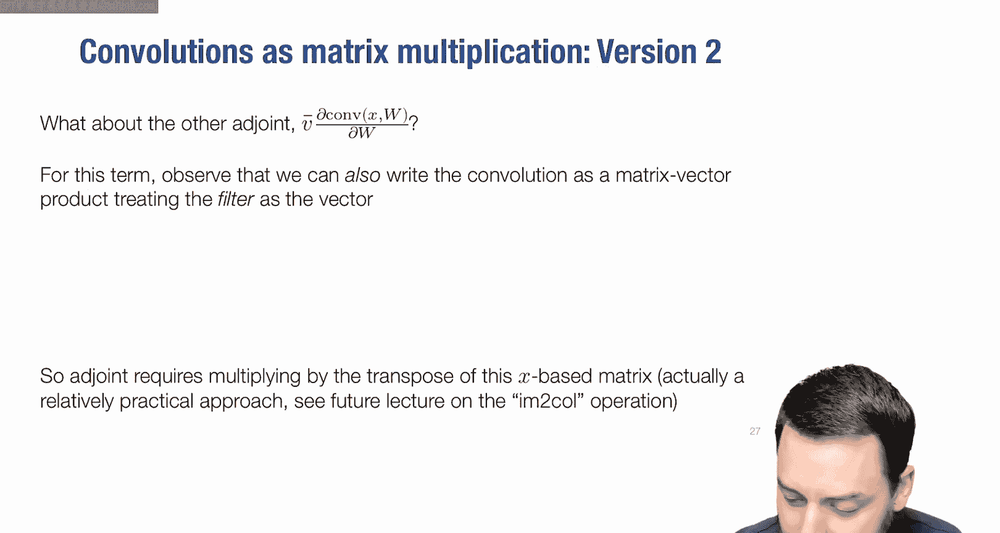

And we go， I'm going to copy this whole thing。

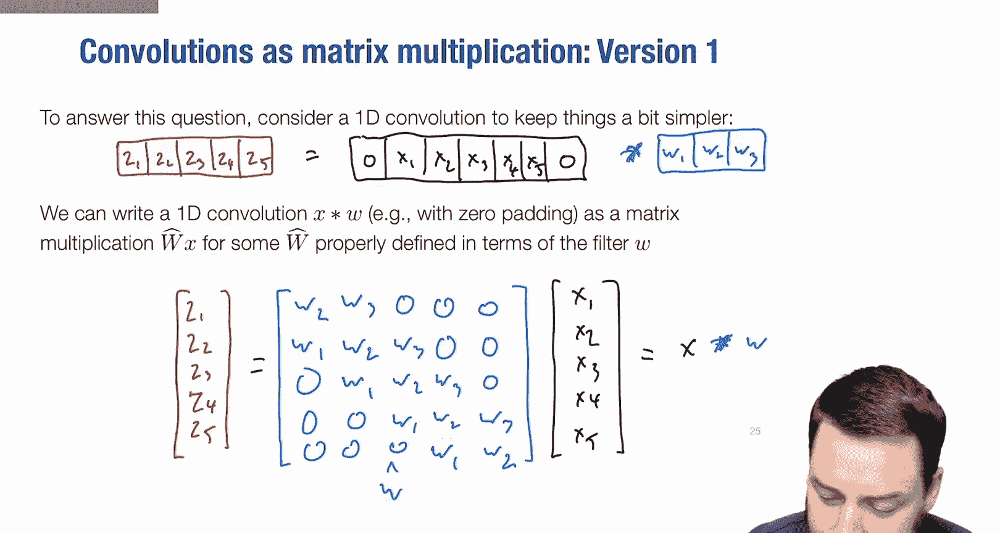

Again， trying to use the medium as effectively as I can。Let's put it down here。A little place for it。

We can also represent this operation， not just in terms of making W of matrix。

 but we can also represent it as Z。Our vector Z here， Z1， Z2， Z3， C4， and C5。

Can also be represented as some matrix， which I'm going to write in black now。

Reasons you'll see in a second。Times。The vector representation of our filters。

We can end up doing it this way， too。And this is actually important because when you differentiate。

 you know。Based upon if you're different with to W or with respect to X。

 you kind of want to write this， you want to be able to write this in either way。

 either as sort of a product with the X as a vector or with our weights as a vector。

But this is actually doable too。 So， so we can write it also in this form here。

 Well maybe I'll write this thing。 I don't think I even labeled it in the in the slides maybe。

 but let's say this thing here is called like。X hat， big X hat or something like that。Okay。

 how does this work？ Well， again， let's just sort of do our our little operation here for multiplying the first entry Z1 will be equal to0 times w1 plus x1 and w2 plus x2 times W3 right So that would be our first our first operation there So what do we multiply So you know what do we multiply by W1 Well nothing that's that's 0 pad So but great because that multipllies this and this What about w2 Well W2 multiplies by x1 right so let's put on。

X1 here。W3 multiplies by well W3 multipl by W x2。 So let's put an xs sorry this was。

Mess that up this video。W 1 should be 0。 It's W2 that multiplies by x1， and W3 multiplies by。X2。

Allright， do one more and then I'll just fill it out after this。

 but if we again slide our filter over in the first location， Ww1， we'll play x1， W2 x2 W3， x3。

 etc ceter。 so we would have x1， x 2 and x3 and I'll just finish this I don't think I maybe can give myself quite enough space here but in the next row we would have x2。

 x 3， x4， x3， x 4， x 5 and x 4， x 5 and 0 and you can sort of validate that is in fact the right matrix。

This is an operation here， this sort of expanding the vector in this way。

 our X vector this way is an operation called m to call。And this is important for two reasons。

The first reason is that if we want to compute this vector here。

 it's very nice to be able to represent Z basically as equal to this case right so this is what we're writing here is we're writing Z equals some big matrix X。

Times W。Because then we have that the derivative of this operation with respect to W is equal to our big matrix x right so that's sort of why we might want to do this。

But this actually also ends up being quite useful unlike the previous one where sort of w。

 we wouldn't want to form this big W because this just has too many zeros this operator actually it has some extra zeros。

 but it's much fewer and you can kind of convince yourself that you know each element here is only going to have the elements we're multiplying our actual weights with and so there's going to be money fewer zeros in this matrix and in fact it turns out that in many cases the most efficient way to implement。

Convolutions is to first explicitly construct。This matrix。This M to call matrix。And then。

Do our entire convolution as one big matrix matrix product。

 so somewhat surprisingly because you think that's。

 know this this is definitely creating sort of wasteted wasted space here， right。

 because this is we creating x1， x1 is， know x3， x2 is being multiple is being represented multiple times here。

 You end up actually replicating each location in your in your signal and in the case of D。

 I should mention this all holds for 2D cases 2。 So just like before in 2D。

 you know you also have this property that the。😊，Mplication with the transpose is equal to the flipped in this case flipped upside down and left right。

 and in2D you would also have sort of you know disimil kind of matrix operation。For this。

 for this convolution but。The the surprising thing to a certain degree is that it often ends up being worthwhile to duplicate your memory in this way for the sake of being a bit more efficient when it comes to the computations of matrix matrix multiplication。

 Now it's very important that this is that this is。Sort of all defined in the op of convolutions。

 you don't want to。Put this term in do it explicitly in your computational graph because that would create a lot of memory in your computational graph。

 it would if you have a three by3 filter it will create nine times as much as much memory consumption in your computational graph。

 but as a way of implementing the compute of your op。

 this winds up being kind of a very efficient method。

 and it will also help you in actually computing the derivatives and really the ad joints。😊。

For your automatic differentiation to do it sort of all this way。

So that in fact is the entirety of what we're going to talk about today with convolutions。

 it covered sort of what the operations are and how you start to integrate them into automatic differentiation tools and I even sort of pointed to this notion of implementing them like this but it turns out to figure out how to implement convolutions properly。

 we first need to understand how matrices and vectors and tensors are really stored in memory because it turns out that all these operations despite seem quite complex mapping multiple things they can all actually be done quite easily by manipulating stride operations in the internal representation of matrices and so all these things if you have the right calls namely the as strideed call the as strideed call which is like this magic function we'll talk about next time or not next time but in a few lectures from now actually introduce them lets take at the convolutions。

You can do this all in very few lines of code， so writing on operations as up being a complex operation certainly。

 but done in very few lines of code。All right， so that's all for today and see everyone next time when we talk about。

Kind of the taking a pause now and talking next about the internals of linear algebra libraries so that we can efficiently implement things both like matrix matrix products。

 but also things like compositions。All right， see everyone soon。

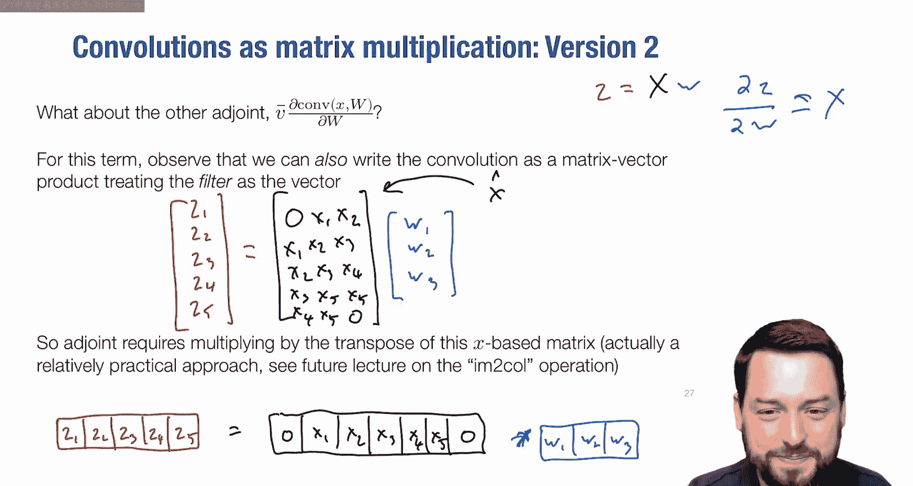