# CMU《深度学习系统｜CMU 10-414714 Deep Learning Systems 2022 fall》中英字幕 p11 -12-Lecture 11 - Hardware Acceleration.zh_en -BV1ERtYepEpy_p11-

对。Okay， hello， Ron， Wee back to。Deeply system， everything implementations on T Q10 is very great to come back。

 And today， we're gonna to talk about a very different topic。 So in the past few lectures。

 we have talked about everything perspective and how can we go ahead and build from scratch automatic differentiation library。

 However up until now， until homework， We are still trying to leverage a you know。

 linear algebra backend today， we're gonna start to touch on our topic on how can we start to learn about hardware explorations and use some of the knowledge we learned to be able to help us build accelerated library that replace the that we had in the needle。

😊，So why do we want to learn about hardware explorations， The reason is that， you know。

 the machine learning landscape is fast changing。 and a lot of cases， you know， today。

 if you want to train a deep neural network model， certainly you kind of need to know how to use a GPU because in lot of cases。

 we kind of need accelerations， really keep up with the computing demand that that bought by those big models and big data set。

And also， it's also important to know about accelerationion techniques general so that we we will be able to understand whats really going on or we start to try out certain things like。

 no， what does Py dot compact con me and why， know in certain cases。

 why does my run faster or slower。Another reason is that in a lot of cases。

 we might come back and ask， for example， you know， if I want to develop a new operator。

 how can I go and implement a particular operator on the acceleration hardware that we had on hand。

 And that's a very important question that we all have。

 And you know and one last reason is it' simply cool to know how exactly my high level machinechi learning code from you know from the high level linear expert description translate to real instructions run on how being able to understand all the implications that boil down onto those details is going to be super helpful。

So today's lecture is going to focus on general exertion techniques and specifically we first will consider。

 you know， general purpose computing， CPU in the next lecture。

 we're going to cover the GP accelerations。And first。

 we're going to cover some of our general acceleration techniques。

After we go through the general extensionion techniques。

 then we're going to do a case study on how can we go ahead and accelerate measures location。

 which is at the center of all the you a lot of machine learning models that we are running today。

Okay， let's begin by talking about general acceleration tas。

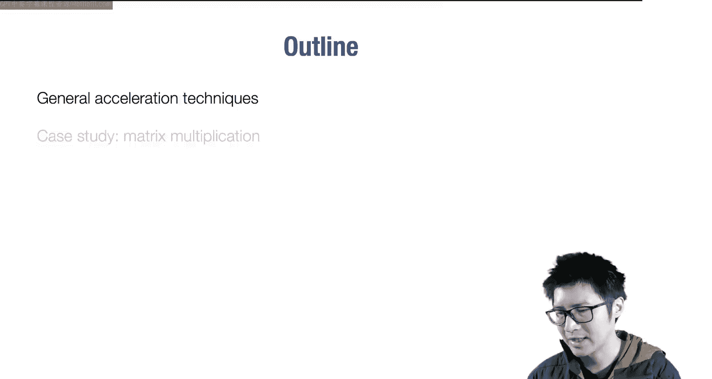

If you look start look at machine learning frameworks。

 you will find that most machine learning frameworks。

 including needle actually can be divided onto two layers。

The highest layer which we were talking about in the past lectures is the layer of canceloli algebra and computational graphs。

 So in this case， as we start to build computationals like needle dot add you know the subtraction we building up this computational graph that traces the computational histories and also allows us to be able to leverage those computational history to build up gradient computations。

Another part that those computational grab libraries sit on top is what we call tensor linear bra linear edge bra libraries。

Lo the Aile libraries really allows us to create a concrete and dimensional array and run arithmetics such as no and。

 additions and so on。So until now， when we start to build a needle library。

 you can find that our back and and D array， if we use has a ten linear algebra library。On that hand。

 we know that， you know， as we start to try to deploy machine learning onto different kind of environments such as modern CPU。

 GPU， mobile devices and sometimes even those x pause。

 we still need a different kind of tenselin algebra library implementation So that become a question of how can we go ahead and optimize some of a tenselin algebra library implementation。

So as a first pilot， let's have to review some of the optimization techniques we can use to optimize some of the Tsoliia at our libraries。

So first technique。That what introduce is what we call vectorization。

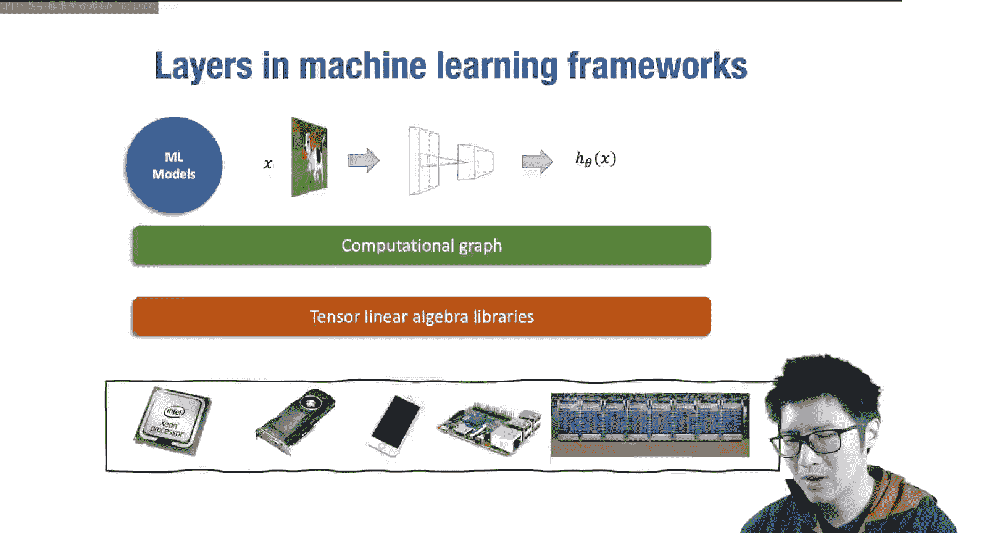

收呃。When we start to write code， like， let's imagine I want to write you know。

 addition of two vectors of length 256 in here。 So here， A and B are two vectors of length 256。

 I add them at each element in an elementwise fashion and store that result back on to the。Okay。And。

 of course， the easiest way that we can write is programs。 we can simply for I in。😊，0 to 256。

 I can do C I equals AI。Plus。EI， I I can simply write this scar code in here。However， you know。

 usually in modern hours， we usually have acceleration unit or acceleration instruction that allows us to be able to load a continuoustiguous piece of memory on what we call vector registers。

And be able to leverage those vector registers to run arimetics and store the result back onto certain piece of memory。

So in this particular case， what we can do is we will be able to instead of iterating over0 to 256。

 I'm going to iterate over 64 iterations and at each iteration I。

 I'm going to load 4 point points from array A and 4 point points from arrayB。

That gives the loading to load for registers on my Howard。

Then what I'm going to do is I'm going to take in this two floating point vector。

 I'm going to add them through add road4 instruction in here and store it by 244 C in here。Finally。

 we are going to use store floating point for to store the floating point register back onto a contiguous piece of memory。

Of course， this is a pseudo code， right that does not represent what exactly going on of。

 of how you want to code certain power。 For， if you are going to use an arm。

 likely there will be special in6 in arm component Hy allows you to do vector loading vector addition and V stop。

But general idea is that there will be special data types that you will be able to use for loading data from a continuousig piece of memory。

 running arithmetics and sting data back onto the continuous piece of memory。😊。

And another implicit requirement in here is actually in order to perform this floating point load and store。

 In other cases， there's a requirement on alignment of A B and C address。We know that no。

 the address is usually can be represented by a 64 bit individual number。

 If you' are looking at the individual platforms。And。Usually， you know。

 if we look at the memory as a continuous piece。😊，In order to load。This you order to load the。

 the floating point number from a memory。 usually it require that this address C。

 A should be multiple of。4 frame points in this case， you know， each of a frame point contains。

 let me see，4 by， right， And so at least you should be multiple 60，16 B。电影屁。And。And， you know。

 so if a's address is， say，0 x 0，0， maybe not 16 but 12。Then this is the address that we call un。

 As a result， you know， every time maybe we only be able to load in a vector from here。

 but not from this online online address。 So this is due to the limitation of hardware implementation where we kind of there's a requirement here that when we are trying to load data in aligned fashion。

 you will need to be able to have alignment requirement of the of the adjusting here， including a。

 B and C。And and that that also means that as we start to allocate memories for those every computations。

 we will need to call align allocation。 as supposed to， you know， just call melo。

 because when you call melo， and most you are going to align to the word size。

 So by when you're 64 bit platform， likely you are gonna only align to you know。

8 bys because that's like a default alignment you have on a platform。

 But in order to get better computations， maybe you want to be able to you need to be able to have a higher amount of alignment。

 So that's kind of a one catch that you kind of need to remember when we start to。😊。

Alloccate memories that that leverages those like an aligned vector load that store。

 As a result in a lot of cases， you will find that， you know。

 if you go actually track cloud that just that being allocated by a libraries。

 you will find surprisingly a lot of libraries have a higher amount of alignment than a simple maillo alignment that's gonna give you。

Okay， so that's vectorization。 The second thing we're going to touch on is the data layout。

 specifically， you know， when we are going to store a multi dimensionsal matrix。

 how we are going to store the data。

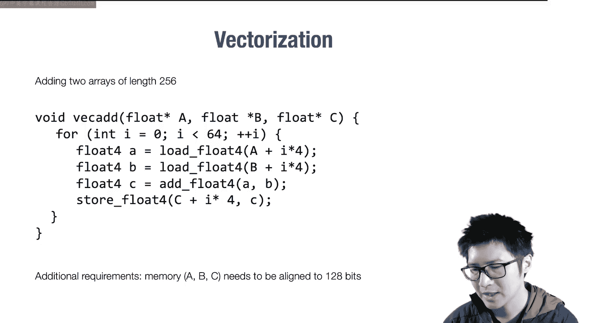

In memory， because we know that， at least in a CPU memory。It's a flat array。

 and it's being indexed by a address。So in this case。

 imagine that we have a two dimensional matrix AI J， that different ways we can use to to， you know。

 map that I J onto a flat piece of memory。 Imagine that I'm going to look at a2 by3。Matrix。😊。

There are different ways we can do it I home。 The simplest ways to do it is imagine I have a matrix in here。

2 by3。 The simplest way to do is what we call row major。

 So I'm going to store the data in kind of this order every time I start from This is the first element。

 The second element。 Its the third element。 then fourth element in here。 So， so in this case。

 the index AI J can be mapped by AI times3 plus J in here。 And this is called row major order。

 And this is also kind of a default order people use to store multi dimensional array in common program languages like C。

If you have used if you old enough， you might heard about this language called fortune。

 And in that case， actually， the my dimensionary is being stored in a different order。

And that order is called column major。So in a column major。

 what happens is that instead of storing since by row first。

 the data is being stored at a column first fashion。 Okay， so， so effectively， you know。

 what each of AI J。The the result is being stored as j times a shape 0 plus I right so imagine I'm doing two by three arrays and the result is being stored by j times 2 plus I in here in a column first fashion。

 And this is a convention that's being used by， you know。

 a lot of old plus libraries because a lot of old plus libraries are implemented in this convention in in language called fortune that follows this column major convention。

Of course， in all cases， you know， you can go beyond a role major or call major convention。

And as a matter of fact， a lot of the linear actual libraries introduces fuel cost drives。

In this case， the strides kind of represents what is kind of offset you are going to take when you increment o dimension。

So imagine that have a radar contains a strides field。

 then the idea is that AIj is going to map to i times Str0 plus J times strike 1。Of course。

 we can generalize this to multiple dimension。 So imagine that I have a multiple dimensional array where we have AI 0。

 I1 I of N。 Then if you have tried array format， it's going map to a data。你啦。Some or。K。

I of K Tom stride of K。 Okay， so effectively， we are using one individualte number to specify what kind of increments we are gonna use while you increment on a particular dimension。

So what is the advantage of having this。Striide format。

One of the things you might notice is that by having the strides。

 its color become more general than either a column major or row major format。然后。imagine I'm doing。

 you know， this this already us。2 by3。We can actually implement either row major or column major by tweaking the number of the stride settings or at each dimension。

 Well I hold， if I said stride 0 to be 1 and stride 1 to be2 in this case， or in this case。

 now a or shape 0。Youll find that actually it's Princeline into the color major， right。

On that back ahead。If I'm going to set。Striide 0 equals8 of shape 1， strideide 1 to be。To be one。

 Instead， you can find that recovers the role major convention。

The least the strides gives the ability to be able to represent know different storage conventions。

 actually using the C setup， okay。

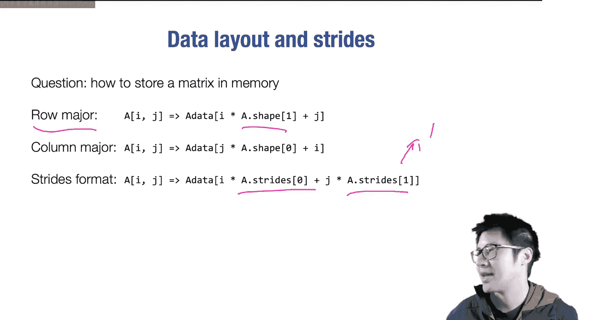

There are also other more advantage of stride that that allows you to。

 because strides allows you to have a flexibility in terms of doing layout transformations of data。B。

 if I stress， we will be able to do things like a resizing by changing the beginning of that without having to change the underlying。

 without having to copy the underlying data。Similarly， you know， remember that。We can， you know， we。

 if want to do things like transposition， which means that you want to be able to take originally and transpo it to another format。

 You can simply swap the strips to be able to and and shape as well。

 right to be able to find a new array。And then it also us to broadcasting operations by having sense like inserting strides equals 0。

 okay。So we， we're gonna have another implementation lecture to come back to this。

 And if you are still a bit confused， it's fine。 You know， we will always come back to this。

 but it's also good to have a mental exercise of thinking about how does this strides become helpful in certain cases。

 like when we are doing things like transposition， slicing and broadcasting。😊。

One of the problem of introducing the strides is that when the array comes with strides。

The memory access of a ray may not become continuous。 though if I have a array that have as dry。

 It's actually it makes a lot of things harder for in my certain cases， makes vector harder。

Imagine that， No， I am a stride like， you know， a。诶 i j。Eals。诶对的。

Let's say I'm setting up battery stretch， like I times。8 plus J times  9。 So， so in this case， or 8。

9， I'm not sure if it's the valid one。 But， know， let's see what if， what about items 8。

A times 3 plus  three times  sign。 That's likely a very stride。 So in this case。

 you can find that if I'm going to increment in either I or G dimension。

Its not a continuous access to memory。 As a result， it makes it harder to do vectorize access。

In other cases， actually， many linear algebra operations such as matrixification might require us to have a compact array。

 which means that you know if the array drive does not satisfy the compact requirement want to be able to know change array in a format that is becoming more compact。

 As a result， you find that actually Pythage and other libraries may come with an nu may come with a function called conuous or compact to be able to。

 you know go andla track if if the array contains dry data compact。

 if they don't then you will come back and compact arrays before you run the follow up arithmetic computation。

So this is something that this is something that， you know， you want to keep in mind。

 and it's kind of a side artifact because， you know， your know。

 intermediate computations can contain a arrays that are not compact。

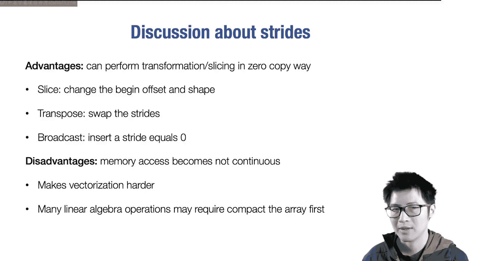

Okay。So besides this drawings。Another thing that， of course。

 we can do is no we can try to leverage parallelization。

 so this is an example where we can have a follow loop that being annotated in a。

 in a code called open MP。😊，And the ideas that well be able to generate this four loop for each of the iterator eyes。

 we could assign those tasks on to different CPU processor。 So imagine that have four CPU core。

 Then willll be able to divide up this loop into four trunks。

 and each of loop trunk is going to be assigned to one of the CPU calls to run the correspondinging computation。

And， you know， usually validationation is a very useful way for us to speed double computations as well。

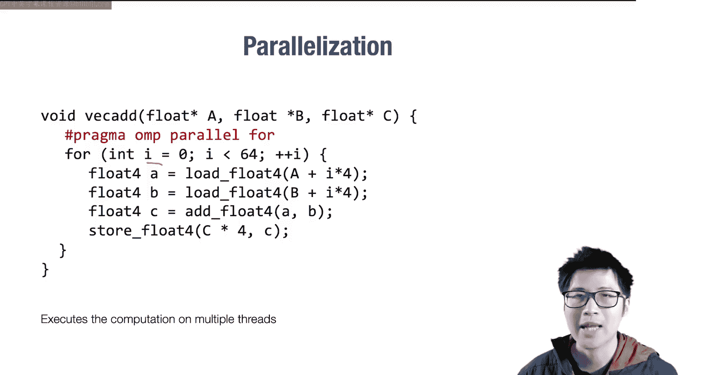

Okay。So that's finished our introduction to general acceleration techniques。Moving next。

 Let's come back to do a case study on， you know， on how can we go ahead and accelerate matrix modification。

To begin with， let's not review this vanilla implementation of matrix application code。

 So in this case， I'm interested in C equals dot A B transfers。

 or if I'm going to write it out in I instancestein， some notation， I'm interested in C。

 I J equals sum over K。😊，AI K timess B，J K。Yeah。Okay。And let's go ahead and review this code。

You can find that we' are going to do iteration over I iteration over J。

Assign the initial element to be 0。Iterate over the reduction dimension and doing， you know。

 multiplications and add back to the crisp morning C element。And of course。

 we're going to do you know arithmetic a complexity analysis of this a。

 we can count number of multiplies in here right So we have n times n times n multis in total as a result。

 the overall a complexity is N Q。Which is kind of easy。 right So one of the things。

 at least when I started to use those plus libraries， I always wondered。😊。

Those you know linear algebra a library that accelerates major communication。 I always wondered。

 you know， what are the tricks that people use to accelerate this。

Do they have a better algorithm than an and queue。And， and well。

 there are implementation that actually try to get a better everything complexity for multi matrices。

 But on other hand， the reality is that， you know， most of blood libraries actually still implement vanilla。

😊，A cube action。Isn't that surprising， at least that was surprising to me when I started to look these informations。

So。But if you look at this vanilla everything， the aron complexity seems to be un cube。

 So what's happening in here。So one of the things that we will need to try to understand is that in order to consider what's really happening in the hardware。

We will need to start to think about memory。

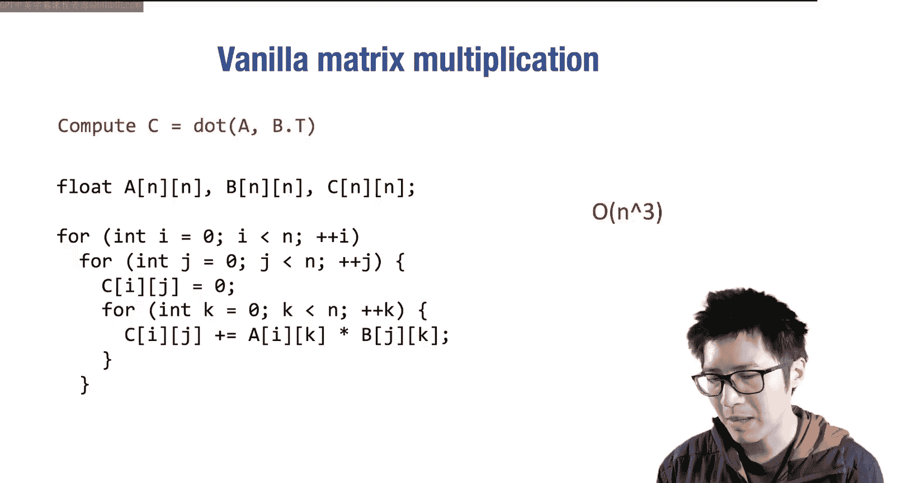

Harchy need knows hourss。Specifically， although， you know， indeed。

 the kind of athmetic computations and memory loads are indeed N cube。

Depending on where the data resides。The time cost of fashion that data can be very different。Foramp。

 if my data recit in typical D Ram。On my computer， it will cost 20 nano secondscond。But。😡。

If the data is being pre fetchched into the L1 cache。

Which is kind of a cache that is a piece of memory that's more， but closer to the CPU hardware 0。

5 nanoseconds。 So there's a 200 x difference in here。 So， so depending on where your data sits。

As a result， you can imagine that if my all my data already fits into L1 cache， Of course。

 that's going run faster。 And there's a 200 X opportunities in here that we can leverage。

And that's where a lot of the， you know， hyper one computing libraries kind of start to start to。

 you know， that thats， that's where a lot of hyper one computing library can come in to optimize some of the data loadings to be able to help us。

 you know， reduce overall overall runtime cost。So how do we analyze this effect。

We can still try to do the similar kind of arithmetic or evolution analysis， except at this time。

 let's try to take into some architectural considerations into account。

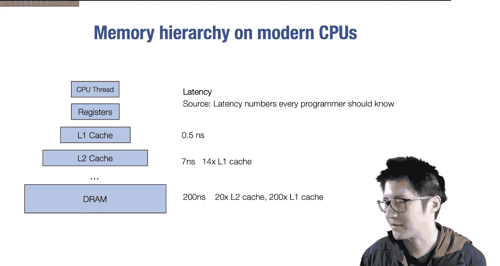

OK。So let's take look this refined program。 Of course， this is a hypothetic one。

 and I'm going to express the annotate。Where。Each piece of memory belongs to。

 So you can find there are two kind memory in here at S D Ram this register。

 So this is kind of a simplified model。 Let's assume that we are looking at a how that only contains a D Ram and register。

And there's no L1 L2 cache。And this is the implementation of the original direction。

 except that we are annotating it using register and during， okay。So no。

 now what we can do is we can try to count。The number of data loads that we have on each of the part if look at。

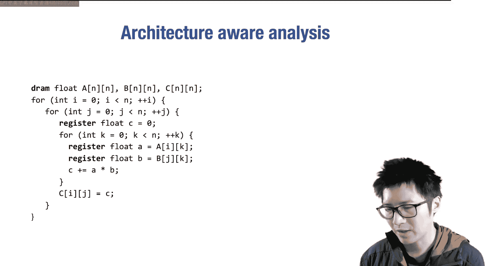

The day load from。If you look at the data load from a。

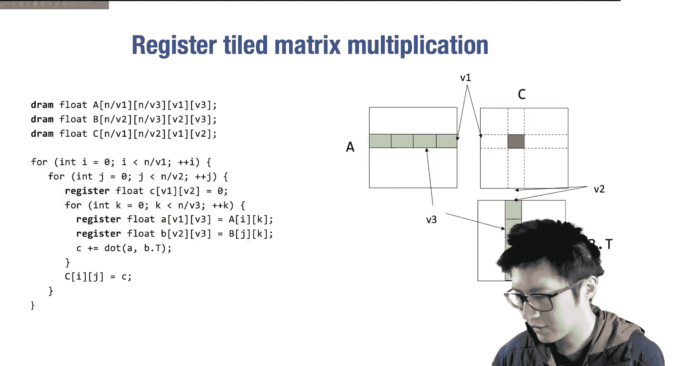

To register。What we can do is can try to count the number of loads， right。

 So this is a node that we're having here。

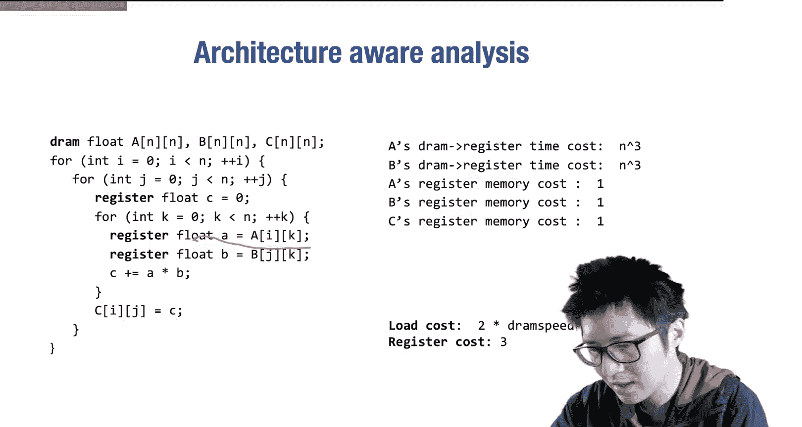

It's n times n times n。 So we have an N cube。Mary loading total。AndSimilarly。

 you'll try to go ahead and countt the memory loading cost of B is gonna be n times n times as well。

 right， So it's N Q。On that hand， we also need to know like how many registers we used in total。

 So in this case， in order to execute this program， we need to， we need to have C， A B。

 So three registers in total， right？ So if you summarize。The cost of this program。

We know that in terms of amount of load that we need to perform。

 we need to perform two times N cube load。And we can also multiply that by D Ram loading speed that loads from D Ram to register。

 right， So that's our overall loading cost。And then it cost me， you know， three registers in total。K。

That's a vanilla option。Now， let's start to come back and introduce a different variant of apps。

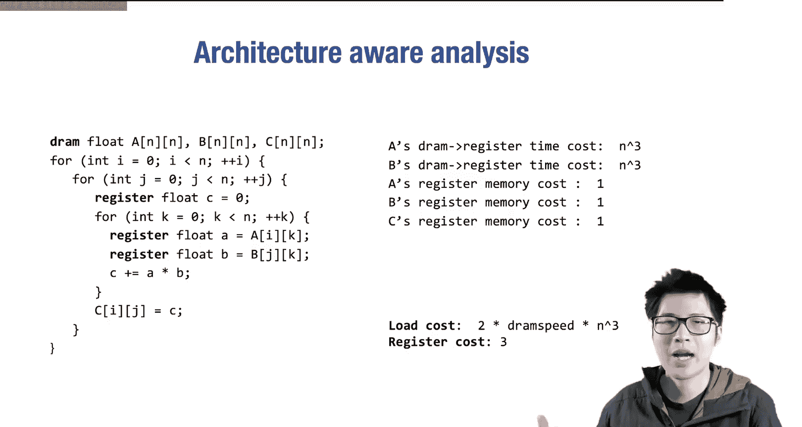

This variant is called Reg tile implementationm。So， in this case。

Instead of trying to compute one element of time， or trying to compute one sub matrixrices。

 So in this case， I'm trying to divide the big matrix into a V1 by V 2。Reion， where each of a time。

 I'm trying to compute this V1 by V2 subs。And in order to you know load the data each over time。

 I'm going to load V1 by v3 and the V2 by v3 is drive。

 and I'm going to the internal dot product in here。

 and this dot product can be our road using for loops， actually。

To be able to effectively compute that and add back to the to the internal v1 by v2 register matrix in here。

So first， I'm gonna pause a bit and I want to have everybody look at the code and try to appreciate that this is indeed a code that crs more to original matrix application。

 Of course， well were already you know， changing the data layout a bit。

 But that's let's ignore that part first。 And let's just look at this particular code。

 you find it effective we are trying to do this every time we initialize sub matrix。😊，And then。

Of course， know， now my outer iteration is gonna iterate over those sub matrices。

5 so here is's gonna be an un divide by V 1 and divide by V2。

Now I'm going to iterate over N divided I B3， loading those that make component。 to an in product。

Add to C。 and finally， I'm going to store the sub matrix back on through that global memory。Okay。

So it is indeed a implementation of the original vanilla matrix multi。

 except that we were loading data in a slightly and doing computations in a slightly different order。

Okay。Now， let's come back and analyze。What is the total amount of data loan that we have to take and what is total amount of registers we want to take in this in this part okay。

走。And it's kind of interesting if you， if you go ahead and try to think about it。

What is the total amount of load that we have。In loading。A to the registry。Okay。

 we can do that but count't the number of loops in here。

 So you can find that auto loops n divided by V1。The second inner loop is un divideiv by V tube。

And third in look is a nearby by V3。 right， so these are the total number of iterations we have on the three iters。

Of course， in each iterator， we are loading a V1 by V3 region。 right， so we are loading。

V1 by B3 region， and that is the total amount of data we load from a to a register in this algorithm。

And if you look at it， you can find that B1 cancels out。 V3 cancels out。

 and this one becomes N cube divided by B2。Right， so that's the total amount they hello loading enre。

Similarly， if you' are interested in total amount yellow loading to B。

 it's gonna be equal N divided by V 1 times N divided by B 2 times n divided by B 3 times B2。

比 three equals nQ divided by比Y。系。So that's the total number of the are loads that we have from。

A D Ram to register。M B is there to register in here。

We can also come back and count the total number of registers were using here。

 So the total amount register that we use for A is V1 times V 3。 We use for B is。V2 times V3。

 And then we use for C is V1 times V 2。Right， so that's the total number register we have。

And if you summarize that up， you can find that my loading cost equals D Ram times N N cube divided by V1 plus N cube divided by V 2。

And my register cost equals v1 times v2 v3 plus v2 times v3 times v1 times v2， right。

Now it becomes as a question。One of the things that a bit surprising is that。E reduce loading cost。

Al so you can find that depending on how I choose V1 and V2， actually。

 the the total amount loading cost is no longer N cube。

 but N cube divide by those what we callty factors， V1 and V2。

Another thing that would do keep in mind is that， you know。

 most processor have limited number of registers， so we cannot have， you know arbitrary large V R V2。

 Of course if have a arbitrary large V1 V2， the loading cost is gonna be further reduced， right。

 So we want to be able to have as large V1 and V 2 as possible。

But we want to make sure that total number register do not exceed。

The total normal register card do not exist。 the register being available。 right。

 so another thing you notice is that actually in here， the choice of V 3 do not affect loading cost。

So effectively， one thing we can do is I will be able to pick。B3 equals one here。And then。😊。

Lets go and try to increase V1 V2 to be you know usually equally largest one right。

 But on other hand， sometimes you need a bit of a symmetry if your total number register is not a perfect square。

 right， So so in that case， you know， we we want to be able have a large V1 v2 that gives you the overall reasonable over reduced cost while not existinging a register budget。

Okay， so that's what we call registerile。 And one of the things， you know。

 another way to look at this。 know why。why there the reduce in loading cost。The reason is that。

After we load in data onto A and B。The data is being reused multiple times。

 So for each of the element in a， actually， that data is being reused。V two times。啊。

When we are doing like V2 iterations over， over different different Bs as a result。

The overall reduce of loading costs is due to the fact that we are reusing the memory after we loading them to register。

 Okay， so that's kind of like a a trip that we all use in writing those high performance libraries。

 You want to be able to load the data。 Store it on the fast memory and reuse it as much as possible。

Okay， so so far， we have considered register and Dam。Will be next。

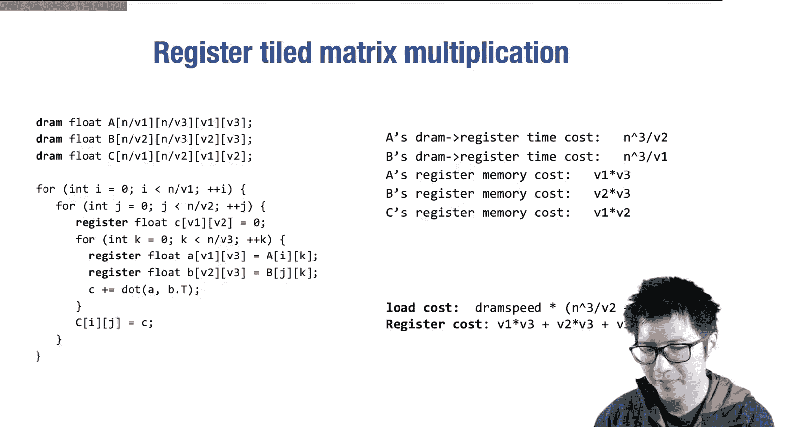

That let's start to think about a slightly more complicated case。In this case， let's assume that。

 you know， we put another thing loop consideration， which is the cacheline。

 So in here I'm going to continually have another form of matrix allocation that contains D Ram。

 D Ram， D Ram，3 D Rams。And in here， I'm going to do another level of blocking。 So in this case。

 I'm going to choose B1 and B2。As a blocking factor， which means that every time being here。

 I'm trying to compute a B1 by B2。Some matrix at a to。

And what requirement that we having here is B one， B2 should be multiple of V1 and V2。 So。

 so in the internal part， I can still apply register tiling on， on the internal sub procedure。Okay。

 so that's kind of a costtrain we have。And， and in this case。

 instead of directly fetching the data onto to register。

We we're gonna do is we're gonna first fetch the data from A and B onto what call L1 cache。 And。

 of course， normally， you cannot explicitly write out L1 cache， right。

 So if youre just write coding C code， the cache is being automatically managed as I suppose to in here。

 we are explicitly writing out。 hey， here's L1 cache you fetch into it。

 So it's only going to be used as a way to analyze the overall cost involved in， you know。

 writing out this program。Okay。So in this case， assume that we have this additional blocking factor。

 B1 and B2。What I'm going to do is we're going to first war。

It were over all the outer loops side and load an entire line of a on to L1 catch。

Then I'm going to load。Ittererate another another J factor in here， right of a B。

 I'm going to load another line of B1 to add1 catch。Finally， if you have this line and this line。

 we are going to do a doll product。That computes the A B transpose。 And in here。

 this procedure we can still apply the register tall tricks that we applied in the previous slide。

Okay。So let's start to analyze what is the effect of。Loading from D Ram onto a1 has。 this case。

 But before I do that， I want to pause a bit。 I make sure everybody go ahead and take a look at the code。

 and you want to convince yourself， Indeed， this is a variant of matrix ver code that implants original matrix fabric。

Except that we are afford reorgan the data in a slightly different order。Okay。

So let's take a look at。 now， what is the overall cost of loading from DM A onto L1 cache in this case。

Let's first take a look at the loading cost of a。In this case， loading cost of a equals again。

 we can count， right， You can see it's N divided by B1。And in each of case。

 I'm going to load in B1 and so B one and here， you can find that this inputs n square。Okay。

If you look at noting cost of B。In this case。We are going to do n divide by B1 times the inner loop。

 N divide by B2 times B2 times n。In this case， this equals a cube。Divide by。You want， this case。

The more interesting thing you notice that actually in the cashline1al case。

The loading costs from A and B are symmetric。 And so the loading cost of a is only n cube sorry。

 n squared。 But loading K loading cost of B becomes n cube divided by b。Of course。

 because we still need to apply register chart internally。

 So we need to make sure that now B1 divided by v1 equals 0 and B2 divided by v2 can can fully divide V2。

 So B1 mod v1 equals 0 and B2， modular v2 equals 0， in this case。

Another thing that we need to make sure is that want to be able to make sure that the total number of L1 cash cost right is smaller than the possible L1 cache that you have in here。

 So， of course， know we also want to have a small enough B1 or big enough B1， B2。

 but they should not exceed the L1 cache size that we have in in here。哎。

that is how we can go ahead and。Possible loop factors in here so that satisfies the overall L1 cache constraints that we have。

Finally， all the things we can do is can try to put everything together and we kind to expand the internal loop using registered hiring techniques。

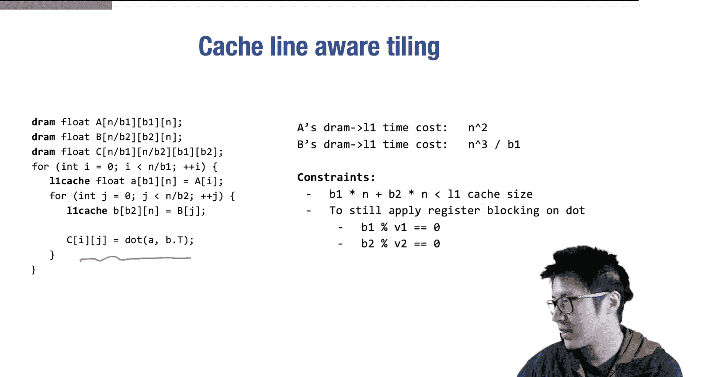

Maybe we put it together。You'll find that， you know， we' are gonna have this。 first of all。

 we're gonna trial by B1。 and then that's gonna be have a B1， V two factor。 Of course。

 we know that V3 equal can you pull1。 So I'm not not going to show B3 here。

 but I'm gonna show V1 and B2。And then。This is the code that contains loadings from a to L1 cache。

B to L1 cache。 And internally， I'm going to， I'm going to do register tlings。

 That's going to load in the Christmas registers and then do the register tiing internally。

 So this is a code that puts both the cash file wire tilings and register tiling together。诶。

We can also go ahead and compute the loading cost of this code。Remember that it contains two factors。

 It contains loading cost or loading from D Ram to L1 cache。

And then contains loading costs from loading from everyone cash to registers。

So were think about loading cost， you look at our well speed。You will find that in this case。啊。

I'm going to first compute the cost of loading from I want to register。In this case。

 if you go ahead and compute that， you will find that， you know， I'm going to do loading here。

And the total amount of cost is going to be n divided by B1 times N divided by B2 times B1 divide by V1。

 B2， divided by V2。Times N right， and and times， in this case， you know， I'm loading V1 element here。

 Thomas V1。And youll find that this equals a cube divided by V2。 as all those things cancels up。

And the other way is the same。 So you can find that the load cost from D Ram from， sorry。

 from L 1 to register equals N cube divided by V1 plus N cube divided by B2， okay。

And we can also go ahead and count loading code from the D Ram to cache， right。

 then it equals n square plus N cube divided by B1。So。

 so these are things that you can find in this case， right we can be。

 we can leverage both the fact that we can load data from global memory to cache in a reasonably fast fashion by having the those block factors on B。

😊，And then。And then you leverage the fact that we can load data from a one cache to the to the register by using rush time。

 right。Now， one of the thing that you also notice is that， you know， in this case， of course。

 this kind of loading cost is a rough estimation because in practice。

 there are different things that can happen， for example， you know。

 my loadings of registers can happen in concurrent of the cache professionion。

And they are also in a multiple level of caches。 So if have L2 cache。

 you might need to add another level of tallling in this case， that takes L2 cash into consideration。

So in here there are different kind of there are different factor that goes into the play of the。

 of the final code speed。 And we have not considered of the they are trying to analyze is an idealized model。

On the other hand， you can find that even even if we just take this idealized model into consideration。

 the final cost is kind of slightly more interesting than the simple N cube， right， of course。

 if you think about B1 B2 and B as a constant factor indeed overall aroundtime is still un cubed。

 but on other hand， know these are really very different constant of factors they want to take into consideration as a result。

 depending on how we are going to organize the code。

 the final motion modification code is gonna be very different in terms of executionion efficiencies they can be know although magnitude like tag。

 or even insert gets 100 x difference depending on how you are going to go and reorganize your code。

And finally， in order to do optimizations， of course。

 we still need to leverage things like priorizations and leverage of， you know， the。

 the vector register unit and other units in here。 So all those things can be put together to when we。

 when we are considering the final acceleration code。😊。

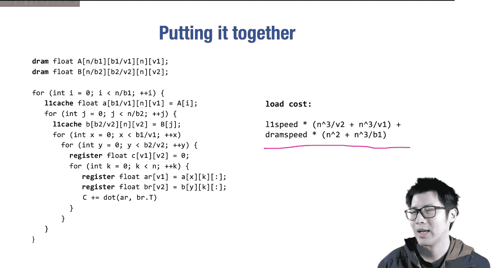

And if we come back and looking in another way， right， So， so why。

Why can we get better memory loading reductions in here。The reason is that in our World code。

 there are more opportunities of data re use。In this case， every time I went loading the a。

And each of element of A actually gets reused V2 times。And in this case。

 each element or B get reus V1 times。So because it's getting reused。

 you loaded and you used multiple terms as a result， your total loading cost get reduced， right？

So another way to think about how do you optimize those， you know。

 major location and what we call general test contract type optimizations。

Is that you really want to think about reuse patterns of， you know。

 what are opportunities you can reuse。 And you can do that by looking at actually a looping patterns in here。

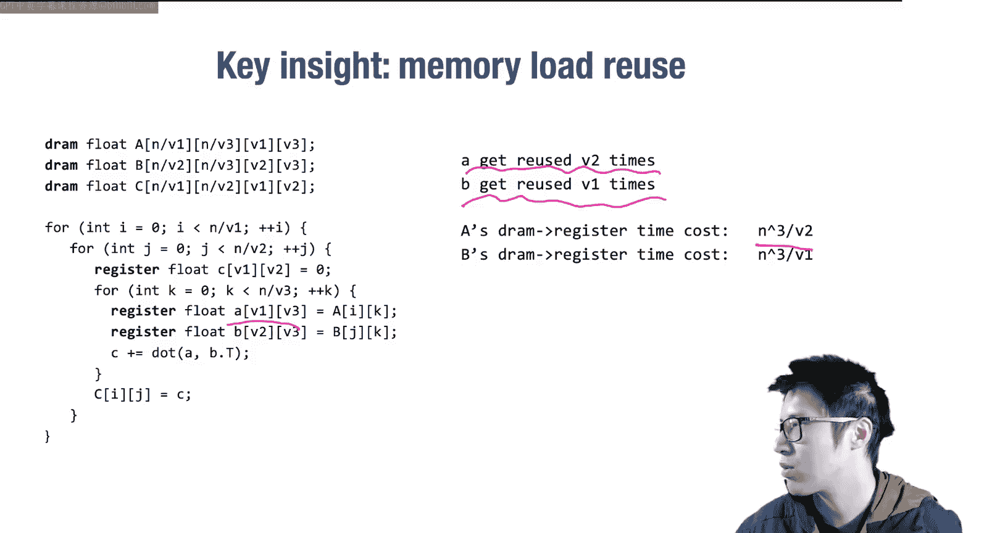

然后， if you look at。This code， effectively， that。Describes the matrix of location， right， C。

 I J equals some AI K times B， J， K X， O O K。 one of the things youll notice is that。

The axis of A's element is independent of J。Okay。So。If I'm going to tile。Jy。V times。

That means that I will be able to load the data first。And if you're gonna iterate over the J V times。

Over internal iterators can reuse the same a element。So that's a general rule of Z。

 when you're starting to look at。index summation pattern。

 you want to start to look at what are the missing iterators in here。 For example， in a。

 the missing iterator J in B， the missing iters I， right so if you have missing iterators here。

 likely you will be retire along that iterator dimension to get more reuse。

And that reuse helps you to be able to get more efficient code。And， of course， you know。

 depending on how do you implement concrete linear a libraries， there are different reuse patterns。

 So mission publications is only one typical one。 If you start look at patterns like convolutions。

 there will be more interesting reuse patterns you can find。

 And I'm going to leave that as an exercise for of you to go ahead and check know what are the possible reuse patterns you can have in this case。

 this， you know， three two dimensional con2 the operations in here。O。😊。

So that concludes the end of this lecture。 So today we reviewed the general power exertion techniques。

 First of all， we reviewed you know what are the common techniques such as vectorizations。

 priorits and other techniques that allows us to accelerate normal algebraz computations。

 Then we did a case study of optimizing matrix rotation specifically by having those how we aware analysis actually we can gain deeper insight of what's really going on and use those insight to guide our implementations。

Finally， one more important thing to remember is that in a lot of cases。

Having memory reuse opportunities kind of help us to be able to load the data once and reuse multiple times。

 and that's one of the key tricks that leads to a lot of acceleration techniques being a lot of linear algebra levels。

Okay， so that's the end of today's lecture。 Thanks everybody for coming。

 and I will see you in the next lecture。

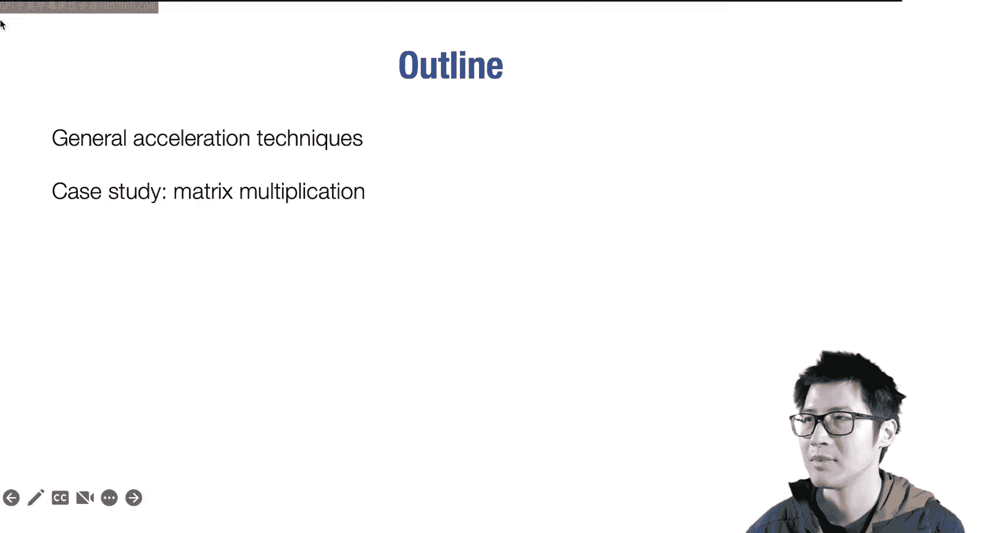