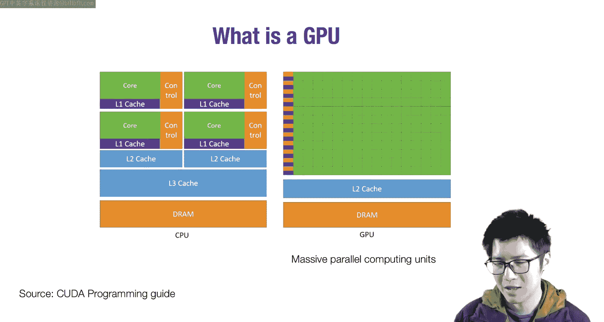
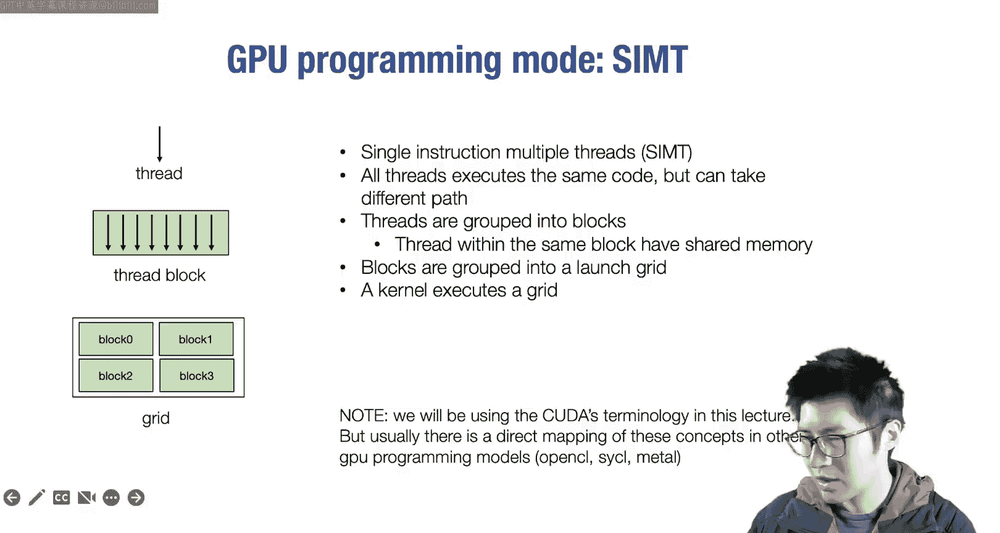
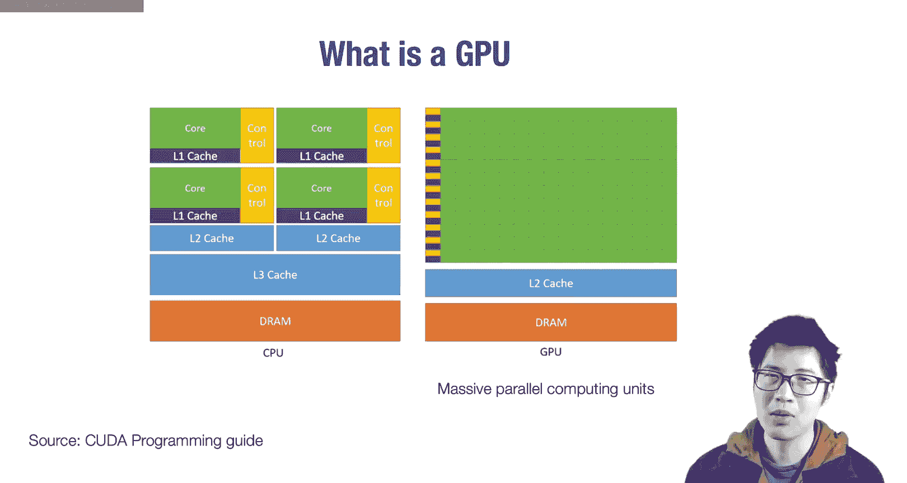
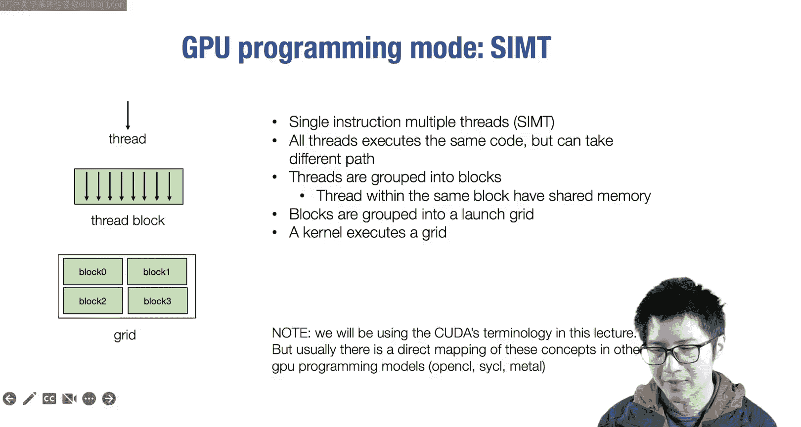
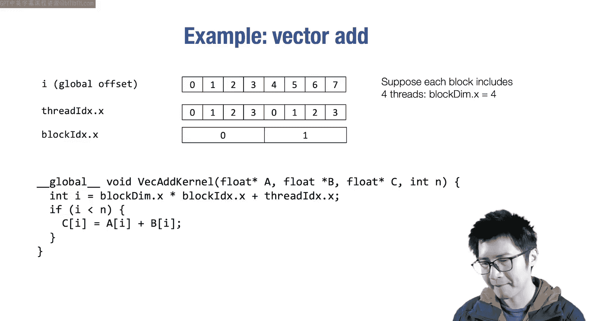
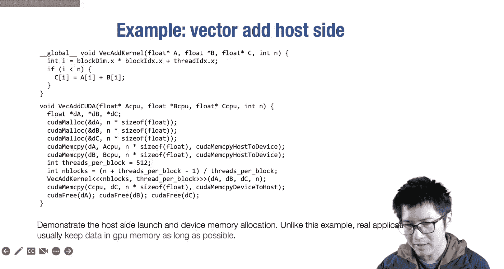
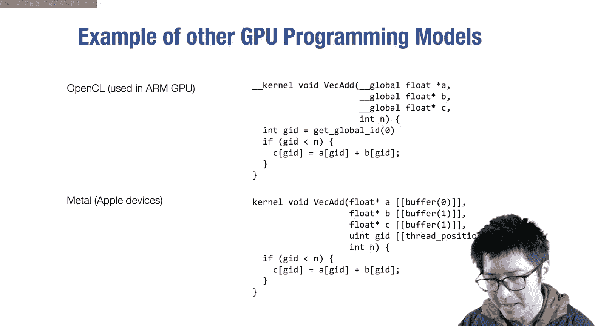
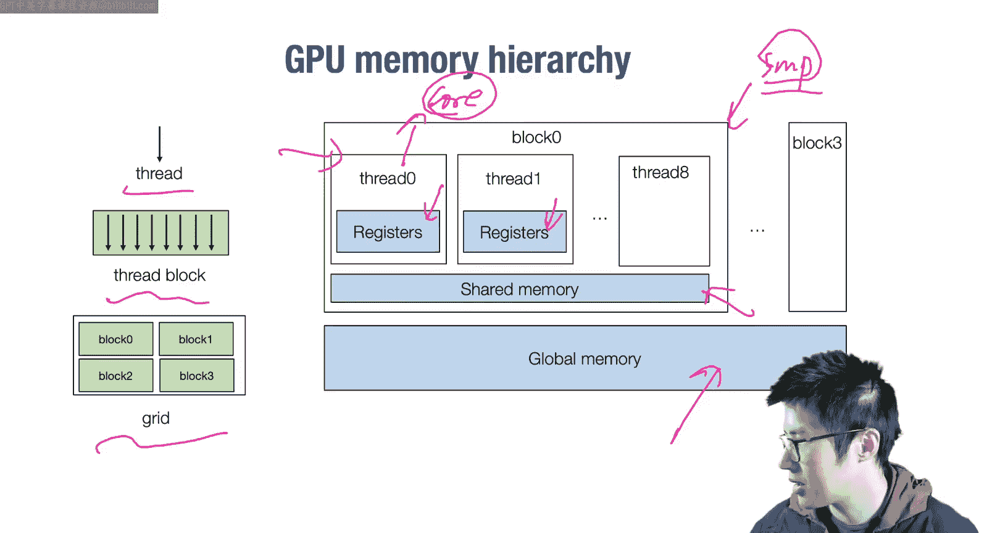
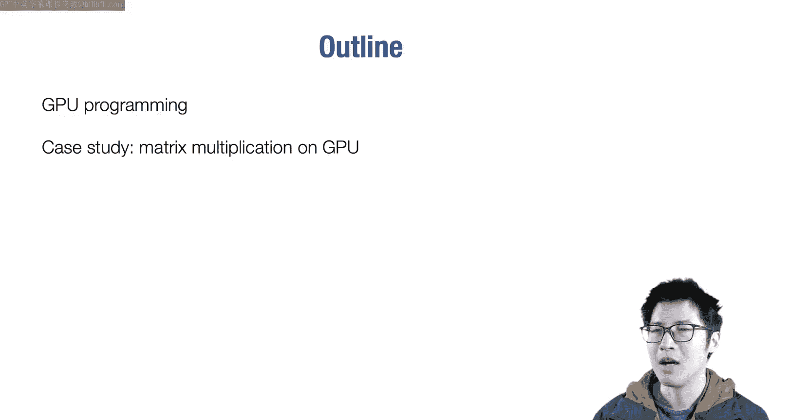

# CMU《深度学习系统｜CMU 10-414714 Deep Learning Systems 2022 fall》中英字幕 p12 -13-Lecture - 12 GPU Acceleration.zh_en -BV1ERtYepEpy_p12-

Okay， hellello， everyone。 We back to D systems Everything implementationm。In the last lecture。

 we talk about how we can use different acceleration techniques。

 especially how can we make user memory weuse to be able to accelerate our linear algebra operations on a CPU。

So today we' are going to go to a different related topic， which is， you know。

 imagine that we start to use more acceleration。 how we like a GPU。 How can we， you know。

 leverage some of the properties of a GPU to help us accelerate some of the computations。Of course。

 the topic of GPU acceleration is quite large， so it's impossible to cover everything within a single lecture。

Our hope is that hopefully this lecture is going to give you enough of a background so that we can start exploring this topic and you will be able to make use of the lessons you learned in this class to be able to work on some of your homework。

So let's get started。This lecture is going to focus on two parts So the first part。

 were going to do a high level overview of GPU programming。And the second part。

 we' are going to do a case study on how can we leverage the techniques we learned in the first part to be able to accelerate measures publications on I GPPU。

So let's start with the first part。

So first， what is a GPU。 So if you start to think about a GPU， by the way， in this lecture。

 we're going to use Nvidia， Kuda as a primary programming model。

 this is because you you can find a lot more materials around Kuda。

 but there are also other relevant GPU programming models such as S Y。

 C1 API from Intel and open C that you can also go and take a look at。So to come back to a topic。

 what is a GPU。 So normally， if you look at parallel computing， you will find that， you know。

 the most familiar thing you are looking at would be， you know。

 just having multiple kinds of general purpose processors in here， right。

 So general purpose processor can include things， like example here。

 we have like the four CPU course。And one of the key properties of those general purpose processor that they they have a lot of the flexibility in terms of。

 you know in terms of control， how you can go and ask each of these calls to do differences。

 for example， I could run my web browser on one of my CPU calls while running a game or another CPU calls without a problem。

 This is because each of the CPU calls， have the own control。

 And you can imagine that in order to perform some task。

Each of the hardware we only kind of have two column things。

 One kind of thing is what we call commander unit， which is the control unit that try to give commands on。

 hey， what are the next steps you want to go and work on。

 And then there will be soldiers that go and really exle those tasks。

 and those soldiers are what we call data path that allows us to be able to you know fetch data from the memory doing computations or registers and install the data back。

A typical CPU will have a very strong commander unit or or control unit that allows us to do different kind of tasks to the brown trains。

 they can have flexibilities have to have each of a core doing different things。

 while you can even have a single call contact switching between different tasks very flexibly。

 right So as a result， there are a lot of the emphasis on being able to have flexible control。😊。

On the other hand， one thing that people start to realize。

 at least in the areaial graphics is that while we start to go and render things。

We are doing a lot of similar things， right are we are formal if you want to be able to add brightness to the entire image。

 Likely， what you need to do is you want to be able to add the same value to all the pixels。

 So that's the same task。 You don't need a lot of commanders to be able to command the soldiers。

 Instead， you want a huge amount of soldiers that go ahead and perform a task while having a few commander to come and and give command on how exactly you want to do things。

And this kind of motivates a different kind of hardware architecture and which is kind of a GPU architecture on the right hand side。

 of course， this is only illustration of what roughly is going on。

 But you can find that there's a huge amount of green areas here that crisp to the computing soldiers that allows people to come in and do highly intensive arithmetic task。

😊，Well， let's still control it unit。We will have like a fewer controller that controls a huge group of soldiers。

 as a result， it's harder to say， like you know soldierier 1， go ahead and go north Sooldier2。

 go ahead and do go source and do a completely different task。 And that's not what GPU is good at。

 But instead， if we go ahead and say， you know hey， although soldiers should do a similar tasks。

 and those tasks come from a single commander likely。

 you know it is something that a task that that know message parallel parallel or computing unit like GPU is good at。

So that's kind of like one of the main difference between CPU and GPU。

And why do we need GPU programming？ So I still remember like， you know。

 when I started working on differently。The first。Machine learning deep learning model that we we we build。

 actually， we tried to attempt。And run it on a CPU that we had using the most state of our libraries。

 which leverages like FMP for convolution and still took us about a week then to be able to even run that all the way to end。

But then we start to switch over to a GPU and that time got reduced to several hours。

 which is kind of amazing speed up that you can get。😊，Because， you know， the， of course。

 there's no free free lunch， Right。 So the the the。

 the trade off here is we are trying to delegatedicate a lot more resources to the compute。

And， and trying to ask all the computation units to do the similar things。So as a result。

 by leveraging by leveraging a GPU， you can usually observe more than 10 x or sometimes 100 X B up versus a traditional kind of computing。

 And GPU is still in the powerhouse， the powers。Almost all the different workflows today。 Of course。

 there are even more specialized hour being coming up， right。

 which we don't have to time have time to talk about today， but still a very important topic。That。

 you know， all of us are， by GPU itself is kind of indispensable nowadays。

 in order to run diplomatic workers。So here's like why GPU gives you this massive comparisonisan。

 But then there's a question on how we can come back and program those massively parallel units。

And that comes back to the GPU programming model。 In this case， we're going to use kas terminology。

In this lecture。 But you know， usually there's a direct mapping between those concepts in other GPU programming models。

 For example， know， the mapping between Kuda to open C。

 which is a programming model that used by some arm GP PU and other mobile GP。

 S Y C is another one that is， know that is being pushed by a lot of theous open community standard。

 And Apple had a standard called metal that is working on similar things。So effectively。

 a GPS framework model is what we call a single instruction multiple threat。

The idea is that we're going to specify the code that one thread is going to execute。 So in here。

 there's this specific concept of single thread。And effectively all the threats。Exuds the same code。

 But then there's a question。 know， if all the thread excludes the same code。

 But what's the difference between the thread idea is that each of the thread will have their own context specifically their locations。

 the thread I D and， and then you know， there are there can be slightly different executionions the data they load the data they store into。

Another interesting thing is that we're going to group the thread onto Wacom B。

And the thread within same blocks also share some kind of common resources so that they will be able to。

 you know， for example， they have a shared memory that allow， you know。

 thread within the same block to be able to share data with each other。😊，Finally。

 all the square blocks are then grouped into what we call a launching grid that contains multiple blocks。

And then when we are， when we say， you know， hey， you want to go ahead and launch a GPU kernel。

 what we really see is we are going to launch all this grid of threat blocks that contains multipleable threats within the within the grid。

😊，Okay， so one of the interesting thing you can find in here is that。

This GPO Ch model contains two level of hero。 We have a strip block， as a first level。And， and the。

 and the launching grade is the second level。 And these kind of two two level hierarchy will also come back when we start to talk about more advanced programming models such as shared memory programming。

哎。So to give you a sense of what might look like， let's start to look at a simple kuda code in here。

And in here， this is an example code that performs vector a。So on top。

 let's assume that we want to do。CI equals AI times B。 So effectively a vector a in here。

You can find the code on the top is how we do that in a CPU。 So effectively。

 you write a follow loop over the older iteration domains。 And then you are just it。

 you are just assigning the result computation to C I。So you want to do that on GPU。

What you want to do instead is that you want to launch。

As many threads that are equals to the amount of that's bigger than the amount of elements。

 actually than the in the error。 Okay， then we're going to do this kind of computation。

 So you here the thread index。Gives you the relative position of a thread within a thread block。

While the block index keeps you ready position of that particular thread block within a launching grid and the block index corresponds to the number of thread within a thread block。

So this computation effectively gives you the global of of of the thread that this particular launch term thread see。

And in here， the code tries to do， you know， effectively computes a global threat index。

And then for each， it's only doing one computation。 right， So it's。

 if the thread I D is smaller than the number of element。

 we're just going to perform that one computation load from a， load from B。

 do addition and then write result back on see。And each are is only going to do that one element computation per。

So we can also come back to this visualization that hopefully it gives you a better sense of what's going on here。

So let's assume that we're going to launch each of str block contains four strap。In this case。

 let's go， let's assume that we are going to launch two thread blocks。 So in total。

 there are 8 threats。And so the block dimension equals equals four because， you know。

 each of the thread block contains four elements。And effectively。

 you can find that the global offset that we're having here。

 depending on the thread index and block index each of thread is in。You will get。

 you will compute a global index at Christmas model 0，1，2，3，4，5，6，7。

 so you will get the global index at crisp to each of element in here。And， and， of course。

 we need to be careful so that the number of total threads covers is bigger than the number of elements in here。

 Right， let's assume it is the case， in this particular example。So in here。

 we can find that each of us thread effectively computes their own individual global offset。

And that's the only difference。Between the code that be executeded on the same of different threads。

 that's why you can find it's called single instruction。 effectively。

 all the threads are launching a same piece of code。

 except that they are environment thread index and block index。Are going to be different。

 So as a result， they are executing different code passes in here。And for each of a thread。

 it's going to load the data from A and B and store on see。

So you can find that it's kind of interesting pattern in here。 right。

 So in order to be able to paralyze the original sequential CPU code。

 we do is that we are trying to distribute the work of each of the element computation on the different threads。

 So each of Australia is doing different tasks and and you know， after all have finish that work。😊。

We get the result of vector add in a efficient in a efficient way。 right， On other hand。

 I also want us to pause a second， because right now， what we did is we kind of manually translate。

ACPU code that was， that was a sequential code onto a parallel kuda code that allows us to be able to run on GPU。

This natural question to ask， you know， is it possible to translate the arbitrary CPU code onto。

哦就在哭打边是。When pause a bit。Sing about this question。Of course。

 it doesn't seem to be so right it seems to be some saying there's no freelaunching here。

So what happened， what makes this program particularly easy to be able to translate on to our GPU program。

The reason is that you find that when you look at this computation。For each other eyes。

 their computation is not dependent on each other。So as a result。

 we will be able to this call a data parallel program。

Belows us to perform each of element computation in an independently。

If we have a different color program， such correlation might be harder。 For example。

 if I'm going to write C， I equals C。Maximal of I minus-10。Plus。AI， in this case。

 you can find that the result of and I'm going to do for over I In this case。

 you can find that the result of C I is going to be dependent on the result of previous element。

Of course， there are auto parallelel everything that does this called， you know， parallelel scan。

 but still not trivial to directly do it using， you know， the data parallel computation pan。

 So really， in low cases， the ability to parallellyse depends on how much independence we have。

Across each element of computation。

Of course， in this case， you know， so far， we have eventually showed the GPU side code。

 which is on the top。You ought to really go ahead and run this program。On， on my machine。

 you also need what we call a host side of a code or CPU side of a code。

That that allows us to be able to launch your kernel。 So specifically in this code。

 what I try to do is we start with three data。3 arrays that come from CPU。

And then what I'm going to do so I'm going to call who that allocate。 It's going to allocate my data。

On the GPU D Ram。 So if you think about a typical host。And and a GPU setting， you will have。This GPU。

 this host。 And there's a PCI e bus that connects to between。 right。

 So when we are trying to call Ka analog。What you are effectively doing is you're allloating memories。

That points to region on a GPU。 So if you simply call ka me， Actually。

 this point I do not correspond to any regions on a CPUU。 unless， you know。

 you use some kind of unified memory feature of ka programming。So when you call， go on memory copy。

These operations help us to be able to take。Origal memory and copy the data onto the corresponding regions on GPU。

 So effectively， the original data sits on the host， and we are going to copy it onto the GPU memory。

And then what you are doing here is we're going to calculate how many thread blocks we need in order to cover the total number of elements in here in this number of elements。

 And we're gonna see is we're going to launch512 threads per block。And imagine that N equals， no。

1 hundred20，1 hundred24。 Then we need two blocks to cover this。

 And then we are going to launch a ka kernel。With， you know。

 so many threads on per block and number block by passing in the GPU pointer。

This code still runs allloho， and then the Christmas GPU code is want to start launching on the GPU side。

Finally， we're going to copy the data from the GPU memory economic the CPU。

 and then we will be able to go and verify the correctness of the C CPU in this case。

 to save really crisp on to the result of addition。

So this code kind of demonstrate the entire workflow of GPU computing， right。

 because usually the data starts on CPU。 You want allocate memory on the GPU。

 copy the data from a CPU on the GPU， perform some computation and copy the back。On the other hand。

 this is not really what happened in most of a different computation。 but actually。

 this was the code I initially write when I started to learn GPU programming。 So to give an note。

 So why I started working on accelerating differently in the first cool acceleration code I wrote this like this。

 like I'm trying to write a accelerated convolution kernels So what we did is let's take。😊。

The data from the GP array copied it to the GPU。Run the ka base declaration， and copy the bag。

But I found out， same said at most can only get about 1。3 x speed up versus the F F D X。

 F F D W based CPU implementation I had。 What happened。

Sames that they all told me that GPU is very powerful。 I shouldn't have only got 1。3 x speed up。

So then if you dig deeper， you'll find， actually， the bottleneck of computation is wasted on the memory copies in here because we are kind of copy the data back and forth from CPU and GPU and PC Ie bus is come in the bottleneck。

😊，So in real world examples， most of a cool excion is not going to look like this。 Instead。

 we're going to try to allocate the memory。On Kuda on GPU。

 I want to keep the data on GPU as much as possible。 So by。

 if I'm going to run one layer convolution， I'm going to take that input data on GPU run a convolution result。

 right on GP memory。 And the second time I are going to run follow up computation So rarely at other cases。

 I'm going to directly load the data from that GPU memory。 I run computation。

 It seems to to be so obvious today。 But that was kind of mistake that。

I made when three started work on GPU computation。So real world applications really try to keep data in GPU memory as long as possible。

 That's that's why you know， when you start to look at when you write code like titletor or needle。

 even when you start to write computations， you wouldn't call it that nu as often because NI will bring that data back on the CPU and convert that onto nupy array instead。

 you would directly run computations on the GPU arrays array point。 And so。

 you know one computation for another， they all simply perform GPU kernels that loads from GP array arise onto the crystal in GP。

O。😊，So this is an example program model to that。

You know， however， you know， as I， as I told everybody， there are other GPU programming models。

 For example， here are two examples。Of other GPU program models on top is the open C program model that's being used5 home on arm GPUs。

And on bottom is a program model called metal that is being used on Apple devices。In both cases。

 you can find that they are a very similar Chris。 know except slightly different keyword。

 you get both A， B and C。 they are like in metal， there are buffer annotations in open C is called global in open C thats a global I that indicates the global spread index similarly know theres a global I in the metal programming model。

 And in all cases， you can find you will be able to find almost one to one translation Chris by taking one GPO programming model and manually translate to another one。

 They are not really that different。 So that's why know a lot of the concepts you learn in one case is gonna be applicable in other cases as well。

😊，可。

So now we have take a look at the first。Taste of GPU programming。 Let's start to try to die。

 dive up slightly deeper。On to some of the details here。嗯。In this particular case。

 let's come back to what call GPU memory habit。So。嗯。We know that。

GPU contains a two level of threading hierarchies。 right you have threads and no threads form thread blocks that gives you a launching grade that you launch together。

On other hand， up until now， we have not make use of that of that fact。

 right All we all we did so far is I'm going to。For the global index of the GPU thread I D。

 I'm going to use that global index to run computations of different elements of。So。

But let's come back to this and let's start to try to think about additional elements that we will need to use of these multiple level of hierarchies。

 So specifically the reason why we need this two level spreading structure is because GPU in nature kind of contains this two level of threading structure。

So within a GPU， each of the block can be mapped on what call stream multiple processors。

That contains。Miple， multiple computing code。So effectively。

 each of a thread block can get mapped onto one stream model multi processor， and in lot cases。

 you can even map several thread blocks onto the same stream model processor。反正。😊。

Each of a thread will get mapped onto what we call a single computing ho within the stream model processes。

So you can find that that's kind of why we kind of have this two level hierarchy。

 because youll come back and look at the GPU themselves。

 A lot of GPU are themselves contain this two level hierarchy。

The global memory here Chris to the GPU memory。 So that's a memory you get when you call Kudar Mallo and Kuda free and and you free called Kudafr。

Within our stream model processor， though there's a shared memory。

That's being issuedsured across all the threats。 So this is the memory that's accessible by all the threats within that threat blocks。

 And this is what we're going to focus on next。And because you chose throughout to have their own local registers。

 that's what。

So let's take a look at another example slightly more complicated ones。

Let's assume they want to do perform a sumation of a window of size 5 in here。 So in fact。

 we are going to do sliding window， we are sliding the window from left to right and each of a time。

 we are going to do some I'm point here， I'm going to sum the five elements。Together。

So you can view this Windows as a simplified version of biopo convolution。

 so because it's like one dimensional convolution with a filter of all ones。😊，So。

 so the most straightforward implementation we can have is， of course， you know。

 let's try to distribute all the output elements on different threads。So， you know。

 I'm going to launch a GPU kernel that covers each of an element。 And then for each of an element。

 I'm going to perform the sum in here。However， once。

 one thing you might notice that this is not the most。Efficient way of implementing。Specifically。

 let's think about how many lows we need to load the inputs from got each of element in here。

 I need to be able to load 5。Input element， right， So in total。

I need to do five times unloading to perform this this， you know， vanilla， we know some。

So what we can do instead。They said， let's try to consider a thread block of wall。In this case。

You look at this red block of forcewas。In total， they only have to load。Let's say，8。Elephs， right。

 so you， so so you can find that。There are a lot of old appss in there loading I of the Expressmen who load this piece of element。

And this thread is going to load this。These sub element。

 you can find there are a lot of loading overlap between those risk。

 And that's where shared memory is going to be become helpful。 So， so the。

 the idea here is that first of all， we're going to allocate。A temporal shared memory。

That comes from these that that that that allows us to fetch these temporal inputs in here。

In a green area。AndThen we have all the threads we try to cooperatively fetch the data onto onto the shared memory。

 So in this case， when we could have the first four thread fetch the first four element and then have them also fetch the other four elements。

 So in total， each of a thread。 I'm going have to fetch two elements。😊，As suppose to five elements。

So that in terms of the number of Pay loans we， we receive two over five。

 there's a 205 memory load savings。Have we load the data onto shared memory。

 What we're going to do is to cross synchronized threads。

 So this is the function that allows all the thread to wait possible so that will allow all the thread to finish。

😊，And after seeing threads finishes， we know that the temporal memory in here already stores the data being loaded by all the threads。

For that， we can then go ahead and perform the full loop sums that sums over all the result elements。

哎。受。In this code example， you can find that one of the key advantages we are trying to getting here is we are trying to leverage a shared memory。

 and there are memory loading reuse between the threads。

So we are using the shared memory to sort the temporal result and then loading from that shared memory to allow them to draw further computations。

 And these are the very common techniques that are being used in GPU acceleration。嘿。收。

In the first part， we have， have two hallo takeaways。

 So the first hall takeaway is that the GP program model。Since in this two level thread hierarchy。

 we have launching red grid and blockss。And then in order for us to be able to make use of shared memory。

 you want to be able to cooperate to fetch common areas。

Common data to the shared memory to help us to increase the memory use across different sheets。

Now we have finished discussing the general GPU programming cap。

Let's come back and do a case study on matrix modifications on GPU。So again。

 let's start a look at a transpose matrix location in this case。You know。

 let's look at the code of C I J equals some。K。A k i。Times B K J。

 So we are kind of transporting a in this case。诶。And there are techniques that we learned from the last actually。

 that's still gonna be useful in here。 thats what call register to。 So。

 so what we're trying to do is， first of all， we're going to allocate。😊，A sub matrix， V by V， Well B。

 it's kind of a telling factor we have in here。And then。Were can also allocate。To temporal inputs。

 A V and B B。By the way， the C A B will going they will be mapped on to the GPU registers。

And that is kind of the most efficient story you can get on GPUus。

Then what we're going to do is for each of iterations。We are going to load a stripe of this。

Iput data from both A and B。 And then we' are gonna do this in the product。

 all the product operations by just looping over， you know， X and Y and doing C。

 Y X plus equal a Y times B X。 And this code， this principle actually will get on road so that they become the effectively register multiply add code。

And after we perform these operations， we're going to store。

The data back onto the crisp memory regions that were interested。

this is called register level telling。And if you remember from my last lecture。We know that。Now。

 by telling A and B by fact of V， right， so each of our time。

Each element of a is going to be reused by V times。

The total number of memory load is gonna to be in cube divided by V for each of the thread。

So as a result， you get more memory use and gives you the ability to be able to speed up your computation so that memory don't become a bottleneck。

Yeahre interested。 I would certainly recommend you to go ahead and try to write a k program likelace and get a feeling of。

 you know， what kind of like acceleration you get by justty over the register factors。😊，Of course。

 you know， because the GPU memory contains this kind of two level memory hiarch。

 So not only we can get reused。😊，Through the same threads by by using Reg toings。

 you can also try to get reused across the thread within the thread block。

 That's where the shared memory clicks in。So the second level of tallling。

And we can perform here is what we call shared memory type。So in this case。

 let's assume that we' are going to do a L by L。Sub matrixtri is thread block is going to do L by L sub matrix s。

And of course， you know， each of threads still performs v by V computations。

 So we are going to launch L by I divided by v times L over V stress per s block。 In this case。

 we are going to leverage what we call multi dimensionmenional thread launch。

 So know there will be like a block index is two dimensional and thread index is also two dimensional。

 we can easily translate the one dimensional Sb block onto multi dimensional by just doing like modular divisions of the crispponing thread index and so on。

But， you know， let's come back and take a look at this， right。

 Let's assume that each of the red blocks compute。This bigger region and each of the threads computes small region。

If we look at the code， the data that's need to be computed。

 the region then be computed by the first thread。You'll find that it's going to need。

This region of a and this region of B。If I want to go ahead and compute the data needed by this red block。

This thread， which is another thread， is going to need the same piece of memory by where you can find that。

 He。 These threads have reduced across each other。But that's why it's helpful to be able to load in is S by L。

Memor regions。On to the shared memory。So that will be able to， you know。

 leverage those S by O regions and then loading data from those thread memory onto the local GPU computing cost to run for the computation。

So in here。What we do is we will try to first allocate。Sheed the memory of S I L。

Where the S is kind of a driving the， the， the tallling factor we had on reduction dimension。

 Sometimes it's useful because have to look at， you know， loop rulings and。

And sometimes transportationposition。So what you do is that。You know。

 we are going to first iterate over the reduction dimension。 In each of a case。

 we want to be able to fetch the crisp morning data first onto the shared memory。

And we know that they are reused across those threads。

 right So thats first have no threat working together to fetch the data on the shared memory。

 And then after we get the data onto a shared memory will next， I'm going to do the in iterations。

 loading the data from a shared memory and do the register tile matrix application。😊，And finally。

 after we finish the computation， we load we're going to write the data back and on the global memory。

 as usual。So if you look at this particular piece of code。

 you can find that there are kind of two kind of memory reviewsuse you're getting here。 right。

 The first memory use is， is should memory perfection。AndBecause， you know。

 we are doing global to share memory copy。 In this case。

 we we are getting L amount of reuse depending on the L telling factor。

And then theres also shared memory to register reuse。Because you get， you know。

 a registered telling effect of V， you simply get a V， you know， V reuses across those elements。

So by choosing the L and V carefully。We will be able to get。

We will will be get able to get a quite efficient GPU implementation。 Of course。

 it's not going to be a most efficient one， but you will be able to get。

 I think at least 20% or 40% utilizations of a GPU cost through this kind of a true level of of register study。

Of course， one the key question that one might ask is。How can we go ahead。

And choose the values of L And B。 right So on the CPU， it's already kind of complicated。 You know。

 you， you need to go ahead and think about on the CPU。

 I will need to be able to make sure that I pick the bigger amount of V so that。I will have。

 you know， I will make use of all registers， but not exceeding the total amount register I have。

 right。OnGO is even more complicated because there's a trade off among。

The number of register you have。In each of a thread。

 the number of thread you are able to launch because the total amount registers on each of the stream processes。

 stream by processes is a constant factor。That means that we can no longer if we want to launch a thread with more registers。

 we're going to only able to launch fuel threats。And if you're going to launch fewer threads in total。

 one of the problem is that we get less paralleled。So when we。

 when I start to look at code like this， when I'm doing memory fetch， actually。

 short memory fetch is slow。 So one of the things that GPU helped you to do is。😊。

If I'm waiting for the memory loads in here and there are other idle threads that can come and run computations。

What is gonna to happen is going to contact switch to others。That runs follow up computation， so。一首。

So in this case， you know， in lot cases， they will be able to have the data loading and computation。

Run concurrently if you have sufficient amount of threat。

 because some thread is going load the data so they're going to wait for the data you contact rate to other thread that runs the computation。

But that really depends on you have sufficient， large amount of threats in here。

 So there's one tradeout between， you know， having more threats。Versus not having less threads。

 but each of threads making use of more registers。There's also a similar kind of trade of in terms of the size and shared memory you can pick。

Of course， one hand， we want to bigger be able to pick a bigger amount of shared memory。 right。

 But on the hand， if you have a bigger amount of shared memory， there are fewer thread blocks。

 you can fit on the same stream body processes。 And as a result。

 you know by more even more of a thread block in this case， thought。😊。

You don't have other share blocks for contact switching to。 So again。

 that's a very delicate trade option here。So when we are trying to go and pick fromfold the values of S。

 L and V， you know， it is something that affects that is being affected by a lot of factors。

One of the ways that people do is people can use for technical auto tuning。 So the ideas you go。

 you come out and try out different values of S S L and B and and see you know what are the what are the result。

 And we are gonna go ahead and pick a reasonable one based on you know， the auto tuning results。

 So that's part of one typical approach that people come and do it。Of course。

 you know if you want to do more careful nows， maybe you you will be able to come with analytical solutions for some of the large cases as well。

 but in general， it's good to keep in mind that you know there are a lot of the factors that come into play at the when looking at the GPU codeexions。

But on hand， memory use is again， a very important factor in here。 In this case。

 that are most memory used within the same thread and memory used across different threads on a single GPU block。

So， so far。We have just right， you know， this F equals a computation in a in a in a6 pseudo code。

Effectively， in order to do that， we still need to be able to cooperatively fetch。All the data。

Of the crisp morning regions。 So， so effectively， this code is going to be expanded onto the code below。

That's going to iterate over。Iterate over over the elements。

 And we're going to divide the entire workload。Onto the work done by each other thread Thank you。

So each each of of fetch here is going to crisp on a corporate fashion among multiple threads where each of our thread is going to perform。

 you know， one part of the job。One of the things I want to notice here is that in the copper fashion。

The job that the fashion job that S A did。May try to fetch the data that's also needed by another thread。

 So that's why it's called corporate fetch。 because Nitro thread is going to do their own local jobs and they collectively fulfill the task for fetching the data onto the corresponding GPU shared memory region。

Okay。So far we have covered two use cases， right， weve covered you know the traditional the simple basic GPU programming models and how we can come and program our GPU。

We also covers， you know how we can use those techniques。

 such as shared memory reloading and GPU parallels to accelerate nations and locations。

There are a lot more GPU programming techniques that you can use to accelerate a GPU code for one the important thing we want make sure is we want to be able to make sure that all the threads。

Within a thread block， try to load data from a continuous region as opposed to from a discontinuous region。

 and usually that leads to that's going to lead to a better， you know， memory utilization here。

 There's also this concept called should memory bank conflict。

We will make sure that each of the threads writes two different shared memory bags。So that， you know。

 and so so that， you know， all the should each of a shared memory address actually can be grouped onto different regions。

 banking regions， and we want to make sure that each of thread write to different regions。

There are also is technical software pipeline that allows us to do the data loading and computations in a concurrent fashion。

There are also tactics for warp level optimizations that allows you to perform certain computations at what we call a warp level。

 where it's even a smaller generality of the of the thread block where you know。

 visual workp can perform some of collective computations in。 Finally。

 a lot of the modern power will come with this modern excion unit called Tensor core that also should be able to take data from from a you know。

 from a specific。Wop and allows us to do matrix matrix computations using specialized explorations。

All those techniques are an important technique to really get us the maximum benefit of a GPU accelerator。

And they are， if you are interested in understanding all those techniques。

 you are more than welcome to check out from a Qa programming guide。

 and there are a lot of materials on GPU programming online that can help you to get started。

So of course， this lecture is going to be served as an introduction material that helps you to get started and there are a lot more that we can learn together。

So。This the end of today's lecture， thanks everybody for coming。 And in the next lecture。

 we' are going to dive deeper into some of the implementation details of Power acceleration Library。

 I will see you in the next lecture。😊。

