# CMU《深度学习系统｜CMU 10-414714 Deep Learning Systems 2022 fall》中英字幕 p15 -16-Lecture 15 - Training Large Models.zh_en -BV1ERtYepEpy_p15-

OK。😊，Welcome back to different In， A Iation， MD DQ。

 So today we're going to learn about how do we use different techniques to train large models。

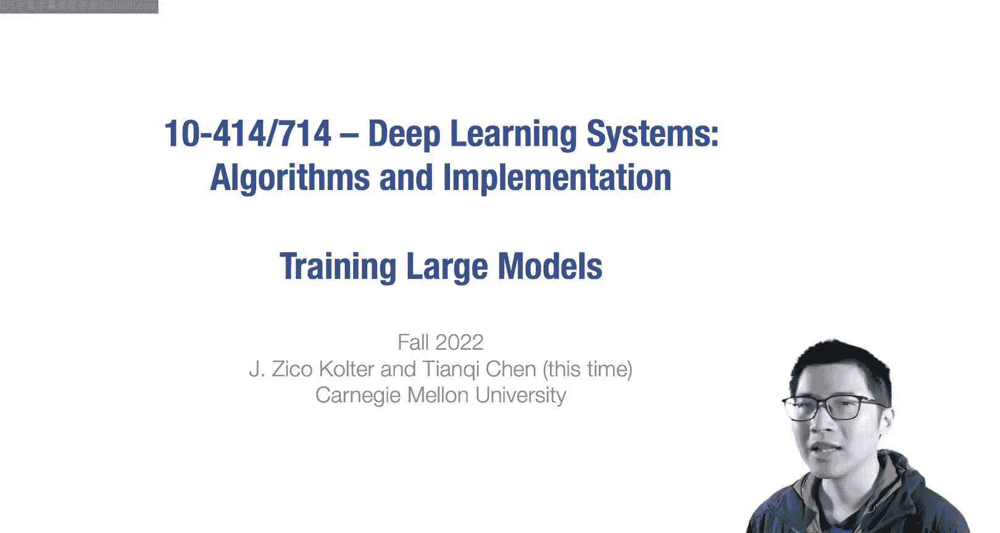

And the lecture is going to be divided into two parts。 the first parts。

 we're going to talk about what are the common techniques we can use to build you know。

 deeper neural networks and fit them on to limited memories that we have on modern GP accerators。

And second part， I're going to talk about some of the common paradigms we use for parallel and distributed training。

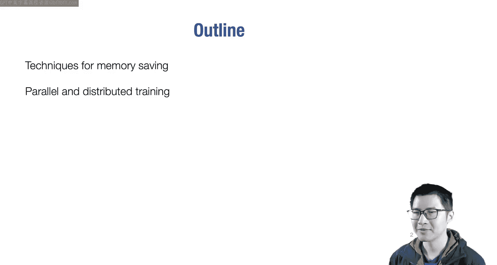

Okay。😊，So to begin with the first part and let's come back to。

 you know why we want to talk about learning large models， in lot cases。

 when we start to think about building machine learning and machine learning applications。

 there are a lot of things that come into play nowadays， Of course， we want to be able to build。

 you know， ever increasingly flexible models。And those models will need to learn from a bigger data set。

 in cases。And in order to learn from bigger data set。

 well need to be able to build those models using， you know。

 the advanced compute devices we have a lot of cases we involve GPU that you learn。

 as well as some of the acceleration devices。😊，So in order to do that， you know。

 there's really a question about how do we scale up this learning process， right。

 Can we fit bigger models on two limited device we have。

 as well as how can we just scale up the training process。

 We can go and leverage more devices available in there。

 So these are the two questions we're going to study in today's lecture。

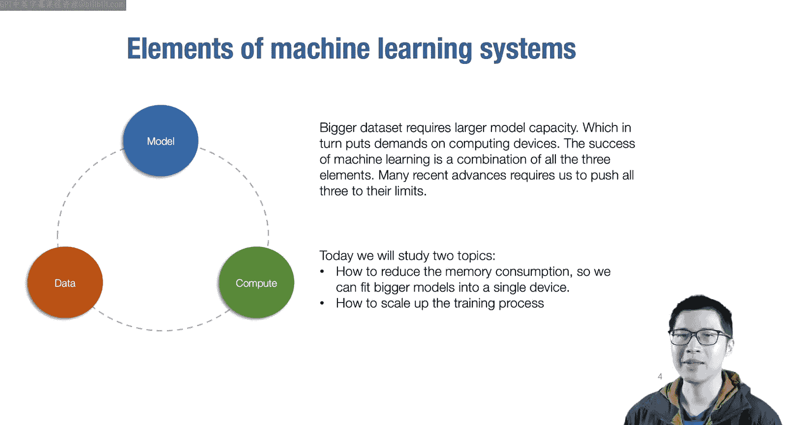

That the first part， let's start with talk about the GPU memory hierarchy in sense。

 you know we just learned about GPU programming and remember that in terms of GPU hierarchy。

 of course， we have like in stream multi processor， we're seeing stream money processor。

 we have limited shared memory， 64 kilobyte in here。But besides those things。

When you go and buy a GPU， like say， you know， I'm， I'm gonna go and buy 30，80， right， you， you。

 they will， there is a tag that covers with GPU on how much GPU memory that you have。

 And this is usually refers to a global memory that you have on GPUus。😊，And depending on the device。

 global memory size can be very different。 for example。

 a common commercial card that you can get will gives you around 10 gig10 gig or sometimes 8。

8 GB of memory。😊，And the modern GPU like 8 hundred0 will give you much bigger memory size like4 gigabytes8 gigabtes in total。

So this is like an overall GPU memory that we have。 and in all cases， when we say， you know。

 I want to be able to train a big neural network。A lot of the model applications are bottleneck provide the global memory size you have。

 when I worked on when I was a PhD student， that's usually saying of you know the biggest neural network that you can train on imagenet is Resnet 200。

 is because most of the GPU there only have 8 gig8 gig gig of memory and Resnet 20 is kind of a biggest size you can fit into this this8 GB memory without some of this matrix tricks that you have。

So that's certainly like one important factor that you consider。In terms of， know。

 can we fit as big of neural network training onto the limited memory devices， Of course。

 you can find a common trend that some of the server class car like 800 start to increase amount of GPU Ram exactly because of the reason because as we start to build bigger models。

 a lot of models will also cost bigger amount of memory size in total and those bigger amount of memory size will come back in turn。

 you know put the put the kind of demands on the GPU memory that we have。 And as a result。

 most of the server class start to increase the size of GPU Ram available。开。

But one question we ought ask， you know， even with the consumer cut， right if we have like R X 30，80。

 will we still be able to train those bigger models that that is out there。 The answer is， yes。

 we will there are like tricks that we can use to reduce overall GPU memory consumption or learning those bigger models。

😊。

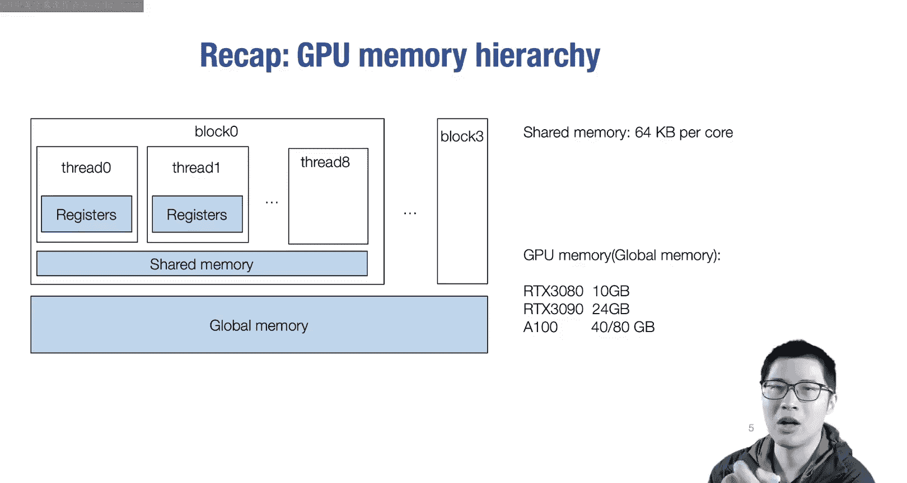

So let's start to think about before we start diving into the methods。

 Let's start first think about what are the common source of memory consumption that we can have。

I'm going to use a simpleimplified view of computational graph meaning so you can find that here is effective forward parts that takes in your input and apply different stage of operations and finally gives you a loss function and here is a gradient pass right that takes in your label and incrementally apply some of operations and then effectively gives you input。

And there are multiple source of memory consumption in here。First of all， of course。

 we want to be able to store in in a training case。

 We want to store their ways as well as auxiliary optimized states like， you know。

 the momentum variable and so on in here。Another thing that that is a common source of memory cause is the intermediate memory activation values。

So， for example， when we take the input， we apply it to linear。

 then I need to be able use memory to to store the results of a linear activation。

 So that's always this。Intermediate activation value that you need to use here。And， of course。

 there are other， you know， sources， memory consumption as well， beside the model weights。

 optimized states and intermediate values。 for example， we will need to be able to allocate data。

 right， to be able to store the input data。 So So these are like a common sources of memory consumptions。

Now， one question that we have is you know， how can we reduce overall memory cost？In this process。

If you look at its computational graph， you can find that at least know every node kind of cost memory is what other possible techniques we can use to reduce that。

I'm going to pause a bit。Everybody think then I'm going to also come back to the next slide so that maybe we'll get a better sense on。

 you know， what I mean in terms of possible ways of memory saving。

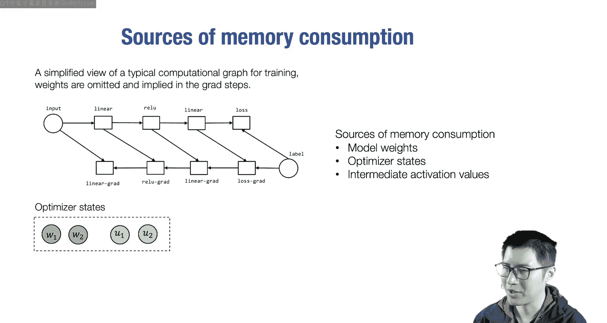

So let's start with a simple O case。This case， let's assume that we。

Only consider the problem of inference。 So in the case of inference。

 the idea is that you are going to take your input data， right。

 You are going to apply different network transformations。

And then we are going to effectively only care about the final output or loss function。

Then the question here is how much activation memory that we need to stem in order to run this inference drop。

And I assume that we have a very deep neural network。That contains earlier where n can be0。

So one interesting thing here is that。As a matter of fact， of course。

 we still need to be able to store the weights。Of each of a linear layer here。 So， so that piece。

 you know， the weight still increases with the number of layers you have。

But in terms of the cost of storing the activation memory。For this like earlier neural network。

 as a matter of fact， you only need to。Bs or two two pieces of memory buffers to be able to run these in。

You see why it's the case。You can see that I can use say buffer age restore the result of linear。

Then I'm going to use Sp B to store the result regulatorator。

But then as I saw a compute result of next linear later。

 we know that buffer a is no longer being needed because theyre already getting value of R B。 So。

 I can use A again， B again。So the fact idea is that we can cycle through two buffers in a ping pg way。

 right So you， you start with one buffer。 you store intermediate results there。

 You run some some of the computations。 you store the output to the next one。

 you cycle in a in an alternative fashion。😊，And in this way。

 you can find that no matter how deep my neural network is。

To we just need two pieces of like a scratch pad memory in order to run this speed forward inference。

Of course， real world models are much more complicated than this one。 So in this case， there will be。

 you know， different kinds of memory sources and memory consumption like B effects skip connections。

 You cannot immediately de allocatelocate the buffer A， right。 So。

 but there are possible techniques that help us to be able to reduce the memory as much as possible。

And in some cases， because the dependencies are really local。 So as the neural network grows deeper。

 likely， we are only still going to have a constant piece of memory for story activation。 Of course。

 we still need to spend amount of memory to store the weights， right， So。

 so that is something that's not negligible in this particular part。😊，Okay。

 so these are the common techniques for saving for memory saving in terms of inference。And， you know。

 a lot of these techniques are being used so that we can afford to run very efficient inference on small embedded devices that we contain really limited。

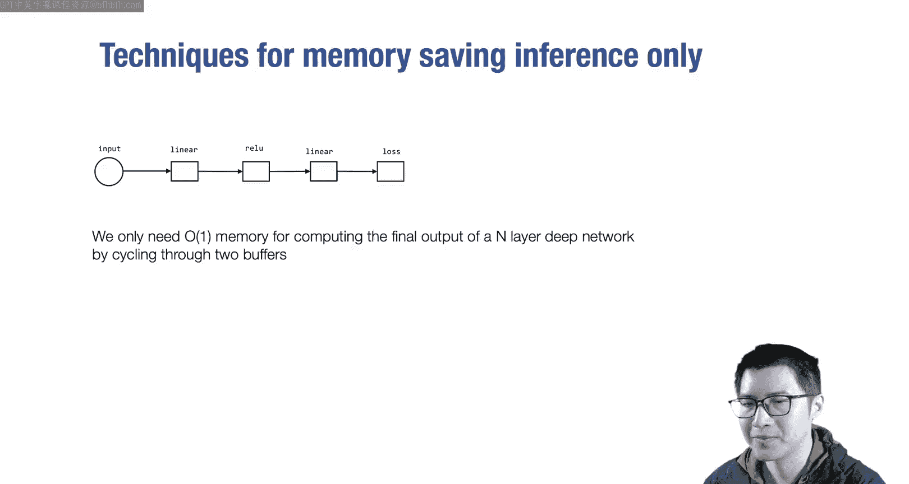

But then。诶。Comes another kind of perspective。 If you start to think about training。

 which is a lot of cases what we care about。And then things becoming be more complicated。

 So if you look at this particular computational graph， it is a simplified view。

 So you can find that in reality， there should be weight 0 and。There should be things， like wait。

And weight being attached to here。 And while we are doing， you know， the gradient values。

 we will also need to be able to。 It's also going to depend on the weight。

So the weight that is being omitted was simplicity。

And you can find that here is a forward pass that takes your input and tries to be able to compute output。

Let's ask the same question。What increase。The number of layers in this neural network。You find that。

Effectively， we cannot use this， no longer use this ping pong， ping pong buffer。Why is the case？

If I use like A B and A in this case。有方院呢。Well， in this case， the。

 the result of this value is being overwritten by the resulting here。

But after we do gradienting computations， I still， in order to compute the the result。

 I still need the result of egg。So， effectively。You can find that in the gradient calculations。

There are， there are these dependencies。That depends on the value in the forward word computation。

So in order to be able to compute the overall gradient computations。

 there's always those ladder value in there。 You can view like， know。

 this gradient computation like a ladder， always these ladder values that depends on the forward computation。

 As a result， we can no longer immediately delocate or reuse the values in the previous stages of computation。

So。In general， if we go and directly leverages automatic differentiation average that contains those letter dependencies。

Then in order to train an n layer neural network。We will need to be able to allocate all of an So the。

 the number of activation intermediate storage is so be dependent on the number of layers。

That is why when we are doing， you know， trimming of deep neural networks cause much more memory than inference。

 because in a lot of cases。You know， because of the dependencies from the forward value。

 we can no longer use the simple approach of， you know。

 doing people recycling or do a lot of memory smart reuse。Okay， so I'm going to pause it。

 and let's start to ask question。What kind possible approaches can we use to reduce the overall activation memory cost for training。

Of course， it's no longer going to be as simple as， you know， just go ahead and re use it， right so。

Excuse me， so what is the possible tack here？And what interesting fact is that， yes。

 there is a way to go ahead and reduce our memory consumption here。And so I'm going to。

 in order to simplify the introductions moving forward。

 I'm going to use even more simplified view to try to combine the gradient and forward computation。

 So in this case， I'm going to use this to indicate a forward computation。

I'm going to directly use this backward arrow to introduce to indicate this， you know。

 gradient computation passing here。So this figure is a bit more like a forward and backward propagation。

 right， But in reality， that's still going to remember that under the hood， there is always this。

 you know， gradient computation pass that creates more to the， the backward path in here。 Okay。

 so in reality， we can still leverage the computational graph Comp engine under the hood。😊，Okay。😊。

So let's start to introduce the technique that can help us to reduce the overall memory consumption in in specifically the activation memory consumption in training process。

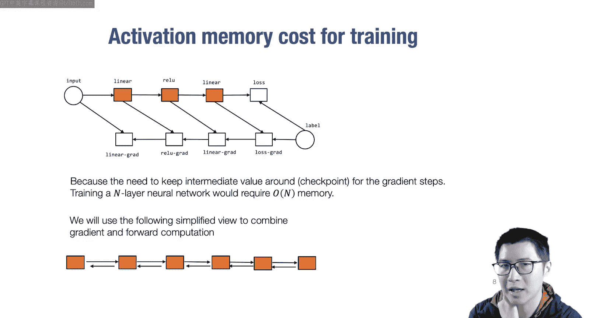

So this this a targeting called called you know， activation trackpointing or or you know grade overall checkpoint in this case。

 okay。So in order to do that as a first step。But still you going to。Do the forward computation。

 so this is the doing the forward computation in here。

But one of the things I want to note in here is that there are those colored node。In this case。

 while we're doing the four computations， we are going to， of course， remember the values。

Of those compute result on those colored boxes。In the meantime， there are also this white， you know。

 there's also this empty boxes in here。Right， in this case。

 the empty boxes means that as soon as I compute result and I compute next value that depends on the result。

 I'm going to deallocate。The memory， all those， you know， empty boxes。So effectively。

 after we finished the， you know， forward computation， we're only going to store the the values。

Of the colored boxes here。 And， of course， I'm going to get my output in here。

 So in this condition process。😊，I'm going to get my op value。

 and I'm going to store the result of those color now that these are what we call a trap。

That going to remember the values of these corresponding stages。可。😊，Now。

We want to compute a gradient value and one can be able to compute a gradient with respect to each of a weight。

How can we do that。Let us assume that， you know， for now。

 I don't care about computing gradient of all those。First few layers。

 and I only care about gradient values of the last three layers。K。What can I do， Of course。

 I want to be able computer grading with respect to this layer。Right， and however。

You order to do that。In order to propagate my gradient values from here to here。Likely。

 I will need to know the value of this box。However， this box is empty now。

 So that means that I no longer know the value in here because it's been ded。So what can we do。

The idea is very simple。 We'm going to go ahead and recompute this value。So in this case。

 what I'm going to do is I'm going to run this another tiny。Forward computation。

 That's going to fill in。The value of the empty box。可。And after we run this forward computation。

Now we know the value in here， right， because we we run this for computation here。

And then I will be able to run the gradient computations。

And I will be able to calculate a joint here and a joint value in here。

I'll hope you now we will be able to get the edge on the value of each of the layers if they have weights on them。

Willll also be able to get the edge on value of this particular note in here right。

 So not only we will be able to get edge on value of the final loss function。

 well be able to get edge on value of that particular note。Through this， you know。

 tiny gradient computations。Of course， in order to compute all weight updates。

 we also need to be able to compute edge on value of weighting here， right。An add value of no。

 this weight。How can we do that？You know。We can run the same grading competition。 Okay。

 Remember that now we already have edge on value up until this note。😊，Right。

 so the only thing we need is to try to propagate this edge of value further back using the reverse mode automatic differentiation average。

嗯。Same thing happens in here。 We cannot directly do the computation because I don't know the value of this empty box in here。

So what do I do？We will run the same forward computation again to fill in those empty box。

And then we run the gradienting computing that will gives me the edge and value of each of the layers。

Okay。So to summarize， you can find that in step 0。The goal is， we only trackpoint those。Coor notes。

And trying to delete。The value of those empty boxes。And within each of a small step。

 what we do is we will try to recompute the value of empty boxes and then run the gradientding computation and then run the recomputation。

 the grading computation again in here。What to pause a bit。 And I started of thinking。

 you know why it can save memory。This case。The seems that it looks quite similar to the computation we have。

 Why I can save memory。😊，So one thing that we might want to notice is that first floor。

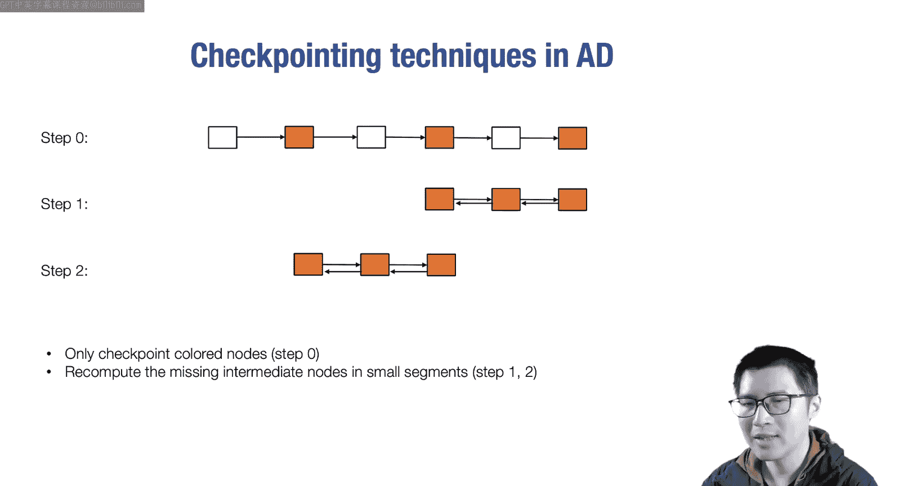

In the forward computation， of course， you know， because you less memory。

 because we only remember the color note here。 So you don't have to， you know。

 allocate memories for those empty boxes。 Of course。

 we are gonna to save memory in the forward computation part。😊。

Then there's also a question about about， you know。Then there's a gradient computation。 Yeah， right。

 that round this meaning forward and backward。Well obviously things I want to notice is that。

Of course， we are going to spend memories all running this mini segment because I we need to allocate more memory。

 right， to be able to view in the blanks of this deleted node。😊。

As soon as I finish this gradienting computation and get edge on here。

I can go ahead and delete activation memories。😊，Of the other nodes， because， you know。

 they are no longer being needed。In what will compute this mini segment。

I just need to know the edge and the value of that particular node。What does that mean。

 That means that throughout this entire process。We're only going to spend one piece of memory to compute a small second。

And we don't have to stand a memory to compute the entire order segment。

And that is where we can save memory。开。You can also go ahead and try to run a careful calculations of。

 know， what are the things been involving here。So， in this case。

If we run the follow computation and let's say we check on every k。That being said in total。

 that's going to be n dividediv by K trap。And when you to remember N divided by K。

Color notes activate here。Of course， because of the length of the segment is K。

 right in order to recomput， we will need to have all of pay over our memory cost in here。Okay。

So if you look at this formula。If you go ahead and pick K equals square root of N。

What amazing thing here is you can find that my overall memory cost is all square root of it。😊。

What does that mean。That means that if we are going to do a training of only layer neural network and we' are going to apply this particular memory saving technique。

You have gonna get a subline memory cost， with respect the total number of layers that you have。

 Isn't that amazing， That means that you will be able to fit a much bigger neural network。

Onto the limited GPU memory that you're having here。And， you know。Of course。

 depends on the actual computation graph。You don't necessarily have to do like a check on every k。

 So， and another thing that。I want everybody to start to think about is What are additional。

 of course， we are doing recomput。 So we are spending a bit more computation than the simple gradient calculations that that don't do that recomput。

 What are additional computational costs we spending here。You're good。 and look。

And find that if you're just going to do the forward。Andgrading calculations， right。

 That's the common way of doing it。By this case。Are doing well for。We a mini forward。

 I mini backward， mini4。 I want to be backward。You can find in total， actually。

 we just spend one additional cost of running a same follow computation。 Okay， so nobody in practice。

The cost of the forward computation is about half of the gradient computations normally。As a result。

 you can find that， you know， effectively， we are going to stand a bit about about 25% of additional comm costs compared to the original original vanilla average。

 So effectively， we're not spending that much。 You're just going to spend 20%，25% more time。

It buys you a lot of memory。So this subliient memory cost saving everything is being widely used。

 So if you go and train deeper models， you want to feed a very deep model on who your limited GPU memory。

 likely， this is the everything that you're going to use to reduce the memory cost。Of course。

 we don't necessarily have to do the， you know， we don't necessarily have to pick。嘿 equal square路。

So there are other ways that we can pick bump in all cases。

We know that the cost of recomputing different layers are different。 However example。

 you want to go ahead and recompute a convolution or matrix publication layer。

 It's going to be much more costly than recomputing the result Ra or other cases， right。

 So you could choose to only recompute those cheap layers， as opposed to those know。

 more heavily computational or heavy layers In those cases。

 likely you wouldn't be able to get a square root of one sub linearium memory saving are still going to be a very significant amount of memory saving that that you're gonna get in this overall process。

😊，So that's also， there are also a lot of followers on how you can effectively use batch kind of gradient check warning or Well another way they call this remateization technique。

To be able to get a more memory efficient training process。

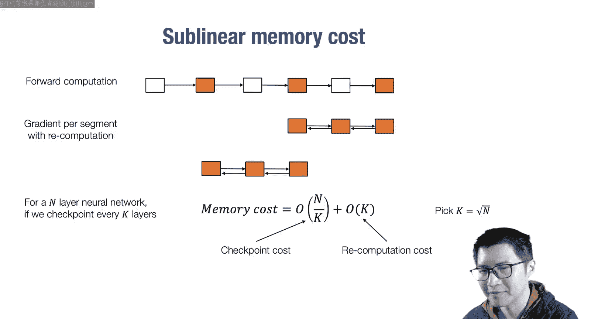

So we' have talked about the techniques for memory saving。

 Let's switch gear a bit and start to talk about techniques of using correlation and distributed training。

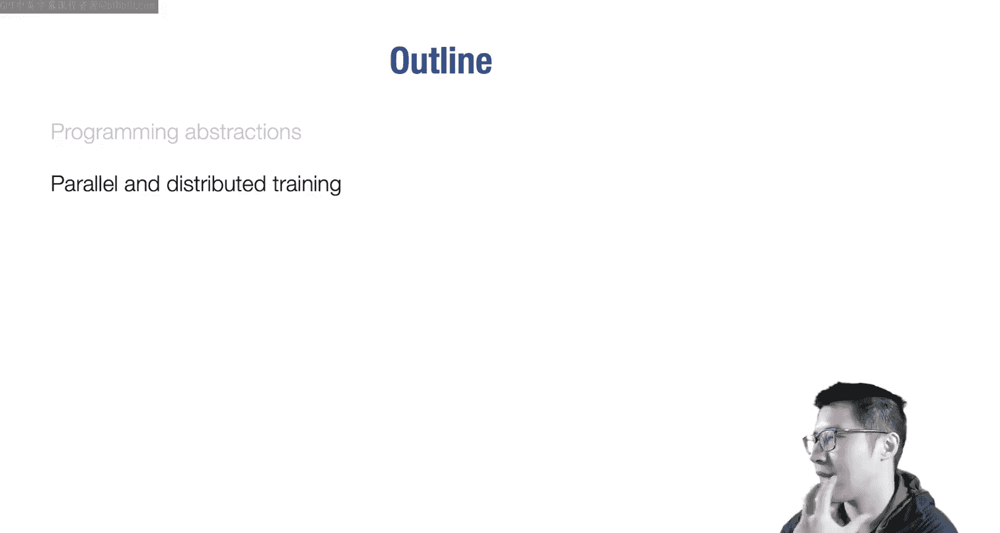

啊。Of course， in order to be able to train a very big model。 in lot of cases。

 we might get a case where your single model do not fit into a single GPU。 So want to be able to。

 you know， you just want to get a bit more acceleration to be able to get all the models to get more GPU computing power to accelerate my overall training process。

😊，And the question here is， how can we go ahead and leverage possibly multiple devices that are distributed over separate work node to be able to train a model into。

And there are different ways for us to do this overall model training process。

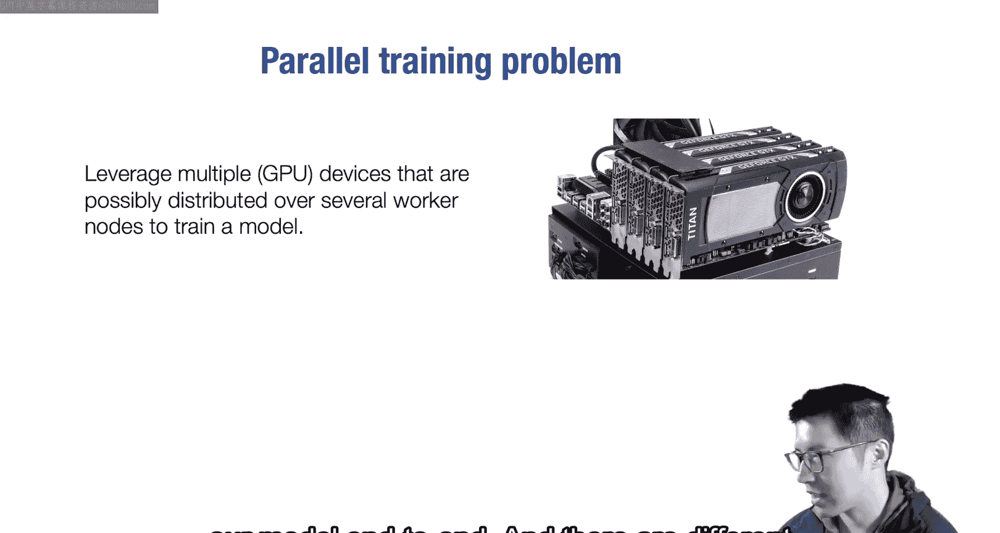

One of the ways to do model training is we' are going to map different part of the computations onto different workers。

 In this case， each worker can correspond on to a single GPU， for example。So。

That's the common way to do things。And in this case， you know。

 this is a particular model that Chris one we call a you know。

 recurringcurt neural network where you can have like a sequence lens dimension and a index dimension here。

 And we can try to map， you know， each parallel computation here。

One interesting thing about these computations， you can find that as long as I start to run。

 as soon as I start to finish these particular computations。

 I will be able to run this follow up computation。😊，Imedia， so you can find that actually。

 my polarization kind happens in this way from fashion in here。😊，Of。

 model parallel training is not always possible。But， you know。

 it is like if you have such kind of opportunities， you should be able to go ahead and leverage it。

So in general， if I have a computational graph and I want to be able to break it up for getting mono terrorismism。

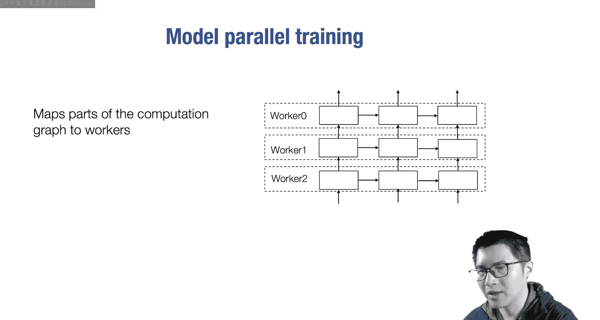

A general approach。Is that you're going to take this computational graph and you are trying to partition it across different workers。

 right， So you will be able to get This worker is gonna to work on this part。

 This worker is gonna to work on this part and so。And once you get this。

 what you're going to do is we're going to go ahead and partition。So in this case。

 I'm going to break it apart。And then。We're going to play what we call thin receiver pairs in a。

 in the boundaries of competition work。So in this case。

We are going to worker zero we going to take data。Do the forward computation and this point is going to send the result。

Onto the worker one， that worker wise to receive data， grading competition， send result all back。

And then it's going to get to the final greetding computation。

So the effective way to break up computation graph is just you go ahead and you know you take your you take your computations and you try to break it apart across different workers and you insert these send receive pairs。

TheOne thing that you might notice about this computation is that there's not a lot of person in here。

In practice， what people normally do is they apply a technique called pipeline Pri。

So idea is that we're going to go ahead and run。

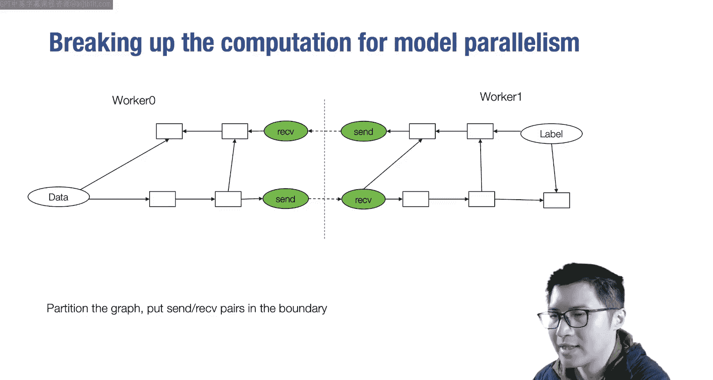

Computs。

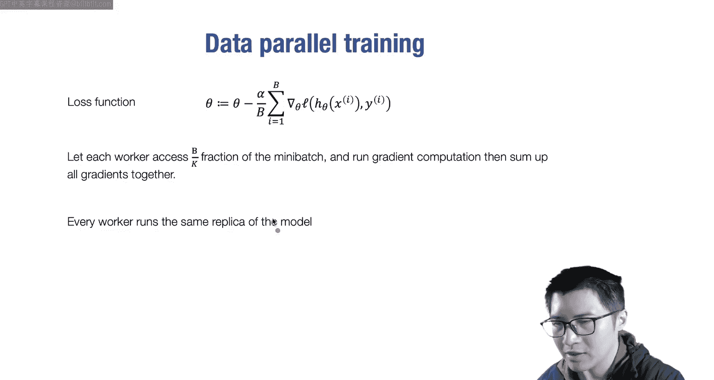

Sorry， that's so， so we' are going to go ahead and run a computation of the first what they call micro batchtch。

And then， of course， worker0 is going take over and run the second model computation。

But as soon as it start from one。Why the worker once run the second microbech。

 iss going to go ahead and then run。Worker0， worker0 is going to run another。Micro batchch in here。

So， effectively。The computation of the first micro patchch on workload  one。

 And here it's going to be run concurrently with this one。So similarly， right， So you will。

 you will get to。 So in this case， actually， we will be able to get， you know。

 this is going run our second time stamp in here。Right， and then。

While this is going to run a second times stamp， actually， you know。

 we also will be able to get this， it's going to run second times stamp concurrently in here。

And then that's going to have a third micro batchch going to come out in a second columnt。

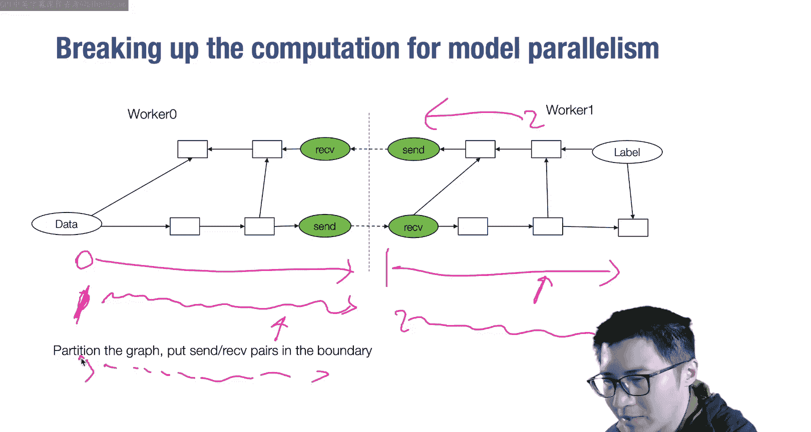

So the idea is that we're going to have this pipeline paradigm going on。

So that while another worker is working on a previous while later work is going to work on a previous micro bad。

 the previous work is going to go ahead and start work on next micro bads to keep this pipeline vivid。

AndIn general， if we're going to have a lot of micro batches。

 then we are going to be able to get enough amount of model para and that enough amount of model para is going to help us to be able to you know fill up the computations across all the world。

So the pipeline person actually is a way for us to be able to make use of the model personon while gaining a bit more you overall reuse。

Of resources so that， you know， most workers are kept busy。Throughout this process。Okay。

 so this model person was not being widely used before。

 but nowadays with the availability of bigger models。

 model person becoming more and more important and most of the major frameworks you see specialized for training bigger models are going to have some form of model paradigm。

And pipeline parts be built in into the system。Okay， so I have talked about model parts。

 and then let's come back。

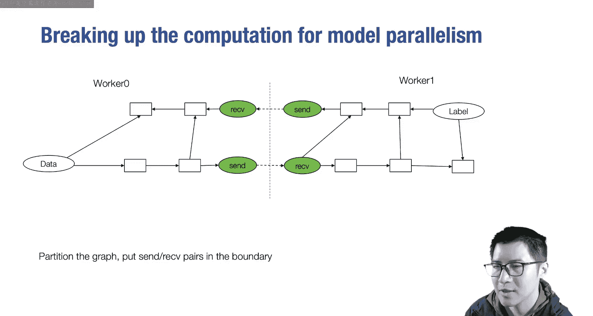

Talk about another kind of parallel what we call a data parallel。So in this particular case。

The idea of data power training， you want to go ahead and look at or loss function of of the Su category gradientian decent。

 The one thing you might notice is that we're going to try to。

Take a mini batch and want to be able to compute gradient values on that particular mini batch。

And in order to do that in a simple ways， you want to compute gradient values with you back to each of the input data points and you sum those gradient values together。

So， in this case。嗯。Of course， in a wild the simple way to do that。

Remember that a lot of those gradient for each of instance， is going to be computed independently。

 So we can do is for a mini batch。 We try to divide that mini batches。Onto a lot of smaller batches。

 and we're going to distribute that fraction of mini batch onto each worker。Within inter worker。

 we're going to run the gradient computations in parallel。

And then we're going install liquidity together。The good part of the data parallel training is that actually every worker runs the same replica。

 So theres no effectively， there's no difference between the the models that run worker0 worker 1。

 The only difference are going to get a different subset of the fraction of a mini batch in here。😊。

Okay。😊，So in order to run this data parallel training。

 there is one particular abstractstruction that's going to be quite useful。

 This abstractstruction called all reduce。

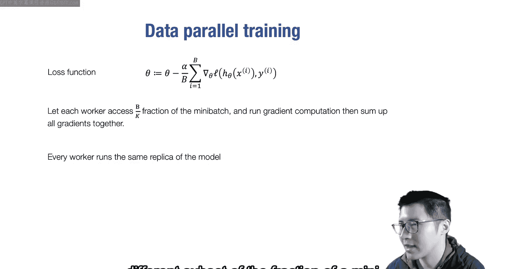

So the old reduce is quite old API。 It actually a API that was being invented in the hyper computing community and it is still gonna to be populated actually in machine learning communities well。

 So this particular case。😊，The way or reduce work is signal for each of a worker。

Each worker is going to have a local copy of a array。 Thank you。And then。😊。

They can all go ahead and collectively call or reduce。So after all reduce。

 what's going to happen is that。We are going to get a result array where each element is going to be the sum of the corresponding element across all the work。

So in this case， you can find that this two is the result of 1 plus 1。 this two is result of 2 plus0。

 and this 4 is result of 3 plus one。Okay， so you can find that this all reduce interface is kind of quite intuitive something。

 So effectively， we are going to call all reduce。Then you you passing and going to get some across all the way。

Under the hood， the or can be implemented in different ways。

 and we don't have time to go through the way to implement or in this particular lecture。

 but if you are interested， there are other lectures from where I had a machine and assistant lecture that talks about different ways to implement this particular or reduce primitives across。

There are a lot of the libraries that that， you know。

 present this interface and implement and on different highways。 for。

 Nvi have this library called Neco， a media collective library that implements or use along with other permits。

There are also other libraries， coral boat， buy downs。

 P S and so on that all implement a similar color interface。

So how can we leverage this or reduce interface through data parallel chain。

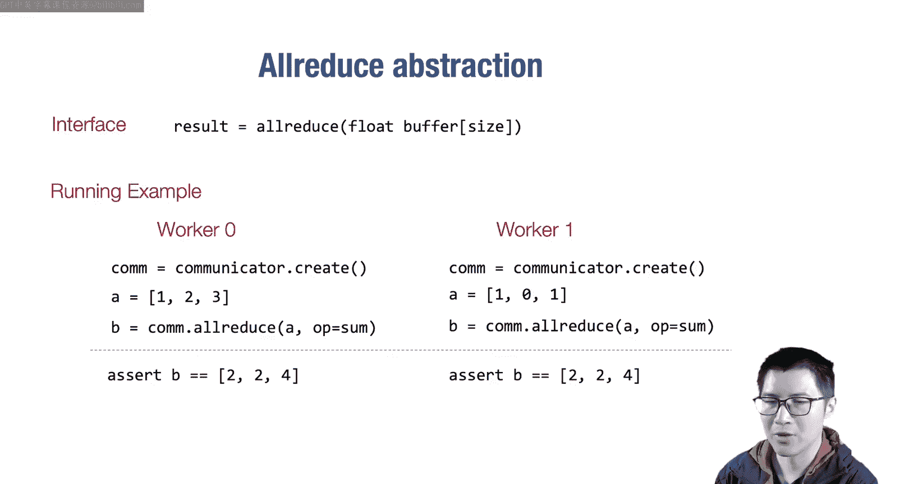

The idea。Is that We to Rome。Different workers， right， so this is worker zero。And behind it。

 there's a worker lot that runs exactly the same thing here。

 except that we're going to feed in a different set of datas in here。

 So the only difference is the data。 And each of work is going to run the same replica。

So we're going to do this for each worker is going to run the forward computation。

 the gradient computation， we're going to obtain the gradient values throughout this process。

And then。All we need to do is we want to compute the sum of the gradient over all the replicas。

 because we， if we get the sum of the gradient， we'll be able to get that better and use that to run。

 say still a gradient update。 Thank you。😊，So all we need do is to take G1。 I want to get big G。

Equals g1 over all rep。You can find this exactly translate into or reduce。

Of G1 on this particular note。 right， so effectively。All you need to do is compute gradient。

 run or reduce。 youll get a big G1。 And then each of work is going to apply the gradient update locally。

哦。And this is a simple way to implement data parallel chain。Of。

 you notice that in order to implement this kind data parallel training。

You don't need to change any lines of coding here。 You just need to be able to directly take your input model。

 right as is， But fill in a small fraction of data。Get your gradient and in your gradient optimizer。

 you are going to go ahead and do the R reduce operations in here and then do the gradient of this operation here。

So this is one way to implement data para menu。

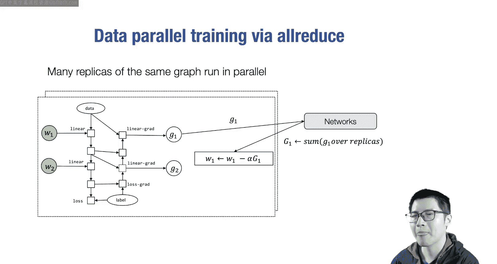

There's another commonly used abstractstruction， which is called peri server。So in this case。

 the idea of primitive surface that instead of doing all reduce and get gradient value and run the weight updates on each of the machines。

We're going to run the gradient update or after immediately after we get the sum of gradient。

And then the parameter server side。 So there's a server side that that's going to accumulate the gradient and round updates and perform and with updates on server。

So how can we use permanent surface abstraction to do the data parallel training？

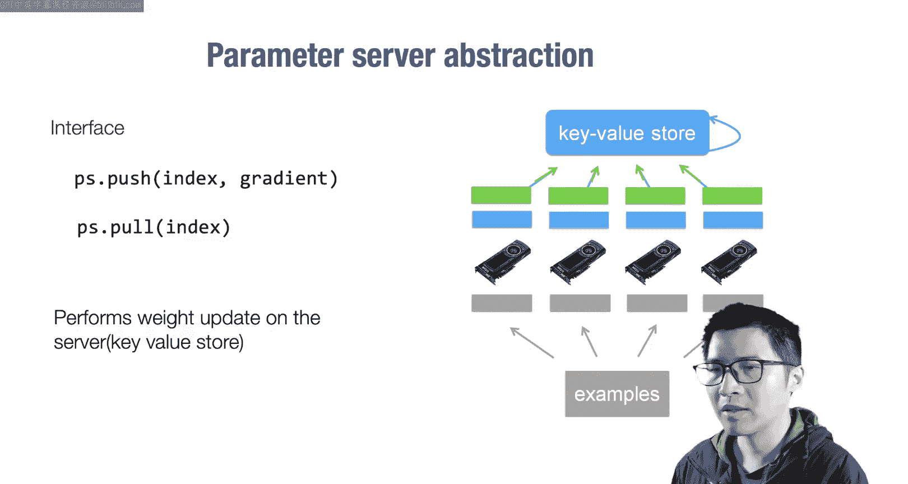

Well it's very similar to what already reduce training is。 So。

 so what we do is we would still run the same replicas across different workers in here。

We're going to get gradient。The only difference is that instead of you know doing all reduce and get sum of gradient value back。

 we're going to directly send a gradient value to the parameter server。

we have the premise server get the gradient values。

 they will be able to do the sum of all the gradient values on the server side and run the weight updates there。

Then it's going to say on the weight back。So you can find it's only a minor difference between the all based data parallel training and parameter server based data parallel training。

So what is the advantage of this criminal server style update？Walk about the advantages that。

 you know， in all cases， the private server don't have to。

Wait until all the gradient to be available。 Imagine that we have 100 workers in there and while the worker。

For some reason， was slower than other。So in this particular case。

 what's going to happen is that this particular worker。Is this particular server。

 parameter server is's going to wait for I say 99 gradient to arrive。

 but ignore the rest of a sta gradient。 So in that case， as so gives you， you know。

 you can still do the approximate gradient right by summing up the gradient from the 99 workers and do the weight updates this。

So the advantage per service that somehow， you know。

 allows us to have a bit more robust training process if you want to have a more advanced strategy。

 and another advantage is that imagine that one of the worker dies and get restarted on another server node。

You know， all the work you have to do is to be able to pull the weights from a permanent server。

 so the permanent server kind of preserves a copy of a weight that allows us to be able to effectively。

 you know， send to the corresponding work wine results。

these are an advantage of permanent server based implementation。

 there are quite a lot of permanent server implementation out there。

 such as by a version called byPS and you know there are other variant parameter server implementation out there。

Both the primary server and all reduce implementation。

 though do have a common saying I could pay attention to。 This is how we can try to leverage。

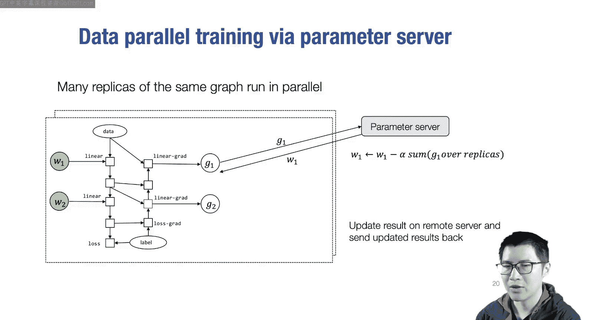

The communication and computation and trying to let the communication overlap with the computation。

 So let， let us say， what do I mean。 So let's imagine that I'm looking at the computation of a single work in here。

You're going to find that one interesting thing is。As soon as we get the gradient value here。

 we want to be able to send the gradient value over to our network either by or reduce our permanent server so that we can sync and update this weight。

And then the weight will get back to each of workers。

We don't need to wait until the next iteration wait until the next epo E plus one。

So one of the things to my find is there are a lot of opportunities for these computation and computational to overlap specifically。

When we're sunny out。The ways。

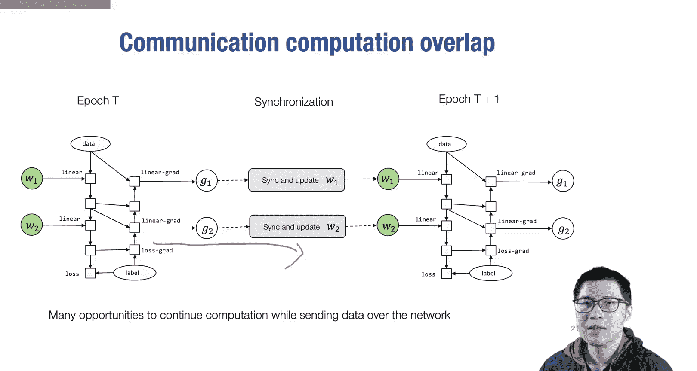

To a network， doing all reduce our parent server based inchronization。

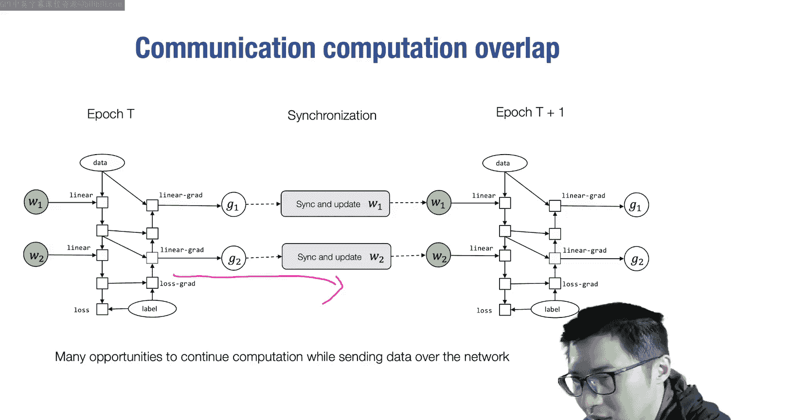

The particular computation of， you know， gradientding calculation of later layers can still continue to have。

 so it does not have to wait。They wait to wait synchronizational finish。

 We can still continue to run the crisp morning gradient calculation there。

And this computation and communication can happen in a concurren fashion。

Another interesting thing that you might notice is here is that。

We will get the gradient of later letters first because of the greeting calculation patterns。

But we don't need the weight of little layers， until。The next generation。

 when we get to that forward point， So what does that mean。That means that。You know， actually。

 if there are already gradient ways being communicated throughout a network concurrently。

Say that we are already getting into a point where we get the gradient of G1 in here。

 But we still not yet finish standing on the G2。 In this particular case。

 maybe we want to prioritize the G1 a bit because， you know， we will need to wait one earlier。

There way to at T T plus one epo。So this is another thing that will be helpful for us to be able to prioritize so that we can。

 you know， overlap the communication with computation。

 but also note that know different ways and different gradients are being needed at different time point。

 We can leverage that property to allow us to get a better overall communication computation patterns in this process。

Of course， in order to implement this manually， there are quite a a complications because you kind of need to be able to have this two runs in parallelil。

But nevertheless， you know， it is something that's really important for us to pay attention to。

 As a result， in most implications， it's not as optimal if you just go ahead and do forward gradientding computations。

 then do or reduce because in that case， your or reduce does not overlap with your overall computation a better way will be you want to use what you call synchronize or reduce a that immediately run or reduce or immediately send the gradient to the to the overall networks as soon as you get the gradient value available。

哎。So this is kind of like a one careful trick that you want to consider when you go ahead and do system level implementations of this data app parallelel training。

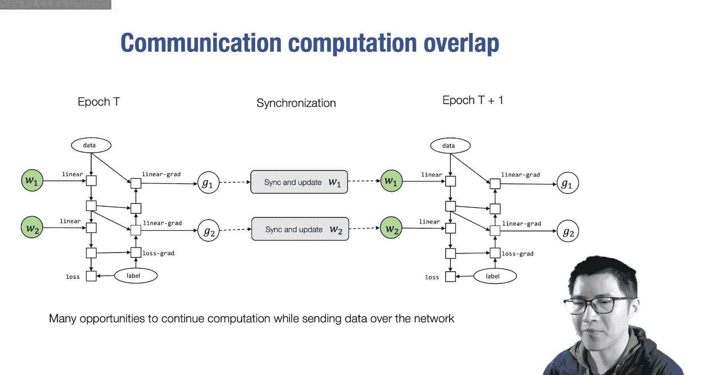

Okay， to sum up today we have talk about different color of parallel mechanisms。

 So we have talked about model parallel training that parts sub computational graph and want thing to notice that in order for model parallel training to really be effective。

 we kind need some form pipeline parents。We also talk about data parallel training that parts the the training workload by subset data。

 right in all the cases， we want to be able to leverage opportunity to overlap the compute with communication so that you can get better overall computation so that communication can happen with the compute with the computation and you can hide the communication latency It's the same case when you are trying to load the data from the disk or other cases onto GPU。

 That's the same thing。 You also want to be able to hide the data copy from the alpha into GPU concurrently with the GPU computation as well。

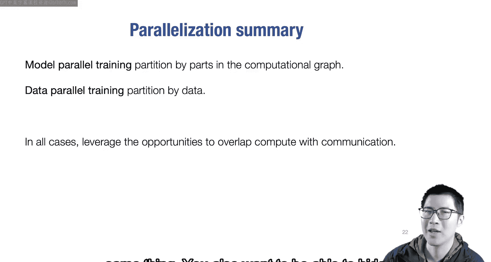

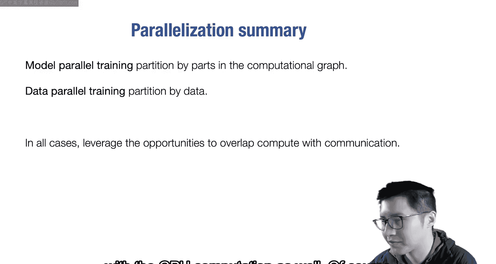

Of course， there are other advanced parallelization techniques we don't have time to cover in this particular lecture I'm called Microsoft and a paper call zero that tries to sha the data across different machines。

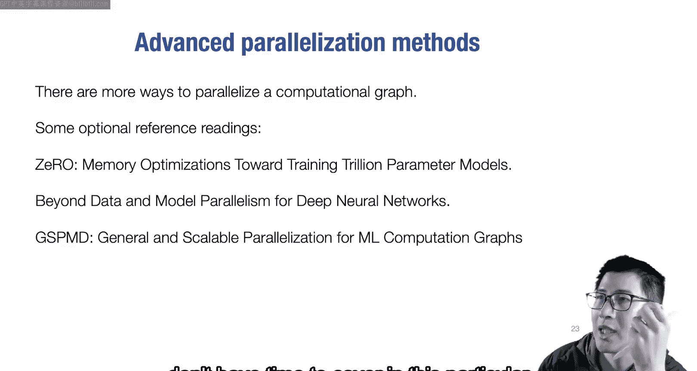

And there are also ways to automatically learn different ways of model and data power lessons and trying to automatically partition workflow so that this kind of correlation can continue in an effective way。

 So there are here are some advanced readings。 You can go ahead and try and read。

And but a lot of cases， the model and the person are basic building element towards those small advanced lesson。

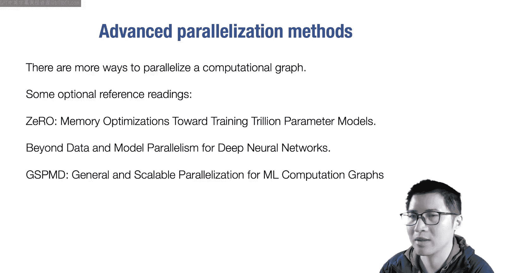

Okay， so that's the end of today's lecture。 hopefully you'll learn techniques of building bigger models on who your limited memory。

 as well as ways to scale up your computation。😊，Thanks。

 everybody for coming and I'll see you in the next lecture。

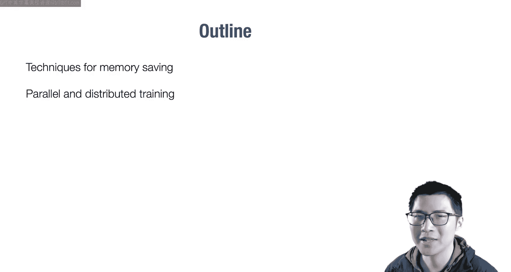