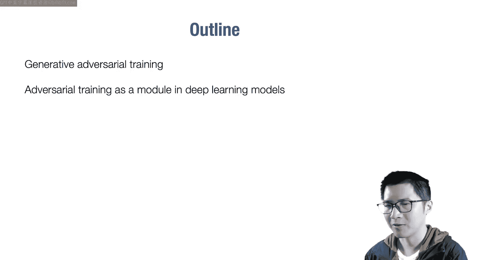
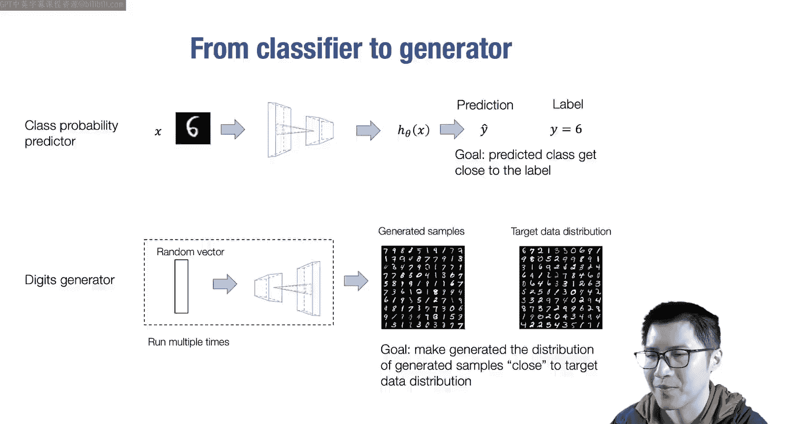
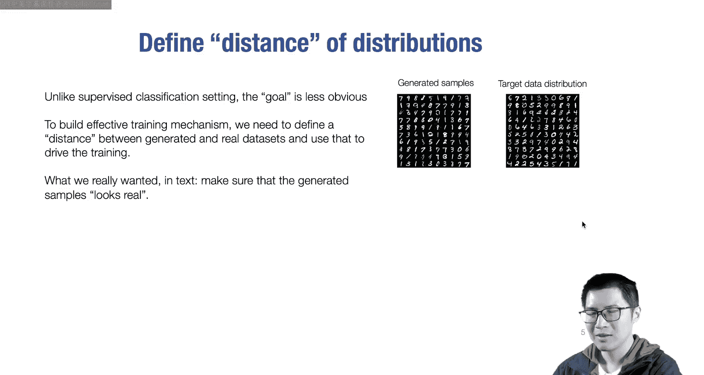
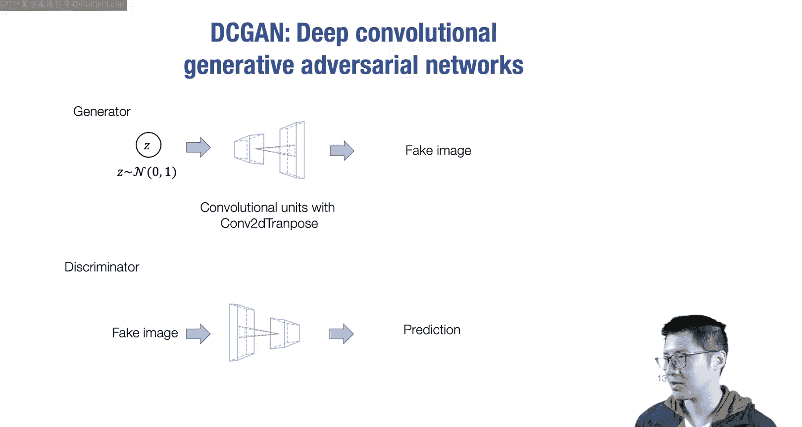
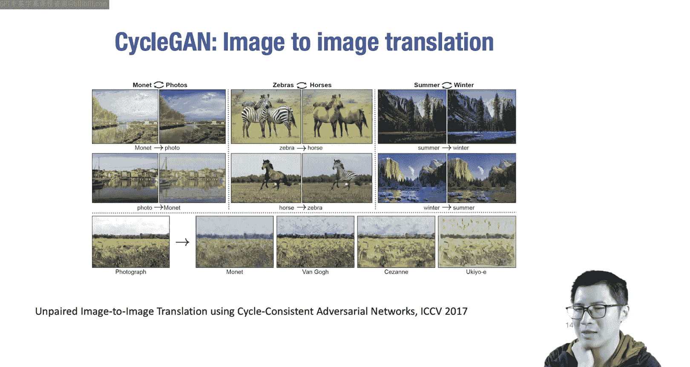
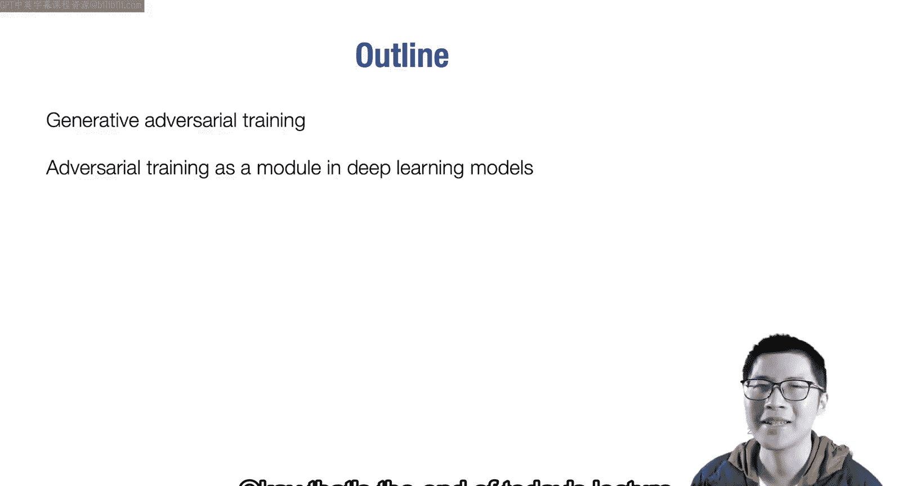

# CMU《深度学习系统｜CMU 10-414714 Deep Learning Systems 2022 fall》中英字幕 p16 -17-Lecture 16 - Generative Adversarial Networks.zh_en -BV1ERtYepEpy_p16-

Okay， hello， everyone， welcomel back to D system， A implementationmentations and TQ。

 So today we're going to start a new topic。 So we're going to talk about a new kind of machine learning empower called generative modeling。

 a specific kind of technique called generative a neural networks。😊。

So this actually is going to contain two parts。In the first part。

 we are going to first talk about the general mechanisms of ad training。

And then we're going to talk about how we can put aver training as a module in general deep learning modeling process。

So let's begin with the first one。

U point you now， we have learned about multi perceptions and residual that neural network architectures。

And most of the tasks that we have been learning so far is trying to do this what we call Uvis learning or classification。

In this particular case， the idea is that we're going to give you an input X。

 which can be represented as high dimensiontens。 We're going to feed into a hypothesis class。

 and in this case， a hypothesis class could be a conversion neural network。

And then the hypothesis costs are going to be give us a prediction of why hat。

Based on the hypothesis prediction scores， we have a label。

 and then we use a label to train the end to end neural network classifier。

So one of the interesting thing about the supervised learning is that most of the cases we can get the prediction and we'll be able to measure how good that prediction is just based on that single instance of prediction。

So today we're going to talk about another kind of modeling technique called unsuvis modeling。

 or we can also call it generative modeling。So idea did here is that the goal is no longer trying to take a something input image and trying to you know classify what it is。

 Instead， want to be able to。Take a random vector。And generate and map it through a neural network that gives us some output that correspond point to things like。

 you know， the digits or in most recent cases， a lot of the advanced reality modeling will give us high resolution images。

And our goal is to be able to generate a set of samples。On the left hand side。I the neural network。

 we want to make sure that all those collection of samples looks like the target data distribution you have on right hand side。

The the goal is really to make the generated distribution of samples close to this target distribution。

Of course， there are different ways of doing general modeling。

 and we are describing particularly right， effectively we are trying to be able to start with random vector。

 So most of randomness come from this random vector。

 you will be able to get a transformation layer that projects that random vector onto this higher dimensional pixel space。

😊，We will get a collection of samples and we want to be able to making sure that they are close to each other。

So one key question that you can find here is that， you know。

 how can we measure like for two for generating sample for a set of generating sample and target distribution。

 maybe， how can we measure how close they are to each other。

 So that's a kind of a general question that we're asking here。And one was things that。

What wast to remember in here is， you know。Right now， we're looking at a set of distributions， right。

 So we are no longer trying to take a single instance and trying to do classification in here。

Another thing to note here is that。You know， in order to be able to learn in those particular generator models。

 we no longer need to provide any of the label data in here。

 So effectively' just give you a collection of data without and say。

 you know learn something that looks like this collection。

So effectively this is what we call an unviser idea is that you no longer have to provide a set of labels in in a Subvis case。

 right， you just need to be able to provide a collection of data like as it is and the goal is know hopefully it will be able to generate a collection of sample that looks close to this target data distribution。

So of course， one of the key questions here is， you know。

 how can we learn those weights in this generator neural network in here？

If we come back to the original maonms paradigm， we know that one way to learn the way is if you can define objective function。

You take a gradient with respect to it right and then you will be able to do automatic differentiation to get weight of each of the layers and those ways will be able to use an gradient with respect to each of layers。

 and know we will be able to then do gradient design or other optimization to optimize our end to end machine learning model widths。

But the question is， how can we define an objective function？

So this is the main question that bothers a lot of people in this modeling process。

Of course， you know unlike the supervised settings。

 the go is less obvious we want to be able to define distance between a generated real data set and generate a data set in a real data set and use that to drive in training。

Of course， in text， we know what really want， we want to make sure that generative something looks real。

But how can we give why in such a distance？I'm going to pause a bit and let everybody start of think about。

 you know the possibilities of distribution definition。If you think a it。

 you know that there are simple kind of possibilities。

 for example one of the simple measure we can take the mean of the of all the data points。

 and making sure that mean matches each other， Of course。

 we also want to make sure the variance measures with each other we can also find other kind of more advanced perhaps you know advanced measuring and cap。

 for example， one thing that I could do is I could do clustering of the pixels and making sure the centers are close to each other and so on right So there are so many different ways that we can use to define distributions。

Another thing that's critical here is that not only want to be able to define a distant of distributions。

 we also want to define a way such that we can still differentiate through it so that we will be able to propagate the gradient values onto to the weight of the generator neural networking。

So in short， this seems to be less obvious than， you know the luvi learning where it's really easy to define a loss function and just you know just use the gradient propagations to be able to propagate the gradient back at of your。

So how can we do it？

So here's the first step to build one idea。Let us assume。That we have oracle。Clasify。

 and Oracle is able to tell between。No， the difference between a real and generated data。 So。

 so at any time point， I give you a picture and art article。

 is it a real image or is it a generated image。Assume that you have that oracle in a parametric form。

 and you will be able to differentiate against it。So then what you can do。In here is that。

 because I have a oracle。 So our is trying to be able to learn the generator so that。

We want to look like a real data as hopefully Oracle wouldn't be able to tell it apart。

So the idea is we want to be able to learn the generator。

Function such that you can generate data that that is going to you know。

 making sure that it's going to afford oracle。So if I have a input z。

 my generator figureigator of x hat is going to equal G of z。

 And then if Im going to pass that through a discriminator， it's going to be D of G of z。

In this particular case， the D of G of Z is a probability。Of the prediction， equals 1。哎。

So the probability of prediction equal because we are generally effect it。

 So the probability of prediction equals 0。Is going to be this right。 So effectively， and。

 and the idea is that。Instead of。The instead for us to want the orac to classify as you know。

 for the orac classifier to be X or as accurate photo。 you want to be able to instead maximize。

Originally， like when you are doing the the max likelihood optimization。

 you want to minimize the log you you want to minimize negative log likelihood。

 you want to maximize log likelihood of our distribution。 but in this case。

 you want to minimize the log likelihood of distribution because we want to kind of fool or likelihood。

 and of course， we will to minimize the log like distribution is maximize a negative log likelihood and that that's effectively being presented as this particular format。

But the generic idea is that you want to be able to train the generator such that you can fool the oracle。

This remainder so that the oracle。This woman is not going to be able to tell apart the real data points versus the generated data points。

Okay， so assume that we have such a D in here。And then what we can do is know you will be able to sample the random vector。

Pass through the generator。And then pass this through discriator。

 and you want to go and optimize this particular objective through back propagation。

 you will be able to get a gradient weights on the generator side。

 and the gradient weight will be able to help the generator P to update and and try to find a generator that can fool the oracle disriminator perfectly。

Okay。😊，Of course， the unfortunately， there's no such an oracle discriminator。

 So so instead what we want to do， the idea here is in the moon， of course。

 there's no such an oracle disriminator， but which you can try to do is we can try to learn the disriminator distribution using a neural network。

So instead， let's try to perurize the discriminator using a neural network as well。And of course。

 you want to make it as smart as possible。 How can you make the discriminator neural network as smart as possible。

 in this case。Well， the idea is that we'll be able to。Take。We will be able to， you know。

 directly get a set of training data that makes the disrimin sense apart。So the idea， of course。

 and you will be able to get the training data by， of course， we have real data points。

 You will be able to collect a real data set。From your set of real data distribution that you have in in your data set。

And well be able to generate f data asral generator。

Once we have those positive samples and negative samples。

 what you can do is you can go and go ahead and minimize this particular objective function。Effect。

 it is the log likelihood of the distribution that classifies the that classifies the real data real data right and and classifies the fake data aspect fake。

 So effectively， this is a way for us to be able to learn a discriminator。

They tries to tell the fake data and real data。Okay。嗯。

This is kind of like a quite interesting idea how you know how does people come up with this generative a neural network。

 and you can you must admit it's kind of a very smart idea it's interesting how Ian Goodfe initially came up with this idea of you know gene ad neural network。

 but as you go through it to kind of find it's kind of quite interesting natural choice。

So it to a sum up。The general idea of generative a neural network is that we want to learn a generator in this case。

But in order for us to be learn generator， that's to leverage a dispro that tries to tell apart the fake data versus real data。

But we don't have oracle discriminated。So what we can do。

 that's also try to go ahead and learn that oracle discriminator along with a generator in an iter process。

So put it together。The overall objective function of generating the adversial neural network is what we call a mini maxax skin between the generator and discriminator。

In this particular case。The you know， the for the discriminator part。

 of course we want to minimize an active log likelihood right you want to be able to generate data from a fake distribution you want to classify that it's fake。

If you I want to generate the real data from these overall real distributions。

 you want to classify the real data point as well。And in the in the generator update step， however。

 the generator will try to try its best to fool the discriminators。 Okay， and in this case。

 the generator will try to maximize negative blockchain likelihood。

 as suppose to minimize the negative negative log likelihood。In practice， however。

 we are usually using another kind of objective that's effectively you want to minimize the loglihood where the discriminator classifies。

The generated samples as being true。 So， so you want to be able to。

 in fact you maximize the probability that discriminator predicts the generated images。

So the overall generative a training process is this alternating process between the discriminator update and generator update。

叫读三啊。Thestr adver training is kind of an iter process。During the discriminator update。

 what we can do is we can try to go ahead and sample mini batch of you know go ahead and sample sample both the generator。

 generate fake data， classify that and also sample you mini batch from a real distributions and you want to go ahead and update the discriminator to be able to minimize the overall and negative log article distribution。

And then in the generator step， what we can do is we can go ahead and sample a mini batch of the of the generated。

Da out point。And trying to you update the generator to be able to maximize。

That negative log likelihood of the of the discriminator class in a label as true。

 This can be done effect by feeding the label equals one to the model。 So effectively。

 in the discriminar update process， on sample。A collection of data， I want to class file as0。

 You're going to sample set real data， a class file this one。But in the generator of the process。

 instead， you're going to go through this end to end process and you want to be able to classify that as one instead of zero。

So effectively we are flipping the labels of the generated data between the discriminator update and the generated update。

By combining this iterative process， we will be able to train a generator that is able to generate。

Das that kind of looks like real image。We also start to think about intuition behind why there's this and generator and this swim step and why they're alternating against each other。

So we can to find that， you know。In order for us to generate example， a realistic looking image。

Likely， we should be the human should not be able to tell apart， right。

 if you look at the image that generator， you want to be able to say。

 this is an image that looks like a real image。Or if you are able to tear it apart。

 then likely it's not as realistic。 right So effectively， if something is not looking photoreistic。

Likely， there's something。That exists， some feature point exists in the input distribution that allows the discriminatorpar。

Of course， in this case， because we are doing like a generative ad training。

 so this limit will be able to pick up more subtle points。That human eye may not be able to pick up。

 However， we know that in lot cases， we will be able to inject small noises on the images and be able to generate text to the image so that。

 you know， the to make sure the image is being classified as as something and some completely different category。

 But from human eye point of view， the input is still the same。 So in this case。

The discri is going to one step further，'re trying to build and identify all the possible corner cases that's able to tell things apart。

As a result， you can find that at least in the beginning while you start to the reach radio process。

 maybe the generator will first try to fool the distributor by finding okay know imagine that want to generate a cat picture So maybe as long as the shape of the cat looks like the cat。

 then then it's okay so so initially maybe discriminant not join up。

 But then after the generator is able to generate reasonable cat looking images。

 the distributor will go ahead and try to pick up maybe the ear of cat should be looking at that way otherwise is' not going to be connecting correctly and the generator is able to force to be able correct with subtle point。

 So in some sense， the distributorriator is trying to help the generator to refocus on on the possible subtle needss this continually trying to discover the possible problems of this generated image and then。

Genator is trying to patch up。So this kind of objective one is quite very powerful。And that iss why。

 you know， actually， in game based pin is the first。Kind of like before across more recently。

 there are more advanced model， No models like diffusion models。

 But before they are again based the training can generate quite， you know， photore images。And。

Compared to other kind of objective function， like the moment matching where child to just match the。

 you know， second order or higher order moments between the data distributions or other other other objective functions is。

 this an game based objective is quite powerful。In trying to make sure that effectively。

 you cannot tell things apart ideally， right， if you cannot tell things apart， then， yeah。

 it seems to be， you know， it must be photore looking。

 So that's kind of like a high level intuition of why this general a training is so so useful。

 in some sense。On the other hand， it's also， we also want to know that because it's an iterative process and it's trying to do play a mini Maxax game。

Its converg is。 It's really hard for the model conversion。 So effectively。

 we are continually doing this iter process。 So the game training itself will require quite a bit of tuning。

 And there are a lot of works on you know how we can making sure that training to stabilize over training process。

Okay。So that's the first part。 We talk about the general idea of effective we get a tool。

 we get a tool to be able to help us to generate a set of distribution that looks like。

The the target data distribution that is specified by the data。So on the second part。

Let's start to think about how we can leverage。The geneative generative as training。 That's a module。

That composes with other deployment modules。So one thing I want to note is that deep learning itself is modular in nature。

we when we draw out this multi layerer residual neural networking here。

 we know that each of a residual block is going to。

 you can expand each of a residual block onto this more detailed form。

 and each a linear of block can be expanded into on this on this more detailed form。

The mod nature of deep learning contributes a lot to the success of deep learning。

It is because no point I we invalid convolution neural networks for classification。

And in other cases， you want to say， I want to change this classification on to say object detection laws。

 All you need to do is you， you can swap out the software max entropy laws。

 which is for classifications。 And maybe you want to add something like SSD detection laws or other laws that measures the the accurate functioning boxes。

And we could reduce all the previous component so that you when you in a residual net when it be the mobile net。

 you no longer have to worry about， you know how does that， How do you do mobile net detection。

 Because the mobile net only contains the main backbone of doing the transform input image onto the hypothesis space。

 We could reuse any of a loss function that follows。

And this modular nature may means that you know a lot of machine learning can be like Le bricks。

 they can compose together。And such legal bricks allows you to be able to build all kind of applications in organically。

 So that is why it's so powerful。And because you can modize。

Since we learned about genetic ad training。The one natural question that want to ask is。

 can we also modize this generative advers training， So， so effectively， if you look at it against。

You can find that it seems to be a tool that help us to be able to。Take something。You know。

 generate a set of data points。 You want to be able to use that to measure the distance， right。

 conceptually， you， you will be able to use that a way to measure the distance between you generated a data distribution。

To a collection of real data points that you're looking at。So the factory， how can we modize？

There's this game loss function。 or you know， this is generate development at a growthro。

there different ways that we can't do it。I'm going to present one of the ways。

So one way to to look at the gene。Adverial training is we could look at as kind of like a loss。哎。

So the idea is that we will have a， we have a generator in here。

 and we will be able to use generator to run through multiples。

 Maybe you know you want to run through a single mini batch as you will get a collection。😊。

Of of generated data。Of course， we will be able to also sample from a collection of real data。系。都。

If we have this generated。Data points and then real data points。

What can do is you can to present the generated reversal training like some kind of like a loss function。

Of course， this is not exactly a loss function because every time you also need to run the disriminator update to always update thisriminator to keep it up to the date。

But in order to， you know， build it in in code and try to compose it together。

 we could leverage this property and try to， you know build gas like a module that allows you to be able to measure a distance between a collection of very data and collection of real data。

Okay。Another thing that we can use to compose an a genetic reverse analysis， of course。

 how can we do this input mapping onto the output space。 There are different ways we can do it。

One of a common way that people do it for image generations。

 people use this architecture called a convolutional generative a neuralnaural or DC game。

The idea is that you would want to be rotate your input image。 Of course。

 your input input vector is going to be， you know， not very big， right。

 It's going to be like oh last128 and so on。And you can turn a map on what we call what we call spatial space。

The initial spatial space can be smaller but you want to be able to map it to be bigger and bigger images。

Of course， you thisriator is going to be a conclusion neural network us normal。

So the deep convolutional generated new a neural network or D Again。

 leverage usually called co de transfer。 So it's also sometimes called deconvolution。

 So it's effectively a reverse operation of a convolution as a matter of fact。

 you will be able implement transports as like a di plus convolution。 So。

 so it's kind of like you can viewed as a one way of convol effectively。

 that allows you to take your。If I take a smaller input and you want to be able to， you know。

 dilate and map it onto a bigger set of spatial input output。So。

 so usually the DCL will contain several layers of this that allows you to do Kong D transfers to map to a bigger output image and eventually generate a bigger fake image。

Okay， so that is another component and you will be able to combine this convolution or the convolution neural network。

With the genetic a training module that measures the distance between two distributions。And you know。

 regardless of whether or not your generator is the linear neural network versus multily a conversion neural network。

 you will be able to use the same mechanism and do that propagations through your generator noise function effectively and then use that to update the weight of a generator。

So。One question that you might have in mind is， you know， why are we talking about。

And this modization， we have talk about game training。 That's good。

 But how can this moduleization help。So moving next， we're gonna talk about different variants of。

 of gas of this， you know， general a training。 where such modization can really help us in terms of thinking about new ideas of building a generative model。

So we're going to talk about a particular work called psychochogan， so it's a quite famous word。

Appearing on CCCCB and from J and Dr and a few other collaborators。And。

The task here is you want to be able to do image to image translation。

 so effectively you want to be able to take， say an image in summer time。

 you want to be able to translate it to winter time or you want to be able to take a house and translate into zebra you want to be able to take an image and translate that onto you know a more more like you know artist style images and so on okay。

And our question now is， you know， if you want to build such an image to image translator。

What are the possible ways that we can leverage to do so。We have learned about several ways so far。

 right， So the first way that one can simply come up with is， you know。

 let's try to get pairs of those images。For every， you know。Tum my image。

 maybe I want to take a picture in the winter， so we'll get each pairs。

And then what you can do is you can try to learn you know， your input。

 you go through a translator and you're going to get output and you get those X or Y pairs， right。

 And you use， you can use those pairs to train such translator image， a translator module。

And it is possible for certain case if I， if you want to train something like a sketch。

Onto a full image， right So this is like if you had a sketch。And and it's possible because， you know。

 there might be ways for us to be able to stop from a real image and try to generate a sketch。

 then when we have the sketch， and then you will be able to try to run a predictor that goes back。

Right so。So this workout pair。Bydirect translator。And you want be able to learn that from my those pair data。

 And this mechanism called supervis learning。However。

 one of the things that we know that it's really hard to be able to get such kind of pair data so in this case。

 you know if the for the sketches， it might be okay because we will be able to try to find errors and then start from these photos and you want to be able to strip them down onto those skeletons on sketches。

But in other case， it's really hard to get such kind of pair cors。Okay。So， of course。我回答下先到。Yes。

 it's really hard to get those。Pair data， but we'll be able to get a collection of own pair data。

 And maybe you will be able to able to get a collection of a house and collection of zebra and so on。

Can we would you use those on data。To build a bidirectional translator。But how can I do that。

This is where kind of like， you know， modizing the overall loss training process is becoming helpful。

And that's the some of things， right， what kind of like objective we can use if you only have onped data。

They have a collection of data。对。That is like a collection of horses， right。

 or say we have a collection of houses or we have a collection of real photos。

What we want to do is want to be able to take。Input X， build input。X to wide translator。

 that sayss G， right， and we can model G using like you know convol neural network。

Or other form of models。For each of the acts， we will be able to get a Y hat。Thank you。Remember that。

 you know。What can we do if we' are going to take a collection of photos。

 I'm trying to map that on to see a more style neural art style pictures。Of course， we want to be。

 although we， we don't know exactly， right， Each of the Y hat correspond to particular white。

 But of course， one of the things we want is we want this generated collection of white to look close to。

😊，A collection of real monnet images。 so effectively。You ought to be able to build。

Again gang loss that tries to reduce distributions。Oh， they generated。

And a translated image versus a real monarch。Can find that if ever have again loss in here that measures and reduce the distance it's really helpful for us to do that。

Similarly， of course， besides we we want to be be a re build a translator from x to Y。

You can also build a similar translator from white to so effectively you want to translate something back。

The backward translator will be able to get you a collection of data points except。

And our goal is for an x head and X to look close to each other。

 so you can build another game effectively here that makes sure that X head and X getting close to each other。

See， you can find that these are like two very smart uses of these overall game laws that tries to be able to reduce the distance of distribution。

 So you can find that。Effectively， be able to。If we have this tool this modized tool to try to measure the distance of to distribution and reduce them。

 you will be able to use it and plug the back onto this kind of unpaired image image translation。

Of course， this two mappings is not sufficient。 So besides these two directional mappings。

We also want to have a cycle consistency that。The idea is that if I stop from。

I'm saying the x domain。 I'm going to map that onto the original y domains。 I'm going map it back。

 getting the X head。 Of course， we want to， we want this kind of a cycle mapped back data points to get close to original。

 So effectively， we can get L1 distance measure in here。Okay。

 so this what call a cyclecon loss that allows the two max over。You back back。

 you making sure that these two thingss are close to each other。So we'll put it together。

You can find that this particular overall training process contains。3 objective。 So actually， you。

 if you count't the other cycle consistency where you take know image from y and math back。

 there's like actually four objective which again。 So you want to be able to map things from X to y。

Such that。It looks like an original Y。 You also want to be able magazines from y back to X。

So that looks like an original X and in those two cases， we are using the gang loss。

get a module to be able to reduce a wide distance between the general translated distribution to the real data point。

And finally， I want to be able to have a cycle consistencyency map that allows to mapping forward and back so that maps back the original input。

And if we put all those things together， we'll be able to build a cycle again and also we'll be able to take the original image and map it to another do。

If I pause a bit。Yeah think about， you know， it's kind of a bit of real composition。

 It composes almost four components together。And if you directly write a model down。U， you know。

 really decomposed form， we can find this can be quite complicated because at least in watch gang laws。

 it contains two kind general adver training here。But on the other hand。

 because well be able to moduleular。你嘅。Part in a more like a loss function style。

 I will be able to join it in a single slide。And will be able to actually write down the updates effectively if you're able to model the game products more like loss function style module。

And that's kind of a magic of the why deep is becoming so successful。

And that is also why again is becoming so widely used because， you。

 this particular idea of the G loss， you know， the general training can be composed well with any of the convol version of the neural network and the other neural networks。

And overall， the modularity of the of the deep learning really makes it really powerful and allows to be able to compose different ideas together。

 P Cyycho deck is kind of like one perfect example。😊，If you're more interested。

 you should go and take a look at more results。 There are more results on the paper and and I believe there are also quite a lot of follow ups or effectively be able to take your input and be able to do translation and so on。

 More recently， there are more advanced models， of course。

 like theres diffusion style models that allows you to join more powerful images。 But still。

 this kind of idea of modization。And training is is a very important result to the cause of development in deeper。

Okay。😊，So in the end， I would like everybody to come back and think about now what are other possible ways for us to be able to compose the game module together with other discipline components。

You know， pause bit use the as exercise and hopefully we' will be able to build more interesting modules together and be able to compose them to form a powerful learning title。

Okay。😊，That's end of today's lecture。 Thanks everybody for coming。

 and I will see you in the next lecture。😊。

