# CMU《深度学习系统｜CMU 10-414714 Deep Learning Systems 2022 fall》中英字幕 p20 -21-Lecture 20 - Transformers and Attention.zh_en -BV1ERtYepEpy_p20-

Hey everyone， welcome back。😊，We're going to talk today about our kind of third element of。

Architectures in deep learning。 and this is going to be two lectures now on transformers and attention。

In particular we're first going to sort of in this lecture today。

 we're going to talk about the basic self attention and transformer architecture and the next lecture we're going to look at implementing this again using nuy to sort of。

Clone a version of a transformer that we see in Pytorrch。

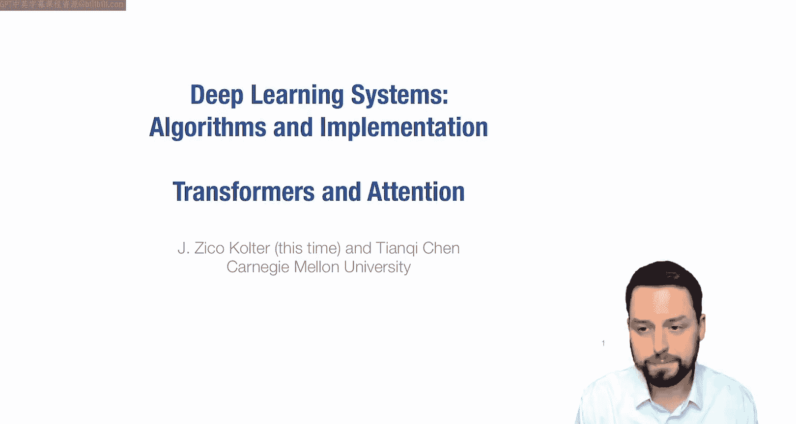

So this lecture today has three parts we'll first talk about。

What I'm calling two approaches to time series modeling。

So transformers in general are much more generic than just time series modeling or sequence prediction。

 but they first were developed in the context of sequence prediction。

 and so we're going to introduce them as a technique and tool for modeling time series。

But to do that， we need to focus on the two different ways we can model time series and deep networks。

 the first being the recurrent neural network kind of paradigm or more formal the latent state paradigm that we saw last time in the last two lectures。

 and then what we call the direct prediction approach which is going to of which transformers will be one instantiation。

We'll then talk about self-attention and transformers and finally we'll talk very briefly just touching on some key aspects of applications of transformers beyond time series。

 which to be honest makes up an equally large portion of their application these days。All right。

 so let's jump in to start off with though and talk about the two approaches to time series modeling。

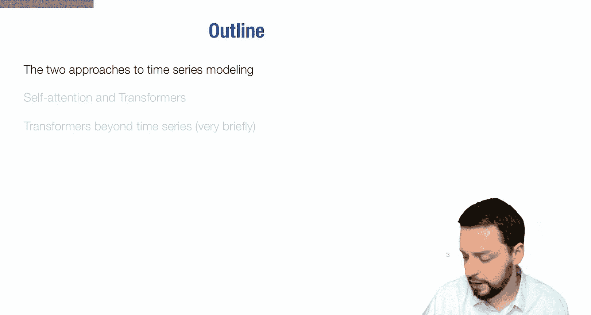

So let's recall from last time or from two lectures ago， our basic time series prediction task。

So what we have here is we have some sequence of inputs， x1， x2， x3， etc。

 and they produce some outputs， y1， y2， y3， etcter。

 and typically the task of time series prediction is to predict the outputs from the inputs。

And these arrows here， again， this is not its like last time this is not a formal sort of dependency diagram。

 but these arrows here just sort of indicate the fact that these variables are not independent from each other or these inputs are not independent from each other。

 they actually come in some sequential form and our goal to predict the outputs given the whole time series up until that point。

But more fun so we talked last time about the recurrent neural network approach to this。

 but more fundamentally， we can kind of abstract a lot of that away and just say that a time search task is just the problem of predicting some sequence of outputs。

 y1 to T， so we predicting all our time outputs as some function of x1 through T。

And this can be kind of any function here as long as it is is sort of a valid function that predicts output and inputs。

 we're okay， but with one important restriction here， which is the yt。

 our prediction at time little T here can only depend on the x's we've seen up until that time so we can't use Xt plus1 to predict yt and that's sort of formally the kind of causal time series prediction problem。

Now， of course， there are multiple methods for doing this and what we saw last time was the RNN approach doing so。

 which seems to be in some kind of the natural a naturaltural way of doing this。

So but it's not the only way， but let's first look at this RNN formulation and in particular what I'm focusing on here is the nature of RNNs as kind of a latent state approach。

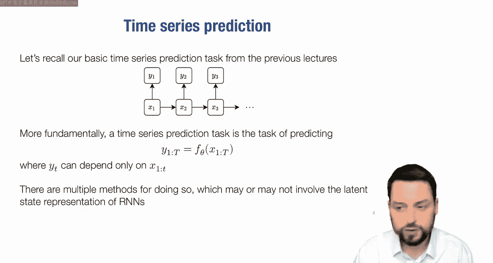

And what I mean by that is the RNN approach to time series prediction。

Is that we take our whole input sequence up until sometimes the x3 here。

And we summarize that or embed that kind of inside a latent state。H3 or in general HT。

That as we discussed last time， the notion of these latent states is they summarize all the information we've seen up until that point。

And this is the core aspect of RNs is they represent the entire time series via this latent state H。

And there is some notable sort of。😊，Benefits to this， right， for example。

 R NNs can capture infinitely long history right in theory。

 doesn't matter how long your state input is。Or input sequences。

This hidden state here is capable of representing kind of the entirety of everything that's seen up until that point。

And that can be very useful potentially for making long sequence or long time series prediction tasks。

Now。The con of this approach or the challenge of the approach is kind of actually the same thing。

 though。Because you are required to filter your entire history through this lateynt state in practice。

 it's often harder than you may expect to incorporate information from the long past into this hidden state the sort of the compute chain or the compute path from x1 to this hidden state has to go through a lot of different elements here has to go through H1 and H2 and H3 etc and along this path you have the vanishing or expd ingredients gradients problem right and that means these networks are hard to learn they're hard to perform inference that sort of keeps an appropriate amount of past history around and this makes latent state approach though it kind of works in theory in practice this makes it rather brittle。

And so this is kind of the core， arguably the core challenge with RNNs。

 this maintenance of a latent state that summarizes the entire history up until now。

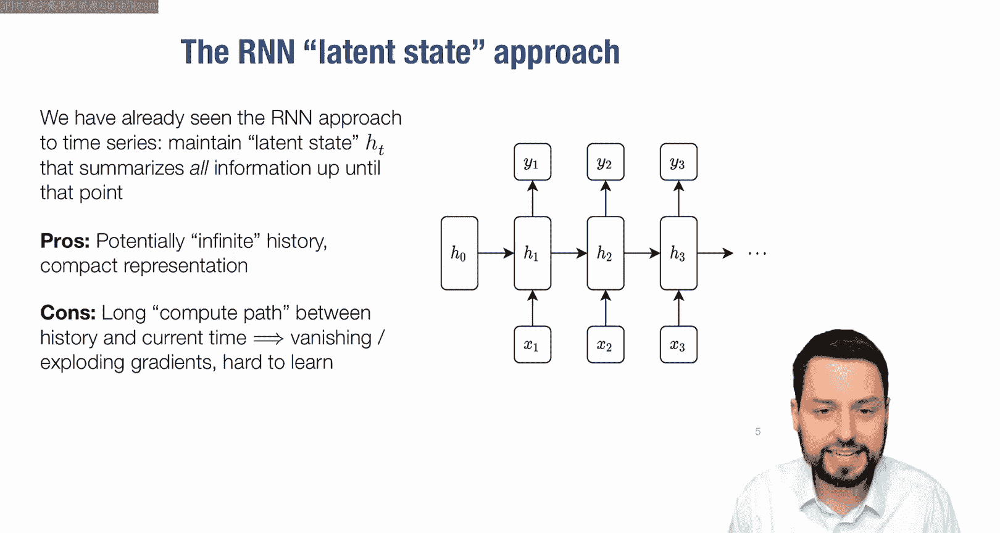

And so in contrast to this， we can think of another approach to time series prediction。

 which we'll just call the direct prediction approach and the idea here is we're going to again。

 predict make some function that predicts each Yt as a function of the xts up until that point。😊。

But we're going to design the architecture in a way such that we just directly map that input sequence to the desired output and so what this figure here is showing is that to make our prediction y1。

 we just use the variable x1 to make our prediction y2。

 we somehow will use the predictions x1 through x2 to make our prediction y3。

 we'll use x1 through x3 and etc。So this approach， obviously in some sense it sort of the easy。

 the simpler approach you could use for this in some sense。

 but I haven't defined what I mean by by this function yet。

 the challenge of this direct predictionction approach is that we need a way to actually specify what this function is that can map any arbitrary sequence x1 through Xt to some fixed size output Yt。

But this is this sort of notion of design architecture that can directly predict。

An output from an arbitrary length input sequence forms the basis for architectures like transformers。

 but also others， in fact， I'll start by highlight a different architecture that's not a transformer architecture。

So the pros of this is that oftentimes this direct prediction approach。

 of which we'll see a few examples in a second， it can often map more easily from past history to a future prediction。

 So， for example， depending on the functional form that I choose here。 And again。

 we'll sort of see one in a second。 But if I want to predict y 4， I could design my。😊。

Pradition function such that you know there's the same length path， say from all my points here。

 compute path from all my input points to the output y4 right again。

 we'll see an example in a second。And so thinking about this as a direct prediction approach。

Oftentimes leads to architectures that are more efficient。In actually capturing。

Temporal information in practice。Now the downside this。

Direct predictionction approach is that there's is as also sort of what the positive or the opposite of what the positive was for R and Ns。

 There is no。Not of a state representation。 right， Remember， in R and Ns before。

 we had this time point， this， this this， this value H3 there。 So if I want to add one more input。

 right， X4， If I went to add on x4 over here。

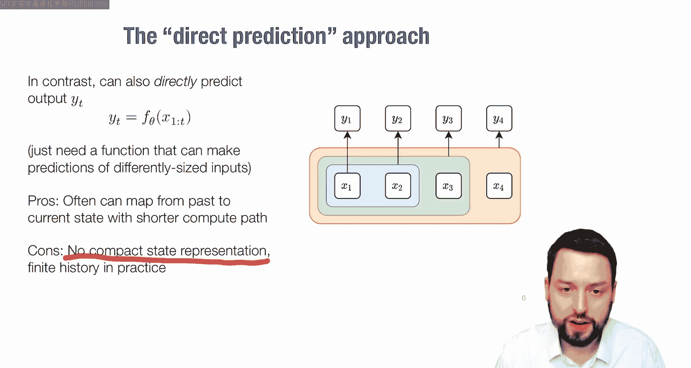

I wouldn't need to keep around my whole sequence， right。

 I could throw away all my past inputs just form a new hidden state by keeping around H3。

And using that to make H4。In direct sequence prediction， we don't have this ability。

 right every time we make a prediction of YT， we need to sort of feed in our entire sequence up until that point。

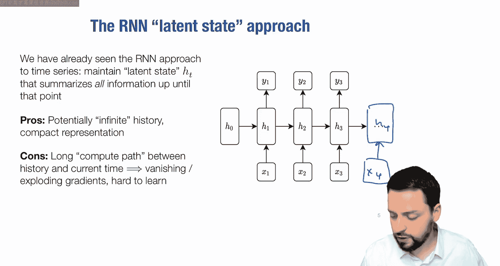

And this sort of difference is going to play。I would say arguably the key role in terms of the pros and cons between RNNs and methods like transformers for time series prediction。

But so so hopefully that gives a rough sense of kind of these two different approaches。

 the latetnt state approach to time series prediction and the direct prediction approach to time series prediction。

 But before I jump into transformers as an example of the direct prediction approach。

 I want to emphasize that it's not by any means the only such possibility here。

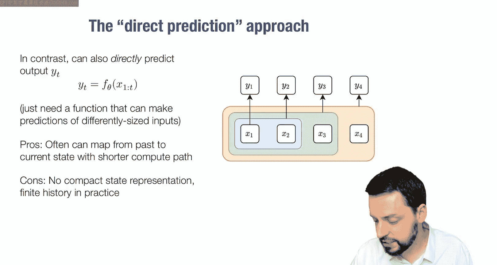

So another very classical method for direct time series prediction are actually just using convolutional neural networks。

And so in fact， I would argue， in some sense， the most straightforward way。

 at least given what we've seen so far， to specify a function like F。

 remember F has taken kind of a whole ideally you want to take in a whole time series x1 through T and un really produce ideally all the output predictions。

 since that should be y5 here。

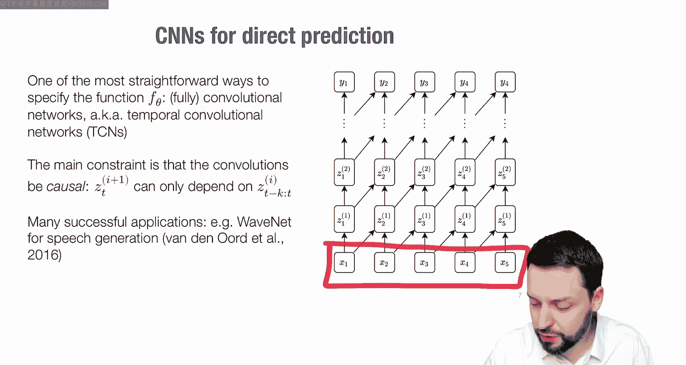

Ially you want to take in a whole time series and produce sort of the entire set of output sequences。

 again， with this condition that the output y at Yt can depend on the inputs up until that point。

But it turns out that a convolutional network with certain forms of the convolutions。

 these are called causal convolutions often， and the resulting architecture is frequently called a temporal convolutional network。

The idea of this form here is that we can define a convolutional network that obeys these exact temporal constraints that we wanted to satisfy in our time series task。

So let's just look， for example， at a convolutional network like the following here。

 so I'm unrolling through several layers here， but let's just look at like a little a small sort of aspect like this portion right here。

So this is sort of one layer of our network， we start two inputs x1， x2。

 and from that we form this hidden state here by applying a convolution。

Now one important thing to note is that the arrows in this in this network only go kind of forward in time。

 so they're only kind of going either that way， which is sort of deeper in the network or this way。

 I guess it would really be kind of kind of this way， which is sort of saying。

One step forward in time and also deeper in the network。

So if we think about a normal convolutional network。

 what we would normally do in a convolutional network and this is a network with say no things like max pooling or striding or like that just sort a it's called fully convolutional network。

 What we would normally do in this case is sort of take these three elements say and convolve them with some filter to produce this next point but of course we can't do this here because if we did this then we would have a state Z subscript 2 which would depend on x3 In other words。

 we'd have some latent or not I shouldn't say latent say。

 we have some hidden state at time two that depends on the future。 we can't have that here。

 So the restriction we have to impose on a temporal convolutional network is that all these convolutions again。

 or word're called causal convolutions and that just means that they cannot have any influence they can only have arrows that go from previous time steps to the current time step or from the current time step to the current time so you could of course have deeper arrow C of Silia。

 for example， this would be an okay connection。But you cannot have connections that go backwards in time like this。

And that's what a temporal convolutional network is。And so formally speaking。

 the constraint of a temporal convolutional network。

Is that our hidden state at time T at layer i plus1 can only depend on the hidden state on layer I。

 I guess you could have skip connections to that's fine， but in general。

 sort of a single layer will only depend on the previous state I。But importantly。

 can only depend on some。Previous states in the previous layer。Up until that point。

And there are actually very many temporal convolutional networks that have achieved very good performance。

 for example， the waveNe network for generating speech from text uses a temporal convolutional network and has very。

 very long time dependencies。Now， this network itself that I'm showing here is a bit。

Is a bit simplistic， of course， right， but I also actually want to use it to highlight some of the key limitations of these networks here。

So let's think about sort of the challenges that a network like this might have with pretty thin time series。

So one sort of obvious notion here is that in order to。Make a prediction。At time5， say。嗯。

In order to sort of let's just assume for now that actually this is our actual network there's one layer here。

 but there aren't repeated layers here， what we see is that know state Y5 through this chain of dependencies does depend on x1。

But if we have the next element of the sequence here， why6。

That would only and won I won't draw all the arrows here。

 but that would only actually depend on the inputs up until x2 right there's no path that takes has any influence from x1 to y6 and this using this sort of same pattern mirrored over again right so this same kind kind of pattern here。

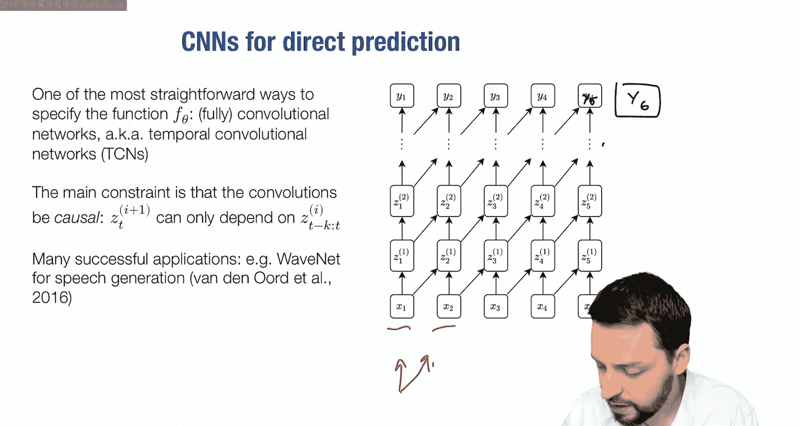

Now what this means is that this time series prediction。

Network or architecture has relatively limited what's called receptive field。

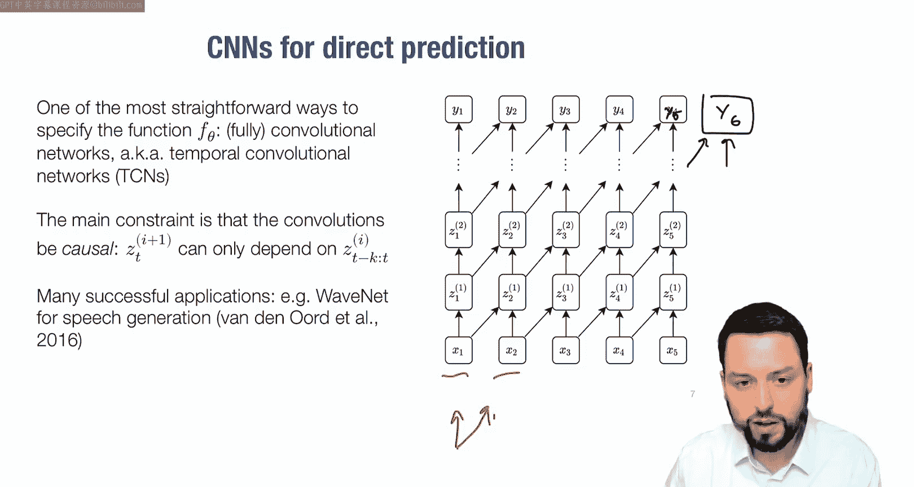

And this brings us to them sort of the main challenge with CNNs for dense prediction。

Which is that there。The receptive field or sort of how far back in the past they can look to make a prediction。

Is inherently limited by the choice of convolutions and the depth of the network right if you have a simple set of convolutions like this where each state only depends on。

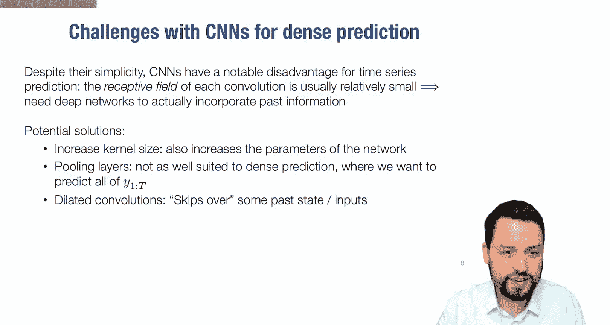

The current state and the past state， right， so so it depends on this state here depends on the input at that time and then the input of the previous time。

Then your receptive field size is only going to be as large as your depth of your network。

And that seems very limited， right， if we， we sort of potentially want networks that can look very。

 very far in the past。 This was supposed to be the whole benefit of of RNNs right is they could contain potentially in infinite time history。

 And it seems like we're giving up a whole lot if we're going to use a network on architecture like CNNNs for this。

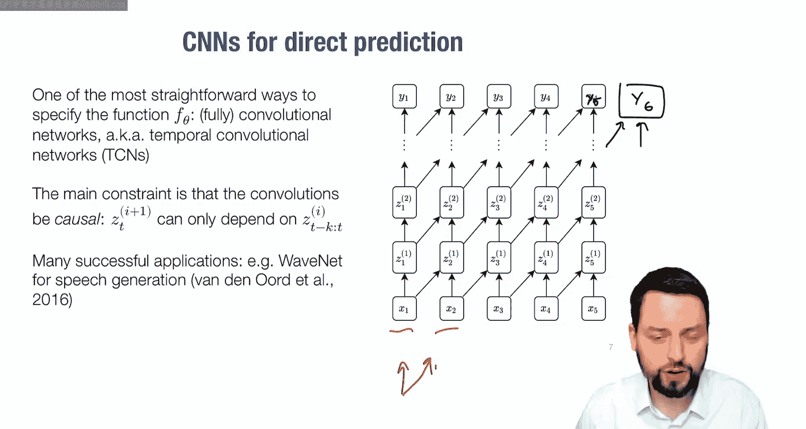

Fortunately though there are some ways of dealing with this problem。

 even in convolutional networks what an obvious thing we could do to sort of make it this problem is just increase the kernel size right we could just sort of increase the size of our kernel and this would have instead of having just depends on the previous time step and the current time step we could depend on the previous two time steps。

 the previous three but it just decreasing our kernel size。

We could add pooling layers and stuff like this。 so we could use dilated convolutions。

 But each of these has some negative side effect associated with it， too。

 which seem kind of odd right， So for example， if they want to increase the kernel size。

 that seems like a good thing， but it also increases the parameters of our network， right。

 So every time we increase our receptive field because our because we are then adding。😊。

sort of an additional set of filter weights tovol to our convolutional kernels。

 we have to increase the parameters of our network every time we want to have a larger larger protectedive field size。

 so if we want to protect the field size of in the thousands perhaps this doesn't seem that practical here right or we need a very。

 very deep network。To do so with a large kernel size， etc。

You can also add things like pooling layers right that's how we kind of capture longer spatial temporal dependencies and images。

 but pooling layers often are not as well suited to these dense prediction tasks right remember because we want to predict all of our output sequence from our input sequence ideally kind of all at once right and so methods like pooling layers are less well suited somehow to this operation。

We can also use dilated convolutions right so you remember this before was sort of this case where when you form if you have some sequence like this to form the next sequence to form our prediction rather than just taking you know every single rather every single element here。

 we would take only every。😊，Say two elements and spread out kind of the filter points of our convolutional filter。

But this is also a bit odd right because maybe this work and to be clear people do all of these things。

 especially dilated convolutions and larger kernel sizes when you implement temporal convolutional networks in practice so that these are all done in practice。

 but they also have these downssides so dilates like skip over parts of the input。

If you really want to skip over parts of the inputs and sort of。

 you know not not look at this piece when looking at the next layer or sort of only do it indirectly because you。

You have dense， some smaller denser or undild convolutions， some dilated ones。

 it raises a lot of sort of architectural questions that have a lot of trade offs involved。

This is going to bring us to an alternative approach for doing something very similar here。

 which is called the self attention operation。

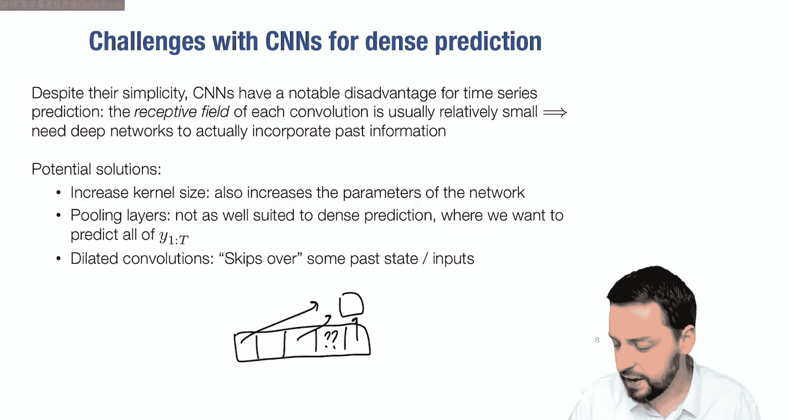

Leading to the architecture of what we call a transformer。

This architecture was relatively recent in deep learning。

 the paper that proposed it came out in 2017。Um， but since then it's become kind of one of the。

 I would say that you know， the most dominant architectures in all of deep learning， right。

 and we're going to talk about transformers as applied to time series right now。

 but it really is not not an exaggeration to say that we are kind of in the age of transformers when it comes to kind of comes deep networks。

For computer vision， for natural language processing， for audio processing。

 all these sorts of things right now， transformers tend to be at least if compute and sort of training costs and inference time costs not are no concern。

 these seem to be the best performing architecture that we currently have。

 and so we are currently kind of in this age where the best models right now。

 at least tend to be some form of transformer architecture。We're going to talk about it， as I said。

 in sequence prediction， But this is now also true。 I do want to emphasize in。

Virtually every domain that's going on right now。Okay， so。

 so what is self attention and what are transformers and how do we sort of get from this motivation of direct prediction and。

Reerceptive field size to the notion of transformer。And。

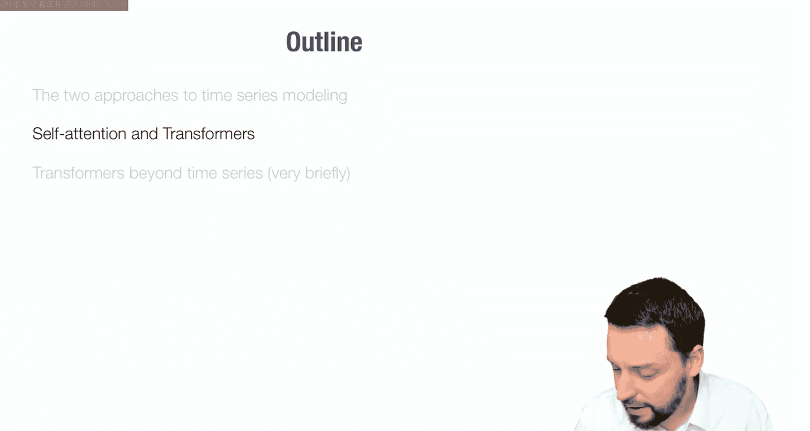

To start off with， I actually want to introduce the notion of attention in deep learning or deep networks generally separate from self attention as it is used in transformers。

So this name attention， it again， a great marketing term。

 it sparks all sorts of notions about networks that pay attention to certain things or attend to certain sections of the inputs stuff like that。

 a very anthropomorphize the term certainly， but attention and deep networks basically means any mechanism where individual components or states in this network are weighted and then combined together。

😊，That's that's maybe a a overly broad definition。 But I think it covers。

 I I think that's actually a pretty good definition。

 It covers kind of the majority of what we mean when we say attention in deep networks。And in fact。

 attention in deep networks was originally proposed in in a different。

usingsing a different sort of architectural form than self-atten that is currently or commonly used now in transformers。

 and it was introduced in the context actually of recurrent neural networks so to give a bit of context here remember we talked about last lecture how you know if you want to take or we also just talked about it too if you sort of want to take an entire input sequence Jo An to X3 here but of course this will keep going。

I want to take an entire input sequence and in some sense。

 kind of make a single prediction over that entire sequence。

 say you wanted to take a text document and classify whether this was a positive or negative sentiment in this text document。

What's typically done or the typical we thing about doing this is we know that in R&N。

 the last state is the last hidden state in the sequence is， of course。

 this summary state of our entire sequence so far right so H3 here in some sense summarizes all our inputs x1 to x3。

And of course， H big T would summarize all our inputs x1 to Xt。

And so the common thing to do if you want to make a classifier based upon this entire sequence is you would just take this state here。

😊，And。Bit it to some， right？Beat it the some。Like next one layer classifier right so I don't know W time transpose times H3 T not transpose that one I meant to say k。

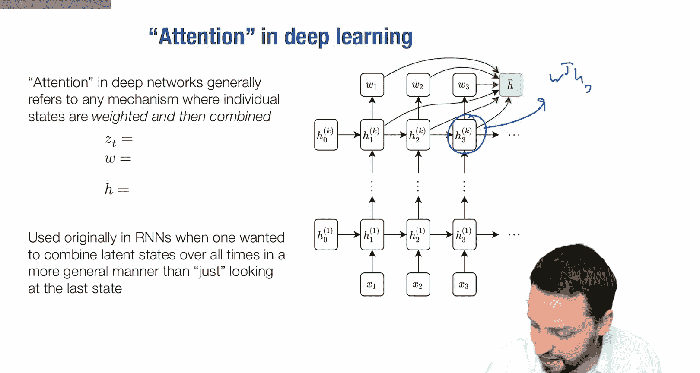

And this would be your your prediction of the logics of how likely you thought this was to be a positive。

Sentiment for this text or whatever。 So typically again。

 the key point being here is that you're taking this whole sequence and you're summarizing it only with the last state here。

But it's also true that this， for all the reasons we talked about， is very imperfect， right。

 no matter how good。LSTMs and all these fancy， you know mechanisms for for RN get。

 This last state will ultimately depend less on x1 than it will depend on x3， right。

 This the compute chain to get here is just longer than the chain to get there。

 And this is especially true if you go out to very long time sequences， right。

 the influence of the first points fade。 This is the whole problem of exploding or vanish ingredients。

 And so making your prediction just based upon the very last element in the sequence tends to favor the content later on in the sequence。

 right， And that's often something you don't really want to have。

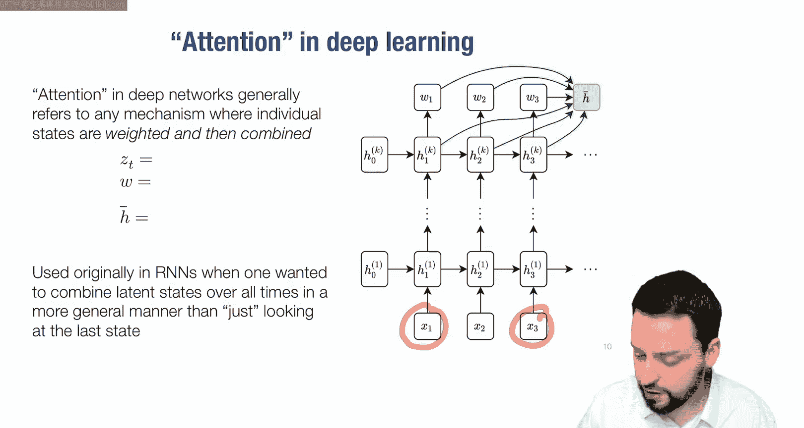

And so to avoid this。What was devised was this mechanism called attention。 Okay。

 so attention Mres says， we're going to take our hidden states。

 but we're not going to take our last hidden state， right。

Normally we just take this last hidden state here， use that forosifier。

 Instead of we're going to take all our hidden states。

we produce over all time and we're going to combine them in some according to some weights。

 and so in particular， we're going to combine them into this this variable H here， H bar here。

And the way we do that and I'll kind of write these equations now kind of in reverse order here。

 but the way we do that is we take h bar is going to equal sort of the weighted sum with sum weights of sum from t equals one to T of our sum weights。

 WT times H T。😊，In our last layer， So so we're going to basically take out form H bar as a weighted combination of all the hidden states over our home network。

And if we do this properly， there's the potential to have a much more direct path of influence from say x1 to our predictions because we're combining this term here。

 right we're also including H1 in our weighted sum， and so if the weight on this term is high enough。

 then we're going to have a lot of information about x1。Now， the question， of course。

 is how do we go about， how do we go about actually computing these things。

 How do we go about really understanding how how we form， you know。

 how do we find these weights relative weights。 And the answer here is， well。

 we we don't have to predeefine how we're going to use it。

 you could just like take their average or something like this。

 But oftentimes you want to sort of weight them in a way that depends on something about that term about how important that term is。

 So what's common is to use kind of some sort of sort of self weighting mechanism here。

 where you form， say， some Z T， which would be something like a vector theta。Transpose H T K。

 And that was sort of be， you know， a relative weight or like， like like kind of a。

A lo of the weight and W would just be the soft max。Of the Zs。

 so the z's basically are the pre softm weights of each term。

 and then you take a softmax to convert that to weights that a set of positive weights that sums to one。

And this mechanism here is one way of combining the elements that we've seen。Over our entire time。

 time series in a manner that sort of treats every time point the same。嗯。But。

This mechanism of self-attention and it does work， I mean， to be clear。

 these methods do work better than typically sort of just looking at the last date。

 but they're also kind of an addition to an RNN and just by themselves they seem kind of like you a nice addition to an RN。

 but not really a whole brand new architecture in of themselves。

So this leads us next to the self attention mechanism。

 which is a very specific form of attention mechanism that's going to play a foundational role in transformers。

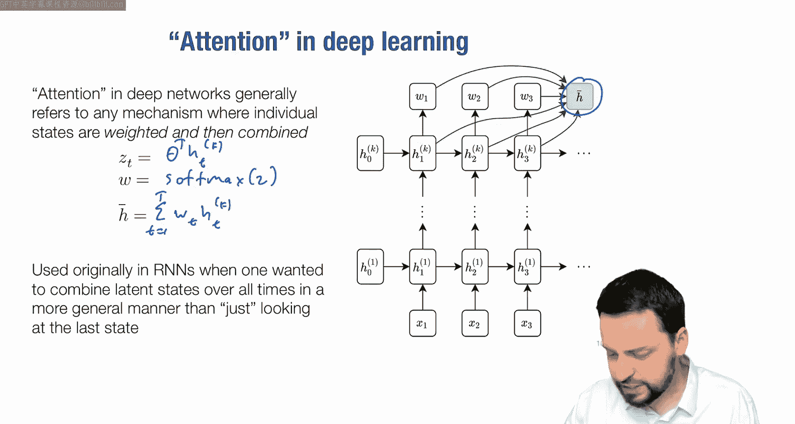

Okay， so what is self attention self attention？Just refers to a very particular form of attentional mechanism。

 again， meaning you form weighted combinations of some inputs where those weights are themselves determined by the inputs。

It's going to be a very particular form of attention mechanism， which has some very nice properties。

So the way that attention is usually thought of， the self attention block here is usually thought of as a function that takes three arguments。

 K， Q， and V。KQ and V are all matrices within in Rt by D， and they are called keys。

 queries and values。Now I am of the personal belief and I've stated this many times publicly。

 so this is not new information I'm on record of saying this I think these naming this naming convention is actually one of the least helpful semantic designations that we have in deep learning I get very little intuition out of calling these things keys。

 queries and values it seems。😊，Way overly dependent on like information retrieval mechanisms and。

Doesn't respect the symmetries that are actually there in this whole thing。 And it's just a very。

 very bizarre sort of nomenclature here。 If you have read some other posts about transformers and really find this key query value designation to to be helpful and helps your intuition about it。

 that that's great。 I'm very happy for you， I find them utterly unhelpful and I find it much easier to understand self-atten just as a set of sort of matrix operations。

 right because thiss linear algebra operations is what they are。😊，Um， but， but let's sort of。

Think about this So so so I will I will from now on very sparingly use the terms keyith courses and values。

 but nonetheless， these are actually very common terms。

 These are sort of the terms that are used there。 So I will still just use the terms K Q and V because those are the standard terminology people use for self- attention I just am not going to give any analogies to database lookups and stuff like this。

 I think they are entirely unhelpful。😊，So what is what， what what are K Q and V， though， So。

 So K Q and V， the way to think of them And， and， and shortly， actually。

 what we're going to do is we're going to form all of these as a function of the same input。

' talk about in a second。 But K Q and V though， the way to think of them is they are just。

Three different matrices that all have D rows and each row is d dimensional。

 So I'll call it like K1 there will be like the first row in this matrix K2 will be the second row in this matrix。

 etc cetera， all the way down to K big T， I guess I'm using T for transpose alsoa。

 which have to figure out when I'm using T for sequence length and one for transpose。

I think in the slides I use the appropriate like top designation。

 but it doesn't come across very well in writing。Okay， so and Q is the same， so Q is the same here。

 so you see first row， Q1， transpose， etc。😊，And these the same way。

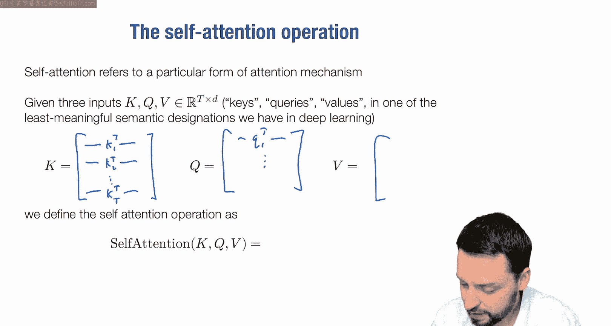

The one transpose。First row， et cetera。 and again， these all have D columns。

 so each row is d dimensional and they have T of them， big T of them。Alright。

 now what we're going to do in a moment is we're going to form these K Q and B actually。

 but it's applying a linear transformation to the inputs to self attention。

 So if we have some input Xa in the very first layer of the network。

 we're going to apply some matrix WK to get to get X to get K。

So we're going to have this sort of as our formula in a second。And remember。

 sort of the notation to keep in mind here is that x itself is a matrix so x itself is a matrix here where the first row is that is the input at time 1。

 the next row is the input at time 2 etc ceter。 And so what we're doing when we do this is we're just taking each individual row in that matrix and we're just multiplying it by some weight matrix WK to form some corresponding row K and we're doing that to every row kind of independently。

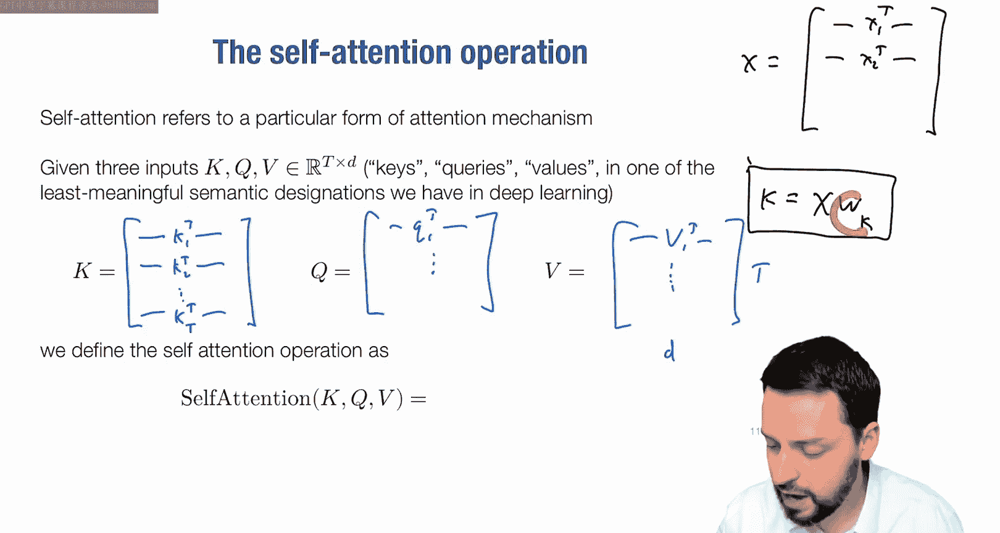

U。And that's what we're doing， right， we're basically just just taking all these things and yeah。

Forming a linear transformation of the input to form。

A bunch of it rows here where the key point is that K1 depends only on the row x1 Q1 depends only on the row x1 and v1 depends only on the row X1 there's sort of no mixing in time here。

 each row depends only on on its corresponding input。

And then we apply the self attention operator and a self attention operator is defined as self attention。

Between this KQ and V is equal to。The softm。Of。K times Q transpose。Over square root D。All times V。

And that's just the definition of the self attention operation。

But let's dive into that a bit deeper and really kind of see what's going on here。So。😊。

What self attention does ultimately is it。We'll finally mix together。

The different values over different times to produce outputs that are kind of exactly these mixed together values。

But let's see how this works so we know let's just look at sizes first right。

 so we know that K is T by D。And so Q transpose would be D by T。

And so that means that this whole matrix in the inside here。

 maybe I'll erase this for now this whole matrix。On the inside。This。

 this matrix before we apply the softm is also a T by T matrix， right。

 So it corresponds essentially there are different elements for each。

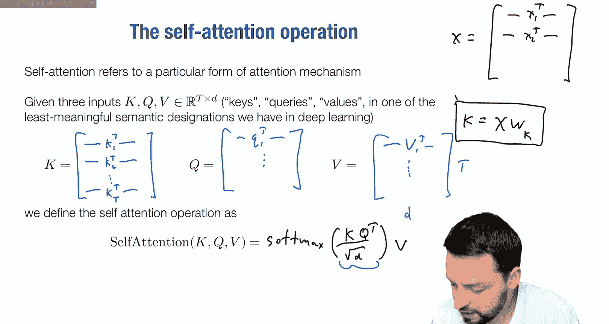

There's a corresponding body middle corresponding to each sort of。

Time points on the rows and time point in the columns。And in fact。

 we can even sort of think about what that matrix is in more detail here。

 so let's just take kind of this this matrix here。And think about like what the individual entries are。

So the entry， like the IJ entry。So the IJ entry in this。Matrix here。Would be equal to K。

 the inner product of K and QJ this is just by definition of mentioned multi here。

What that means is this entry。Corresponds in some sense to computing a similarity between the KI term and the QJ term。

Whatever those terms are。But the more similars are。

 the higher this inner product will be and the more dissimilar the larger negative it will be， right？

Then， we are going to。And erase this for a second here。

 then we're going to take a soft max of this whole of this whole thing。So the softm operation here。

It's actually going to be a softmax applied by row。

That means we're going to take each row of this matrix。

And we're going to apply a softmax operation to it。

 meaning we're going to exponentiate it and then normalize it to have sum equal to one。

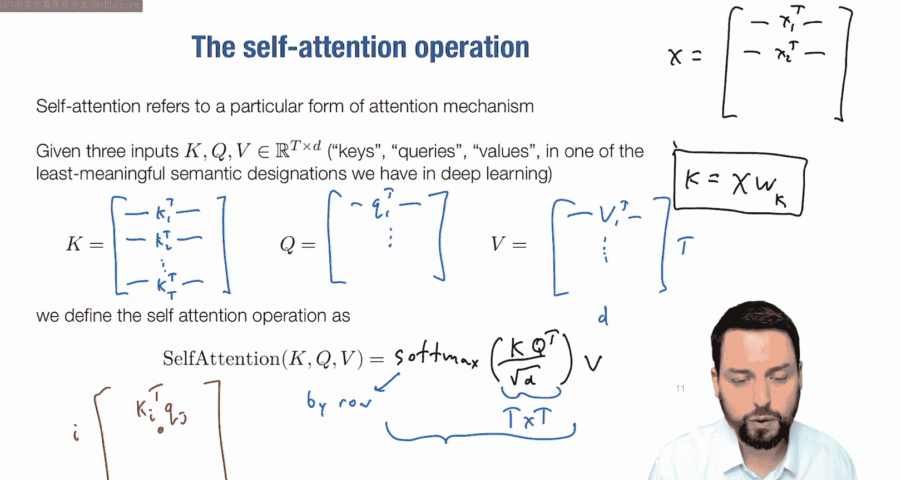

This is still going to be a t by T matrix here， but now each row of this matrix will be a set of weights that sums to one。

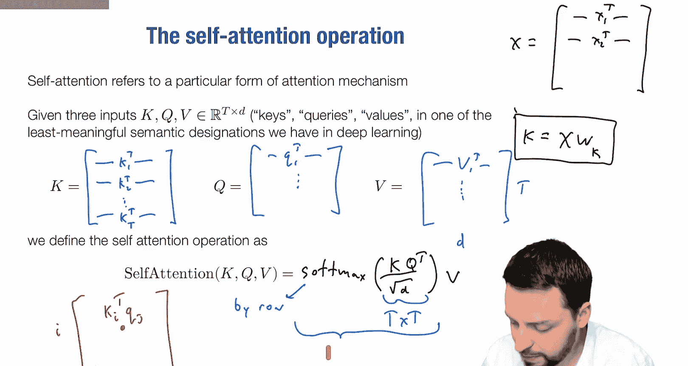

And then finally， we do our sort of last combination。

 which is multiply this by v v is going to be T by D， so of course I can fit it here。

 the final argument is going to be T by D。

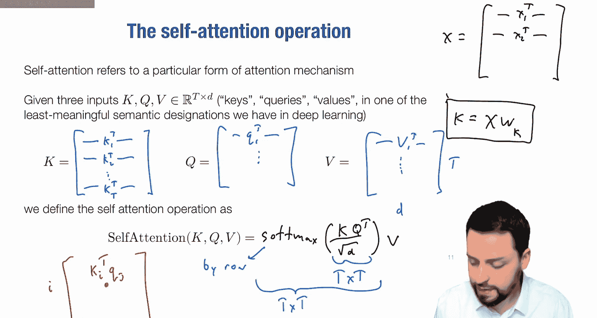

so in other words， the output of this thing is going to be the same as all the input sizes。

But importantly， what's happening here is the following。So。We form this weighted matrix here。

 right this this softm matrix here， we form this matrix here。And then we multiply that by V。

And remember， each row of that matrix is normalized to one。

So what is the final output of this thing going to be well the first。Output of this whole thing。

 the first row of this output。

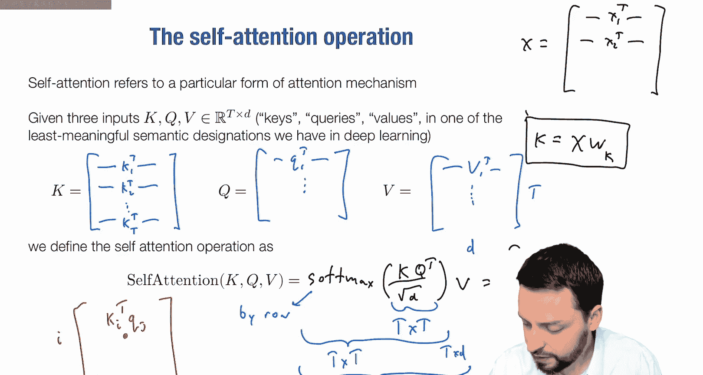

Will just be equal to the entire。Matrix weighted by the first row of this softm matrix。 right。

 This's this one here we talked about， I guess after the softm。Okay。

 and so each row of the output of our attention matrix。Is a linear combination of all the rows of V。

 In other words， this is now mixing together。Elements of different points in time。Okay。

 so you know this first row here， right， this first row。If。The terms in this matrix here， again。

 using a little bit weird notation here。Whatever this first row this matrix is here。

 it will be a set of weights that weight each sorry the first row it'll weight apply that weight to each of the rows of V。

 you know， the V1 and V2 and V3， etcter。All right， so this means this first output here。

Contains can contain e from all the rows of V。Sae with a second， right， where what。

 which rosa contains？We'll just depend on what the actual weights are that you form here。Al right。

 so that's the last sort of scribbles I know。 But hopefully that that kind of made a high level sense。

 I'm going to now kind of take a step back and highlight what the main。

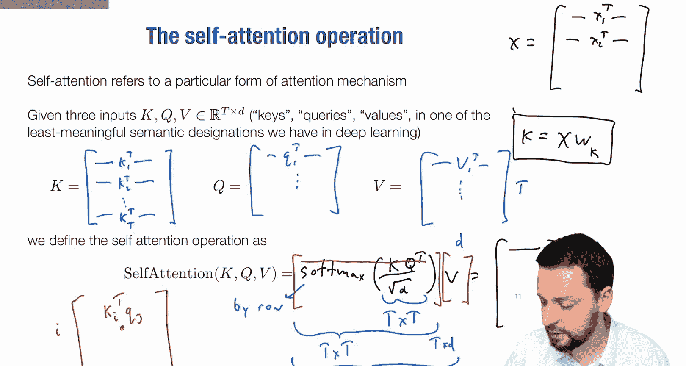

诶。High level properties of this overall operation are again， highlighting this is a。

Softmax applied row wise， a key by T weight matrix that you form， I guess after the softmax。

 it becomes a weight matrix， etc。嗯。But there are a few key properties that I just really wanted to highlight here this operation and we'll implement the operation next time again again。

 it's one line of Python code。嗯。But there's some really important properties to self attention that are worth mentioning。

The first property is that it is invariant or really equivariant to permutations of the matrices。

 Okay， what do I mean by that， what I mean by that is if I take the matrix K， for example。

So let's if I take K， that has a bunch of rows。Okay1。K2。Et cea。And if I permute all those rows。

 I sort of how mix them up in some order， some permutation， I can apply them whatever it wants。

By applying a permutation to that and to also Q And V， the same permutation。

 then the output of my self attention is just going to be the permed。

For the the same permutation applied to my original output and you can just sort of get that set up by inspection right。

 so sort of all these operations， you'll just form kind of a permed version of this weights and you'll apply those same those same permuted weights now to the permuted form of the and you get the exact same sort of。

😊，Perm set of outputs。Thiss actually called this is not called invari， it's called equivariance。

 because it means that if you apply a permutation of the inputs， you get the same permutation。

 the output is the same output permuted with that same permutation。So that's sort of one nice。

 oh I would argue nice property， but maybe that's not so nice， right， think about time series。

 you know， is that is that a nice thing or not。The other sort of important property is that it allows influence between over all times。

And this is sort of hopefully also apparent from what I said before is that basically you get a certain amount of mixing between time with V and this allows。

What we're gonna， I mean， what， what you can kind of imagine maybe is that。

When you have something like direct sequence prediction where you sort of want to be able to predict sometimes the other times。

Including potentially very long in the past， this can be a fair nice property。

I should also mention something here， which I didn't state。

 but it is important to sort of also emphasize。This allows influence swing over all times。

Without increasing。The parameter count。Okay， so think about like or with convolutional networks。

 if you wanted to have a temporal convolutional network that had more and more influence over previous time。

You would need to have a larger kernel size or something like that。

 and that would involve more parameters for for for your network， whereas self-atten。

 it mixes together the entire sequence， no matter how long that sequence is。

 it provides kind of a single layer mixing of the entire sequence。

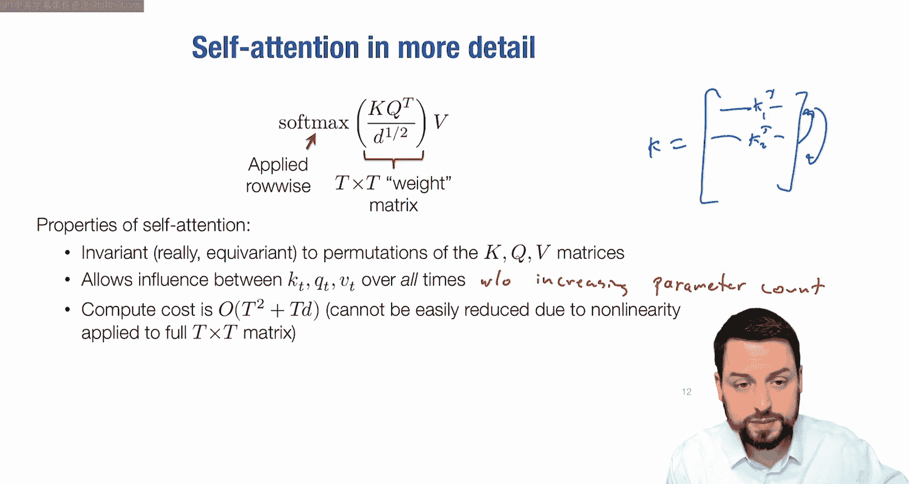

Without any additional parameters。In fact， I mean， there are going to be parameters of these layers。

 namely the parameters we use know form K Q and V， but treated as an operation of K Q and V itself。

 self attention has no parameters。 It is just a non linearity that's able to mix over all time。

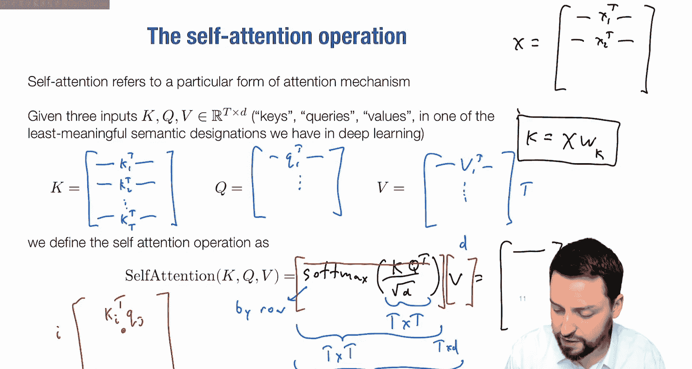

With。With sort of no favoritism for sort of the current time versus previous times， right。

 because it's perationly invariant and perly equivariant。

UmAnd it can do that without increasing parameter count。That's a really sort of nice， nice property。

Now， one notable downside is that there's sort of this unavoidable cost that we have of the naiveive self attention module。

Which is that it involves this T by P weight matrix and there's no obvious way to get around that you kind of can't get away from that because you're applying an on nonlineararity to it and so you you can't just sort of treat that as like a you can't optimize that away right you actually form and store and compute this whole T by T weight matrix。

And actually， this should really be compute costs should actually be。Here t squared times d。Yes。

 this is the memory size， not the， not the compute size。

 The compute size actually involves forming P by T matrix。

 And each element is D square is is involves a D by D inner product。

 So actually the compute the the compute cost here with the O of T squared times D。

 And this cannot easily be reduced with due to。😊。

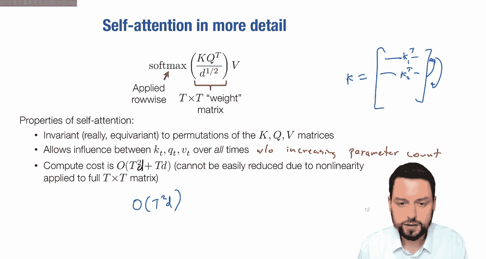

Due to this nonlinearity that we have involved here。All right so。Armed with that sort of。

Self attention mechanism。We're now going to turn to the transformer architecture。

And what the transformer architecture is going to be and this this slide has been just like a sort of sometimes a contentless preview but we'll get to the details sort the gooditty details in the next slide。

But what a transformer is going to do is going to take。A series of inputs。

And it's going to transform them to a series of sort of hidden states。

Up until we finally get our output。m using this me that we call the transformer。

 which is in turn is going to be a particular construct of an architecture。

 which uses the self attention layer。Now， one thing I want to emphasize。

 which I will come back to in a moment， is that as I'm going to present this right now。

 this architecture will not preserve that causal necessity that we want from a time series friction problem so in some tension。

 as I've presented so far， there's this matrix here。

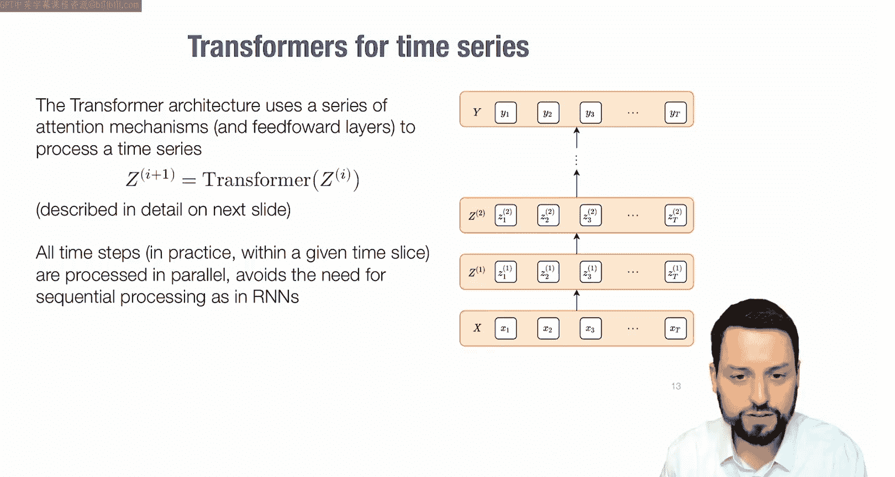

Can be a dense matrix。 And so every output， you think of these sort of as as as elements in time。

 you know， every output can depend on or the output at every time can depend on the inputs at all other times。

 right， thats is sort of by definition of what this mixing is doing。

And we'll see in a moment how you avoid this for the for the sake of。

Maintaining this causal property of time series friction。

 but for now I'm going to actually introduce transformers without this notion of temporal causality because really the basic transformer block doesn't have this property of being temporally causal。

 it just is a mapping that transforms rows one row to the next row the next row and we'll have to actually inject later on some elements that will'll make it。

 in fact， have these causal properties。

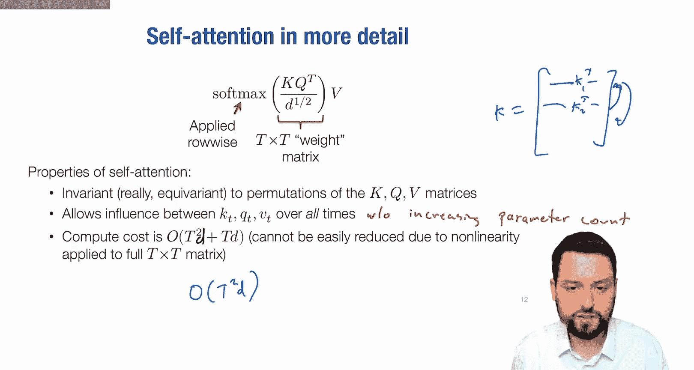

But let's just define for now what a transformer block is。

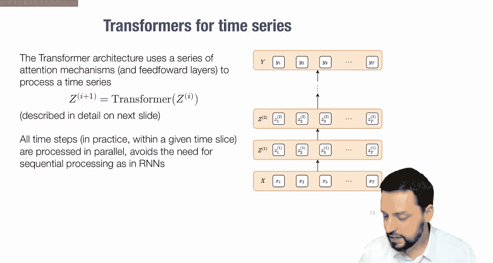

So the transformer block is the following and I'm going to now define it in terms of sort of my as a mapping from you know my previous layer。

 ZI to Z plus one right like we had in this previous slide， ZI is some function of a transformer。

 which is applied to my previous input， so whatever I want to do。

 I want to show how we map between my previous layer and my next layer。😊。

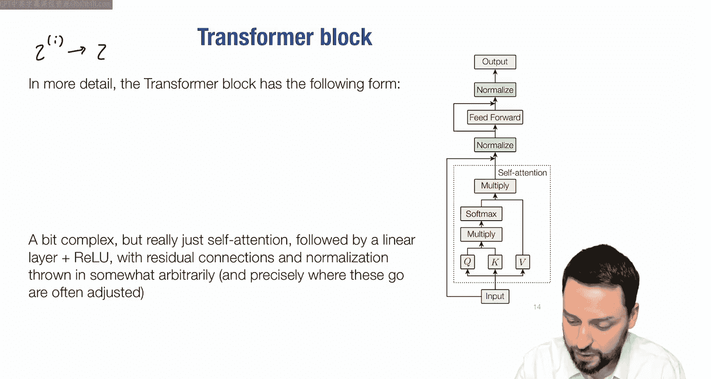

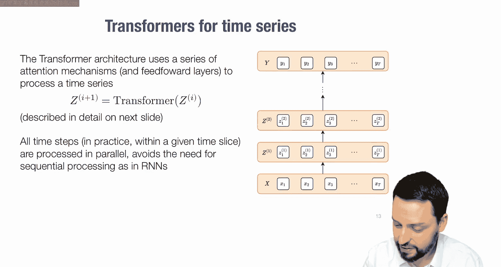

Um， and this little diagram here gives us sort of a common diagram for how people think about transformers。

 butum lets let's let's just write out the actual equations。Okay。

 so the first thing we're going do in I transform a block is we're going to form。

 I guess I'll call it like we're going to form a few intermediate elements。

 so I'll form like the first intermediate element Z Tilde， I'll call it even Z Tilde 1。

 and that's going to be equal to self attention。😊，SeWe feel like this's self attention。Applied to。

K Q and V， where K Q And V is going to be three different linear transformations of the input。

 So we're going have C I。Times W。K Z I times w cubes。Times Wq。And Z， I times W V。Which， by the way。

 just equal to softm。Of。Z I。WK。W， Q transpose。Z I transpose over square root D。Times v。

 which is Z times W v。And one thing on those immediately here is we probably could actually abbreviate some things because we're going to do things like。

well， we're like。there's a multiplication here of WK times WQ transpo like couldn't we just simplify that B answer actually is no you can't always do that because oftentimes the rank of these things actually makes it so you really do want to first form this then form that。

 but let's not worry too much about that just now。Does is the form of that？嗯。

Now we just do a few more things。 so we first applied self attentionten to all our inputs。

 but that's not the end of a transform block。 the transform block also has a few residual connections and layer norms and additional fee forward element in here。

 So these next things are they're a bit arbitrary。 but this is just how this block was designed。

 And so we and it's become prominent enough that it's worth just knowing what these things are。

 So we form I guess I'll call it like our next intermediatemediaity output Z till the two。

 and that's going to equal layer norm。😊，Between Z of like a residual layer。

 Z I our original input plus z tilde 1， so we apply kind of a layer norm to a residual connection of our original input plus the output of self attention。

And then finally， we're ready to produce our output， so Z i plus 1 is equal to again a layer norm。

But now apply to。Well， first of all， actually our new kind of feed forward residual connection。

 Z t the 2。Plus a。Two layer or one hidden layer Re network applied to the outputs。

Of Z 2 here is Z tilde 2。Alright， so that in particularicular takes the form of a。

So Z tilde 2 times W1， we apply a re to that。And then we apply some other matrix W2。

And we apply layer norm to the whole thing。Okay， so this seems a bit complex。But what it really is。

Is is just a self attention。Layer。Which mixes together。The different components on time。

 So because of its nature， right， because of its nature， you know， you。

 the inputs at time T has like。诶。Each row in that matrix Z of course sort of corresponds to a hidden state representing information at time T。

The self attention operation mixes these all together。 so sort of you know in this term here。

 the key row will potentially contain information from all time steps kind of mixed together according to these attentional weights。

😊，And then after this， we apply an independent deep。

Or two layer network to each row independently of that。 So remember， like this， this thing here。

 the way to think of it this you can just think of this as like a two layer network applied to Z as if like the rows of Z or the different elements in a mini batch。

 right And this is， in fact， exactly the mini batch form of a two layer network we talked about way back and when we talk about MLP。

 And so what we're doing here is we're supplying a independent。Realue network to each individual。

Output。Followed by some normalization， the something's from blowing up。And。

Where the normalization goes actually is under some amount of debate。

 people can debate like you get better performanceism as not by doing this exact thing。

 but by putting it in a little different place， the layer norm。

 but this is how the default transformer and Pytorch works so I'm going to follow that convention here。

And in fact， it was the original the original transformer as well。 And so I'm going to state that。

 And again， some things seem arbitrary here， but the high level is。😊，You are。

Using self attention to mix together different times。

 then you're applying an independent feed forward network， two layer feed forward network。Plus。

 some layer norm thrown in to each time step independently。And that is what a transformer block is。

Now， there are a few sort of challenges that come up。

 which you may have already but identified if you sort of were thinking about time series predictionction and thinking about kind of this figure here。

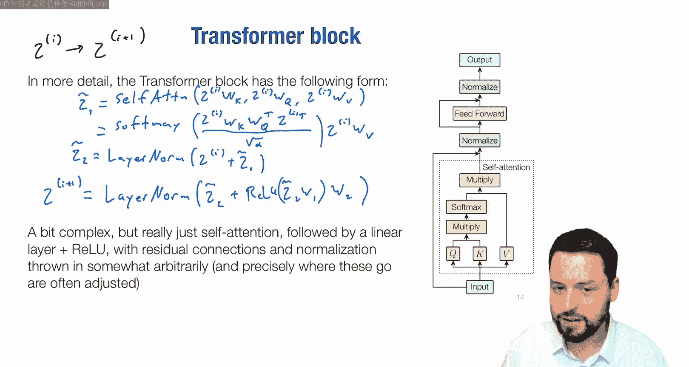

Namely， this figure here， as I said before， does not obey and with this format here。

 know with these formula here， does not obey that constraint that I mentioned before that the that the past time steps cannot depend on future time steps in their input。

 So if you just implement that transformer like this， things wouldn't actually work。

 this would not be correct。 it would it would give it would give an incorrect result because each selfat layer could mix together points from sort of all times to produce the output。

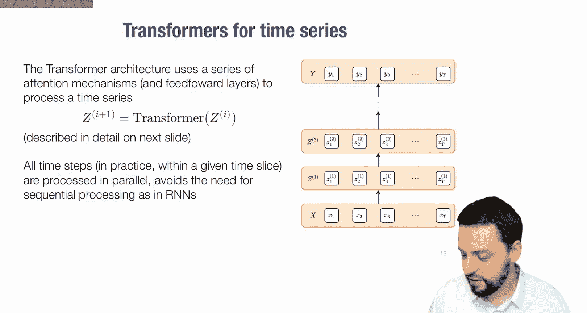

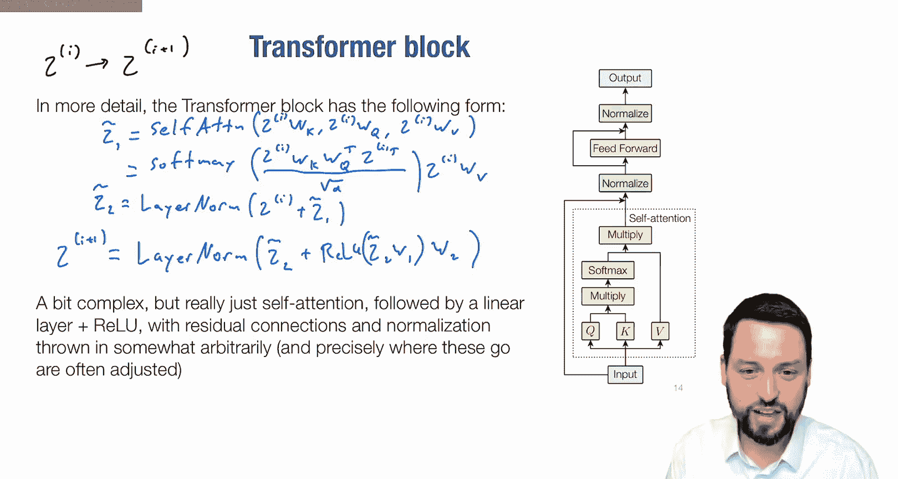

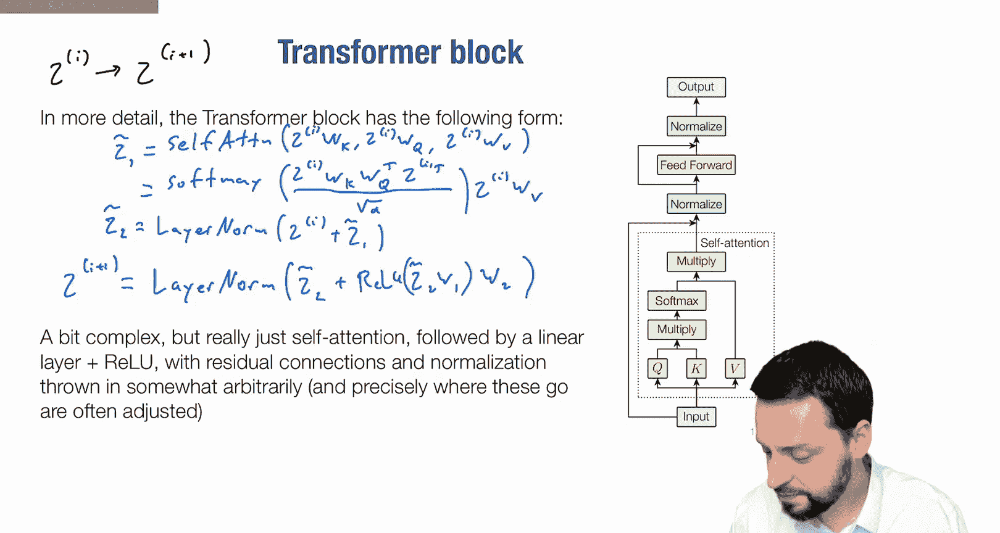

And so this is sort of this is sort of nice for time series for some reason right so that like the nice elements are you know the fact that we can get a full receptive field within a single layer。

 so you know going back to like temporal convolutional networks we have to stack many of these things together in order to get a large receptive field whereas the beautiful thing about selfatten is that with a single application of self-attention。

 you can mix all the points in time together。😊，Additionally。

 mixing over time does not increase parameter counts as I mentioned before right so you get within a single layer you get mixing over the whole time series。

 but without any increase in parameter count， no matter how long your time series is right that you can apply this whatever length temperature you want。

 it'll have full mixing over the whole sequence and it will not increase the parameter count。

But there is some downsides to this So again， all outputs on all inputs。

 this is not what we wanted for temporal sequences。

 right we wanted outputs to only depend on the input up until that point in time disadvantage sort of number one。

And this dimension number two is that there's no ordering of the data。

 So remember we just sort of talked about how transformers are thought attention' permutation equivariant and what that means is the outputs of fri on a time series would look the exact same whether or not you shuffle that time series I mean it'll like the shuffled output of the time series。

 which is often not what you want in time series right in time series the order really does matter and so you want the way of actually encoding order into this thing。

And so the next two editions we're going to make the transformers or really to self- attentiontion to be clear are exactly the elements that kind of fix this problem here or fix these two problems here。

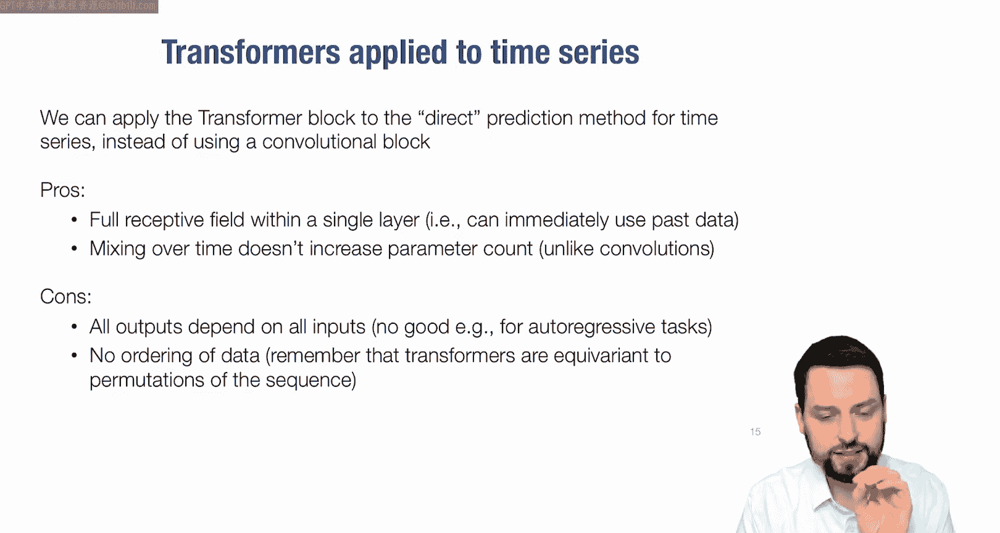

So let me first talk about the idea of these a causal dependencies。

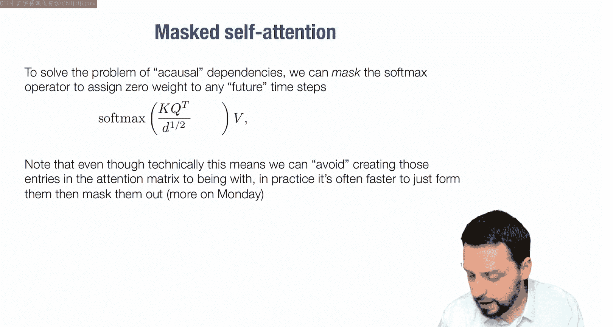

So the problem with our with our transformer， right， is that this matrix here。

 if sort of look at this matrix here after the softm， this is a dense matrix。

Okay so this is some dense matrix here that each row corresponds to the weight corresponds to the weight of the corresponding sum of V。

 So this is v。 This is R。 I'll call this like a。 oftentimes the attentional weights are called matrix A。

 So each element here corresponds like the weight of the different times。

 So this means that the output at time 1 can depend on time 2， time 3， time 4， time5， etc ceter。

 And this is a bad thing we often don't want this。 we don't want the output on time 1。

 to on anything but time1。And so what we can do to overcome this is to ensure that all the elements above the diagonal in the a matrix were all equal to0。

 So if we could ensure that if we could ensure that all the elements were equal to0。

 then we actually would respect temporal consistency within our our matrix。

 right so the first output would only depend on the first input。

 so it always just be the same as the first the first input because that has to be when you take a soft next there。

 then these two， you know the next element would depend on only on the first element， second element。

 then the first third and the first three elements， etc。 And so。

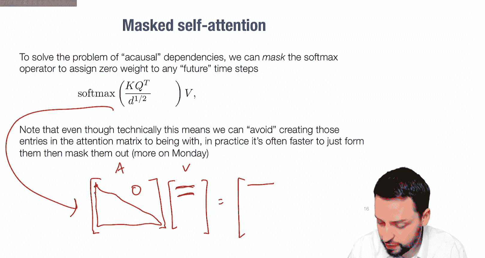

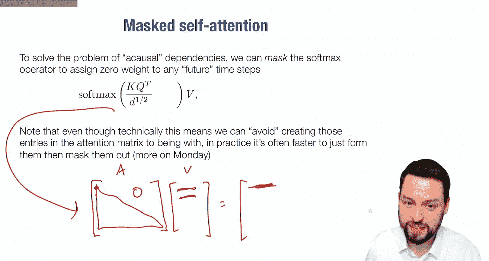

This actually would if we are able to force our softftmax output to look like this。😡。

Then we actually can achieve what we want to achieve。And so the way we do this is we just， I mean。

 you can just sort of take multiply by， you know， all zeros on the upper triangular and then renormalize。

 But a slightly nicer way of doing it is to write this as our softmax is going to be our softmax of our original kind of。

Inner product of the of the K the Q matrices， But then minus some mask matrix where the mask here is going to be equal to an element that's all zeros here and on the upper diagonal is all infinity。

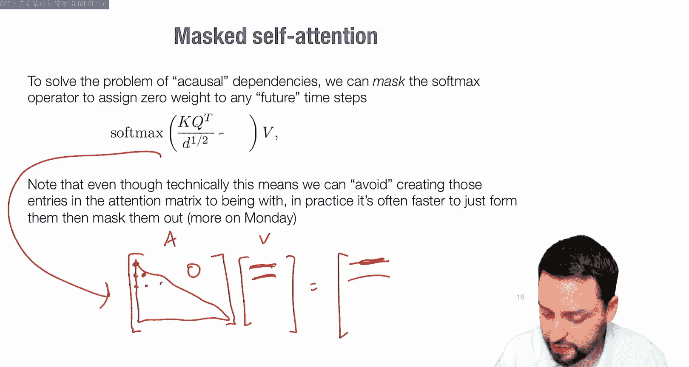

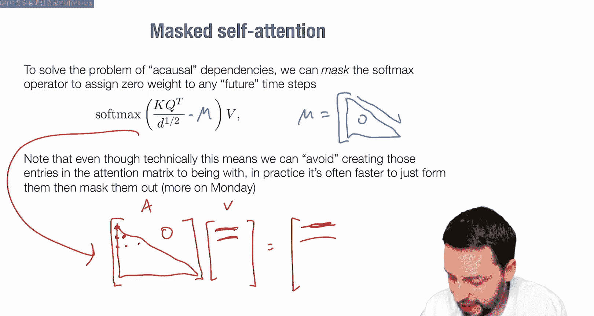

Okay， because again， if you subtract off infinity， remember softmax has an exponential in it。

 So the exponential of negative infinity is always0。 And this essentially converts this thing here。

 converts this， this matrix here to。This form without having to sort of normalize it once and normalize again。

 So this's just sort of a nice way to sort of sort of run that run that normalization。

And that's how what what what it means to。Or masked self attention。

 So you form this mask here and this form of mask is exactly what it sort of typically input into into something like pietorch。

嗯。Now， one thing to keep in mind is that what this mask means。

Is that because we know that all these terms are going to be 0。 They're going。 know。

 it doesn't matter what K and Q are for the upper。Elements here because we're going to subtract off negative we're going off in thin in anyway。

 So it can be negative infinity regardless of what the actually output of this of these inner product is。

 So in theory， we actually don't need to do a lot of our inner products。

 We could just do compute the inner products for the lower triangular portion。😊，However。Again。

 given what you know now about M multiplication and has done efficiently with tiling。

 it perhaps is no surprise that this is not that big a win and it turns out that in practice it's way more common just to do the whole image multiplication and then mask out and then just zero out or infinity out the。

The elements that we don't need， so do it and then throw it away that computation just because maximumplication is so fast and it's just better to do these things for big ortular matrices than trying to come with special cases that handle。

 you know lower triangularular blocks only。

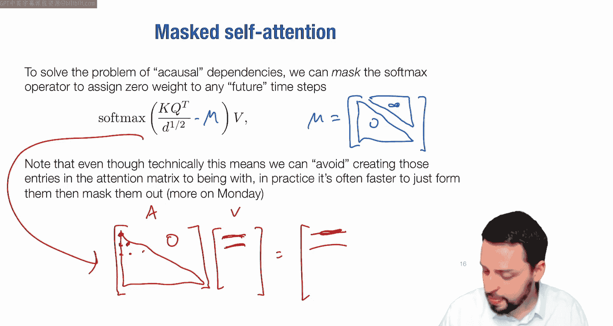

The second aspect of transformers that is sort of ill suited to time series prediction is the fact that these things are。

 as I said。Positionally in variance， the output of the network， I permute all the inputs。

Will just be that same output now also permuted。this is not a good thing for time series， right。

 we don't want to read the sentence the same way。Regardlessd of the ordering of the words or things like this。

And so to do this，s what's done is that we need a way of embedding。Sequence information。

Into our raw input series。 So if we have our series， you know， X1 through x big T。

 we need a way of actually injecting information about where in the time sequence each of these points actually is。

And so the way this is typically done is with what's called a positional encoding。

And all additional coding is， it's just sort of a matrix that。

Tells each row kind of where it is in the sequence。

 And the common thing to do for at least for sequential。

Positional encodings is to use something that lookss a bit like a fourier series if you're familiar with those things what all they really are is some function like sine of omega1 times the time step which in this case is1 the sine function sort of encodes you know this would be different for example。

 than the sine of mega1 times 2 and so would encode the fact that these two are in fact different and and at this point here occurs at time1 this point here occurs at times2 all the way down to sine of omega1 times big T。

Of course， just doing this for one frequency is not enough to because you know sign is periodic and all kind of do it。

And loop background on itself， stuff like that， like this is not sufficient to differentiate all the points。

And so what's actually done is use a number of these different。

Additional encodings with different frequencies， so mega 2。Again， this is actually very。

 very similar to a four year basis for those that are familiar with that， but if you're not。

 don't worry about that times one。A sign omega 2 times 2。Sign。Omega。Two times t。Etera。

 all the way up to say sine of omega n times 1， if there were n dimensions here。Sine omega n times 2。

Sine， omega and F。Now， oftentimes this is actually not applied and， and the omegas here are just。

 are just frequency terms。 and they're typically chosen in according to something like a log breaking schedule。

 Again， the only reason for these terms there is to introduce some sort of differentiation so that the you know network knows。

Hey， this point here is not just not just， you know， X T， but it's X T that occurs at time T。

 And this is X T that occurs at time2。 And so that's that's。

 that's the nature of these position encodings。 They're just sort of additional information that we add。

 and we do just add them。 We just， we just add it because， you know， in high mental space vectors。

 we're all kind of orthogonal and。So， you can kind of add these things together。 Doesn't make sense。

 Don't don't worry about that。 It's a bit， I'm being a bit bit heavilyvalier here with my。

 with my definitions。But you just add these this information on so that each input kind of knows where in the sequence it actually occurs。

 Now typically you also don't do this to the input itself。

 you do it to like a projection of the input。 so you have one more projection before you actually apply these positional encodings。

 but that's the basic idea。But now with these two properties。

 you really have found a way to largely address the two challenges that we had。

 so you know we no longer have the fact that outputs depend on all inputs by masking。

 we're able to avoid that and by using position encoings。

 we're able to actually avoid the bad side of the fact that there's no ordering of data and get only the good parts。

 which like the fact that you know there's the same length compute chain from any point of input to the output over all the time that there is。

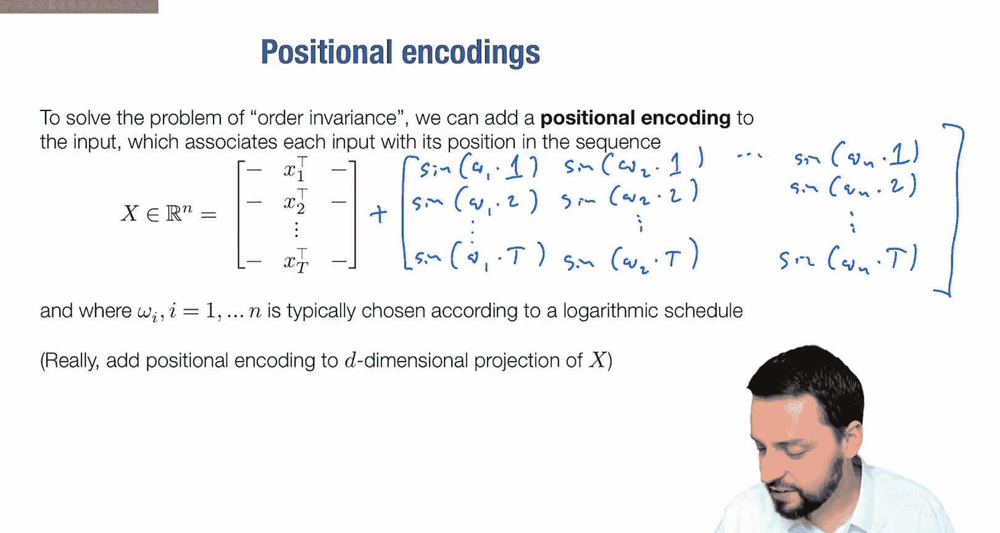

And so。For all these reasons and just through practice and experimentation。

People have found that for most time series problems that we care about。

 these sorts of networks do a lot better than either recurrent networks or temporal convolutional networks there are debates of whether this you know requires more data because there's less sometimes there's sort of less structure built into these networks you might need more data to learn。

Good parameters for these things。But the idea and just was borne out empirically is that。

For even seemingly reasonable sizes of data， these sorts of time series methods。

 just these methods just do better when it comes to time series prediction than other approaches we have that we've seen before。

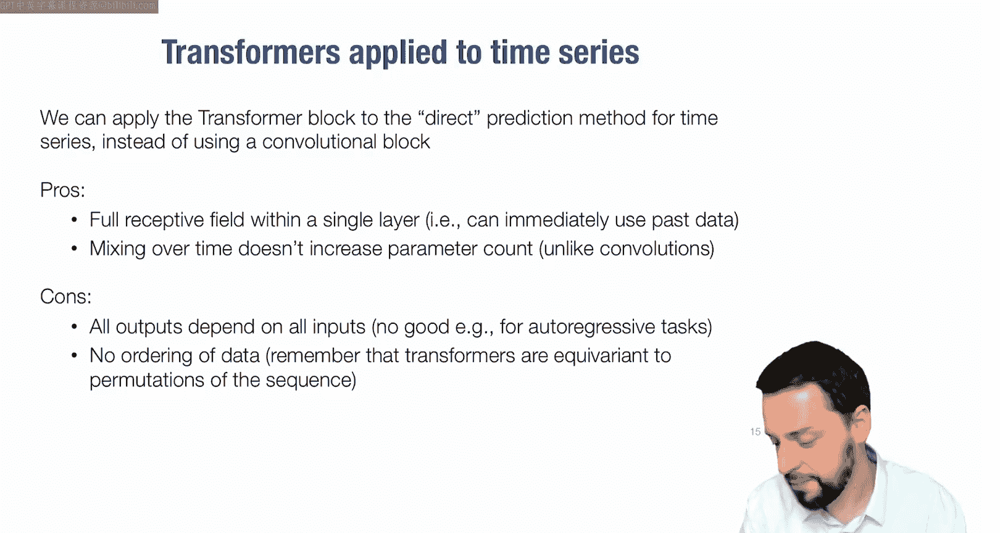

Okay， that actually is all I'm going to say。Mostly today about transformers。

 next time we will of course implement one of these things。

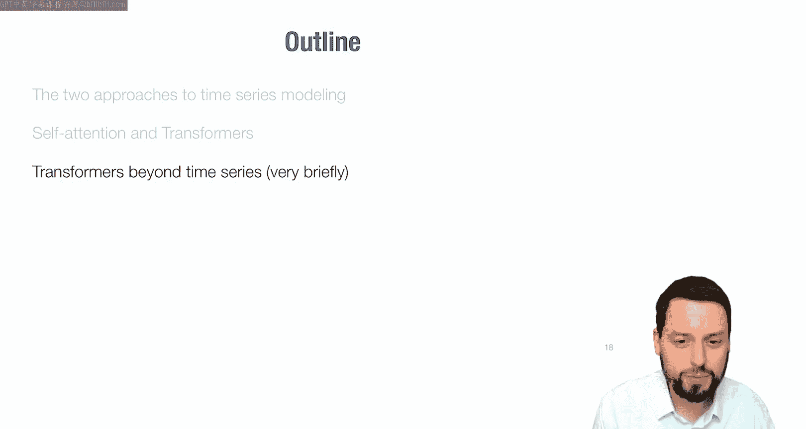

I just want to briefly mention that。There， there's no， although transformers were developed for。

 actually for。诶。Translation was their first application they were used for。

 which is sort of a sequential task was they have a generation component of translation。嗯。

Although they were first developed for these time super tasks， the reality is this mechanism。

 meaning combine data points V selflf attention。Plus。

 maybe some additional masking or something other interesting notion。Plus。

 then apply independent deep networks like MLPs to each sort of location in our time series or in our image or whatever individually。

This paradigm has essentially prevailed these days as the dominant paradigm for most high performing architecture。

 as I would say， indeed learning。It's incredibly simple。

 Actually think is much simpler in a lot of ways than things like LSTM。

 So I'm kind of okay with with this progress， right， like this notion of， you know， a mixing unit。😊。

Other than those horrible names of keys， queries and values。

 there's actually a very sort of elegant way of combining together information across all time with easy sort of masking。

 with easy ways of encoding additional information and that kind of stuff。

 and it's actually quite nice in some sense that it's become the development approach。

 both for time series but also for other domains as well。😊。

So people have applied transformers to to vision tasks where you apply a transformer to so sort of the the。

The points in time， the analog of points in time are just locations in the image。

 and for large data sets， this seems to work better than convolutional neural networks even even on image classification tasks。

😊，Similarly graph transformers， what you can do is in the attention matrix or like in the mask。

 you can embed the graph structure as part of the mask or even like a distance along the graph as sort of an addition to the self the pre softm。

 selfattion and stuff like that， and so doing this allows you to embed a substantial amount of information and prior knowledge into the self-atten operation。

In a manner that lets you sort of effectively exploit all that kind of all those properties and knowledge of the system。

Now， to apply it here， there are some challenges， for example， you know， as I mentioned before。

 self- attention is inherently like a t squared operation right form a T by T matrix。

 so if your T was going to be sort of you know a individual row and matrix for every single pixel in your image。

That probably wouldn't work because then you have， you know。嗯。25。I guess yeah， 26 but 26。

Squared different points in your actual in your actual attention matrix and that's just going to be too large to even form in GPU memory So there have to be some tricks that are made the tricks that's used typically in a vision transformers as you first sort of look at patch and bedding so you look at sort of small patches as kind of a single unit and you apply your transformer not to every pixel but to sort of every patch in the image。

That's just like end by end groupings of pixels。 you also have to figure out how to form additional embedding。

 So typically actually images you just ignore entirely just make them random。

 but with graphs and stuff， you want to you want to take some care for that and then you also want to know how to form the mask matrix So again。

 an images actually you really don't worry about this at all。

 you just all you deal with is this problem which is solved by patches， but for graphs， I mean。

 you want to take into some account what can influence what if you have causal structure of graph。

 maybe if it's direct the graph and you want to respect that directionality when it comes to when it comes to these edges and stuff like that。

 So these are all challenges that come up when trying to figure out how to fit a transformer architecture to your problem But again in general over time。

 what we have found is that this relatively simple， I think architecture has really prevailed。😊。

In terms of I setting the bar for the best performance。Of deep networks。

Across a number of different domains。And so it's a very， very powerful architecture。

 we've only covered it at a high level here so far。And actually even cover it。

 And it's full glory because there are things like multi head attentions like that。

 but we will cover that next lecture when we talk about how to implement these things。

 we'll actually will implement a very simple。😊，Very simple transformer architecture， which will。

Include self attention， include all these things including masking all kind of stuff， and again。

 as you're used to in this class， it will only involve a relatively small number of lines of code。

All right， so see everyone next time。

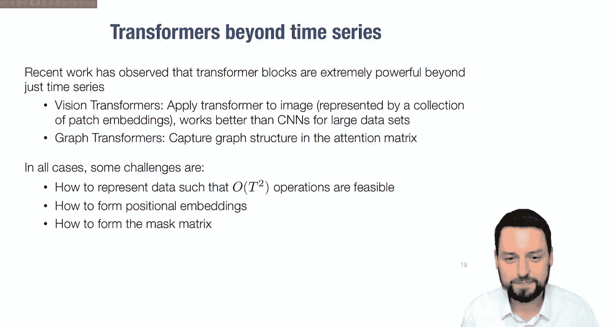