# CMU《深度学习系统｜CMU 10-414714 Deep Learning Systems 2022 fall》中英字幕 p21 -22-Lecture 21 - Transformer Implementation.zh_en -BV1ERtYepEpy_p21-

All right， hi everyone， welcome to this implementation lecture on Transformers。

So we're going to take us through take you all through again the same sort of patterns we've had the last few implementation lectures we're going to implement a nuyI。

 a native Numpy version of kind of the reference implementation of in this case。

 transformers as they're implemented in pytorrch， you will of course in the homework implement these in needle。

 actually there's no homework for transformers， but if you want to use them in your project you'll have to implement it in needle。

 but we're going to do it in NumpI to kind of show the simplicity of this and the reality is in needle you will have to implement a few more things。

 especially as we'll talk about later on batch matrix multiplication。

 but at least because these things are already implemented in Numpy you can highlight kind of the simplicity of these things just by looking at a nuie implementation。

Alright， so let's go ahead and get started here。's let's let's start by importing all our all our libraries to be just the just the torch nuy。

Wch。All right。And so we're also going to refer to some of the sort of basics of our sort of the mathematical equations of。

Attention， but to start off with we'll just implement kind of these basic operations here。Okay。

 so to start off with， let's talk about implementing the basic kind of attention mechanism we've talked about。

 which is essentially what we have to implement is this output y。

Output y is equal to the soft max。Of。K Q transpose over root D。Times v。

And the way I framed it last lecture is that K and Q and V were the inputs to self attention。

But what's a bit more common and this is for example。

 the commission that Pytorch takes in its own module is that you actually make the selfatten a you make selfatten a module in and of itself and you include the weights that manipulate the input the weight to get the K matrix the way to get the Q。

 et cetera， as part of the actual as part of the actual layer and so what we're actually going to do is something more like the following。

 we're going to implement a layer that has WK， WQ， WV as parameters and we'll actually implement something like softmax。

Of。K。X。Times WK。Ce transpose， which would be WQ transpose X。All over root the。Times。Times v。

And it turns out actually the convention for most frameworks out there is to add another linear projection after this fact。

 they actually also have some additional W out term。 This is， of course， it I wrote just V there。

 it really should be。X times Wv this。Tuckki speaking is not really necessary， right。

 because you could always just lump together W out into WV there。

 but especially when it comes to multi head attention。

 we'll see why we might want to do these things separately so we'll actually have a separate matrix here。

The follow conventions right， but this is the basic operation we're going to implement here as a self attention layer and the parameters of this layer will be K Wq。

 W V and W out， which has to be implemented as a linear layer。😊。

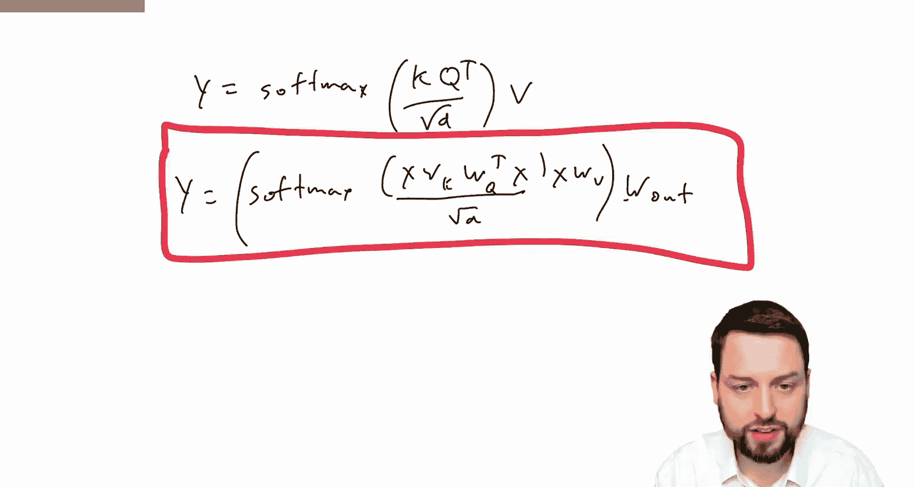

Now in some cases， some of these terms have associated bias terms as well as the weights we're going to ignore the biases and se them be zero so that we won't worry about biases if you want to include biases。

 it's it's already quite simple。Okay， so let's go ahead and start implementing this。This thing here。

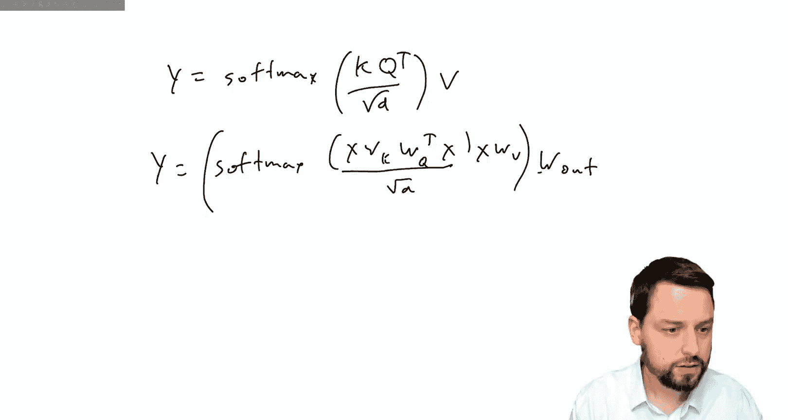

All right， so。To start off with that we're going just implement basically the functions of before we there's no built in softmax and and theump of course。

 you already have this in your needle so you wouldn't implement this。

 but let's just build us a simple。A simple nuy softm layer that would be something like take the exponential of Z。

 Actually， yeah， I think this was Z minus Z。Max。Over the last dimension。

 we'll always take the softm over the last dimension。

It goes true to make it keep take dimensions there， and then we will set。

We will set Z to be equal to Z will'll just normalize Z Z got sum。

Some axis equals negative1 and keep。It's true so that's our we return that。

And that's our softmax function。Okay， now we have our self attention and remember self attention is just literally nothing but nothing but this this that we saw here。

 So the way we implement that is we implement softmax our self self attention。

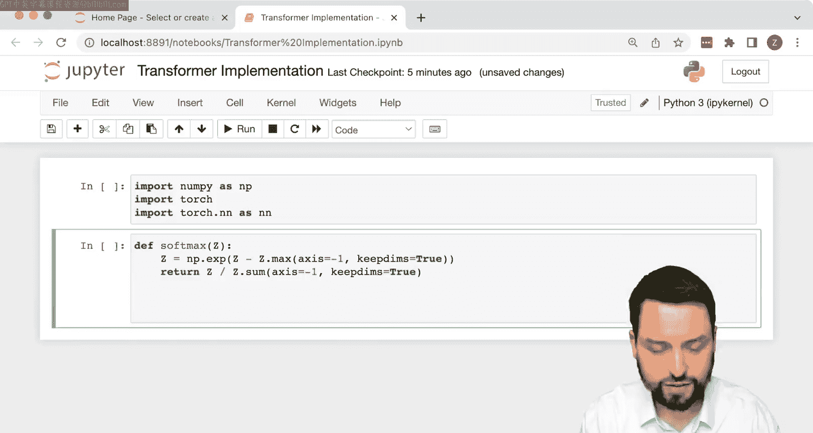

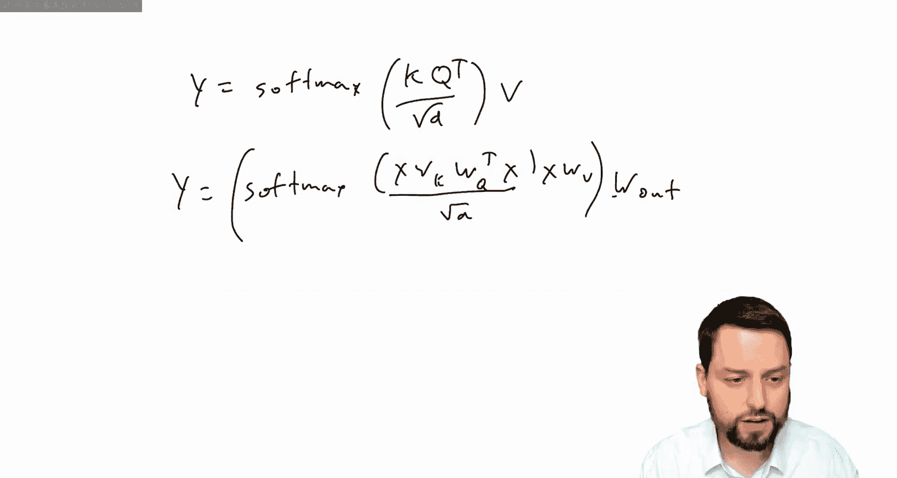

And。We're going to take one input X right and then create all those three terms。

 We're going to take a mask two that we might adjust it by， and then we'll take the weights。

 and if you look at this equation here。If you look at this equation that we saw on the previous page。

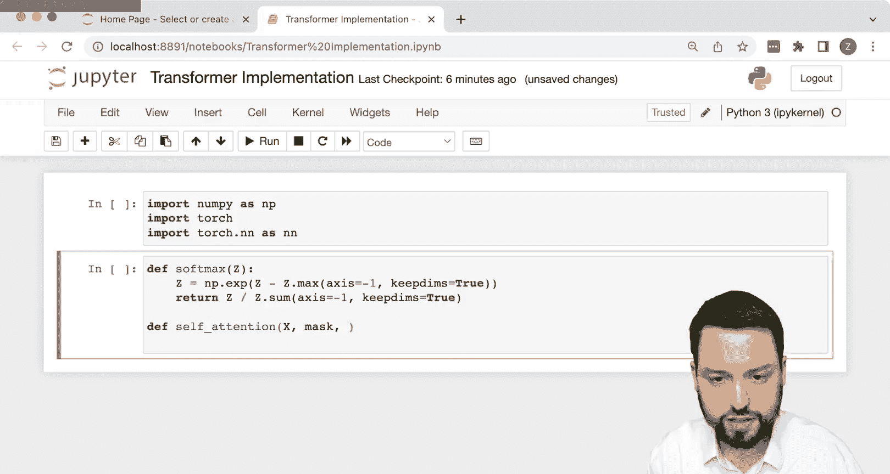

What we're actually doing in some sense is we're forming three things， right。

 we're forming K equals x times WK。Q equals x times Wq and V equals x times Wv。

Right but because we always want to sort of have the largest possible matrices multiplied together as we can。

 it doesn't really make sense to do a multiply to do three multiply kind of separately for these things。

 what we should actually do is form kind of a matrix that contains all of KQ and V together。

And form that as just x times a matrix that sort of contains WK。This over a bit。It contains W K， W Q。

 and W。V。RightAnd we can do that kind of all in one go here。Of course。

 and this could also just be written as x times W like KQV like one matrix sort of contains a concatenation of all these things and in fact this is really what leverage like Picard do internally so internally just like with LSTMs they didn't really store a separate each separate portion of the different hidden and input gate output gate to hidden and they just have sort of one matrix that here with self- attentionten too so sort of one matrix sort of contains your weights for the KQ and V matrices altogether。

Alright， so let's see what this looks like now sort implementation， so we would pass also W K QV。

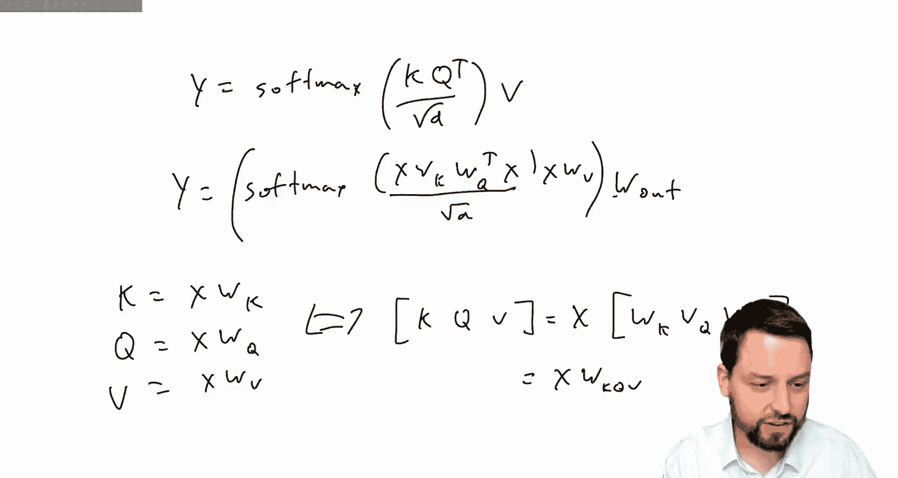

And I double you out。All right， and the first thing we'll do is we will form K Q and B。

 so we'll form K Q and V equals。Equals here， Well， it would be x times W K QV。

 but we have to then split it so that it's sort of that it's sort of consistent， right， We want。

 we want it to be the the same， the same。Each of these to be the right size here right so what we actually call is split WkQV again we'll split it into three components so the KQ and the V and we'll split it over the act the second axis there so it's over axis equals1。

😊，Right again， x here would be a t by D dimensional matrix。

 the sizes for them are all the other ones are all the same。

 but this is sort of the second dimension dimension we split over according what we saw we saw previously on the little notebook。

嗯。Then we'll define our attentional weight， which is going to be the softm。And again。

 this is playing softmax kind of row wise， so it's the correct， it's the correct term there of K。

Times Q。Transpose divided by square root of D， which is。

Shape one and then we'll add to this our mask and the convention is you actually add mask to and subtract them I know we wrote comes subtracting them。

 but we。add negative infinity instead subtracting infinity。All right and I think that's that's it。

 I think that's I believe that's that's all there is to it。 then we just have to return the。

Oh the one thing we'll have to do then is that's our attention matrix and then we have to return。

 of course， our attention matrix times V， that's the main thing that we want and then for good measure that we'll see why we do this in a second we also multiply it by W out。

And we can also return to our attention matrix if we want to。

 I think it's rather common to return both the actual output of the attention layer plus the attention matrix itself。

All right， so this is our attention。Oops， I think I didn't run the cell。

 is is our attention matrix and then our attentional self attention call。

 And now we can compare it to Pytorrch so we can look to see what is the actual， you know。

 how does the pytorrch really stack up against this。

 So let's say T and D equals a time of 100 and hidden dimension of 64 say。

 let's form our sort of real attention or I guess the ptorrch attention and we'll use the multi head attention。

😊。

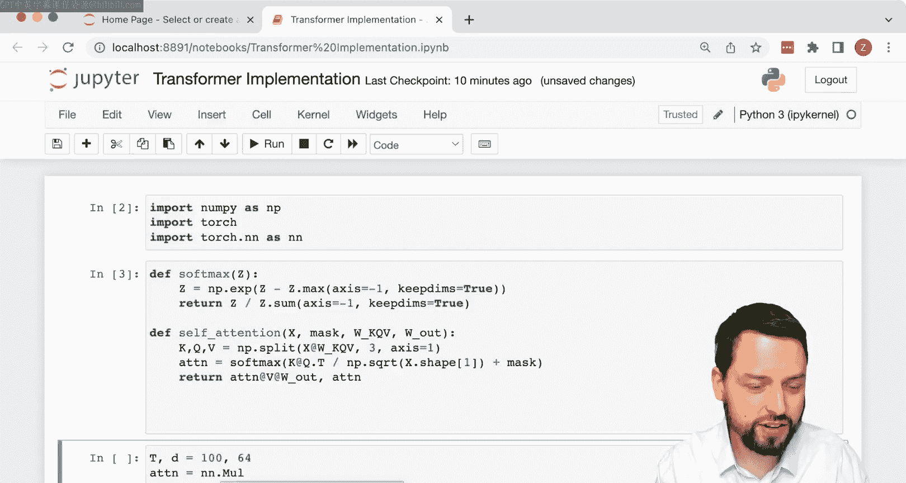

Call there and the arguments this call are first， you have the embedding dimension。

 let me just create some more space here。

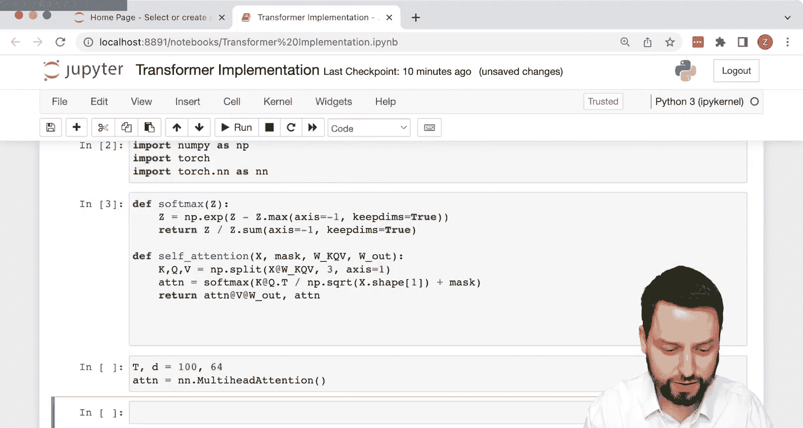

First you'll have the embedding dimension， then you have the number of heads。

 we'll get the heads in a second and you have some some other terms as well so you have the whether there's a bias term。

 we'll make that false because we don't want a bias term and。

Ltch of other terms that we're going we aren't going to worry too much about there because theyre they're actually not use that that frequently The one that we will use U dimension is this batch first dimension we'll talk about that。

 We'll get the batch。😊，Okay， so we're going to have D BR our hidden dimension。

 the embedding dimension one head for now we'll talk about heads in a second bias equals false and batch first equals true This is going to make the batch dimension the first mention the input we'll talk about that more with batching let's create our mask so let's make the mask equals a upper triangular matrix of infinities so on the upper triangular matrix there's going to be。

😊，Negative infinities and then torch dot ones。A T by T matrix of infinities there and we'll do it one off the diagonal。

 so that looks something like this。So the。Lower triangangleular portion is all zeros and the strictly upper triangle portion is all negative infinities。

U。And then we will set our input sequence to B torch。ran then just one again。

 we're just testing random inputs here to see if these things work or not batch size of one for now we'll deal with batchgees in a moment and let's get our true kind of output here。

Is the attention kind of applied to and the convention of P torches that you actually input。

you form the input three times to get the three different components of it。

 but we're just going to multiply it one by one our ours just has a single call， of course。

 right we don't put it in three times。😊。

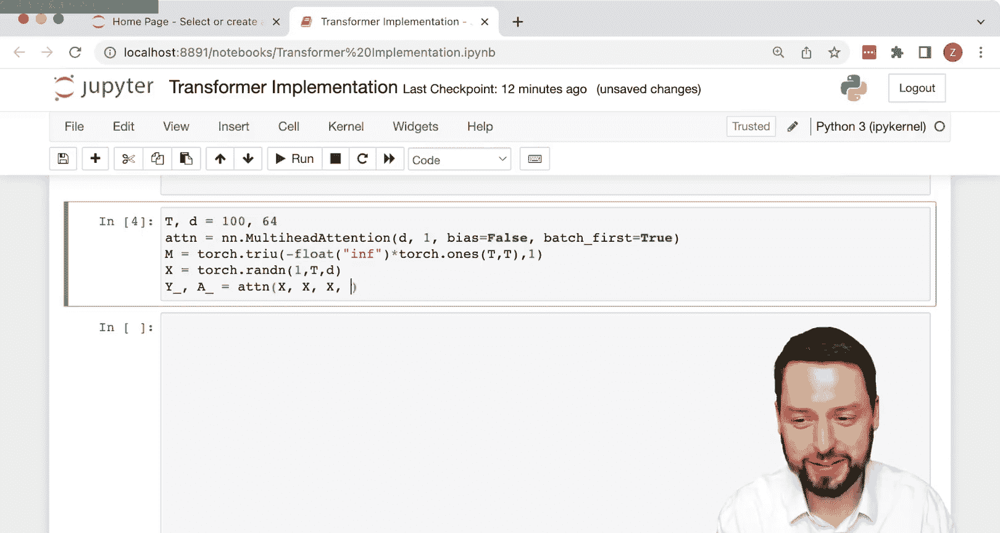

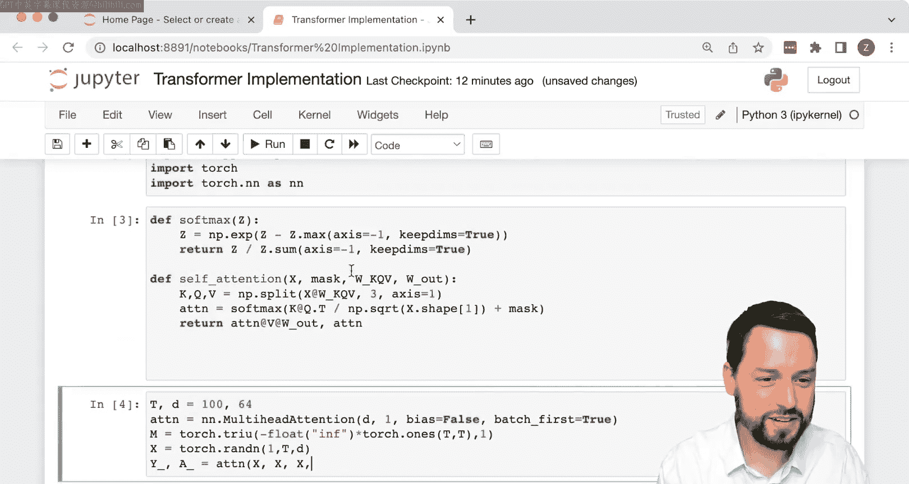

嗯。And then the attention mask equals M。Al right， so that gives us our ground truth output。

 it's no real point in inspecting it it's just it's just random， it's just going to be random。

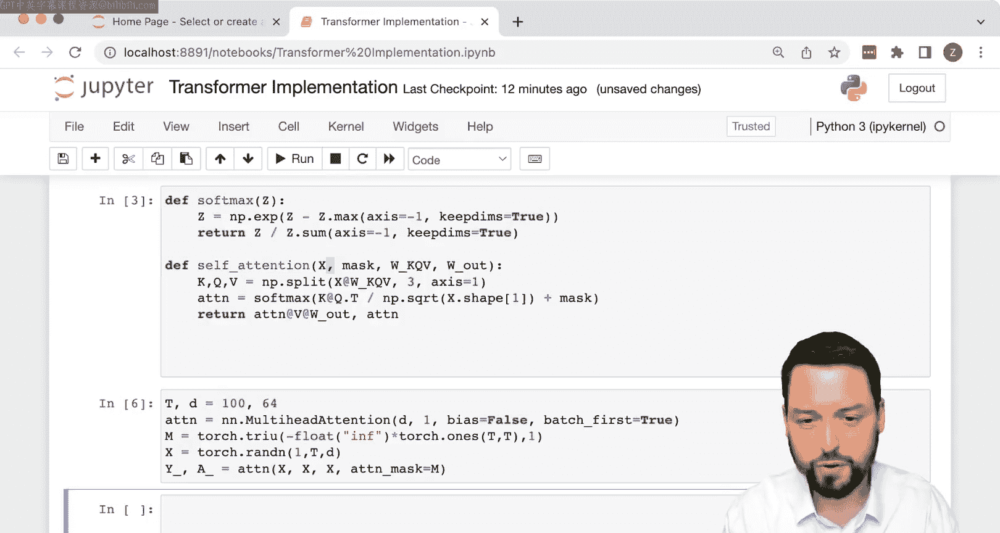

Numbers， but what we actually want to do is compare to sort of our version of this。

So let's also then compute our output， so y and a equals our self attention to x0。南派。And that nuy。

And now we need to have the actual past the actual weights and everything。

 so let's look a little bit at the model， so let's look at our attention model and see what weights it has。

So the first thing you'll note is this this in projection weight and in projection bias are the this actually is exactly this。

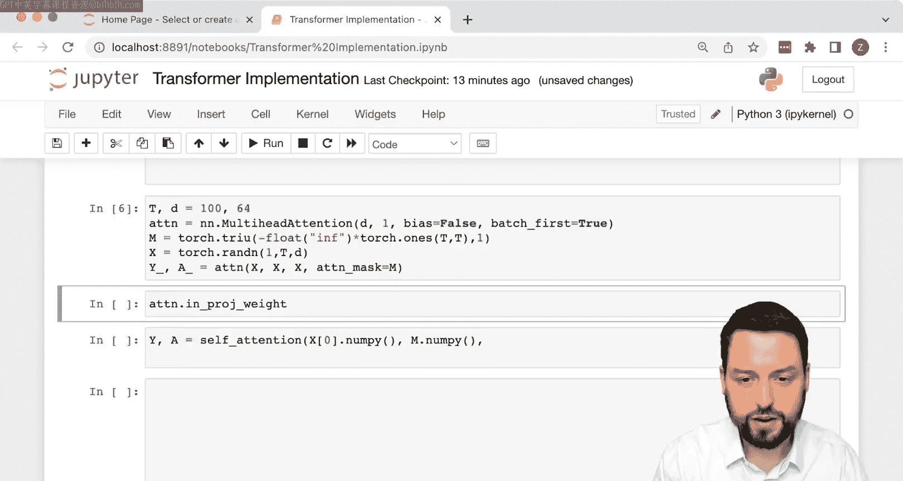

That's exactly this WKQV here。 It would be a bias term that it would have as well。

 And so we're going we're going to start with start with that as our as the thing we multiply by but to get KQV there and that really is KQV and if you just look at the shape of it。

 So it's three times 64。 but really so you know our version of that would just be that thing transpose。

 So we just take as input tension in project weight we want to attach it。

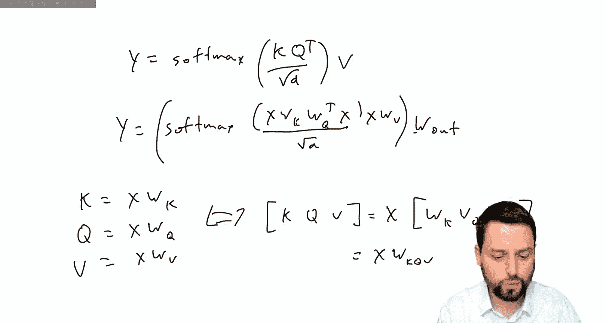

Attach and we want to transpose it because in our convention。

 we multiply post multiply by it and that need a 64 by 192 dimensional matrix。

And then we need to also multiply by the。The out projection weight， which is this term here。

 so's that's this term。

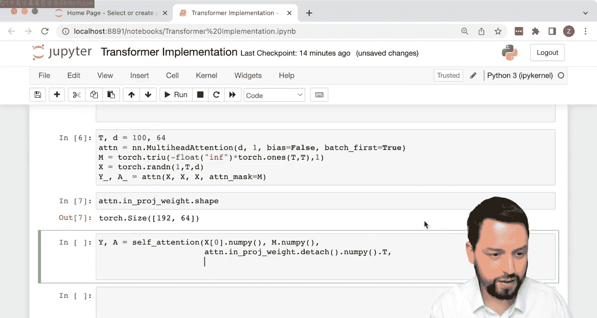

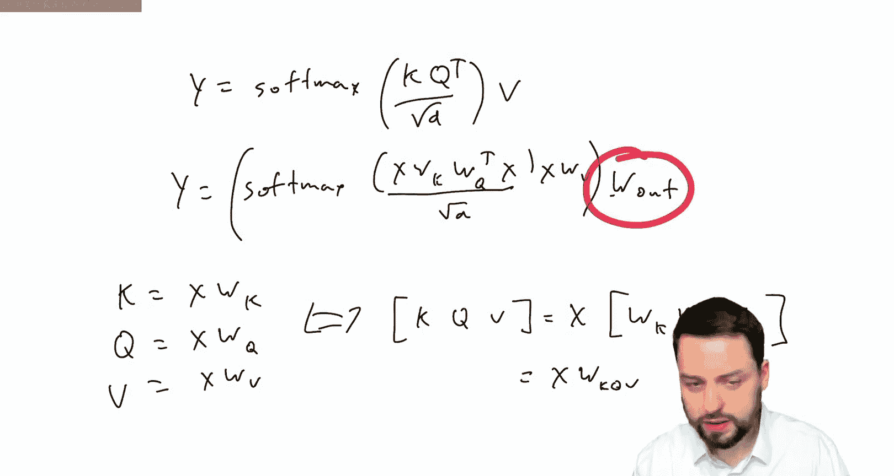

And there for that purpose， Pytorrch has a separate has a separate。Linear layer in this。

 which is called out projection， so that's well， let me just go up here。あ。Out projection。

 So this is a。It's basically a linear layer despite the， the the。😊，The funny name。

 sort of a special linear layer， depending on you can quantize it， I guess。

 but this is basically a torchdo linear layer。 And then it has a weight associated with it。

 It has a bias。 And so we can see what size it is' 64，64， as we expect。 And so the weight。😊。

And that detaach。谂排。Transpose， right， and that should be everything。Okay， let me compare。

Norm of we can look at difference between a minus the true。Of course。

 the true one would be different for each batch， so we need to do this。男排。

And look at that and as expected。Both this and our outputs are the same。

 So we're doing the same thing。 the plugar is doing here again with just sort of this this call here so that's that that's sort of the thing that。

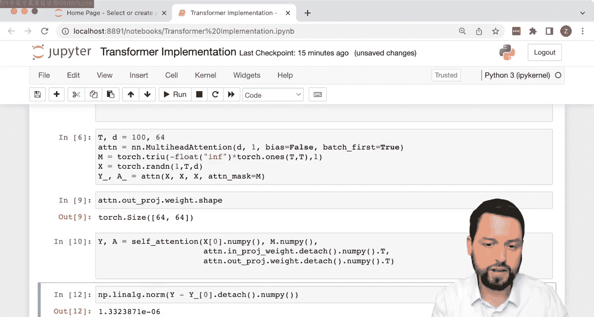

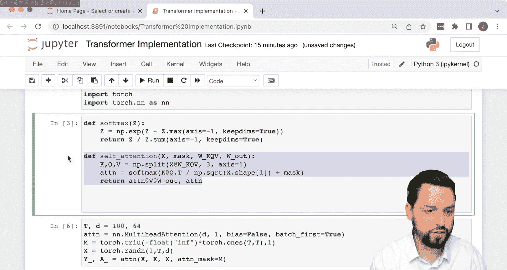

Pice switch is doing internally。With this sort of is with。

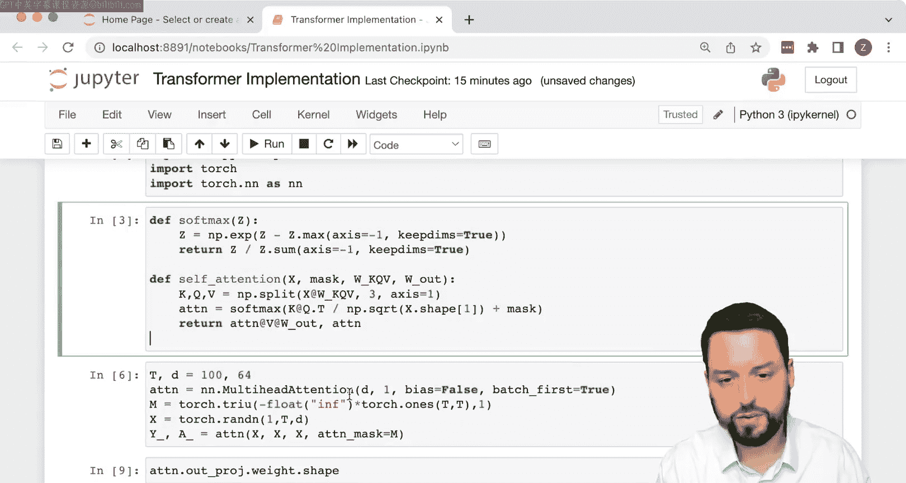

M they hit attention when you call it with a single head that we'll talk about heads again in a second。

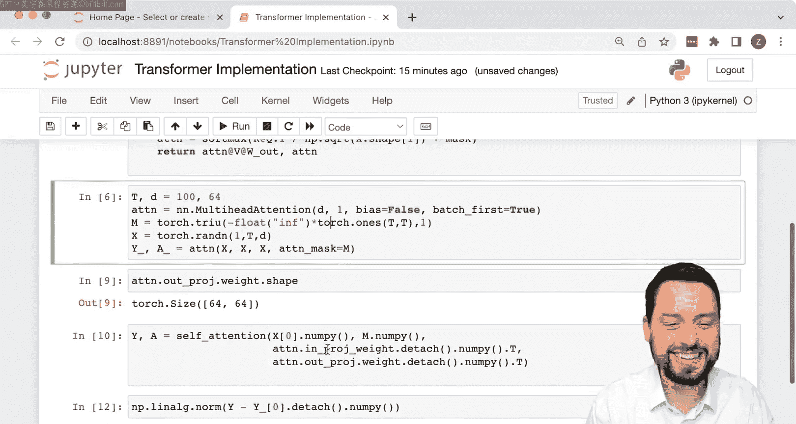

Allright， so let's now the next thing I want to talk about。

 So so that's sort of our basic limitation。 But of course， this is not， you know， this is sort of。

One layer of self- attention that works for a mini batch of size one that doesn't have has what's called a single head。

 which is not what we'll use in practice， and fact we'll use something called multi attention。

 which we'll talk about in a second。But before we do that。

 let me talk about the next element of order here， which is mini batching。

Let's talk about mini batching。Okay， so。When we want to do mini batches in。In attentiontention。

Let's look back at the formula for what we had for self attention here。

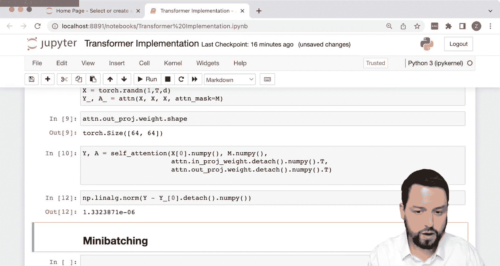

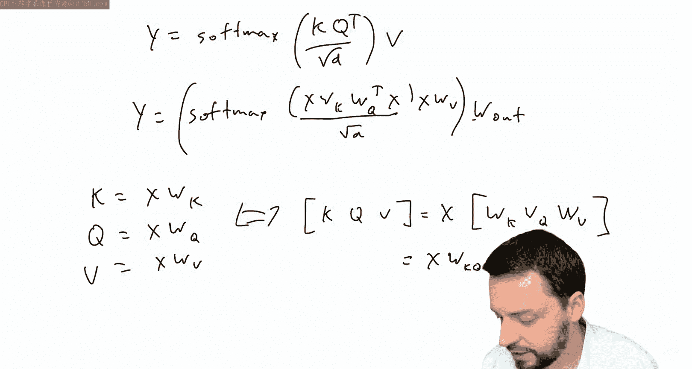

And I'm just going to look at this sort of equation here。And。If we have。

This is sort of for a single batch right for a single batch example， you know， K would be a T。

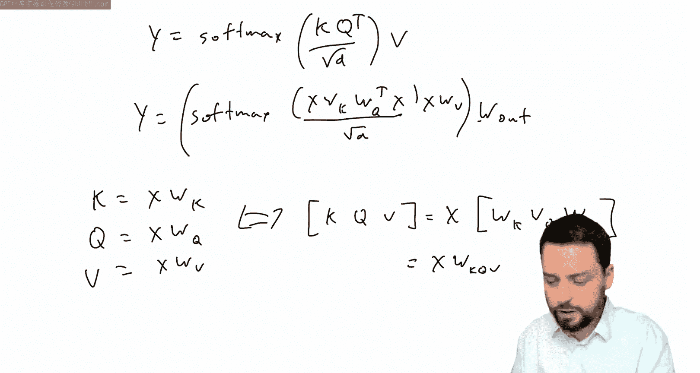

By the matrix， right， for a single。Mini batch。And if we have many， many batches， then， you know。

 we'd want to somehow。Contain more than one batch in the tensor。And remember， theres some。

 we have some sort of some options here， right， So what we did in R N Ns is that we had a T by。

Sequence T by batch size by D dimensional tensor， because we wanted to of batch multiply these matrices together。

 B by D matrices because we had to process each time series in sequence。So we've used this。

 basically for RNNs。Right。嗯。For transformers， though。We're doing。

This sort of multiplication in batches， right we're forming k times Q。

 which is the last dimensions of which is the T by D dimensional matrix。

So what we're actually going to do here is what we're going to use a kind of adopt more or rather what we should do to keep our multiplications contiguous in memory is adopt kind of a more standard approach and actually use batch by T by D。

Now， Pytorch， if you default actually to this format for self attention。

And that really makes no sense kind of kind of computationally。

 it's only done that way such that the Si so that you can swap in and out transformers for RNNs kind of one to one and not have to worry about reordering your batches。

But really we should be implementing a transformer like this。

 take the batch dimension first and then then do multiplications over the two trailing dimensions。

 which is going to be more efficient of course because these are going to be contiguous in memory。

 so what we should be doing is this one for transformers。Again Pyth force does not do this。

 this is why we the patch past this batch first operation that you saw earlier。

 this what was that here， batch first equals true that means the first dimension is the batch dimension。

 not anything else。

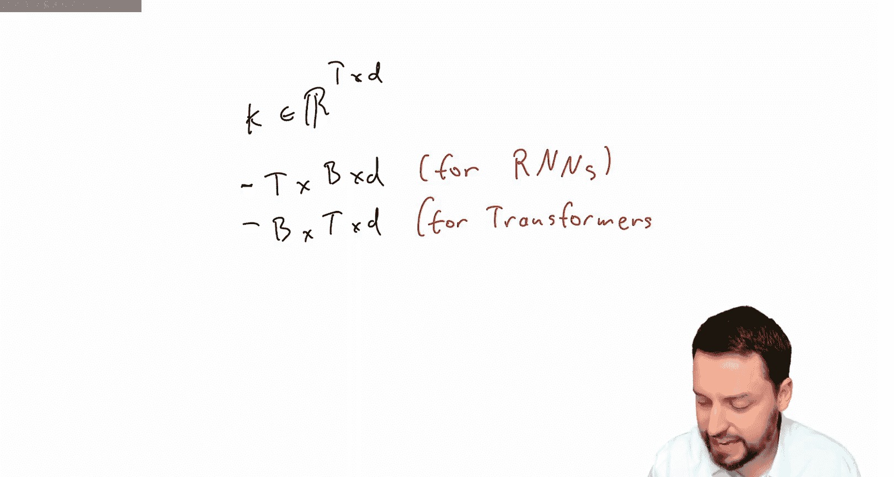

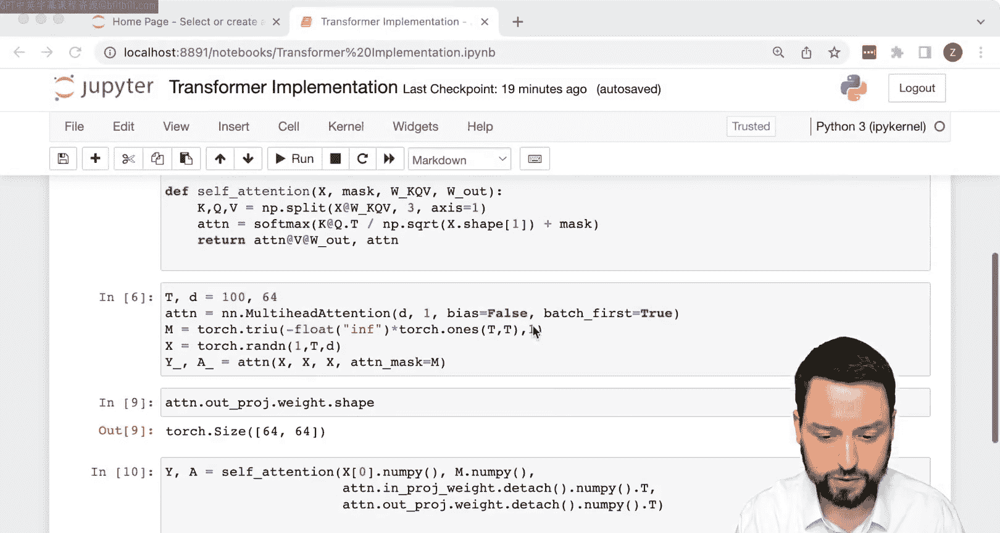

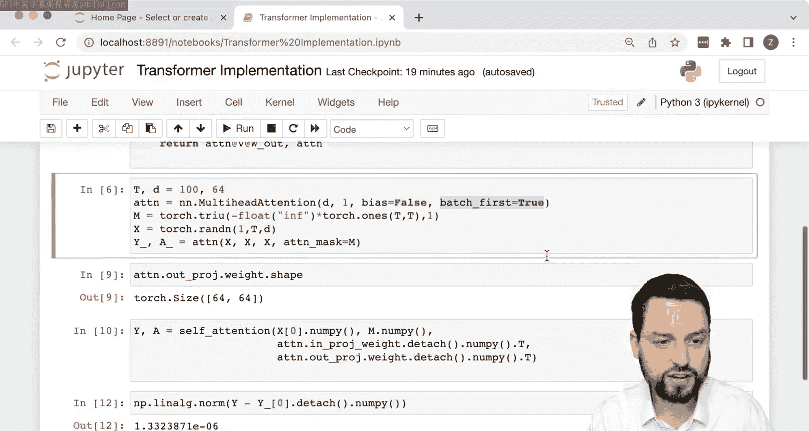

Okay， that's sort of the first thing to know about batching is that we're going to implement our batches like this。

 not like we did with RNNs to sort of do that but let's think now a little bit more about sort of what we want to do。

To process these in batches。What we kind of want to do is we sort of want to form like we have our you。

 our different batches。K1 or K2， right， So if we have， you know。Softm。Of。Our first。

 that's not like the first row case， it's like our first whole big K matrix and Q1 transpose。

 this forms， you know， the the output of our first batch。

The next one't be the output of for our next batch， et cetera。 You know， this， this with， this with。

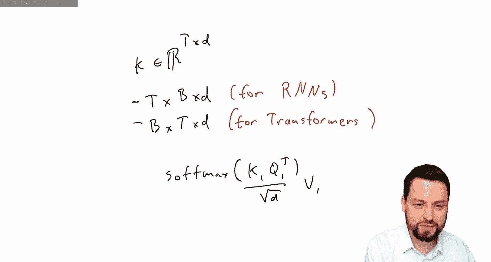

Q2 there， K2 would be our next batches， etcter。

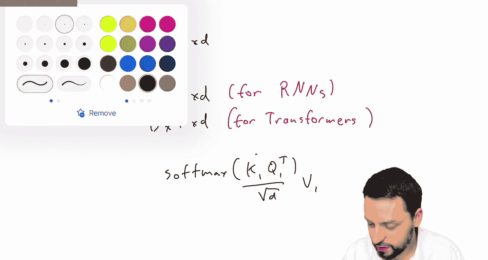

Okay， but it turns out there's actually a subtlety here that is worth mentioning because in order to do this。

 just think about just forming， you know， all multiplications of KI times Qi for every element in our batch。

It turns out to do is we actually need a new call， which is called a batch。Matrix。Multulplication。

Also sometimes called the BMM call。And。It's subtle why we need this because after's all we've been doing batching for a while。

 right like in convolutional networks we had batching so why do we need some sort of new kind of call for batching。

It turns out though， that all the matrices we've done previously。

 we all could have done that multiplication or all the batching we had there。

 we could sort of do still with a single matrix multiplication call。

And sort of what I mean by that is previously， even when we had like you remember like to do a for example。

 to do a convolutional call right， we would do something like y equals m to call of X so y1 there right equals I probably should have actually use。

 let me use superscripts here to talk about batches that's probably what I should have done。

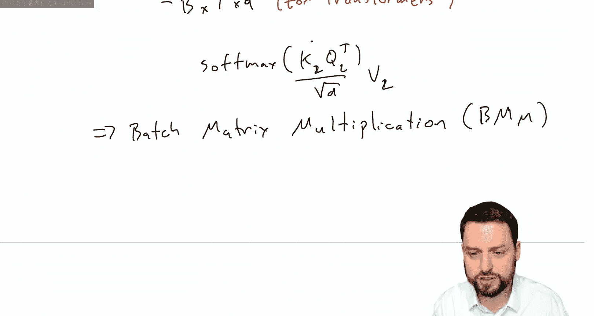

Because I use the other ones for times， so let me do that for batches。So previously。

 if we have the batch1， we would call integral of x1 and then multiply it by W。

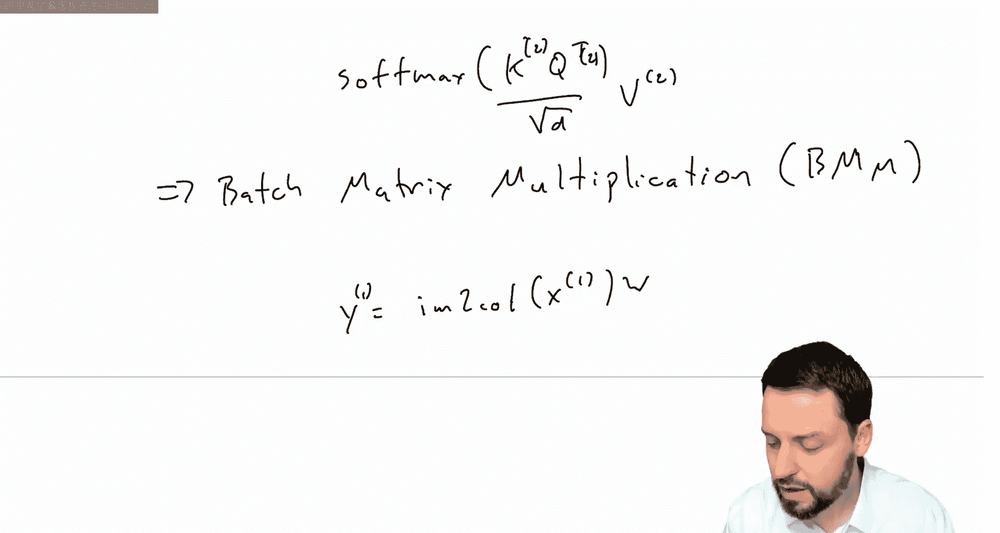

But of course， and this would be a matrix， and we would do that for x1 and x2 and x3。 so let's do。

This is the matrix here， this terms of matrix and this terms of matrix here。

 but it turns out if we want to get kind of all the different ys。

 we don't actually need to do anything but momentum multiplication。

 we could just sort of say that y2， all of them together， kind of y1， y2， etcter。

Is it going to be equal to impical x1？And to call。X 2。Et， all times the same term W。Okay， and so。

Whatever batching we had before。Was actually just attainable by taking you know whatever tensor we had in our first。

Mulplication here and just kind of you know flattening it out to a matrix to the proper size and and then recompressing it to be the right size。

 So you didn't actually need and you probably had seen this if you've implemented homework 4 when you did convolutions。

 you'll see we didn't need anything more than this。

 we could just do everything we had with this your ordinary sort of matrix multiplication call that you had in needle。

For transformers， though， we actually need something different。 We need a batch matrix multily hole。

 which says for all the K and Qs form this inner product and to sort of highlight this difference I want to go actually to。

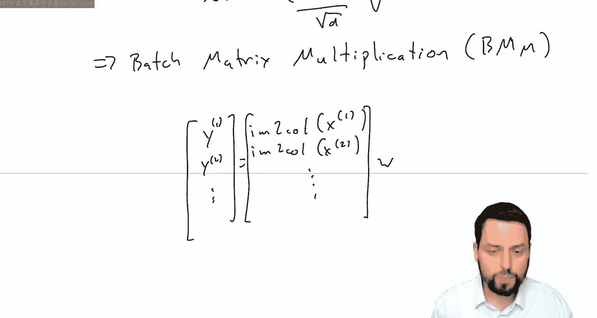

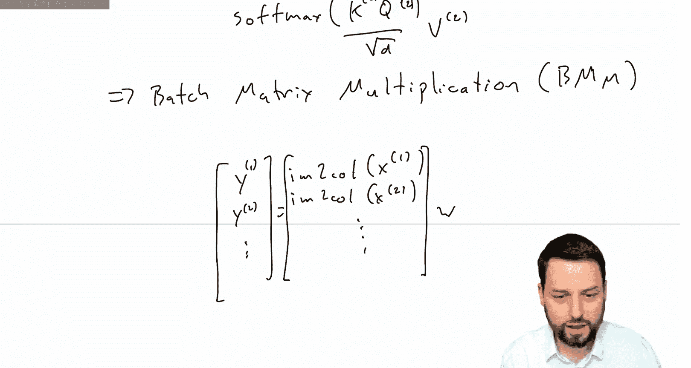

I want to go to。Talk about the， this。So to illustrate this in。

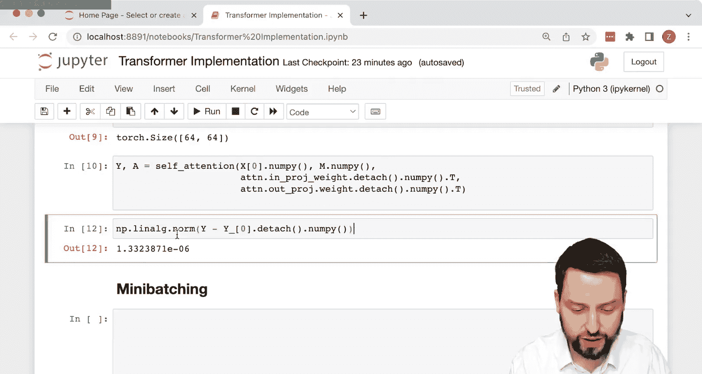

In nuie here。And just with some random matrices here， right， so let let's let's take like C equals。

And then。5 times 4 times 10 times 3 or something like this， right， and let's make d equals and。

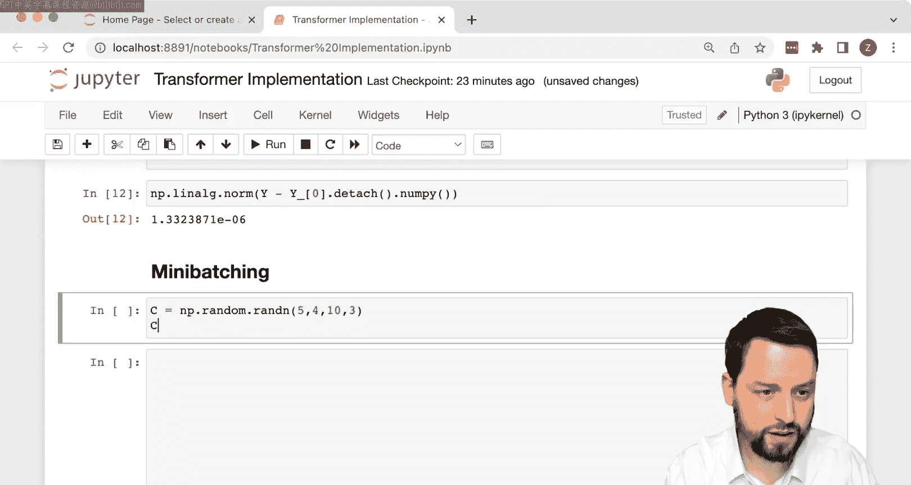

I' want use a because I think I use A elsewhere， so I'm just starting with C。

And let's just do it like three times six right So if I multiply in nuy。These things together。

Then my output basically is the leading dimensions， so for every input in leading dimensions here。

 I take the corresponding 10 by three matrix multipied by this matrix okay but to be very clear。

 this isn't really batch mentioned multiplication because this thing here is the same as if let's just say。

See， view this basically as a。Whatever by three dimensional matrix。

 So let's look at the shape of this。 This would be a。This would be。Oops。

I'll just reshape like this 200 by three dimensional matrix。😊，And I think this shouldn't do any。

This shouldn't copy memory up。 If I just did that， multiplied it Now， this thing by D， this would be。

诶。200 by6 dimensional matrix and I could then reshape this thing into a 5 by4 by 10 by 6 matrix。

 and that would actually be the same thing。As just multiplying c times D。So this will be all zeros。

Okay， so this is maybe saying a lot here is to make a really simple point。

There's nothing batch about this matrix multiplication here right this this is just matrix multiplication。

 this is a matrix， and this is a matrix， they're both just 2D tensors and so this thing here。

 even though this is a higher order tensor， the actual multiplication can be accomplished with normal matrix matrix products right so a 2D tensor  tend0 to 2D tensor。

All right， that is not the same for something like this。Alright， so what this is doing。

 that's the same dimension what this here is doing is taking every corresponding entry and computing the product of the being two dimensions。

 So this is going to be 5 by 6 by4， but you can't have different sizes here。

 So you can't have like this is 5，4。 This won't work to do。

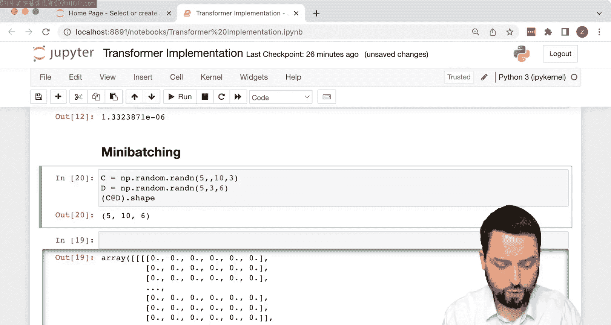

For higher order tensors， we multip it together， either the second one has to be a matrix。

 in which case it flattens the first one or the second one has to be the same。

 the leading dimensions of the second one has to be the same as the third one and then you just do sort of multiply the corresponding things So it's important to note this seems like I'm glosssing over here but actually it's important to note something kind deep is going on here which is that this operator in nupy。

 it's doing something actually quite different when you so here it's sort of doing like a loop a for loop over batches here。

 whereas if you do this it's just doing a single large matrix product and then reshaping things accordingly so are those are two very different operations actually。

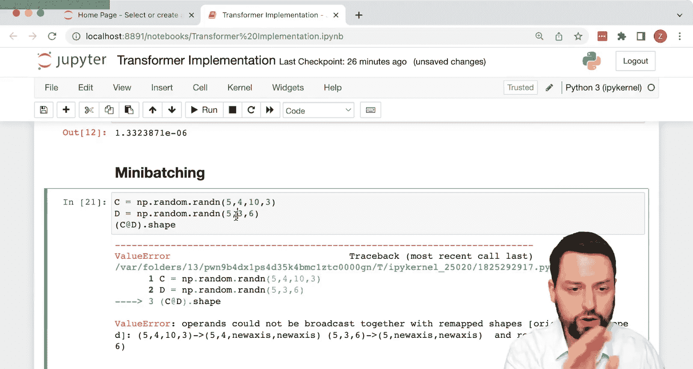

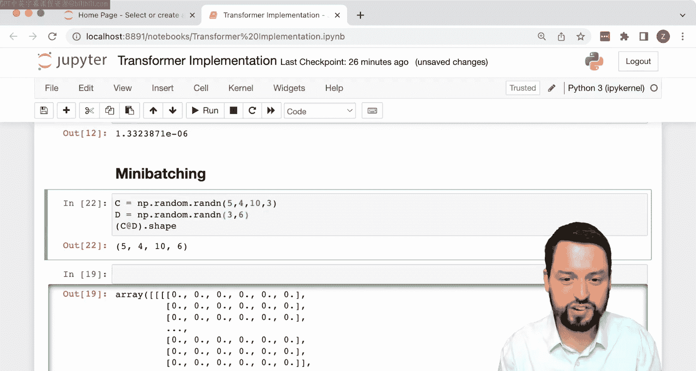

What we want for self-attention is a mini batch is a batch matrix version of this。

 but the good news is that it actually is a very small set of changes that we need to make to our to our matrix here or to our sort of function here in order to make a batch version the only thing we have to change actually is because we're all doing sort of batches there if we just make X be a batch by T by D tensor everything works here we just have to sort of use different a few different tricks let me just talk about what those tricks are。

😊。

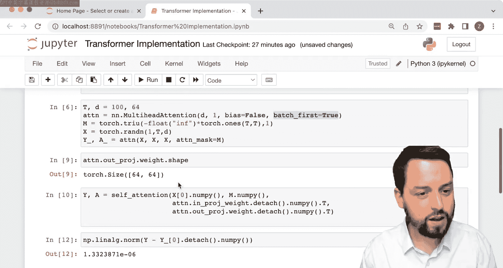

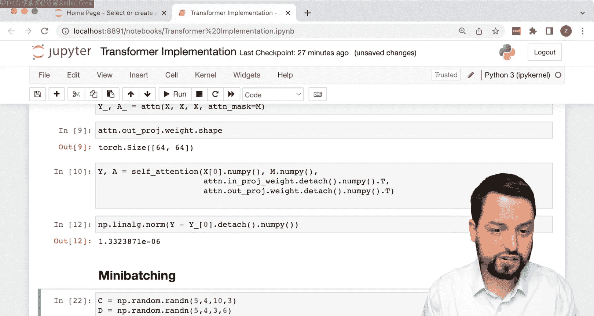

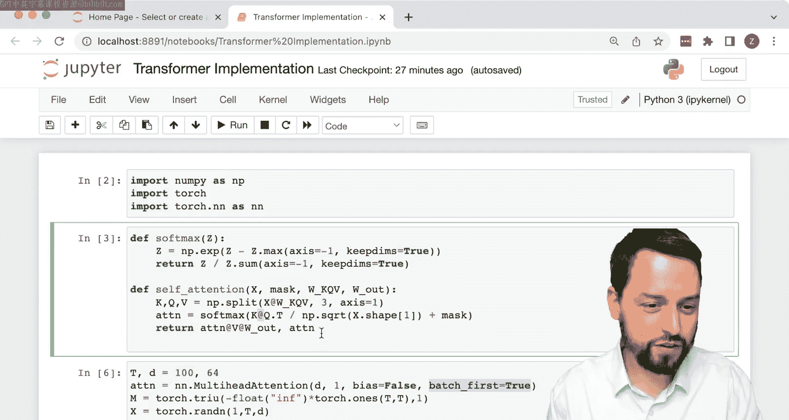

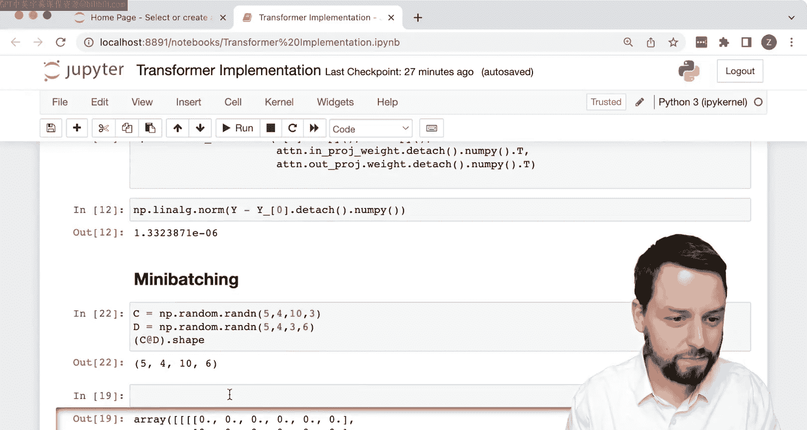

Let's define a。When the works is batching， I'll just call it the same thing because there's no point in defining a different term for this。

 but basically all we have to do is just you know we're gonna to be splitt it on the second dimension now in theory。

 but let's actually make one that will work in both cases let's make it one that will work in both the batch case and the nonba case as well so that's going this is going to take the last axis and split it on the last axis which will be either the third or the second'll also make D be the last shape。

 not not this and then transpose' transpose those the last two dimensions。

 but it will just transpose doesn't really work for highertensors so we have to actually say swap the swap axisxes call here and we'll swap the last two dimensions there。

But other than that， that is now a self attention call that will work in batch form。

Exactly the same as before， just with and it'll also work in non batch form。

 so it in fact works for both these cases。So let's go ahead and test that one actually。

 let's test this only difference being that let's say that B here。😊。

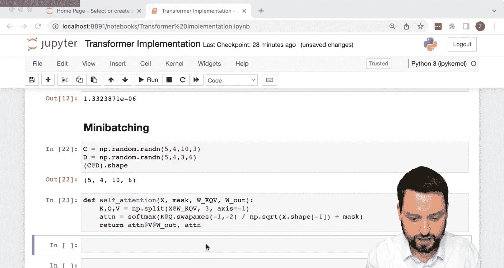

Is going to be equal to。This。And let's also set B to be， I don't know， about size of 50。

And then let's make x equalched。嗯。U。Of。B by T by D。

 and then the mask is the same thing as before the mask doesn't change。

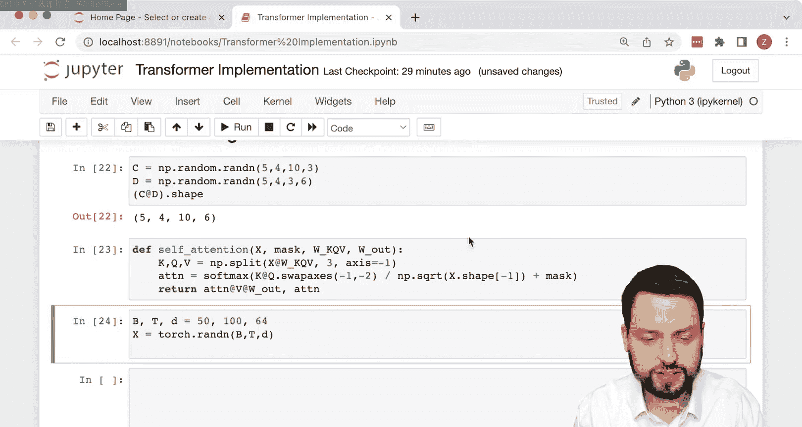

It will the mask is applied the same mask to all to all these things so it should just work oh I might to actually do one thing Now this this will work because I think that the dimensions will work properly for the batch you don't need to because it's the trailing dimensions that need to sort of be broadcast that that just kind of works。

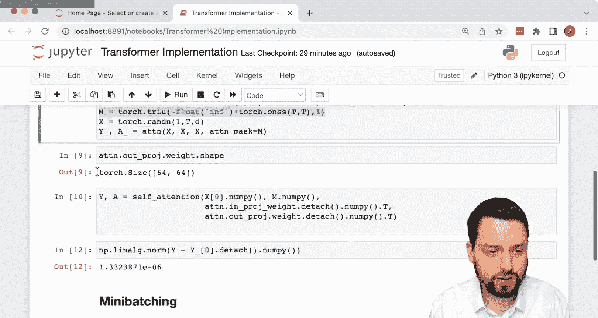

Make the mask the same thing， just for the sake of it here， I'll add that there。And。This is out now。

 So let's test out why。A， the true Y， the true A is going be the attention， X， X。

 X attention mask equals M。 So I got the sizes right。 Okay， I think I did there。

 And then let's look at ours。 So let's just， let's add our。

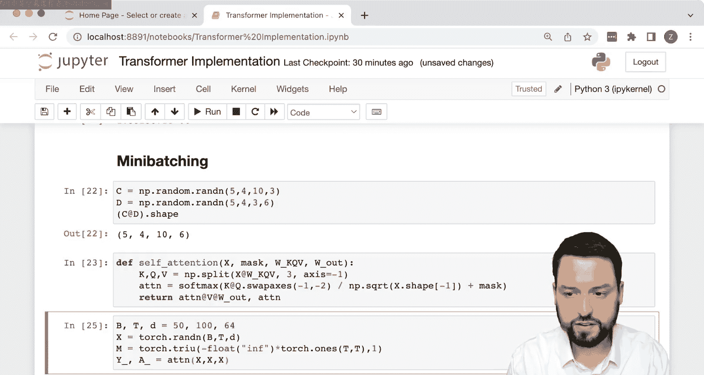

Y a equals self attention。X， mask， W， K， QV and W out。

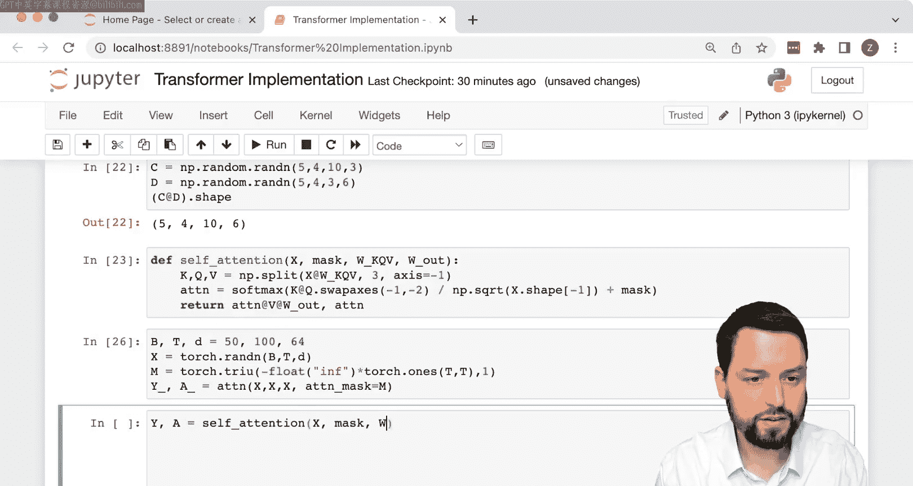

K。😔，Did run here or something。Is there。Ys em。Oops I didn't that's right I won't more because It just copy my call from above。

 so let me do that。

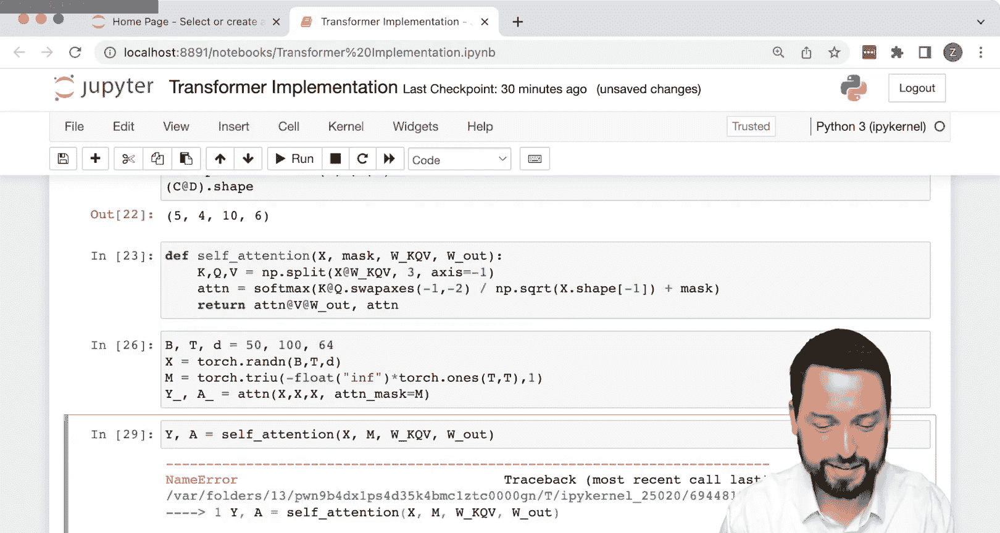

This is what I wanted to call。

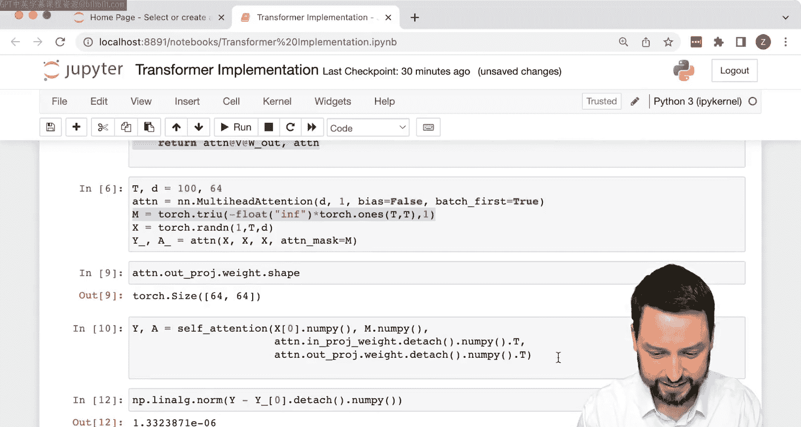

The only difference is I don't want this first one there， I just want that， and that should work。

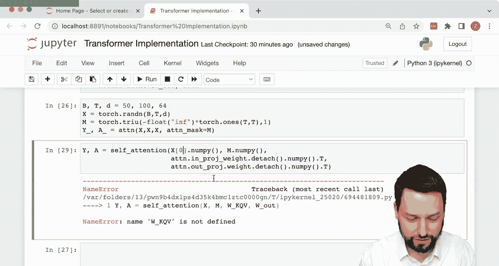

Okay， and now let's look at。好ち。And arm。Of y minus y。あ。南排。All right， it's looking good。

 It's the same thing。 So now we have。诶。Bch version of matrix multi of self attention working。

All right， so that we're actually kind of almost getting there。

 we have almost ill all the ingredients we need to build that transformer。

 the only missing ingredient is multica attention。So。Attention， as we described it before。

 is actually not usually applied in this way。So。The problem with that self attention it was。

 as we sort of described before， is that when you're forming this， let me go back to the board here。

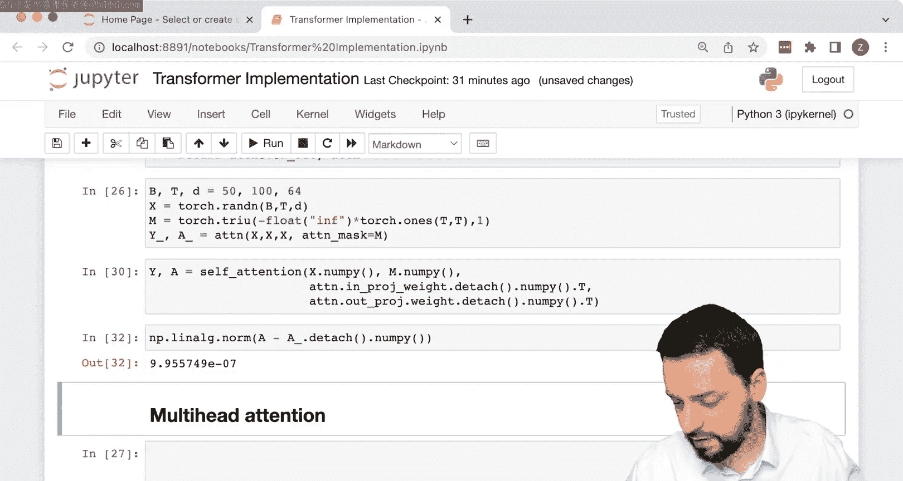

When you're forming， say this KQ transpo matrix。This is a matrix， so this equals some matrix here。

 and as I mentioned before， sort of the I J entries of this matrix is equal to K I。K， by。

Transpose times Q J， where K is the I row of K and Qj is the Q row of Q。And。If these are each。

 if Ki here is d dimension， so basically if K。Remember is T by D。 That means K I。

 the I row of K is d dimensional。And you're using a D dimensional inner product。

To ultimately compute one number which is used to weight these things together。And。😊，While。

 this is a bit of a hand wavy argument。What I would describe。

 the way Ill sort of put this is that is not the non linearity of the attention layer。

I guess there's also multiplication of things together。

 but sort of the key on nonlinear the already is like like the softmax。

 right you're getting different averages to add up together to sort of make your you're getting an average of the different rows of Q to all。

Give a weighted sum together to produce your output and somehow doing that only once for all this work to form big match multiplication seems like kind of a waste sort of at a high level。

 kind of the intuition here is you sort of you want to cram kind of more and more nonlinearities as many as you can in some sense。

 into your nonlinear operator like this to sort of get the power of nonlinearities for deep networks for function approximation and just doing this once with these really big inner products here iss kind of a bad use of nonlinearities to kind of again。

 give a little bit hand wavy， but I think kind of intuitively correct argument here。

And so what the common thing to do is is instead of producing just。One application of attention。

 we're actually going to produce。Many of these H of these were h of the parameter known as our heads。

 so we're going to have what's called multi head attention。Multi head。Attention。

And what that does is that takes our K， but also our Q and RV and partitions it。

 So K is going to be now equal to K1， K2， etctera， up to K。Times the number of heads we have。

 I'll just call that little gauge。Okay， H and Q would be the same。 So Q would also equal Q1， Q2， Q H。

 And importantly， I'm doing this by splitting the the columns here， right。

 So the rows of these matrices are the individual time are the individual time points。

 I'm taking each sort of slice of time， a row and time。

 and I'm chopping it up into H different components。 I this is an H here。Each。Right， then。

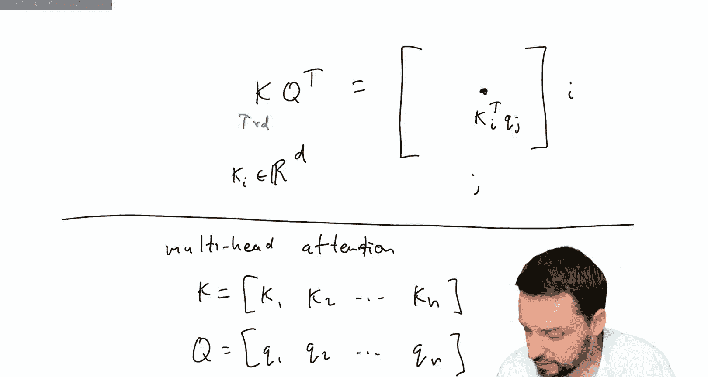

What I do is I form a number of outputs like my Yi would be the softm。Of。K I Q I transpose not again。

 these are not batches。 This is for a single example。 So we're going to do the same thing。 you know。

 bench the same thing by batch， but that will require a little bit more， a little bit more。

little bit of care to do both multi head and batch tension， but we'll get to that in a moment。

 this is now I just doing it by the different heads for a single example。Divided by D。

 but it's now a D is actually going to be the square root of D divided by H because we want the it's each I here。

 you know each row here of this matrix sorry each sort of sub subgroup of this matrix is going to be T by D over H So you have this of the H times V I and then our final y。

 the final output of the sort of soft max layer is just going to be all those y's together， y1 y2。

Et cetera， to why。H。And then I guess you all multip it this W out。

 which again could just be folded into all the other matrices， but let's not worry about that。

That can be done after the fact that you want to。Okay， so that that there is our。

Our multi head attention。Let's go ahead and implement this and we will need a we will need a bit of care here when we talk about doing this in a manner that allows us to do sort of these multiplications。

Kind of。In the proper way while also preserving the batches properly， all right。

 so we'll talk about what I mean by that， but then we'll sort of see yeah we'll sort of see what I mean by that。

Okay， so let's talk a bit now about how we go at implementing this thing。

So let's define another operator， which we'll call。Whats what call。There we go， multi head attention。

Like also X。The mask， but also have a parameter which is the number of heads we'll take， again。

 W KQV nothing changes but that of the sizes of these things。

 we just are applying self attention to blocks there。

Let's just for the sake of it also get B， T and D is the shape of x because it's a little easier just to use those numbers instead of getting the shapes of x automatically。

😊，Now let's sort of form our self attention。So first we'll do the same thing we did before。

 which is to say we take x times W KQV and we split it。Into three components along the last axis。

All right， now we're going to do a little bit of a of a tricky thing right now， K Q and V are。

 as I said， they are。KQ and V are。What size would they be， Well， they'd be B by。

I got a comment thus these are like。K would be B by T by D dimensional matricies as well。

 just like x。But what we want to do is we want to split this。Into。A different size， right。

 We want it to be instead B by T。Well， where we want to be we like we want to still multiply。

At some point， a batch by T by D divided by head size。

And we have to be able to multiply sort of these matrices together， right。

 because we still need a T by T matrix for each of those。

 So we really want to somehow convert this to a。嗯。To a B by heads by T by D divided by heads。 Okay。

 so we could do this by saying like you know k dot reshape and well。

 first of all we have to reshape it to be B by T by heads by D divided by heads。

 But then we need to swap kind of this term this this axis and this axis there。

 So we're going swap the axes of one and2。 By the way if if。

I think we're starting to the point where like doing this all would be way。

 way nicer with named axes or named dimensions here。

 which is one of feature of the Pitororch has that I admit I don't use even though I probably should but it might be nicer if you sort of keep track of these but what we're doing here。

 this would convert this to a to this format right because we convert the heads T by heads and we swap these two and then we get heads by T Okay so that would convert K to be a 10or of the form that we want for batch mentioned multiplication。

嗯。I'll just treat a little bit here and do like one kind of。啊。Like this， I don't want to this for。

 I don't want to repeat three lines of this， so I'll just do them all at the same time。

 let's just do for A and KQV。So this just does the same thing for all of those， right。

 just this will do it in one line。Okay， now we form our attention matrix。

 so let's say our attention is going to be equal to the softm。😊，So again。

 works fine in the batch setting because it's applies applied to the last dimension of everything here iss the same because K times Q swap axes。

Negative  one， negative two， that's all the same these are now four。Or tensors。

 but we're doing we're forming like this， we're just transposing these two elements here to form our attentional matrix。

 we're dividing by the square root of D the number of heads， and we're going to add the mask。Okay。

So now now we're we're good all we have to do let last is sort of multiply our attention by V。

 but now we have a I think kind of the wrong size right because now we have a matrix that is。

This size， and we want to convert it back to this size。

 So what we're going to do is we're going sort of swap axes 2 one and 2 again。

 That swaps the heads and the T dimensional axes there。 So it's going be back to。Back to T by heads。

 and then we're going to reshape this to be batched by T by D。Okay， then finally。

 we multiply by W out and return this and the attention。😊，I think that should be that should别。

All right， so let's do everything again， let's just heads equals four， let's create attention。

Is a。Now， and then that multi head attention。My head。T had attention。

D heads4 bias equals false and batch first。Equals true， get our true outputs。Attention。X。

 and then tension mask equals M。All right， so this is our ground truth。

And now we have Y and a equals our multi head attention。X do nuy。M dot nuy。

Heads。I'm just going to copy what we did before。

These all stay the same， so nothing changes here。

Its。

And so I be wrong。差多。This I called that shape I reshape。

Okay， and let's compare why。Sort of say one around to give me space norm y minus。I catch。Okay。

 and it looks good。Now one to keep in mind is actually what pitorrch even returns here。

 So it this for a， actually something will I think something will go wrong here。 pretty sure yep。

 And so what's oddly happening here is that you know our attention matrix is sort of rightly。

 well we have 50。Baches， right， We have four heads， and then each head has an attention matrix。

 So it's100 100。 This is the right size of the attentional matrix。

 But if you look at the output of this， it's only 50。

 And I believe what pi torsch does it takes it returns the。Average attention over all the heads。

 I don't know why this means anything or why this should mean anything to anyone。

 But this is what it does。 I believe。 So if you look at this， if you look at the mean。

Over the axis equals one， I think this will tell you the same thing。 Yeah， so， you know。

 ours is again。Ours rightly returns all the attention I use for each head。

 but Pytor just returns them for each one。

Okay， so now this is our multi head attention， again， not five lines of code。

Now we're ready to put it all together and create a。Transformer block。Alright。

 so what is the transformer again， a transformer is just a。

 I don't know if I want to write the whole thing again's fine it's honestly faster to write it in code than it is to write it is as a as the equations。

 I suppose I suppose I'll sort of write the at least the high level， draw the diagram here。

 So what transformer does it takes X as input forms from this K Q and V。😊。

Q。And V puts these three into self attention。Attention。嗯。😊，Adds together the input。

As a residual layer and puts this into layer norm。space there。Layer。Norm。Then puts this into a。

Feed forward network， which is just like a two layer network。

 is going to be a re followed by or a linear layer followed by a re followed on a linear layer。

Let's call it a feed forward， and then。For good measure has another residual connection into layer norm again。

Lair Nora。All right， so that's our transformer honestly。

Actually easy to write this out with code than anything else， so let's write this out in code。

All right， so we actually will have to implement like the basic operations here。

 but we have to first implement like a。🤧ふふん。😊，A layer norm call。

 so let I know we've already done this in needle， but we have to do it again here。

Let's delay layer norm so it's going to be return Z minus z dot mean against the last axis。

 make it one。Keep dims equals true， so it properly broadcasts。

 and then we want to divide by and that square root of。うみな。Of。Of the。Cs or go。

The variance of on the last axis。One， keepith。al true。

 And then before taking square root we add epsilon so we don't get sort of a by zero error。

 right We also need to find a re。 that's just going to be return。Maximum c and0 okay。

 and then we finally have our transformer layer， so let's define our transformer。

And now we actually have to honestly， just having all the emphasis takes as much time as anything else。

Take X， the mask， heads， so we'll use a multi head attention for our transformer， WKQV， W out。

W feed forward one， there's no option and I believe in Pythorchs transformer to de up the biases for the feed forward layer。

 we'll through do that manually， but let's it's easy to include biases if we want to。

 let's just not do it because it's kind of a pain。The two feet layers and Epsilon for layer norm。

Okay。pell the transformer around。It's former。All right。

 so let's first set z equals to layer norm of z or x plus multihead attention。Of。嗯。

The head attention apply to X， the mask， W， K QV， W out and oh and heads。It's。Okay。

 and then we need to also give it Epsilon for our layer norm。M's return then。We's now take。

 take this output and kind of， you know， feed it into a a。

Two layer network and flat layer norm there， so let's just return the layer norm of Z here plus well。

 the value of z times w v41。Times w。E42。And excellent。Okay。That should be it。Um。

So now also to define this， I also find like the Pth reference solution， so let's define transformer。

😊，equals to neural and then transformer and one thing you'll sort of notice here is that you when you have these things you'll notice that there's these like transformer decoders。

 transformer encoder layer， transformer decoder the thing you want is transformer encoder layer when transformers were originally formulated in their original paper they had kind two different layers that had different size inputs here basically they would share like K andq terms from the they basically had an encoder decoder architecture because they were using it for for seek to seek problem that involve transform so just like with RNs。

 you can have two RNN and stack together one that encodes it one that decos it they did that with a transformer but it made actually notation very complicated so a lot of later application transformers they don't use the sort of things and in fact it's rather it's rather like language models don't either just this one application transformers is actually rather complex compared to other ones。

One but basically decoder depends on sort of the relative sizes of the inputs to them and will also sort of imply masks or no masks。

This is how we'll do it here， but just note that this is the layer you want。

 if you don't know which transformer you want， you probably want this one。

 the transformer encoder layer。And so I forget what the arguments are so the this D and then heads and then the and then then let me see so right。

 the dimension of the feed forward， let me pop this up a little bit。

doing that There we go。 dimension of the feed forward is the other argument here。

 which is sort of the dimension that we that we see in the in the after the in the feed forward layer。

 because it's two layers。 this this is the dimension of that。

 the hidden layer in the in the feed forward network， which is typically higher than D。

 So you sort of sort of like inflate the hidden dimension size and then to get expressive power。

 there's also a lot of various dropout mechanism mechanisms for transformers that are built into these things。

 but。Let's not worry about that。 Let's just set， set， set， drop out to0。

 And then batch first has to be true to make sort of the batches work also。

Okay， so I think we want this， we want dim feet forward。Let's make this 128， say dropout equals 0。

0 and batch fors I'm losing my。Let'sて this here。Drop out and batch first equals true。

I think that's my whole transformer that I want。And because I can't actually set my transformer to have no bias in the feed forward layer。

 just to keep things simple。 I didn't。 I didn't add a bias up here， right， This was without biases。

 I could add a bias， but just one more parameters to the input。

 I'm trying to show the the the relative simplicity of this。

I can just say so I think it's trans that linear 1， that bias。Let's zero that out。They are not zero。

And similarly。Alright。So now I can set my output to be the transformer。Applied to X with the mask of。

嗯。And that's the true output that I want for this thing here。Now let's try， oh actually sorry。

 let me set this to be。Why。

M scorere。Okay， now let's set mine， so let's set。Transformer of x dot nuy M dot nuy。Heads。Okay。

 so now we have to pass all the weight。 So this is going to be kind of a pain。

 but let's just do them all。 So trans， I think it's self attention is it self attention layer。

 And then we want the in projection weight。Um， oh， I also wanted to set bias。Bs， let's see。

 I want bias equals。Did not set bias equals false for the。Iget if it did this for the transformer。

 thought it was one of the arguments， let's see that again。So no， but it must be zero like I'll look。

 but I think for some reason this this work even when I didn't specify bias be zero if need be I can do that。

 I think the bias terms initialize to zero by default there or they are set to zero initially so maybe you have to fix it for your when you train。

 but this should roughly work。

If not， we bug this then detach。呃那怎排。All right， so that's our first that says the WKQV。

 then we need to say w outs， that's wttenion。 out projection。 weight。Detaach。That's N。

Now I need to pass next the feed forward weights there， so WF1 theF2 so that's be trans dolinear 1。

 weight。 detaach， I should have like a little macro for dot detaach。 nupi。我关。Totuch。No。And finally。

Let's look at my normalization， the epsilon。

Okay， let's see did that run everything though。

Theyre there， so。Oh。

So what did I do wrong here？U。

So this should be negative one。

They normal。Think that's what it was。

So the the dimensions are still messing up here。嗯。Oh， right， right。

This。Thing that I add as an output would be just the zero that is a problem。

 that's not the problem that's actually causing this， that would be a problem。

Definly not would not work， but that shouldn't be the only thing let me go back and see what was happening here。

 that was working fine。

That I passed the wrong weights in。

Oh。Right， transpose them。

On my weights。

Okay， still causing some， some issues。

嗯。X plus。

So。

Let's see again。 Okay， so what's this。Shape is that， so that should be the same shape as this。

It was like Pass distention， X， masks。

0。They should be the same size。

So where's that happening？It's happening there， let me just print this out。

I think I just hadn't saved something or something like that too， so that's working。

Oh， hadn I think I hadn't run it when I did the two or something or something I don't know。

Okay。

All right。So。Crisis averted。Well， let's see。Y minus y。As our hatch dot nu。Allright， and。Little。

 little， no。The errors are building up a little bit because these errors。

 These are floating point numbers。 and we're doing a lot of things to them now。

 But that's still with a numerical precision for the size This we're talking about here。 Again。

 this is， you know， this remember， this is a a fairly large matrix。 So this is a。😊。

50 by 100 by 54 and our total floating， the norm of our total floating point error is within machine precision。

Okay， so that's that's gonna be our implementation now of a transformer。 And again。

 the point that I kind of w to highlight and and really emphasize here is that， you know。

 this whole thing is 9 lines of code and you know5 or8 more right says all less than 20 lines of code。

 And yes， there's， of course， elements。 It's pretty dense code。

 all this kind of stuff you know whether you really want to write it like this in needle。 Yeah。

 you probably want to split to a few more lines in that。

 But these are very simple operations right theres there is a lot of sort of。😊。

They're written very verboly in a lot of the libraries that are out there if you look through the putt it'll be a lot longer than this certainly and it does handle more things right if you look at you know if you just look at the definition of this right there are a lot of options here that you can kind of go through and add and all this kind of stuff but and you have to dropout somewhere and you have to put sort of you where the norm goes and this kind of stuff。

😊。

But the reality is at its core， transformers are very simple operations。

 so you can implement them in 20 lines of code and if you implement this all needle you would have to implement the batch match multi plant needle of course。

 and that would take some work in the op call and getting the grades or everything like that correct。

 but once you actually have all your ops done and just want to write the module writing a module is just not for a transformer is not that hard and because it's just based upon match multiplication。

 this will be relatively efficient to do on GPS。

And that's arguably one of the motivations for transformers is that they're very efficient to run because they rely just on large matrix matrix multis。

All right， so that's that's our， that's our sort of。Lecture for today。

Next time we will have kind of a bit of a， we're gonna and Ash finishes up kind of our。

 our dealing with the implementation of kind of the core， the core。Moules and units of of。

Of work when it comes or a sort of。Common modern， deep networks。 And next election。

 we'll talk on some sort of。Additional topics I'll talk about implicit models next lecture and TQ will talk about some some additional kind of large scale training and things like this in the following lectures。

All right， so hope you enjoyed this implementation and see everyone next time。

