# CMU《深度学习系统｜CMU 10-414714 Deep Learning Systems 2022 fall》中英字幕 p22 -23-23 - Model Deployment.zh_en -BV1ERtYepEpy_p22-

Okay， hello everyone。 welcome back to deep learning system A implementations。

 So how town flights we are getting close to the end of this lecture series。

 So today we're going to cover a slightly different topic that is also quite relevant or putting machinery models in practice and a topic called model deployment。

😊，开。So upon you now， we have learned。A lot of the machine learning models and you know system building techniques and today's focus is going to focus on more。

 you know， the techniques we can use to accelerate and also deploy our learned machine learning models on different kind of environments。

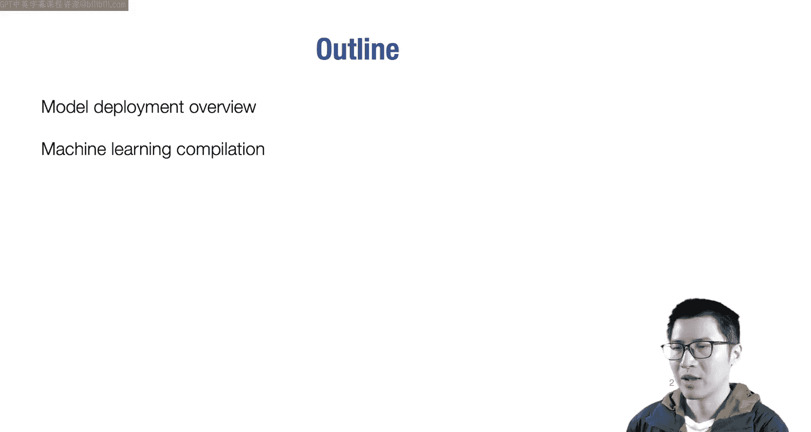

So to begin with so far， we've learned about a lot of things。

 We've learned a lot how do we build automatic differentiation libraries from scratch and also you know。

 derive the end to end reverse vote automatic differentiation。😊，On top of that。

 we are building a high exc library and the needle library allows us to be able to compose up the different kind of modeling techniques that's different modules and make use of compositional capabilities to build different kind of models。

We also learned about different modeling techniques， including， you know。

 feed forward neural network to modeling， sequence modeling in place model and so on。

And we have also looked at different optimizationization。

 normalization and institutionalization techniques。On multiple cases。

We learned how to build a different learning system that train different learning models efficiently on a standard computing environment。

 because that computing environment involves GPU that help us to be able to run a lot of accelerations in here。

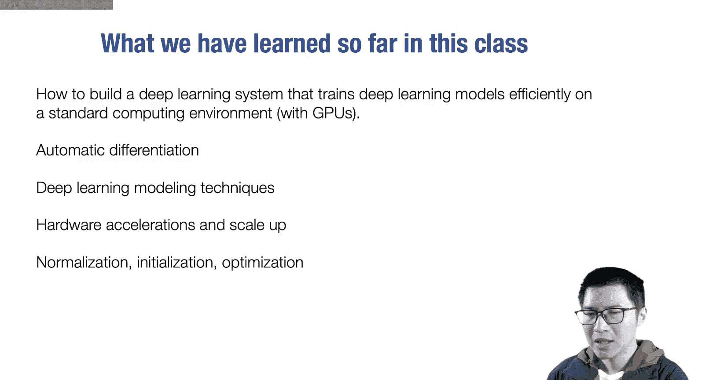

On that other hand， we also need to consider the question about deployment。Specifically。

 so imagine that we have an existing model that is learned by our needle framework or you know pick your favorite machinery In。

 Pythtorch， Tensorflowlow or others， you will be able to get a learn model and the task model deployment is that want to be able to bring that model on different color environments that we might be interested in deployment onto to。

Of course， it could involve， you know， deploying them on the same environment like a server environment。

 in which case， we could directly go ahead and use needle。Sometimes， you know。

 we might be interested in deploying face detection algorithms or other algorithms onto mobile devices。

In other cases， we might be interested in deploying our machine learning model onto smaller embedded settings。

And even for GPus， you know， right now， they are different kind of GPU environment that we can use。

 right， So we will have video GPU， AM D GPU， Apple， GPU。

 and there are other GPUus in mobile environments as well。So the question of model deployment。

Effectively means that how can we bring those learned models to different application environments。

Now， if we pause a bit and start to think about what are the possible difficulties in bringing our models onto load environment？

If I post that question to you and that's。Think a bit about what are complication behind。

 You can find that there are quite a lot of interesting things we want to consider。

 Well you want to deploy things on to say， a mobile device， right。

We will need to be able to wrap our machine learning models on to a native deployment environment。

 example， if I'm going to run a Apple devices。At least I will need to be able to invoke the system libraries on the Apple environment in order to make use。

 say my GPU or iPhone， will need to make use of Apple's GPU program language this case metal to do so。

If I want to deploy things onto an embedded settings。Like a respiratoryspberry pie。

 we will need to be able to make use of the acceleration libraries on in this case， arm environment。

And only better settings usually memory is also a concern。

 so we want to be able to reduce our memory consumption in this process。And of course， you know。

 if you want to deploy things as a mobile app， there's also a question about。

 can we minimize the library or application size， where you don't want to deploy your your overall executionion libraries as you know。

200 mebytes of application。 So that's also another concern of know being to reduce the dependencies。

 And in certain cases， the deployment environment may not have Python That means effectively we can no longer use some of the Python dependent implementations free。

So also， deployment seems to be， you know， straightforward in some sense， for example if I just。

Take the needle library on my on on the server， right。

 on the on coab and just want to use that to build predictions。 Like。

 you don't need to change anything。 You can just use needle on the box。 or you know。

 if you are using Python it the same thing。On other hand。

 if I start to think about the complications about deployment on different environments。

 certainly you know there are more things to consider beyond the sense that we have implemented so far。

 a lot that are being borne by the diversityities and characteristics about the deployment environment that we're going to face。

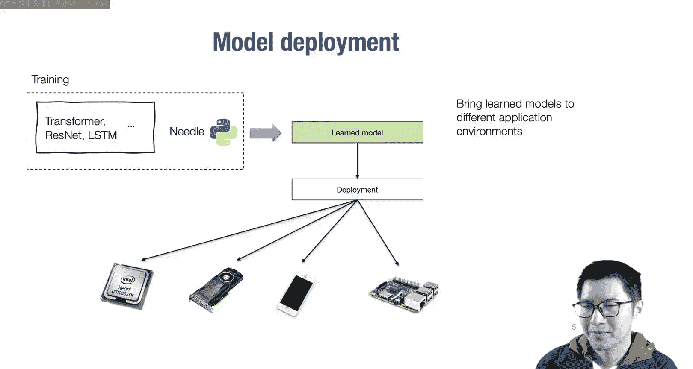

So we have already walked through， you know， some of the considerations。 I'm going to。

Bring and go through those points again。So the first four。When we are doing motor deployment。

 we might need to consider application environment restrictions。In this case。

 could be the size of models that you can， you can choose in other cases， a lot of cases。

 you might be running on environment that don't have a Python interpreter。

 So we need to be able to find ways to get around that。In a lot of the modern。

Ptforms like mobile devices or other devices。 We might have a local power acceleration。For example。

 if I'm using an Android or Apple device， you will have a mobile GPU on top。 in a lot of cases。

 there will be accelerated CPU instructions like arms， new instruction or you know。

 A V X instruction Intel devices。And in other cases。

 there might be specialized however like neural processingces unit that we can go ahead and leverage on。

The other side of concern is that we want to be able to build our overall。

Deployment solution and integrate them with the applications。

 right so that means that we will need to be able to have ways to do things like data preprocessing to transform say my video streams using some of the transformation primitives if it involves you know some of vular data。

 maybe you want to do feature engineering and also post processing to be able to take our prediction and turn it on something the application understand。

So all these things kind of are complications that being bought by the。

So now let's start to take a look at what the current typical way of running machine learning deployment。

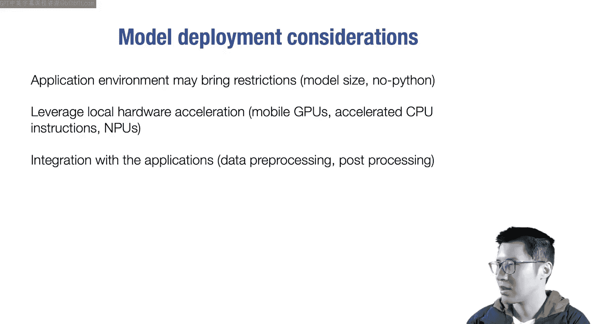

So nowadays。There are a lot of the deployment engine or inference engine available out there。

Those inference engines are usually in a specialized。

 you can view them as a specialized frameworks that takes in a deepening computation and you want to be they will be able taking in that and be able to run some of the end to an inference computations on a particular device。

So I'm going to list a few of them， for example on a video devices。

 theres a video have a tool called Tensor RRT that allows you to be able to give computation grab is will accelerate some of computation for you if you are looking at some of em devices that this tool called Tensorflow light or arm have also have this tool called arm Comp library that special implements and optimizes some of the computations on em devices。

By looking at Apple devices。Apple have a prim called core M O。

 and that allows you to build machinery models that it will be able to leverage both the GPU on device。

 as well as the neural engine that is comes with the Apple， Apple Apple associate。

So the way that most of those deployment engine works that they are going to take in some kind of the what we call inference model format。

That describes overall neural network computation。For， for inference。So so in this case。

 usually there are kind of different model formats that are being recognized by the inference engines where I'm hold that's the one common format called Onyx open neural network Exchange。

 which is quite widely used by Microsoft and a few other entities and it's a format that allows you to describe the overall neural network computation。

Apple also have its own format called Como。And Tensorflow come with you know Tensorflow light format that you can use to be able to build things onto in this case。

 I think it's a flat buffer format that describe computational graph。

 is will be able to take that and build up the end end computation。So most of those formats。

Kind of what internally， what they do is is some format that describes the computational graph and a weight。

So effectively， you know， if I have a two layer neural network。

 likely this format is going to look like something like your input。

 It's going to describe sequence operations。That we're going to carry out to run this inference workload and is's also going to attach the weight of each of the stages in here。

So usually the in terms of deployment， what we need to do is we want to be able to take our learned model。

 in lot cases， it's been regene the module format and find a way should be able to generate the corresponding computational graph format that our deployment backends might want to take。

Of course， it does come with limitations in a sense that， you know， in lot cases。

 when we are building a neural network， remember that we are building these using needle right。

 the one advantage of needle is that our computational is kind of have a dynamic computational graph construction。

So and we are constructing the computational graph on a fly at each of iterations of competition the advantage of that is we will be able to mix the computational graph construction with the pi sub code right so imagine that you know if we want to have some advanced model strategies from who we could as this idea called stochastic depths。

That allows you to be able to randomly skip some of the residualnet connections。Ding training time。

 right， and if you want to still do the stochastic adapts on the deployment end。

 it's really hard to describe that stoastic adapt as a whole computational graph。

There are other cases where some of the output of a computation some of the computation can depend on the output of a previous computation。

 for example， in certain cases like a mixture of experts we might want to use a neural network to decide which which of the following sub expertst they want to be able to query in this case。

 although it's possible to describe in computational graph using like conditionals node in here。

 that certainly puts a bit more pressures on what kind of the conditional graph format that were going give。

So in some sense， in low cases， that's not a very perfect model format that allows us to be able to describe everything。

That that's also the reason why it creates a bit of trouble you know。

 effectively deploy models within Pythage or needle。

 but all it's also kind of like a blessing as I say you know。

 the flexibility of the Pythage needle in terms of being able to do a lot of computation Python kind of enables us to be able to build those models more effectively。

And we do need to recognize that most of the models that we're interested in will be able to actually that are being deployed on realway scenarios will be able to be resented as this computational graph format。

 So still you know if you want to be able to build and and run those models on different environments。

 having abilities to be able to get the computational graph is going to be useful。

The techniques that framework that Ptoch is using is they use use what they call a symbolic tracing tracing technique。

That effectively traces through the overall computations。

 you will be a particular computational graph。That that is in our internal format。 In this case。

 the format can be a needle format that that we use by connecting the values together。

 And now we can build a translator that translate that needle format onto the computational graph that backend engine recognizes。

 So if you are interested， this could be also one of the project options So you know。

 maybe take a needle model and deploy that on environment like onx runtime or Ten RRT or other runtime。

So that's about how we are going to get a learn model and turn that on to a computational graph format that the back manager recognizes。

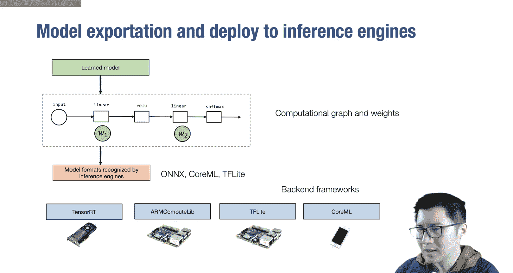

Inside of the inference engine。Most of the inference engine that we saw today like Tenr T or TF light have been structure as a computational for interpreters。

The idea is that it's going to， you know， allocate inter memories or this computational graph。

 And it's going to work that through using topological order。

 It's going to walk through the first layer neural computation。Get the result on this first layer。

 And then it's going to run a second layer and so on。 After interprets each of step in N。

 it's going to be able to give you the final output。

 and you're going to get that final output as your prediction。So one of the。

 as I noted in the in the last slide so most of the inference engine do have a limited set of operator support and programming models。

 So depends on how powerful they are。 All cases they may not support things like dynamic computations or in certain cases。

 maybe they would even require other shapes to to be no ahead of time。

One of the things that a lot of those do very carefully， though。

 is through what we call a memory reviews。So we have already mentioned that in some of past lectures that if you are doing inference。

 there are a lot of opportunities to reuse memory。 So instead of allocating the memory。😊。

Each of time， most of input engine will be able to you know。

 pre allocate memories and using a scratch patch for in this case。

 we could see that I'm going to allocate a for here， a for this node。

 and I'm going to use2 I'm going to show the memory of relevant soft next in here。Of course。

 besides those basic memory allocation and optimizations。

 there are other optimizations that most of inference engine do some of them could involve things like an operator fusion that takes two operators and turn them on a single operator and some of inference engine might also convert the intermediate weights and activation to a lower precision drawing points like know F16 or so So these are like possibilities of know how those inference engine are going to implement the underlying computations。

And accelerate underlying the computation as well。Okay。

 so that's all about overallval inference engine。 And that moving next。

 I'm going to cover a relatively emerging topic。 This topic called the machine learning compilation。

诶。So up until now。If we look at the inference engines， most of the inference engines are library。

That means that for each kind of power backend， in order to build an inference engine for that particular power backend。

 we need to go ahead and build specialized libraries。And indeed。

 take a lot of engineering effort to do optimization。

 especially go and build that library kernels for the particular how back interest。

 So usually if you find， if you look at issue of inference engineering。

 that's usually an engineering team and a big company that's supporting that。

Tsor R T is being supported by NVdia。 Caflow line is being supported by Google and Co M always is is being supported by Apple。

 So that's usually a server engineer that keeps optimizing and implements the libraries for the particular hardware back。

So of course， it can be quite engineering and intensive。

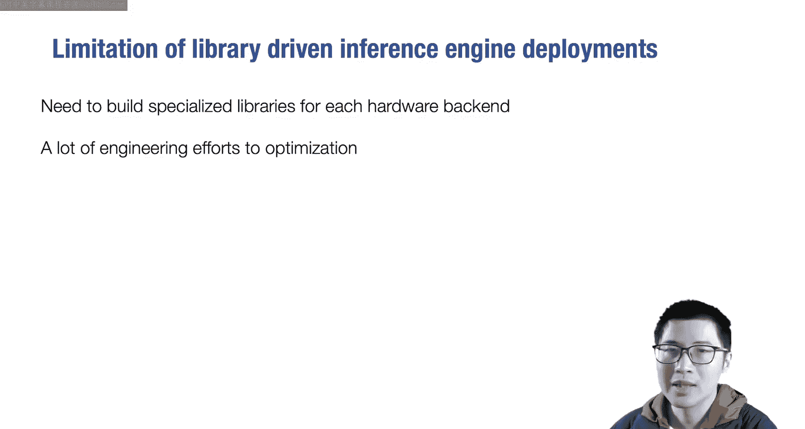

So one of the questions that the field is asking recently is that is it possible to bring a bit more automated techniques？

So instead of trying to build a library for each kind of powerbe。

Can we try to go and do some form of direct cogen that takes in high level machine learning models and turn them on to directly roundable code on each kind of hardware environments of interest that hybrid environment can include an embedding environments。

 A GPU or sometimes even accelerated environment。And this all you is called machine learning compilation and still emerging field。

 there's also one of a few that I personally do researching。

 So it's kind of a quite fun thing to look at a lot of recent advances in here。 Our general idea。

 you know， maybe you want to be able to do a more structure cogen。😊，Of course。

 sometimes we still want to be able to offer some of competitions for libraries。

 but ideas that we not only want libraries， we also want to be able to complement that with cogen approach。

So what does it mean to do a machine learning compilation？Let's start with。

 you know how we can go and represent a machine learning program， in a typical MO compiler。

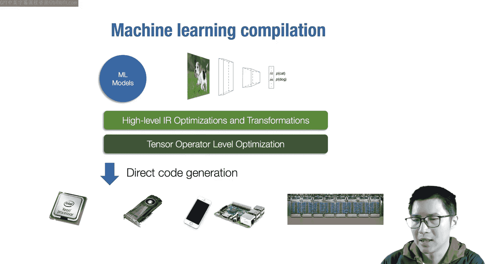

So normally， a typical machine learning program can be represented what we call what we call a module in here。

 and usually the machine learning program could contain things like functions。

And cost between functions， Of course， in this case， we have a model， right， in this case。

 this describes。A one layer neural network that contains X。W。诶。And soft max。In here， right。

 so this one layer neural network。That that is like a single Somax classification neural network that we've describing here。

And usually this format called also called intermediate representation。 So。

 so that's a termin compiler。 you know， the， the ways we can use to represent the intermediate。

Intermedia code， that is in a compilation。And。This box is called an IR module and contains a collection of interdependent functions。

Another thing to note about most machinery models is that each of the intermediate data in here。

 right are higher dimensional tensors or multi dimensionaries。So effectively， you can view that。

 you know， it's not that different from a computational graph that we described before except。😊。

It it's slightly more generalized in some sense， you know， the functions correspond to。

 can correspond to the real program functions。 that you right。

And intermediate data can just be you know， tensors that we are looking at。

So one of the things that most of my welcome compile do is we try to take。

A IR module that represent the computations， usually a tensor computation that correspond to the original model and try to do a sequence of transformations。

So that will bring the high high level model onto something that is directly runable on the targeting environment。

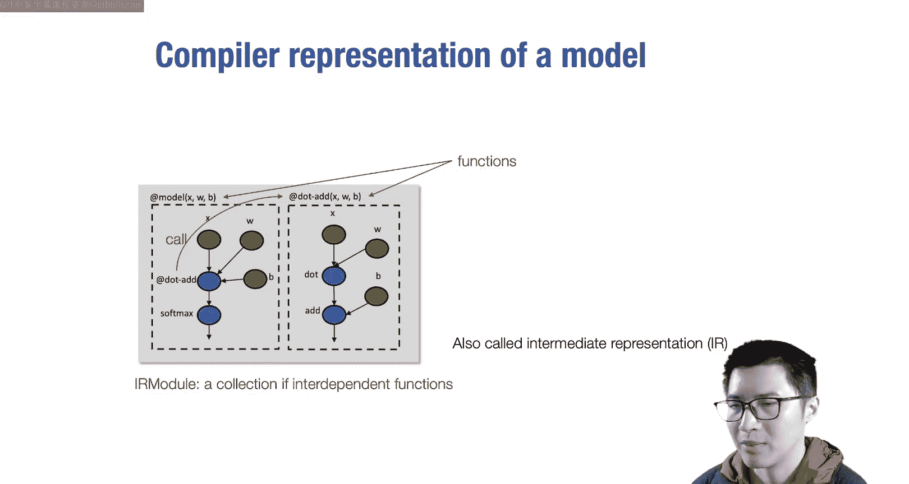

So for a given machine model， let's try to walk through what a possiblemo compilation pipeline could look like。

So for given machinery model， first of all， we are going to import that model from our native framework like highych or needle into this intermediate I module that we can use to represent this particular machinery model。

 in this case， it's a one layer neural network that contains X input weight bias matrix modification operation or bias add and soft X operation。

What things we can do after we have those I modules。

 we will be able to run higher level transformations on this module。 Well， we could try to take。😊。

In this case， I could try to。Take。😔，This part of computations。

And trying to turn that on to a single dot add function on the right hand side。

But this transformation usually called operator fusion allows us to be able to fuse the computations of sub originalal。

 the computation graph on on left hand side in this case， this part， onto a sub independent function。

One of the motions we can do moving next is we will be able to actually take these fu functions and when we generate a single operator that does the you know matrix its multi and add in a single GPU kernel as a result。

 it was going to save the overall GPU combination memory， in this case。😊。

Besides this kind of like a operator future， there are also other kind of transformations you can do on the computational graph example in certain cases。

 if we have normalization right in the layer batch or other cases。

 we will be able to turn that normalization on a shift。And。

A scale and add operations on the original computation。

There are other cases where we might be able to know transform the layout of the data。

 so especially in convol neural networks， we know that know there are different ways to layout data。

 you can put the channel dimension on the high or put the channel dimension on the low list on different kind of highway platform。

 they might have different implications of the over execution efficiency。

So well be able to do transformations on on those higher level combination graphs。

The other possible transformations you can do in certain cases。

 sometimes when maybe we have parallel we have blank parallel passes that allow us to be able to run。

 you know， parallel matrix modification and we'll be able to fuse what we call doing this case doing another kind of fu to be able to fuse some of the parallel passes together into a single。

So in some sense， you know， if we have these high level computational graphs。

 we will be able to do transformations in different ways。

AndAll this on this what we call a high level reputation。

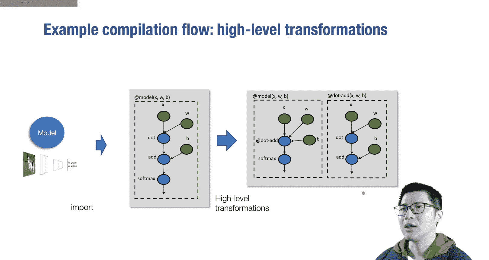

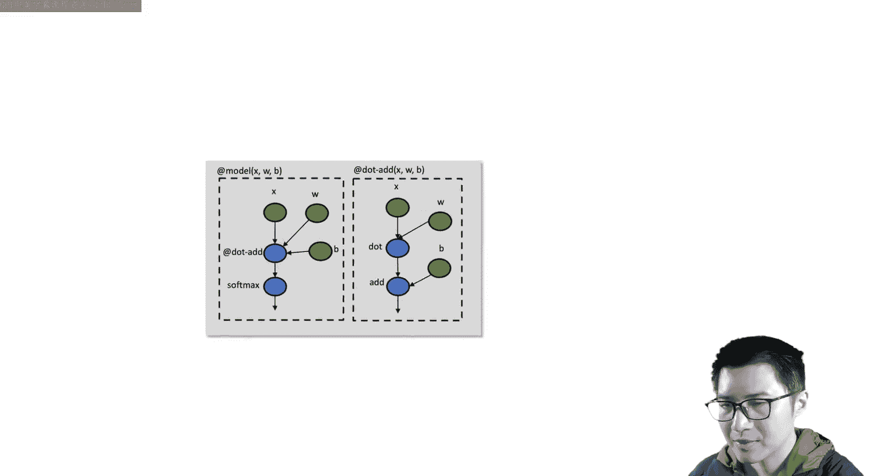

Once we have done some of the higher level computational transformations。

One of the things that a lot of M O compiler to do is trying to lower or in this case of being able translate part of the computation onto something that is slightly lower level。

So in this case。One thing we can do is we can translate the right hand side。The dot add part。

At true we call a loop。Look， nesting a repent。And the advantage of this lu nestingation is that。

It's getting closer to the online hour。 So we will be able to write things in the follow。

And in certain cases， we will be able to run what we call look nest transformations。

To be able to generate and transform a loop nest in a way such that it kind of fit on to underlying how we back。

So， and you know， once we have this loop test。 one of things you can possibly imagine that I could go ahead and directly translate that onto to you know。

 see how or in certain cases， maybe I could even translate that ontoa on media devices。

 So look nest I is a way for us to be able to generate the underlying underlying code accelerated code on the underlying how。

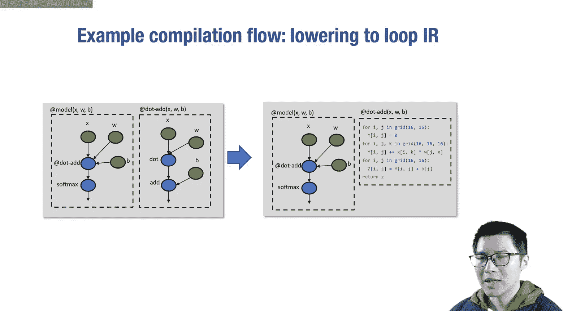

Once we are in the loop nest and transformations。

One thing we could go ahead and do is trying to do some of the lower level transformations。

For example example， one of the things we could do in this case is operator fusion。

 right by trying tofuse the bias operation onto the initial assignments。

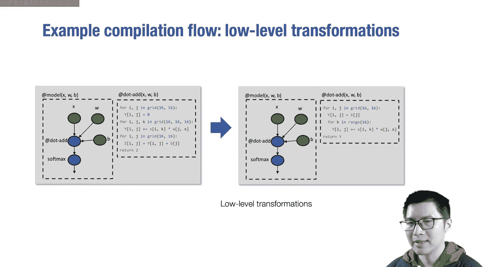

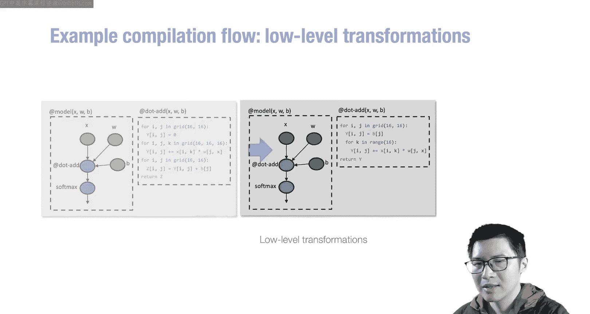

啊offY那些。Back。We want to try to fuse。 So in this case， you can find。 And this is a loop nest addition。

 We can try to recognize that there's assignments here。

 We could swap the bias set right so we could try to do the bias assignment first before we do the matrix modification。

Oper， so this kind of like a lower level loop transformation we can perform。

 And depending on the kind of transformation you perform。

 you might get different executionion efficiencies。

 And that's where someone kind of like automated cogen approaches come in and become helpful。 That's。

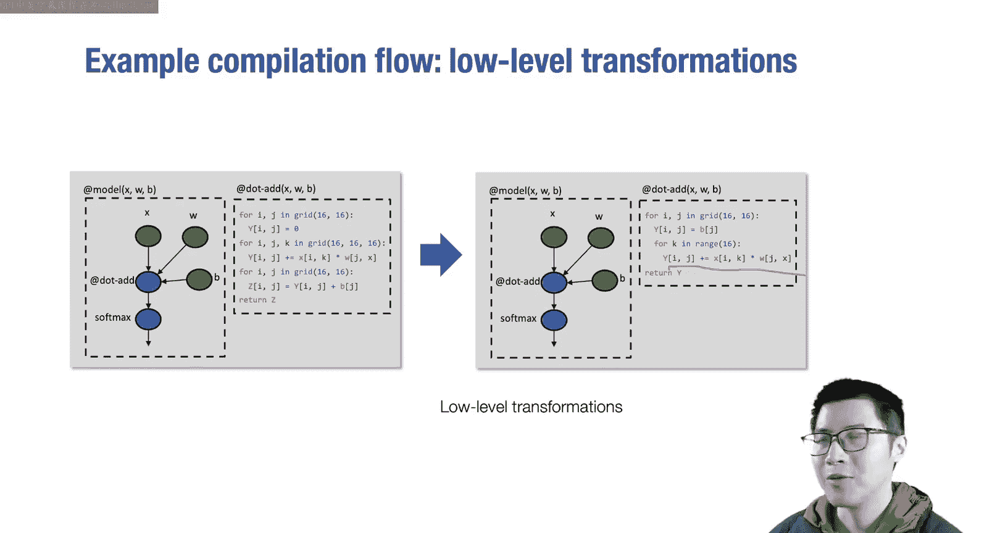

So once we have this transform a lower level loop， finally。

 one of the things people will do is we will do cogen。 So in this case。

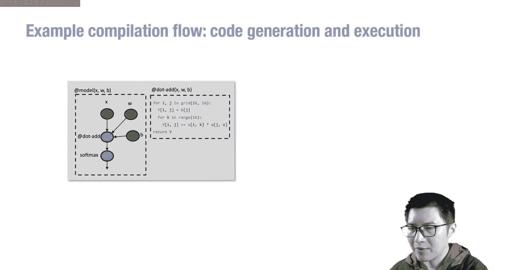

This lower level loop will become。ACompd operator on my run hum environment。 And， of course， I could。

 you know， have a software next compile as well， or provide a predefined library implementation of software。

Of soft。Okay， so in this case。Besides these compile operator functions。

 we could also have some representationation that help us to be able to interpret the computation。

 So a lot of the generated result will have something。 you know， compile level in this case。

 you can find that it describes overall computation。

 So it will effectively means that we are going to take in X and W and B invoke this dot add function。

 get the result。 and invoke the Soax function and get result here。 And finally。

 the final output is going to be the output of our roundtime executionion。😊，So effectively。

 this is our overall aroundtime environment。And it's the final artifact that the the compiler outputs。

Depending on the approaches have could also be， you know。

 approach that directly turn into this graph， turn this graph interpretation onto something that is。

 you know fully compiled。 So you could also turn， example。

 this function onto a fully compiled the plus function that invokes each of the particular operators as well。

SoU now， we have walked through the possible lifecycl of an American pilot。

 so well be able to change the higher level machine learning models。

And and do some transformations of high level intermediate presentations lower some of the parts onto what call loop programs。

 convert loop program onto a compiled operator。 and then finally on the runtime environment being able to take in this composed compile operator and overall。

Competal graph and do and to an institution。Of course， one of the questions that people。听。And ask。

 you know， is how is it different from the original inference engine approach， right， in some sense。

 they are not that different。 So if you look at this final format。

 you can find that this could be the format that inference engine takes as well。

 but most of the inference engine do come with this computational graph part。

As well as a set of a predefined operator。One the key characteristic of most MO compilers is sometimes some of those operations will be generated automatically from this intermediate orientation。

And so on one hand， you can view like a Mmo compilation。As a approach to enable， you know。

 efficient model deployment and as a matter of fact of techniquess we talk about today。

Are being incorporated onto remote deployment solutions such as T RRT and other cases。Of course。

 compilation techniques also do not limit to inference work。

 so we could also imagine that we can go ahead and bring the same techniques to accelerate some other the training workload as well。

To recap， we know that in through other compils。

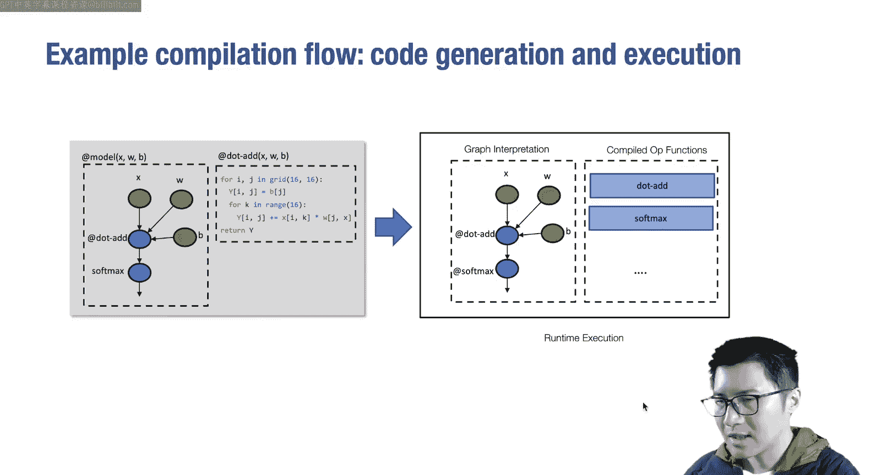

There is a layer called higher level IR， or usually people also called computational graph IR。

 because you can usually look at them as kind of like a computational graph in some sense。

And each of a node attempts the operator that takes things of input tenses and outputs certain input tenses。

And we can go ahead and transform these intermediate implementations to to represent things like operator fusion。

In other cases， we can also go ahead and annotate this computationalal graph that you know。

 we can annotate things with decisions like device placement。

Most machine learning framework also have this layer。 So in some sense。

 you can find that this higher level layer is also baked onto most of the common machine learning frameworks out there。

 including needle， In some sense， you know， you can view ouron ponic computational garation as a way to represent this higher level line。

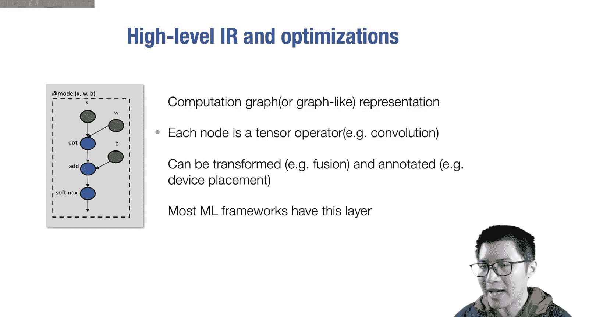

Now， let's dive slightly deeper onto the topic of lower level co generation。

So in terms of low level co generation， the goal here is want to be able to。Effectively。

 take a high level operator like farm whole matrix small location。I want to be able to generate。

A different variant of low level programs。One interesting thing that you have learned in our lecture of power exploration is you know there's no different ways of ordering loops。

😊，And， and computations can have a huge impact on executionion efficiency。 Okay。

 so for seeing high level specifications， like example， if I specify my result as you know。

 this trans post matrix location in this way。😊，It can correspond to different variants of low level programs。

 We could do things like operator tilings。Loop patterns that we did in some of our hardware acceleration lecture。

 right？We could directly write out of vanilla loop in certain cases。

 we could have what we call highway intrinsics that create one to some of the operations that get accelerated by underlying Howard。

 so we could generate a lot of lower level program variant for a given high level program。

And one of question said that we want the answer is， no。

 how can we effectively search over different variants of our high level programs and find optimal implementations for a particular however back。

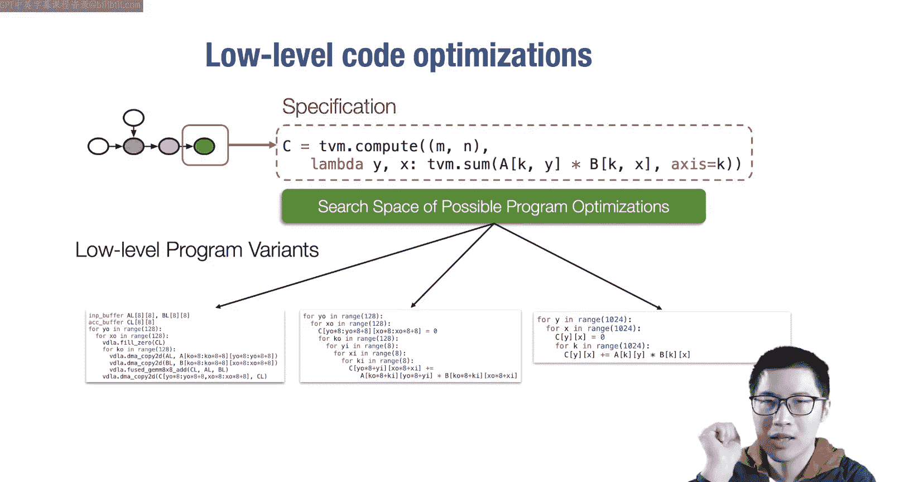

So let's have a look at you know what are the common elements that a low level loop plantation can have。

Of course， it's going to have multi dimensionional buffers that's going to represent our multi dimensionional computation storage or our intermediate results。

It's going to have my diameter loop nest。And， of course， array ray computation here。

So you want for us to be able to explore。Different possibilities of optimizing the same program。

Of course， one is we can just go ahead and write down right different variants of programs。

 for example， we could try， you know， different ways to tie the loop a bit using register talls。

 the cacheline talls we talk about in our past lecture。

Another way to try to optimize these programs through what we call a loop transformation。

So in this case， the ideas will have we have code and will also have APIs on the right hand side that go and manipulate。

😊，The code on the left hand side。 for example， this is a pseudo code that I have that usually should present the transformation API。

 So in this case， if not get loop X。 I'm going to split the loop。At this operations。

 the effect is that it's going to take in original loopbe。

 you can find it's going to split X onto O and I part where the inner factor 4 is coming from here。

So you can find that the loop nest on below is exactly equivalent to the loop nest on the top。

Except that we are using true loop testing to represent one loop。Of course if I just stop here。

 right， it's not that different in a sense， we are still doing the same forward iterations。

 except that you are just using two iterator than the one iteration。

But things become interesting if you start to do composite with small operations in here。

For example hope， we could go ahead and say， let's go take this code and let's try to do reordering of a loop。

Now， in this case， after have reordering what's going to happen is that it's going to reorder these two loops。

In different ways。And after you reorder it， you can find that actually this correspond to a different way of iterating on the data。

Of course， not all the loopnet transformations are possible。

 and this transformation really depends on the fact that we are running a data parallel computation here where each of element computation is independent from another So we'll be able to know do the loop transformations into order。

We can also try to turn over our GPU program。 In this case， what we can do is we can go ahead。

 take the reorder program。 And we're going to see， I'm going to bind。😊。

Golow an exile onto a thread and blocking index。Remember， could our programming model， right。

 with our programming model， the block and thread index presss on to the index of a thread within。

A GPPU stream by processor and a global index of of the overall threat block within that overall launching group。

So if we bind it， you can find that you're gonna get a pseudo code like this where， you know。

 effectively become a GPU kernel and the C operation can be crisp on to where X I being binded on the。

well XO is seen by on the block index and X I is going to be banded onto the strategy。

 So effective in this。X I。 and this is XO。 And remember， you know， XO is mined by str index index。

X I's been byden by flocking X here。So one of the fun thing you can。

 you can find is that by running transformations of original program。

 we turn the original program that runs on。😊，Well， usually if you have a follow， right。

 you right it does only run CPUU or you turns it onto a GPU kernel。

That you can really go ahead and launch on Ka。 Isn't that amazing。 So， true。

 the program transformation allows us to be able to transform the program and turn into something that effectively can execute on GPS。

😊，We could use a similar approach to generate different variants of transformations。

 where each of variant transformation correspond to a different implementation of programs。

 Some of them can be more efficient than other ones。

So then comes to O we call Auto program optimization。

The idea is that we want to build aO compiler that tries out different transformation sequences in here。

Where， you know， we could try out example， I could， instead of doing four here， I could try out 8。

 And then this case will become 8 by 16， right， And so that will generate different variance of programming here。

 and want to be able to do an anto search。Of possible implementation of of machine learning operator。

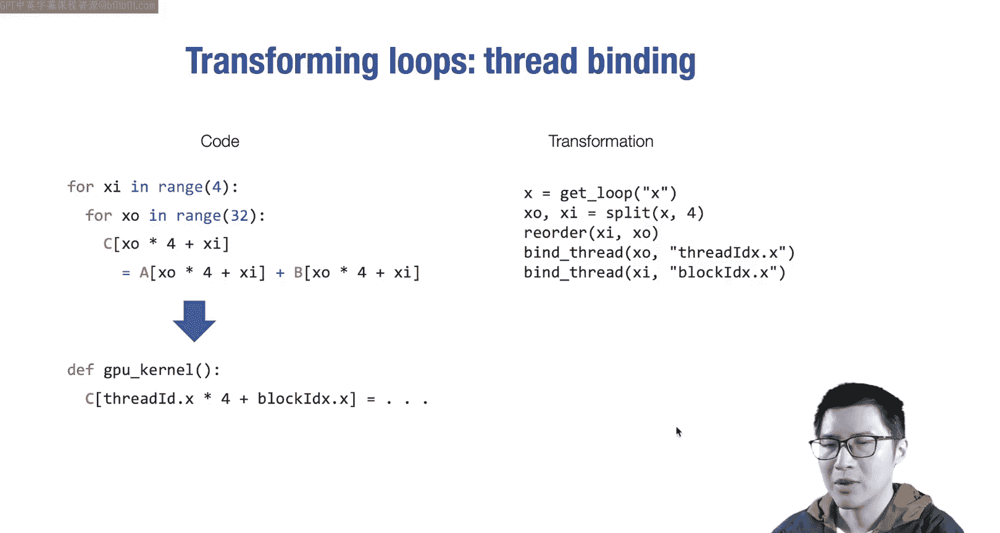

So here's kind of like a high level overview of what an automated ML compiler will do。

 but idea is they will try to generate a search space。

And then a search planner is going gives you different configurations in here。

Each of a configuration is going to help us to be able to output。A code。 So in this case。

 x corresponds to a generated variant of a program。

One of the things that a lot of the automated framework doing is they will do what we call auto tuning or automatic benchmarking。

So once we have this program， what we are going to do is we're going to send the program onto a targeting verb。

 in case say I have a mobile device。 I'm going to go ahead and and measure the executionion and time of that particular roundtime kernel on the particular device very interesting。

 this case Raberry。Once we get a measurement。These measurement data is going to be used as training data to learn the estimation cost model。

 So in this case， the estimated cost model is going to take an existing configuration。

 estimate how accurate what is running time of that。 So effectively。

 we don't have to try everything on the device。 Instead， as we collect more data。

 the more basic cost model is going to be able to tell us how effective configuration is。

that really help us to be able to reduce overall a third ton and find a good configuration for a particular hour。

One interesting thing about this approach that you can find is fully automatic so。

In some sense that if you take a regional program， you don't need to worry about how do you go and optimize the code on a particular power backend instead as soon as you have a decent surface and a decent amount cost model。

 it's able to give you a decent generating code and use that to be able to to be able to build better overall cost models and make use of a cost model to run better future predictions。

So。through this process， actually， you know we reduce。

 we kind of replace the human engineering effort by the automatic computer and in certain cases。

 we know that really hard between expert engineers and this automated approach really helps us to be able to automatically find different kind of variants of optimize program all the hardware back kind of interest。

We could also apply it on to different hardware back。 So， you know。

 you could apply it on one variant arm GPs arm CPUU versus another variant and get you know optimizations for each of them。

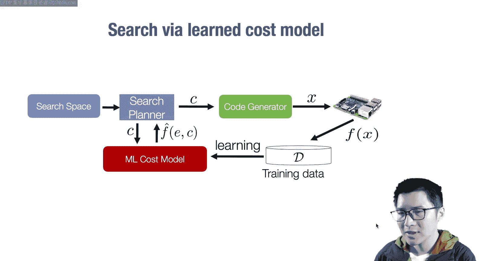

Okay， so to summarize， we have learned about male compileilation and Auto compiler。

 there are more elements that we don't have time to talk talk about today。 example。

 we roughly talk talk about how we can represent the program。

And there are different ways of representing a program。

 some of them could lead to more efficient optimizations than other ones。

 That's the question about how we can build a comprehensive search base through a sample transformation that covers common optimizations。

And also， how do we find ways for domain experts to provide inputs right through this process？

And finally， how can efficiently optimize the search process？

So that we can reduce overall our search phase and and find a good。

On a good set of you know program candidate that we can optimize myself。

All these are exciting topics that still actually ongoing research。

In love cases and if you are more interested you should go and check out some of recent literatures。

 I also had another online course called MOC dot AI that explains this automated machine learning compilation topic。

 We are interested you more than also welcome to check it out。Okay。

 so that's the end of today's lecture。 Thanks， everybody for coming and we will see you in the next lecture。

😊。

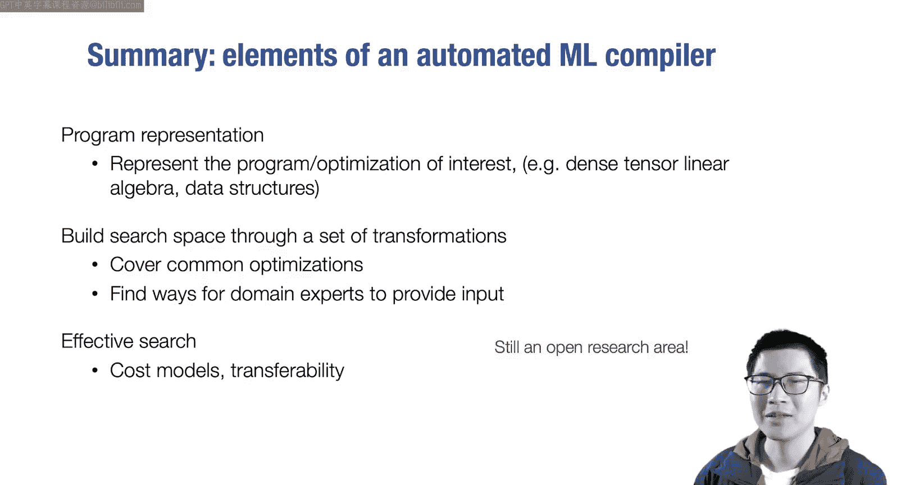