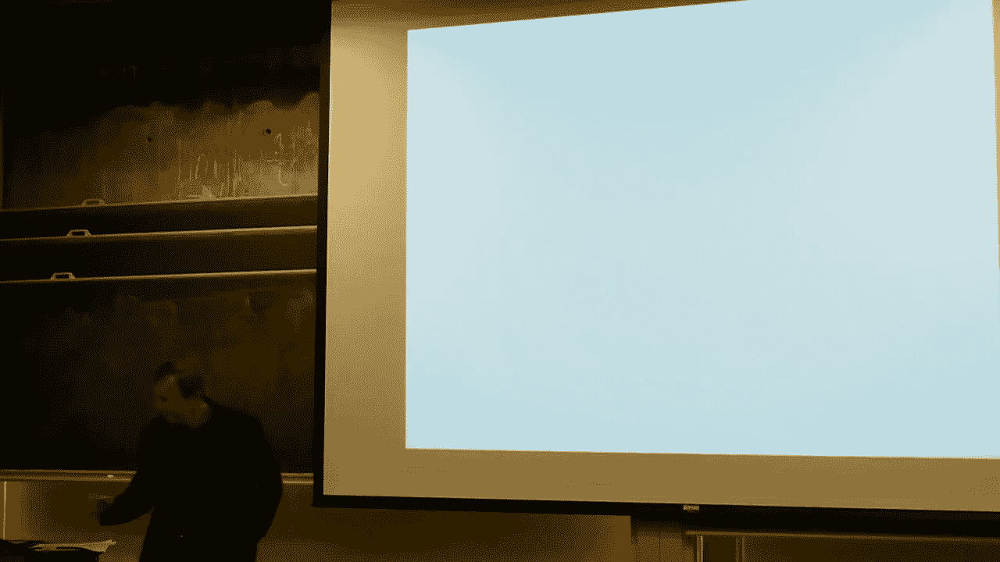

# 卡耐基梅隆大学【中英⚡机器学习｜10-601 2015 Machine Learning】 p02 P2 Lec 2-Decision Tree -BV1Lcnhz1E7P_p2-

Finish off decision trees。 and。Use that as a kind of case study for making some more general remarks about function approximation。

So just to kind of review from last time。In function approximation。

 we're trying to learn some unknown target function。

 let's call it F from some X to some Y might be from emails to spam or not。

 That would be our X and our Y。 or we had a simple example where the X is were different days described by attributes like the humidity and the temperature。

 and were trying to predict whether our friend would play tennis that day。

 So many functions you can imagine。And in this setting。

 we say there are some set of instances that the function can take its input。

There's some unknown function， and the learner has some way of representing。Hypotheses。

 which are themselves functions for x to Y， different classifiers of email or different classifiers of days。

And the input to the system is simply a set of training examples， X Y pairs。

 here's a day described by these features， the humidity is high and so forth， and yes。

 the person plays tennis。And so that's the input。 And then we expect that we want our learning algorithm to output the hypothesis that best approximates this unknown function。

 And so often， what we do， of course， is have it instead， fit this data。

 this sample of inputs and outputs of that unknown function。😊。

So in the case of decision tree learning， we can easily instantiate this。For decision trees。

 decision trees are defined over inputs that are feature vectors。

Of different features that have discrete values。 So we talked about humidity could be low or normal or high and so forth。

W has to be discrete value too， that is we can predict yes or no。

 the person plays tennis or maybe no or yes， but they don't play very well， and yes。

 they play very well， it could be more than two values。But for decision trees。

 we don't usually use them for continuous values for Y。

 although there are extensions to the decision tree learning algorithm that can handle。Continuous。

 but we're not。Here going to cover those。And then， of course。

 each hypothesis is just a decision tree。 And as we said last time。

One nice property of decision trees is that they can represent。

Any discrete valued function over any vector of discrete valued input attributes。

And so decision trees are sufficiently expressive。To represent any function that we might want to teach it。

And so what I want to do。Is so， and， and then we talked about a decision tree learning algorithm。

 which grows the tree top down。 Remember， it starts by picking， well， what。

What attribute should we test at the root of the decision tree？

And it used that entropy based mutual information statistic to choose， to do a statistical test。

 to choose the best attribute， to put it the root。And then suppose we choose humidity at the root。

 then we sort high humidity， low humidity， sort our training examples into those two buckets。And if。

Either bucket happens to have uniformly positive or uniformly negative examples。

 then we stop growing the tree there and just announced that any future example that sorts there。

Should have that label。 But if it's a mixture of positive and negative examples。

 then we just recursively apply the same strategy to further divide。By adding more attribute tests。

To further divide the examples below that point。And we just grow the tree until。Well。

 we said until it perfectly。Classifies the examples that is each one of the leaf nodes in the tree that we've grown has purely positive or purely negative examples。

So that was our simple algorithm。 And so you can think of this as。

An algorithm that's really doing a search through the space of all possible decision trees。

And at each step， it's adding one more node to the decision tree。And of course， at each step。

 there are many choices of which note it could add next。 And as we discussed， it's using this。

Entropy based mutual information measure as a way of choosing which of these。

Elllaorrationations of the tree created any given point。Okay。

So this will actually turn out to be a kind of useful perspective。On many， many of the。

Supervised learning， function， approximation， algorithms that we talk about through the course。

In fact， in general， we can think of many of these algorithms as performing a search through a space of possible hypotheses。

Each decision tree is a different hypothesis about what the。Target function really is。

And many of these algorithms we can characterize as simply performing a search through the space of possible hypotheses for the best one。

So I want to。Pause for a second and。Talk about this in a little bit more generality。嗯。And I have。

 in my head several pictures that I carry around that helped me make sense of the field of machine learning。

And through the course， you'll see several of these pictures。 Today is the first picture。

And here's the picture that I think of when I think about。Function approximation。

so in function approximation， generally， we're interested in learning some function that's going to map。

From X to Y， as we said。So now， in our case， in our particular example of decision trees。

 X is going to be represented as this vector of different attributes。

I could call them humidity and temperature and so forth， but in general。

 I'll just say they're x1 through xN。And so here's the picture I carry around。Think of。

The space of all possible hypotheses。I'll call this H。It's just said of all the possible。Hypotheses。

 right， that's just the set。Of functions。That。Decision tree functions in our case。

So there's the decision whoops。There is a decision tree。嗯。That one maybe looks like this。

The labels plus minus minus。A point in that。Fen diagram of possible decision tree hypotheses。

Here are some others I won't draw the trees。There are a lot of them。Okay， we also have。

 think of the Venn diagram of possible instances。That the function applies to the x。And so here's。

For example， one point， this is humidity is high。And temperature is low and so forth。And again。

 here are some others。 I won't draw them out as vectors。Say their points。

And。Of course， it's the relationship between these two。Right， every one of these。

Decision tree functions or hypotheses actually will label all of these points。Right， we can give it。

For any given decision tree we're interested in， like that circled one。

 we could give it all these points， and it will give us an assignment that some of them are positive examples。

 some are negative。 Some of them are play tennis equals。 Yes， some of them are play tennis equals。

 no。And so we could think of every one of these hypotheses as corresponding to。Some set of examples。

That they label positive。And some set of examples that they label negative。Okay， so now。

Here's a question I want us to think about。 I'm interested just in。Whether you're tracking me。

 so let's say。Suppose for the sake of argument that I have a set of。20 features。 N is 20。Okay。

 and suppose these are also Boolean feature。