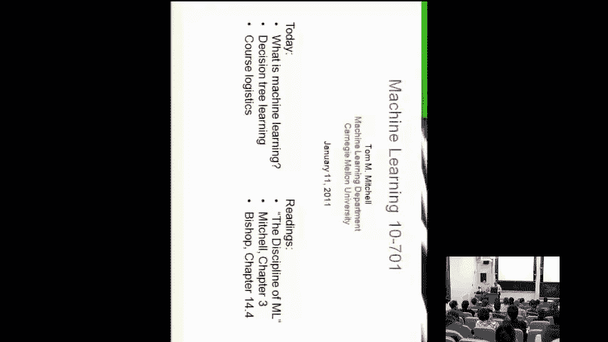
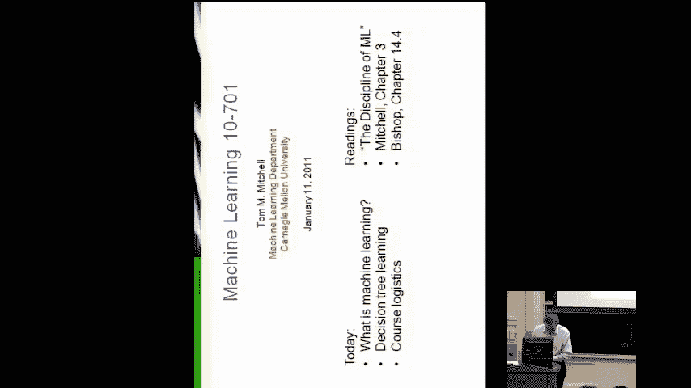
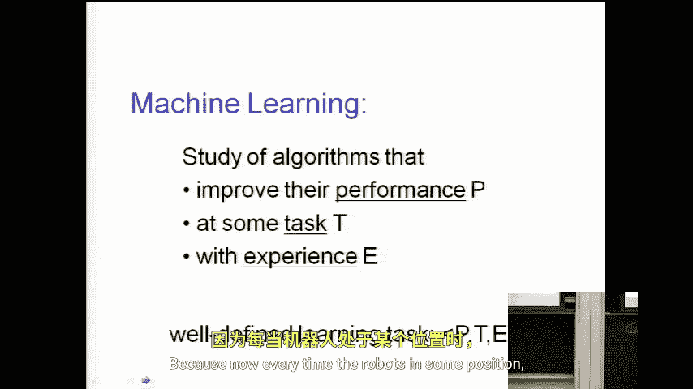

# 卡耐基梅隆大学【中英⚡机器学习｜10-601 2015 Machine Learning】 p27 P27 Lecture 01 Intro to ML Jan 11 -BV1Lcnhz1E7P_p27-

It's a feature of windows。

We're ready to go， okay。Well， welcome you're in the machine learning class and as some of you know。

 there are two machine learning classes。We're in the 10701 machine learning class。

There's a second machine learning class called TAN 601。

 which is recommended for undergraduates and master's students。

 this one is recommended for PhD students。And。So if you think you should be in the other one， then。

Feel free to switch classes。 My name is Tom Mitchell。 I'm going to be the instructor for the course。

啊。This is my favorite course to teach， I'll tell you that right up front because machine learning is my favorite subject。

And I've worked in this area for a number of years。And so today， we're going to just jump in。

I'm going to talk about what machine learning is， what are the kinds of things we're going to learn in this course。

And then we'll have our first example of a machine learning algorithm， decision tree learning。

 which you will get a chance to implement and experiment with starting with Thursday's homework assignment。

The来。The plan for today。嗯。I do have to beg your forgiveness。 I have a new tablet computer。

 because I really wanted to。Give you the best of technology for the lectures。

 And I haven't really used this tablet computer before。And so it may be a little bumpier then。

Future lectures after I come up to speed。But， let's see。Okay， so machine learning is about。

 of course， how we get computers to learn。And。There are a lot of examples of that。And in fact。

 for instance， you probably have a spam filter on your email reader。

That filters out emails that are likely to be spam。

 and that is based on a decision strategy that is learned by a computer from examples of emails that have been labeled as spam and not spam。

You probably swipe your credit card to purchase things at the store。 and when you do。

That computer card transaction。Is evaluated by some computer somewhere to decide whether this is likely to be fraudulent or whether they should give the go ahead on this purchase and the decision strategy used by their computer program。

Is learned from historical data。Of millions of other credit card transactions。

 some of which turned out to be fraudulent， many of which didn't。

 And those are the training examples from which it has learned that decision strategy。

 So there are a lot of examples of machine learning to have a well defined。Machine learning。

Question or problem。What we need are three things。 We need to pin down what's the task， for example。

 in the case of spam。Detection。The task is to come up with a function thatll take his input in arbitrary email and produce his output a one or a0。

Indicating whether this is spam。Or perhaps we could say a number between one and zero。

 which is the probability that it' spam。So there be a task。啊。

To make it a well defined learning problem， we also have to come up with some performance metric。

That we're going right， learning is about improving your performance through experience。

And so if we're going to talk about。Even training a spam detector in a well defined way。

 we have to talk not only about what's the function is' trying to learn。

Function from emails to yes or no as this spam。 But also， what's the performance。

 What's the metric that we're going to use to determine whether it's getting better or getting worse。

Over time。And so for example， an obvious metric would be what fraction of the time is it correct when it labels something as spam or not？

That would be an obvious performance metric we could use。啊。There are others。So， for example。

 we could use。From I spam detector， I actually prefer a different performance metric。

 I prefer one that。Makes fewer errors where it's。Taking emails and mislabeling them as spam when they're from family members。

And I'm willing to put up with a few more errors on the。False negative side。

 a few more errors where it mislabels true spanm as not。 And I have to look at it and delete it。

 I'm willing to put up with a few more of those in exchange for。

Not missing any of those emails that are important。

So I might see you see there are several different performance metrics we could come up with and depending on your taste and the task。

We have to pin that down so that we know what it means when we say we want our computer。

To improve at this task。According to some performance metric。And then there's experience。 Well。

 we could train。We could train our span。Recognizing program。诶。Well， the most obvious thing。

 of course， would be to give it examples of inputs and outputs of the function that we're trying to get it to learn。

 let's give it examples of an email and we'll label this one spam and we'll give it other emails we label not spam。

And that could be， we'll just give it， it's called supervised learning。

 we'll give it examples of input output pairs。Of the。

Email to yes or no spam function that we want it to learn。

 and we'll have it learn from that kind of experience。And in fact， for the first part of the course。

 that's exactly the kind of experience we're going to be talking about。Lning from。

But even for spam reading， you can imagine or for spam filtering， you can imagine。

There could be other kinds of training that we could do。So， for example。

We could provide in addition to those labeled。Emails label this spam or not。

We could provide also a ton of unlabeled emails。And we could give that as experience to the program too。

 to learn from。Now you might think to yourself， that doesn't sound very useful。Because， of course。

 if we don't tell it whether this。Additional email is spam or not。

 then probably that won't help it learn very well。 but surprisingly， and you'll see in this course。

 why。There are occasions we're providing， and I believe spam detection would be one of those where。

Providing unlabeled data together with labeled examples actually improves， perform。

 improves the learning。Compared to if you provide only labeled data。

And that's an active research area in machine learning right now。

Trying to understand the conditions under which。Providing that kind of unlabeled data can， in fact。

 improve the performance。Of the learned system。Okay， so when we talk about learning。

 we're going to be talking about improving our performance at some task through experience。嗯。

To pick a very different kind of task。Imagine training a robot。

Suppposed we had a mobile robot that roamed around this building。We might not want it to learn。

Through experience。And we might。For example。Define a task right now。

 we've got to define what we mean。So I guess a beginning robot。

 we might want it to be able to roam around the room without colliding with things。

So we can define the c is to move around and avoid collisions。

 presumably this robot has some sensors。We could define some performance metric， like。Well。

 we'd have to be。We have to think that through a little bit， but for example。

 we could say how many collisions you have per unit time you get a negative for that and you get a positive for how many linear feet。

Of territory you cover。In the the room， you get a positive for that。

 And then the performance metric is just the difference between those two， something like that。

For experience， you can imagine。 And now this actually gets to be pretty interesting。

 And we'll cover this in the course。What would you want that robot to learn from？

So if you think about it， one way we could have the robot learn is we could have a joystick and drive the robot around the room。

That would be another example of supervised training， right。

 because now every time the robot's in some position， we tell it that it's safe to go。

