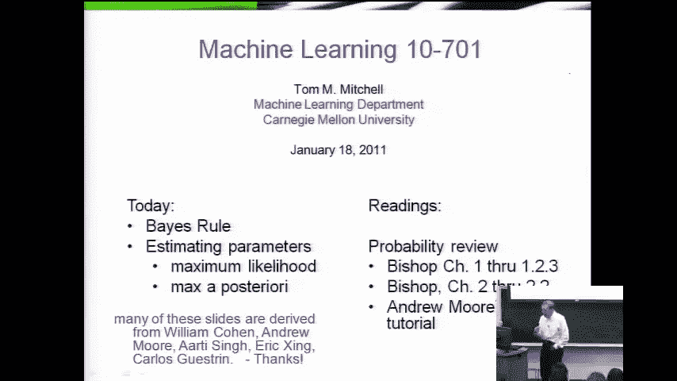
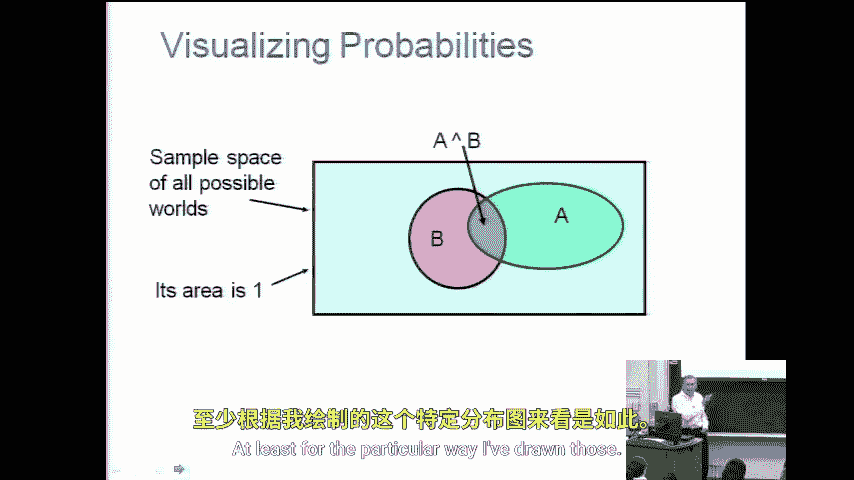
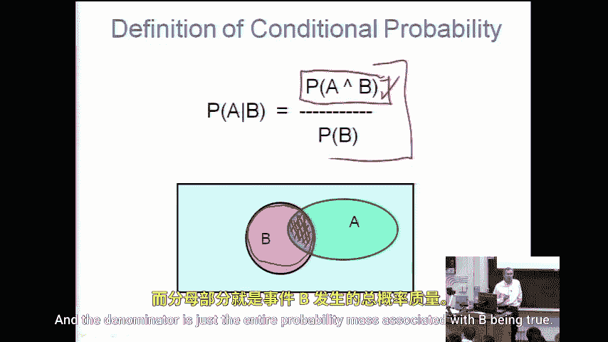
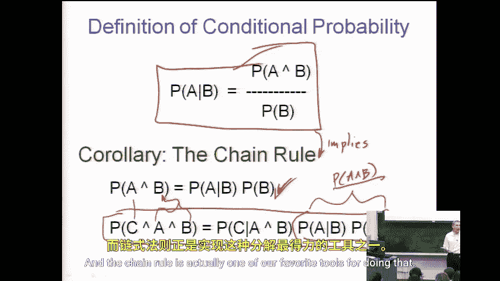
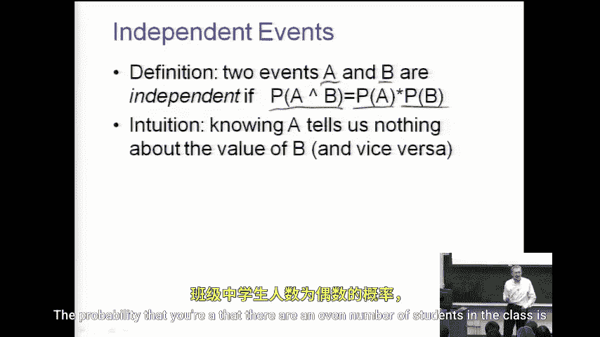

# 卡耐基梅隆大学【中英⚡机器学习｜10-601 2015 Machine Learning】 p29 P29 Lecture 03 Probability and Estimation Jan 18 -BV1Lcnhz1E7P_p29-

Okay。So quick few announcements before we get started。

 the first recitation for the class will be tomorrow evening at five。

 I forget the room number but it's on our website like all information is。

And these are optional recitation sections。诶。Hosted by the teaching assistant。

 but even though they're optional I strongly encourage you to attend those。

 if you want to go into get some more help with some of the material and tomorrow's recitation in particular is going to cover material on probability and also decision trees so it's very relevant to the homework oh homework that's my second announcement as you noticed in your email box on Friday the first homework is out。

And I'll tell you， I think。The homework is pretty reasonable。

 there's one question on there about Poan distributions。

 which will test your true recall on that old probability course you took a while ago。

But the other two questions， I think， are pretty straightforward。

 if you need some help with the Poisson distribution question。

The recitation is the perfect place to come。Okay， question。こと。

Ts want to answer that Do you want to said you want two copies of them homework。

 That's hard copy or electronic。I see。 so the point is different TAs are going to grade different questions。

You can figure out which TA by looking at the TA name next to the question。 and so the。Thought is。

 don't stick it all into one thing and submit it， Just submit it in pieces so that it can easily be。

Split up among the Ts。Okay， other questions。Okay， then today is really the one and only review session that we're going to have in class I think this is I taught this course a couple times and I found it really is useful to have a。

Session that zooms through at very rapid speed， all the things that you might have seen in earlier courses about probability and that focuses in on the material most relevant to this course。

But， you will see。During the course that。Understanding probability， random variables， distributions。

 entropy， mutual information， these different notions。

About probability distributions is central to passing the course。

 so it's worth taking a day and I apologize in advance for those of you who are already experts in this material。

 you can just kind of use this as a way of calibrating your understanding to the terminology and notation that we're going to use but for the rest of you I think itll be useful to zoom through this。

Okay， so。We started looking at。At the end of last lecture。

 we started actually looking at random variables， probability distributions and so forth。

 just to refresh your memory of。It's handy to visualize these probabilities in terms of the Venn diagram that represents the event space。

 then we can think of， for example， a boolean random variable like a or B。

 as as defining some subset of the event space for which that variable has the value true。

 so if this is the space of all events like each student in the class could be a random event if I point to a random student。

 that's an experiment， and I could get the value of random variable a as the student female。

For example， or bald。For example。There at the intersection would be， of course。

 students who are both female and bald， both A and B， and you can see that's a smaller。

Probability than any one of those。Variables individually being true， at least。

For the particular way I've drawn those。Okay。All right， so。With that in mind。Maybe。

One obviously important notion is conditional profitability。

Which is defined this way for're interested in the probability that A is true， given that B is true。

Well， that's just the probability that A and B are both true divided by the probability of B。

 That's the definition。Of conditional probability。And one way to think about that。Here is。

This would be the region in which。Both A and B are true。

And if we're interested in the probability of a， given that we know B is true。

 the probability of A being true， given that we know B is true。Well。

 that would just be the fraction of all of the。Probability mass associated with B being true。

And the subset， the fractional part of that for which a is also true。

So it sort of the ratio of this hashed off area。To the entire area。Of B。

So would be the probability that A would be true， given that B is true。

 And if you think of it that way， then you could even just write down this formula if you happen to forget it。

Because， of course， that hashed off area is just。The probability that both A and B are true and the denominator is just the entire。

Probability mass associated with be being true。

Okay， so I find that a。A handy。Convenience。And for conditional probabilities。

Since we define them this way。There's a。Handy corollary to。To keep in mind， which is that， well。

 if we multiply both sides of this definition by P of B， then we get this expression。 the numerator。

 P of A and B is just this left side。Times P of B。That's called the chain rule。

 if you think about it， what it means what it's saying is the probability that A and B are true。

 it's just the probability that A is true given B times the probability of B。And again。

 it just follows from our definition。And this is called the chain rule， in fact， it generalizes。

To arbitrary conjunctions。Conjunctions of arbitrary numbers of random variables。For example。

 we could easily prove this。More general version of the chain rule from this one， because notice。

This part here。Is just P of A and B。Right，That's what。This equation here is saying。

So by the chain rule， this part。Equals P of A And B。 And then。If we substitute that。

 then we just have another instantiation of this where instead of having A and B， we now have C。And。

Those。ThisCha rule is very handy thing。 We'll see that， in fact， by the end of this very class。

 we'll be talking about joint probability distributions over。Large collections of variables。

And often， will be interested in。Factoring that joint distribution into。

A set of terms that get multiplied together so that we can work with them individually。

 and the chain rule is actually one of our favorite tools for doing that。

オケー。Independent events。And so。Will define。Two events or random variables。

Will'll say they're independent。If the probability of their conjunction is just the product of their individual probabilities。

So， let's see。Well， in other words， what this is saying is that A doesn't really tell us anything about B。

The probability that you're here。Well， none。 the probability that you're。

That there are an even number of students in the class。

Is independent of the probability of weather。