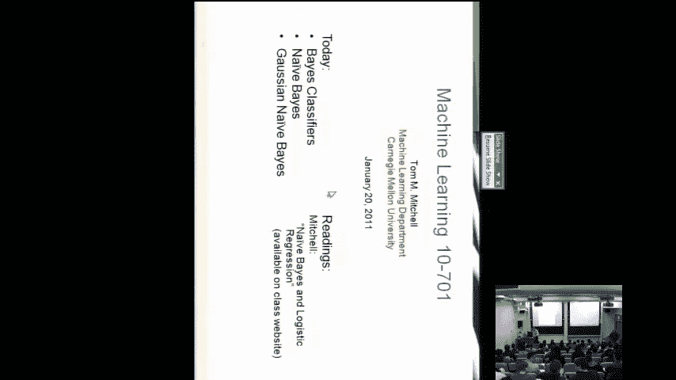
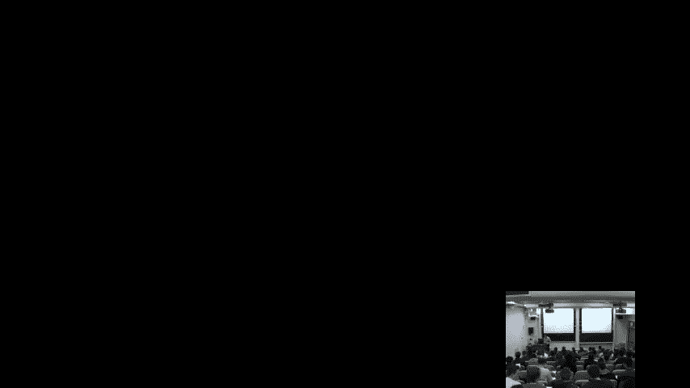
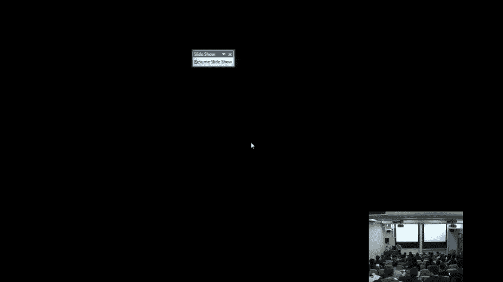
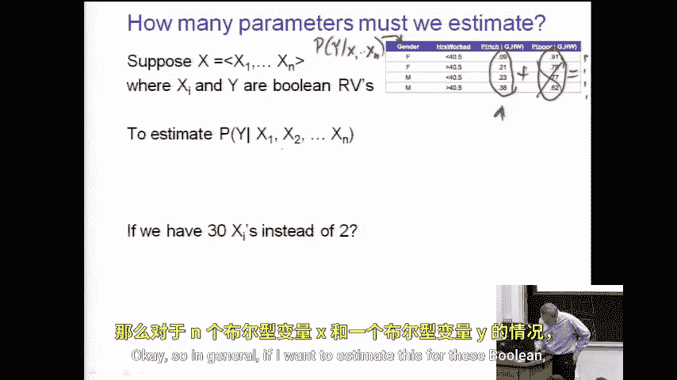

# 卡耐基梅隆大学【中英⚡机器学习｜10-601 2015 Machine Learning】 p30 P30 Lecture 04 Naive Bayes Jan 20 -BV1Lcnhz1E7P_p30-

要过。

おか。还。诶。So today，Today we get to have our first serious example of a probabilistic machine learning algorithm for function approximation that's why we've been working so hard last lecture on covering sort of a basic review of concepts from probability including how to estimate parameters。

 so today we're going to talk about in particular Bayesian classifiers and then very widely used and easy to implement。

 as you will soon find out， algorithm called naive based classifier。

It's called naive because it makes a great simplifying assumption。

 which is usually violated in practice。 But nevertheless。

 it turns out to be a very valuable algorithm。For a lot of practical problems， including things like。

 well， you can train a pretty good spam filter even with naive based classifier。

 So that's the goal for today。So let's jump right in。

Last time we talked about the idea of having a joint probability distribution over a collection of random variables。

 recall we talked about the simple case up here on the top where we might in this case have three different variables。

Gender， hours， work and wealth。 These are three boolean variables the way we've set it up here。

And those red bars tell us。The joint probability。Of any assignment of values to those three random variables。

And of course， those red numbers add up to one because the event space is defined so that for every event。

 for every random draw that we do， we get some value for each of the three random variables。

They have to take on some value。There are three random of variables， eight rows in the table。

 so of course they have to add up to one。啊。So now， as we talked about last time， also。

 if we're interested in function approximation， in general。

 learning to predict some variable Y from a collection of other。Variables， say x sub 1， x sub 2。

 x sub 3。Then。One way we might try to do that is just to learn the conditional probability of why。

Given the values for those X sub1， x sub 2， and so forth。So here， for example。

 we might be interested in predicting whether somebody is wealthy or not。Based on their gender。

 male or female， and our worked above or below 48。5。And if we did that， we wanted to do that。

 then of course， because we have the joint distribution on these three variables。

It would be possible for us to calculate that conditional distribution。

So here's actually the joint distribution of I'll call it wealth， gender and hours worked。

 that's what this table is giving。For any joint assignment of those three variables。

 we see what the probability is for it。We could also， instead， build a。Table， which could calculate。

 of course， from the joint。For let's say， the probability for the variable wealth。

Given the values for gender and our worked。And that's what in fact， this table is。Right， so。

HWhy are these numbers different， Well， it's a different table。 How are they related？

So somebody tell me， let's just look at this first one。

So that purports to give us the probability of being rich。Given that the gender is female。

And the number of hours worked is 40 is less than 40 and a half。Then it says the probabilities。t09。

 How did I， How can I get that from this joint table at the top。First you。Of which general。啊，我说。打鱼。

出这ら。Exactly， so if you didn't hear that in the back。

 our definition of conditional probability is simply。The ratio。Of the probability that。

All of these things are true。That is your rich and the gender is female and the hours it worked。

Is less than 40。 That would be this one。Let's call that a。So that's gender as female。

 ours worked less than 40 and you're rich。And then we want to know how often that happens compared to the thing we're conditioning on。

Which in this case would be gender as female in our worked as less than 40。And that， of course。

 would be a plus B。And that'll give us。This number right。

 so it's just what we talked about last time。嗯。And just to remind you， just how simple it is。

To calculate these conditional。Terms from the joint distribution。Okay。

 so if we could estimate that joint distribution， we could compile out this table。

 and we will have then。The function we want， right， This table is。

Probability of Y given accent for any new person who comes in。

 we ask for the values of these two attributes。We can tell them if they fall into this row we'd say。

 well， your probability of being rich is 0。23。If they insist on a one or a0。

 a yes or a rich or a poor answer。Then we might say， well， since this probability is less than 0。5。

If I'm forced to make a guess， I'm going to say airport。All right， so we could do that。😊。

But you know， if this is what we're after， we don't necessarily need to begin with the joint distribution。

 we could just take our training data and estimate these parameters directly。

That would be an even more。You know， reasonable thing to do。诶。And so let's consider that。And。

An important question to ask is how many of these parameters are we going to have to estimate？

And then will we have a reasonable amount of data to estimate them from。

And if the answer to those are。A reasonable number of parameters。

 and we have plenty of data to get statistically significant estimates for them。

 then this is the approach we'd be happy to take。So let's just， let me just ask you then。

Suppose in general， I'm interested in。Learning the probability of why， given。X1 up through some Xn。

Suppose I have N features。That I'm interested in。And so I want to build a。A table， for example。

 like the one we're just talking about。嗯。Then how many parameters do I have to estimate， Well。

 in this table， how many parameters do I have to estimate？4， right， There are actually， of course。

 eight numbers in here。But the astute observer will notice that some of these numbers have to sum to one。

 right？So， of course， the columns don't have to sum to one， but the rows do， you know。

 for any given row， we're talking about a particular。Instance， a particular vector X。For example。

 the first row we're talking about the genders female and our worked as less than 40。 Well。

 either that person is rich or poor， so the probability that they're rich plus the probability that they're poor must sum to one。

So this column plus that column has to equal all ones。And so we really don't need to estimate these。

 We can just estimate these for。And then if we need the others。

 we just calculate them one minus that。Right， okay， so in general， if I want to estimate this。

For。