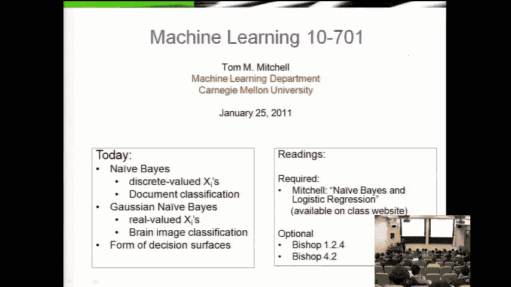
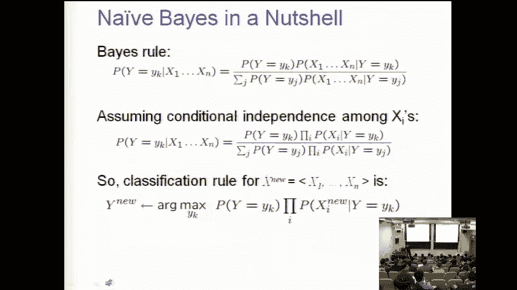
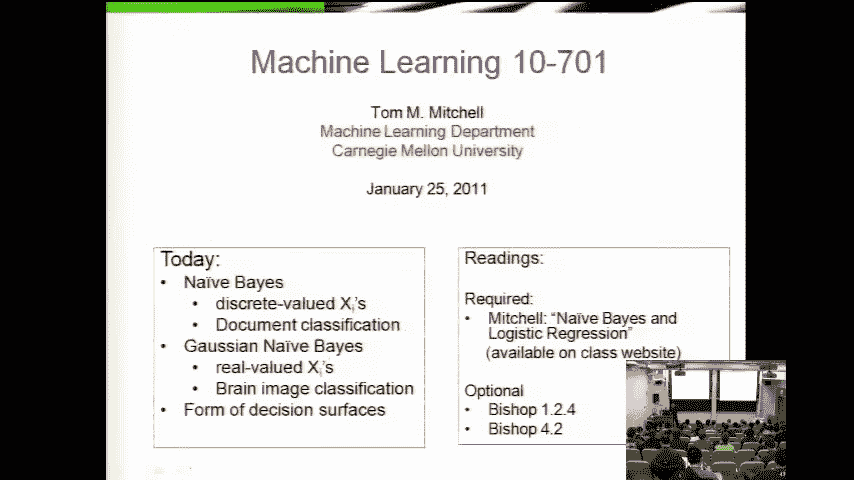
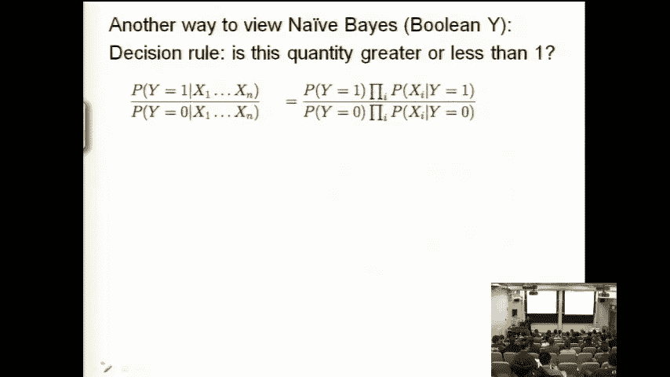
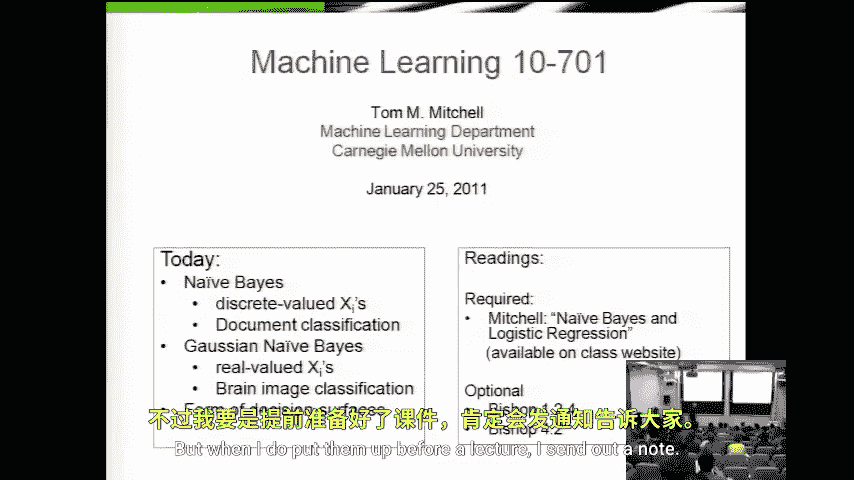
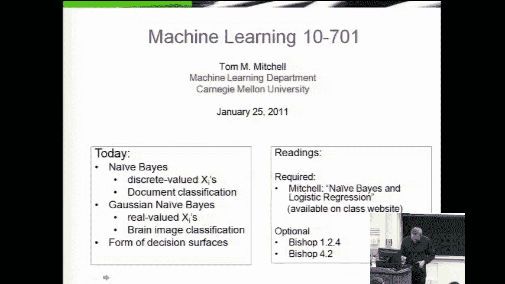
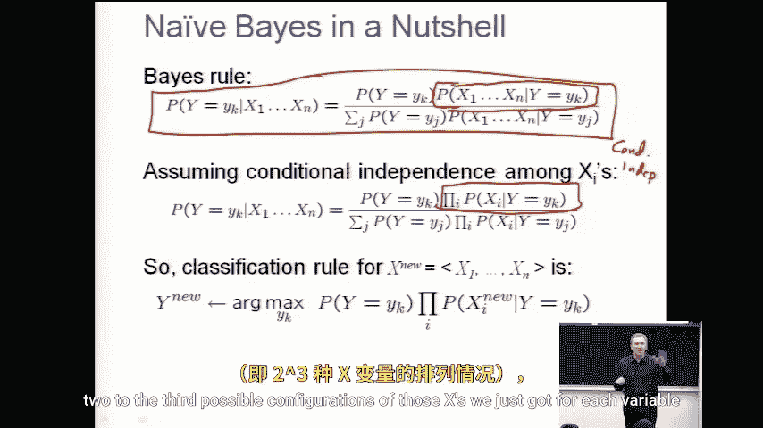

# 卡耐基梅隆大学【中英⚡机器学习｜10-601 2015 Machine Learning】 p31 P31 Lecture 05 Gaussian Naive Bayes Jan 25 -BV1Lcnhz1E7P_p31-

。系。诶我开。

对。个月。ラめ。

有我问。first。

くみたい。They're online。well。I sent a note at one， sorry， yeah， the slides are online。

Some of you have asked me why aren't the slides online like two days before the lecture。

 the sad truth is it's because I prepare the slides right before the lecture。

 but when I do put them up before a lecture I send out a note so I did， for example today at one。

But you know this way this stuff is fresh in my head。

 and so it's easier for me to get into the material。Well。

 and I apologize for the fact that they're not ready sooner than that。

So let's see a couple quick announcements before we start the class today， as you've noticed。

 homework one is due。嗯。Some of you noticed that some of the problems were more challenging than others on homework one。

 the question about Poisan distribution was a little bit more challenging。

 That was there partly to remind us all that。There are a lot of different kinds of probability distributions that you probably saw in your statistics course and the fact that we don't talk about every single one of them in lecture doesn't mean that you shouldn't know about these or be able to just pick up a new one and understand what it means so that was kind of an opportunity to look at it that way。

The next homework assignment will be out。In the next day or so， we'll send it out electronically。

And it includes a question where you get to implement naive bay and apply it to document classification。

Which is something we'll talk about today。Part of my goal in this class is by the end of the class。

 I'd like you to have。A kind of mix of theoretical understanding。

Of the principles and the algorithms in the field， but also have an exposure to。

At least a small number of。诶。Algorithms that you've implemented or experimented with yourself。

 So this is going this next assignment will be a chance to implement naive B。

 which you now know is a very simple algorithm。And test out on some text data。

I'm hoping that later on in the semester， we'll have another。

Programming assignment that will give you a chance to apply machine learning algorithms to some image data as well。

 So I find。For a lot of people who I talk to feel like， well。

 text and image data are especially weird kinds of data。

 They're not structured data the way a database。Strucd database would be。

 And so it's interesting to see how we can apply learning algorithms to those。

The final thing I wanted to say is that there will be， as you've noticed on the course webp page。

 there will be a。Project。That a more substantial project that you'll get to do。

Mostly after the midterm。And the number of homework assignments will decrease。

Dramatically at that point， because we'll be expecting that you'll be working on your class project and we're going to put up a collection of many like well over a dozen different data sets that you can define a course project around and we'll have some suggestions of problems you might look at。

 You'll be。If you feel like teaming up with another student will be happy to accept teams of up to two students to work together on a project and also we'll be very happy to have you propose your own data set。

 for example， some of you I know have already talked with me about。

 projects that you're involved in for other reasons。

And if you want to design your course project around your own data set。

You're welcome to propose that to us。 We'll ask for proposals， just after the midterm。

But the one reason I wanted to bring this up now is so that you could start thinking about it。

 and also because I wanted to let you know that rule here there's only one rule about bringing in your own data。

 which is you must have your own data。Before you submit your proposal。And so if you're thinking。

 oh wow， I'd love to collect some data and do a proposal around it。

 then you should begin now to collect that data because we wont we will approve only proposals that say I already have the data。

 here's the file pointer to it， and here's what I want to do with it。And that's simply because。

Over time， we've learned that it can take longer than expected to collect data and you don't want that clock ticking while you're trying to do your project。

So any other， any questions about the。Projects or other。

Of those kind of logistics issues for the class。Oh。

 one other quick thing many of you have noticed this because it's on our website。

 but my office hours are right here in this room immediately following lecture every day。

 so feel free if you want to follow up on any of the issues in class to just。啊庆眼。

Hang around a little bit after class。Okay， so that's it for announcements。Today's lecture。

So we're now at the point in the course where we're taking very seriously the idea that。

We want to design machine learning algorithms that have a principled probabilistic foundation。

So unlike decision trees， which were kind of a。Rea heuristic scheme for growing something that fits the data。

We're now。Really， looking at the question of。How can we design。Function appmators， or。

Systems that predict the conditional probability of our target label Y from the attributes X that are available。

That are based on Bays rule。 and what does it mean。To learn。The parameters that we need。

In order to correctly capture P of Y given X。And last time we talked about naive Bay， I want to。

I want to not restart， let's postpons。我这。

Okay。So just to remind us all， the beauty of naive Bay says even if you forget it。

 you can rederiveve it。 It's so simple。 Okay， so here's naive Bayes in one slide。 of course。

 we all know Bay's rule。 You shouldn't try to reerve that。 You should whoops， You should know naive。

 You should know the Bay's rule。😊，诶。Which can be written in a couple forms， but here's one of them。

And then the naive Bayes rule is simply the consequence of starting with Bays rule。

And making a conditional independence assumption。And the conditional independence assumption simply says that we can write。

The joint probability。Of X1 through X N。Given some why。As simply the product。

Of the individual probabilities of the X subise given y。And that's why when we trained the。Now。

 famous squirrel Hill classifier in class last time， where our excs were。Ge。

 do you shop at John Eaglele， D， do you drive to work in M you Rachel Madoff fan？

So we had a Boolean variable deal live in Squirel Hill that we were trying to predict from x1。

 x2 and x3， these other three Boolean variables。And instead of。Estimating all the different。What。8。

Two to the third possible。

Configurations of those X's， we just got。For each variable individually， like。

Do you shop at giant Eagleag， We just estimate， we just used you training examples to estimate the。

