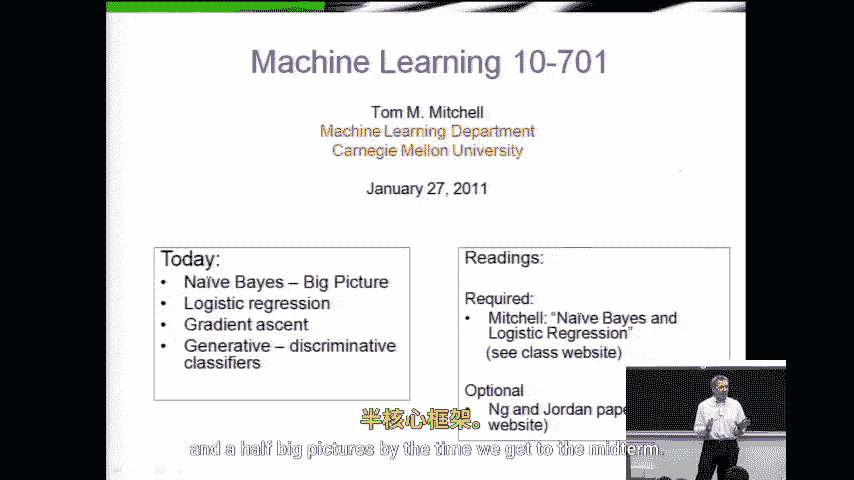
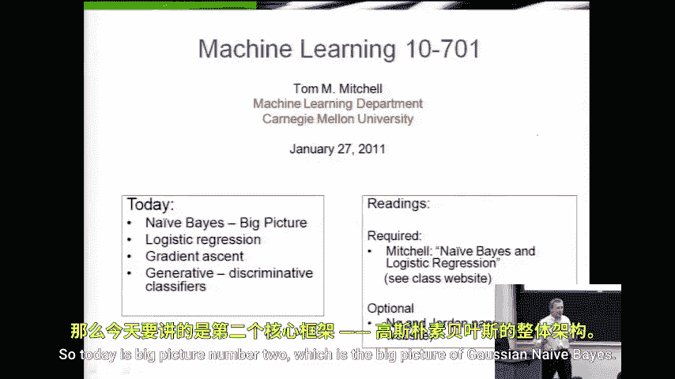
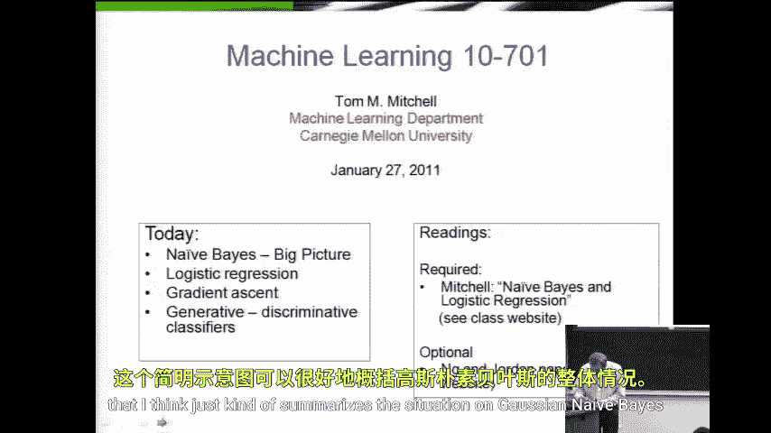
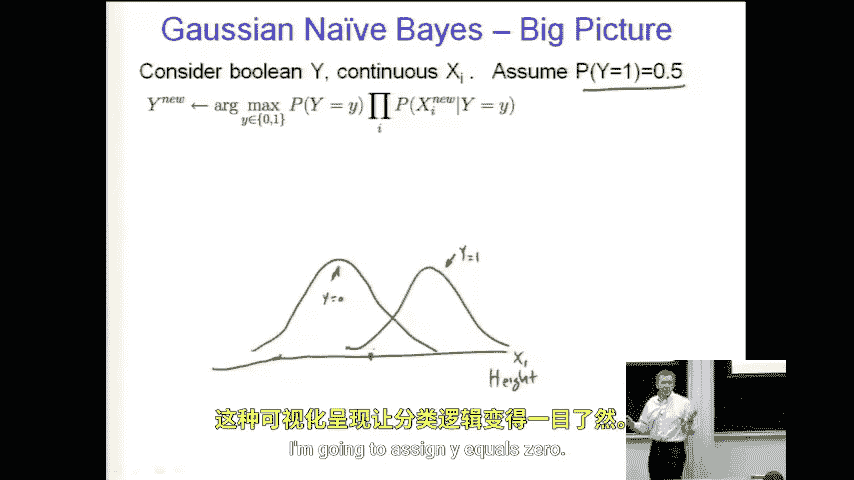

# 卡耐基梅隆大学【中英⚡机器学习｜10-601 2015 Machine Learning】 p32 P32 Lecture 06 Logistic Regression Jan 27 -BV1Lcnhz1E7P_p32-

。And all。Yeah。では。ち可。可爱公。大大夫。对 know like。Yeah。这可定。The are very exciting。ちゃい。で。はは。はは。あ。你没算。Yeah。

then like， yeah， to solve your problem and it like double。三か二十六。Yeah go。Okay， let's start。嗯。

So I'd like to begin today's lecture。Remember the big picture we had in lecture number two。

 so today is the second big picture of the course and I calculated they're going to be three and a half big pictures by the time we get to the midterm。

 so today is big picture number two。

Which is the big picture of。

Gauussian naive Bay。 So this is another little picture that I think just kind of summarizes the situation on Gaussian Naive Bay in a kind of convenient way。

He's here to remember pictures for me and lots and lots of symbols， so I carry this picture rep。嗯。

So suppose we want to train a naive based classifier， let's take a very simple case。

 we have one continuous variable。X sub1， and we're trying to predict a boolean Y so maybe。

We're trying to predict whether a student is a basketball player。Yes or no。

 and we'll use the height of the person as our single continuous variable。And so I might draw。

Here's my X1。That'll be height secretly。And my wise。

Will be y equals one means your basketball player， y equals zero means you're not。

And so we already know all about naive Bay， and so we know the decision rule shown here is that we're going to assign。

Once we train our classifier。And of course， training。

 the class of art just means that we use our training data to estimate。Two distributions， P of Y。

 the prior that somebody's a basketball player， and P of x given Y。

 the conditional probability on their height。Given that they are a basketball player。

 that'll be one distribution we'll have to learn。Plus another one。

For a condition on them not being a basketball player。 And for the sake of this example。

 let's assume， on average， although not。Not completely every single time， but on average。

 basketball players are a little taller than the normal student。So。I might。In this case， say that。Oh。

 here's a Gaussian distribution I could get。That gives me， let's see。P of x。Given that y equals one。

 that let's make that y equals one。Like was one distribution， and I can。Of course。

 have another distribution for y equals zero， that'll be people who are a little bit shorter。

On average。Call that y equals zero distribution。And in this particular case。

 I'm just going to make life very simple by assuming。I have a sample of。

People I'm interested in half of whom are basketball players， so the prior to just 0。5。

 they're equal。Okay， so now。Having， suppose I have a sample of。People and I train。Of course。

 to estimate these， I just had to give the mus and the sigmas， the meanss。

 and the variances for those two conditional distributions。

P of x given that y equals 1 and p of x given that y equals  zero。

And then if I have a new test example and a new X that I want to predict。Why 4。I can just apply my。

Decision rule up there， I'll assign the why。That maximizes that quantity on the right。

Just the product or the prior。And the data， the probability of seeing the height。 So， for example。

 if I。See a new student over here， let's say this student。

What would I predict y equals 1 or y equals zero？Of course， I'll predict y equals 0。

 the probability is higher。If I multiply it white。Probability of y equals 0 times its prior 05。

 That's going to be greater than the probability。Of x given y times x given y equals 1 times 05， yes。

That is。对。The question is why is it just the product and not the integral。

 The answer is my new student has exactly this height。

And so what I'm interested in is what's the probability that。This person is a basketball player。

 given that their height equals。Exactly five feet， 10 inches。

And so Bay's rule tells us we just multiply the prior。5。Times。

Or our decision rule there tells us we multiply the prior times。

The conditional probabilities of those datas。Those observed x's given the Y。

 so it's just what we've talked about。Okay， yes。It's a continuous distribution。

 So we't then you cannot。A s X equal to something in。In the distribution you have only can define。

Arange。No， no， you guys are making this way more complicated than it really is so I have a scale the person stands on this or I have a measuring stick。

 the person stands next to the measuring stick。 I see there are five feet， 10 inches。

 I write that down and I just am trying to estimate the probability of why given that。

And according to Bay's rule， I just multiply these numbers。It's really no more complicated than that。

Despite the fact that， of course， these are conditional distribution or these are continuous distributions。

 I have a Gaussian distribution。 There's some distribution of heights。

Given that somebody is a basketball player that's。In this example。

 different than the distribution of heights， given that they're not。

That's reasonable and because it's continuous distribution。

I might choose a Gaussian as a way to capture that。But。When it grounds out in any given example。

 of course， there are no integrals or any fancy math involved。 I just say， well。

 what's the probability of 5 feet，10， given that y equals1。

 I put that into my Gaussian distribution gives me a probability density。

And the same when I ask it for y equal zero， so it's really not complicated。It's really no different。

In style， than when we had discrete variables， except。

The way we characterize the probability distribution here is in terms of a continuous Gaussian distribution。

Everything else is the same。Pardon me。The probability density can be greater than one。

 but the integral under both of these two curves is one。Okay， so really。

 this just applies and if I were a careful mathematician。Following standard notation。

 I would have put little lowercase Ps instead of uppercase Ps there just to indicate。

Actually a lowercase P on the right hand on the conditional of x given y to indicate that that's a probability density。

 and I would have retained my uppercase P for P on y to indicate that that's a discrete distribution。

 but really， that's just mathematical detail。Is inconsequential to us。Okay， so。

You can see the reason I drew this picture。This is part of the big picture。Yes啊。

Because this picture makes it kind of glaringly obvious that I can。Easily summarize。Which x' is。

 which new students， if the only thing I know about the new students is their height。

Which new students I'm going to classify basketball players。

 y equals one and which one I'm going to assign。Y equals0。

And you should be able to see that easily， right， for any given X。

