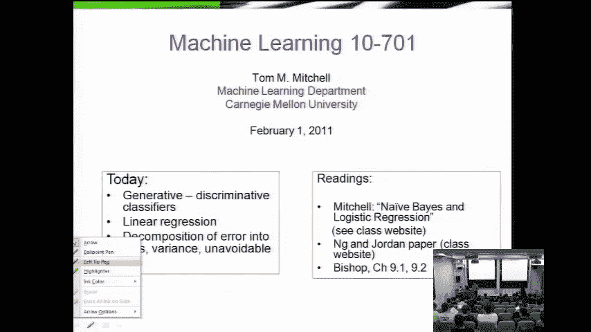
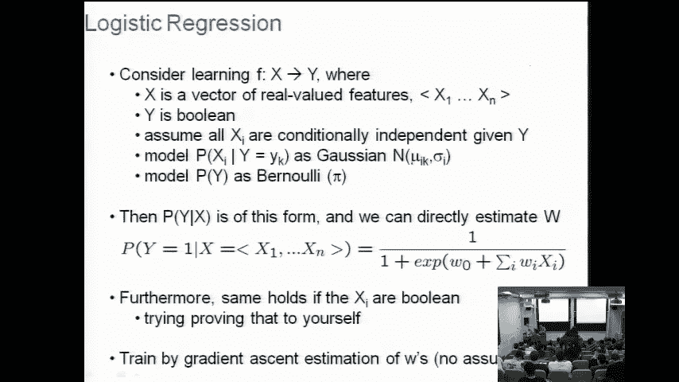
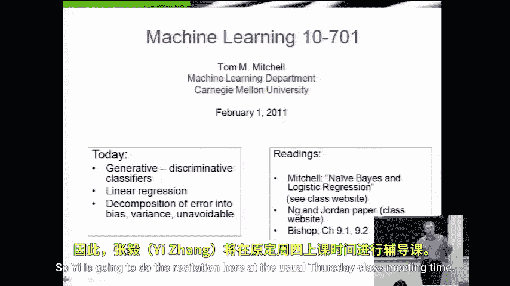
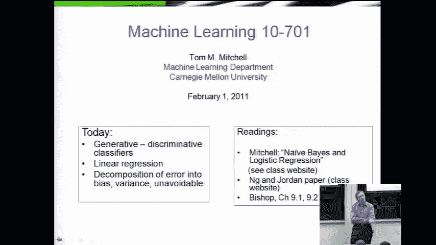
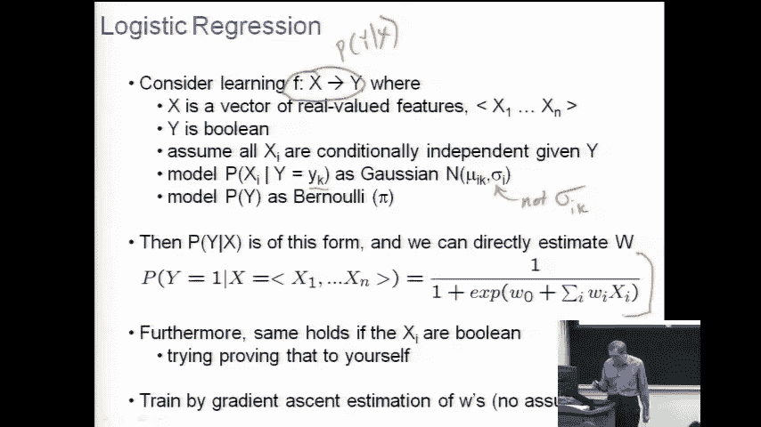
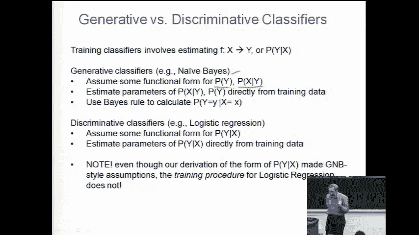

# 卡耐基梅隆大学【中英⚡机器学习｜10-601 2015 Machine Learning】 p33 P33 Lecture 07 Linear Regression Feb 1 -BV1Lcnhz1E7P_p33-

主要拿出。佢家。いやこさ。个。我干。気。

🤧う。前。其啊。Quick announcement before we start the lecture。

 we're going to have a slightly different lineup this week of instructors。

 So we will not be holding the usual Wednesday。5 pm recitation section， but instead Yi Zang。

 who is going to give that recitation， will be giving it Thursday here during the class period。

And that'll be a chance。 It turns out I need to be out of town。On Thursday。

 so he is going to do the recitation here at the usual Thursday。

Class meeting time， and he'll cover some material and also give us chance。 you a chance。

To have a little bit more question answered than we usually can afford。With a lecture style。

So that's the plan for this week。啱。So let's start So we just finished really talking about logistic regression in IE phase。

 so we've just finished talking about the two， the first two seriously probabilistic approaches to machine learning。

In the class， naive base and logistic regression。 So what I want to do today is。

Have take a look at those two in particular。And。Ask the question。

 when might we want to use one versus the other。And then we're going to move on and introduce a third。

Again， probabilistically motivated learning algorithm。 And by now。

 you'll see it won't even take us that long because you already know the template for doing this。

And we'll take a look at that。 That's going to be linear regression where the function we're trying to approximate has a real valued Y instead of a discrete value why。

So that's the plan for today。Just to kind of swap us all back in。

 here's my one slide summary of everything we've talked about， linear regression。So， again， the。

Point of linear regression is that we're trying to learn some function from x to y or equivalently the way we think about it。

 the conditional probability of y given x。And。If we make assumptions very similar to what we make for Gaussian I youth Bay。

Plus， this one assumption that the。Conditional distribution of the individual。Real valued features。

 X sub I， given Y is Gaussian， but that。If we make this additional assumption that the variance of those Gaussians is the same for every。

Possible label。Then we found that we could derive the answer to the question， well。

 what would be the form of P of Y given X， And we found this was the form。

And then we moved on and we talked about。Training this。

The weights the W subs in this logistic regression form。Directly by。

Maaximizing the conditional likelihood of all the training example， Y values。

 given the training example X's。And then when we wrote down the formula for maximum。

 maximizing the conditional likelihood， the likelihood of the Ys， given the x's。And the W used。

Then we found that we could derive a gradient descent。Actually， gradient ascent。

Rule that allowed us to iteratively reest those Ws until they indeed did maximize the conditional likelihood of the training example Y。

 given the training example X's。And so that's our optimization procedure， or our training procedure。

 our way of fitting the training data。Or fitting the W subs to the training data。Okay。

 so that was logistic regression。

And I just want to point out and this is actually an important thing to realize we had a little discussion about this after the lecture up in the front of the room last time。

But if you ask， well， what are the assumptions。In the logistic regression。Algorithm。

Then the smart way to think about that is to break that down into two different questions。

 We can ask， what are the assumptions we made in order to drive this functional form。

 the logistic function。As the way we're going to represent P of Y given X。

And the assumptions we made there are precisely the ones that are on the top half of this screen。

But then we could also ask a slightly different question。Which is， what are the assumptions we make。

In the training algorithm itself， once we're committed to this functional form。

The the training algorithm that gradient iscent algorithm。If you think about it。

 it's really not making anything like a conditional independence assumption。

It's not making any assumption except that P of Y given x' is of dysfunction form。

And then it's finding V W subs that maximize the conditional data likelihood。Given the really。

 the only assumption it's making is that we're going to use this functional form。So， there's a。

Kind of interesting。Openness。Of the gradient ascent training algorithm to violating the assumptions that we made when we were drivingriv this functional form。

 I mean？It's like， yeah， we had to make we made those assumptions when we drive the functional form。

 but once we had the functional form， our procedure for estimating the W subI's really makes no assumptions except that we want to optimize the conditional data likelihood。

So in that sense， logistic regression is a little bit more free and easy。Then Gaussian Naive Bayase。

 because when you train the Gaussian Naive Base class ofifier。

 you really are estimating these mus and these sigmas and you really are applying those to classify new examples under the conditional independence assumption。

So， that's part of the。啊。Perspective that we're going to have to take， if we want to understand。

What's the difference between logistic regression。And Gaussian and naive face。Okay， so。诶。So。

 one reason that we're。Actually spending so much time。On Gaussian A phase and logistic regression。

 is there really examples， exemplars of。What people often call generative versus discriminative classifiers。

 and we'll see others as the semester goes on， too， but。For example。

 naive Bayes is an example of what people call often a generative classifier。

 And what they mean when they say that is that it's a。Probabilistic classifier。That。

Assume some functional form for P of Y and P of X given Y。And therefore， it's a。Well。

 and then it estimates those two things from the training data， and then it uses phase rule。

To classify new x's。To find。The distribution of Y is given a new X。

The probability distribution on possible wise given a new。嗯。In contrast， logistic regression。

Is an example of what people call a discriminative classifier。

By which we mean a classifier that just assumes some functional form for the conditional distribution of Y given x。

And then directly estimates the parameters of that。Without going through this Bay rule intermediate。

啊 step。The reasons for calling these generative and discriminative are a little bit quirky。

But roughly it's this。Logistic regression is called discriminative because it's not really all it cares is what the Y is。

Given an access。