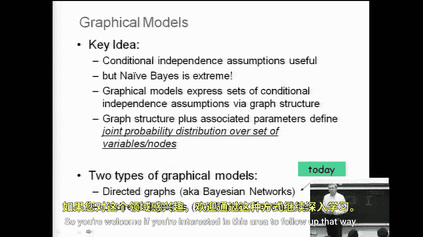
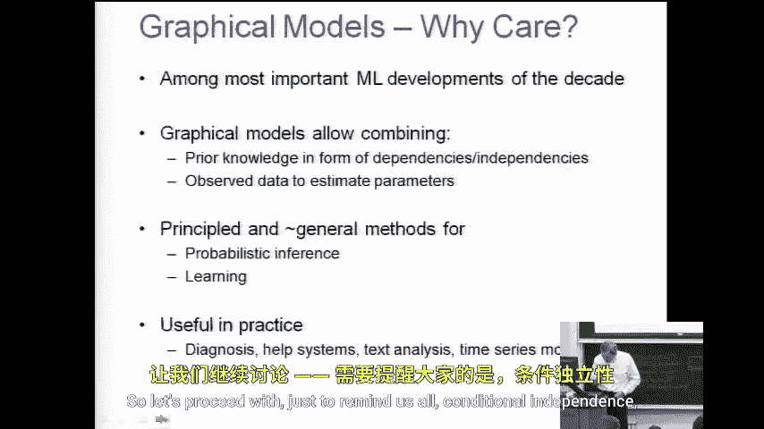
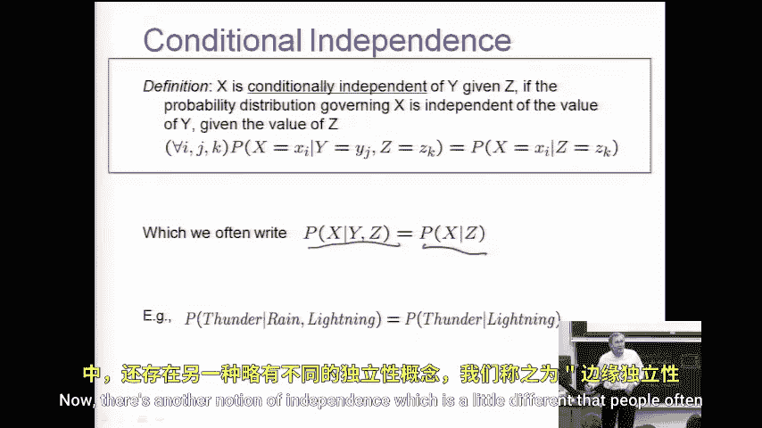
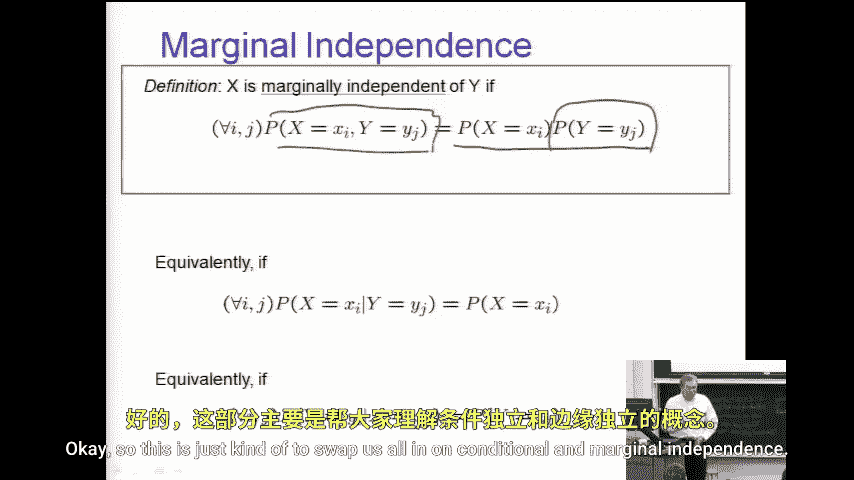
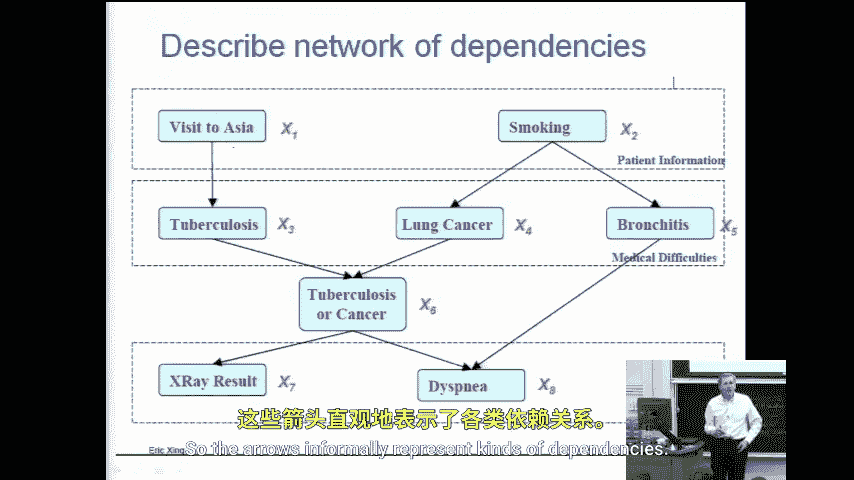

# 卡耐基梅隆大学【中英⚡机器学习｜10-601 2015 Machine Learning】 p34 P34 Lecture 08 Graphical models 1 Feb 8 -BV1Lcnhz1E7P_p34-

Of a series of three or four lectures on Bes networks or graphical models。 graphical models are a。

Representation。For probability distributions， that turns out to be。Very convenient。

 especially for thinking about many of the kinds of learning tasks that we're considering。

 So it turns out that this is actually a very popular。诶。Basis。For many machine learning algorithms。

 And in fact， if you read。The proceedings of the International Conference on Maine learning。

Or of the NPS conference Ne information processing systems。

 which are probably the two dominant machine learning conferences。Annual conferences these days。

Then you'll see that probably more than half of the papers。

 the research papers in these conferences use graphical models as the basis for。

The work that they're doing。 so it's very important part of the field of machine learning and hopefully you'll appreciate why by the end of today's lecture。

But the key idea is this。 It actually derives from what we've already discussed when we talked about。

Nive days。AndRemember， we motivated the idea of using naive phase because number one。

 we wanted to use some kind of probabilistic basis for our learning system。 But unfortunately。

 number two， we realized that。If we tried to represent the entire joint distribution among a large collection of variables。

 for example， even just N Boolean variables， we'd need some number of parameters that was exponential in N。

Just to write down the joint distribution。And so that bothered us。

 and we decided we would use the conditional independence assumption of naive B。In order to。

Defeat that complexity。And then we found， well， if we use naive B and made that conditional independence assumption that all the X sub Is are conditionally independent。

 given the y， then we could get away with， in the case of naive B。

 a linear number of parameters in n， instead of an exponential number in N。Okay。

 now some people complained。 and I think with good reason， when we brought that idea up that。

This naive based assumption is really dramatically incorrect in many， many domains that we use it in。

 for example， you now have some experience applying it to document classification where you make the truly ridiculous assumption。

That the words in the document are conditionally independent of one another。

 given the category of the document。That assumption really is false。 You could test it statistically。

See for yourself。But still， we like naive base because well。

 you have to do something to be tractable。Here's the motivation for graphical models。

It turns out graphical models are a way of positioning our。

Midway along the two points of this spectrum that we've discussed。

 So we discussed the possibility that we'd represent the full joint distribution over n variables with no assumptions。

And we realized that was intractable。 And so then we leap to what I considered the other end of the spectrum where we said。

 okay， let's just assume that every single x sub I is conditionally independent of all the other x of Js。

Given the target variable， why。Which is a truly dramatic set of many。

 many conditional independence assumptions。And so what graphical models do is it gives a chance to。

Select out certain conditional inencies that we like。

And introduce other dependencies that we believe really do exist。 And in that way。

 we can kind of navigate the spectrum from very tractable。

 but ridiculously over a simplified model of naive base。To truly intractable， though， of course。

 very rich representation of a full joint distribution with no assumptions。

And so graphical models are important primarily because they give us a way of。

Writing down in advance。And。In some cases， even learning what are some of the conditional depends and dependencies that we'd like to assert among the variables and then designing learning algorithms around filling in。

The needed parameter estimates to。Give us our。APro estimate。Either the joint distribution or。

 of course， if we have that P of Y given the vector of x's。So that's the idea of graphical models。

It gives us the way of writing down。Essentially， conditional independence assumptions。

And there are really two broad classes of graphical models that are used in the field。

 we're going to focus mostly in this class on directed graphical models。

 which are often called Bayesian networks， although Bayesians bristle at that because many of the learning algorithms for Bayesian networks。

 are actually frequentest methods， not Bayesian methods， but it's okay。嗯。

We'll put up with the brsistle。There's another class of graphical models that are undirected。

 the edges aren't directed and we won't really in this class spend a lot of time。

 but if you're interested in this area， the machine learning department offers a complete semester long course on graphical models and once you've had this class you've got the prerequisites you need to take that class so。

You're welcome if you're interested in this area to follow up that way。 So let's proceed。

嗯。With。诶。Remind just to remind us all， conditional independence， of course。

 is the assumption we talked about when we talked about naive Bay， just to remind you。

 when we say that。Random variable x is conditionally independent of random variable Y。

 given random variable Z， we mean exactly this。We mean that the conditional distribution。

Of X given Y and Z really doesn't depend on Y。If we have the。And we gave an example previously。Now。

 there's another notion。

Of independence， which is a little different that people often talk about。

Which we'll call marginal independence。And basically， it's a simpler notion in some ways。

 it just says the joint distribution over two random variables， X and Y。OrLet me put it this way。

 Two random variables， X and Y are defined to be marginally independent。

If their joint distribution can be written as the product of their individual。诶。

Marginal distributions。And again， terminology wise。

 we call these things marginals and in contrast to the joint distribution。Okay。

 so this is just kind of。

To swap this only in unconditional and marginal independence now。Here's the typical phase net。

Where in this case， I have all those blue boxes represent random variables。

And I might have a problem where I have data about each of those kind of random variables。

 and I might be interested in。Learning the joint distribution over those or maybe learning to predict。

The X ray result of somebody based on whether they've been in Asia lately and whether they are a smoker。

诶。And。So， here's the typical。Bayase net。 and informally， we'll get formal here in just one minute。

 But informally， what this base net represents is the idea that。There are a bunch of inencies。

 conditional inencies among this collection of variables and the edges here。

Really are kind of description of the dependencies among the variables。So， for example， the outcome。

Of whether you have lung cancer might， for example， depend on whether you're a smoker。

But not so much on whether you visited Asia。So the arrows informally represent kinds of dependencies。

And。In fact， it turns out we'll be able to attach a formal semantics to these kinds of graphical models that allow us to say that。

This graph in writing this graph this way。Corresponds。

To saying that the joint distribution over all those variables。Can be factored out。

 can be written as the product。