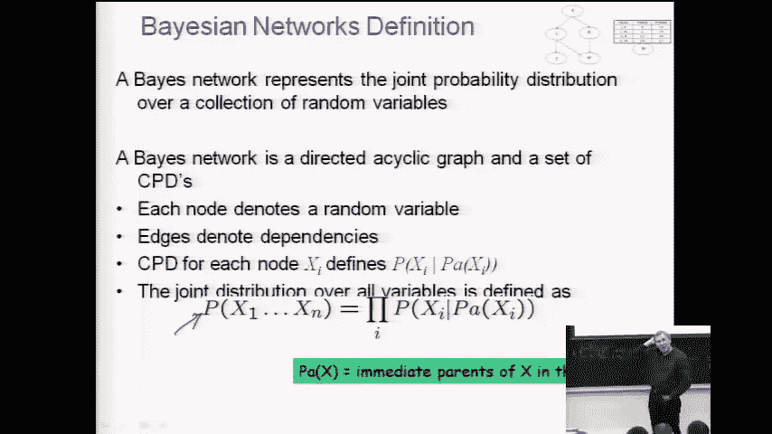
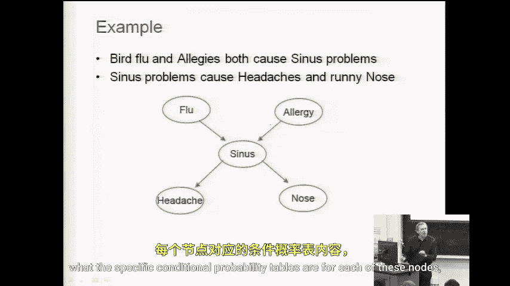

# 卡耐基梅隆大学【中英⚡机器学习｜10-601 2015 Machine Learning】 p35 P35 Lecture 09 Graphical models 2 Feb 15 -BV1Lcnhz1E7P_p35-

いら。Okay let。So let's begin today's lecture， which is a continuation of our discussion of graphical models B Nes。

And。Just to remind us all， here's what we mean by a Bayes net。

 is's just a notation for describing a joint probability distribution over a collection of random variables。

F it is really a notation， very convenient one。And so how does that notation work while a basenet represents that joint probability distribution。

According to。This formula。So we have a collection of random variables， x1 through xn。

What the basenet tells us is how we can more simply represent that joint distribution。

Compared to our default approach of building a huge table with all the possible configurations of values for x1 through Xn。

Which even if those are boolean variables， of course， we'd have two to the n rows in that table。

What the Bay net tells us is that instead of that。Tedious， complete。Complex。2 to the end。

Representation of the joint distribution， we can represent it instead as the product of some simpler distributions。

And that corresponds， as we know， to making a bunch of conditional independence assumptions。

 and so being able to represent these joint distributions more simply actually pays off in two very different ways。

 one is whenever we need to do some inference if somebody gives us a Baysnet。

Of x sub 7 given being one， given that x sub 5 and x sub 3 are 0。

 So if they give us that kind of an inference questions。Then， of course。

 we could solve it with the exhaustive table。Representation of the joint distribution。

 We just have to sum up all the rows in the table。For which the denominator。

Would be true in some of all the rows where the denominator plus enummerator would be， well。

 you know what I mean？Where all three of those variables would have their assigned values。

 Look at the ratio。 We can always do that as kind of our default strategy， but。

If we can represent it more simply， then often we can compute。

Those kinds of the answers to those kinds of inference questions。With less complexity， not always。

 it turns out， unfortunately， imprints in bay nets。Is also MP hard in general， in the worst case。

 But for some kinds of bay nets， as we'll see today， we can actually do inference in a lot less than。

To the end complexity。Okay， so that's one way to pays off， but it also pays off。啊。

More obviously to us in this course， when we go to learn a BsNe。And that's because。Well。

 the same reason that naive days is easier。To learn easier。

 what do I mean by easier to learn naive B requires fewer training examples to get reliable estimates。

Of the joint distribution of Y and all the x subs。Nive B requires fewer training examples to get reliable estimates of those parameters than。

A Bayesian classifier that represents the joint distribution this way。

And so the second way that Bnets bias something is by virtue of having these implicit conditional independence assumptions。

They reduce what we call the sample complexity。 The number of training examples that we need to see to reliably。

Learn， estimate the parameters of the model。Okay， so that's。Kind of where we were with Bay nets。

Today I want to look at a couple issues， one is inference。We'll spend a little bit of time on that。

 And then I want to come back to。嗯。The question of exactly what conditional independence assumptions are implied by Bnet。

 We'll take a more detailed look at that and a more complete look than we did last time。Okay。

 so the story on inference is。Kind of sad， to be honest， I wish I could stand here and tell you。

 Bay Nes make。Probabilistic inference easy， but they don't。It's still NP Phard in the worst case。

And as I mentioned， in some cases。It's tractable。If you look at the published papers on graphical models in B Nes。

It's kind of disappointing， but I would say。By my assessment。

 there's more text pages devoted to how could we do the inference in this phaseNe than there is to devoted to how do we learn these things？

So inferenceprints and basement is actually a big。Hasle， if you have an arbitrary base net。

 it just follows from the fact that inferences MP complete。

But there are a bunch of methods and we're not in this course going to get into their details because that's not really the main thrust of our class here。

 but。As I mentioned last time， if you're interested in this area。

 there's an entire semester long course on graphical models that you're welcome to take once you have this course you'll have the prerequisites that you need to take that and that semester long course goes a lot more into a lot more detail on。

The question of how to do inference tractably。 and we'll kind of sample some of the ideas today。Okay。

 so。Let's start with this simple base net， which we looked at last time。诶。

Which essentially tells us that we have five。In this case。

 I'm going to assume they are boolean variables。 See， whenever I describe a bay net。

 the things I describe are， what's the graph structure。And then I tell you for each node in a graph。

 what kind of a boolean or what kind of a random variable is this？What kind of values can it take on。

 is it real valued， is it boolean valued？And then the third thing I tell you， of course。

 are the conditional probability tables for each of those nodes in the graph conditioned on their immediate appearance。

 Once I've told you those things， then you know everything。About the basement net。So in this case。

 I'm going to assume these are boolean variables。 We have these five。

 and that's the structure of the bay net。 I haven't yet told you what the。

Specific conditional probability tables are for each of these nodes， but。

That's okay。Let's。Let's just look at the inference problem。嗯。Starting with this day's net。Okay。

 so again， I'm assuming these are Boolean valued variables。And。In general。

One kind of obvious question to ask in terms of inference is how do we use a BaysNe like this to figure out the probability of a particular specific assignment to every one of the variables？

And in general， I'm going to use uppercase to refer to variable names， and I'll use lowercase。

To refer to their values。And I'll follow this notation fairly。Commen。Not everybody uses it。

 but a lot of people in the research literature use the same notation。

And I'll even use this kind of shorthand notation。A lot if I don't want to actually write out in detail the variable upper K A has the value lower K A。

 I'll just kind of abbreviate it this way。Okay， so。

Given that I do have the conditional probability tables for each one of these nodes。

I'll just assume I have a little table associated with each node that gives me the。

Appropriate conditional probability of each node conditioned only on its immediate appearance， right？

Then how can I compute？The probability of this particular assignment。啊。

For those variables taking on those five values。Of course。

 the only thing I have available is the grass structure and the conditional probability tables for each one。

First probably yes。probably。Time。

Proably us given。