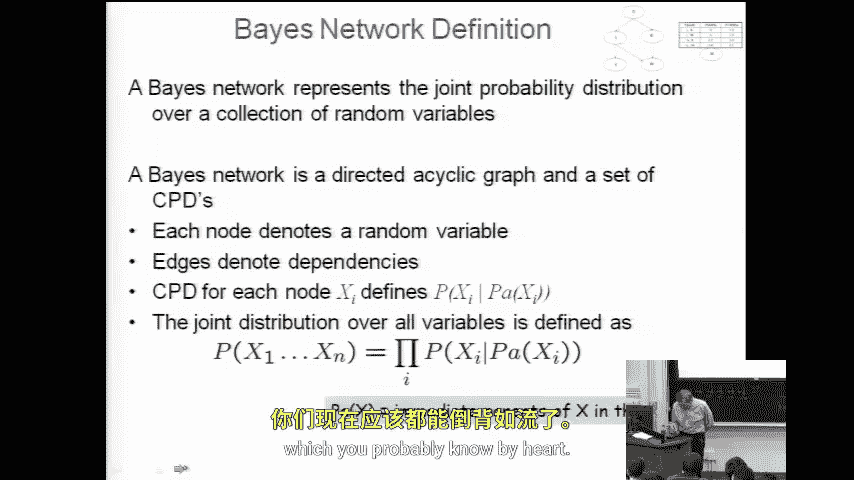
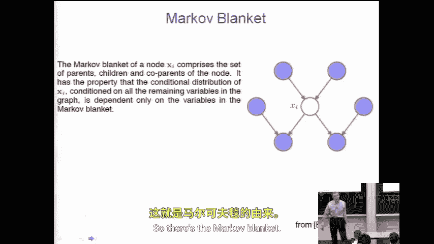
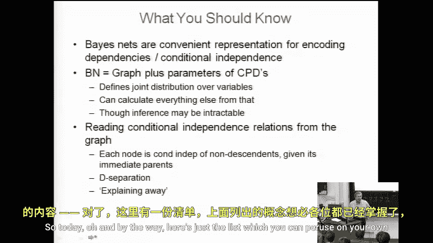
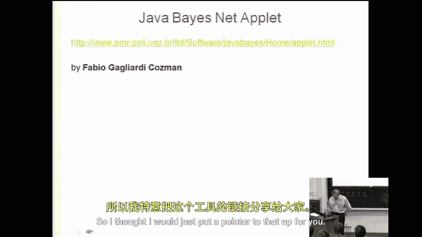
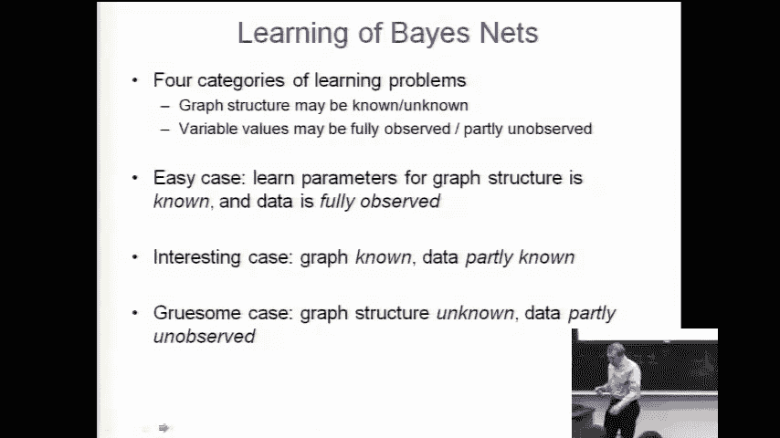
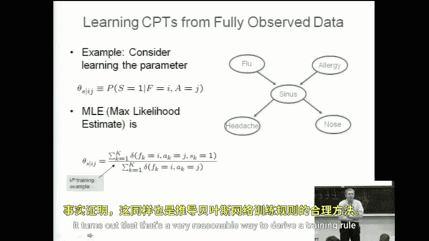

# 卡耐基梅隆大学【中英⚡机器学习｜10-601 2015 Machine Learning】 p36 P36 Lecture 10 Graphical models 3 Feb 17 -BV1Lcnhz1E7P_p36-

ok。Okay。Allright。Okay， so today， we'll start with days mess。And training base。

And see if anybody gets the idea that we're starting。Okay。

 let's begin today we're going to cash in on all the work we've put in so far on figuring out the notation of base nets and figure out how to learn them。

So by now， this should be part of what you wake up thinking in the morning。

I won't even review it again， but that's the simple one slide definition of bay nets。

 which you probably know by heart。Yesterday we talked not yesterday， last lecture。

 we talked about Markov Bla。

And a couple people came up after class and asked a few questions about that。

 And so I just want to very briefly say again， what we said in。

Kind of quickly at the end of last lecture， the Markov blanket。

With respect to a variable in a Bays net is simply the set of all the variables whose values you need to know in order to completely determine everything you can about this variable。

In other words， the rest of the Bay's net is conditionally independent of that variable。

 given its Markov blanket。ok。And。In general。And you'll recall from when we talked about the definition of de separation。

 we talked about these three primitive kinds of subgraphs。In general。

 the Markov blanket for any variable。In any。Directed acyclic graph baysnet。Is simply。As it says here。

The set of parents。The set of immediate children， sorry， the set of immediate parents。

 the set of immediate children， and then the co parents。Of those children。

That is the immediate parents of the immediate children。

 And why do we need those immediate parents of the immediate children in order to。

Make the rest of the base net。Conditionally independent。Of X sub I， given those， Well。

 we need them because of that funny collider subgraph that was involved。

In the de separationation definition。So there's the Markov blanket。

All right， so today。Oh， and by the way， here's just the list which you can peruse on your own of things that you no doubt know by now since we've covered these。

I just， I'm not going to spend the time in class to go through this。

 but there is also this kind of interesting， nice little applet you can grab on the web and it lets you easily。

Make some nodes and some edges between them and define your own bayesnet。

 and then ask the athlete to do some inference on it。

 So it's a nice way to play around with these ideas and test your understanding。

 So I thought I would just put a pointer to that up for you。

Okay， but today， the main subject is learning base。

And I think the easiest way to think about learning bay nets is that there's a kind of。

 there are four problems or a two by two array of learning problems for bay nets。

 and it stems from the fact that we might or might not。

Know the graph structure of the Bay net in advance。Okay， so either we do or we don't， if we don't。

 wed better learn it if we do that part of the learning problem that' already solved。

 but of course we still have to learn those conditional probability。诶。Tables。

Or some description of the conditional probability distributions associated with each node in terms of its immediate parents。

 we'll have to learn those， even if we know the graph structure。

The other dimension along which learning problems vary in an interesting way is whether we in the training data get to observe。

The values of all the variables in the network。Now， so far in this course， we've always assumed， yes。

 we do。When we trained our naive base classifier， for example。

 we assume there was some variable why we wanted to predict our class variable and then all these x sub Is。

 And of course， we assume that in the training data， every training example gave us。

An observed value for each one of those X's， as well as the corresponding Y。

But today we're going to consider the possibility that we might have data sometimes where we don't really。

 on every single training example， get to see every single one of those variables。

Which is very realistic。Problem， for example， if you imagine。Training。Graphical model， a Baysnet to。

Classify patients， medical patients。According to predict their disease based on their symptoms。

Usually when I go to the doctor， they don't put me through every possible test。

 they just look at four or five things and then there are a lot of unobserved variables like you know what's Tom's white blood cell count。

 well we don't know， we haven't measured that yet。Maybe if。

He was really sick and there was a good reason we'd pay the extra money to measure his white blood cell count。

 but it might be unobserved。 so there are plenty of practical situations where we might have data where some。

 but not all variables are observed。Okay， so then it turns out in that two by two grid of problems。

Known and unknown graph structure， fully observed， only partly observed variable values。

As you might expect， the easiest problem is where yes。

 we know all the variable values it's fully observed data， and yes。

 we know the graph structure in advance。And it。So that's the easiest one of the four problems。

The problem we're going to consider today， in addition to that one。

Is the problem where we know the graph structure。But we don't get to observe all the values of all the variables all the time。

And that's a， as I mentioned， that's a pretty interesting problem。 Now。

 people do also work on what I would call the gruesome case of not even。

Not being able to fully observe the variables and not knowing it advance the graph structure。

 But as you might guess， that's a more difficult problem。

Both in terms of working through the mathematics of which you want to do。

 but also in terms of the sample complexity， you know。

 the amount of training day that we would need to have in order to。Learn。

 estimate both the grass structure。And deal with the fact that we don't observe all the data。

So we're going to look at the easy case and the interesting case today。

All right， so let's start with the easy case。Here's a now familiar Bay net。啊。

With the midterm coming up。It's good to think about what are the general lessons of the course so far。

And so one of the general lessons to put it in kind of a jeopardy mode is the answer to the following questions？

Right。Oh yeah， MLE is my jeopardy clue。And。Your jeopardy answer is。

What is our standard way of deriving a training rule when we want to learn some function or when we want to estimate the parameters of some probability distribution？

And of course， maximum likelihood estimates has been our tool of choice。And so have map estimates。

 maximum， a posterior probability。Estimates。so嗯。And of course， all that means。

 all MLE means is that we want to choose， again， we'll use theta as the symbol for representing。

The different。Parameters that we want to estimate for all of the conditional probability distributions and for all of the variables in our network。

And in general， we've said， well。If we've got a learning problem where we need to use our training data to estimate。

The values of the parameters and the function we're trying to learn or the probability distribution we're trying to learn。

 Then what we'll do is we'll try to。Find the values of those parameters。

 the value of the vector of theta parameters。That maximizes the probability of the training data。

So if you give me two different choices for what the theta values could be。

 I'm going to take the one that makes the observed training data more probable than the other one does。

Very intuitive thing。And。It will， it turns out that that's a very reasonable way to derive a training rule for Bay nets。

 too， right， I mean， that's basically what we did for naive Bayase。

