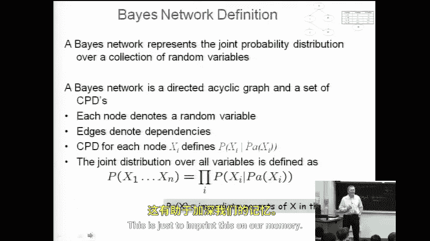
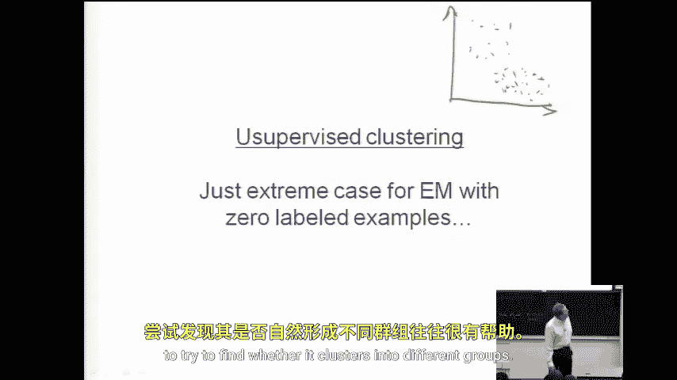
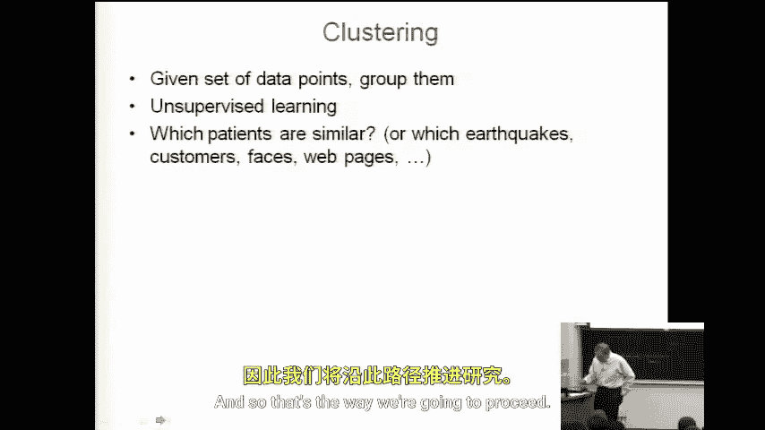
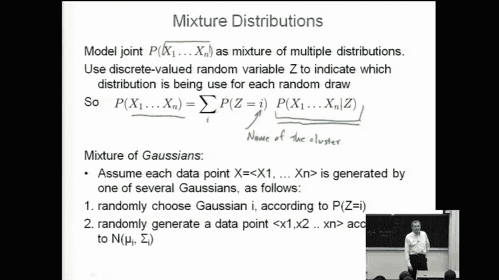

# 卡耐基梅隆大学【中英⚡机器学习｜10-601 2015 Machine Learning】 p37 P37 Lecture 11 Graphical models 4 Feb 22 -BV1Lcnhz1E7P_p37-

They okay。Can stick those over there。All right， so today。Today， as you can see。

 we're going to talk about clustering。 We hinted at this on at the end of last lecture that。

Handling the problem of how we cluster unlabeled data is just really a special case of the problem we talked about last。

Lecture of how we would use EM。To learn a basenet when we only have some of the variables observed some of the time。

And so clustering is just a special case of that， so we'll talk about that and also we'll talk about learning the structure of Bay nets。

So moving right along。This is just to imprint this on our memory。 I'm not even going to say it。

Okay， so unsupervised clustering， the problem here is many people would describe the clustering problem with a picture kind of like this that says。

 well， if I have some unlabeled data，Maybe。Grouping。诶。People buy a couple features like say。

 hide and weight。Then。Sometimes it's useful just when you're getting a look at data to try to。

Find whether it clusters into different groups。

And we can think of that problem。Is。We can model that problem a couple different ways。

 When I first encounter the clustering problem。Myself。I thought。This is a silly problem。

A sillyilly problem for me to spend time on because there is no wrong answer。

If you give me a bunch of data points and you say， guess what the clusters are。ok。

I'll draw a circle around some of the points， so that's a cluster。 Here's another one。And。

You haven't really specified the problem well enough for me to know。

Whether we should prefer the clusters that I made up or the ones that my friend Harry makes up。

So in that sense， it's a silly， underspecified problem。But。

We can make it into a well defined problem。If we take the point of view of saying， well。

 we want to train some probabilistic model of Asnet， for example。To。Cluster these points。

And will specifically say that the best clustering。

Is the one that maximizes the likelihood of the data？

So if you give me two probabilistic models that can cluster the data。

 now I have a basis for choosing between them， I'll prefer the one that assigns。

The grade that makes the data most probable。 I'll prefer that over somebody else's clustering that for the same data points makes that data less probable。

So。So I've mended my ways。 I no longer think of clustering as a silly problem because I see this way of making it into a well defined。

Algorithmic question。How can we estimate the parameters or some base net？

That allows us to cluster the points in a way that makes them most probable。

And so that's the way we're going to。

Proceed， and in general， when you look at the literature on clustering。

 you'll often see the phrase mixture distribution。And this is the kind of probability distribution that we try to。

Used to model the data when we have clustering problems。And。As you'll see it。

 it's a very common sensical thing to do。 Suppose I have data points that are described by N features。

 So each data point has。It's described by and random variables。And。

A mixture distribution is just a particular kind of probability distribution。

Particular kind of joint probability distribution over these random variables that takes on this particular form。

So we say the probability of any given data point with features x1 through xn。

Is going to take this form。 It's going to be the sum over。诶。

The possible values of some latent variable z， and this Z really can think of as the name of the cluster。

Or actually， I guess I should say I is the name of the cluster， Z is the cluster variable。

So I'm going to have a latent variable Z whose value， it's a discrete valued variable， Z。

And for any given data point， we can't observe Z。 That's one of the unobserved variables。

But it's going to be the indicator variable that indicates which cluster this data point belongs to。

And then we'll have some other。诶。Probability distribution。Conditioned on Z。

Depending on which cluster you come from。Theres some probability distribution that determines。啊。

The probability of any joint assignment of x1 through XN。

Given that you happen to fall into cluster Z。Or whatever the value of that random variable is。

So you can think of it it's just this way of saying the probability of any given data point is the superposition or mixture。

Of several different probability distributions。诶。P of x1 through x n given z equals1。

 given z equals2， given z equals3， whatever， and however many clusters we want to say we have。

 that'll be how many values we'll allow Z to take on。And then。

And some of those clusters may have more data points in them than others and we'll let that be reflected in the probability of Z taking on a particular value。

 More populated clusters will have a higher。P of Z。

And so you can think of it as just another way to look at this is you notice that's the form of an expected value。

 right， is some over the possible values of a random variable。

Of the probability that it takes on that。Times of other quantities。 So you can also think of this。

If you like， this is just the expected value。Over P of Z。Of， of this。Okay， and so then。Actually。

 when we talked about naive Bay。This is the form of。P of X， Y， that we。Talked about， really。

Where why？If you think of。Nowive face and think of y as being the variable Z here。Then we're saying。

 well， the probability of any given data point is the probability of the label Y now is Z taking on a particular value。

Times the probability of all the x sub I features taking on their values， given。

The value of the label。啊哼。😊，say three way to optimize， but also。You can imagine as I versus end。Get的。

thereYeah。Yeah， this is a very good question。 So the question was。

How do we know how many values Z should be able to take on2，3，17？How do we choose？

And in this lecture， we're just going to say。We make it up。诶。This would be a good midterm question。

The midterm question would be， how would you use cross validation？

To determine the optimal value for Z， that would be an excellent midterm question。

So you could try z equals1 equals twos equals 17 equals 94。

 z equals the number of data points that I have and I'm clustering。

So that every data point gets its own cluster。And obviously， the well， should be obvious。

 the more clusters we allow， the more values of Z we allow。

 the greater we can we're going to be able to be able。To make the training set。Data likelihood。

But if we held out some data for cross validation。We would see that， for example。

 if we used as many clusters。