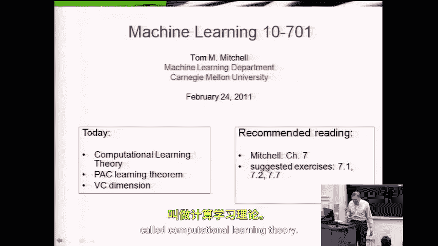
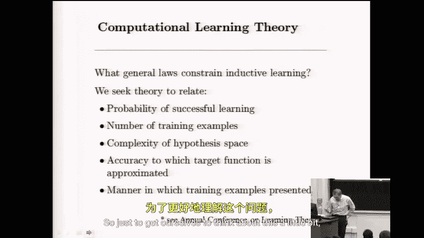

# 卡耐基梅隆大学【中英⚡机器学习｜10-601 2015 Machine Learning】 p38 P38 Lecture 12 Computational Learning Theory Feb 24 -BV1Lcnhz1E7P_p38-

系。Yeah。なのか丈入いね。ははい。What is。冇细。あ丈。对。没有。不知道。あ。very。Yeahや。然问て。Okay。Okay， well。

 let's start the lecture for today。啊 today。We're going to come back to a question that we actually asked。

Or promise that we would ask on the very first lecture of the course。

Where I mentioned that we're going to talk about a number of different algorithms。In this course。

 and we're going to talk about。Some principles that we use like maximum likelihood and math。

As the basis for。trainraining learning systems of different kinds and that we were also going to talk about the question of are there any fundamental laws that we can come up with that govern the learning behavior of any learning system。

 including your brain and mind。诶。And so today I we're going to cover an area that's called computational learninging theoryory。

This is actually a very active。A topic within machine learning that warrants its own annual conference。

 there's a conference on learning theory cold。And if you look online。

 you can the online proceedings of these conferences from year to year are all available for free online。

 So there's plenty you can look into， but。Fundamentally。

 the question we're going to ask today is this one。

What are the general laws that constrain inductive learning that is function approximation。

 let's say。We want to we given examples of the input output of some function， say from x to y。

 we want to estimate what that function is from examples。

 and so we're interested in can we come up with some theoretical analysis of that problem？

That relates。The number of training examples that we provide to the learner。

To the probability that it's going to succeed where we define success in terms of。

The error rate that it'll make on future examples when it has to make new predictions。

And it turns out that it's also going to be related to the complexity of the hypothesis space or the class of models that the。

Learner considers。And it's also related to how it gets its training data。

So just to get ourselves to think about this a little bit。

诶。Here are three。Somewhat different questions we can ask of this Ilk。The first one says， well。

 all of these have to do with。A scenario where there's some function we want。Our learner to learn。

 we're going to call this C。It's a function from some input vector of features x。

To a boolean valued y1 or0。We'll call these concepts in meaning a boolean valued function。And so。

Think about it this way。We're going to provide training examples of C that is inputs in their labels。

 x's and Y's to the learner。And we'd like to know。How many training examples are sufficient to succeed？

And here are three different scenarios we might consider。 So like， for example。

 we might consider the problem of classifying。Students。According to whether they are， let's say。

 computer science major。We have some features we're looking at， we have a probability distribution。

 maybe let's say we're interested in classifying students who come in this door。And。Randomly。

 people come in this door。 that's going to define the X's that we're interested in。 Now。

 we just want to classify them。Cin to whether they're computer science majors or not。

So one scenario we could have is。That the learner。We have a learner and we have a trainer。

The trainer knows C， it knows the function。We assume。And so it can label， for any X。

 it can tell us what the Y is， computer science major or not。That's what the trainer can do。

And we also have a learner who's getting these training examples and trying to estimate what the function is。

So one scenario we could consider is that the learner proposes instances， the learner says。

 what about this student？And then the trainer says， no， not a computer science major。

And then the learner says。Can pick any other student they want。

 they don't have to take the ones that are coming in the door。

 the learner maybe could optimize by choosing the student that they think will somehow give them the most information。

So that's one scenario we'll call it a problem setting in which we could consider this question。

 so we could consider the question of how many training examples will it take to learn successfully if the learner gets to choose an arbitrary X out of the space of possible x's。

And ask the trainer， what's the correct label for this X？And under that setting。

We could consider the question of how many X'es will the learner have to ask about in order to succeed。

 That's often called the active learning。scenarioar where the learner gets to choose the x's and then a trustworthy trainer will label them。

Scenario two is kind of the flip of that。What if the teacher gets to choose？

What if the teacher who knows the function we're trying to learn？

Is trying to teach in the fewest possible number of examples。

Then given that the teacher knows what the criteria are。

 like whether you're carrying a laptop and whether it's an apple or a PC might be a relevant feature。

 whereas the color of your hair， probably not， and so the teacher who knows exactly what that function is。

 might be able to construct a particular collection of examples that very efficiently communicate。

What the。Decision。Criterion is what the function is。 case that's a different setting。

A third one and the one we're going to talk about today。

Is the one that we were just experiencing where we say it's neither the student nor the teacher who picks the next example。

 Instead， there's some underlying probability distribution。 let's call it P of x。

That determines the probability that any one of the possible x's will appear。

And we could just watch people coming in this store。 That's a draw from P of X。And。

Instead of having the student choose which X we'd label next or having the teacher choose which X weed label next。

 we'll just take the random。Distribution of x's that appear in our doorway。

And the teacher will still label those correctly。But now that's not the active learning scenario where the student chooses。

 it's not the training scenario where the teacher chooses。

 it's just examples are coming in from some underlying P of x distribution that might。You know。

 it might not be a uniform distribution。诶。For example， it might not include very many five year olds。

 but include a lot more 20 year olds， for example。But there is some P of x。

 and so we're going to consider this。 What the examples。

