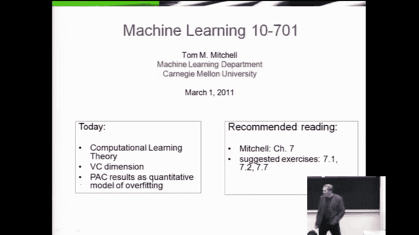
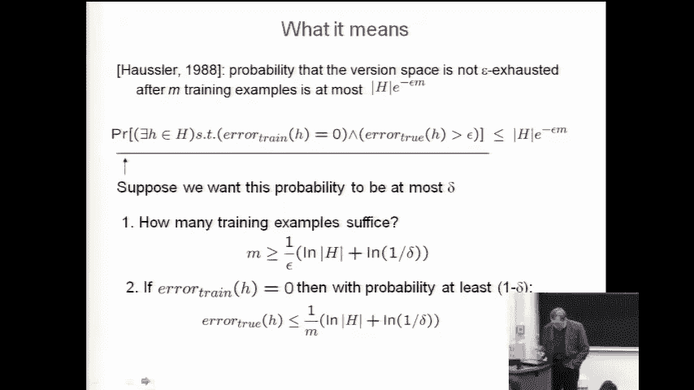
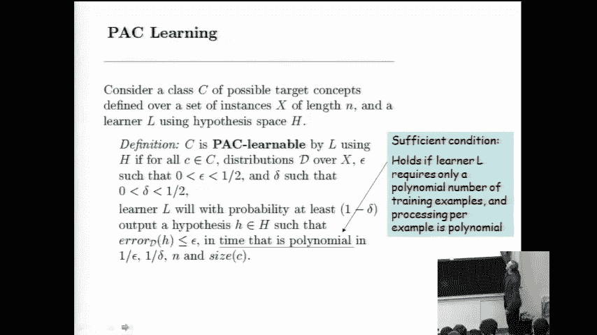
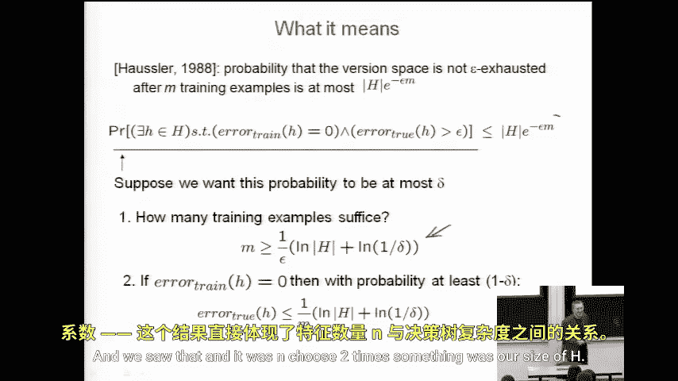

# 卡耐基梅隆大学【中英⚡机器学习｜10-601 2015 Machine Learning】 p39 P39 Lecture 13 Midterm Review Mar 1 -BV1Lcnhz1E7P_p39-

な。すごいすごい。我そ的。Tell you what， let's do the rest of this later， okay？I thisister。This is last homeworkr。

Okay。员。I was brilliant and I marked mine with this， can I grab this。ok。That was good。

I'm going to use that。 Yeah， there's another one in there All right。

 Im just gonna take this way so people will go sit down。😊，可。ok 啊。They have plenty to cover today。

So let's get started。嗯。Let's see。 so we really have。Two half lectures today。

 the first is finishing up the material on computational learning theory。As you remember。

 we left you with this cliff hanger question， but what if the hypothesis space is infinite？

And then the second half， we're going to just take a step。

A giant step backward and kind of look at what we've covered during the first half of the semester。

 in partly in preparation for the midterm。Okay， so。

Let's。Start right in。 So last time really the key result that we proved as a class。Was this one。That。

In this PA learning setting that we talked about where examples are created by first drawing in X。

At random from P of X， some underlying distribution like students coming in the door。

And then once we have an x drawn from that random distribution， we'll have a trainer。Label that X。

In a deterministic fashion。And without ever making a mistake。

So the randomness here in the training set comes from P of x。

 not from the teacher making labeling mistakes。And in that setting。

We found that we could prove and we did， in fact。That。The probability。

That the version space is not epsilon exhausted or put in other way。 the probability that。

We have a hypothesis that has survived all the training examples。Without making any mistakes。

After M training examples。And still has a true error that's at least as bad as epsilon。

Then that probability is founded。And we proved with the boundary。So in other words。

 the probability that there exists a hypothesis that will have zero training error on these m randomly drawn examples。

And still have a true error that's worse than epsilon。Is it most this quantity？

And then we showed that we could。Use that fact， just reexpress that fact， really。

 to answer questions like， well， how many training examples M will suffice？

To guarantee us that that probability of making a mistake is or the probability of having a worse than epsilon hypothesis。

Still in the running。Is at worst Delta。And we came up with that expression。

 or we could flip it around and equivalently calculate well。

How many examples do we need to look at to bound the true air？Essentially， using epsilon。

As our indicator of the bound on that。Okay， so that's what we talked about last time。

And。One thing that I gloss silver， but I just want for completeness。To tell you the definition。

P learning， because if you read papers in this area， you'll see people talk about。

They've proved something about a PAC learner， and I just want to for completeness。

 say precisely what that means， here's the definition。

So let's consider that this definition involves considering some class C of。

Concepts that is functions with。1 or zero is the y value。

That the teacher could conceivably want to teach。That's the class。

And it's defined over some set of instances， X。They can be coded with length M。

Like these are N Boolean features。Unniorly distributed， then maybe M would be that。诶。

And we have some learner， we'll call L that uses hypothesis based H。

 then we say that class of concepts。Is Pa learnable if？

But it's learnable by learner L using its hypothesis space age if。

For any concept in that class that the teacher might want to teach us。And for any distribution。

 P of x， we're using script D here for our P of x recall。For any distribution that exists over x。

And any reasonable epsilon in Delta。The learner will with probability at least one minus delta output a hypothesis with error smaller than epsilon。

And we'll do that in time this polynomial in this。So this is the official definition of PA learnability。

 And notice it's。Couched in terms that are really computational complexity， kind of。Terms。You know。

In time that is polynomial。But of course， in machine learning， what we really care about， usually。

 well， we care about time， we care about computer time。

I care more about not the computational complexity， but what we'll call the sample complexity。

 how many training examples do you have to give as opposed to how much CPU time is it going to cost？

But this definition is in terms of CPU coming。And they're actually very closely related because if you think about it。

You have to prove that this learner can do this in time， that's polynomial。In。

How tight our bound on epsilon and Delta are and N the size of the examples。And also。

 this is something about the size， the complexity of the class C。So what is exactly？

And is the coding length of X。They want something that。Yes。

 the code you would use to encode a randomly drawn example of。

It's the length of the code you need to code an arbitrarily drawn example of x。So， just one example。

Yes， but if you， if you。To code an arbitrarily drawn example of X。

 it's influenced the code you'll need is influenced by the number of examples in that conclusion。

polyno milk in the in the sample size。Well， it's not。 This is just the way it's defined。

 So that's why I'm putting it up there。 But now let's look at how that's related to sample size。

So one way you can prove that your learner will be able to do this in polynomial time is if you happen to have a learner like all of the ones we've discussed in class。

That requires only a polynomial number of training examples and can process each of those training examples in polynomial time。

Okay， so。So even though the definition is phrased this way。

 almost all of the proofs that something is a PAC learner really prove that the learner can。诶。

Achieve。This sample complexity。ThatThat it can learn to an arbitrary。

Epsilon in an arbitrary delta in a polynomial number of training examples。

And then point out that this algorithm also uses polynomial time per example。Okay。

 and just to kind of relate this back to what。We saw here。

So here we have our bound on number of examples。That will suffice to get us to an arbitrary epsilon in Delta。

And last time we looked at a few examples like， remember， we looked at depth2 decision trees。

For example。And we asked， well， how big is H？For depth two decision trees。

 if those trees are defined over N boolean features。And we saw that。

 I it was and choose two times something。诶。

Was our。Size of age。 and。