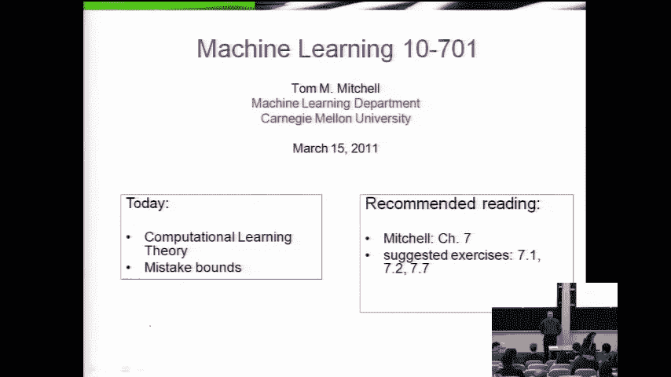
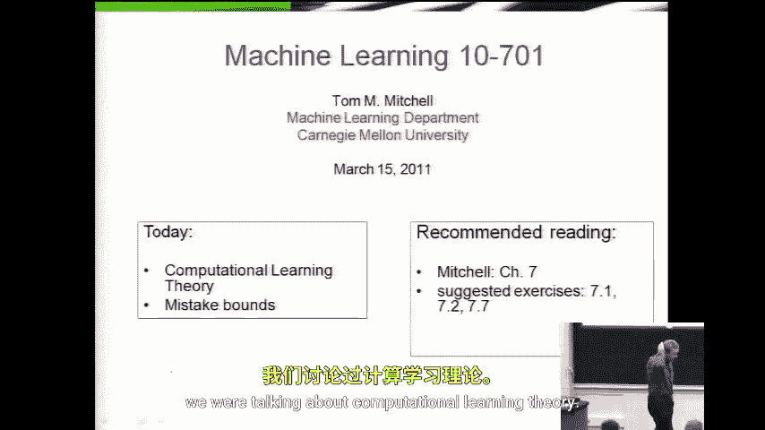
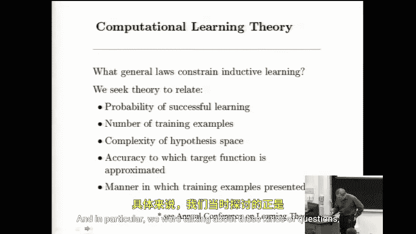
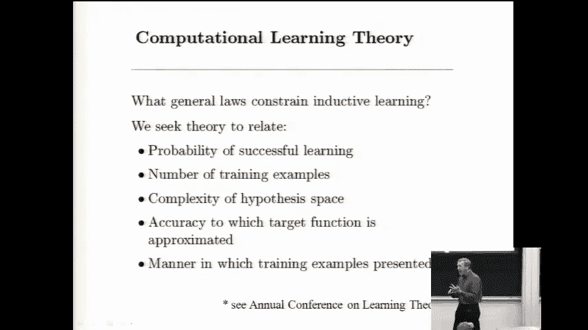
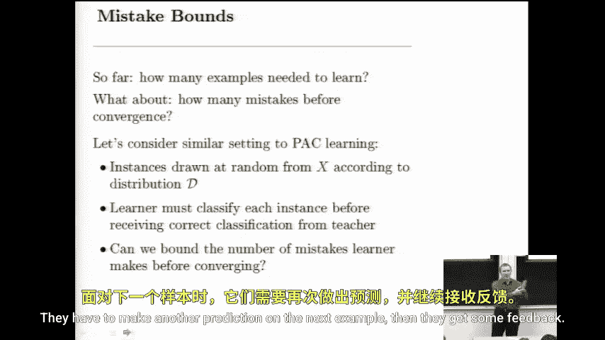
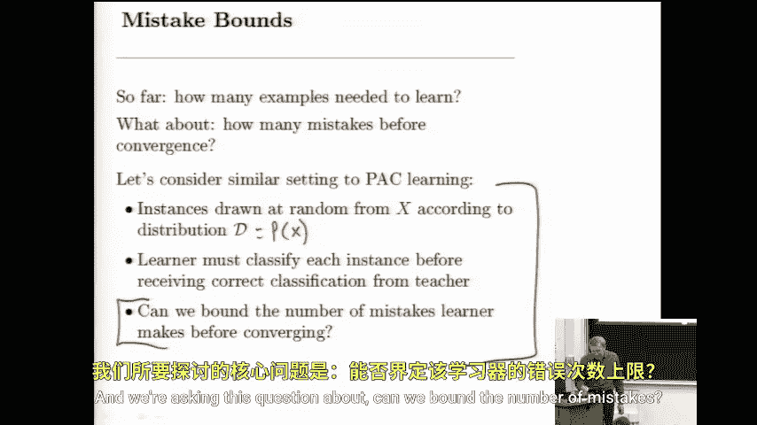
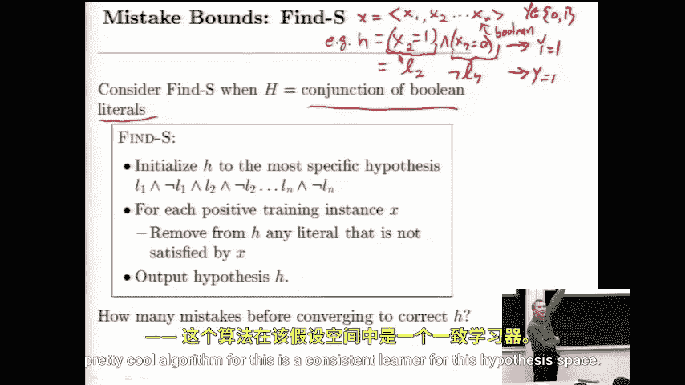

# 卡耐基梅隆大学【中英⚡机器学习｜10-601 2015 Machine Learning】 p40 P40 Lecture 14 Computational Learning Theory Mar 15 -BV1Lcnhz1E7P_p40-

Looks so rested。 and sort of。Springy。It's great。IHope you' all had a good break。

Sorry about the midterm， no， not really。It was， I'm glad you got to complete the midterm before spring break。

 so you didn't have that hanging over your head。 We'll return those today。 and overall， I thought。😊。

啱。People did about， as I was predicting。TheThe average， the mean on the midterm was 68。

And the standard deviation is 15。 so I think of 68 plus or minus 15 as kind of the spread of grades。

And。By the way， out of 100 possible points， the highest score was 100。

And that individual also happened to get all six extra credit points。

 so it was a solvable midterm i'm happy to say and that wasn't one of the Ts are me taking that was one of you。

嗯。And。I think what we may do is。Maybe in recitation this week， maybe we can go over a few of the。

Midterm questions that were most exciting or most contested among you in terms of their answers。

But overall I thought it was okay and。I'm sure by the time the final rolls around。

 you'll know even more。嗯。Oh， it's good。Let's see。 So today， what I want to do is give a。

A little bit shorter lecture than normal so that we can also， in terms of technical stuff。

 but also leave a little bit of time to talk about the。Projects。So as you know， in the course。

 the second half of the course will have many， many。

 many fewer homework assignments of the type that we had in the first half。Like。

 maybe we'll have one。Or two short ones。And then primarily your outside of class time will be。

Of course， studying the material， but doing a project。

 and so I want to spend some time talking about that today too。Okay， so。

You'll probably recall that before the midterm， we were talking about computational learning theory。

And in particular， we were talking about these kinds of questions。

The fundamental questions of machine learning， really， how does a learner's performance。

 That is the accuracy with which it can approximate the target function that。It's trying to learn。

 how does that accuracy depend on things like the number of training examples it sees。

 the complexity of the hypotheses that it considers and so forth。

 and we talked about really the key result in the field。

 which is this result on probably approximately correct learning。Paack learning。And today。

 what I want to do is just talk about another kind of different way of theoretically characterizing。

Learning， so instead of asking the question， how does the probability that our learner will output a hypothesis with true error epsilon。

How does that depend on the number of training examples？A different kind of question we could ask is。

How。If we have a learner。That let's say， a consistent learner。For starters， consistent learner。

 that is one that finds a perfect a hypothesis that perfectly fits the training examples if possible。

诶。The mistakefo question is。How many mistakes？Will a learner make on the way to getting the right answer？

It'K kindd of an interesting question。 If you think about it， if you think about a spam filter。

 for example。A learning spam filter。This would be equal to the question of how many males would it？

Misclassify a spam or not before it converges to the correct spam filter。If there were a consistent。

Spaam filter。Right， or so you can mention lots of reasons why。

 especially if we're looking at what what people will call online learning， that is learners that。

Have to train on the job， so to speak， they have to make a prediction。As they're going。

 and then they get some feedback， if to make another prediction on the next example。

 then they get some feedback。

So a spam filter that you're using and correcting would be such an example or some kind of diagnosis。

Medical diagnosis。Classifier that was going to look at patient symptoms and say。Yes or no。

 it's a good idea to give them this particular antibiotic。To treat。Their problem。

If we imagine a learner like that， that's。Getting new patients coming in all the time and having to make a prediction。

And then later， we find out whether。That therapy worked well for this patient or not。

 So then it gets the correct label。 Then it's a very reasonable goal to ask。

To try to minimize the number of mistakes that the learner makes along the way to learning。

And that would be sometimes a more important constraint than minimizing the total number of examples that it looks at。

So you can see why this is an interesting question。And also。

 it turns out by looking at this question， we'll kind of get a different angle at looking at some of these fundamental insights into learning and how it really works。

So this is the question for today。 So basically this problem setting is。

The same as the path setting that is we're going to assume we have a kind of online learner that's。

Being given a sequence of training examples。Each member of the sequence is generated by drawing some random。

Instance， a patient or an email to be classified。From some underlying distribution。

Which is our P of x。And then the learner must classify that example。

 then the trainer gives it a label and we're asking。

This question about， can we bound the number of mistakes？Okay， so。嗯。

I want to just start with a very simple algorithm and ask you to come up with the mistake bound。

So the simple algorithm is this， let's suppose。As usual or as we've commonly done in the past。

 we're going to assume each example is just a vector of， let's say， boolean features。

So those will be our examples， just a vector of N Boolean features。And let's assume。Each hypothesis。

Is。A conjunction of Boolean literals。AndBy that， I mean a constraint on any subset of these。

 so for example。I'll say EG。Our hypothesis could be that x sub2 must be1。And x sub7 must be zero。ok。

actually， to follow the notation that we're using down below on the same slide， I could say， well。

 here's some literal。I'll call this literal two that's requiring。The x2 be0 B1。 And I'll call this。诶。

Not。X 7 must be one。ok。So I'm just defining that because I see the slide below uses this。

Other notation。 but the idea is simple， right， Every hypothesis is just a set of a conjunction of constraints on the values of the different。

Features， and if that is satisfied， then we're going to say y equals one。Right， and。Here again。

 we're assuming。The label we're trying to predict is also boolean， okay？So simple learning problem。

 the examples are just。Feature vectors of Boolean features We' trying to predict a 0。

1 valued function。And。The hypotheses we're considering are the simple rules of the form。嗯。

Either constraining。An arbitrary x sub I to be 1。Ass here or constraining it to be not one。Okay。

All right， so now think about the following simple。

 pretty cool algorithm for this is a consistent learner for this hypothesis space。

嗯。