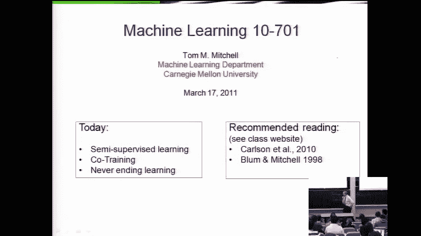
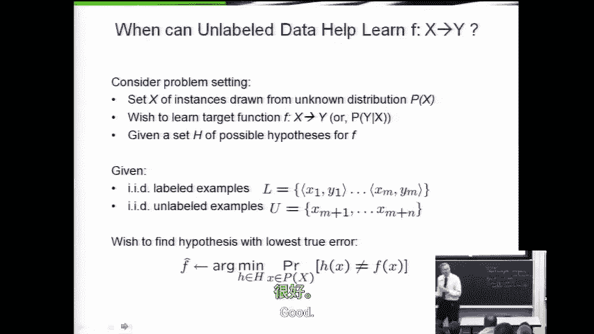
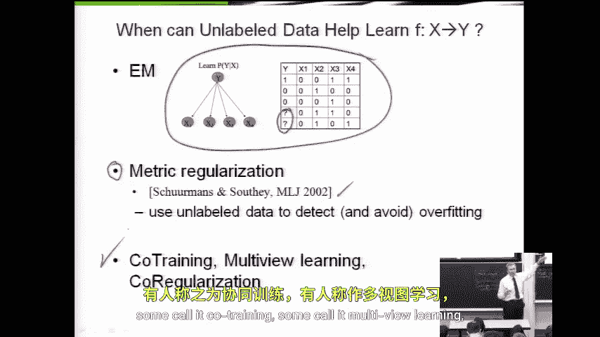
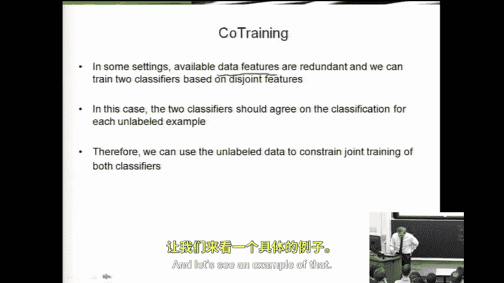
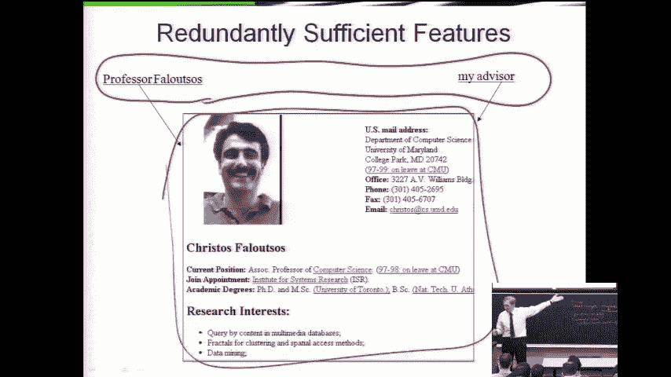
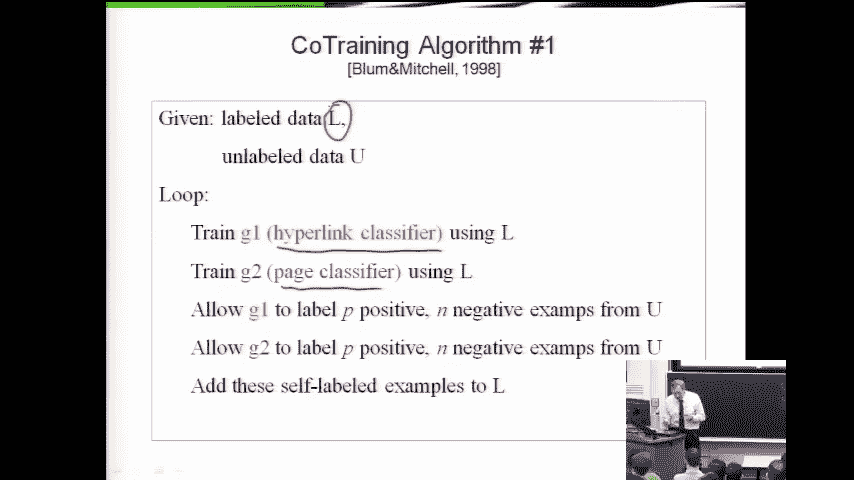

# 卡耐基梅隆大学【中英⚡机器学习｜10-601 2015 Machine Learning】 p41 P41 Lecture 15 Semi-Supervised Learning Mar 17 -BV1Lcnhz1E7P_p41-

希は。何千？や輩と？There is。啊。That's right， yes， underwear accounts。Okay。

 so today we're going to talk about semi supervised learning。😊，And never ending learning。

 two of my favorite topics。

And we've talked a little bit before about semi supervised learning。

 because that's really this question。Semi supervised learning has to do with the question。

How and when can unlabeled data help us approximate some function F？And when we see unlabeled data。

 we mean just that we only have the x's without the Y's that go along with them。

So now that we've talked about the PAC learning setting。We could。

Tk about the semi supervised learning setting。As follows。

 and this is basically the way we're going to think about it today。啊。

We have some set of instances drawn from some underlying P of x distribution that we don't particularly know。

 but it's fixed over time。We wish to learn some function from x to Y， or。

Conditional distribution of Y given x。Our learner has some set H of possible hypotheses。

And in the past， we said， well， and then we'll provide labeled examples shown as L here。

Where each labeled example is some pair x subi and the Y subi that goes along with it。

And here we're going to say， well， we also have some unlabeled examples， which are just more x's。

Without the accompanying wise。And our goal， as typical。

 is that we want to find the function that minimizes。Our estimate is going to be the hypothesis H。

We want the one that minimizes the probability that it'll disagree with the true function F。Okay。

 so it's just。The same setting we've been talking about before， and。嗯。

We did discuss this once already in the semester before the midterm， remember。Good。Good， so EM。

 that's right。 EM is exactly one answer。😊。

To the question of when can this kind of unlabeled data help？ And when we talked about EM， we even。

Use this little example here where we said， well， we know the labels for some of those x's。

 but not for all of them。And what can we do？And what we decided was， well， with EM。

 at least we could estimate the parameters that maximize the expected full data likelihood。Now。

It's a good idea。There are roughly。Two and a half other ideas that I've seen in the field。

One of them that we're not going to talk about today， but which if you're interested in this。

 I encourage you to read this very nice paper by Dale Shermans。Called metric regularization。

 It's an idea for how to use unlabeled data。To detect overfitting。

And roughly and if I had to describe it in a sentence， I would do it this way。And figure it out。

I would do it this way。 I'd say think of growing a decision tree。

And trying to detect when it's getting so big that it's overfitting the data。

And the way you can use unlabeled data to do this。Is when you grow the tree larger。

 you could look at。How the labels assigned to the unlabeled data。By the new tree in the old tree。

Compare。And if those are changing faster。Then their assignment of labels to the training data。

That's kind of a。Signal that maybe is changing too fast in you're overfitting things。

Or if a change is slower than that。If the training data change。

 if fitting the training data is happening。Faster than the difference in the labels on the unlabeled data。

 that might be a signal that you're fitting the training data too much and therefore you should be wary that maybe you're overfitting。

And this paper。Actually does a very nice job of formalizing that intuition and showing。

Some experiments showing that indeed， you can use this idea to detect overfitting in some cases。

 so it's a nice idea。The one that we are going to work on today。Is an idea called。

People use different terms， some call it co training， some call it multi view learning。

 some call it coreization， but it's a simple and wonderful idea， which is this。

The idea is sometimes we have problems where we can make an additional assumption。

That lets the unlabeled data be useful。 And in particular， sometimes we have。

The features that are describing X。Contain redundant information about the why that we're trying to predict。

If we think we know something about that redundancy。

We can train two classifiers using different subsets of the features。And then on the label data。

 we'll train those classifiers to predict the whys that we know， but on the unlabeled data。

 we also want them to at least agree。So that's the intuition of co traininging。

And let's see an example of that。

Its one of my some of you may know， Professor Christos Fuluos。

 some of my favorite pictures of Christoss from before he came to CMU。诶。

But let's use this as an example to think about。It' supposed you want to train a classifier for web pages。

And you want to classify pages into faculty homep pages。Or not。

And so I would say here's the positive example of a。Faculty homepage。

And the features that I'm using to describe this example includes both the words that are on the page itself。

But also these hyperlinks that point to the page from elsewhere。Okay。

 so somebody else authored a page that says， oh， here's Professors Pluos and they point to this and somebody else authored a page that saysMy advisor and it points to this page。

So I would say this is a prototypical example of。The kind of redundant features that we。

Would like to see， in order to use this co training idea to leverage onlabeled data。

 It's redundant in the following sense。 If I give you this example。

 it's obvious to you that it's a positive example of the faculty page。

 So these features are sufficient。 But in fact， if I only give you that half of the features。

You could probably still tell me whether this。Page here is the faculty page or not。

Why else would it say Professor X？Okay， so these features are sufficient。To classify the page。

 and so are the other half。If I show you these features instead， you could still tell me yes or no。

 is that a faculty homepage？So in this sense， those two sets of features taken together are redundantly sufficient。

To make the classification that we're interested in。And so if we have data of that form。

We can get a lot of leverage out of it。

So in particular， what we could do is if we want to train and we have some labeled data。

 suppose I give you a dozen labeled web pages。Labeled as。Faculty homepage are not。

 and then's suppose I give you1 thousand unlabeled web pages。So one thing you could do。

If you can say， well， I'm going to train not one classifier， but two。

I'll train one classifier that uses just the hyperlinks。

And I'll train a second classifier that uses just the words on the page。

 those two sets of features we looked at。And what I'll do is first， I'll use the label data L。

To train those two classifiers， they may not be very good because I don't have that much label data。

But hopefully they'll be better than random。And they'll probably be， depending on the class of art。

 pretty good if they see an example that's almost exactly like one of the training examples。

They'll be very uncondent if we show them something very different， maybe。But then。

What we could do is we could use the unlabeled data。

