# 卡耐基梅隆大学【中英⚡机器学习｜10-601 2015 Machine Learning】 p42 P42 Lecture 16 Hidden Markov Models Mar 22 -BV1Lcnhz1E7P_p42-

You were working on your course project proposals because I've been getting emails， that's great。

I look forward to seeing these。 I think there are some interesting ideas that I've seen coming around。

😊，Today， I want to talk about time series modeling。嗯。

It's such a big subject that there are entire courses on time series modeling。啊。

We're not going to have an entire course on that here。

 but the good news is a lot of the work that we've already done to talk about Bay nets and probabilistic models is going to make it easy for us to much more quickly go through several of the key topics in time series modeling。

So。Actually， i just wanted to point out that。I always put little reading suggestions here。嗯。

In this particular case， chapter 13 of Bishop's book is actually very good and very thorough in terms of covering the material that we're going to cover today。

 in fact， much more thorough than we're going to be。And。Okay， all right。

 Much more thorough than we're going to be。 And so I'm going to。Skip over a bunch of。

Intricate details of some of the manipulations of Bayesnet inference。

 but those details are all available in bishop's book and certainly if you decide to do some work in this area。

Should' have a serious look at that。Are we okay here？Okay， great。嗯。So， here's the。

The simple question， we've been talking about all kinds of classification and modeling problems。

 We've ignored the fact that a lot of data out there that we'd be interested in is really sequential data。

It's not a set of things， but a sequence of things。 sequence of stock prices。

 sequence of medical states that we've been in during our lifetime sequence of。诶。Well。

 just about anything。 sequence of grades in our career and so forth。 and so。It's interesting to ask。

What kind of may be specialized？Two sequences， learning algorithm should we think of。And so。

 given the。Approach that we've been taking in the course。

 the natural way to pose the question is to say， well。

 what kind of probabilistic models of sequences should we think about？

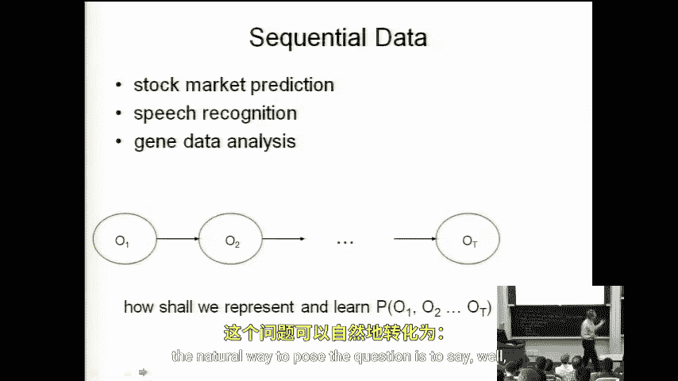

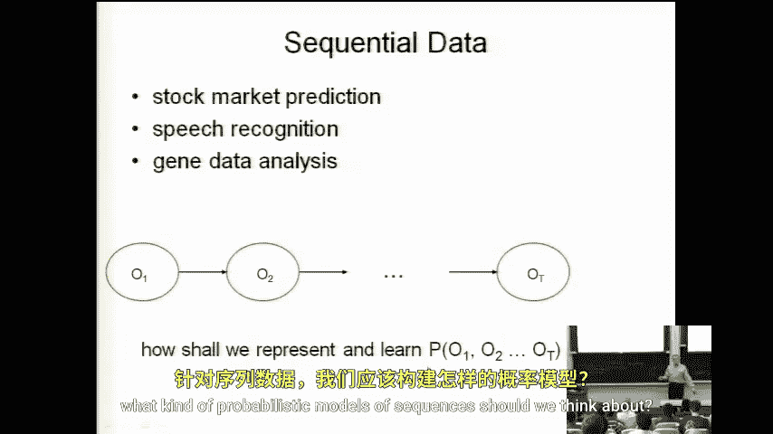

And so。嗯。And one concrete way to test that is to say， if we have a sequence of observations。

 0102 up through0 capital T。Then。

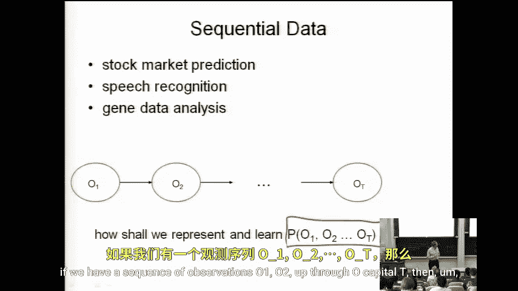

What kind of joint distribution over those variables？Might we think about。And so one common approach。

Is called Marov models。And the idea there is to simplify the description of the joint distribution over the observations in the series。

By saying， well。Observation at time T only depends on some limited history。

Of the past doesn't depend on the infinite past。It's called a Markov assumption。And so。

Put in our terminology of bay nets。 we'd say， well。

 we have to represent the joint distribution over the sequence。And without loss of generality。

 without making any assumptions， we know we can represent that as some kind of a base net。

Which just means that we're going to represent the joint distribution over all these observations at different times。

As the product， our usual base net product。Of for each of those observations， the probability of it。

 given its immediate parents in the base men。And now the question is。

 what's the structure of the base net？So the Markov assumption is simply this。This simply says。

We could assume。That the observation at time T。Depends only。The immediate parents。

Of the observation at time T is only the observation at t minus1。

And so then that would give us a basenet that looks like what， well。

 actually one that looks just like this picture I have at the top of the page。

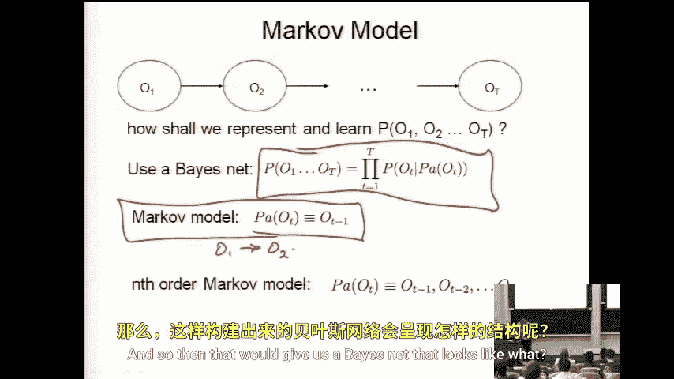

So that would give us this kind of business， right？That is the Markov assumption。

 the Markov assumption is that we can represent joint distribution on01 through Ot using this chain based net structure。

 that's it， that's the Markov assumption。

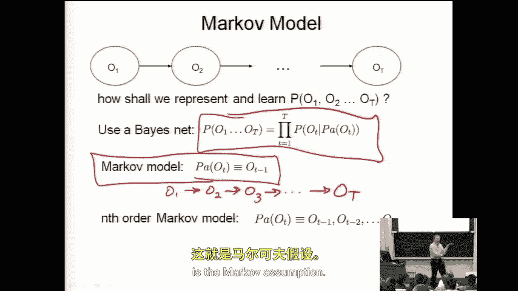

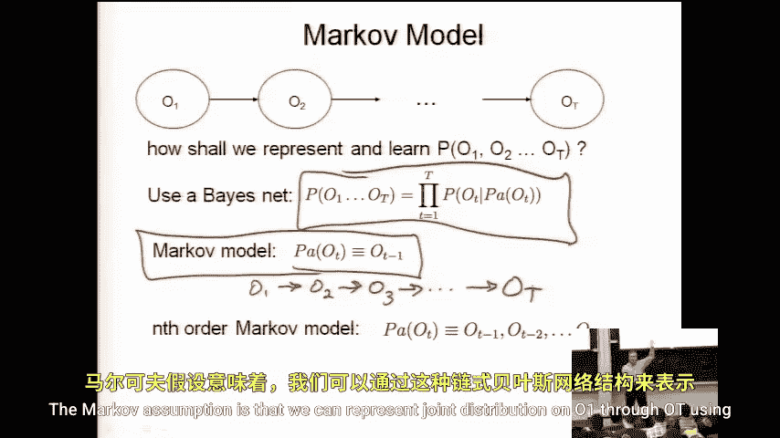

And then if we bring in what we know about deseation， conditional independence。

 then you could tell me things like， oh， what that means is that。

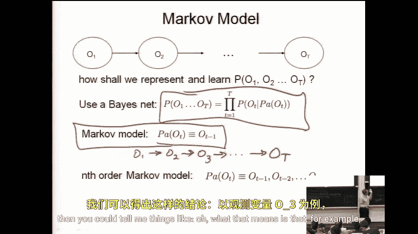

啊。For example， if I think about。The observation 03。Well， that means03 is。

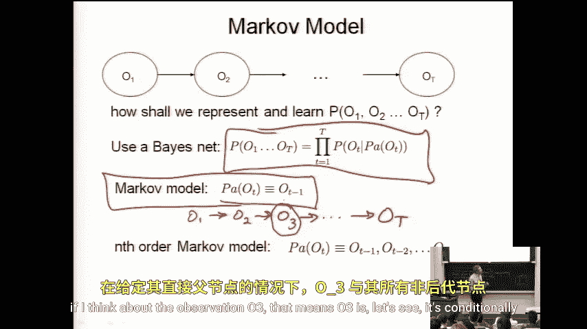

Well， let's see， it's conditionally independent of its non。Nondescendants。

 given his immediate parent。So that means it's conditionally independent of 01 given 02。

And by de separation， it's also conditionally independent of 05， given 04。

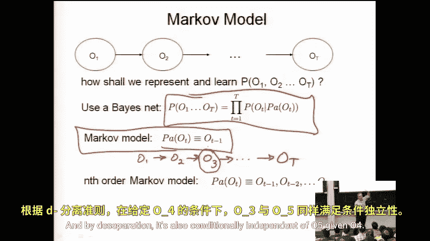

诶。So that's nice。 That means that this。Joint distribution is going to factor into some pretty small product of some pretty small terms。

And that's going to have all kinds of tractability advantages。And it's actually not a bad。

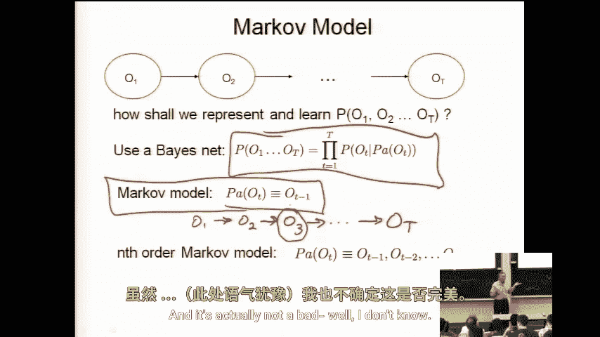

Well， I don't know。 Might be a bad assumption。 mightight be a good assumption。

 but if you think about something like。Oh， let's say the stock market or the medical state that I'm in today compared to yesterday。

诶。If you think about it， let's think about my medical state today。

It's not unreasonable to say that if I had， if O was not just a single value like my temperature。

 but a vector of values。Like my temperature， white blood cell count to all these kind of medical signs。

Then it's kind of reasonable to say that。The distribution on my values today。

If I know all those values from yesterday。Then given those values yesterday。

 it's conditionally independent of what they were the day before。

That's a reasonable assumption if the vector of values that I'm observing about myself is fairly complete。

Now， if it's not very complete then。This assumption becomes obviously much more questionable。

Because then。Well， if I'm not measuring my white blood cell count。But maybe。

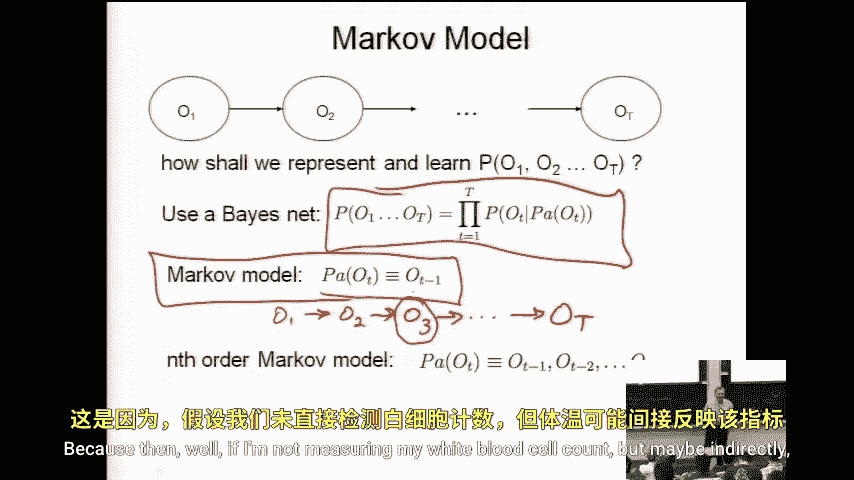

Indirectly my temperature reflects that because if I've been an infection。

 my temperature will be my white but， so it might be kind of you know dependencies among those different variables since they're if we don't observe。

If we don't include in my vector white blood cell count， then it might be。

The case that it would be useful to know the values from a couple days ago because if I've had a temperature for several days。

 probably my white blood cell count as higher， meaning that today's temperature would also be higher。

You see， there's this kind of trade off。Between how complete I make o sub I or o sub T。

The vector of observations。And how reasonable it is to assume that those are conditionally independent of my history。

 given my immediate history。Does that make sense？Yeah。Is there any way to quantify that。

 I don't have one off hand， but it seems like one certainly could， right。

 You could certainly imagine measuring things like。诶。

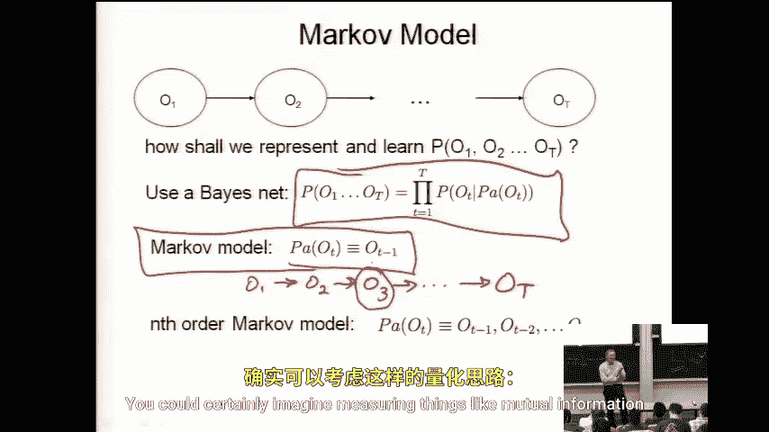

The mutual information of the。Of the variable observed at T -2， with respect to the。

Something like a conditional distribution of what you expect today given yesterday。

 So you could imagine ways of measuring that dependency。

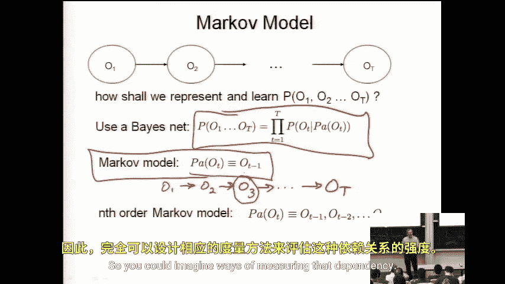

Might be interesting。Okay， so that's the idea of a Markov model you hear about Markov models a lot。

There's also something called an norder Markov model， which is a simple generalization of this。

 it says that the immediate parents of the observation at time T include t minus1 all the way up through t minus n。

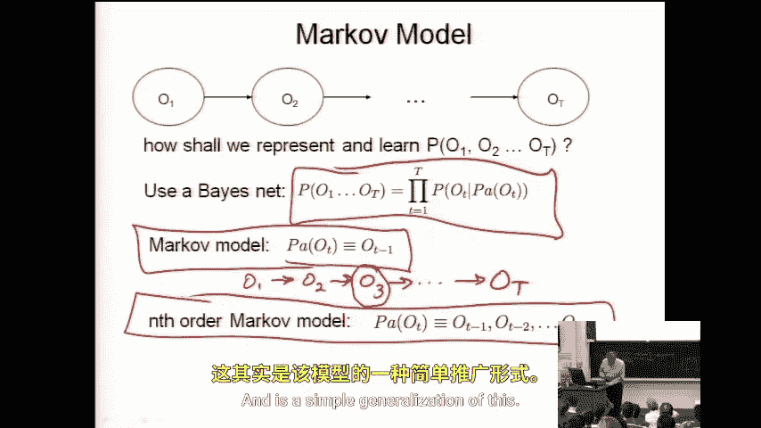

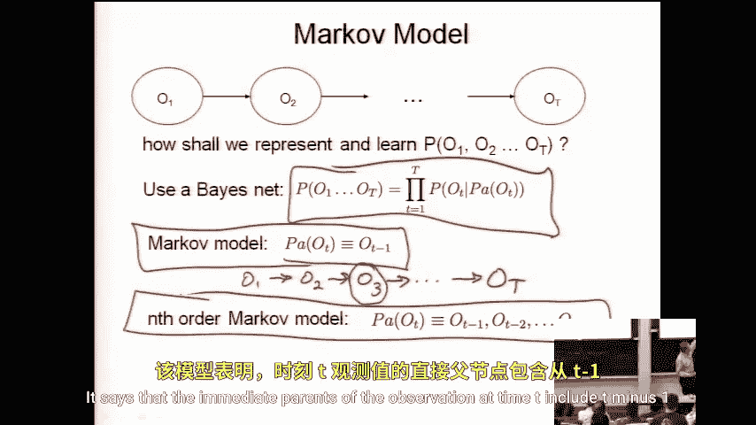

Or put another way。The history more than end steps into the past。Sorry。

 OT is conditionally independent of o sub t minus n plus1。

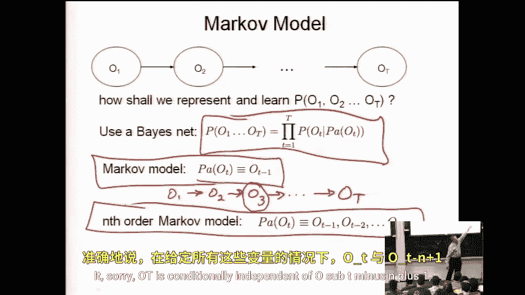

Given all these things。So what kind of a base net does that give us？

So that just gives us one that looks like。So as before， Ot depends on Ot minus-1， but。

It also depends on Ot minus2。

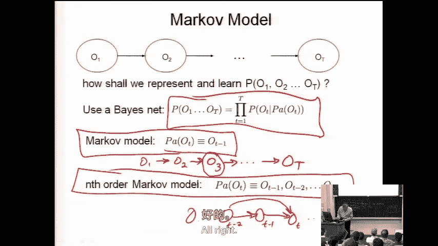

And。