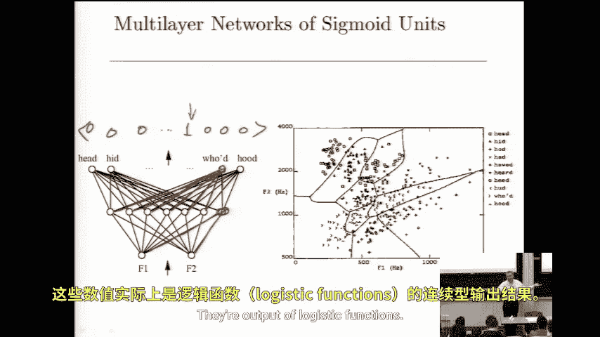

# 卡耐基梅隆大学【中英⚡机器学习｜10-601 2015 Machine Learning】 p43 P43 Lecture 17 Neural Networks Mar 24 -BV1Lcnhz1E7P_p43-

我来是。

Nice to see these here， I look forward to reading them。So today is a fun topic。

 We're going to talk about。😊，Nonline regression。And in particular。

Neural networks as a way of doing that。And neural networks is an interesting。

Subfield of machine learning， it's been around。For a long time， since the 1980s。And。Actually。

 a little bit of history and machine learning。 It was sort of the dominant。

Approach to doing machine learning for much of。The late 1980s， the early 1990s。

And it was around the late 90s that probabilistic models。

 like graphical models that we've talked about here。

 became much more popular and they kind of ecliped。

Much of the work that was going on in neural networks。嗯。

Although many of the good ideas from neural networks were imported into that。But recently。

 neural networks have had a kind of。Resurgence in， in some ways。For reasons that I think。

Might become clear during this lecture。So let's just start in。 I think， by the way。

 of neural networks in from two views one is。In terms of this course。

 we've talked about regression problems。As being just function approximations。

 we're trying to learn a function from x to y。 and when we say regression problem。

 what we mean is that y is a real valued number。And the。

Approaches we've talked about lake linear regression。Assume that y is a linear function of x。

But in many cases， of course， we don't know what kind of a function of X Y is。

And artificial neural networks are a great way to do regression when we have that kind of a。

Problem or we don't know that it's linear。 It's probably nonlinear。

 but we don't know exactly what it looks like。 We can't say for sure， it's a third or polynomial。

So we have to。Just use something that's very expressive。

 that's where artificial neural networks come in。That's one of the two ways， I think。

 of what they contribute to the field。 The other way I think of it。

Is if you think about what we've talked about in this course， it's primarily。Function approximation。

Or estimating probability distribution。 those are the two things we've really talked about in the course。

嗯。But。I think of neural networks as a way of getting at。Another key problem in learning。

 which is how do we learn representations？So for the most part。

 we've assumed we knew how the data was represented at some feature vector x1 through xn。

And we think about given these representations that we know， how do we learn the function。

 but one way to think of neural networks is they're a way to learn representations。

 rerepresentations of the input data that are valuable in all kinds of ways。

 so that's another way I think of the field so let's just jump in。诶。To be precise。

 here's the definition of an artificial neural network。

We're trying to learn some function from x to y， and in our case。

 x can be a vector of any kind of inputs we like。X1 through xn。

 and Y can also be a vector of any kind of input outputs。

So now we're not talking about predicting a single variable Y， but a whole vector of them。

For example， why might be an image？A photograph。And we might be predicting what image the robot will see。

 given the image that it sees now as input， what image would it see if it drove forward three meters？

In fact， I've trained a neural network to do that with a robot and a camera， was kind of interesting。

诶。So once you get into the idea that we're learning functions over vectors that。

The input can be a vector， but so can the output。 Then you realize we can use this to predict images or all kinds of data that has a much richer structure than a single。

Scalar， single variable。嗯。The function itself that we're trying to learn is represented by a network of logistic units。

Which are used based on exactly the same function as our friend logistic regression。And in fact。

 when we train a neural network。We train it to fit the input and output vector。

And we use gradient descent。To minimize。Some of squared errors。

Of in predicting the outputs from the inputs， At least we do that if we want the maximum likelihood estimates of the weights。

And if we want map estimates， then we also added in a term for penalizing。Wights， so it's。

The cool thing here is that it's building up on the blocks。

 the building blocks you've already talked about， like logistic regression uses the same function。

And all the things we said before about linear regression and what it meant to do maximum likelihood estimate or map estimate。

Of course， we make the same kind of assumption of the probabilistic model。

Then we get the same kind of objective that we tried to optimize。So let's look at a neural network。

 here's a nice example。This is a neural network trained to recognize different。Vowel sounds。Okay。

 so the input， which is encoded by just two features， F1 and F2。

 encodes a sound like the vowel that you hear in the word。Whod hid had。Head， et cetera。

 So different vowels there。And it encodes the input by。The frequency。诶。

The first forment and the second forment， which have to do with power spectrum of the frequency of the sound。

And so these are common features used in speech recognition。

So you can think of every sound being converted to a point in this two dimensional。啊 plot。In fact。

 if you can read the tiny font， you see that those points have different shapes and they represent the vowels in head。

 head， head。Hood。Haveved， heard， heed， h， etc cetera。ok。Now。In this neural network， there are。

Two layers of logistic threshold units。诶。Here's a unit， for example， that's the output of it。

 and it has these two inputs。And the output of that。Is a value， a single。Real value。

Which is the output of the logistic function， which takes these two things as inputs。

And these two edges represent the weights on。Those two inputs for that particular threshold unit。

Okay。Its output， however， becomes the input to the second layer of logistic units。So for example。

 this one。Use is。The outputs of all of these。Some people call these the hidden units， because。

They're in the middle of the network， they're not really pinned down when you specify the input to the network。

So the second threshold unit uses the outputs of all those first layer units and multiplies those by its weights on those black edges to get its output。

And as you can see， there's an array of。诶。7 of these first layer logistic units。

 followed by an array of。Different output units， as many output units as there are classes in this classification problem。

 We're trying to classify the sounds， according to the vowel sound。That you hear in who'd had， had。

 et cetera。And so。In this case， the output is being coded。As a vector with。All zeros。

 except for a single one。So that would be the output that represents。This particular vowel sound。

 So each of these outputs is。Essentially representing a particular vowel sound。Okay， so in this case。

 the output vector is just a bunch of zeros with a single one。

 at least that's what we train it to be。Once we train it， of course。

 then the output numbers might not be exactly zeros and ones， their output of logistic functions。

 and so we just round up or down to zero and one。

