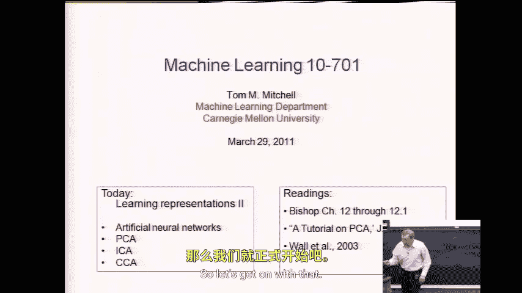
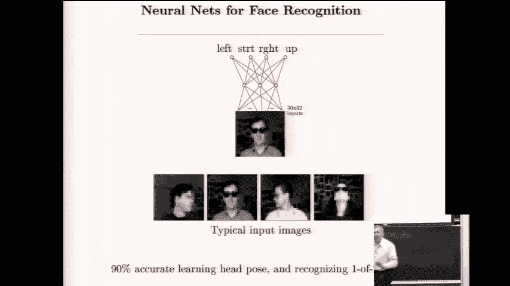
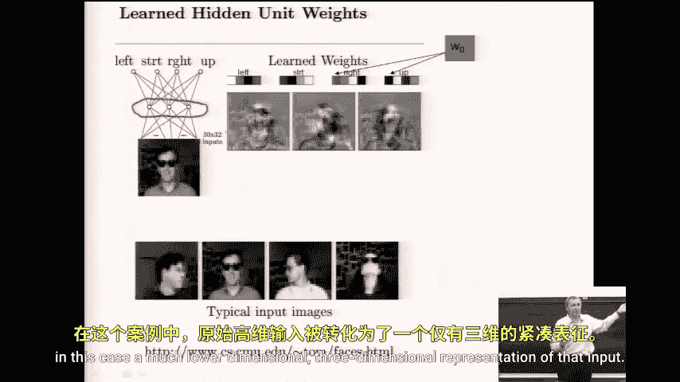
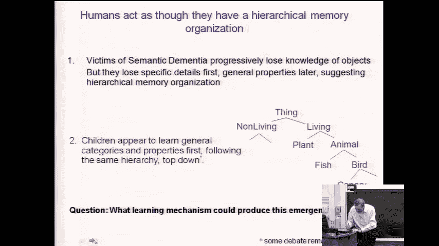

# 卡耐基梅隆大学【中英⚡机器学习｜10-601 2015 Machine Learning】 p44 P44 Lecture 18 Learning Representations I Mar29 -BV1Lcnhz1E7P_p44-

Hey， let's start in for the day。And this is。Part， I guess，2。

Of series of lectures that are really about learning representation。

YouWe talked about artificial neural networks last time。But。

One of the most fascinating things to me about artificial neural networks is that they are a way of learning a new representation of the input data。

And so we're going to continue on that theme today and also on Thursday and look at a variety of other methods。

The well known XcaA methods。Like PCA， ICA and CCA， we're going to talk about today。

And just kind of take a survey of different methods in machine learning for learning representations。

So let's get on with that。

嗯。This is a slide we talked about last time， but I put it up here just to remind us what I mean by learning a representation here we have a neural network that's trained。

By giving it。Training examples where the input is in photograph。

And the output is a classification of the face in that photograph。

 according to whether the person's looking left， right。Up or down。And as we saw。

 when the network is trained， it can do this task with quite high accuracy， 90% plus accuracy。

And interestingly， if you think about it， this input image， which is 30 by 32。

 so it has 900 features。Once this network is trained。It has found whoops。Can't do that。

It has found a way to re representpresent that。30 times 32。

900 pixel input in terms of just three numbers。And that doesn't preserve all of the information about the photograph。

 but if you think about the objective function that we're using to train the neural network。

 which is to minimize the sum of the squared errors in its output predicted output values。Then。

What the neural network will do essentially， is try to find。The best。3 number representation。

 three dimensional representation of this 900 plus dimensional input image。

And when I say the best three dimensional representation。

 I mean the one that will minimize the sum of squared errors in predicting whether this face is looking which of those four directions。

So， in this。In this sense， the neural network has a side effect of trying to fit the input output signal in the training data ends up learning a rerepresentation。

 in this case， a much lower dimensional three dimensional representation of that input。

So。Before we leave neural networks， I wanted to talk about one more example that illustrates。Another。

Direction of work in neural networks， which has to do with。

Their use in modeling cognitive processing in humans。

And this is a neural network taken from a paper in nature a few years ago by Jay McClellan。

And what this network does is you can see the input。Is。There are two sets of inputs here。 This one。

 which codes in a one out of n fashion in input like。Pine O， rose， Daisy， Robin， Canary， etc cetera。

And also。In input。That encodes the name of some relation like Ia or has or can。And。

The network is trained to fit assertions like this one， which asserts that canaries can fly。

And the way that's encoded is shown here the dark green means that these are activated units。

 so the dark green ones would be a one， the others would be a zero。So if we want to。诶。

Represent the training example that canaries can fly。

 the way we do it with this network is we make canary here a one。And we make can， the relation can。

 a one。And then we on the output side say， well， canaries they can fly， so we'll make fly a one。

Canaries can also do other things like sing and move and grow， we make those ones too。

So one thing I like about this example is it kind of stretches your thinking a little bit about what we can do with these propositional representations that neural networks use。

So。And in fact， you can see this has a couple layers of neural network， hidden layers， I'm sorry。

 in the neural network， and it's a completely connected feed forward network and therefore we can train it using the BF propagation algorithm that we talked about last time。

And indeed， that's what。McClellan did in this case。

And so I like this network because it kind of makes you think about different ways of representing things。

 Yeah， is there any reason why they structured it this way。Yes。

 there is the reason they structured it this way， which we're about to see。 They were。

 They were interested in the question of。嗯。How do hierarchies emerge？

Hierarchies of categories emerge。And so they structured it this way to make it easier to study that question。

So let's see what I mean by that。And so this is kind of a summary of this paper that was in nature。

With the。Point out was that there's this properties of humans that sometimes humans develop deficiencies of cognitive deficiencies of different types。

 one is called semantic dementia。And people who have semantic dementia lose over months or years of time。

Knowledge about objects in particular， they lose the more specific details in the hierarchy first。

And so for example， before they have semantic dementia。

 if you show them a picture of a canary like you and I， they'll have no trouble saying， oh。

 that's a canary。But as the degree， as the disease progresses。

 then they get to the stage where they can identify it as a bird， but they can't。

Say that it's a canary。 And much later in the disease， maybe they just say some kind of animal。

So the disease progresses by taking away， in a sense。

 the more specific layers in the hierarchy first。So they bring this up as an example of evidence that humans act as though they have some kind of hierarchical organization。

Of concepts。 And they also point out that。Children， when they learn。To speak。For example。

 first learn a word like bird。And then sometime later， they learned。

Distinctions like canaries versus Robins versus rooters， et cetera。So there are a couple。诶。I mean。

A lot of evidence that people act as though they have some kind of hierarchical organization of concepts and memory。

 and so they are interested in the question of what learning mechanism could produce this kind of emergent hierarchy。

From the stuff we encounter。

So。Actually， here's one bit of evidence they give。Particular person。Who named J L。Who had。

Semantic dementia， here you can see at three different periods of time。

Spread out over a couple years， their ability to name objects of or name the objects that are in photographs。

And so in September 91， they did a perfectly good job at spotting birds and chickens。

 ducks and swans， but had difficulty with these other objects later on。

 you can see they could identify these things were birds but。Had lost the detailed ability。

And then much later， even had some difficulty with those。 So there's a typical kind of progression。

And。So what they did was they again， the question theyre focused on is what kind of learning mechanism might explain the emergence of these hierarchies and their conjecture was that artificial neural networks could model。

This kind of。Emernt hierarchy appearing。And so what they did was they trained that neural network that I showed you。

And they plotted。What algorithm did they use to train it back propagation。

 the same gradient descent algorithm that we？