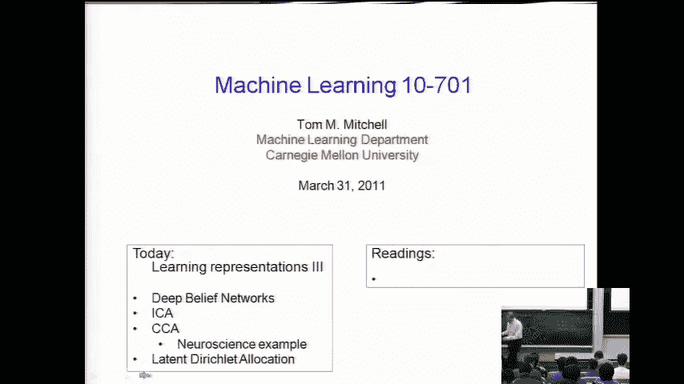
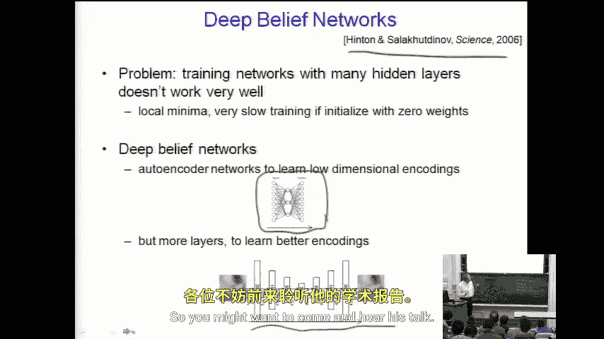
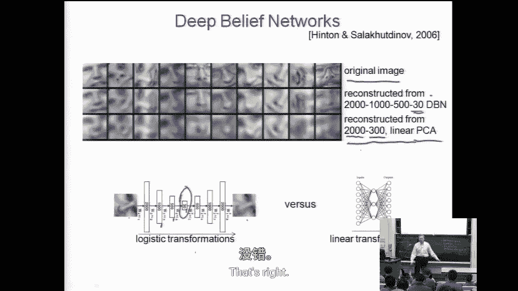

# 卡耐基梅隆大学【中英⚡机器学习｜10-601 2015 Machine Learning】 p45 P45 Lecture 19 Learning Representations II Mar 31 -BV1Lcnhz1E7P_p45-

The topic of learning new representations。And。Let's see to summarize in two sentences what we've learned so far。

诶。Interestingly， neural networks， when you train them get to have hidden layers that re represent the input for the purpose of predicting the output。

 and that gives us one way of learning representations in a supervised fashion。

And we also talked about unsupervised methods that reconstruct。

The input from the output and PCA is the example that we gave of a linear。

A system that learns a linear projection of the input features to。A different。Representation。

 which is where each feature in that new representation is a linear function。Of the original ones。

And。Fortunately， that has。Good algorithms and doesn't require that we worry about local and minimum problems。

So that's what we've talked about so far。And I thought today what I would like to do is go through a number of other approaches and a couple examples。

 we won't be going into the details of proving why each one of these things is good thing。

See some of the variety of things that people are exploring and using。诶。

For learning different representations and you'll get some feel of in this a very active research area。

 we're not covering all of the stuff that is going on in the field。

 but I thought giving a sampling of this would be interesting。

So。One topic we want to begin with。Is。A topic， which is。Pretty。Hot right now。

 called deep belief networks。It's a modern day area of neural network research。And the idea is this。

If we'd like to learn representations， we might， as we talked about before， I have to turn on my ink。

We might， as we discussed before。Use a neural network， we talked， for example。

 about that auto encoder network， the one that tries to reproduce if the output the same input we give it。

But if we want to do that in a more。To give the network a chance to learn。

More sophisticated representation than you can get with a simple logistic function Then we might want to train a network that has many layers of hidden units。

And。People have tried that and one of the problems you get into if you try that is even worse local and minimum problems。

Is not have an even more complicated network that you're trying to train？

And so people call these networks that have many stages of hidden units。

 deep networks for kind of obvious reasons。And there are some interesting work I want to tell you about some work that appeared in the journal of Science a couple of years ago by Jeff Hinton and Run。

I always have to read this one， so Lock Hood did not。

And Rlin is actually going to be here in about three weeks to interview for a faculty position at CMU。

 so you might want to come and hear his talk。诶。

But anyway， I want to show you some of the work that they've been doing。Again， their idea is。

If we want to。Train a neural network to learn。Very good codes。Rerepresentations of complex data。

 then we are going to want to train it with many layers of hidden units and here's an example of when they did train。

And what you see here in the top row are the original images of。Face fragments that they've。变 using。

So that's what they trained on。 And so they gave that as input and had the network have to construct it as output。

What you see in the second row is the reconstructed output for each of those faces。

 So you see like this one looks kind of like the input。So this is the reconstructed。

Image at the output of the network after it goes through this network that I was showing you。

And what you see in the third row is what you get if you use PCA instead。

And so they use this as an example to illustrate why PCA isn't always。good enough。

Learning representations of the data that are linear transformations of the input。

And lower dimensional。Might not give you as good an ability to encode the information and therefore reconstruct it。

As if you used。An even smaller number。Of hidden units。

Whose values could be more complicated functions of the input？ and the numbers here mean。

The original image， I guess， was 2000。Pixels， and then。They shrunk that down to 300 PCA components。

Versus starting with the 2000 using at first 1000。诶。

Hidden units and then going from there to 500 and from there to 30 and back out。Yes。

You can see the picture。Allright。2%。Or you mean， how would we check the reconstruction error？Oh。

 the standard way， if you think about what PCA is minimizing。

 it's the reconstruction error measured by。The sum of squared errors。Of the pixels。

 So what PCA is trying to minimize subject to the fact that it's going to use a single linear。

Transformation is trying to minimize the sum over the pixels of the square difference between the pixel value here and here。

And。Even if you可 minimize。被个人。ピつだ。Oh， I see。 So you're raising a question about。

Why would we trust some of squared errors as a good thing to minimize when what we really want to minimize is the quality of the。

WhatWe want to optimize is the quality of the reconstructed image and we don't really know psychologically how our brains work on it。

 is that your point？Yeah， I agree。And so we use sum of squared errors for two reasons。

 one mathematically is convenient because that's what PCA does。

 and when we train a neural network with bat propagation。

 we're training it to minimize sum of squared errors。And then。诶。2。Well。

 I guess those are two reasons。 It's mathematically convenient。 That's what the algorithms do， but。

And the second reason is we don't really have an idea of。Say we went to image reconstruction。

 we don't really know what are the properties。Of arbitrary images that we want to preserve。

 So it's not like we have。A clear alternative objective。

But I agree with you if you get to image quality。Psychologists who studied our behavioral response to different faces and measured。

 whether we could still recognize the person might come up with a different objective than this。Okay。

 so the point of this slide then is just that， look。

 this network really is doing a better job of reconstructing those。Face images than PCA does。

 and therefore it's worth pursuing this line of work。Question。

 a different performance because of the。Park or at least partly because of the different angles of the place。

 Will that mean。D B and art still work better if they are。

Good question so if you didn't hear in the back the question was you know unlike the other faces we looked at in the last lecture which were all aligned and centered in the image。

 these faces are rotated and translated and we're seeing different chunks of them and maybe that's part of the reason why it's harder for PCA than it is for these and indeed I think it is and I think that's why they made up this set of test images to illustrate。

The value of their approach。

From different angle's three。Right。