# 卡耐基梅隆大学【中英⚡机器学习｜10-601 2015 Machine Learning】 p46 P46 Lecture 20 Learning Representations III Apr 5 -BV1Lcnhz1E7P_p46-

So how are those projects going。I noticed on my calendar， as I'm sure you noticed on yours。

 that next Tuesday， a week from today is when the midway progress reports are due。

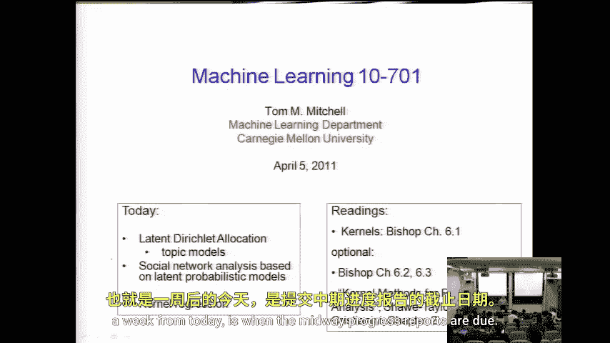

And I'm very much looking forward to seeing the midway progress， how things are going。

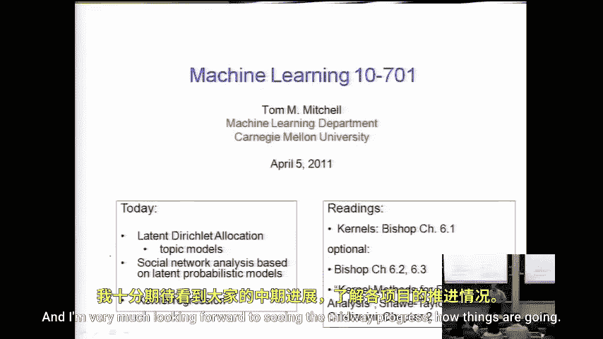

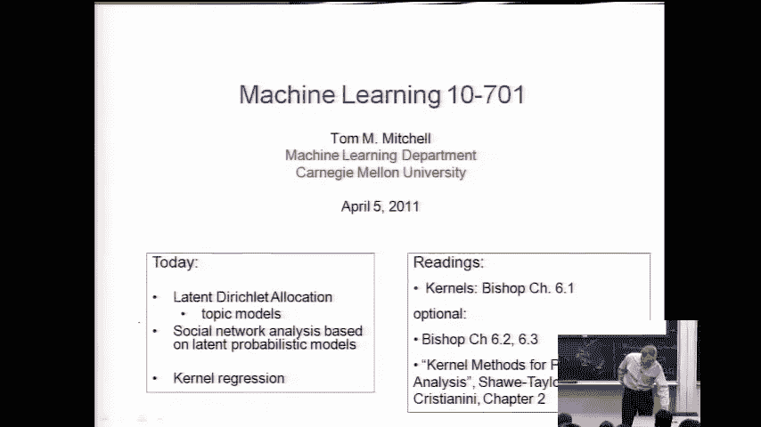

诶。We've gone a little easy on you in terms of other homework since the interterm， as you've noticed。

 we are going to have。

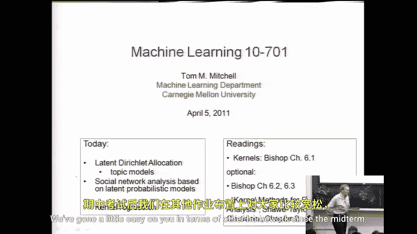

Some what I would call lightweight homework for you。

We hand it out probably Tuesday the day you turn in your mid midway report。

 and we're trying to make this midway home the。Second half of the semester homeworks lightweight in the sense that we know that you're going to be working primarily on those projects。

 but we want to make sure that you have a chance to review the material that we've been talking about in lectures because you know of course when the final exam comes。

 we're going to have a whole semester's worth of material to cover and so what we're trying to do is put together homework assignment we're taking it is a little bit like taking a midterm。

You knowLike if you know all the answers in 80 minutes。

 you're done with the homework and you're out of here。Except like unlike the midterm。

 if you're not familiar with all the answers， you still have extra time where you can work on it to figure them out before you turn in the homework。

 so that's the goal。

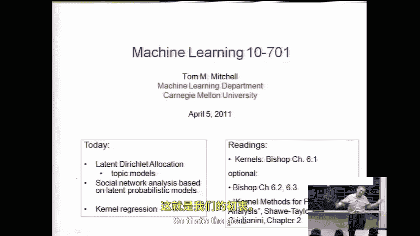

Today， I want to。Finish up。Our discussion of different kinds of latent variable models。

 dimensionality， changing representation， learning approaches。

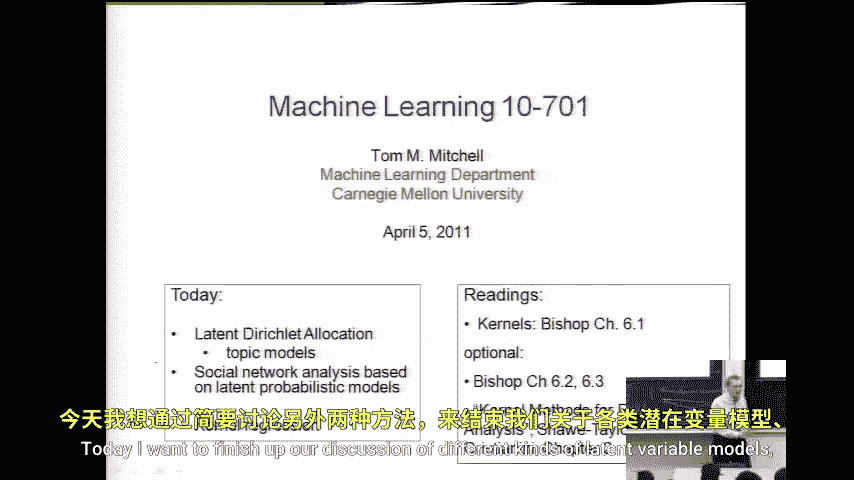

By talking about two more of these briefly， and then。

Just make a beginning if we have some time at the end on。

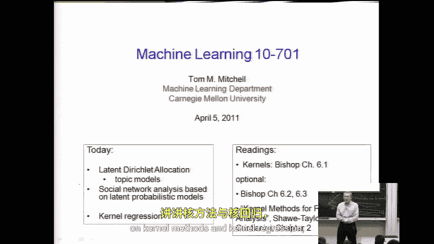

Clonnal methods。And kernel regression， which is will lead into our discussion on Thursday about support vector machines and。

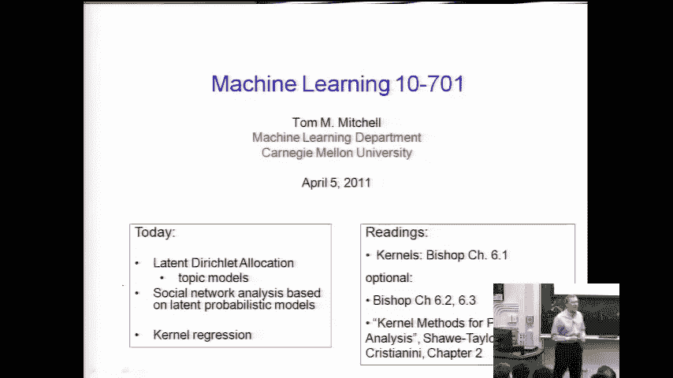

Maum a margin classifier method。

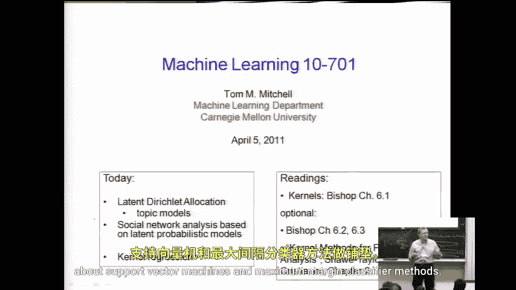

That's the plan。So let's start。

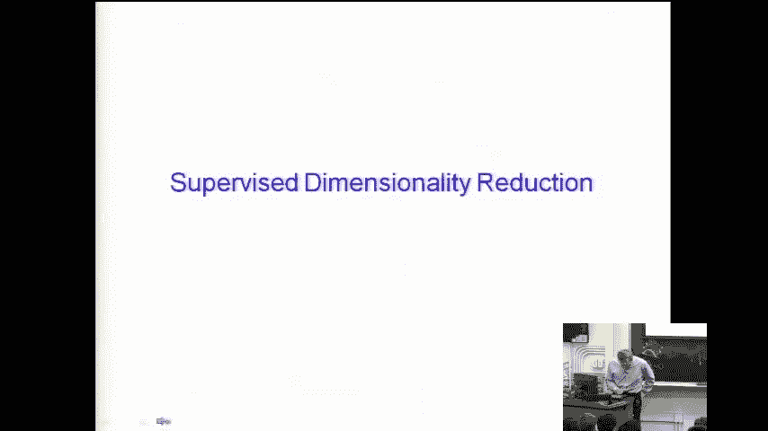

So we've talked about a number of approaches to。

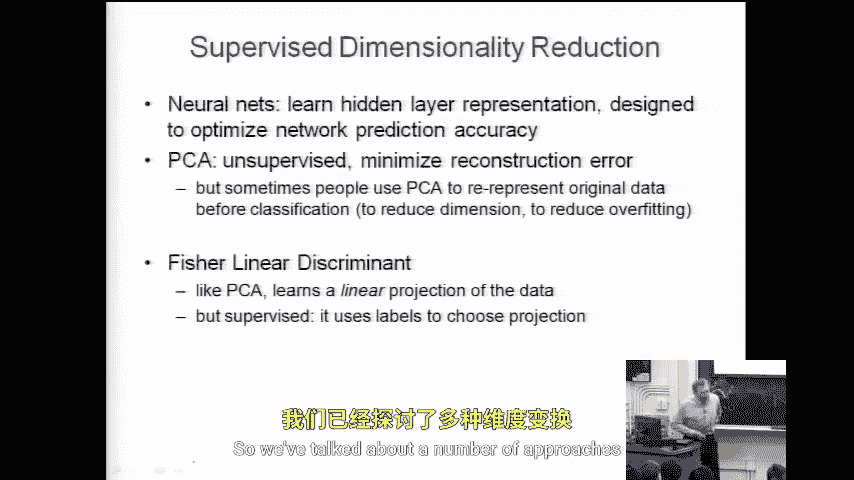

Changing dimension， learning representations， for example， PCA， neural networks and so forth。

And we pointed out that PCA was an example of an unsupervised approach in the sense that。

We're trying to learn with PCA， a rerepresentation of the original data that。

We'll just minimize the error if we ever want to reconstruct that original data。

Whereas a neural network was a supervised or could be used as a supervised method in the sense that we're really trying to learn with a back propagation neural network。

 some mapping from an x to an output Y。And the hidden layer in that neural network re representss the input X's。

 but does it in a way that。

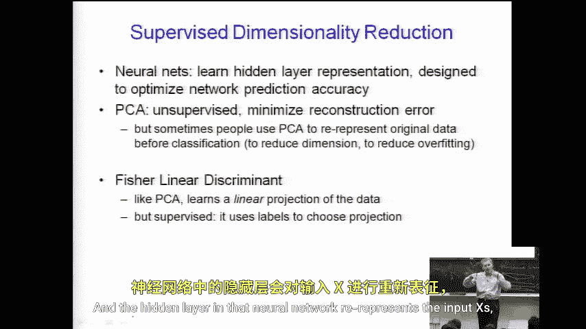

Isn't necessarily trying to minimize the reconstruction error of the inputs of the network。

 but instead is trying to minimize the error and predicting the whys。 So in that sense， supervised。

And I just wanted， there's one。Can be widely known， additional。Supervised。

Method called Fisher Linear discriminant， and I just want to take five minutes and tell you what the idea is because you may well run across it in your reading the literature。

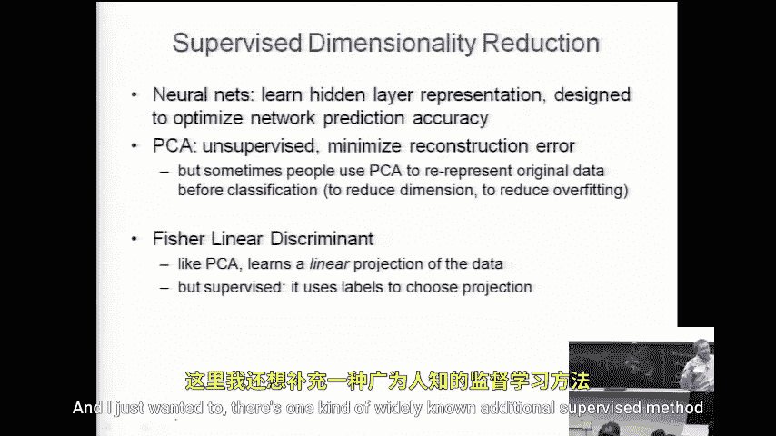

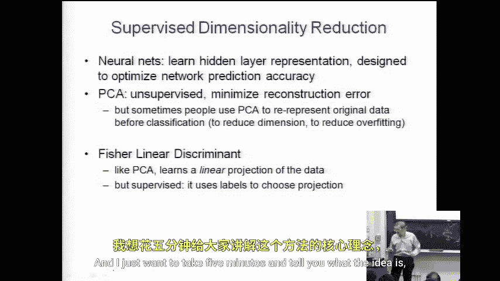

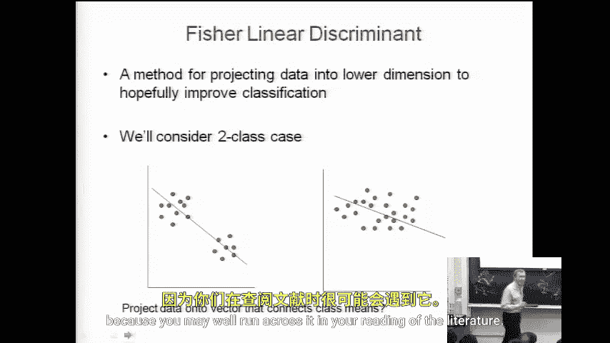

And it is kind of a basis for a collection of。

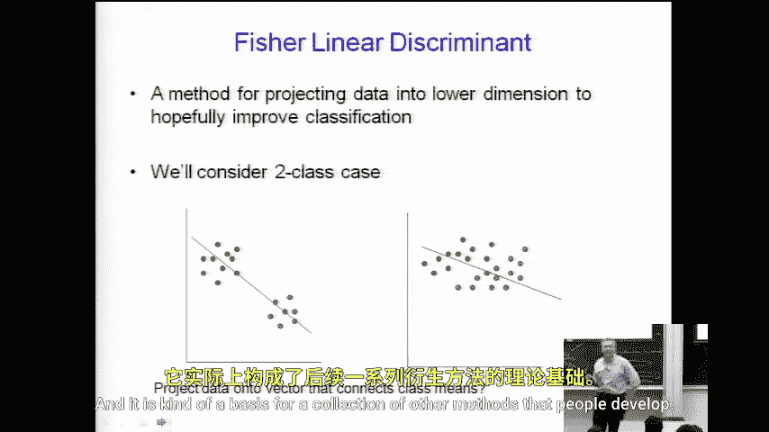

Other methods that people。Develop。And the idea is very simple。

So think let's think about a supervised learning problem。

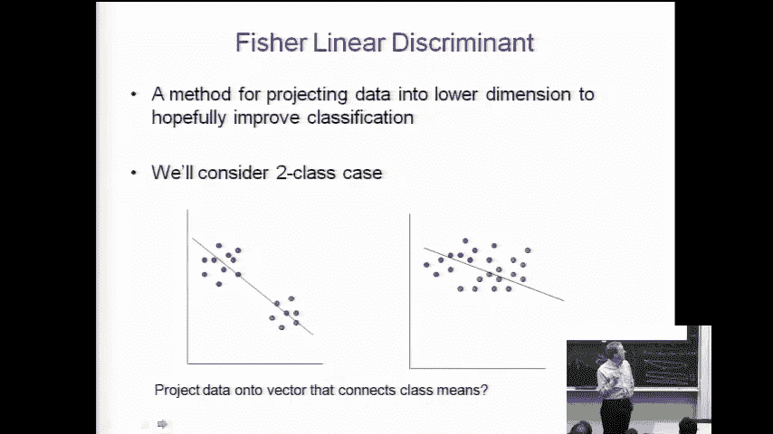

We might have points， x's like the points in this plot。

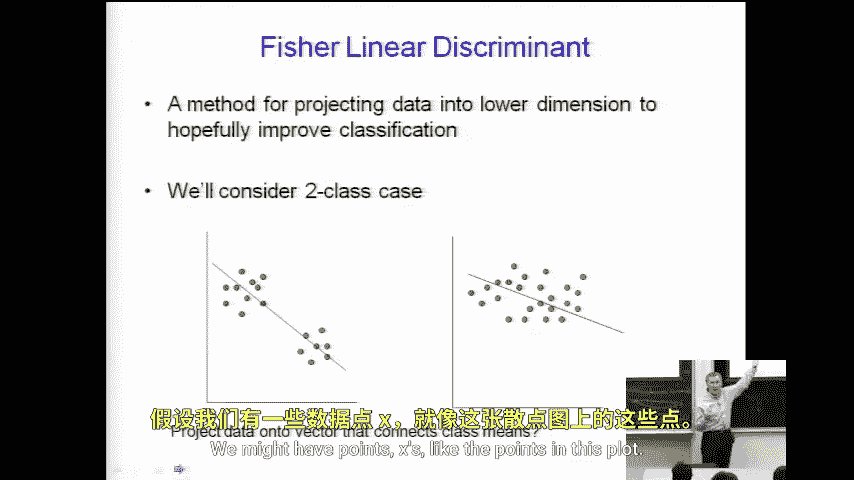

And we want to learn to classify them according to their why。

 which in this case is the color red or green。And if you look at that data。

 if you plotted that data yourself， you might think something like。

Gaussian naive bays would work pretty well here。You might think， for example。嗯。But。Geneneically。

The idea of the fier linear discriminant is that we want to learn a linear。

Classifier for this function。But in a。Lower dimensional projected space。

 So we want to project these points into some other space。That will make it easy to classify them。

And if this is a。Very high dimensional original space than projecting it into that lower dimensional space is also kind of a way of dealing with possible overfitting issues。

So。If we looked at， let's say this left example first。And I asked you， well。

 this is two dimensional data， obviously， just x1 and x2 are the two features that describe each point。

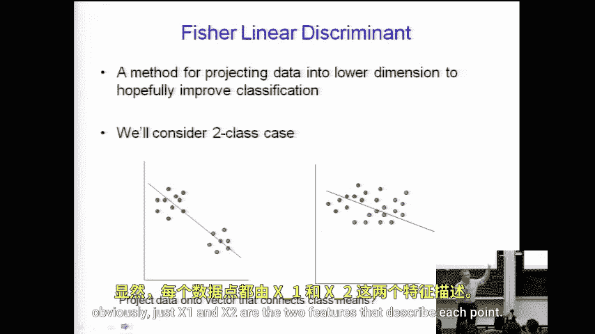

If I ask you， well， what would be？A good。Single dimensional space to project those points into。

You might suggest something like this line that's here。

Because obviously if we project all let's project one of these points， let's take this one。

 if we go to project that into that one dimensional space， it'll show up there。

That is each of these dots will be projected into that one dimensional space by drawing a line from the dot perpendicular to this。

Space。And that's what the。The dot product。Of。The green dot vector onto。The closest point on the line。

Sorry， the mapping， the projection from each green dot to the closest point on the line will just be。

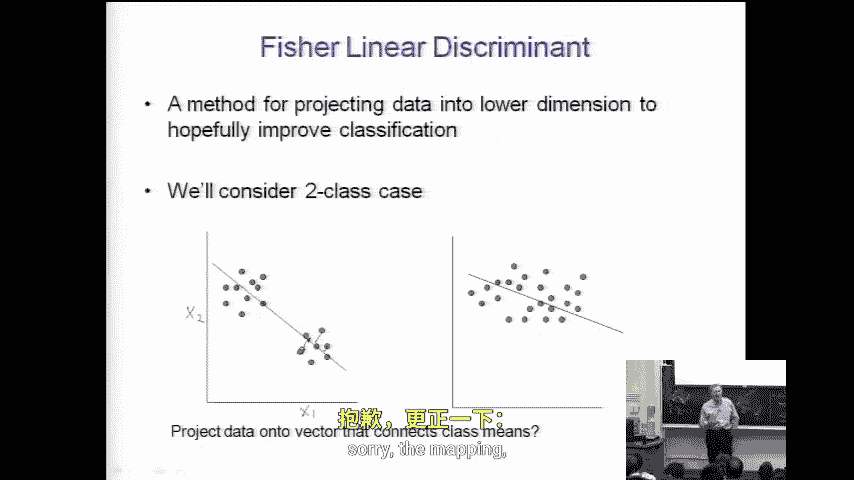

啊。

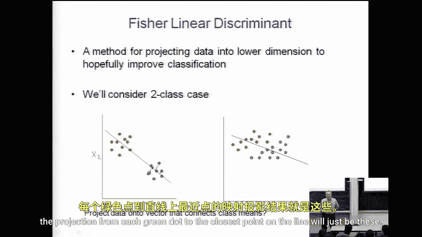

These。Move that point along line is's perpendicular too。To our dimension。 And so then you see， well。

 that'll be nice because now I'll have a one dimensional data set。

 Everything will just have every point will be described by just this one number。

 and I'll have a bunch of data up。😊，This corner and another bunch down there。

 And I'll be able to easily make a linear classifier， like。

Separating the points on one side of that line from the other。

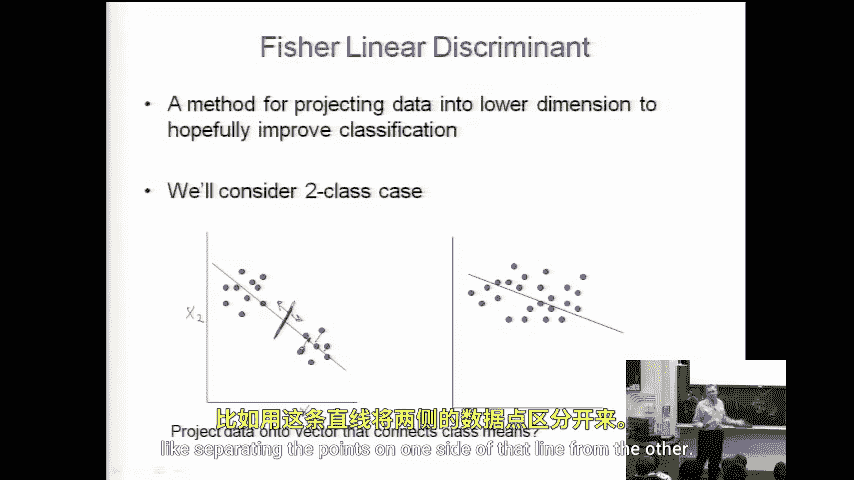

Okay， and then if I ask you will。What kind of algorithm should we use to do that？

You might well say to me， well， we could use PCA。And just take the first。呃。

The first dimension generated by PCA。

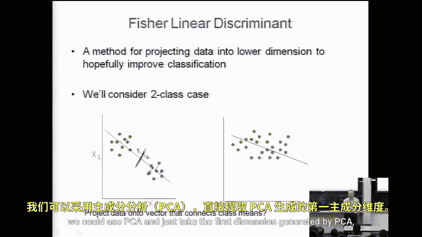

That unsupervised learning method， which well find will first choose the direction of maximum variance in the data。

And you can see as well as I can that that's kind of the line I've drawn。

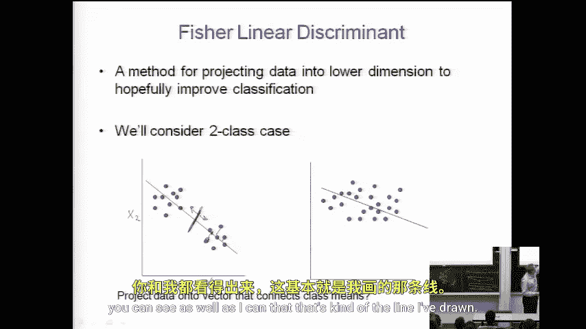

Except that PCA。

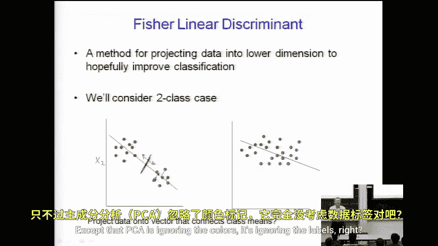

Is ignoring the colors， its ignoring the labels， right？

Looking at the whole set of data and finding the direction of maximum variance。

So I'd probably reject PCA as an answer to how should we make this up？

Maybe a more reasonable thing would be to say， well， let's take all the。Points， which have。

Y equals red。And let's find the mean of those points。

And let's find all the points here of y equals green and find the mean of those。

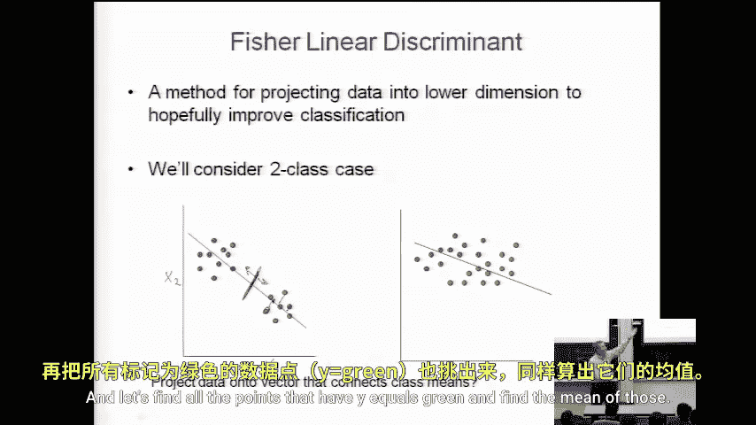

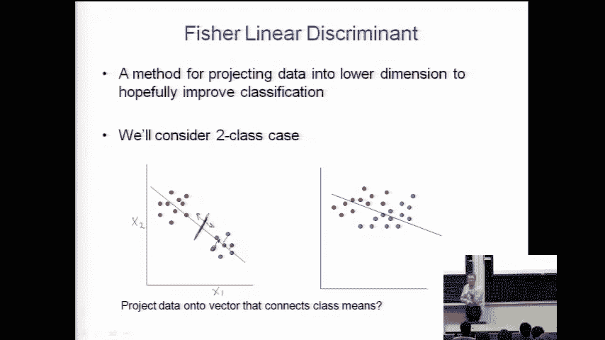

And that might be like。Here's a mean of one of those。 Here's a mean of the other。

 and then we could draw a line between those two means that way we're at least coming up with an algorithm that。

Looks at the labels。And in this case that would be a pretty reasonable approach， in fact。

 it probably give a solution very similar to PCs first。

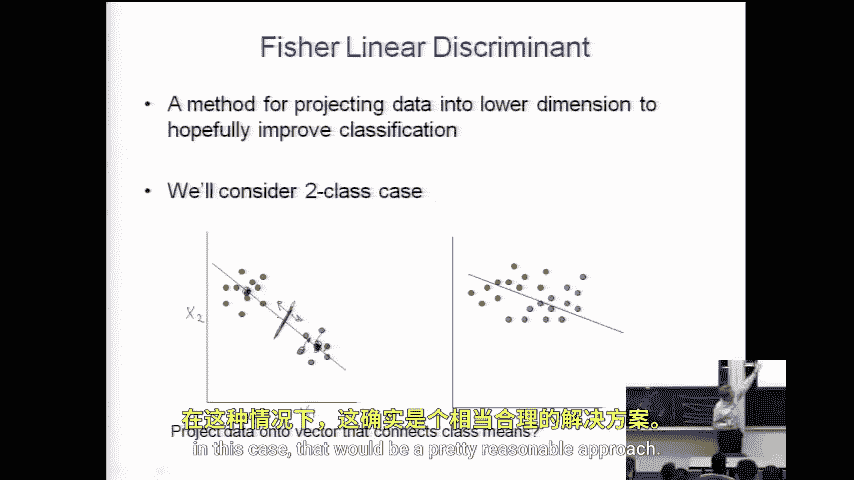

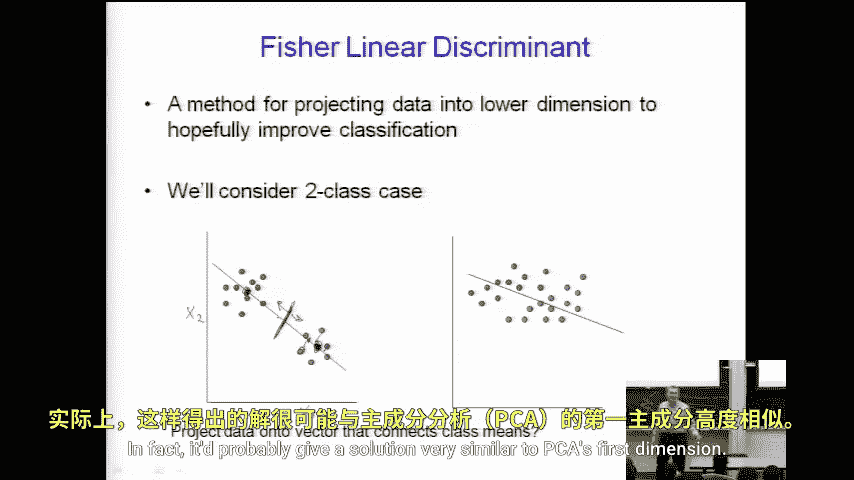

Dimenssion。But you see what I'm saying， we could， if we want to project these points onto a one dimensional。

 lower dimensional， one dimensional。Surface so that we can。Do a good job with a linear classifier。

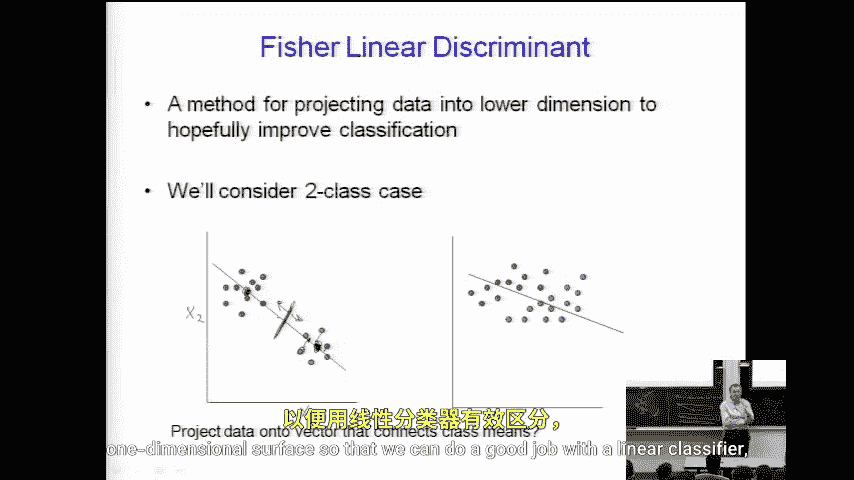

Then somehow we want to choose a dimension that separates out the reds from the green。

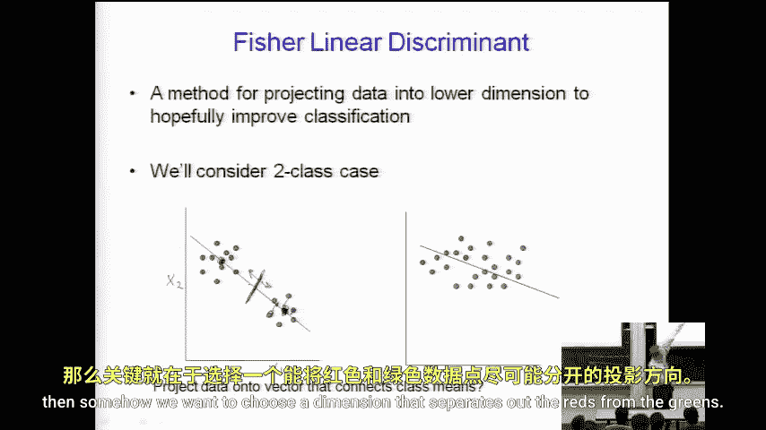

Okay， so now。This plot of data makes it look like， maybe。

Driving that dimension by finding the mean of the green。

 the mean of the reds and just drawing a line between them could be a good idea。

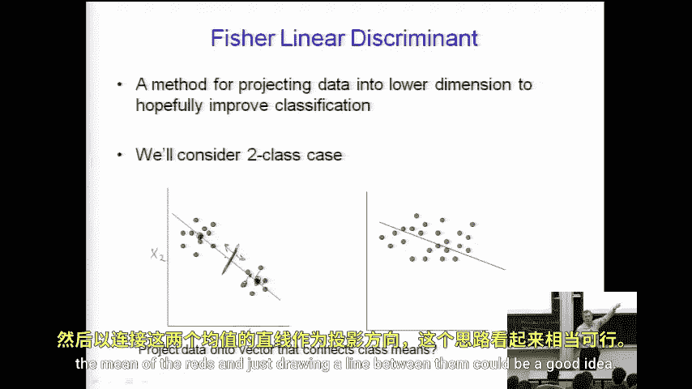

But that's the reason that the second set of points is on the。

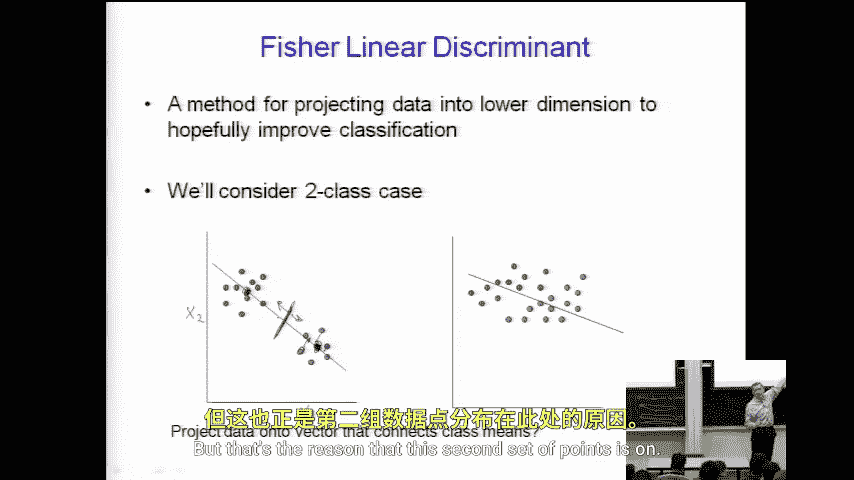

嗯。Is on the slide。Because if we were to。Use that kind of approach here。 we might say， well。

 the mean of these red dots is around here。The mean of the green dots is somewhere around here。

 and so we might get a line like the one shown there if we use that approach。

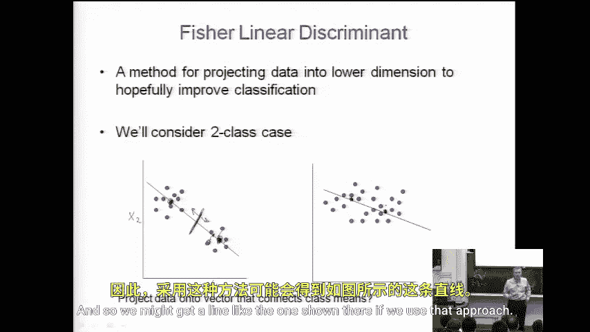

But really， that's not such a great line if we're trying to get a linear classifier because。

 you know， obviously these this red dot here will project on to this point。

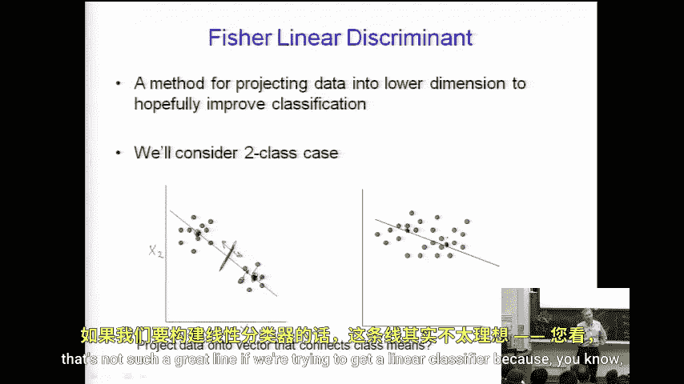

This green dot will project up here。

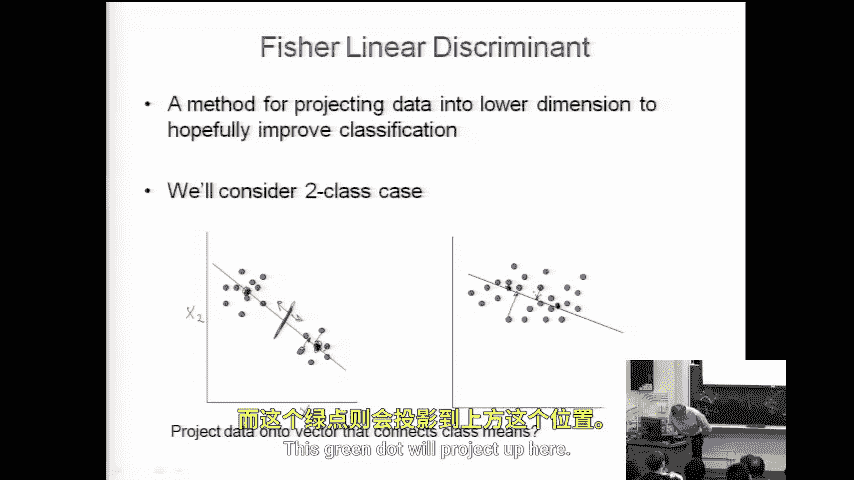

So will this one。Here's the。