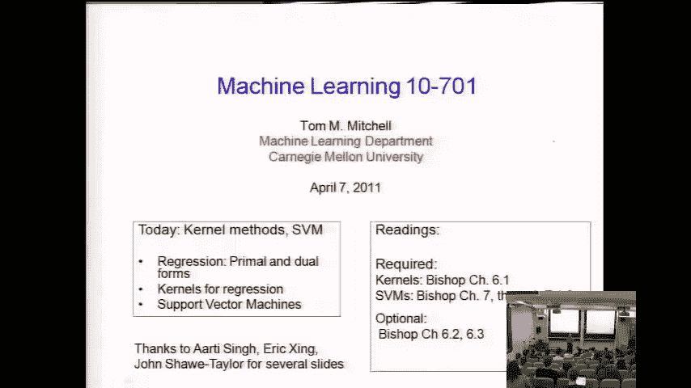
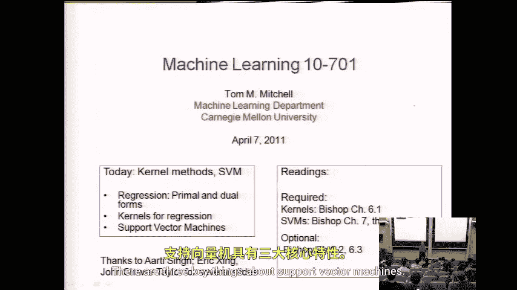
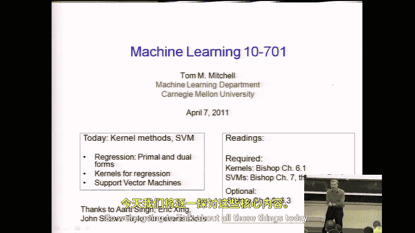
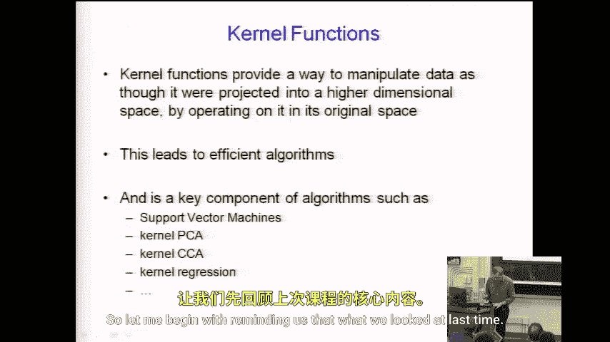
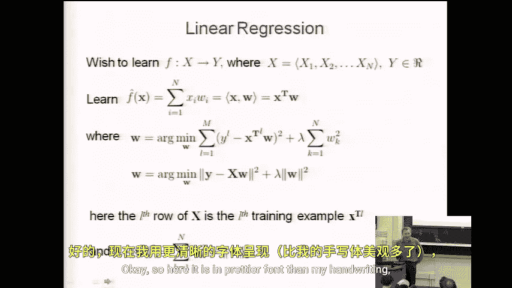
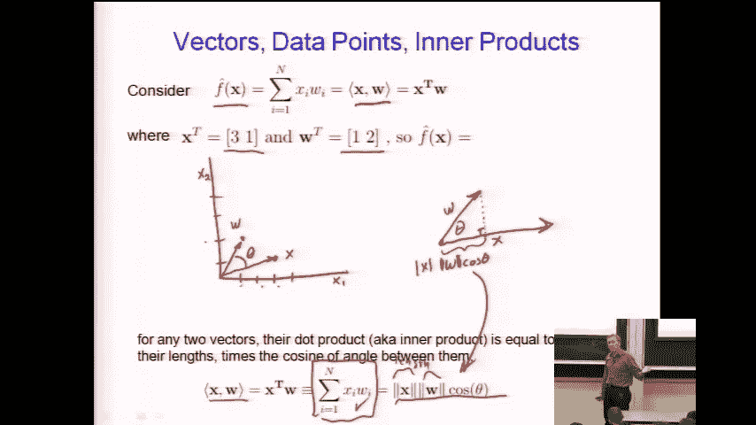

# 卡耐基梅隆大学【中英⚡机器学习｜10-601 2015 Machine Learning】 p47 P47 Lecture 21 Kernel Methods and SVM's Apr 7 -BV1Lcnhz1E7P_p47-

And also the class of algorithms to which they belong。诶。

There are two key things about three key things about support vector machines。 One is。

 it turns out in practice， they're one of the most widely used， most successful approaches。

To training classifiers。Another is that they're based on an idea we haven't talked about so far。

 which is maximizing the margin as an objective function for choosing。Our weight vector。And third。

 they are based also on the idea of kernel functions， which。

I promised last time we would be talking about。 So we're going to talk about all these things today。

So， let me begin with。

remindminding us that。诶。What we looked at last time。

 just a little bit of notation to get us all on the same page。

So we've been talking for a long time about learning linear functions as a weighted sum。

 if we have a vector input X。Containing features， X1 through Xn。

Then our typical linear function would just take a weighted linear combination of those features。

And we can express it that way， or。To use shorthand notation， we can really。

Use the fact that these are vectors in use vector notation。 So in general。

 I'm going to use bold font to represent vectors。So， I can。

Write the same expression as the dot product or equivalently called the inner product of two vectors。

 which is just defined by that linear sum。诶。Another notational variant of that that we'll see is to think of a bold font character represents a vector。

 which is a column vector like this one over here。And will take its transpose。

Putting a superscript T to mean that we're rotating the vector into a row vector。

And then we can think of the dot product or the inner product if two of a row vector where the column vector is just。

Literally， this sum。So it's just notation。 And last time we talked about how we could use that notation to re expresspress our。

Objective function。Of course， our learning problem is to learn those。Components of the W vector。

 the weights。That we're going to multiply against the components of the x vector to predict our scaleal or value y。

And we noticed last time that if we like， we can。Express that as saying， well。

 we want our W vector to be the W that minimizes this expression。

And the first term in that expression is just the difference between Y super L。

 That's the observed value for the elf。Training example of why。And。

The difference between that and our prediction， which is just the dot product of x super L transposed。

 of course， with W。So that's our sum of squared errors term and also if we want to regularize。

 for example， to minimize the sum of the squared。Values in the W vector。 We have that in as well。

 And then we pointed it out。 we could represent this， in fact， an even more compact notation。

If we say， well， let's just。Take all of those different training examples。

And let's make Y be the vector of all of the observed Y values for all the training examples。

Similarly， let's make the matrix at the。A matrix where each row。

In fact the eye throw is just the eye training example。And of course， we have our vector W。

 and now we can represent this whole。嗯。First expression by just saying， we want。

To minimize the square of the difference between this vector of Y training values。And W times the x。

Matrix of training aid。Okay， so this is all notation。

 but I wanted to start by quickly saying it again because we will be using it today。ok。

So here it is in prettier font than my handwriting just so that everybody could read it。

And。So。I want to。Start by。Again， just kind of swap in a little bit of notation and also intuition。

 Many of you have had courses in linear algebra， you're familiar with this。

 but it's still good to just very briefly notice that there is a geometric interpretation we can take of this notion of a dot product or inner product。

So suppose， for example， that I'm trying to learn this function。

 and I've decided here is my learned weight vector。And I have some。Pot3，1。

Then if I call this the first component of the X vector and the second component。

 I could plot that point， of course。By let's see， x would be three，1s， 1，2，3，1， x would be here。

And W， if I wanted to plot W， it would be 12， since 12， W would be here。And， in fact。

 I can think of those as vectors。Is directions in this space。

I could think of them as vectors coming out of the origin to their points。

So I could think of W either as this point or equivalently as the vector。

From the origin to that point， it's really the same thing。But then what's interesting is。

When I think about the dot product of two vectors。Of course， we have our， our definition of it。

 It's just what we said it was。But we can also think of it in terms of the length of these vectors and the angle between them。

So for example， if I'll call this angle between w and x theta。Then it's also the case。即。

Their dot product defined this way， is equal to。This is the link。Of x。

And the length of W times the cosine of the angle between them。

And you can prove this to yourself rather easily， but。It's a simple fact。

 And I find this very useful when I'm thinking about。

Vectctor algebra and linear algebra to keep this in mind。So。For example， it helps me think。Well。

 let's see if I have。This vector。And let's say， this vector。

Then one way I can think about it dot product。Is I could think， well， here's data。I could think。

 well， what if I just project。The endpoint of that vector onto x。Perpendicularly。Then。

What this product， this what this distance is going to be， Of course。

 is' just W times cosine theta that's。High school trigonometry。诶。

And then if I take that projection and multiply it by the length of x。

 I should have put my bars around there， meaning the length of the vector w times cosine theta。

So I can think of the dot product as that projection just times the length of x。

Which is exactly what we're talking about here。Okay。

 so that lets me easily see little facts like if I don't change W and I don't change x in terms of their length。

But I allow them to rotate。Around their origin。Then you can quickly see the answer to questions like。

How would I have to rotate them to make the dot product zero？Just make them perpendicular， right。

 rotate W until it's perpendicular to x。Now， obviously。

X cosine theta is going W cosine theta is going to be 0。It'll be zero。

 How would I rotate them to give them the maximum dot product without changing their length。

Just make them coline。In which case， cosine theta is1。

 and it's just the product of the length of the two vectors。

And everything in between is something in between。 So， for example。

 you now know the dot product will never be greater than the length of x times the length of W and will never be less than。

Zero is the wrong answer。It'll never be less than。