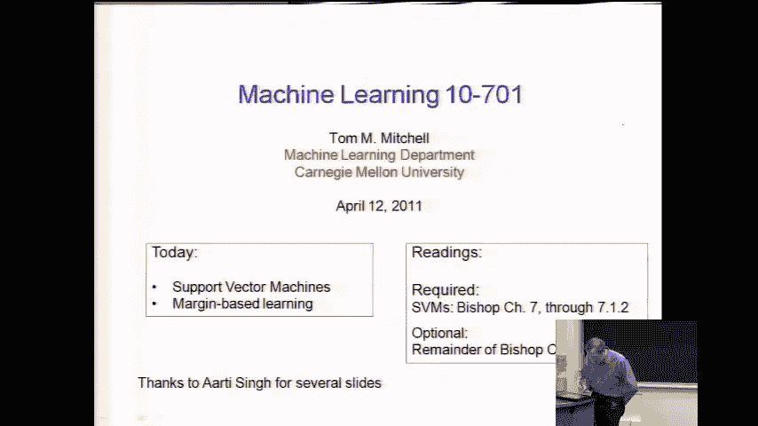
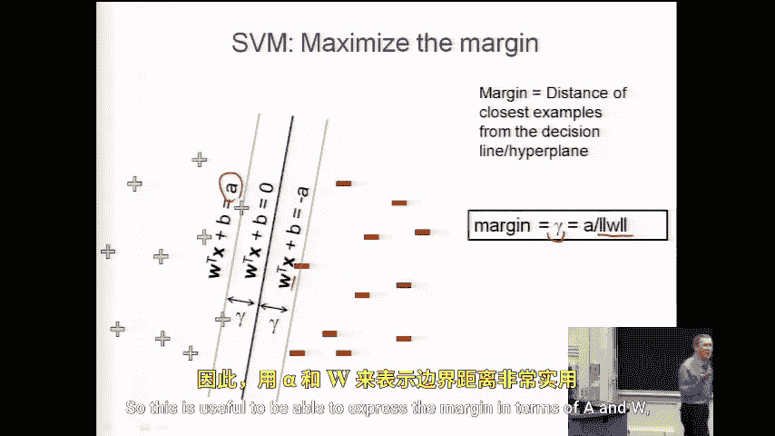
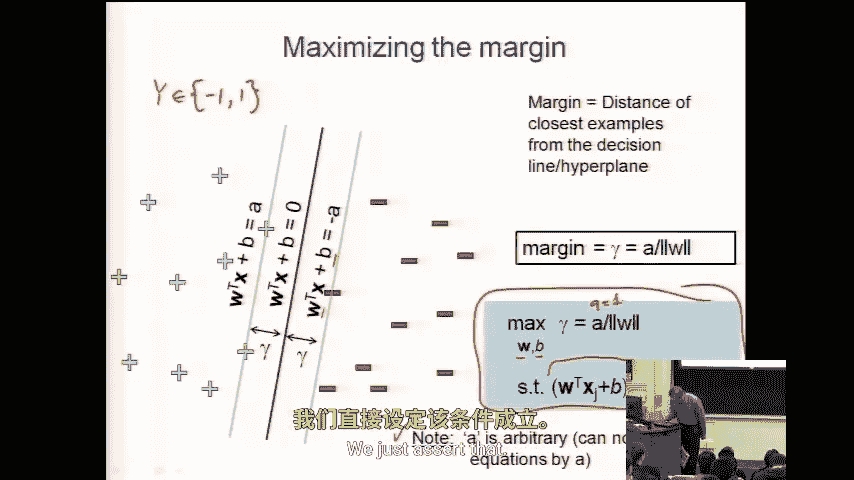
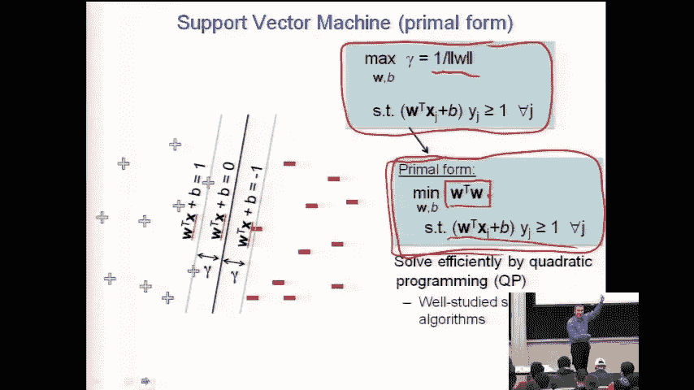

# 卡耐基梅隆大学【中英⚡机器学习｜10-601 2015 Machine Learning】 p48 P48 Lecture 22 SVM's Apr 12 -BV1Lcnhz1E7P_p48-

我对这个。C。可。Could you see these。诶。So I hope the projects are。Proving to be useful to you。

 It's really a key part of this course， because we want by the time you come out of the course that you。

Understand。The key algorithms。And underlying theory。

 But also they had some experience with trying it because as you know， when you work with real data。

 things are always a little bit。More grounded。Then when we talk about these algorithms in the abstract。

 So I hope that's useful。 Anyway， I look forward to reading these。s going to be good。

So today we're going to finish up our treatment of support vector machines。And。啊。Also。

 tie them back to。A number of topics that we've discussed。Along the way in the course。

 like comparing them to some other algorithms， relating them to PA learning theory。And so forth。

Let's get started。 So last time。We got to the point where we had defined support vector machines as a way of doing classification。

 so it's a discriminative classifier。Just as say logistic regression is a discriminative class of art。

 we're trying to learn some function from x to y。And。In the case of supportive vector machines。

We define the objective function that we're trying to optimize in order to choose the weights for that function。

As the function that。Ends up with the largest margin， gamma。

The margin being the distance between the decision surface and the closest data points。

And we had just， at the end of last class， got to the point where we realized that we could express that margin。

In terms of the magnitude of the weight vector， W。And the value of the function。At the nearest point。

And we proved that we derived it actually at the end of last class。

This is useful to be able to express the margin in terms of A and W。

 because when we try to maximize that margin， essentially what that means is we want to minimize a over the magnitude of W。

And then one further step， it turns out that。Well， to be more precise。

 what we want to do is we want to classify all the examples correctly and maximize the margin。

 So we could say that our objective is actually this。We want to choose the weight vector W。And also。

 the constant。B。Such that we maximize that margin， we want to choose the one that maximizes gamma。

 but such that we classify all of our training points correctly too。

And recall that in the case of supportive vector machines， instead of saying that why is。Zero or1。

 we say y is minus1 or1。So the negative examples， we're going to give them a value of minus1 in the positives。

 a value of one。And so， a nice little way of。Saying that we want to classify each of our points correctly。

Is to say that for training point X J， we want to make sure that the weight vector times xj plus B。

Times y。 Well， Y is either going to be plus or -1。 So if it's a positive example， it'll be plus1。

 And so we want that W X plus B to be greater than a。That'll put it on the right， the correct side。

Of our decision surface， on the other hand， if y is minus1。啊。Then we just want that。诶。Essentially。

 the negative of this to be greater than a。Okay， so that'll put it on the correct side over here。

So this multiplying by plus or minus1 is just a way that allows us to have a compact way of expressing the kind of。

 the obvious intuitive constraint that we want all the positive examples on this side of y plus x。

 sorry Yx， sorry， Wx plus b equals a， we want them on this side of it。

 and we want all the negative examples on this side。W X plus B equals minus a。Okay。

 so there's our objective that we want to maximize。And。This note here simplifies life for us further。

啊。If we have this kind of a setting， what I could do is I could。Just divide through by a。

So basically， I can say that I'm going to my。Margin is going to be one over the magnitude of w。

 and I'll make this。Greater than one。So in other words， I can just arbitrarily say a equals one。And。

I can make it so just by scaling Ws。Appropriately when I choose them。

And so that makes it slightly more simple。Function to consider if we just divide through by one and we essentially just assume a equals one。

 we just assert that。

And so then that gives us。诶。Just rewritten with equals one that gives us this。

And that lets us see that actually the margin， if we define A to B1。

 then the margin is just one over the magnitude of the wave vector。So， the bigger the。Coics in WR。

The smaller that margin。Given that we've labeled our examples correctly。

 and if we want the largest margin， we want the smallest W。Again。

 given that we're labeling the examples correctly。And it kind of makes sense if you think about the distance。

 we'd have to travel from Wx plus equals0 to get to it being one。诶。

If I'm considering the weight vector pointing in this direction or this or this or this or this。

The smallest weight vector will make me have to travel the furthest distance to get from zero up to one。

So in that sense， makes complete sense that the smaller the magnitude of the W vector。

The wider the margin， the further I'll have to travel from the point where the function equals 0 in order to make it be1。

Okay， so there's our objective function， and typically。We write it actually this way。Where。

We just take advantage of the fact that if we want to maximize one over the magnitude of W。

 that's equivalent to just minimizing the square of W。So W transpose W， again。

 if w is just a column vector。Then。W transpose。W will just give us。

To sum of the squares of the weights in W。So essentially。

 it's just saying minimizes some of the square of our weights。

 such that we correctly classify all the training needs。

Okay so it's just a mathematical way of saying label everything correctly and find the largest margin you can among the different linear。

Surfaces that will label things correctly。All right。

 so now the nice thing about writing it in this form。it turns out this is what's called a quadratic。

AProgramming problem。So， there are。Optimization algorithms around。That you can grab off the shelf。

 this is a well studied class of optimization problems。

Where essentially this is called a quadratic programming optimization problem because the quantity that we're trying to minimize。

With respect to our variable， in this case， W andB is a quadratic function of W andB。Quaddratic yeah。

 we just said it's the sum of the squares of W is quadratic function of W。

And a quadratic programming problem is one。Where we're trying to minimize some quadratic function of the variables that were。

Selecting over。Such that we satisfy a number of linear constraints。

When I say linear constraint， I mean。Excuse me， I mean， linear in W。ok。So the linear constraints are。

Linear in the variables， again， that we're trying to optimize over。

So that's a great class of optimization problem。😊。