# 卡耐基梅隆大学【中英⚡机器学习｜10-601 2015 Machine Learning】 p49 P49 Lecture 23 Active Learning Apr 19 -BV1Lcnhz1E7P_p49-

No questions。 And if the answer is no， then they can drop down all of the female characters and then ask。

 do you have a mustache， The answer is yes， and so on and so forth。

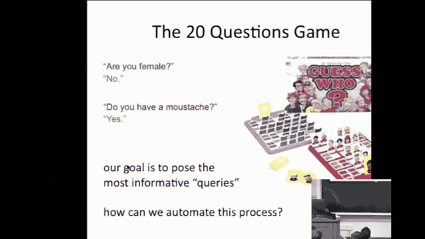

This。This type of asking questions。Narrows down the search space a lot faster than just saying。

Are you Mark or Bob or Joe or whatever the name for the corresponding。

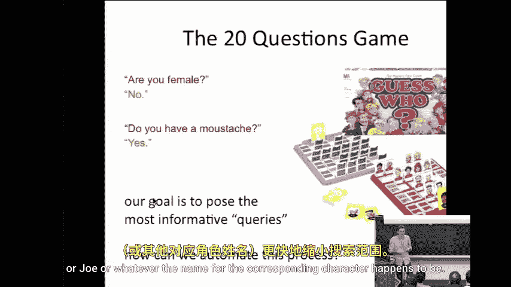

A character happens to be。

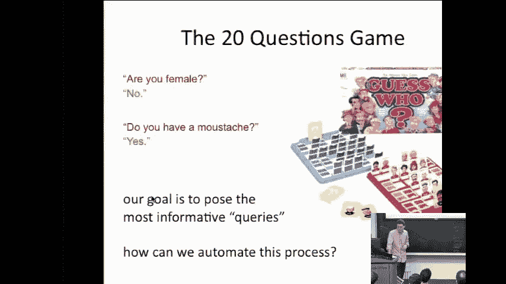

So our goal here is to pose these types of queries that are as informative as possible。

And so what the lecture today is going to be about is how do we automate that process？

You knowThat active of searching through。 And if at any point you've got like specific questions or concerns。

 feel free to interrupt。Hopefully we can still get through all the material。

So we'll start with a thought experiment， let's say that you're in charge of an earth con convoy to colonize the planet zelgon。

 some extra solar planet， it doesn't matter where。

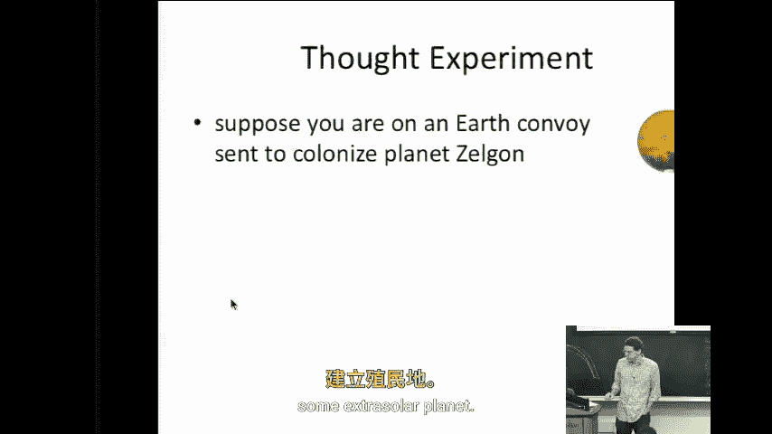

And。On this planet， there's various food sources and you find these round fruits。

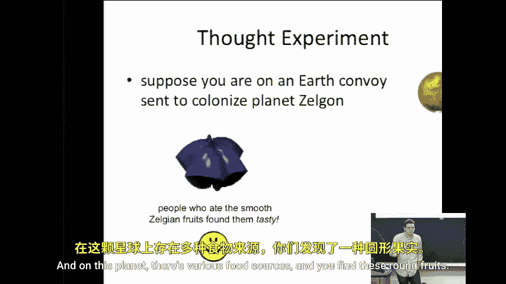

And the people in the convoy who ate these round foods found them really tasty。

And then there were also these really spiky fruits and the people who ate those got sick。

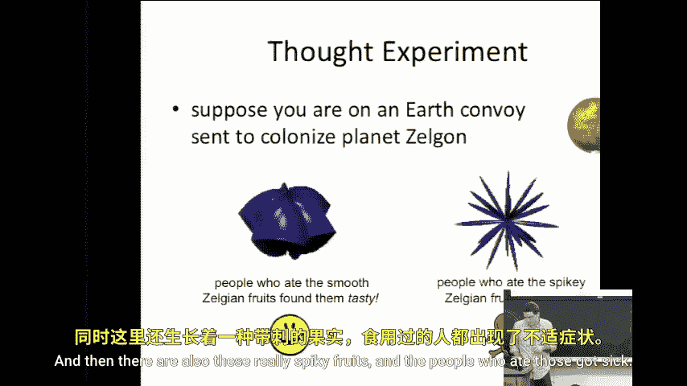

So。

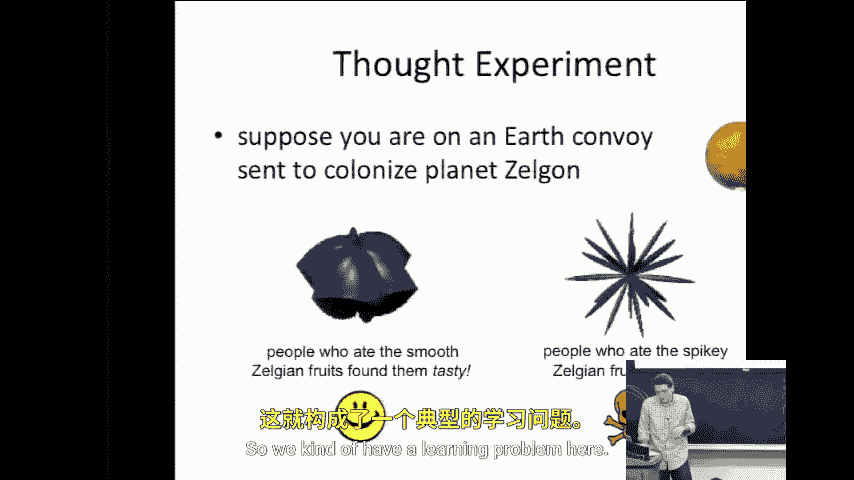

We kind of have a learning problem here。There's a range of fruits from spiky to smooth on this planet。

All right。And what your job is， is the person who's in charge of this convoy is you need to learn how to recognize the safe fruits from the poisonous fruits。

And you want to do this while risking as few of your colonist lives as possible。

So to formalize this is a machine learning problem， this is like learning a change point。

 we've got some binary function that we're trying to learn， and there's a continuous space。

 let's say there's just some parameter that controls spikiness to aroundness。

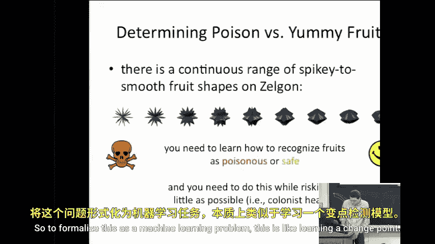

And the goal is to learn some threshold， which I've denoted data star here。

 and you want to learn that as accurately as possible using as few labeled instances as possible。

So what's a labeled instance in this case？行。Right。Right， so an unlabeled instance is a fruit。

A label instances， you give that fruit to somebody， they eat it if they got sick。

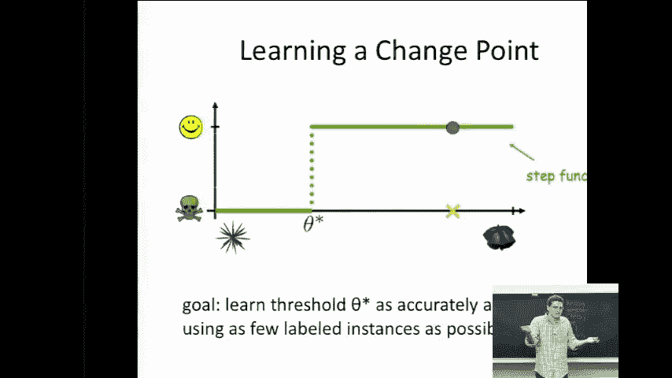

Versus they didn't get sick。That's our label。So in the typical passive supervised learning setting。

All the instances have to be chosen before these tests are run。

 so you would just go out and gather maybe 100 or 200 or 100 fruits and then pass them off to different people in the convoy and say。

 did you get sick or not？

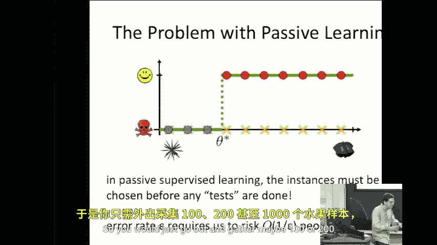

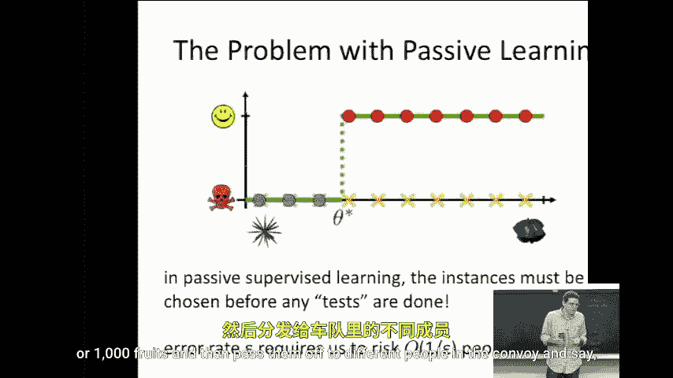

And in order to accurately learn this threshold under the probably approximately correct learning model。

 which I think you discussed earlier， to learn it within an error rate of epsilon。

 it would require O of1 over epsilon。Labeled instances to train this classifier。

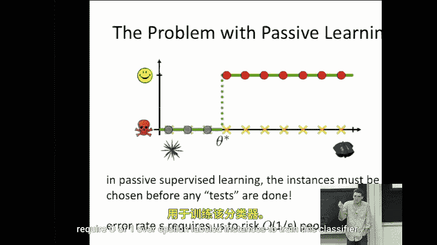

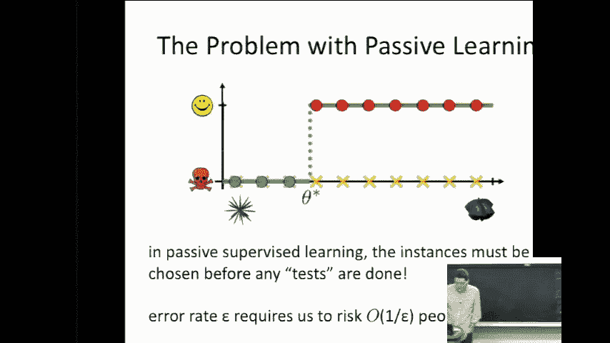

So thats that can be， you know， if you want this error rate to be very small， this is a big number。

 That's a lot of people's health to put at risk。So the question is， can we do better？

So let's say we've gathered these nine different fruits。 and we know that the spiky ones are。啊。

Our poisonous and the round one， the smooth ones are safe。So where should we start？sri。

You're going to start in the middle。So if we start with this one in the middle and give it to somebody and they eat it。

 oh， they got sick。So now what do we do next， imagine we're a learning algorithm。

 we're trying to learn a threshold。 We ran this test。We have updated our model of the world now what？

Right。Look in the middle here， safe， middle here， we found the threshold。

And this is just a binary search。So in the passive case， we've required this many labeled examples。

 but in this active space， we've required that many fruits to be laying around。

 but only log base two， since we're doing a binary search of actual tests。

So those are the number of queries or the number of actual fruits that somebody has to eat in order to determine where this threshold is。

So congratulations， this is your first active learning algorithm。

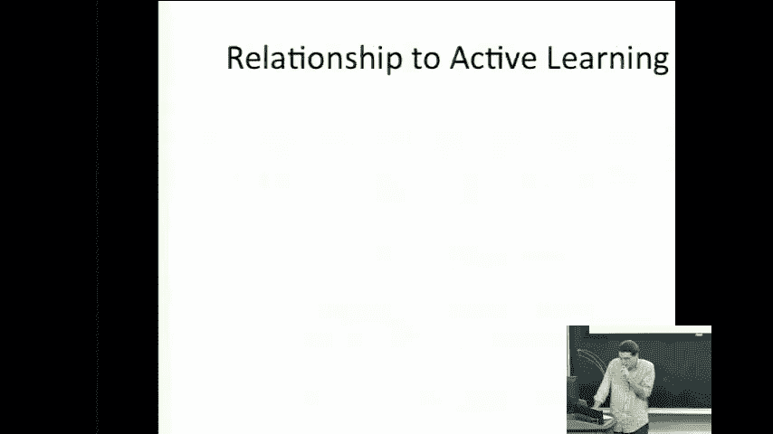

So the relationship here is the key idea。The learner is choosing the training data rather than just passively sampling things and then handing those off to the oracle。

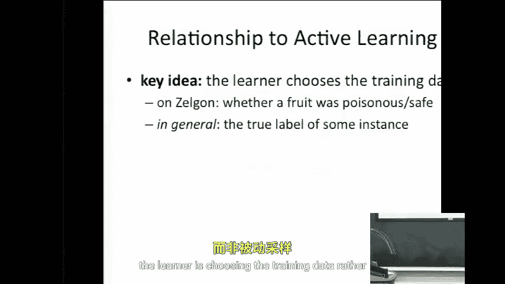

And on planetet Zelgon， our example is whether or not a fruit is poisonous or safe， but in general。

 this is like the true label of some instance in the problem domain that we're studying。

And the goal in doing this is to reduce the training costs。

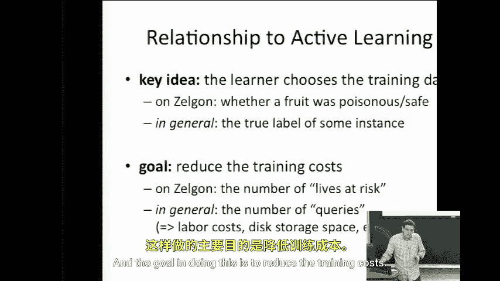

So in the fruit example， this is the number of lives that we put at risk by asking them to eat a fruit。

 and in general this is the number of queries which can translate to more interesting or prescient notions of costs。

 like labor costs， you know the people that you have to pay to do the labeling or disk storage space for your training examples。

 so on and so forth。

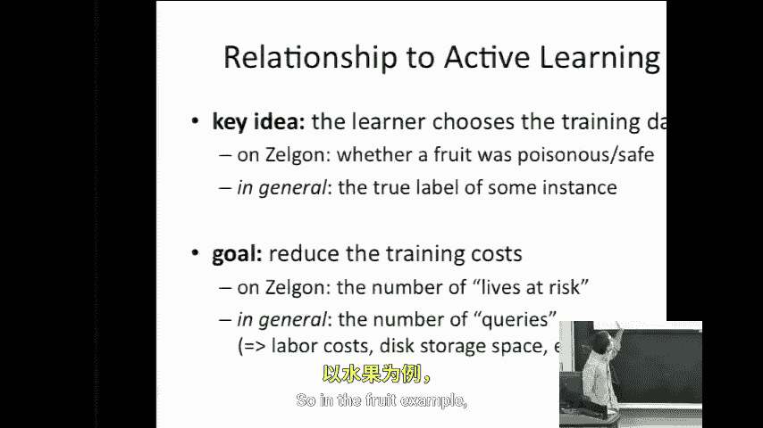

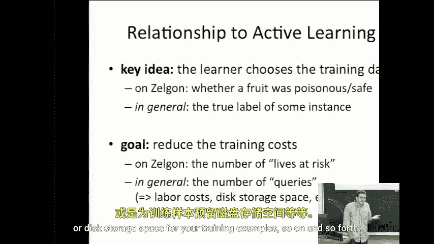

So reducing the amount of label data。

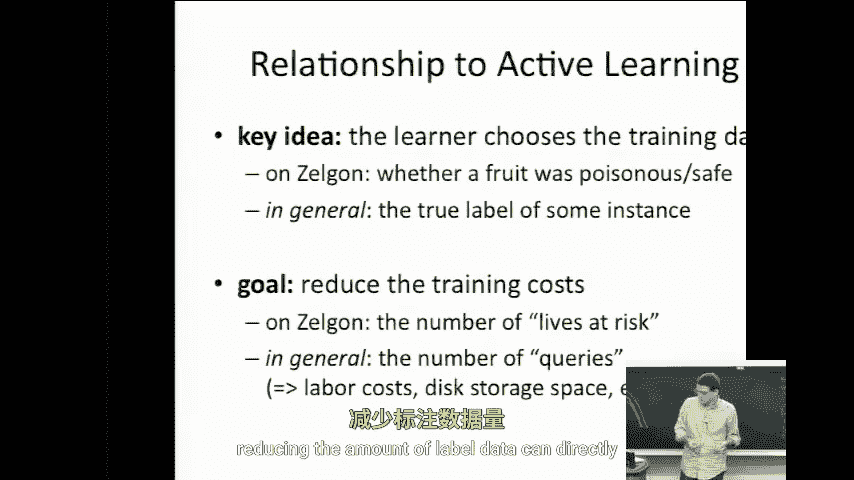

🤧啊。Can directly influence the cost of obtaining。

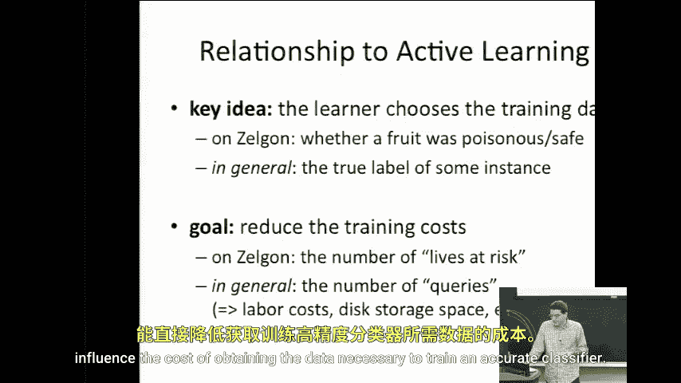

The data necessary to train an accurate classifier。

So there are several different ways in which queries can be formulated and tested in real world problems。

 We'll start out by talking about three of these。 These are query synthesis。

Selective sampling and pool based active learning are the three most general approaches that are considered in the literature。

So we'll start with query synthesis， let's say we've already got some random labeled sample laying around。

And we give that training set to the learner。And it is able to， it knows what the instance space is。

 and it's able to just generate some new。Query， de nobo， just knowing what the domain is。

 So if the instance space happens to be a Cartesian space of real numbers。

 then it can pick a point with two coordinates。And then passes that point off to the expert who provides a label that's added to the training set and that repeats。

Does anybody see a problem with this？So it's a technical challenge of how to actually synthesize that point。

Is that what you're saying， Yeah， that's true， too。

 There's also a more kind of philosophical problem or like like。Like a more basic problem than that。

 Did you have your hand up。The expert is not only right， that's true， let's pretend he is。

 there's still another problem。法证人。Thats's a problem。

 that's a challenge that we're going to talk about extensively throughout this lecture。

 but even more basic than that， that's specific to this like synthesizing queries。对第号。Right。

 so you don't know what the underlying natural distribution of instances is。

So this came very apparent in the early '90s when people started first started trying to do this query synthesis in practice。

 so Langgen Baum did this experiment with artificial neural networks trying to learn to classify handwritten digits。

To recognize one of which of 10 digits this particular character corresponded to。

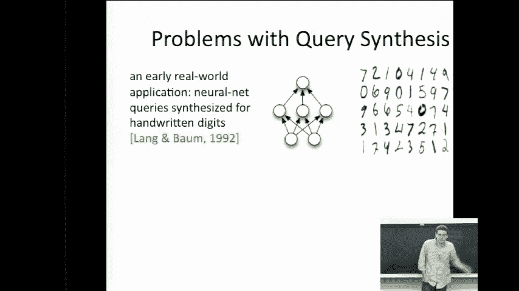

And the queries that it synthesized just didn't make any sense a lot of the time。

So these are probably sevens。 That's maybe a five， but。

Is that a nine or something in between a7 and a5， or this is something that nobody would actually naturally write out？

RightSo we want some guarantee that the queries come from some underlying natural distribution。

So this is a problem with the query synthesis approach。

If we had some generative model of where the data was coming from， then we could combine that。

 for example， with。With a query synthesis approach。But in practice。

 selective sampling is an answer to this problem。So again， we've got some labeled data。

 We give that to a learner to induce a classifier， and then we've got some continuous data source。

 which might actually be a generative model of the data if you know what the distribution of the data is。

 and then you pull some new instance out of that data source。

And then the classifier is allowed to inspect it。And decide whether or not it's something that's informative in which case it'll posese a query。

 or if it's something it already knows the answer to and we're just wasting our time， then we'll。

We'll pass that off to the trash。So for example。These are all of the smiley faces and cr。

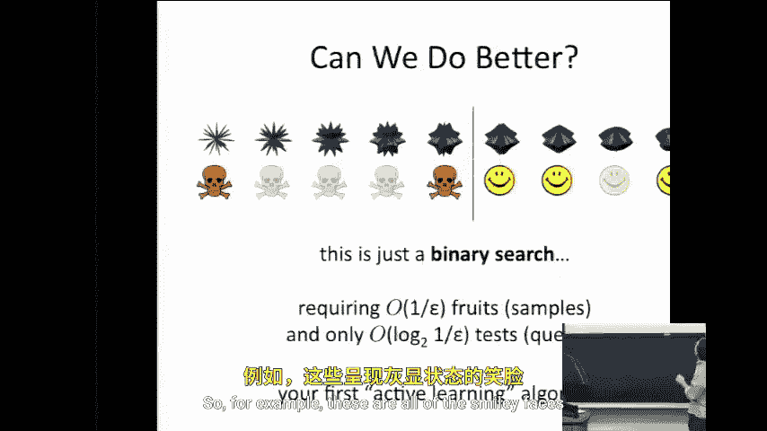

Skulls and crossbones that are kind of grayed out here。

