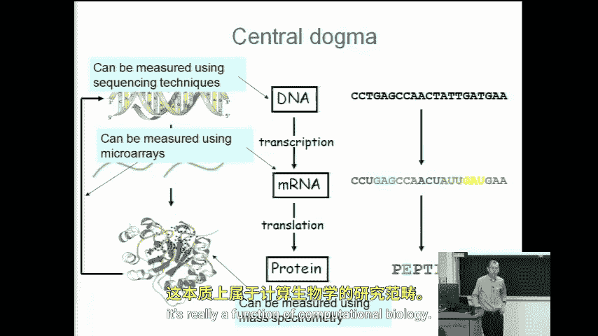
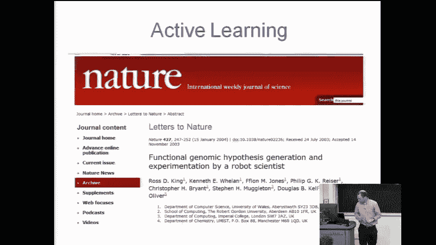
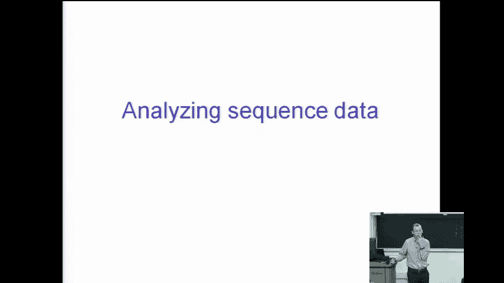

# 卡耐基梅隆大学【中英⚡机器学习｜10-601 2015 Machine Learning】 p50 P50 Lecture 24 ML in Computational Biology Apr 21 -BV1Lcnhz1E7P_p50-

Antative energy solutions。 So they think that some of these can generate different types of fuels and they are trying to sequence and find the proteins that can do that。

 So this is the ability that we now have that wasn't there maybe five years ago， We can， as I said。

 we can measure the levels of mRNA。 We can measure structures of protein we can measure which protein interact with with each other。

 we can look at this backward feedback loop that tells us which proteins control。

 which other proteins and so forth。 And all all of this can be done using highput methods， Basically。

 they give you a lot of information together。 And now the question is。

 what do we do with this information， How can we put it together。

So that we really understand what's going on inside the cell。 So each of these types of data sets。

Gives us specific view of the activity inside our body。And the challenge。Computationally， also。

 biologically is to put this together and understand， for example， how does cancer progress， right。

 we start with a sequence。 There are some mutations that lead to some proteins being misgenerated and these interact with other proteins that。

 in turn， affect the generation of others and cancer is one outcome of this。

 So if we can put all of this information about what is the sequence。

 What are the levels of the proteins， which proteins interact with each other。

 which proteins control， which other proteins are going to be generated， Try to put it together。

 We may get a model of how things go wrong， For example， in cancer。

So this is the main focus of the work in computational biology， although the last。I would say decade。

 because， again， because we could collect， we could have collected other types of data over the for many decades。

 right， we can observe people。 We can do post mortem。I don't know。

 Take some organs and look at them under the microscope。

 but it was very hard to collect the cellular data over these years。

But I don't want you to get the impression that computational biology is only about what's happened inside our body。

So can anybody tell me what is the most important sporting event that happened this week。Important。

 I mean， in tunnels， for example， of the number of spectators that actually watched it， yes。Right。

 so clearly， the Boston marathon is the most important sporting event， right of this week。😊。

A lot of people heard that Jerry Jones wanted to break the record for the number of spectators in the Super Bowl。

 and he was trying to pack 108000 peoples。Into Dallas Stadium， but he didn't succeed。

B of Marathon is being watched live by more than 500000 people。诶So it's definitely诶。

A very important event。Another thing that happened in the Bo Mountain on this year is that。

The run that won the Bostons marathton did it in an incredible time。

 They actually did it a minute faster than the best time recorded。😊，For maraths ever。 So basically。

 they run it in 203。Which is something like 4 minutes and 45 seconds per mile for 26 miles。

Most people here is' not。 Everybody cannot run one lack of the CMU track in the time they ran 106 laps。

104 laps。 So this is incredible。AndAnd breaking the record by one minute is also unheard of。 Now。

 if you talk to sport analysts。They actually acc credit this with the structure of the Boston corse。

 So Boston， unlike almost any other marathon， including the Pittsh marathon。

 which is going to be in three weeks， is not a point to point。

 So you don't start and end at the same point。 You take the buses 26 miles， and then you run back。

And as it happened。Sometimes this helps you because in this year， for example。

 they claim that there was a very strong tailwind the entire way。

 You can't have it in Pititzslo because you run in the circle。 But in Boston。

 you had a 15 miles tailwind。 Someone pushed you。For 15 miles hour。

 And you can think that that definitely helped。 But what the analyst ignored is the fact that it's really a function of computational biology。

 So last year。😊。

There was this paper published in plus computational biology。

 one of the leading computational biology journals。

 which analyzed the metabolic intake required two marathon manuals and gave you some formula about how much you you need to read。

 I don't know many of you watch the two de France。 but when you see them crest these mountains。

 they usually go to the back and then take something and eat it and then go down in marathon。

 you also can eat during the marathon or doing and this paper analyzed computationally what is the caic intake that you need and what is the best efficient way。

 And obviously they read it and took it into account and was able to improve。

 but at least this is definitely one direction that computational biology can go even though it's not necessarily molecular。

 So this looks at metabolic intake， which is basically organ or even body based。

 So there are things you can do in other levels。😊，국这에서 맞。

Another example is clinical application of computational biology。

 So here is an example of a clinical test that is being used right now。😊。

And that test basically measures the levels of genes in a tumor。 So basically， we have。

If you have a breast cancer and it's recurring， there are a few things you can do。

 a few alternative treatment options。 And using this test。

It actually tells you what option is best for you。 So you can do different things。

 or you can take different drugs。 The test basically tells you which one you should do before that。

 before this test existed， people would just try one of them。

 And if it didn't work would have to switch six weeks， six months later， the problem is， of course。

 that first of all， you waste six months。 And sometimes this is。You know， little I mean。

 if you didn't take the right treatment。 and also you can have side effects of the treatment。

 even if it doesn't mean the treatment doesn't help you， it can actually harm you。

 So this type of tests are very important。 And you can see， I mean。

 this is the Washington Post report。 But the idea is。

 instead of there are tests before there are some existing tests that look at something called biomarkers。

 But they usually look at one protein at a time。 This is the first test to look at a lot of proteins at once。

 in this case，70 proteins。 And Washington Post really says that this is a formula。 but in reality。

Therere using a classifier， basically。And it's proprietary。

 We don't know which classifiedifier they're using。

 but it's probably a variant of support vector machine。Based on some early papers they published。

 and you take this， you measure the levels of proteins in your cell。

 You have 70 different values that you take into account and based on some classification that was trained and a lot of different individuals。

 You make a prediction。 And based on the prediction， Basically， people decide which drug to take。

 So this is something that came out of computational biology。 Of course。

 apply to clinical applications。 This is some work that we did where we took a hidden markov models and used them to combine a static and time series data to model some systems in the cell。

😊，So data integration is a key issue in computational biology。

 We have a lot of these types of information。 Some of them are static。 Some of them are temporal。

 How do we put them together。Another example or another area of machine learning that is being used。

Is active learning， I don't know if you had time to cover active learning。

 but this is the process in which instead of walking with training example， you actively sick。

The different training examples。 And a few years ago， and this has been extended since。诶。

Researchers in the UK developed what they called a robot scientist。

And the idea is that the robot scientists can actually。Not only performed the experiments。

 but also designed the experiments。 So basically， it would go to。Whatever the bench。

 or it would go to some closet， take out the samples， run the experiments。

 analyze the results and decide。Which experiments to do next。

 And the way it would do it is by using active learning methods。 So basically。

 trying to determine what experiments to do in order to get the best outcome or to minimize the number of experiments so that you get the best model。

For outputSo this， again， this is something that was done with machine learning in mind。 Okay。

 so so machine learning covers a lot of different aspects of this。

 I would like to focus today on a specific problem that people have been facing in computational biology over now at least two decades and how using ideas for machine learning really changed。

 I think the way people address this or try to solve this problem。 And the problem that。

I'm going to focus on， is。How to deal with sequenceance data。So sequence data， as I said。

 is something that。Is very common in biology。 right， Everything basically is derived from sequence。え？

Of course， there are。 nowadays， we know that sequence doesn't dictate everything。

 There are things beyond sequence， but sequence definitely plays an important role。

 A lot of diseases are associated with changes in sequence， so。诶。

Anybody knows how long the DNA is of individuals。I mean， if we have。

We have trillions of cells inside our body， right，50 trillions。 Each of these has a copy of the DNA。

 which is a big book。Which has a number of different letters。 Anybody knows how many letters， yes。喂。

No， not the right， total number of letters in the DNA。😡。

