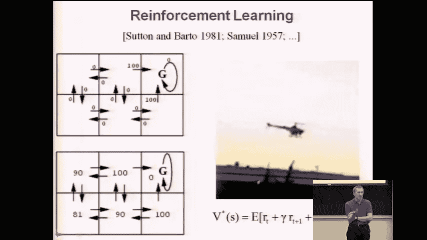
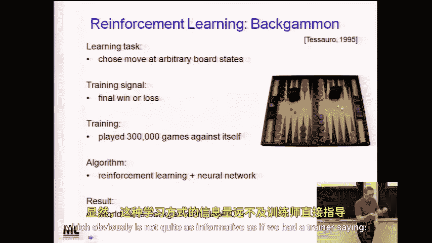
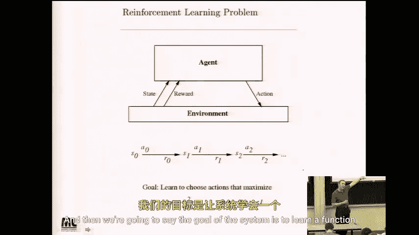

# 卡耐基梅隆大学【中英⚡机器学习｜10-601 2015 Machine Learning】 p51 P51 Lecture 25 Reinforcement Learning I Apr 26 -BV1Lcnhz1E7P_p51-

I mean theres。Okay， well， on today， I'd like to talk about Markov decision processes and reinforcement learning。

And this is a little bit of a different kind of。Fraaming of a machine learning problem than we've seen so far in class。

 So mostly in class， we've been looking at what I would call function approximation problems。

 trying to estimate some function from X to Y， given examples of it。But。Today。

 we're going to look at the problem of what some people would call control learning。

So for example， imagine you have a robot like a helicopter。

Or a simulated robot roaming around in a grid world where it can be in one state or another。

And all we want to do is have this robot learn a control strategy for choosing actions。

Out of its vocabulary of actions。Given the state that it finds itself currently in。And of course。

 to make that a well formed problem we have to say what its goal is and what it is that these actions are supposed to accomplish so that's the setting for today and this is yet another active area of machine learning there are textbooks written on reinforcement learning and Markov decision processes if you go to the machine learning conferences you will find sessions on reinforcement learning and Markov decision processes。

And。I have to tell you one of the fun examples of this。

Reinforcement learning actually really works in practice。

 and one of the fun examples of this comes from a former undergraduate who took this very machine learning course。

In the 1990s， Andrew Iing is his name。He's currently a professor at Stanford and as part of his thesis work。

 he worked on reinforcement learning。And developed what turns out to be。Probably the most impressive。

Helicopter control algorithm。That exists。 if you go onto YouTube and type in。I don't know。

 machine learning helicopters or something like that。

 you'll be able to see the video and watch it do amazing acrobatic feats， aobbatic feats。

But it turns out。That's a problem of learning control， of learning to choose。

The right helicopter control action。Given the current state。

And by repeatedly applying that control function， the helicopter gets to control itself。So， there's。

One example， another well known example of this is in gameplay。

So if you think about playing a game like chess or checkers or backgamin or whatever your favorite game is。

Again， you're confronted with this。Question of given the current state of the game。

 what action should I take next in order to optimize my。Chances of winning the game。

 that's actually what we're trying to optimize in that case。And。In fact， in many games， including。

Chess and backgam。The best methods that are known are really based on machine learning and various forms of。

What we're going to talk about today。Temporal difference learning。one。Well known example。

 if this is due to a guy named Jerry Tasarro at IBM。Who was also involved in the Watson effort。

 by the way， But before he worked on Watson。Sheerry was essentially the person who developed the。

First。World class back in and playing program。And。Again， the way he did it was using。

Reinforcement learning， the technique we're going to talk about today。 and essentially， his。

Training signal was whether in the end the computer won or lost the game。

And the experience that he trained from was hundreds of thousands of games that the computer played against different versions of itself。

And。Then eventually， it was able to learn a good control strategy。

 a good way of looking at the current board state and choosing the right action。And back came。

 and I guess the board state is both where the pieces are plus。

What happens when you roll the dye with the state of the dye dice？Are also。嗯 so。Now。

 if you think about this learning problem， you realize that it really is a little bit of a different kind of training experience。

That we're learning from。So it would be one thing if I asked you， how would you train a program？

If I give you training examples of the form， here's a board state and here's the correct action。

 here's another board state and the correct action， then you'd say， oh， we know how to do that。

You're asking us to do another function approximation problem。

 we have a lot of methods for doing that and you'd be right。But if instead I say to you。

I can't give you that。If the training experience is playing games against yourself。

 then you never actually get a training example of the form， here's the board state。

 and here's the correct action。All you really get is training examples of the form。

 here's the board state。And I took this action， then my opponent took that， then I took this。

 then my opponent took that， then I took this， then I won。

So what you get is this training data of the form， board state action sequence outcome。And so。

We're going to call this delayed reward。For obvious reasons。 and really， the key technical。

Challenge in doing this kind of control learning， reinforcement learning is to figure out how can we design machine learning algorithms。

That can learn effectively from that kind of delayed reward。

 which obviously is not quite as informative as if we had a trainer saying， oh， in this position。

 you should take this move。

And that's really the problem at hand。 If you think about it。

 most of what we do in real life has that character， right， very few times， except when our。

Parents are patiently teaching us what to do very few times do we actually get training examples of the form you're in this state here's what you should be doing usually we just do a bunch of stuff and then we like it or don't in various ways。

So in some sense， this is the realistic。嗯。H。Wow。Okay， I vote we reinstall later。Oh， I see。

 we're going to get。Is there a way we can get rid of this？Okay。

 pay no attention to the man in the corner of this screen。

What we're going to do instead is just forge ahead and ignore that。Okay。

 so here's the outline we're going to talk about formalizing this problem of learning from delayed reward will formalize that with a。

Formulation that we call Markov decision processes。

 which has an interesting correspondence to hidden Markov models and Markov models in general。

Then we'll talk about a couple of methods for learning that and probably next time we'll talk about how recent research on animal learning has found that this is actually a intriguingly good explanation for a lot of work。

A lot of observed data from animal learning。Okay， so here's the problem in the abstract we're going to think of it this way。

 we have some agent that's the thing that has to learn a control strategy。It's in some environment。

And。What it can has some sensors that sense the state that。It and the environment are in。

Plus it's going to get some reward signal， for example， in the case of playing backhammon。

 the reward signal is going to be zero all the time， except if you win or lose the game。

 if you're in the final state， maybe if you're in the final state and you win。

 well say the reward is plus 100。And if you're in the final state you lose。

 we'll say the reward is minus100。For every other state， the reward is going to be zero。

 We don't know what reward really to give。So it can sense the state and the reward。

 it can choose some actions， it has a set of actions to choose from。In the， case of a game。

 these are the legal moves of the game。 And so it's going to generate a sequence of states。

Then in action， then it'll observe some reward as a result of that state action pair。

And it will find itself in a new state， S1， it'll choose another action， get another reward。

 and so on。And then we're going to save the goal。Of the system is to learn。

A function that。