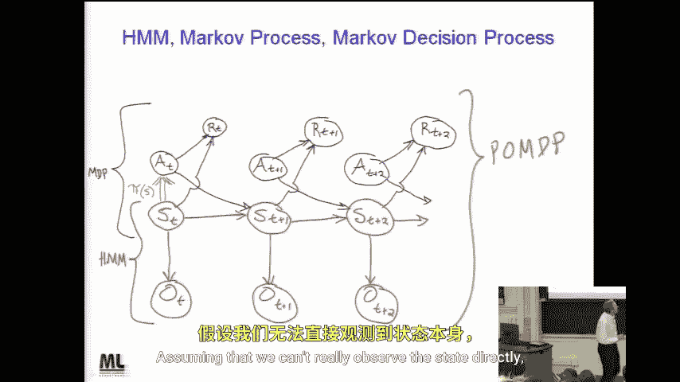
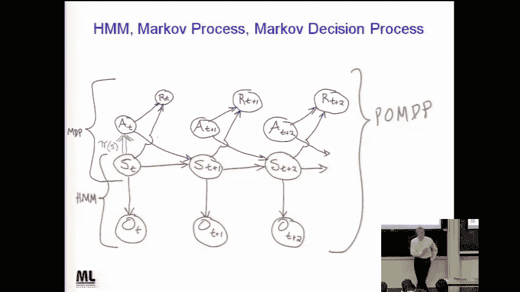
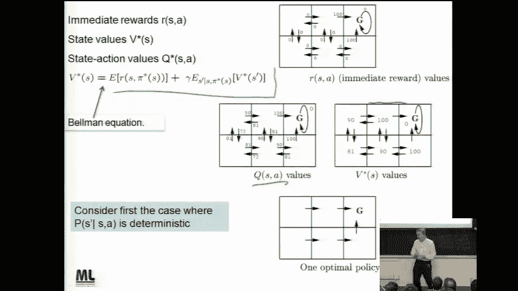
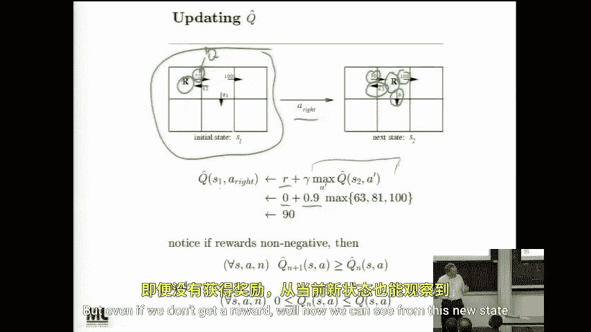

# 卡耐基梅隆大学【中英⚡机器学习｜10-601 2015 Machine Learning】 p52 P52 Lecture 26 Reinforcement Learning 2 Apr 28 -BV1Lcnhz1E7P_p52-

Okay。All right， so welcome to the last class， this is amazing， it's amazing to me。

 I'm sure it's amazing to you。啊。And so before we start lecture， as you know。

 we have a couple things coming up after the last class， the poster session is Tuesday。嗯。

And the final exam is then。Friday， a week from Friday。And。

Check out the website just to make the class website just to make sure you know exactly where and when those things are。

 the final exam will be as the midterm was open book， open notes， closed computer， closed cell phone。

And you won't need a calculator。As far as I can tell for the final exam。

But you will need your brain and full understanding of maturity。So嗯。

And I think maybe what we'll do is for the poster session。

I think just consult the instructions that are on the website if you have any questions about and you know if you don't know how to print out one huge page。

 it's okay you will not be penalized any points if you print out  eight and a half by 11 pages and staple of them on。

 I think that's just fine。Also one quick announcement though we would like you when you turn in your final project reports to turn in hard copy as well as sending us an email copy it just makes grading a lot easier if we can get a hard copy from you one student sent an email and said but I'm going to be in some other geographic region at that time do I have to rush home or mail or FedEx you a hard copy no。

 just send us an email that says in bold letters in the title of the email I'm the one who is out of town and so please print this。

The one。Okay， so today let's finish up Markov decision processes and also spend a little bit of time studying for the final。

 that's the goal。So we talked about Markco's decision processes last time。 Here's the picture。

That is easy to carry around in your head for that。

 The red part is just our old familiar hidden Markov models。The blue part is， well。

 the full picture is a partially observable。Markov decision process。诶。

Assuming that we can't really observe the state directly。

 but only observe the outputs the same way we would in a hidden markoff model。 if， in fact。

 we can observe those states。

Like here， if we do observe the states， then this portion of it。

 we just call a Markov decision process。OkaySo we talked about this last time and we talked about the formalization of our problem is to learn this policy function pi。

 the green function that looks at the current state and chooses an action。

And which action do we want to choose while we agreed， we would。诶。Choose。

 try to learn to choose the action that maximizes the sum of expected。Future rewards。

Discounted exponentially into the future。

So I'm sure you recall that。So， in fact， we ended up noticing that we could take that expected sum of future discounted rewards as the value of some evaluation function。

 we'll call it V star。The value of any given state。

 we could say the star is just the sum of expected discounted future rewards we'll receive if we happen to start in that state and then。

Do the sequence of optimal actions starting in that state。And we'll call that the value of the state。

Because captures our intuitive notion of。How good it is to be in state one versus state2 is we'd rather be in the state that has a higher。

Expected some future rewards。And so if we can learn that evaluation function V。诶。Then， we can。

Use it together with。Our ability to predict what the next state will be if we do an action。

Then we can use our evaluation function V together with the ability to predict。

What state will end up in if we do action 1 versus two。

To choose whether wed like to take action one or two。But then we mentioned that if we don't know。

The next state function， if we're a robot and we really don't have a perfect ability to predict what will be the next state I'm in if I execute action 74。

Then we need something other than V。Because we can't do the one state look ahead because we don't know how to predict where we'll be if we do action 73。

And so then we notice， well， instead of learning the evaluation function V。

 we could learn the evaluation function Q。Wwhich is just like me except that we define it over state action pairs and now instead of choosing actions by saying。

 let me simulate going forward one step and see what the value of the state will be。Instead。

 I just say， would I like。Which one， which Q value is higher。

 the Q value for the state action pair consisting of my current state， which obviously I can observe。

And action one or the Q value of my current state in action 2。So basically， we just。

To find a similar but slightly different evaluation function Q。

That has this nice property that we don't even have to do a one step。 Look ahead。

 We just look at our current state， and then we look up in our。Q function。

Whether there's a higher value for action one or action two in the current state。Okay。

 so that's where we left things。

嗯。And we also talked about an algorithm for learning both V and Q。

 and the algorithms were remarkably similar， they basically operated off the following insight。诶。

We can。Well， first of all， we observed that in a lot of these cases。

 if we really knew the next state function， we could just do dynamic programming。

To take a world where we knew。诶。Where the rewards were and calculate the V value for each state with dynamic programming。

 kind of working back from the states that。From where the rewards。

 the immediate rewards were to figure out what would be the expected discounted。

Value of one step away from there and then two steps away and then three。

And then we pointed out that， well， instead of doing a full dynamic programming thing， we can just。

Sample。The state action pairs， and if we do， we apply a simple update rule。

 then randomly sampling state action pairs。In doing that long enough。

Will give us the same result as dynamic programming。And so we centered zeroed in on this kind of。

Update rule said， well。Suppose we have a robot in some particular state and it decides to do a particular action which lands it in some other state。

Then that robot just sampled the state action pair。The state it was in， the action it did。And we。

As we said， the Q learning algorithm essentially just says whenever you do that。Then。If this is the。

Q hat。Value。For the state action pair that we just sampled。Then what we'll do is after we sample it。

 we can replace our old estimate for what Q hat is for that state action peer。

 we can replace it by a better estimate。How do we get that better estimate？ Well。

 we just take the observed reward that we actually got when we sample dates state action pair。

In this case， a reward of zero。Immediately rewarded0。Plus， the discount factor times the maximum。

Over the outgoing。Actions we could take from our new state。Right。And in fact， as we noticed。

 that maximum is， in fact。The V function。For。The new state。Okay。All right。

 and so learning the V function through value iteration。And learning the Q function this way。

 both are basically using the same idea。Every time we。

If we have some estimate of what V is or some estimate of what Q is。Every time we take a step。

 we can improve our estimate for the state or the state action pair we just left。

Because now we're in a new state where we see more stuff。Maybe we just got a reward too。

 in which case now we know a lot more about confidently about what the value was of being in that state。

 but even if we don't get a reward， now we can see from this new state。

 what are the outgoing actions and what are their。

