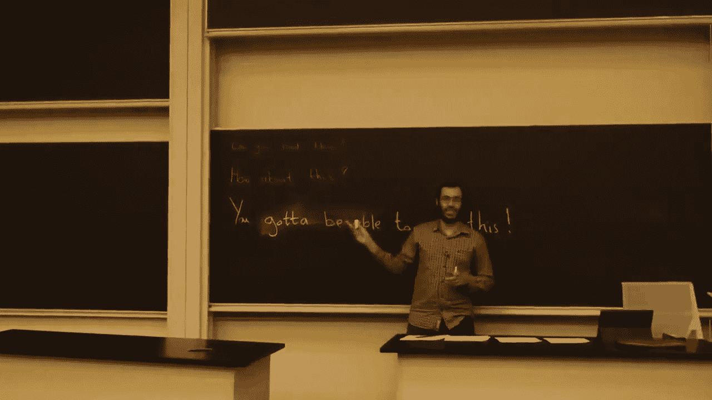
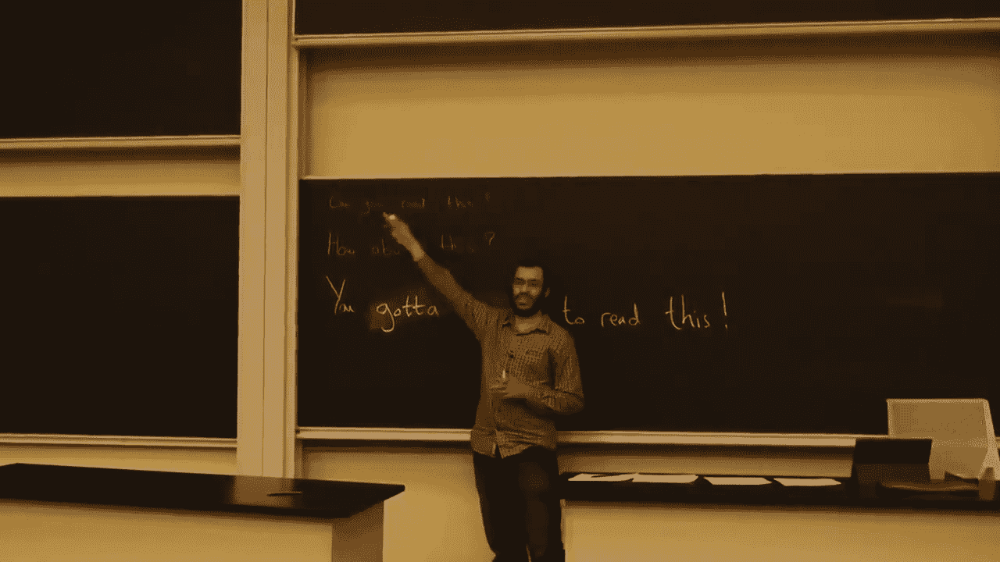
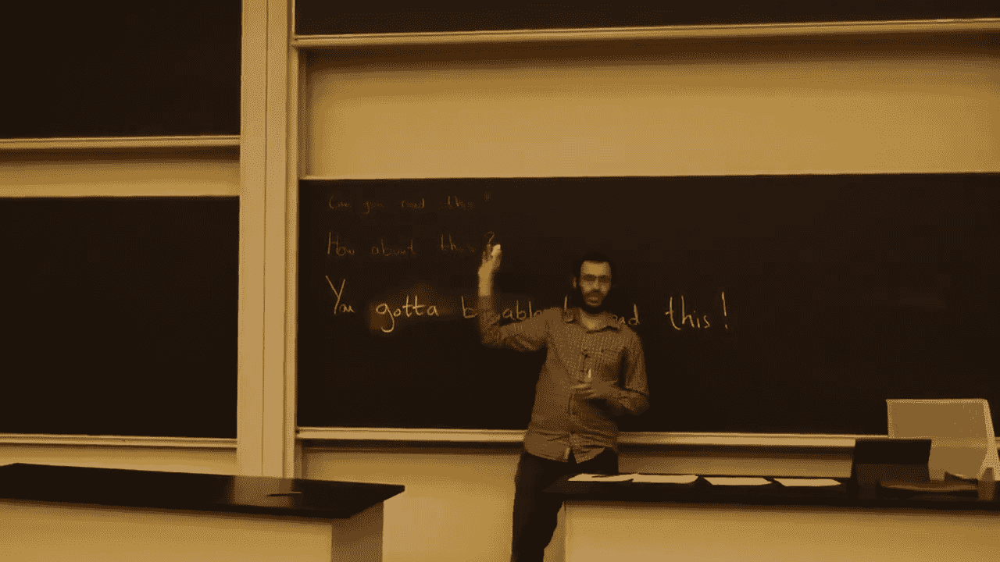
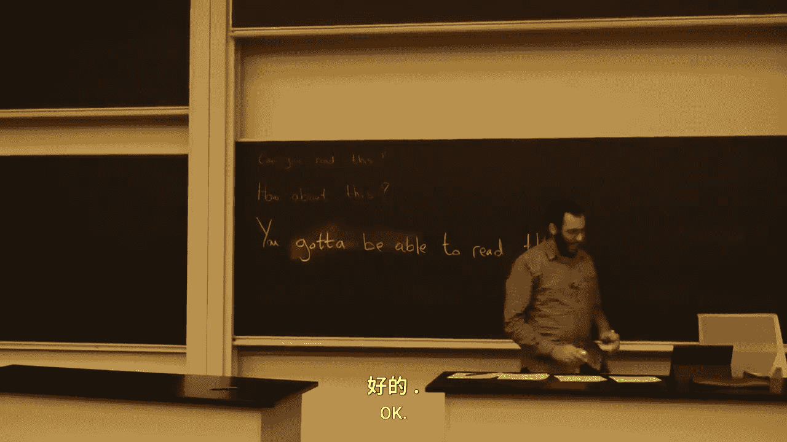
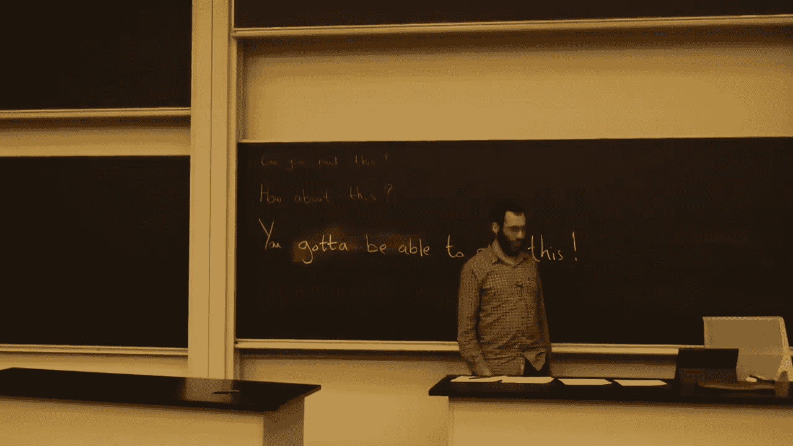
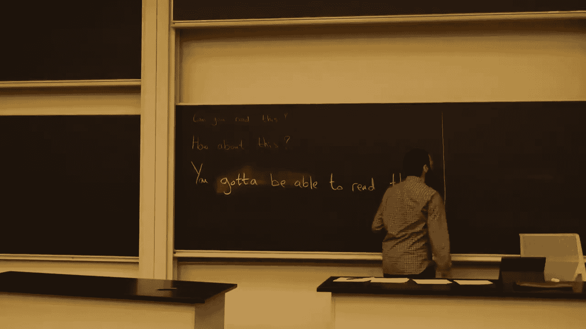
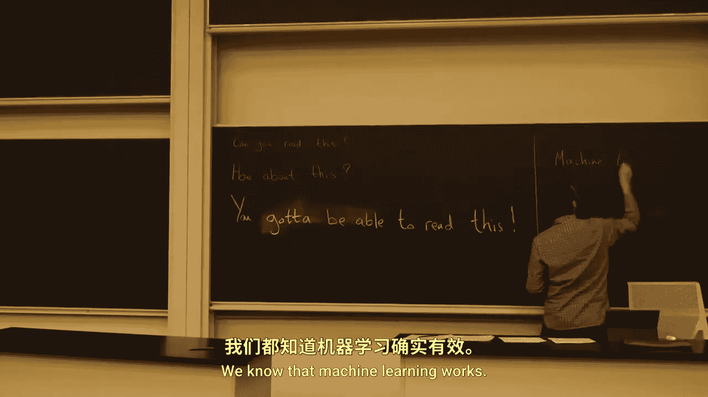

# 卡耐基梅隆大学【中英⚡机器学习｜10-601 2015 Machine Learning】 p56 P56 Recitation 5 Learning Theory Feb 12 -BV1Lcnhz1E7P_p56-

Okay， welcome， everybody。 I'm Ahmamed Hafney。😊，And this station will be about learning theory。

Before we get started。You just wanna calibrate my lighting。So is everyone okay with？

This font。

How about this？

Okay， so this plus。Okay。

嗯。

So。What's learning theory？

We know that。咪先。

Learning works。Right。Otherwise， we won't have a course with more than 100 units。

Myach machine learning theory studies。When。Does。Why。And when。Does machine learning work。

Or to be precise， when is machine learning guaranteed to work。And。We will have like， some very。

Quick touch of this topic， because it's a very deep field of machine learning that's beyond this course。

 We just。Going to have a taste of it。So。Let's remember our。Toms。Big picture of machine learning。

We have。A population of data。Let's assume this box contains。

 let's say all emails that were sent and will ever be。And。These emails can be partticed。Into。

Not spam。And spend。And this partitioning is based on some criteria or some concept， we call that。

The target concept。This criteria would apply to all data。The resultssult in that partition。Hey。

However。We don't observe all data。 Otherwise， no point in doing learning。无。What we。

 we have access to a set of examples。 So we have a few points inside that。Not the spa lesion。Oh。

 let's called that negative。And a few points。offff。This spam。Category。

And we would like to learn how to categorize points that we haven't seen into spam or not spam。

And to do so。We start by。Having。What's called a。Hypo class。Okay。And this hypothesis class contains。

All always that we consider。To partition the data。 So they are not necessarily all possible ways to consider the data。

But。Some of the ways to politician the data that we liked， that we think are plausible。

And so each hypothesis within that hypothesis class。Will induce。Different bying。Of our data。So。

 for example， let's say。We will consider all the ways to partition the data， by doing an ese。

Whatever inside the ellipse is negative， whatever outside the ellipse is positive。

 That's a hypothesis class。And so， one eipse。Ms。Look like。Another ellipse。Might。Look like this。

Is this being key？Okay。That other ellipse seems to agree with the target concept。And all the。

 in all the examples we have。Right。However， it doesn't agree on some of。

On some of the regionss where we don't have examples。

So these are lesions that will be classified negative by our ellipse by eachha。

 but truly they are positive。And also， they are lesions。

That will be classified positive by a chat with as truly they are negative。So。

We have a set of hypotheses。 We have a set of examples。We try to find a good hypothesis。

And the way we evaluate our hypothesis， given that we have only。

A finite number of examples is that we test the hypothesis on the given examples。And so。

 we call that。The sample。Of the hypothesis。Basically， if we have。And examples。

 how many of these examples are。Misclassified by our hypothesis。However。And we。

 we are training our hypothesis or our class file。To work in an application。

And so we don't really care about its performance on the existing training data。

But we care about its performance on unseen examples。And so we really want what we really want or。

To have an ideal。I。The L O of our hypothesis on all this data on the population of data in general。

And I'll call this the error on data。This can be computed。And the question of Linux He is。

Given the value of。L O S of H。 Can I have any guarantees on L D of H， So， for example。For example。

 of L is of H。Let's say， is。30%。Can I say that G of age will be like。45%。

That's the question of the learning here。And the answer to this question is， no。You can't say that。

You can see。That the error。D H will lie within some interval。So， it will be。It。

 it will lie in the interval，30%。Plus。Between 30% and 30% plus some quantity。

