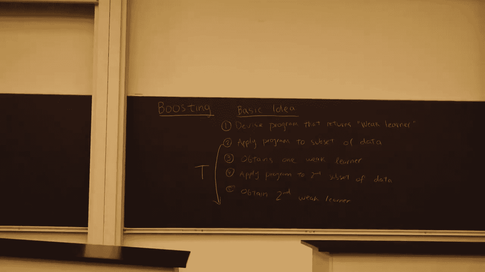
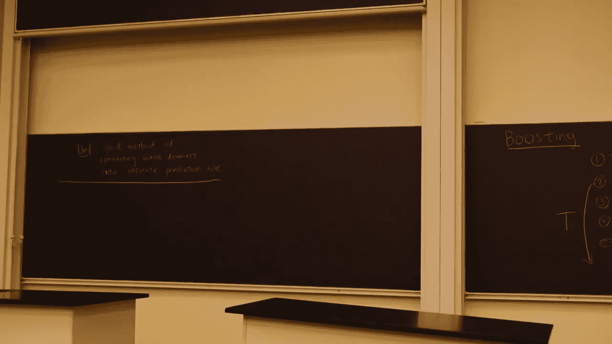

# 卡耐基梅隆大学【中英⚡机器学习｜10-601 2015 Machine Learning】 p60 P60 Recitation 9 Boosting Mar 5 -BV1Lcnhz1E7P_p60-

Okay， I think I'll start。Okay， today we're going to go through review of boosting and cover boosting and applications。

If you have any questions throughout， feel free to interrupt me to ask something。So first of all。

 suppose we're in a supervised learning setting。That's what we're going to be considering for boosting and assume we want to do binary classification。

 so we want to classify all data points to plus one or negative one， positive or negative classes。

 so it was just a very basic intuitive view of boosting so the basic idea。

There's sort of we can think it in five steps， so first of all。

 let's suppose that we've devised a computer program that can learn or create some sort of basic rule of thumb for doing binary classification。

 so we can call this some sort of program that gives you a weak learner。So the first one is devise。

Program that returns a weak learner。Okay， now second of all。

 after we've got a program that returns a weak learner。

 let's we apply the above program to some sort of- so we've got a data set。

 let's suppose we apply the above program to a subset of data or to a weighted set of data。Okay。

 so after we've applied our weak learner to a subset of data or sorry after we've applied our program to a subset of data。

 this returns a weak learner。So it returns one given rule of thumb for doing binary classification。

We can write this as obtains。One week learner。Okay， next。

 we take another subset of data and apply our program to the second subset of data。

So every time we apply a program to a subset of data。

 we get a weak learner that gives a classification rule。And finally， after we do that， we get again。

Another weak learner。So we obtain。Sorry， this is a bit hard to read， but Jane second。Week learner。

And basically， all boosting is is we cycle through。These steps repeatedly。

 so we continue to select a subset of data， apply a program that spits out a weak learner to the subset of data or to a weighted data set。

 and this gives us a weak learner and we continue to do that。And in particular。

 we're going to do this process。😊，T times， so this T here is going to be kind of an important variable in when we're talking about analysis a little bit later on。

So the two things we need to specify when specifying a particular boostosing algorithm is how are we going to choose a subset of data or how are we going to wait the data during each round for all T iterations or all T rounds of the Boosing algorithm。

The answer to that is basically we're going to focus on the hardest examples。

 so the examples that are most often misclassified by previous weak learners or previous rules of thumb will be the ones that we choose or the ones that are weighted the most in next iterations and the second thing that you want to specify when defining a boosting algorithm is how to combine the rules of thumb that you've learned。

 how do you combine the weak learners at the end of the day to give you one final prediction rule and basically the way that it's done is you take a weighted majority vote over all the rules of thumb for test points to see whether to classify them as a positive or negative example。

More formally， let's define boosting， I'll define it over here。

We could define boostosting as a general method of converting weak learners into a highly accurate prediction role。

Okay。So I've thrown around this term weak learner a lot really what we want is some sort of more technical definition of a weak learning algorithm which I'll get to a little bit later。

 but intuitively what you can think of a weak learning algorithm is a procedure that consistently finds classifiers consistently returns classifiers or rules of thumb also known as weak learners that are at least slightly better than random。

 so whose accuracy is better than 50%， for example， maybe 55% accuracy for your weak learners。

And given a sufficient amount of data， boosting can prove construct a single classifier with a very high accuracy。

 so something like 99%， even if you only have a sequence of weak learners that only have 55% accuracy。

So a little bit of history about some of the。How boosting was created and how we do analysis with boosting。

So let me write it over here because it's a bit easier to read。

Okay。So we've got some history on something called PAC。Strong and weak learners。分ける。

So Botstein's roots are in PAC， which stands for probably approximately correct learning。

This is a learning model or a learning framework， which was proposed for analyzing basically machine learning algorithms proposed by Leslie Vallliant in around 1984。

Sorry this a little bit。Bt a racing jump。The setup or goal in Pa learning is the following。

So let's suppose you have a learner who receives samples from some distribution。

And we'll call this distribution D。So learn to receive samples。From D。嗯。Then essentially。

 you must select a generalization function， which we'll call a hypothesis from a certain class of functions。

So you select some hypothesis， we'll call H。From a class， from a collection of hypotheses。Okay。

 so this is basically you can think of this as a way of viewing supervised machine learning algorithms。

 so obviously you have data and then you have you know your supervised machine learning algorithm which returns some hypothesis for doing classification。

 so the goal of PAC learning，Is with high probability to select a function。

 so to select a hypothesis that has low generalization error。Okay。

