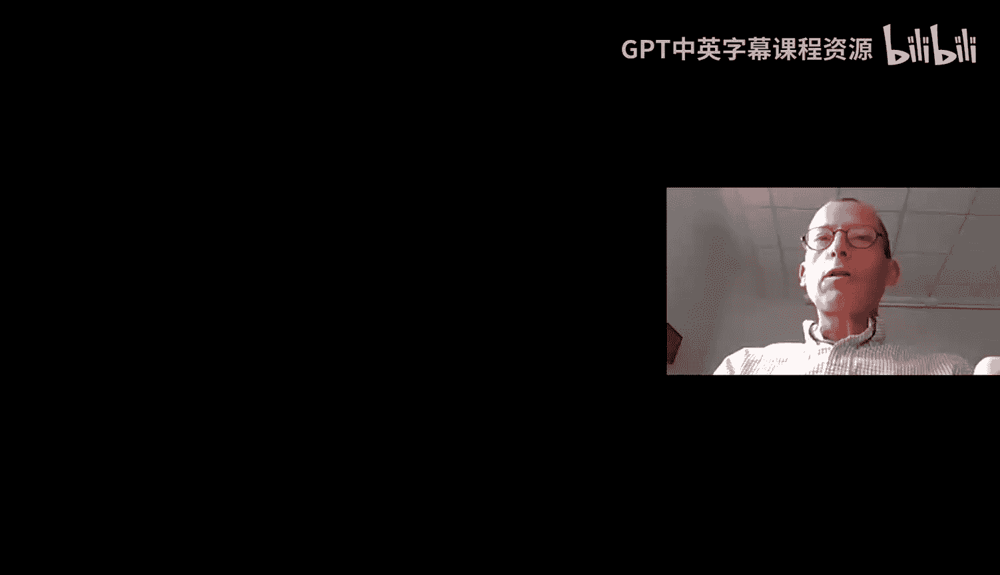
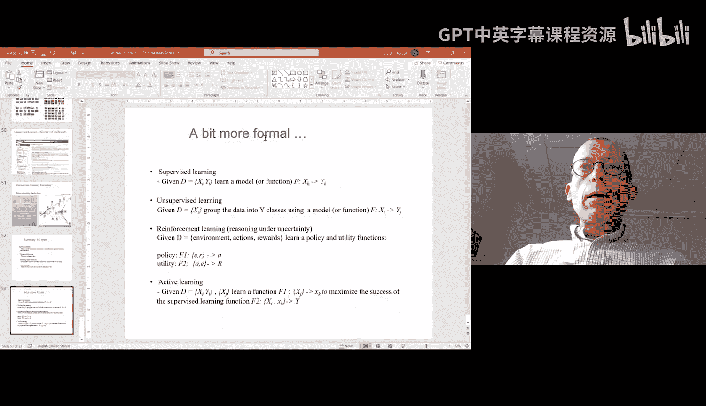

# CMU《机器学习导论（研究生）｜10-701 Introduction to Machine Learning 2020》中英字幕 p01 [01]10-701 Lecture 01 Introduction.zh_en [BV144SuB8ETp_p1]

Okay， so I think we should。Start。嗯。Yeah， we don't have all the students， I think in the class。

 but we have most of them， some students。Maybe a very different time zones and so it could be very late or very early for them。

 but for the most part most of you are here so welcome to 10701。

The first and hopefully last time we are doing this online， or at least fully online。

 this is obviously a very。Un usualual circumstances， for some of you。

 this is also the first class you're taking at CMU to welcome to CMU more generally and of course。

 to computer science。To this first class that you are taking， you know。

 it would have been of course much better for us to see you in person。

 but due to the circumstances and the fact that this is a very big class， we are doing this online。

T several01 is you know a very longstanding class in machine learning that's been taught。

 I guess for 20 years， of course， its changing as machine learning is changing。

 but we're always excited。To teach it to a new。New set of incoming students， I think it's。

Very useful introduction to machine learning for those who have not seen machine learning。

 and even if you took machine learning related classes。

 I think you will find some new ideas and some new concepts。In this class。

And so I'll be teaching this class together with Eric who is also on the call。

 I don't know if he wants to say hi before the winter。I'm the only guy waving your hands， so it's me。

And yeah， and I'll start the lecture， then we'll talk a little bit about some procedural issues related。

 of course， to the class， but also to how we are going to do it over Zoom。

And and all the other things。 So let me start I。Hopefully most of you。

We're able to。Okay， so most of you were able to。And to at least access the Piazza pages for the class where this lecture is already posted and more generally going forward。

 we are going to post lectures， the lecture slides before the lectures so you don't need to take notes。

Or make any copies of the slides， all the slides will be available to you before the lectures。

 you can of course unnotate them。If you wish join the lecture but you will have access to them before the class so this is as I said and several my introduction to machine learning the reason I'm crossing out deep neural networks is not because I wanted to say that nuclear neural networks are not important and in fact we are going to talk about deep neural networks but I do want to emphasize and this is something that became more important over the last few years that machine learning is not just the neural networks there are other things in machine learning that have been。

That have been very useful and remain very useful that do not use neural networks or deep neural networks。

 including a lot of methods for classification and regression that can use neural network。

 but sometimes neural networks are not the best approaches and other methods for unsupervised learninging。

 for modeling uncertainty， for modeling probabilities and so forth。😡。

Those who just heard about machine learning through deep neural networks。

 hopefully will find some new and interesting other directions in discuss， although again。

 neural networks are very important in machine learning。😡。

Become more and more important I just want to emphasize that this is a more general introduction and we'll try to expose you to a lot of different areas and I'm saying this because。

😡，You know。As I said，701 has been taught for many， many years， if you took machine learning。

 I think 20 years ago， then the。😡，The the thing that you were most excited about the things the people was talking the most about was something called graphical models。

 so based in networks hidden Markov models， these were introduced more or less 2025 or please gained popularity 25 years ago and everybody thought that this will solve all the problems related to representation and understanding and used for computation so if you took machine learning 20 years ago you would say deep neural networks then a few years later there was something called support vector machine and kernelnels which were all rage everybody was very excited about them they seemed to be much better at classification and doing things that we couldn't do with any of the other methods so again if you took machine learning 10 to 15 years ago you would be most excited about support vector machine nowadays we are back to neural networks which were actually introduced as we will show you in the 60s but very slowly gained popularity and became much better over the years until。

You know，10 years ago when they really was when a breakthrough was made。

 So the reason why we don't just talk about the thing that works the best now is because you never know what will be the best or potential good methods in 10 years from now。

 So it's good to get a very general， I think overview of the current directions in machine learning。

 even if some of them may not seem to be the most popular or the most active。 And then you know。

 going forward， of course， you can decide to you know， specialize in one of them。

 But I think it's very important to get a broad introduction to machine learning。

 which is what we are trying to do with this class。 Okay so this is。嗯。Just， you know。

An overview of how we think of introduction to machine learning now in terms of a bit more technical details about the class itself。

 most of the information is provided on Piazza we also have a website here that basically duplicates Piazza the website is primarily intended for people who cannot access the Piazza pages so if you have access to the Piazza pages I encourage you to use that don't feel on the website the website is intended for people who are watching this class from the outside and maybe not registered or maybe cannot access our piazza pages but generally speaking the information that you would need a student registered for this class is on Piazza。

😡，As I mentioned， those two instructorors， Eric and myself。TAAs that will'll mention in a second。

 but we also have their information， or we will have the information on Piazza。

 including email addresses and information about office hours。Now。This of course。

 here is very unusual in the past we will just publish office hours for different Ts and for instructors and you can。

😡，Come to the office hours you know stand by the door or Ts usually held the office hours in open spaces and you would just come and sit with others and walk and you know talk to them during the office hours this year of course it's very very different each of you so I want to make sure that people understand so we have two classes which are Monday and Wednesday at 1140 we are also going to have a general recation for all students it doesn't matter what office hours you're listed to or recitation slot you listed to all students will have recitation online on Friday between 1140 and 1 pm so so 1140 to one Monday Wednesday and Friday okay this is online lectures。

Office hours in person office hours by assignment only you cannot come to office hours you're not side too because of course of limitations related to the in person issues so each of you or at least most of you maybe some people who were just admitted from the waiting list have not been but each of you has been assigned。

😡，An office hours slot。😡，This slot and some of it is some of them are actually over the weekend I know that these slots are for inperson office hours you do not have to come to them obviously so even if you are assigned to an office hour I don't know Saturday one to2 you definitely do not have to come but if you do want to come you can only come to the one you are assigned to and there will be a T that you can talk to of course with all the restrictions masks and we will of course restrict the number of students attending okay so this is the organization of office hours in terms of Eric and myself for now at least I think we will do it by email so if you want to talk to us email and we will set up a piazza meeting we can also do like a piazza room but the problem will be。

To set it up such that we have only one person at a time and that's usually an issue if you don't schedule it in advance。

Email us and we are more than happy to talk to students over Zoom for now。Yeah。

So that's basically it in terms of the class organization recations and office hours any questions on this。

 this is important to get it clear because again this is the first day of the first semester that we are doing online I'm sure everybody has questions we also are not completely show about everything so we can try and answer as much as we can but if people have questions about this this is a good time to ask maybe we can。

And so to the best of our knowledge， I don't know if anybody has。Oh。

 I do want to say something about so we just discussed it before the lecture。Someone just asked。

 do we have online office hour options， we will absolutely be hosting online office hours as well。

Yeah。GreatSo in terms of questions yeah， by the way， if you have questions， first of all。

 we really want to encourage people to ask questions during the lecture。

 especially when we have a Zoom lecture it's very hard to get people engaged so we do want you to ask questions however。

 of course this is a very loud class so if people start unmuting themselves and asking questions it might cause interference so the procedure we will go by is the following if you want to ask a question please raise your hand using the zoom controls which you have in the participant panel。

You should be able to raise your hand and then one of the Ts or Daniel which we'll talk about in a minute will call on you and then you can ask your question if you are worried about internet connection and you cannot ask your question you can also write your question to the chat and one of the TAs or Daniel will ask the question for you but I would prefer that you ask it yourself so if you can raise your hand and ask the question that's the best be prepared to wait a few seconds or a minute until calling you because。

And。When Eric and I teach it's hard for us to see people who raise their handss because we usually are more focused on the slides so we need the Ts and that may take a bit of time but that will be the procedure let's start with that and go on sometimes I will close the slides and move to this type of presentation which means that I want you to ask so in that case I can be more concentrating if someone raises their hand I can actually say yeah go ahead but in most of the time when we are on the slides we。

😡，And raise your hand。O。え亚缩。Yes the threat is filling up。 I don't know if we want to。Yeah。

 so online office hours， we will send information about it later， okay， let's not。O。So this is。Okay。

 so this is some issues related to。Organizational aspects。In terms of the class， as I said。

 this is the class that I'm teaching with Eric Singh and we have introductory slides on each of the。

😊，Lecturureers actually don't have one for myself but I'm Zbo Joseph。

 I'm a professor in the machine learning department and computationalutal biology department and my work mainly focuses on using and developing machine learning methods for the analysis of biological high throughput data so data about events happening in our bodies and inside ourselves。

I'm caught teaching this with Eric who， as I said， is online， Eric。

 you want to say something about your interests in machine learning。😊，I want okay。

 it's already written here。 You know I'm Eric Xing， I'm a professor at machine learning department。

 and also C S and L T I。 here' is my research interest。

 I mainly work on machine learning theory and system。

 And I developed some applications in the healthcare space。 And recently。

 I've been interested also in earn new topics such as auto Ml， you know。

 trustworthy M personalizable M and transfer machine learning。

 These are basically the augmentations of either existing or new algorithms。 You know。

 in a number of different application settings。 This little graph is kind of showing you how these topics can be organized in a synergized way to solve you know。

 different types of problems。Thanks。Great thank you now so Eric and I are teaching the class in addition。

 we have an instructor or education associate the official title changes。

 but basically Daniel who is also online is in charge of all the organizational aspects of the class。

 including in charge of all the Ts and if you have any issues related to scheduling to your slots to any other things related to personal accommodations you can contact him and us and he will basically right he's basically running the class behind the scenes。

 let's put it this way。😊，So Daniel yeah， so you can email or contact him for any issue you have in addition to Daniel or。

Wking under Daniel we have seven Ts now this year we in the past all Ts did everything so all Ts did all the recations and all the problem sets this year we are dividing it slightly differently so we have seven Ts but you will interact primarily with four of them and we will be primarily behind the scenes it's good for you to know because they will be working on problem sets and exams and so forth but you probably will mainly interact in terms of office hours and recations with four of these Ts and the other three are very important for the class but but you may not see them in person as much so。

Why is it。Whathy does it always。Yeah， I guess people can see it， but when I display。

 you don't see it， right？Yeah， it looks to me like the image is missing。

 but the image is definitely there when I made the file Yeah。

 the image is missing so let's see if I havent。Anyway， so Roger， I actually do have the image。

 I don't know why it's。You see when we scale it， you see it， right？

Yep yeah that works I don't know what anyway this is Roger Joe I think he's on the call he's a PhD a student in computer science and you know he's interested in a few things as you will see here including MMl and he will be one of our Ts and he will as I said hold office our presentations and so forth and hopefully from now on the slides I'm going to works。

😊，Yeah， next is Abby who is a PhD student in computational of biologyology and all of these by the way。

 all of the TAs took this class in previous years。And。

Have done very well so Avi is the PhDO computational biology and works on machine learning and personal medicine。

😊，Clay， who is a masters student in language Tech。On NLP and data visualization。

John who is a masters student in computer science department and workss on power computing so these four are the ones you will interact with primarily and then we have a few other Ts that are again walking mainly behind the scenes。

 although you may see them in office hours and recations。嗯。How do I that's。

Would you pronounce it Daniel， hey it's Chandri Chand okay Chandri。

 who is a master's in robotics again working on enforcement learning。

Buan computer Science department。Jay who is working in the computer science department as well Okay so this is our staff it's a big stuff but of course we are a big class and especially this year with the way we divided the in person hours。

The office hours we needed a bigger stuff okay， so this is in terms of the class staff in terms of the class content and this is of course very important so the class is divided into a few different modules。

😊，The first one or the first two are mainly or mainly focus something called supervised learning and we'll discuss what that means in a second next we talk about unsupervised learning then graphical models。

 a bit of theory and then something we call actions。😡。

The first the detailed schedule is already available for you on Piazza these are just the dates of the different lectures and again the first at least the third of the class is going to be on supervised learning and then the rest is going to be smaller modules on other applications by the way each of these almost any part of this is just a foundation for a more advanced set of classes so we have a full class that are Eric usually teaches on graphical models we have classes on neural networks。

 we have classes on optimization so each of these lectures is only exposing you to a very brief introduction to area that can be greatly expanded a few key things you do or a few key time points dates that I do want you to keep in mind the first these so we are going to have and I'll talk a second about the requirements but we are going to have an exam。

In this class， the exam will be during class time， of course。

 it will be online and it will be slightly longer so。😡。

Will be roughly two hours but it will be during class time and it's going to be a single exam we won't have a final it's going to be on Wednesday at the end of November。

 November 23rd and we'll talk a lot about what we expect from you for the exam and what material we're going to cover how the exam will look like and so forth when the time comes but I do want you to be aware of the date of the exam okay so that's important again it's going to be online and we'll discuss the material or we'll discuss the procedure for that。

The second important date is something we call postal presentation。

 so the class involves the project I will talk in a second。

 and you will need to present your project in a postal presentation on Wednesday， unlike the exam。

This is not restricted in time again we will talk exactly about the procedure but the basic idea is that you will record yourself for 10 minutes and upload that and we will actually watch it during that day but this is a deadline for recording yourself and then you will have another deadline for submitting the write up so the project will be project poster presentation and a write up the poster presentation deadline is Wednesday so youll have a deadline by which you will have to upload the video but you will not have to be。

😡，Or we will not have a specific time that you will need to be present okay。

 so this is so that's less of a restricted restriction in terms of specific time。

 but it is a deadline that you need to be aware now in terms of the other requirements for the class。

So you will be graded based on three primary tasks， one is problem sets。

 so we' are going to have five problem sets problem sets in introduction to machine learning are。哎哎。

Are a major component of the class， so we expect them to be or they are not。Tvial。

 so they will be a major likely will。This something you spend a lot of time on so they will they will account for 40% of the grade。

 The exam will be 30% and the project will be another 30%。

 Now just to be a bit more explicit about the problem sets。

 So we're going to have five problem sets the dates of the problem sets have already been assigned。

 So if you look at the schedule， you see the dates of each problem set when it's out when it's due。

 the problem sets include both theoretical and programming assignment。

 we have a late submission policy， which is very detailed in the it's already on Piazza Danielo。

 if not， we are going to post it。 Yes。Okay， so you will see on Piazza we have some details about late submission and so forth so just follow that if you can submit on time no problem but if you need some late days everything is discussed there but these will be probably the most or the thing you will work on the most during the class so that's the problem sets。

And as I said include both theoretical and programming assignments project so we have a project in11 this is one of the hallmarks of a graduate class in CMU and especially70 one we really are actually looking forward to seeing the projects however the projects are going to be limited in terms of this topics so we are going to provide a set of topics between five and seven topics we haven't selected all of them and you will have to choose one of these topics and associated data so each topic will be a specific problem definition and associated data and you will have to work on that specific topic and data so for example if it's a classification task we may give you some images and ask you to come up with new classifiers or compare different classifiers for this specific image classification task usually the project involves data that is coming from research of either the instructors or the T so it's really。

State of the data， but the challenge is to see which methods can be applied to improve performance and to compare performance on the project and again we will talk more about the projects when the time comes。

😡，Projects are going to be in groups of three， so we have a strict requirement that there will be three people so you have to start or try to find teammates we will definitely not approve teams greater than three and we will try to not approve teams with less than three so if you want to walk on your own with someone else。

It's unlikely that we will approve it unless there is a very strong argument to why this should be the case so groups of three I always tell students working in groups is something that you should expect I know that in undergraduate it's unusual but from graduate level going forward in industry or in academia even if you do PhD research in most cases you're not working on your own you work with other people collaborators in groups so working in groups is something that you should get used to and you might as well get used to it as part of this class。

As we said， as I said there is going to be a postal session which will be recorded and a write up。

 we will give instructions detailed instructions about both later in the class。

 but generally speaking the write up is going to be like a journal paper of eight pages。

 including references and you will get specific templates and all instructions made in the class。😡。

Exam， so Daniel， I see that people are posting to。Chat。

 if there's any question you can stop me and ask okay。I like exams， as we said， the single exam。Yeah。

 it's it's probably not going to be in the afternoon， so this was。you can ignore this。

 the exam is going to be during class time。Reation as we said every Friday and unlike what you may have understood from the fact that you assigned to office hours recation we are going to have only one recation and it's going to be on Friday including this Friday we will have the first recation and generally speaking the recations on usually tied to the problem sets so each recitation usually overlaps with one of the problem sets except for the first two where we don't have a problem set out so the first two recitations including the one this week will be a background on probability and some introduction to Python for those who are less familiar with programming okay and generally speaking we will hold recations on Friday。

😡，And Friday。114 now I should say this lecture is recorded or all the lectures are recorded and also the recitations are going to be recorded so recitation although again we highly recommend that you participate in person。

😡，And everything is going to be recorded except for the the office hours are not going to be recorded。

 so this is something we' need to participate。Okay。Good。

 so that's it in terms of organization any questions before we move on。

 usually people have some questions。I don if I need to look at the I've been。

 I've been responding to them as they come in。Any question。

 any other question everybody wants to ask？Organizational question before we move to。잠깐点。

Yeah the topics for yeah， so theres a question about topics for the project I think we are planning in the next three。

 four weeks Vi Eric to have yeah， hopefully within three to four weeks。And again。

 the goal of the project is really to have you use or extend some machine learning method。

 so we usually teach a bit and then show the project rather than the other way around but yeah you will have a broad selection so this will cover a lot of different types of machine learning issues ranging for classification。

 regression modeling and so forth。You should find something that interests you in the project。Okay。

 more important， I think to think about it forming the teams at this stage rather than。Good。

 so if there's no more questions or no more questions that I need to answer。

 we can move on to the content。

Okay， so。One question that we often ask ourselves and this is not I mean。

 this is an exercise that we are going through periodically because machine learning keeps changing。

 but I think the first time we really spent a lot of time on trying to answer this question what is machine learning and both Eric and I were part of those discussions was when we first started or when we started the first machine learning department in the US maybe in the world in 2007 so CU of course has a machine learning department and it emerged from a center of machine learning and then in 2007 it became a department and one thing that a department needs to do is have a mission statement what does the department or what is the department work in on and therell we really need we really had to basically specify what machine learning is and you know it's one thing to say what you are but it's also important to distinguish between machine learning and other domains okay so what's the difference between machine learning and theory what's the difference between？

Machine learning statistics， data science， which didn't exist back then and other things。

Let's see at least what we think about when we say machine learning so obviously machine learning has two parts。

 one is machines， so it needs to be automated or there has to be some computational automation component。

 but the learning is the really hard thing or harder things to。😡。

To define right so basically when we talk about machine learning and there is a lot of different areas in machine learning and I'll discuss several of them today。

 but generally speaking we are looking for method that can generalize from data。😡。

Generalize some data means that you can take data and learn classifiers so how to predict certain things。

 you can learn regression， how to predict continuous values discrete values。

 you can learn how to organize things using clustering you can learn how to model things using different graphic models and a lot of other things that you can generalize。

 but the idea is to take the data and the data only represents a subset of of the。😡。

General space or the overall space of things that you can see and come up with a way to explain it such that you can general you can make inference。

 you can make decisions based on that。😡，Okay so this is the general definition of machine learning。

 most of what we will talk about will follow this idea but will take it to different places。

 so it for classification， for prediction， for clustering and so。Okay， so generally machine learning。

😡，Goes or or goes along this diagram。 So you have data。

Using the data we come up or we employ in learning algorithm and there's lots of learning algorithms and they're doing different things。

 And once we have the outcome of the algorithm， we can generate new knowledge。

 new knowledge can mean that if we take a new sample。

 we can classic a new image we can say what this image is or maybe we can generate new samples from some music that we never heard or maybe we can say something about the probability of an event。

 This is knowledge。 This is thing that we didn't know before and we needed a combination of data in the algorithm in order to generate。

 So that's the idea of。😡，Machine learning somehow generalize the data using some algorithms in order to create knowledge。

😡，And， and again， sometimes you can take it to a very extreme level。 for example， as I'll show you。

 there are cases where people are trying to come up with methods that keep on generalizing and generalizing and getting more data。

 Sometimes you just want to generalize one。 So basically you take a set of inputs。

 you learn some model。 and that's what you want to use。

So there could be a lot of variations on exactly how to use this formula。

 but more or less for most of the methods we will talk about， this will be the process。😡。

AndAs I said machine learning that sounds like a good or this idea of generalizing from data may sound like a good idea or an important idea even and the question is okay。

 did other people think about it before or this is just a new name for something that we have been doing for decades or even centuries for example statistics is it similar to statistics。

 what about AI right we often when people talk about deep neural networks they often mean they often。

talkalk about artificial intelligence we usually if you neural our networks are part of machine learning so what's the difference between AI and machine learning data mining data science。

 what's the difference between all of these。😡，Definition so sometimes I should say， I mean。

 I will talk about some differences， but again， sometimes people really mean the same thing when they talk when they use different words right so when people refer to neural networks as AI and we refer to them as machine learning it's not like we。

Look at different types of methods， both of them are using neural networks。😡。

But neural networks are really maybe the intersection of both。

 but there are cases where machine learning is completely dis separate from AI。😡，Okay， so that's the。

That's the。The one goal of the next slides， right to。

To emphasize the uniqueness or the things that machine learning is unique with respect to these other and。

诶。With respect to these other fields， the goal of machine learning， as we set is to improve。😡。

Using methods to improve what we can far from the data using computational methods。

 right to create new knowledge。😡，And if we look at other areas。😊，There is overlap with other areas。

 but there's a lot of differences as well， so of course machine learning overlap with statistics with AI even with computer science theory and so forth。

 but it is different statistics usually is about describing the world about describing the data so statistics is very good at taking a set of data and coming up with some ways to characterize it but it's not usually focused on trying to predict new things although some people would say the statistics generally statistics about descriptions it's less about predictions machine learning is much more about trying to predict and trying to find new output or new novel I would say insights given the data that you have so that's a major difference between again the goals of statistics and the goals of machine learning although machine learning relies heavily on statistics。

AI is at least in theory， when people talk about AI is this idea of trying to come up with ways that mimic human intelligence or other intelligence Now some of the machine learning methods we using including neural networks are exactly that they are trying to use ideas from the brain to improve the accuracy of some methods but most of the machine learning methods have nothing to do with human intelligence for example。

 support vector machine right it's a great method we will talk about it it works very well in many cases and it's nobody claims that humans or any other intelligent organism is using support vector machine。

 but the computer can use it so why shouldn't we use it So machine learning is less focused on mimicking or trying to be similar to other intelligent systems or organisms it's more about trying to generalize from data The way you generalize from data is not important as long as it achieves the goal that you define and the goal different by the task but machine learning is not about trying to。

Have an artificial intelligent agent。 Okay， that's different。 I mean， there are overlap。

 but it's definitely not the same。Data mining is more about patterns and again you can extract patterns but the question is what do you do with them so this is more a descriptive area rather than a predictive area data science is something that people use to talk about a lot of things some of them may refer to machine learnings that may be just coordination of other things so yeah that's also not definitely not the same as machine learning okay so again there is a lot of overlap and as I said machine learning relies on foundations related to statistics and computer science and a lot of other things but it also has unique aspects that。

First of all， make it suitable for a department。😡，At least that's what we think。

 but also make it suitable to be considered as a standalone field。

 which is why we have this introduction to machine learning and why we have programs in machine learning。

And again， nowadays， I think it's much easier to convince people when this class was taught whoever taught0 20 years ago。

 maybe they had a hell of time convincing that， but hopefully everybody agrees that machine learning is an important standalone area。

Okay so this is about trying to motivate why we think machine learning is an area on its own and it has its own principles。

 its own set of goals and guidelines and now if we agree。

 then we need to try and focus on what are these underlying ideas that machine learning is using and how can we use them or what cases can we use them in order to improve our understanding of various systems of the world and so on so before we go into a more generalized or more I would say theoretical issues。

 let's talk about some examples of machine learning and see what we mean by this generalization in practice how does this ability to generalize on data affect us in practice and you know what are the examples of some things that we do in machine learning so an example that has been actually something that。

😡，People have been expanding and thised 1213 years ago。

 but it's actually gaining a lot of traction now is trying to decode your thoughts using machine learning so people including people at CMU basically are able to look at your brain scan and try to predict what you're thinking。

😡，And sometimes they can predict it even better than what you know that you are thinking， right。

 So this was an example of trying to predict some some text that you are thinking about。

 But nowadays， brain scans are used for commercial to evaluate commercials。

 So people are so groups of individuals are actually wired to some brain scan devices。

 and they are shown commercials and based on their activity， brain activity。

 the agency decides whether this commercial is effective or not。

 even if these individuals can say exactly what they like what。

So this type of things is gaining traction， whether you like it or not it's a separate issue。

 but there's a lot of。A lot of interest and a lot of people walking in that direction。

 so this is really understanding our own thoughts。And this is something supervised learning stock market。

 we have been losing。Faculty over the years to various hedge funds and one of the reasons is that because they think that you can use machine learning to predict。

Reg， this is called regression， but to predict the values of certain certain entities， you know。

 I'm not sure this works or not didn't work for me。 I'm still。Paid employee， but maybe for others。

 this can work much better。so this is supervised learning。

 but it's a regression model rather than classification， so not trying to predict yes or no。

 I might try to predict some continuous one。😊，嗯。All the internet。

 a lot of the internet is organized using specific algorithms。

 but some of the ways things are organized is using machine learning， for example。

 those who use Google use。They see that Google is able to group news as they come into different types of storm。

 The way Google is doing that is using machine learning specifically using clustering because right I mean it's not a human that sits and says this this story goes to this part and this story goes to this subject it actually has a way of。

😡，Cting， grouping together things based on the data that it gets。😡。

So this is usually unsupervised although sometimes supervised learning。诶诶。Yeah。

 so spam filtering is also something that you you don't even know I guess。

 but maybe you don't even mind， but if you go to your email mailbox you have the spam folder and the spam folder is primarily based on classification methods is machine learning。

Sorry， Zev， it looks like we do have a question from Colonardo。Leonardo。

 do you want to just unmute yourself and ask your question Great yeah。

 I will more than happy hear so you about。machine learning being used and kind of like con receptivity of like commercials or the design of a news article。

 it seems like that's like a very open ended thing like how would you know what aspects of that commercial trigger a certain thing maybe there was something in the background maybe was the tone of a commentator's voice how would you narrow down to try to optimize that commercial if this if the search space is so large。

Yeah， so that's a great question so again， so this becomes so a commercial for example the brains scan issue is something called supervised supervised learning means that you have some examples of things that you think well and based on that you are trying to predict new things just as an example let's say and this is something that is being used let's say that you have a political candidate that you want to come up with a good commercial for okay so you take some of these candidate supporters okay and you know or you expect that they will react positively to this candidate right so when you show them the commercial you look at their response and you say oh this is a positive response then you maybe take some of the some of it's you the people who are against this candidate and you recall them and you see negative response and now you take a group of individuals and when you recall them which let's say independent you can say which things are positive。

Oh in which cases they seem more like the positive and in which cases they seem more like the negative so I but again this is tricky I mean coming up or I didn't mention it。

 we will talk about it later， but coming up with good data sets for training is。😡。

One of the most challenging， if not the most challenging aspects of machine learning and one of the reasons why neural networks and I started by saying neural networks are so successful。

 one of the reasons why neural networks are so successful is because they do not need vast amounts of labeled data。

 they can actually use something called unlabeled data so if we don't know the answer we can take a lot of information but we can't really use it to build a classifier。

 it turns out that neural network can actually use that's why one of the reasons they are so successful。

 but getting a good labeled data set， a good data well you know the answer is extremely I agree。

 but you sometimes you can do it。😡，Okay， the next example I wanted to talk about is something that I mentioned about generalization。

 something called never never ending learning， this is something that you know this is from 217 but it has been going for。

😡，I would say at least five years， maybe close to a decade at CMU basically this is an agent that grows the web and tries to learn every day some new things from the web。

 so basically it takes a sentence it tries to do some NLP analysis and every day it adds to its knowledge base more and more and tries to generalize the information。

😡，So this is called Nell。Obviously one of the things that people are very excited about and very familiar with is autonomous driving and autonomous driving nowadays right is something that you know people。

😊，I would say， so I thought 701， I think two or three years ago and I said then that I don't think my kids。

 which were then。😡，I guess my daughter was then 15 or 14 I'm not sure she would need the driver license。

 I said that three years ago because I said look， I mean everything is moving to autonomous vehicles。

Unfortunately， my daughter is almost finishing a viable license and you we'll see how the cow survives。

But you know so I was wrong so it took it took definitely I mean in 2017 we thought autonomous biing is around the corner we were wrong and you know now it's 2020 we still。

Believe that autonomous driving is around the corner but it may take it's much harder than people thought at least a few years ago。

 but still it's not like we can't do it so even 10 or 15 years ago CMU or maybe 13 years ago CMU was able to demonstrate that a self-driving car can ride within a city but with relatively small number of individuals and relatively small number of other cars so this is a very limited experiment。

 but still this is something that machine learning could achieve and hopefully going forward will become much more doable maybe with some of you when some of you graduate and join the companies that are trying to do it so this is definitely a major task of machine learning which hopefully will come。

To completions。Another thing that people may or may not realize is using machine learning is Google Translate so you know if you have been to some a foreign country over the last few years。

 for example， if you went to China it's very hard to communicate or at least for people who don't know the language but Google translate now and other translate agent adult translation are doing an incredibly good job at translating language and most of the neural translation translational methods are using a neural networks specifically something called become neural network but theyre based on machine learning model and that's a big revolution in fact until four or five years a Google translation has been around for a long time but until four or five years ago it was mainly based on standard language processing model which was very manually annotated and nowadays or at least a few years ago it moved to a neural network based and of course as I said this requires a lot of training data so they had a lot of samples of。

Goodod translation that humans did， but once you train on that you can build an automated translator that is doing pretty well and again I don't know about Chinese maybe there are some Chinese students in the class hopefully the translation they you see here makes sense to them about the class description but anyway this is something that is using machine learning I always like to say just because that's an area I work on that machine learning is also something that not just human use or not just neural networks or something that we can learn from nature so there are other things we can learn from nature and recently walk in our group has shown that bacteria cells so this tiny cells that you know we actually have own body a lot of bacteria cells but some of them are also disease causing pathogens but bacteria cells basically use something similar to bo propagation which is。

To methods that are similar to joint probability distribution estimations in machine learning in order to find the best way to navigate a collision course or makes basically to get to them food and so this is also one way that machine learning is being used of course。

Not by design， but or not by you know some。😡，Grated algorithmed by in practice and this is something that we can use if you think about it。

 for example， from robotic applications， where you also have a set of agents that need to navigate a complicated environment。

😡，But this is another example of， I would say intersection between artificial intelligence because this is intelligence。

 at least one way to think about it and machine learning machine learning is also being extremely popular and useful in biology which is as I said my area for example this is a subset。

 very small subset of your DNA and this basically has a set of letters ACG and T this is the letters that the DNA is composed of and one question that we have is what are the punctuation marks and what are the parts of this sequence right it's just looking at this。

 that's what we see when we do sequencing， and in order to determine what is the gene。

 what are control areas and so forth， we use a lot of machine learning methods。

 a lot of methods related to hidden markov models which have been very popular but also other types of methods nowadays neural networks are also being very successfully used to understand our biology and gene。

And many more， there's one video I love to show not because it's very sophisticated machine learning。

 but it's a very cool video， so let me see if I can show it。😡。

And then talk a bit about what the video shows。😔，Yeah。So people say this is the helicopter。诶。

Of course， autonomous helicopter， so this is pretty small。

But it can fly very nicely and it can actually fly upside down and do some very interesting maneuvering。

😊，As you will see in a second。Yeah， so it can go， you know。

 it can flip back and forth and there's no human controller so like the helicopter is doing this all on its own。

Now， of course， you can control it like a drone， but in this case this is fully automated and the interesting thing about this。

你你哋嚟咯诶。唔系。Yeah。

Willll have to stop it。 but anyway， the cool thing about this is that。

The helicopter was trained not using some example data， like we said。

 like showing some taking some helicopters that crashed and didn't crash and training based on that because you need negative examples and positive examples but rather it was trained using something called reinforcement learning。

 which is a fully something can be done fully theoretically in a computer and teach the helicopter before it even flies right so if you have a reasonable model of how helicopter flies。

 you can do something called reinforcement learning each time it crashes it learns that that's not a good end goal so you basically back to and see how you can correct what you did and each time you successfully finish the maneuver you get some rewards and so as that training continues you improve and improve your model until you can actually do this maneuvers on your own so this was trained in the simulator or the model was learned using a reinforcement learning simulator and then when the helicopter actually took to the sky it was able to do these maneuvers。

Almost you know almost perfectly without any or without any need for a training data or without any need for stem crashes for it to work so this is called reinforcement learning and again we will discuss a little bit of reinforcement learning in this class。

Okay， and as I said， many more medical informatics nowadays is becoming very important。

 social networks rely more and more on machine learning， of course， all the commercial。😊。

All the ads that you see in your Facebook feed or when you watch YouTube video or whatever are tailored to your own characteristics using machine learning methods and the challenges are slightly different than what we usually talk about because you also want something that works very fast but this is all based on machine learning so machine learning is you know really all around us。

 it's not just something we just discussed in classes and lectures but something that people。😡。

Rely on all the time。 It's all around you， you use it all the time and。😡，Hopefully。

 likely this will be。More and more useful going forward。😡，Okay so this is just some examples。

 let's go a bit more into so as I said biology and a lot of other things。

 let's go a bit more into a specific aspects within machine learning research so there's three major things we focus on when we talk about machine learning or that we need to focus on one is the data。

The other is the algorithms and the third is something we call tasks。

 so different algorithms or some algorithms can be applied to multiple tasks okay。😡。

The definition will become clear hopefully soon， one thing I want to say is that in this class we primarily focus on the second part of these three axises the algorithms。

😡，That's what we usually focus on in introduction to machine learning。 I do have to say。

 and I think I'll emphasize it in future lectures as well。

 that data may be more important than the algorithm。 So sometimes if you have better data。

 almost any algorithm will work well and if your data is lousy。

 then even the most sophisticated algorithm will not work well。 Similarlyly。

 if you have ways to process your data to prepare your data to being analyzed。

 it might be much more important than the actual algorithm you're going to use okay unfortunately or no I don't know。

 if it's unfortunate， we usually don't talk too much about it in production to machine learning。😡。

One of the reasons is because it's much harder to generalize this， it really is very domain specific。

 for example in biology， you need to do one thing to process the data if you have housing data and you want to predict house prices。

 you may need to do something very different it's much harder to generalize this whereas algorithms are much more general so we usually focus on the algorithms but you definitely should realize if you have a real world problem the first thing you need to pay attention to is the data and how to process it and how to represent okay it's not trivial think about cases where you have categorical data。

 continuous data discrete data and you want to put all of them into a model。😡。

How do you do that that's not we will talk a little bit about it， but this is a broader area。😡。

As I said， algorithms of the thing will focus about the most and tasks are related to algorithms and basically represents the goals of the operation。

 Sometimes different algorithms can be applied the same algorithm can be applied to multiple tasks。

 for example， you can use one algorithm for regression so getting a continuous value and the same algorithm for classification。

 getting a discrete value with a small change So there is no it's not a one to one division between algorithms and tasks some algorithms may be appropriate for multiple task and obviously one task can have a lot of different algorithms that。

😡，Okay so data just more generally right so if we can have a lot of different types of data we can have something called fully observed so we see all the observations but we can have in many cases partially observed for example。

 if you want to predict house prices and there was a big competition recently by a company called Zelow that try to ask users to improve their predictions so you can see that sometimes you have all the information for the house but sometimes you don't have all the information so for example you don't know I don't know how many windows the house sell what year it was renovated and supply so sometimes you have something called partially observe data and you need to fill in or somehow ignore the missing parts and the question is how do you do that。

That's not a trivial。There could be other issues related to the data， as I said。

 some data can be of different types， discrete， continuous， categorical and so forth。😊。

And so so this is the first the first thing， the other thing which we are not going to talk about in this class。

 although it's an important area in machine learning is something called active learning。

 so usually machine in this class。😡，I would say for almost all of this class。

 we would assume that your goal is to generalize from the data that you are given to an algorithm。

 Okay so I'm giving you a set of data， either labeled or unlabeled and you need to and you need to generalize but that's not the only way to work with data right Another way to work with data is to ask for more data you can say。

 look， I can't generalize from the data you gave me I need more data or I cant generalize very well。

 I need more data， we usually do not assume that that's an option in this class。

 but in machine learning， there is an area called active learning where you actually allow to ask for more data and not just to ask for more data but to specifically ask for labels or information about specific samples So this is called active learning and it relates to how we basically collect or analyze data again。

 we won't talk much about it in this class， but this is an important area of machine learning。😡。

So this is data， as I said， unfortunately or maybe not the major focus of this class。

 the second part which is the major focus is related to algorithms and algorithms we divide algorithms。

😡，Along different。Lines along different categories and we are going to have some algorithms that are probabilistic。

 some algorithms that are。That have parameters， some algorithms that don't have parameters so non permit be parametric。

Discriminative algorithms that don't use probabilities just divide the two areas。

 so there were going to be lots of different types of algorithms and we will try when we present an algorithm to say which type so for example。

 na base is a probabilistic model whereas I don't know Lo aggression is a parametric model and because it has parameters and K nearest na is a nonparmatic so so for each one we will try to specify its characteristics but we are going to have basic or we will be able to assign different or we will assign different characteristics to different algorithms okay it could be that different algorithms like probabilistic and discriminative which is not probabilistic are trying to solve the same problem it's not necessarily that probabilistic algorithms are only good for one type and other algorithms are good for another task okay so lots theres going to be。

A lot of options to do or a lot of different algorithm itemss they can work on。

Okay so the basic idea of machine learning as we said is going from data to a model to use a learning algorithm and then expect knowledge the way we do it is we have some way of learning a model from the data okay and the model can be parametric non parametric it to be a lot of different things and once we have the model we can use it to make inference what does it mean to make inferences inference could be that if we have a new sample that we never seen before we want to predict what it's going to be or maybe we want to generate something new that we never saw before and use that or maybe we want to determine some probability of an event and so。

😡，This is called inference。Yeah。Okay， so。The goal of the model is to summarize the data okay so basically to get a really concise representation as concise as possible of the data without losing a lot of information。

 so if you can if you have 1000 values and you can summarize all of them with two values maybe themin and the variance。

 that's a much better representation than the original set of values。😡，So on the one hand。

 the model is a summary of the data， which is like statistics is handling it， on the other hand。

 the model can be used to generate new instances in some cases okay and to explain how they will generate。

😊，So this is the model itself， the model is a way to somehow describe the data in an efficient manner。

 but then the next step is inference， how do we use the model to make the predictions this is where we said machine learning basically difference from other areas because machine learning doesn't care just about describing the world but also how to use that description to predict inference on you to be able to predict your outcomes。

😡，AndA bit more formally so we have parametric models。

 parametric models basically means that it doesn't matter how much data you give it。

 the model size stays the same for example， let's say we want to fit a regression in this case let's say a blue which is linear regression or maybe a quadratic a polynomial a secondary polynomial to the data and we have some samples here right。

😊，It doesn't matter how many points we get， the model that we will learn。

 the parameters that we will have are the same right for a linear line。

 we will have two parameters for a second degree poly normal we'll have three parameters and so forth。

 the model we learn always stays the same okay so this is called parametric model。😡。

And it's nice because it's fixed based on the， I mean， the number of parameters。

 the number of values we need to keep。😡，Is fixed， the challenge is that maybe we don't keep up and then we don't make the ultimate use of the data okay。

 but that's definitely oh most of the models will talk about alpha models。😡。

There are also methods that use something called nonphaametric models。

 Noforametric models grow with the data。So basically。

 we don't try to keep any summary of the data here。 We use the polynomials to summarize the data。

 right if we。😡，But new points， we just update the values of the coefficients of the polyno。

In other models， for example， in something called theane neighbors。

 we don't have a model of the data。 We use all of the when we want to learn something from the data。

 we use all of the points we have seen so far。 So if you give me more points。

 the model grows because I'm using all the points。 Okay， this is called paramatic models。😡。

And of course， if we have more data， the complexity or the time we need in order to decide becomes greater right so it grows with the data that can have。

AndDriminative models our models where we just want to find a discriminant between two classes。

 for example， or three classes so we don't really care about how the data was generated the only thing we want to know is where does this point lie with respect to a line or a plane that separates them right so if we want to just classify or determineine if a point is black or white then we can just find a line and say anything。

Above on one side of the line is black， anything on the other side is white and this is the two classes that we have we don't really care right if you want to create a new white point。

 I don't know how to do it， I don't know if a new white point should go here or should go here or should go here or should go here the model doesn't tell but if you give me a value on this two dimensional space I can tell you whether I think it's black or white depending on the line right if this is the line then I would say things here you have to come up with the line this is a parametermetric model because in this case for example we have a line which is parameterized by in this case know two values you can have higher dimension but the model itself is discriminative。

 it doesn't tell me anything about how to generate things it just tells me about。😡。

How to distinguish between two things there's also something called probabilistic model。

 which I'm not showing where you can actually generate instances。😡，Okay， so this is again。

 these are just a few examples， there's more ways to define algorithms based on parametricic。

 not parametric， proba ballistic and discriminative。😡。

Okay so this is algorithms the third thing is the tasks so what do we want to do with this algorithm what's the goal what's the inference goal of the algorithm As we said machine learning is can be divided into I would say four different main four main tasks the first and the thing that we will probably spend most of the time on this class maybe between a third and half is something called supervised learning Supervised learning is the case where the task is to make predictions either continuous or discrete given some inputs for which we have the known labels for example I can tell you if this is a cat or a dog based on some images and now I give you a new image and you want to predict whether it's k or a dog or I can tell you the stock price for tomorrow for a specific stock and I want you to predict the stock for I don't know two days from now if I give you all the information a few days before okay so this is the goal is to estimate an output given an input。

This is usually called oh this is supervised learning or prediction problems and there's two main directions right one is as we said。

 it's a discrete case where you want to predict a label， for example。

 you want to classicalify documents include sports documents， news documents。

 science documents where the label is a discrete entity like one。

 two or three or maybe you want to predict the continuous value， for example。

 Scott price Okay so given X， you would like to predict why。Right so we said classificationification。

 right？😊，And lots of classification problems， text classification， image classification。

Sound classification and so forth， so this is definitely one of the。

Right this is definitely one of the major goals or maybe ad classification which a you would like the most so forth so this is classification problem and the second problem is regression right as I said stock market or maybe you want to determine what what level of the or how much。

Of a drug you should give an individual based on their gene composition that's also a regression problem right so like some quantity of the drug that you want。

And again， in both of these cases， regression and classification。

 we assume that the training data includes the samples and the labels right so in the classification case we have the samples in the class and in the regression case we have the samples and the expected outcome of those predictions。

😡，Some problems are much more complicated， so some problems are very simple classification。

 either regression or classification， some problems mix the two right so if you want to do something like face detection maybe you want to determine whether this is an specific individual or whether this is the phase or give some continuous value about whether this is a face similarly in autonomous cars right so on the one hand you need to make predictions about whether you're too close to another car because if you're too close you need to put the brakes but you also want to have continuous predictions about how far you are from a specific traffic light how likely you are to get to the intersection before the light changes and so forth so most of the real worldor problems involved combination of discrete and continuous predictions and and also a combination of input data so discrete and continuous data。

Okay， so we practice。So this is， as I said， this is mainly supervised learning。

So supervised learning is about prediction， part of another set of problems is more about description rather than prediction and this is something usually called unsupervised learning。

 and unsupervised learning includes something called density estimation so trying to predict some probabilities from a data for example。

 what's the probability that if we take the students in this class。

 we will find someone who is six foot tool。😡，Or maybe someone is five footn right so these are probabilities related to height of students in the class so this is called density estimation we can use it for clustering we already talked about clustering for example。

 grouping documents based on what the topic is dimensionality reduction So if we take things in very high dimensional space how do we're presenting in a low dimensional space for example。

Pictures of individuals。 How do we put them in space that we can see。

 This is called unsupervised learning。 And the main difference between supervised unsupervised is that in this case。

 we don't get the labels。 We only get the samples。 Okay， so here's an example we have。You know。

 we have some population density in the US and we want to predict if someone comes。

 what's the probability that they are from Pittsburgh example？😡，Okay。

 so for that we need to compute the probability of individuals and how many we have and so。

 and based on that we can predict what's the probability that someone is comp。😊。

So this is density estimation another thing is unsupervised which is clustering right we take all the documents and based on the walls in the documents for example we want to group them into different topics we don't know what the topics are because nobody told us what the topics are going to be but we can actually find these groupings just based on similarity of words between so this is called clustering you can do it for documents you can do it for images you can do it for genes in the body。

 you can do it for a lot of。Right you can do this is an example of cluster energies even if you don't know what the image means once you cluster it together it groups into cases。

 for example， sunsets， outdoors and so forth， which you can identify even if you don't and you can also cluster web pagess and so forth The last thing in unsupervised learning is something called dimensionality reduction if you want to represent high dimensional spaces in two dimension maybe because it's easier for you to visualize it or maybe it's easier to walk on it then the question is how do you put different facial expression of the same individual such that things that are very closing the high dimensional space or closing the low dimensional space and things that are far away in the high dimensional space will stay far away in the low dimensional space and it's not always trivial it doesn't necessarily。

folow the transitive requirement and so forth so densities or embedding right or dimensionality reduction is a major issue and there's actually a lot of interesting work recently mainly and this is definitely an area that receives a lot of attention because a lot of the data that we are dealing with now is very high dimension。

 including image of course image data but also a lot of data in health in biology。

Okay so this is the major directions in machine learning just to summarize right we said we have supervised learning where we are given a set of features and labels。

 features out the input samples， labels can be continuous or discrete and the goal is to predict the outcome based on the input data unsvised learning mainly some related to description not prediction and the goal is to discover some patterns in the data so similar things in the。

Co in case or dimensionality reduction to put things that are close together in high dimensional space。

Two other things that we haven't discussed much， but we will discuss in the class is something called reasoning。

 other uncertainty， so how can we learn a model of the world？

Form samples right so if we go if a robot goes in some cave and it wants to learn the dimensions of the cave and the structure of the cave。

 is there any way for the robot to map it as it goes right so every time it bumps into a wall it wants to learn that this direction is not good for you but maybe at some stage if you don't take a left you would miss an important term so you have to come out somehow balance between negative examples that you've seen and things that you haven't seen and try to improve your understanding of the world as you go this is called one of。

😡，The ways to do it is called reinforcement learning and the Markov decision process and so forth and this is another area where we do machine learning and the last part I mentioned we wouldn't probably have lecture it but it's an important area of machine learning is called active learning and active learning。

Unlike like other all the other methods we talked about。

 the goal is not just to select the algorithm or learn the algorithm。

 but it's also to determine what data is the best to learn and optimal algorithm Okay。

 so this is called active learning and active means that。😡，You have to actively ask for the data。😡。

A bit more formally okay so we should at least end with some formalism because machine learning from now I mean except for this lecture。

 we will be much more formal going forward so in supervised learning we have x and y and the goal is to learn the function from x to Y well Y is the label and X are the samples okay so we can have images where x is the pixelels and y is the label cats or dogs or we can have stock values and y is the prediction for the next day okay so this is called supervised learning and unsupervised learning we have the same inputs but we don't have the ys okay so we don't get the labels we just get X and the goal is to group these x into different groups or to reduce them into a dimension where you place each of these Xs on its location。

In so this is in reinforcement learning or reasoning under uncertainty， we add。😡。

We add to the observation something that is called a reward， so we are in a specific place。

 so this is the。😡，And this is the environment the reward is maybe you can think of it as the y。

 but in addition there are actions there are things we can do so you can turn left to turn right and you want a function that maps。

😡，The environment。And actions sorry the environment and rewards to your action this is called the policy。

 So if you know what the environment and the reward is。

 you want to know what is the next action or what is the next step you should take this is。😡。

This is the goal of personal learning andactive learning usually starts with X Y， so X Y pairs。

 which are the labeled data and a set of unlabeled data and the goal is to select another subset of the unlabeled data which the user will label for。

😡，So you tell some oracle or some use there that okay you gave me these examples。

 I also want to know the labels for some of the others for example。

 if I give you all the images on the internet and for some of them I give you labels and for most of them I cannot give you labels。

 your goal is to select a small subset of the unlabeled images and ask for labels in order to improve your classifier demo and of course the question is what is the best subset for you to ask for because you can only ask for another 100 and which one of these will most improve your class。

😡，Okay， so this is unsupervised learning。Good， and I think we are done for this lecture。

诶。Right， so in。Yeah， so as I said this is an introduction， I've been a bit less formal。

 but going forward we will actually use math and mathematical notations much more。

Any questions about the introduction？Daniielelle， is there any other things we didn't discuss in the chat no one had their hand up it did look like a just asked about。

I said， is the policy dependent on the reward after learning because you don't always know the reward priority？

Right so right so that's a great question and that depends on the model in some models we know the model in advance。

 so we know the rewards and we just want to learn the policy。

 but as you said in lots of real world applications we don't know so we know what actions we can take but we don't really know the rewards so reinforcement learning allows you to learn both the policy and the expected rewards as part of the algorithm so you don't need to assume that you know what the rewards you learn or you try to learn a model of the rewards as part of the algorithm as well and again we'll get to that when we talk about enforcement learning。

Okay， good。 So if there's no other question， as I said， we will meet back on Wednesday。😡，诶诶。

We will meet back on Wednesday and we were going to have the first recation on Friday。

 the first problem set is only going to be out next Wednesday so you still have a bit of time without any problem sets。

 but I definitely encourage you to attend a recation even if we don't have a problem set especially those will have I mean the recitation will mainly be on background material and probability and statistics and Python so if you feel。

And that these are things that you would like some refresher on and we'll discuss this very briefly next time。

 but very， very briefly， so if you want a bit more you should definitely attend the presentation。

And as I said， that's it， if you have anything else。

 you can email Daniel and me or post a question on Piazza。

 which is the best because that's something that others can see as well and we'll be more than happy to talk to you。

Okay， so yeah， we'll see everybody again on Wednesday。

Oh by the one one last thing on Wednesday I'm going to start using Piazza for quizzes so please be ready with Piazza open and the quizzes are not graded but it's something that I'm using during the class so please have piazza ready for Wednesday。

😡，Okay， I'll see。Bye。