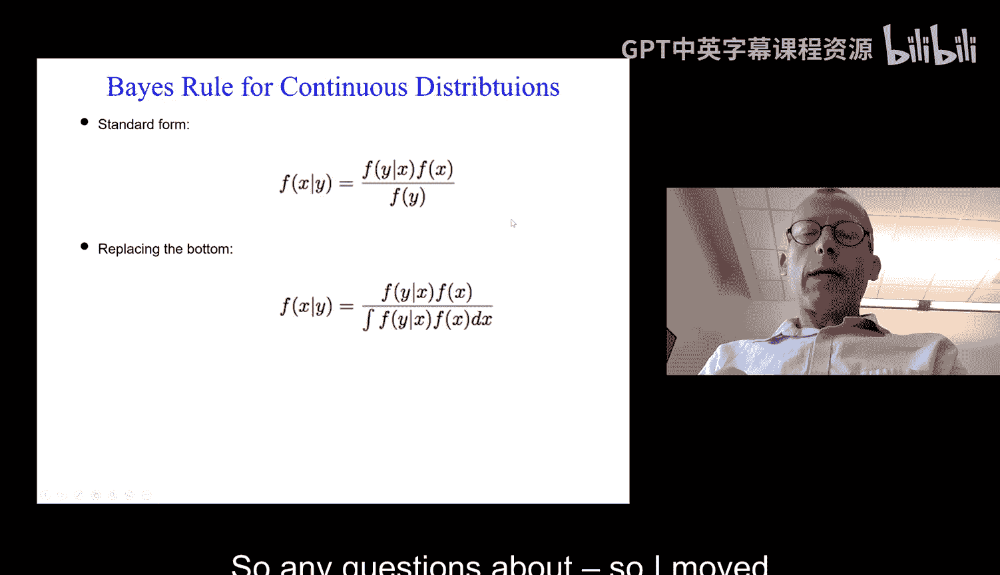
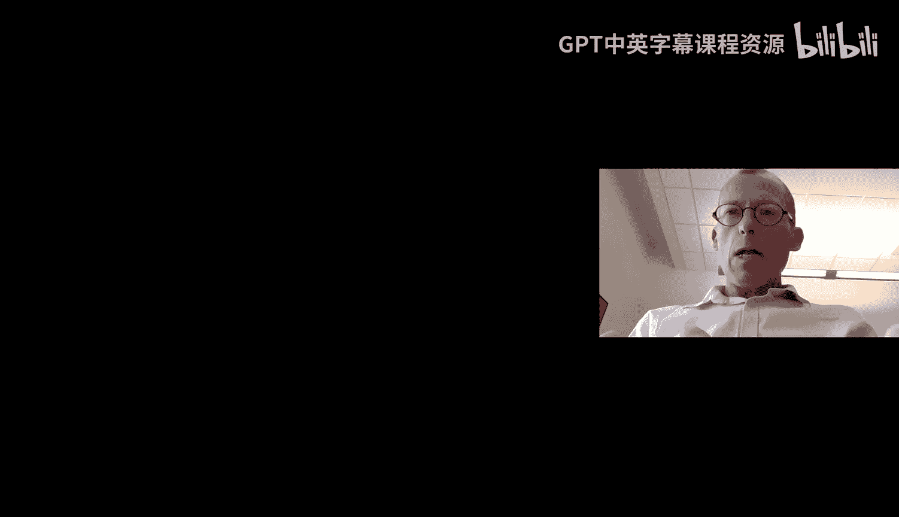
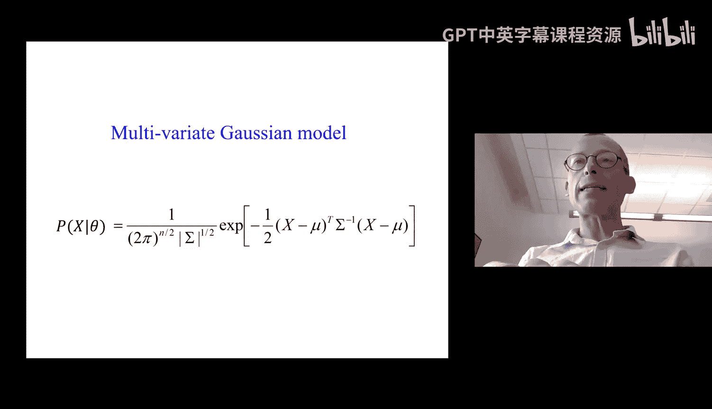
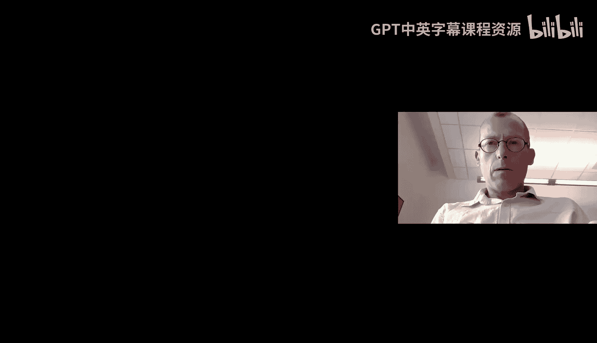
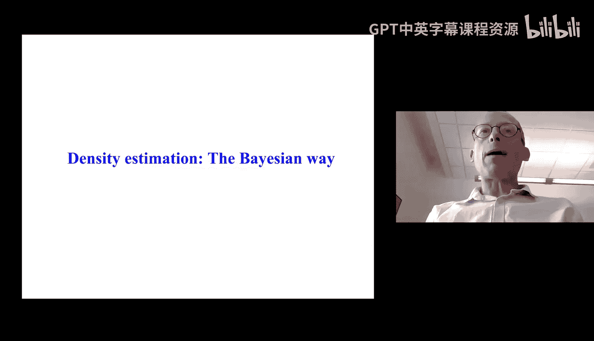
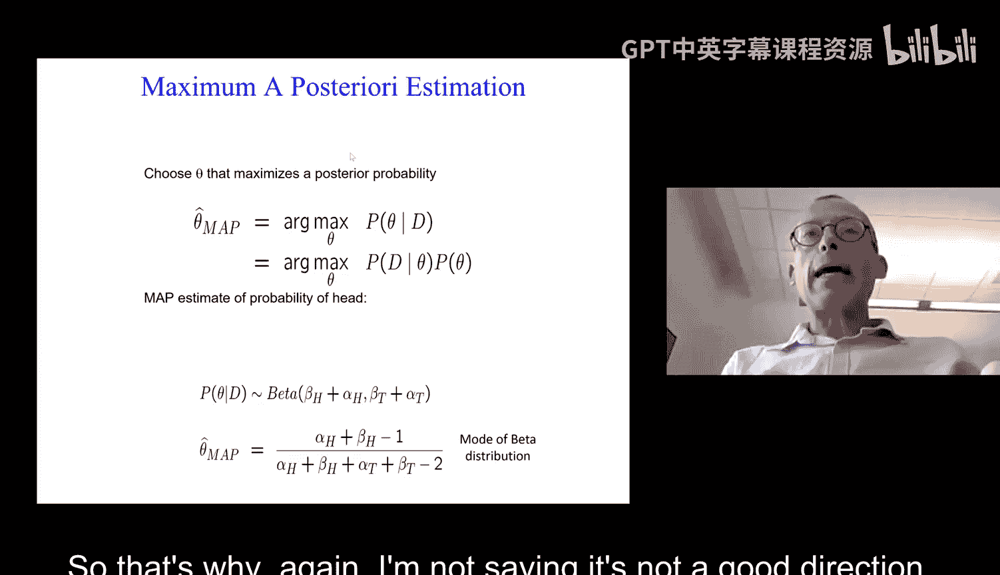
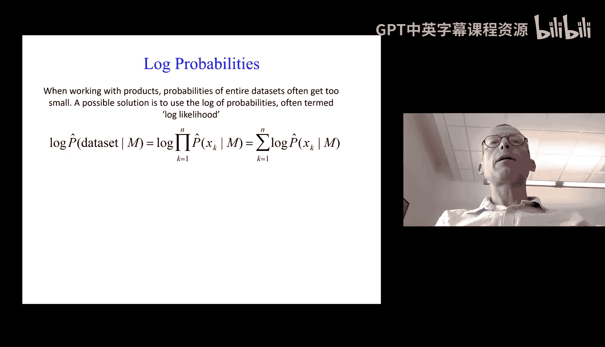

# CMU《机器学习导论（研究生）｜10-701 Introduction to Machine Learning 2020》中英字幕 p02 [02]10-701 Lecture 2  Probability, MLE and MAP.zh_en [BV144SuB8ETp_p2]

Okay， welcome back everybody it looks like。😊，We have a lot of people online and a few people probably will watch it later。

This is the second lecture in machine learning or in 10701 and today we are going to。

actually see a real algorithm。As I said in the introduction。

 the most of the initial part of this class is going to be about supervised learning。

 but in order many supervised learning algorithms will rely on methods from unsupervised or from density estimation。

 so the first thing we are going to talk about is methods to represent joint distributions and to learn parameters for joint program distributions。

Because these will be useful in many downstream applications。

So the first lecture or the second lecture of this lecture is going to be。

On probability in MLE and maximum likelihood of estimation。

And I'm going to start with very very brief introduction to probability。

 in fact the main reason i'm doing this is really to set up the terminology I'm not going to refresh too much about different issues related to probability。

 the assumption is that，😡，You already took the probability and statistics class as a prerequisite and as we said in the recitation so there's going to be a recitation on Friday and part of the recitations will be some background on linear algebra calculus but also on probability and statistics so those all。

😊，Less comfortable or。You know， feel like too much time is passed since they took it should definitely try and。

Attend that rec， but I'm going to set up some terminology and then we'll move to a discussion of how we are using different basic or basic concepts of probability in order to estimate parameters and learn some properties of distributions。

So we start with some notations so random variable is an variable that refers to an event that we don't really know the outcome okay。

 so you know whether it will rain tomorrow or not is a random variable。

 you know we might have some probability。We might know something about tomorrow。

 might say that generally speaking in August in September， it rains I don't know 60% of the time。

 so we have some probability about。H， Pro， do you want to share your slides Like， oh， it's not。Yeah。

 or do you want to look at the slides ourselves。No。

 it's not you can't see the slides I'm showing them Oh no， it's on Piazza。

 but do you want to like share it on your screen or something， Oh I can see it Yeah。

 the slides too yes。对对。Okay， it's full screen for me。It's fixed， thanks， awesome。

Okay thank you yeah so yeah and as was mentioned it wasn't but all the slides are posted on Piazza I usually try to do it the day before。

Definitely in the morning out time， but hopefully 24 hours before the lecture I should be able to post。

But yeah but I'm showing my screen right now okay so so we have random variables random variables are all the values of random of variables come from domains domains are the set of values that a random of variables can take for example we can have a binary random variable whether for example the stock market will go up or whether it will rain tomorrow that's a binary yes or no we can have a discrete random of variables so it can have one of a limited number of values if we roll diece then it has six values if we look at games in football season usually the are 16 games in the regular season so you can have a discrete probability for the number of wins or you can have continuous probabilities either within a specific range or unbounded。

In terms of the distribution， okay so each of these basically or each of these domains basically represent a set of values that the random variable can take。

There are a few axioms of probability that everything else is derived from them。

 so probability is always non negative and it's between0 and 1。

 we usually refer to the probability of2 to be1。😊，And the probability of falls to be zero and the union rule that for two random buy about the probability of a。

AndO B is the probability of A and B and the probability of A plus the probability of p minus the probability of A and B。

And this is these are the axioms and a lot of the。A lot of the。

Other things or a lot of the other rules we derive we obtain from probability or we obtain for probability functions are derived or can be derived from these three aoms。

 there are other aoms， but these are the most common layers。

One thing we will use a lot in this class is something called trialss okay so we can ask what's the probability that it will bring tomorrow as we said this is a random variable and it has a domain a binary domain yes or no and we can assign a probability which holds in all cases right so any day of the year I can say the probability going tomorrow is 20% and the probability that going tomorrow that it will not bring tomorrow is 80%。

For example， just by the fact that maybe 20% of the days it rains and 80% of the days it doesn't rain。

 this doesn't use any additional information for example。

 about whether it rained today or whether it rained yesterday and so forth so this is called the prior this is some belief I having an outcome without any additional launch I don't know anything about which day it is or what year or which month or whatever。

😡，This is the belief I have in this manbi。There's also something called conditional probability and conditional probability is the belief in an outcome given something that you know about something else right so for example what's the probability it rain tomorrow given the fact that it rain today or what's the probability that it will rain tomorrow given the probability given given that the forecast says it's going to rain so what's the probability of focus is one for example。

😡，Okay so this is called conditional probability， a very。

 very important concept in this class and conditional probability of two variables A and B is basically the probability of a equals one。

 for example， condition on the fact that B equals one or B equals zero or it doesn't matter the conditional is on some value of B again so A could be rain tomorrow B could be rain today and I can ask what's the probability of rain tomorrow if I know that if I know that it rains today maybe there is a rainy season somewhere so if you know that it rains one day it's very likely that it will only the next day and vice vera so this gives you a lot of information some places it can give you very little information so maybe the probability of rain in every location is always 5050 so it doesn't really help you the fact that it rains today but sometimes it can help a lot。

Okay， and of course， the probability the probability of a conditional event can be very different than the probability of the file okay for example here。

 if we look at a with respect to this box， we can say the probability of a is 20%。

 but if we know that we are in B， then the probability that we are in A。😡。

Let's say B is the green box， then the probability that growing in a is 50% because 50% of B is a Okay。

 so this is just。😡，Now conditional probability can be computed or can be derived from observations right we usually do it and you can use that to show some differences。

 for example， if I want to compute the probability that I slept in the movie I can just count how many times I slept in the movie okay so let's say I went to the movie this case eight times and I slept 50% of the time so I can say the probability that I slept if I don't know anything about the movie。

😊，Then the probability that I'll sleep in the movie is 50%， but if I know that I like the movie。

 the probability changes right so if you want to know what's the probability that I slept given that I like the movie。

 you restrict yourself to the rows of the table that only contain light。😡。

And you can see that in this case I only slept once of four times and if I didn't like I slept three times。

 so if you know that or if you know some other fact about。The random variable， or for example。

 or if you know some other random effect not necessarily about the random variable， for example。

 if you know that I like the movie， then it can change your opinion or decision about whether I will slip in it。

😡，Okay。And this brings us to something called so this wasal distribution conditional probability。

 okay， so we had priors with conditional probability。

 the next thing is something called joint distribution or joint probabilities。

And joint is basically the probability that two events happen together。😡。

We usually represent it with an end or。Honestly， most of the time with a comma。

 so comma means that A and B。😡，Happened together Okay， so for example， in this case。

 we can say what's the probability that I both like the movie and slept in the movie Okay。

 so this is。The probability of two random variables like the movie and slept in the movie。

 both of these have a probabilistic outcome， and we can ask what's the probabilityba that both of them accrue or happen together。

😡，Now， one thing that is very important to know and of course。

 a lot of you know it is that if two variables are independent。😡。

Then the joint is basically the product of what's we call the marginal the individual probabilities。

 so if if A and B are independent， so for example。😡，If I'm sleeping in the movie。

 regardless of whether I like it or not。😊，Then the probability of A and b is the probability of a times the probability of B。

😡，However， in most cases， most of the variables are not independent right so in this case。

 for example， we already seen that there is a much higher probability that I would sleep in a movie that I didn't like and stay awake in a movie that I like so in most and that's generally true so so generally speaking。

😡，We cannot assume that two random0 variables are independent。

 but if we do assume that are independent， then this joint probability factors very nicely into the marginal probabilities now。

😡，Whether or not they are really independent is one thing。

 whether we make the assumption that is they are independent is another thing and one of the things you will see in this class is that sometimes we make assumptions that we know are wrong。

😡，But makes our life easy in terms of learning and sometimes even though the assumptions are wrong。

 the outcome is not so bad。😡，Okay so that's something to keep in mind later in the class。

 we will actually rely a lot or we will use a lot this idea of independence。

 both in the first part of the class on supervised learning something called a naive based estimation。

 but also in the other parts where we talk about graphical models， based networks。

 hidden Markov models， Markov bundle field and so forth， where we rely on this quite a lot。Okay。

 so again John distribution， you can compute it for example， from tables right， so for example。

 let's say we have。😊，Some table about。Some ranking for different classes right so this is the size of the class this is the time regular semester over the summer and this is the evaluation okay so we can ask what's the probability that the class size is greater than 20 and the summer so in this case we need to look for we need to go over the table and find cases where we have both this one greater than 20 and the time is summer and in this case it's only one out of 10 so we can say it's 0。

1。AndAnd oh， by the way， you can see that， of course。

 they are not independent because if you just look at this and this。😡。

So the marginal nodes themselves to multiply them， you don't get 0。1。

 so you can see that they are not independent because the joint is different from the product of the marginals。

And similarly for other things， okay， so in most cases， a random variables zone in many cases。

 random variables are not independent and you cannot assume that are。O。

The last thing before we start talking about a bit more involved。

Machine learning issues is something called the chain rule。

And the chain will basically links and that's a very important rule because as you will see it's directly leading to something called the base rule which we use a lot in this class in in fact a lot of the algorithms we will talk about in this class are based on it so the chain rule basically links conditional and joint probabilities and it works for all of the probabilities so not just those that not all probability it works for all of the random variables not just those that are independent or dependent it works in all cases so basically what the chain rule says is that you can write a joint probability as a product of a conditional probability and the marginal probability and that's true for any。

😊，any two random of variables， in fact， this can be extended to more than two random variables as well。

😡，So that's very important again， why is this true， I mean I can illustrate it with some cartoon。

 but basically what the trail rule is saying is that the joint probability of A and B is the probability of a condition on B times the probability of B This is of course the metric So you can also do the same to say the probability of B given A times the probability of A will B the same right A and BR。

There's no。No meaning to the ordering of， so both of these will。😡。

Why is this true so the idea is that the joint probability of A and B right is this so if we look at this。

 this is the large set of values that。That this is the domain basically of A and B， let's say。

 and this is the joint of A and B inside this domain you what the idea is that you can factor it as。

😡，The probability of B。😮，Inside the domain。😮，Okay and the probability of a given that you are inside B okay so this is larger of course than the joint so this contains it。

 but then when you multiply by the part that a contains inside B you get back the joint part itself okay so this is so again the joint is here right this is the joint of A and B and you can break it down into two pieces one is B。

Because the joint has to be inside B， and second is the power that a occupies inside B。😡，Okay。

 so this is the chain rule again。😡，We are not proving it。

 but we will rely on it and if you believe the chain wall or if you agree with the chain wall。

 then the next step is something called baseball and again I moved very quickly and I didn't even。😡。

Sve anything， but this is just again setting the terminology。

 So baseball basically is just the chain rule， but we use the tools。

 the symmetric part of the chain rule in order to in order to get。😡。

And the probability of one conditional probability as a function of another conditional probability。

 so we know that the probability of a and B is the probability of a conditional B times the probability of B。

😊，As I said， this is the matrix， so it's also the probability of B condition only a times the probability of A。

😡，And then if we just take at this part here， then we can say that the probability。

 the condition of A and B A or the probability of a given B is the probability of B given a times the reality of a divided by the probability of B why is this useful。

 it's useful because sometimes it's much easier to compute one side of the condition compared to the other side So if it's easy for us to compute or to find out the values So it's even easy for us to find the values of one side of this conditional probability let's say B given A。

😡，What baseball tells us is that it's very easy or possible for us to infer the other condition。

 so if we know B given A， we can come get a kidney。😡，Okay， and we need the trials as well。😡。

But if we get right if we know the trialss and one side， we can easily get the other side。😡。

And that's extremely useful again in many cases as I tell in algorithms I'll show you an example in a second why this is useful as well。

 but this is a very useful fact that comes directly from the screen Okay so this is called base rule as I said and you can see in the names if based based in networks。

 a lot of algorithms in machine learning。😊，Oh not a lot。

 but there are several algorithm attemptss in machine learning that basically use this rule quite happen。

😡，One lust。One before last， I guess a comment about a baseball。 So sometimes it's actually a。

It's actually harder to oh sometimes it's also so we said already that we want based rule because sometimes it's much easier to compute B given a compared to a given B sometimes we can't directly also compute the marginal over a specific a specific variable and this is where we can use the summation rule okay so the idea here is that。

嗯，Let me呃。See if we can do this。Yeah， so Daniel， we still didn't solve the problem， right。

Right with the Google Jabone。Right， and I'll use this， okay。Right， so P of A and B。😡，Right。

You provided it like this。😮，'m sorry。So what we can say is。P of B equals。B。嗯。I'll get used to it。傻。

Okay so this is a always true for any let's say in this case discrete random variable if weve continuous we just need to take the integral。

 but basically if I sum over all the values that another random variables can take let's say I have two random variables it doesn't matter if they are dependent on or independent if I have two random variables and I want to know what's the probability that let's say B equals1 if I sum over all the values that a can take and compute the probability of A and B then I basically sum over all the domain and I get back the probability of B okay so this is the sum rule and if that's the case we know then this equals right sum over a。

P of。B， given a。This is just a chamber。Right P of A and B is P of b given a times p of a so this is the way to move from the marginal probability over a B to a conditional probability and the marginal over a which may be easier to compute so this is what I did here okay。

😡，S。So this is what I did here right so I'm stming over a P of B given a times P of A which is exactly I mean just replacing P of B with P of A and B and then P of A and B I use the chain one to get that and this is the full the final version I would say of baseball okay this is the version that we will use in most cases this basically only requires knowledge of the probability of B given A and the probability of A for all values of DNA but we don't need to know directly the probability of B or the probability。

Okay， so this is just a representation of the ST rule that I've shown you but that's sand。Okay。

 last thing everything that we said already can be applied also to continuous distribution so this is not just a function of discrete distribution where we sum here we sum over A&B it's also two or for continuous distribution and we'll discuss continuous distribution。

😡，In a second。Oh yeah soon okay good so any questions about so I move very quickly but any questions I know the chat has a lot of things but I don't know if there's any relevant questions one of the Ts or Daniel can。

Anybody has any questions？Yeah， okay， so。There's one in the chat Yeah so can I explain what it means to some overall probabilities of it yes so let's say I want to compute the probability that it will rain tomorrow okay？

And we want and。Basically， let me do this okay， so I can do this quickly， hopefully。嗯。

哦。So let's say I want to for computer probability that it will rain。

Let's say the probability that rain tomorrow is one， okay。

 so what I can say is the probability that rain tomorrow is one is equal。😡，To some over。Rain today。

Yeah， okay。Well，Let's's。This is p of r T equals 1 n。Okay， so this， what what does it mean。

 the probability that it will rain tomorrow is the probability that it will rain tomorrow and it rain today。

😡，Plus， the probability went to tomorrow and it didn't play today right there's only two options for in this case。

 this is a。😡，This is A and this is B。Okay， so A is the event that it went today。😡。

Right it either rain today or did not rain today there couldn't be anything else now the probability that rain tomorrow is the probability that it rain tomorrow and it rain today these two are two separate things they cannot happen together right and the second thing is the probability rain tomorrow and it didn't rain today so this and these are the only events that can happen right there's no we are not missing anything and we cannot add anything for this to be right I mean there's only two options for a so if we sum over all the probabilitybabilities for A or not probability all the options for a on computer joint。

😡，Then each of these is a separate。😡，Set of events。

 And the sum of these is all the probability that it will write tomorrow。

 So that's the idea of what I was talking about。 And that's true for any discrete variable and for continuous variables。

And for continuous variables， basically， it's the。It's the integral of this thing。Okay， yeah。

 we need to move。Again， hopefully most of your。I have some， or at least。

 I think we'll have some questions in the or at least one question in the pro said that。

Let you play with it， let's do an example of why baseball is useful and then move on to discuss some estimation issues。

😡，So some of you have heard about a recent development in the COVID 19 testing。

 a great new product that came out from Abboot Labs， they promise a $5 COVID test。😊。

That you can do very quickly， and I think it still requires some medical assistance in order to take the samples。

 but other than that this looks great。😊，There is one downside which wasn't emphasized。

 but you know maybe we as a class should take into account and this test has a 1。

5 false positive rate false positives means that。If it says that you are positive。AndThere is。😊。

There is 98。5% probabilitybil that you are indeed positive but 1。

5% that you are not positive okay so this is false positive it also has a pretty high pulse well the false negative rate is about 97% so for 3% of the population that has the infection it will say that it doesn't but let's focus a bit more on the false positive。

Okay， so the first positive is 1。5， which doesn't seem like a lot， right 98。5% of the time。

 it's correct。😡，In terms of positive so now this seems like a great test to administer very widely because it's very cheap and we can just run it through all the population。

 but a good question will be out of all the positive results that this test generates how many of them are really positive right so let's say it does 100 positive results。

How many of these 100s are really positive， Can anybody tell me？😡。

Let's say 1000， if it gives you 1000 positive results and it has 98。5。😡，False positive。So 1。

5 false positive。Anybody can tell me？It seemsm like a lot of people in chat are saying 985。Yeah。

 okay。Good， that's true。If。Right， so this means that。诶。Right， this means that。If you are， no if。😡。

If the right， so if the。And。If the test says that you are positive， right。

 if the test says that youre positive then。😡，诶。Right， right sure， yeah， no I didn't。I didn't。

I didn't， I guess。Phrase the question correctly。Let's say that again， so the test has 1。

5% false positive rate meaning that。Of the。嗯。False positive， right so if you are negative。

 it will tell you that you are positive 1。5% of the time， okay。😡。

So false positive means that let's say there's 1，000 people that are negative。

Then basically 15% of them， sorry，1515 people will be will be will be positive。 That's correct。

 Now of the ones that the。Of the ones that the test set is the test。😡，Okay。

 so let me rephrase the question of the ones that the test said are positive。😡。

How many are really positive？😮，我。And that the answer here is not going to be 15 out of 1000 because it really depends on the people who take the test right so for example。

 if all the people who took the test， let's say all 1000 people who took the test are negative。

 15 of them will be declared to be positive。😡，RightBut zero will be really positive。

 so the percentage of those who are actually positive is zero basically。😡。

If all the people who took the test are positive。😡，And the test has， I mean。

 then everybody the test will say it's 100%， so the answer is going be not going to be no I'm going to show you some numerical con。

 I just want to make sure that the fact that the first positive rate is 1。

5% does not mean that the actual error on the test that on the population。😡。

Is going to be a 1。5% it really depends on the underlying distribution in the population Okay。

 so let's do an example， maybe it will be clear okay， but let me show you example。😡。

And explain why this might not be that as good as it sounds。😡。

So I maybe I confused you a bit， but hopefully this will be clearer now okay。

 so this this was not actually the first test that so let's do an example and see what I meant。

So let's say we have a test not for COVID， but you can think about this of COVID。

 it's the same thing， well we have a false positive rate。😡，Of 1%， okay。

 so of the people who are healthy。😡，RightIf you are really negative。

 1% will stay the test will say that it's positive and in general 99。9% of the population is healthy。

 let's say in Europe that's more or less the case right now for COVID and 0。1% are infected okay。

The test is perfect， it doesn't have any false negative， so if sorry。😡，yeah。

 so it doesn't give you any false negatives， so if you are positive it will say that you're infected。

😡，If you are negative。😮，Right if you' are negative， it will give you 1% false positive。

 okay that's the test so zero false negatives。😡，And 1% false positives and we know that only 0。

1% of the population so the question is。What is the probability is the test test that you are positive。

 what's the probability that you are really positive or what's the probability that you really are infected given that the test that you are positive and again this is AS but you can think of it COVI how do we do this we can use base rule so baseball rule says what's the probability of aidDS given the test right we want to know what's the probability that you really have the disease let's say aidDS if the test is one。

😡，If we want to use baseball for that， it's the probability that the test is one given right given that you have eight times the probability or the prior on this divided by the probability that the test is one。

😡，Okay， so these two things we can actually compute already from the information right what's the probability that t equals one。

 what's the probability that you are。😡，That the test is one if you have the disease。😡，滚。

So it says like we know that if a is one， then theres no false negative there's no false negative。

 so you will be what's the probability that。What's the probability that you have the disease？😡。

It's very low， right。The probability of AIDs is 9 is 。01 okay。

 and what's the probability that the test is one？😡，For this。

 we're going to use the other part of base rule， which is basically we will basically factor this。

 as we said。😡，We will some so we will treat this as P of B and then do some of B given a times p of a right so this is the probability of the test the test is one given a equals1 and the probability that the test is one given that a equals 0 okay so this is just this is B and this is a okay so we just do what we did before and now we actually can just plug in the values form above。

😡，So as people said the probability， the probability that the test is one if a is1 is1。

 the probability that a1 is 001， that's the same here and here we are doing the opposite so the probability that a0 is a 0。

 999 and the probability that the test is1 if a is 0 basically the probability that the test will say false positive。

 you don't have it but the test says if you do have it is 0。

01 and when we put it all together we see that only 9%。😡。

Of those that the test says are positive are really are really positive Okay， or only 9%。Oh， sorry。诶。

So the probability that you really have the disease or the infection。

 given that the test is positive is only 9%。😡，So if you take 1000 people and you tell them。

 and this is， by the way， this is assuming 1%， if we have 1。5%。

 it will be even higher right so for the for the for the above test。

 So basically it means that if we test 1000 people and the underlying infection rate is 0。1%。😡，Okay。

 so off。Of the 1000 people， roughly 900 that sorry not if we test if we test 1 million people and 1000 come up as positive。

 900 of them are actually not really positive and that's really because of the underlying prevalence in the population。

😡，Yes question。So basically this tells you that 1。5 or whatever percent is really good。

 but you have to be very careful about how you apply the test because it's only good if the population is 5050。

 5050， then it's pretty good， but if the population or the underlying infection is very skewed。

 then even a small force positive rate can lead to very， very large mistakes。😡，Okay。

So this is an example of using base rule and。😊，Again this was on the As。

 but it applies equally well to by the way， one way to mitigate this is to test on a more likely population that's why for example。

 in many of the。😡，Many places， including the US， the recommendation is only to test you if you have been exposed to individual or if you have some symptoms in that case。

 the probability of infection is much higher， so the underlying probability is much higher。

 so even if you have。😡，1% false positive rate most of the people who are positive are really positive so that explains why I mean and there's been a lot of criticism why widespread testinging is not。

😡，Offer to everybody， but again， if there is even a relatively small force positive rate and a very low prevalence。

😡，Of the infection， this will lead to a lot of misdiagnostics。

You knowYou can criticize some issues related to testing， but there are some I mean。

It's not completely unscientific anyway， but that's a separate。Discussion， okay。

 so let's talk about continuous unless anybody has a question。

 anybody wants to ask a question about this。😡，That's fine。O， good。Okay。

 good and Daniel and the other tiers if you see any questions just love me， okay please。😊。

let's continue so we mainly talked about this dispute distributions right probability of rain。

 not rain probability of test being positive negative。

 there's also in this class we are also going to deal quite a lot with continuous distributions。

There are several types of distribution， I just wanted to say that and again we are not。

 I didn't cover almost any distribution except I mentioned binary。

 but there's also something called multiomial uniform distribution and so forth。

Maybe or maybe this will be covered or least some of them will be covered in theation。

 I do want to emphasize that there are continuous distribution and continuous this。

And continued distributions are very useful to model real world values， for example。

 if we want to model the height of students in this class。😊。

We usually are not going to use the speed distribution because height is the continuous value even though we measure it maybe to some I don't feet and inches you can go into much much higher resolution in terms of the points after the estimate so in this case we have continuous distribution there's a lot of different continuous distributions。

 one of them very popular and very successful or one that could use quite a lot is something called the Gaussian distribution which basically assume that a variable is distributed with some mean which we call new and some variants which we call sigma square。

Okay， and like with the tables that we use to estimate the values of discrete probabilities。

 we can use observations to estimate the values of continuous distribution， for example。

 we want to determine how much。😊，Or how much time do students in this class sleep， Okay。

 so we can just take observations right so this is an observation of the number of hours that students sleep and。

In this class and then based on these observations we can compute like before some parameters of the distribution and in the next part we will talk about exactly how to use it the important thing about about this type of distribution is to fit so we have an assumption about the model so we have an assumptions about the distribution that it looks like this basically that it has a mean and some variance and we have a set of observations and our goal in this type of distribution is to fit the model to the observations so in this case right in this case the distribution the redistion has a mean of zero but in class in this case we see that the distribution is slightly different so the goal is to really fit。

The distribution to the observation in the best way we can and again。

 we will talk exactly how to do it next。But this is true for discrete distributions and this is true for continuous distributions。

😊，And more generally in continuous distribution right， for example。

 this is a covariance matrix so we can also use relationships between so it doesn't have to be a distribution over just one variable like we did。

 for example， in the discrete case， we can have a multivariate distribution for continuous values as well and in this case。

 for example， if I want to compute what's the joint probability of sleep and GPA for example。

 which is also a continuous value， I can compute some parameters and then learn a distribution。

That tells me something about the probability， so if you give me the values of x。😡，right。

 can you can compute， what's the probability that you will see someone with a very high GPA that sleeps very little。

And similarly also probably someone with high GPA that sleeps a lot and so forth。

 and in this case we use a this is a continuous distribution this is called Gaussian multivari distribution it's characterized by a mean I mean vector in this case and a covariance matrix。

😊，Okay， so this is very brief introduction to probabilities and to terminology that we will use throughout the course next we are going to talk about or we are going to start dealing with aspects related to machine learning and this is how do we estimate parameters for these probabilities Okay so that's the first set of algorithms we will learn any questions before we move to that。

嗯。But he has any questions？Okay， so the next。I would see。嗯。

So the next part is going to be two different ways to estimate parameters of distribution so we said what's the probability of rain tomorrow I said it's 0。

2 but how do I get to this 0。2 what's the probability of rain conditional tomorrow given that today rain I said it's 04 but how do I get to that so we said we already show the way based on the tables by just counting but counting you know makes sense but it's not you know there's no underlying theory of why this is the right thing and how do we deal with continuous distribution how do we estimate parameters so the first thing we really want to do is something called density estimation and density estimation deals with the ability to estimate the values of parameters for distribution so for example if I assume so the assumption of what type of distribution it is is a separate issue so for example a coin flip I can assume that it's a binary distribution a height I can assume that height in this glass is a gausston distribution but this is just an assumption maybe it's not a Gausstton distribution。

😡，Maybe I don't know， maybe it's some exponential distribution， something else。

 so we are separating the assumption about what type of distribution this is and the parameters。😡。

So for this class， we assume that we know the type of the distribution。😡。

The goal is to find the parameters of that distribution so for example if I have a coin flip I assume that this is a binary distribution bin nominial distribution and I want to know what's the probability for heads and what's the probability for T that's my goal if I have a die I want to know what's the probability for one to six or if I want to estimate the probability of height in this class I assume that this is a Gaussian distribution and my goal is to estimate a parameters okay this is the goal of this class for now。

😡，How do we get the assumption about the probability？😡，We are not going to discuss， in fact。

 for the most part， we will just assume based on some background on our domain knowledge。😡，Okay。

 but assuming that we know。😡，Something about what type of distribution this is。

 what is the next step， how do we go about finding the parameters of the distribution。

 what's the first thing we need to do to find parameters for a distribution， let's say a coin flip。😡。

What would you do to， to find the parameters of this distribution。Anybody。

Collect samples absolutelyly right so the first thing and that's why we showed in machine learning right the first axis of machine learning is data without data we can't do anything of course you can make an assumption but。

😡。

The first thing you want to do in order to predict the probability of a coin flip no distribution of some gaussian distribution for example。

 height is collecting information from students about their heights or flip the coins several times okay now okay so we did that and the question is how do we use it or the question we will try to answer in the next class or in the next。

You know， half an hour or whatever we have is how do we use this a set of observations in order to estimate the probability and there's two major directions。

One is called a map estimate or Maxim oppopiri。😮，And and this is using some Bayesian approach。

 I'm going to talk about it first。Primarily because we are not going to use it a lot in the class。

 You will still work on it in the problem set but this is not something that will use a lot in this class。

 It's important to know that it exists and it can be useful in some cases。

 but it relies on domain knowledge that we prefer not to assume if possible。

 the second approach is something called maxim light estimation。

 which Im going to introduce later today， and we will use extensively in this class。 In fact。

 almost a lot of the different algorithms rely。 Okay so let's start with the map estimate what's known as the Bayesian approach。

As I said， we will not use it a lot， but it's something that is good to be familiar with and we will refer to it in some cases。

Okay， so what is the basin approach to estimating parameters？😡。

So let's say you're going to determine the probability of a set of coin flips， okay。

 so you collect a few samples。RightThat's the thing that was suggested and obviously that's the first thing we do unfortunately there's a limit to how many samples we can collect maybe five is too little but in practice there is a limit to how many samples now of course if you have a binommal distribution it's only two values that's easy but if you want to collect information on biology right so you have tens of thousands of genes there's a limit to how many cells you can measure or if you want to collect pictures there's a limit to how many pictures you can collect。

But each one has maybe thousands or tens of thousands of pixels。

 so learning probability distributions for these high dimensional spaces is very hard。

 so there's a limit to how many samples you will collect for a complicated data problem。😡。

So if you collect a set of samples， let's say five coins， you can say， okay。

 let me just count how many times I see heads， how many times I see turnss and say that the probability for heads is 60%。

 the probability of tails is 0 is 40%。That's good， but it's dangerous， right， Because。

 you know that you only collected relatively few samples， So it could be very biased， even though。

You know， even though the probability is 50 50， you will see something slightly different。😊。

So what can you do？One thing you can do is use the basin approach。

 what does it mean to use the Ba approach， Ba approach means to use some the conditional assumptions or condition on some assumptions that we have。

😡，And in this case， about the domain or assumptions about the world。For example。

 we can assume that most coins， not all of them， maybe some people are cheating。

 but most coins are pretty balanced right so we can assume that most coins are going to be 50 50。😡。

In that case， if we have that most coins are 5050 and we flip the coin five times and we see that three times it came head and two times it can tells。

 we are going to say even though we saw 60%。😡，Of the outcomes as head。

 we are not going to say that the probability of hedge is 60%， we might say it's 52% because yes。

 we saw a bit more heads， but we assumed that。😡，The head scale distribution is close to 5050。😡。

So the idea is to combine your prior belief about the world， which is 50，50 with the observations。😡。

Okay， so this is called a map or maximum posterior estimate。

How do you do that Well there's lots of ways to do it The thing we like the most is something called conjugate priors and I'll discuss them in a second。

 but the basic again the basic idea of this assumption of this estimation process is to have some prior assumption get some observations and try to combine them together in order to get a revised model of your distribution So initially you don't see anything you CO5015 you start to see things you start to update your distribution Now the more samples you have or the nice thing about this approach usually is that the more samples you have the more your estimation is based on the samples and less on the assumption if you have very few samples the assumptions play a big role if you have a lot of samples the assumptions are going to be very the weight of the assumptions is going to。

Go down， so that's a good way to combine assumptions and observations。😡，Okay so how do we do that。

 we do it using base rule， that's why this is called base estimation and basically here unlike before when we try to estimate the probability of an observation here we treat the parameter as a random variable。

😊，Okay， that requires some different thinking， basically in this case theta is the parameter in this case it's the probability of the conflict。

😡，And the goal is not to find out what's the probability of the next point being one oh that's the optimal goal。

 but the goal is to find out what's the probability that the parameter let's say datata is 0。6。

5 right our goal is to find out the probability the distribution over the possible values of the parameters so in this case the parameter can go between 0 and1 that's the probability of head and we want to compute the probability of the parameter given the data now how do we do it based on given we can use base rule right it's the probability of the data given the model times the probability of the model in this case this is the prior divided by the probability of the data since the probability of the data is the same under any right so the probability of the data。

😡，And is basically the data is given to us， we don't right we are not going to right so this is basically some overall all possible probabilities and basically the probability of the data given the probability of the model。

 then we can remove we don't really need it and basically the probability of the prior scales with the probability of the data given the model times the probability of the model。

😡，So we can ignore the denominator in this case because it doesn't depend basically on the thing we want to optimize。

 which is the parameter。😡，Okay， so this is the idea of based learning basically that we have some prior and we want to learn a posterior posterior is our new belief after we saw the data and that probability is going to scale with the likelihood how good this prediction is times how much we believe we believe in it in the first place okay so let's see an example。

😡，Okay， so yeah， so usually we take some， we use it， yeah we can that doesn't really matter。

The important thing here on this slide is the fact that we want to use conjugate piles。

 conjugate trialss are ps where the posterior， this is what we call the posterior。

 this is the estimation we have after we see the data。Seems very similar。

 or the function that we use for the posterior is very similar to the function that we use for the prior。

😡，Again， this will become clear in a second， but the basic idea is that if we have a posterior that is similar to the file it's pretty easy to estimate and it's very easy to update we don't need to walk to how to update once we see the observations。

😡，So let's do an example for coin fliplip okay so for coin flip。

 we are going to use a right Wulli model where the probability of so we assume that the coin flips are independent so the order incat me in this case and the probability of a set of observations given a model。

😡，It's just the probability of heads and the probability of tens right so we have theta which is the probability of heads to the power of the number of times we saw heads and one minus theta which is the probability of tens tied up to the number of times we saw tens right because that's the probability of basically if we don't care about the other and that's the probability of the events happening or that's the probability of each of these or the probability of each of the conflicts and we just take a product of all of these probabilities。

😡，So this is the probability of the data given the model。

 if we have an a or if we have the probability of heads。

 is the probability that this is the probability we will assign to this set of observations。😡。

Now if we assume a prior as the beta distribution， so a beta distribution is a specific type of distribution that is basically defined。

 this is a definition as theta to so we have two values that define these are inputs to that function。

 user defined values and we'll talk in a second about how to define these values。

 but once you have these two values， the probability of a specific theta and using the beta distribution is theta to beta h type minus1 minus theta beta t minus1 divided by B this is a function again。

 this is a normalization function basically make sure that this sums to one for any value between the one。

So it's always positive and it sums to one because this is a probability。

 So this is just a normalization platform This is the definition of a better probability and this is the prior we put on theta。

 Now once we have this prior， remember the posterior is this。Times the likelihood， right。

 This time's this。😡，When we do these times this， what we get back is another better distribution。😡。

So we basically， right， remember， the posterior is this times this。😡。

This is the likelihoodlio this is the prior when we multiply this by this。

 you can show that we actually get back a new better distribution。

 the difference between the previous better distribution and the current better distribution is that the new better distribution includes the observations。

😡，So beta h plus alpha h and this is be t plus alpha T so basically we get back a better distribution。

 but now the better distribution that we have for the parameters includes the observation that we have。

Okay so let's see an example and see why this is useful。

 so one thing to realize is that the prior basically tells us two things first of all。

 it tells us how much we expect the heads and details。😡，To be the same to begin with。 So as we said。

 if we think 50，50， then the B beta H and beta T should be the same， obviously。

 but that's not enough because they can be 1，1。 They can be 22 or they can be 50，50。😡，The difference。

 so even if they are the same， the magnitude。😡，Implies something about our confidence in the if we are if we think that most coins of 50。

50， but maybe some a lot of them are not， then we will relatively small values， let's say2，2，3。

3 on the other end， if we are pretty sure that almost all coins of 5050。

 we should use very high values for both so we can say 100 then 100 the difference is that。😡。

The higher the values of the priors， the more companies you need to offer write them。😡。

Because when we combine the two， you can see that we have a weight from the samples and we have a weight from the priors。

 the higher the values for the priors， the more samples you need in order to move away from the priors。

😡，Okay so this is some examples of a betterta distribution。

 maybe this is some files and then after we observe right after we observe a coin flip you can see that the distribution changes a lot。

 so you can see the ratio is the same three and2， but here because the values of the betas are very small。

 then the distribution is is much larger whereas if the values of the betas are very large。

 then the distribution is very。Okay， so yeah so this is the idea of conjugate priors and right so this is an example for all。

 let's say we see another。We flip the coin and we see another in this case。Right。

 we see another head。So you can see initially we have beta H and beta Tl2 and 2。

 but after we flip a coin and we add to the distribution we saw one head。

 the distribution changes to become more concentrated on the likelihood that it's had okay so the parameter in this case。

 the probability of。😡，Right the probability on this， I think， yeah， let's say。Right。

 so so in this case， the probability of。this probably the probability of tails is going to be so we are going to have a higher probability for heads rather than for1001 minus 0。

3 is probably the probability of loss。Right， so conjugate ps are out too for or can be used for binomial distribution。

 they can only be used for other types of distribution and again the challenges to find the correct conjugate priors for a multivariate discrete distributions。

 we can use something called the multinoial distribution so multinoial distribution very similar to binomial ornu basically see that the probability of the data given the model is again the probability of each of the possible observations to the power times to the number of times we saw it so this is the number of times so1。

 two and so on。So this is the likelihood of the data given the model and we also have the prior on the model。

😡，This is called the Davidishlet distribution and again very similar。

 it's just the product of the original AAO。The priors on each of the different values divided by some normalization function that makes sure that this sums to one and everything value is between00 and1。

Okay， so this is the prior， this is the likelihood and the posterior is just a summation like we did before of the priors and the observations。

😡，So again， if you flip a die with six values and you don't know anything， you can say， look。

 I assign a value of one to each one and then when you see more and more observations。

 you can update your distribution or your probability based on the the distribution。😡，Okay。

 so we are almost done the main challenge is that。😡。

What we got out of this I mean this whole discussion right we actually get a distribution so we get a distribution of our parameters let's say these are parameters for heads。

 so this is the PDF of 0。2 0。4 0。5。And here， I don't know。3 and so forth。

 So we get a lot of different values。 but at the end。

 we want to have just one value for this distribution， right。

 so we want to have a probability for heads。 We don't want the distribution over the probability of heads Because if we want to make some or if we want to use it in some downstream algorithm or if we want to use it for some prediction。

 we really want to know what is the probability of heads。

 And this method does not give us the probability。 just gives us a distribution。

 So how do we go from there to probability。The answer is what's known as the map estimator or the maximum posterior estimation。

😡，The maximum of posterri is the value that leads to the highest。😡，AV for for the combined。

 basically for the likelihood times the file。Okay， so we have a distribution over these values。

 right， this is the distribution。😡，This is the distribution over。😡。

RightThis is the distribution over the。A product of the prior and the likelihood。

And there is one point here， which is the max， or at least。😡。

There are right there is a max for this function there could be multiple points but but there's an a max value for this well in the better distribution there is only one but there could be others where you have multiple points anyway there is the maximum to this function and this is what we are interested today we are going to take the ag max of the distribution。

Which again could be multiple points in the better distribution to go to be1 and we are going to sell or in most better distributions right we saw already that in 11 there's no。

But in most cases the better decision is one value and we will use that as the estimation of our probability right so again long story short if you want to use the basin approach what you have to do is start with a prior。

Make an assumption about the distribution of the prior using some conjugate function。😡。

Have a lot of observation， and update a conjugate function based on these observations and choose the mode basically。

😡，Right so this is the mode of the distribution and again in the better case。

 this is going to be just count。How purpose better age or。

But this can be different for different functions， so you choose the model the highest point in the distribution。

 and this will be your prediction for the map estimate。😡。

Now you don't need to use the map estimate if you want to use the entire distribution in some way you can do that。

 you can integrate maybe a online distribution， so this really gives you a distribution unlike other methods we'll talk about。

 but in most cases we are actually interested in the map estimate and we are going to find the one individual value that will give us the result of the probability of the distribution that。

😡，Okay， so this is called max posterri or base estimation， as I said。

 I think we will I think ask you to work on this in the problem set。

 although most of the algorithms we'll discuss in class will not use this method。

 the main drawback of this method， I mean it's a very nice method， the main drawback。😡。

Is the fact that you need to come up with a very or you need to define。😡。

A prior distribution and that's hard in two ways one is you don't know which type of function is the best to define that and second even if you know。

 let's say a better distribution you don't know what should be the values of the prior or in some in most cases it's hospital。

Okay， so that's why again， I'm not saying it's not a good direction， it's definitely a good approach。

 but in most cases we are not necessarily using it。

Okay， so this will make estimate any questions about this？😡，About map estimations。Good， okay。

 so now finally， we are on our way。To discussing a real algorithm。mean the machine learning class。

 which is good。And the first algorithm we're going to discuss。It's also about density estimation。

 but in this case density estimation using something called the maximum likelihood estimation principle。

 so this is another way to perform density estimation that does not require or does not rely on any assumption。

😊。

About the prior， it does rely on your or you need to define a probability distribution。 So。

 as I said in this class， and in fact， in most of the classes， we will assume。Well， we will。

Use or we will define a probability distribution for the data and the goal will be to learn the parameters we are not going to learn which probability which type of probability distribution we're going to use okay so for for example for coins we will assume a magnoial distribution for diece we will assume a multinoial distribution for height we will assume a Gaussian distribution and so forth and the goal is to estimate the parameters for。

😡，Okay， so we have an input a set of values right so in this case we just rely on the set of observations。

 we have a density estimation， a method， an algorithm basically and we get out probabilities。😡。

That's the goal of this algorithm。And then this applies very widely right so it applies to binary to corn flips。

 you know predicting whether an alarm will sound to discrete variables。

 right diece or car model to continuous variables height weight temperature and multi multivariate predictions can also use this method so density estimation is widely to use predicting population。

 predicting a lot of other things and as a component this is going to be something we will use in a lot of other methods so in AC base and in all the baseline networks and hidden markov models and a lot of other methods we will rely on logistic aggression a lot of supervised and other methods and even。

And even learning other than under uncertainty will rely on this。

 so this is a very important method that is used quite a lot in machine。

Right so in many cases we use the density estimation as an ingredient inaug attempt and sometimes we use it in combinations with other types。

 something called EM expectation maximization， which we'll get to and as I said in。😊。

Okay so how do we do this， how do we use the density estimation method。

 it turns out that the solution or the way to use density estimation or the algorithm attempt is very simple。

 basically it it just requires us to count。😊，But it actually has a very nice underlying motivation。

 so it's not just that we can't like in the table， we just counted and we said that's the probability。

 we can actually show that the estimation that we get is based on some very strongest os。😡。

Not strong， but very reasonable assumption about the data。Okay。

 so here is the solution basically and in a second we will try to motivate why this is the solution。

 so if I want to know the density， if I want to predict the probability of an event，😡。

Right I just count how many times I saw that event and divide by the total number of samples that I had right so if I want to count how many what's the probability of heads I count how many times I saw heads I divided by the total number of coin flips I did and this is the probability of heads if I want to know the probability of one in a dice between one and six I count how many times I saw one I divide by the total number of time I flip the dice and this。

😡，And this is the outcome that I get， oh， this is the prediction that I make。And again and。

 and again， this is for discrete distributions for， for continuous distribution。

 we'll talk about in a second。 Oh not in a second， but in a few slides。 But generally speaking。

 this is the idea of， of， of density estimation， You just count and， and。

 and basically take the fraction that that you see， right， That's what we did in the table。

 The question， of course， is， why is this the writing to do， or what is this counting based on。

So in order to answer that， we are going to define something we call a likelihood。

 I already refer to it although I never formally defined it。

 so now I'm going to formally define a likelihood of a data given the model。😡。

A likelihood of a data given the model is if we have some probabilistic model for the data。

 it's the probability of all the observations condition on the model now if we have assumed that the observations are independent we can make it as a product of the different organizations sorry if the are independent we can do it as a product if the observations are dependent。

 we need to do it as a joint。😡，But in this case， let's assume that we are doing a coin flip。

 each coin flip itself is independent， So we want to know what's the probability of x。

 which is x each x is a coin flip condition on the model the model in this case is the probability of heads。

😡，Okay， and we can write it。😊，as the probability of a set of observations， x1 to xn。

 condition on the model， condition on the probability of X。😊。

And because we said each conflict is independent， we just get a product。😡。

Of the probability of each of the conflicts condition on the planet。😡，This is then the likelihood。

Of the data given the model， the model is。 and again， in this case， the model is very simple。

 It's just the probability of F， but the model can be much more complicated。 For example。

 we can ask X can be an image and M could be a probability of a specific cat image of cats for example。

 So so M could be very complicated model or very simple model。

As long as we have a probabilistic or a way to represent this in some probability term。

 we can write this likelihood function here okay， so this is just the likelihood the probability of the data given the model。

 this is called the likelihood。😡，Okay， so given that this is the likelihood。All right， so Amy is。

So M could be the probability of heads or the probability of a die and so forths。😊。

So now given that this is the likelihood。The next step is something called the maximum likelihood principle。

 the maximum likelihood principles states that if we have a set of observations。😡。

We would like to find a model。😡，That maximizes this function here。

 This is the likelihood of the data given the model。 Of course， we don't know the model。

 but there is the value for the model in this case。

 the value for the probability of heads that will maximize this function。😡。

And that's what we want to find。 We want to find the value of M that leads to the maximum for this function here。

😡，This is called the maximum likelihood principle Okay， so once we define the likelihood。

 the likelihood is a function of the model and our goal is to find the value for the model that leads to the maximum。

😡，So in our case， for example， the theta or the M is the probability of a coin right so this is just the product of the probability of the first observation times the probability of the second and so forth okay and we assume that the coins under。

😊，Right， and we already said that given I mean， the answer is to do the counts， but the question is。

 why is this a way to do the counts？😡，So in order to find the best solution for this problem。

 we really need to find the value that maximizes this probability。😡。

And the way to do it is by maximizing a combinatorial function how do we maximize a function Well we learn this in linear algebra or in calculus。

 you basically take the derivative with respect to the parameter equal to zero and then hope that this is the maximum sometimes this is the minimum serve to take the second derivative in order to show that this is really the maximum。

😊，Okay， so this is what we want to do here if we have a likelihood function。

 the likelihood is a function of a specific parameter。

 the parameter in our case is the probability of heads or the probability of states' one one if it doesn't matter。

😡，And so if we have that， we can write it as a function of this parameter and then take the derivative effect to that parameter equal to zero and hopefully we'll get a maximum number。

😊，Okay， how does this apply to our data so we have the probability of the data given the model D is the set of flips m is the model in this case Q basically is the probability of heads and we have n1 observations of heads1 minus clue n 2 right and our goal is to find an outrc marks over Q of Q to the power n1 minus minus clue above this is the likelihood of the model。

😡，This is the likelihood of the data given the model， and this is the maximization point。😡，Okay。

 so goal is to find Q that maximizes this function here again， how do we do it with exit derivative。

😡，Right so again this， I mean， I'm right so if if you're using the full binomal distribution。

 you also have this right。N1 plus N2 choose N1， but this doesn't depend on Q so doesn't we don't really need to use it for the L box。

Okay， so this is the data likelihood， Q and1， minus minus Q and 2。

 and if we take the derivative respect to Q。😊，Then we need to do some steps， right this is in1。

 Q and1 and so forth。This is something you can look at and I mean you can go through the simple math after the lecture。

 but the bottom line is that at the end we end up with n1 equals n1q plus N doq basically  Q equals n1 over N1 plus N2 what does it mean it means that the probability of heads is the number of times we saw heads divided by the total number of observations exactly what we said before but now coming from the maximum likelihoodlude estimation principle So if we are interested in finding the maximum likelihoodlude。

AO sorry， if we are interested in finding the parameter that maximizes the likelihood of the data。

 given the model， that this parameter will be n1 over N1 plus。😡。

This is true for the bioommal distribution and it's also true for other discrete distributions so for example you can show。

Do have it one second。きさ。So this is true for binomial。

 but it's also true for other discrete distributions including multivariate distributions where you just count and you see。

And you see the。Or basically， if you take the derivative or the partial derivative respect to each of these parameters。

 you will get the same solution， basically， for example。

 the probability of one in a die is the number of ones divided by the total number of samples。

 so the number of one plus2 plus3 plus 4 plus 56。Okay。

 any questions about maximum accurate estimationation again， very important concept。

 you will play with it in the problem set I think。😊。

So you will do some derivation of more complicated or maybe even continuous distributions I will discuss continuous distributions in the next lecture as well。

 but this can be done for other distributions as well any any questions about this so this is very important concept in there。

Yeah we actually did get a question that I'm not 100% sure on is the assumption always that the observations are independent in MLA or is that just in this case No so as I MLE is basically writing the so MLE tries to maximize the likelihood of the data given the model。

If the samples are independent， then the likelihood is just the product of the samples is given the model each one if the samples are not independent then you cannot assume that then the probability is some joint probability。

 sometimes some of the samples are dependent some are independent of course if everything is dependent it might be very hard to compute the maximum likelihood estimation but it doesn't mean that so the likelihood so maximum likelihood can be divided into two parts one is the likelihood and the other is the max the likelihood function should be correct。

😡，Based on what your assumptions are。😡，The way to maximize it is a separate issue， obviously。

 if the things are independent， it's much easier for us to maximize。😡。

But there is no requirement that things are independent。

 Maybe there is a way for you to maximize even if things are independent， that's undepend。

 that's your problem， basically。😡，In most cases， we will assume that samples are independent of each other。

 for example， if we take a lot of pictures， we will assume that each of the in fact most cases we will assume that the input is drawn from something called the IID。

 so in independent distribution of。Yeah， but again， this really is separate。

 I mean it's just based on the assumption。😡，Okay， and so yeah， I wanted to say。I wanted to say maybe。

One more thing。But maybe I'll get I mean this is really important for the next step so maybe I won't mention it now I do want to say yeah so maybe we'll finish I want to say this is the last time that I'm teaching for an hour and 20 minutes without a break going forward don't worry will take so we want to have a formal break but I usually have a quiz during the lecture basically that it's not graded so we're not going to grade a quiz but it is asking questions about some of the stuff and this provides some informal grade that also a break that also provides information about the class so I apologize this I just I mean I do have a quiz question but get I didn't teach the information that you need for it so next time we will do a quiz or maybe even more than one so it will be hopefully a bit more relaxed but on the other hand you should have Piazza ready so the quizzes are going to be administrative on Piazza so please。

With Piazza for the next election okay I guess last announcement there's no class on Monday and so it's labored there here in the US yes most of you are in the US right now so there won't be a class on Monday and on next Wednesday we are going to finish maximum estimation and move to classification and we will also release the first problem。

Next Wednesday， I think one final thing there is no office hours this week。

 but we are going to have a recation on Friday， so you should definitely oh。

 you're more than welcome to attend a visitation。And that's it。 I think， then。See you。系咯。

