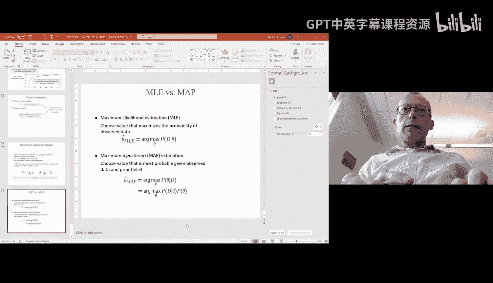
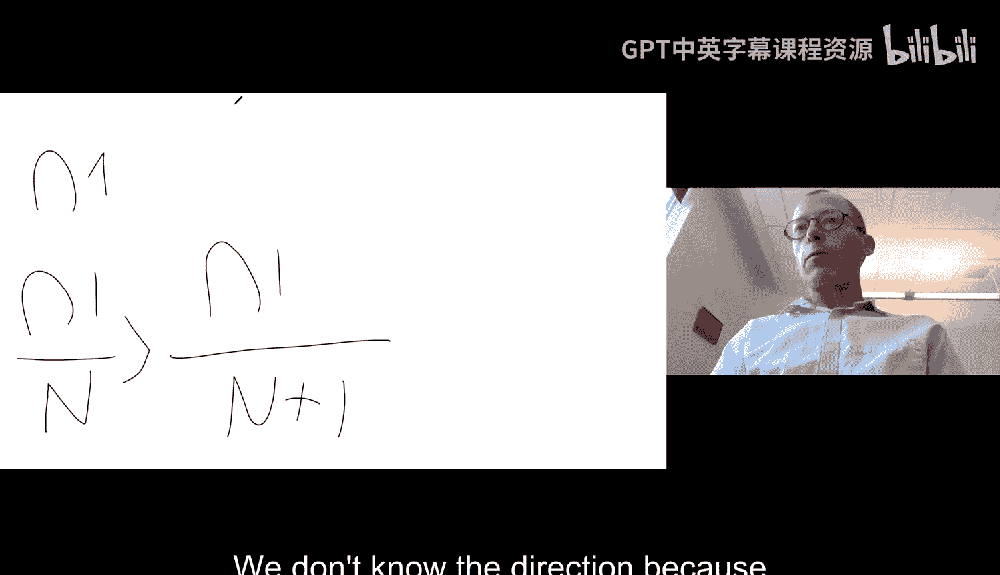
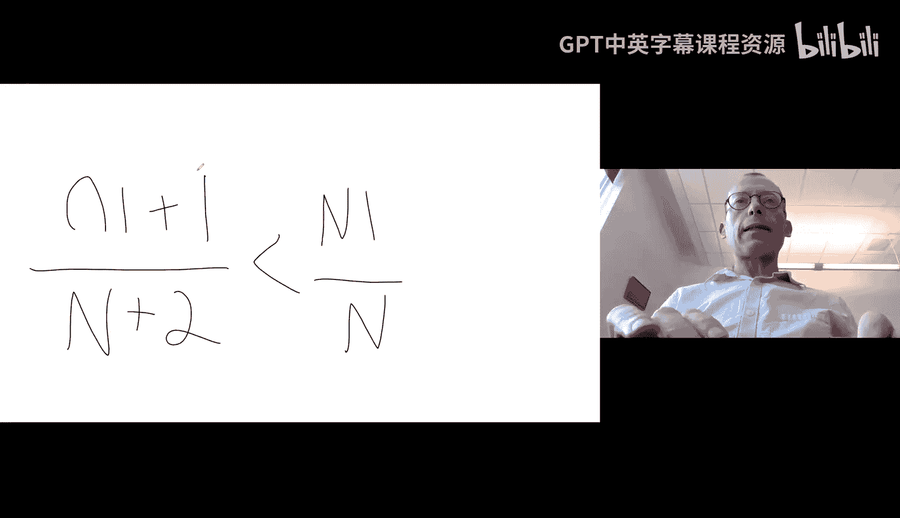
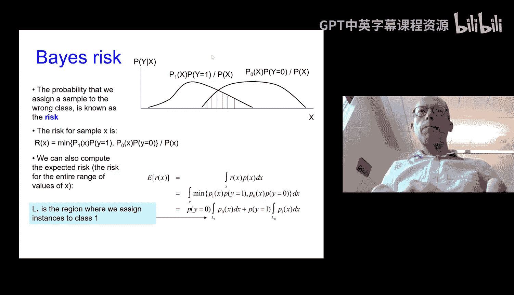
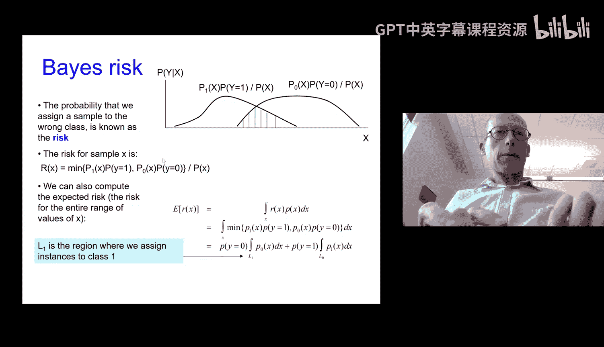
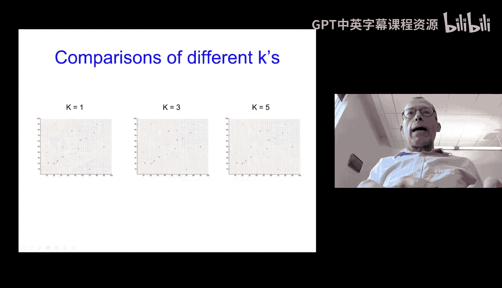
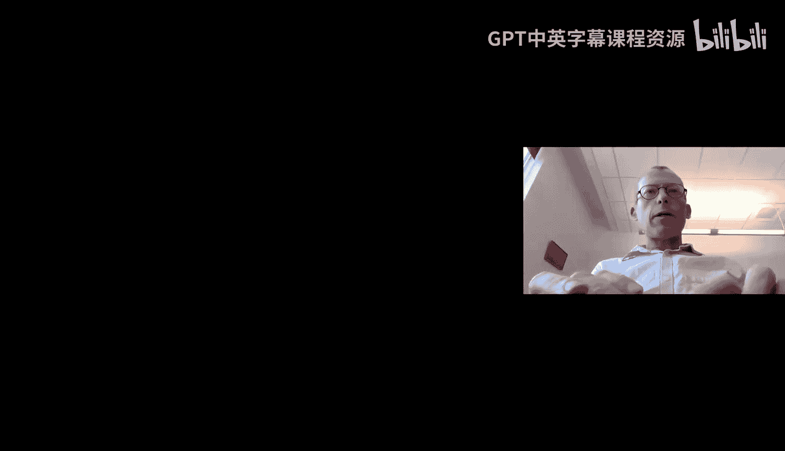
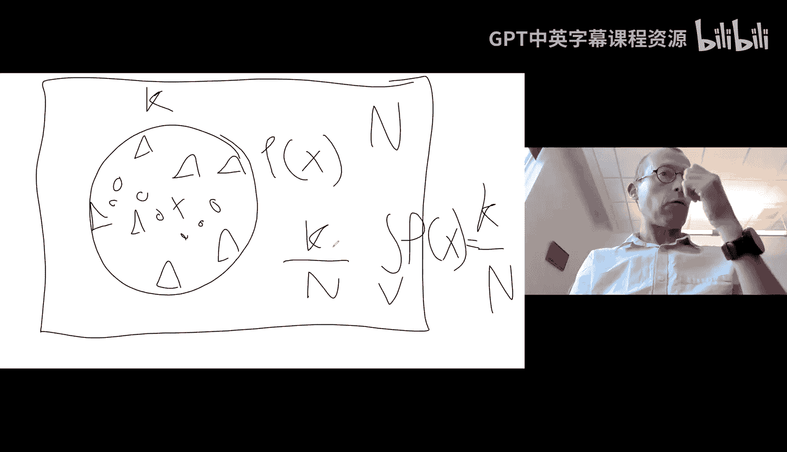
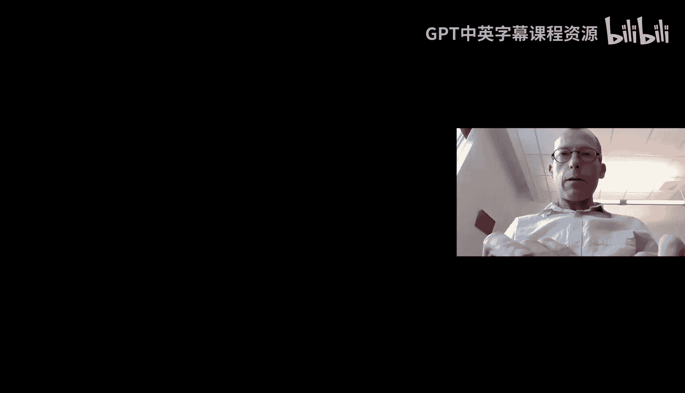
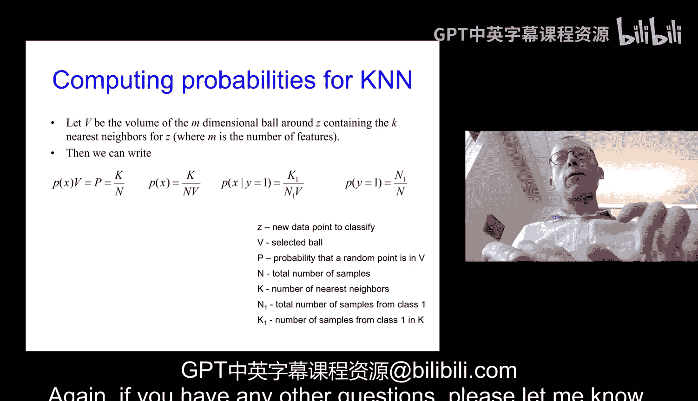

# CMU《机器学习导论（研究生）｜10-701 Introduction to Machine Learning 2020》中英字幕 p03 [03]10-701 Lecture 3 Maximum Likelihood Principal.zh_en [BV144SuB8ETp_p3]

Okay， welcome back everybody， hopefully。😊，You were able to enjoy the long weekend。

 so today we continue。In this class and we are going to talk。

Finally about supervised learning so until now we introduced machine learning and we discussed maximum likelihood estimation and now we will most of this lecture will be focused on supervised learning which as I said is the major part of the course so roughly between a third and half of the course is going to be in supervised learning we will finish some of the stuff that we didn't on maximum likelihood estimation and then move to。

Supervised learning and classification before that a few announcements so first of all we're going to have another recitation so we had a recitation on Friday we're going to have another recitation this Friday。

😊，Still， I think more general introduction， problem set one is going to be released。😡，Danielle。

 you haven't released it right I mean at the end of this class we said yeah right after this class it'll be released so Pro that one is going to be released as I mentioned at the introductionduct when I first on the first lecture。

Problem sets are going to have a mixture of programming anti theoretical questions。

 So we'll have usually we'll have three or four theoretical questions and one programming question and this is。

What you will see in。In this problem state。Dnielle posted online。

 but I just want to say that in the past and as my experience as a student。

 it's very useful and recommended even to work in groups so we don't or you do not need to walk on the problem set completely on your own。

 you're more than welcome to form study groups。😡，Of course。

 it's a bit challenging how to organize these online in the past people were just sitting。

 but we are definitely。You know， permit it and even encourage it。

 you do have to report and you will see in the problem set you do have to report who you work with that's not。

😡，There's no problem with that， but we do want to know who worked together on the problem sets。

 but other than that， I recommend it， I think， well。😡。

If you feel like you can do it easily on your own， that's fine。

 but generally speaking it's good to work with others on these problem sets and we allow it as long as you write your own。

 of course you have to at the end， you will see the instructions but you'll have to write of course the solution on your own and tell us who you work with on the problem。

Okay so this is for the problem set and again， if you have any questions about that。

 of course you can ask on Piazza going forward for this class， if you have any questions。

 please post to the chat and one of the Ts or Daniel will alert me and either will call on you or they will ask the question for you but yeah。

嗯。Okay good so let's start with the lecture and as I said the first thing I want to do is finish the maximum likelihood estimation。

嗯。Don't。So。In the last lecture， we talked about density estimation we starteded initially we talked about。

max postperi or baseian based estimation and then we move to talking about maximum likelihoodli estimation and I mentioned that for the most part we will rely or for the most part in this class whenever we will have a probilistic model we will primarily rely on maximumim likelihoodli estimation and the idea of maximumim likelihood estimation is to represent the likelihood of the data given the model and that could be very I mean the exact format of this likelihood function can vary depending on the model you have。

You can have a coin flip model where each flip is independent。

 you can have something called the based network where things are partiallyly dependent。

 you can have a fully dependent model。 It doesn't matter as long as you can write your likelihood the probability of the data given the model you can employ the maximum likelihood principle and the maximum likelihood principle basically tells us that we want to find the model in this case。

 the parameters of the model that will lead to the highest probability or the highest likelihood of the data given the model and we showed an application of this idea to coin flip。

Right so we derived the maximum likelihood estimator for the probability of heads if we have N one heads and N2 tails in a con flip and it basically it came out to be just the count。

 so basically the number of heads divided。And by the total number of times we flipped the so that's the result。

 but。You know， maybe you would have expected it， but this is the maximum likelihood estimator as well it's not just some count it's really representing the value that will lead to the highest likelihood of Okay。

 so this is。So this is what we discussed。Okay， so this is what we discussed and now I want two more things and then we'll finish with this one with this part one is that in many cases rather than maximizing the likelihood directly it might be better to maximize the log likelihood。

Now the outcome is going to be the same in the sense that the model that you will select。

 the probability for heads， for example， is going to be exactly the same if you maximize the likelihood and if you maximize the log likelihood。

 why is that that's the case because log between0 and one is an increasing function。😡，Okay。

 so if you have something that marks and of course。

 the probability of the likelihood is always between zero and one right a product of probabilities。😡。

Is always between zero each probabilitybabil is itself between zero and one and the product of these values is also between zero and one so the likelihood function。

 the likelihood of the data given the model is always going to be between zero and 1。😡。

In that case anything that maximizes the likelihood is also going to maximize the log likelihood and vicestabels so if you walk in log space or in wheel space of course the value。

 the likelihood itself the log likelihood and the likelihood are going to be two different values but the parameters that maximize this function are going to be the same and we don't really care about the likelihood some cases we do but in most cases the thing that we care about the most is the parameters and the parameters will be the same so if instead of maximizing the likelihood of the coin flip you maximize the log likelihood you will still get the same parameters and again for coin flips this is not really useful because we can do it without it but there are some probability distributions including some that you will walk on in the problem set but also even density estimation of Gaussian distributions so this is maximum likelihood in Gaussian or normal distribution where it's much much easier to walk in log space。

Going to do the de。 You will do something similar in the problem set， but generally speaking。

The result would be the same， but sometimes it's much easier to walk in log space， for example。

 because in log space all products become sum， especially sometimes we have something into to the power of something that goes out and so forth so you can think of a lot of advantages to walk in in log space and again the reason why we are allowed to walk in log space is because the values are always between zero and once and anything that maximizes it in the probability space will also maximize the function or any value that maximize the function in the regular space will also maximize it in the log space。

😡，Okay， so this is basically it for a maximum likelihood estimation。

 again writing the main idea is writing the likelihoodlude。😊，As a function of the model。

 basically the probability of the data given the model， as a function of the model。

 and then trying to find the value that maximizes this function and usually taking the derivative sometimes we need to take the derivative with respect to this as we showed。

😡，Either in real space or in log space and basically you get out the value that maximizes。Okay。

 good so I don't know if anybody posted the question。

 but so I'm not going to do the reservation for this。

 you can try it all the problems that you will work on something even more challenging so you will get to exercise with max and likelihood estimation devation。

So just really to summarize right， so if we discuss two ways in this lecture in the previous and current lecture to estimate parameters。

 one is based on something we called MLE and the other is called Mac and both of these use the probability of some likelihood function。

 the difference is that in Mac。😡，Right， we use some prior on the data。

 So the the parameter that we obtain is affected not just by the data we observe。

 but also by some prior belief we have。And again， the impact of that prior belief usually is the function of how much data we collected if we collect a lot of data。

😡，Then the map estimate is not going to be affected too much by the prior。

 the prior has a limited impact if we collected relatively small amounts of data。

 then the prior has a big impact。😡，So that's the map estimate maximum postpiri。And usually again。

 it's the a marks of the probability of the data given the model times the probability of the or the prior probability of the model。

😡，And the other direction we mentioned， which doesn't require any assumption。

 so we don't need to assume， oh， we need to assume the probability distribution。

 but we don't need to assume any prior on the parameters is the MLE and the MLE is just defined as the arg marks of theta of P of d given theta or the likelihood of the data given。

😡，Okay， so this is the two options that we have， as we said， or as I said。😡，In many cases。

 we prefer to use MLE， not maybe because it's the more accurate thing。

 but just because we don't need to make or we make much fewer assumptions in MLE。

 we don't need to have any prior estimation of the data of the model and in many cases we can collect。

😡，Especially for density estimation， we cant collect samples。Again。

 we'll get to that and how complicated it is to connect enough samples for density estimation。

 but for now。The assumption would be that we collect enough data to estimate the probabilities。Okay。

So I don't know if there were any questions， I didn't see anything in the chat so if there's no questions。

Then let's turn， oh that's something I should say， as I mentioned。

 I ask everybody to have piazza ready， so please open Piazza I'm going to release the quiz。😡。

A few questions for you on maximum likelihood estimation。

 you will do them and then we will discuss the results。Okay。

 so I'm releasinging three questions and oh， I should say， I mean。

 this is the first time we were doing this。These quizzes are not graded。😡，In fact。They're anonymized。

 so I don't even know who is answering what I do get statistics for the class so I can see if people on average got it right or wrong。

But we don't follow individual。😡，Individual responses so don't treat it as an example。

 you're not going to be great on it， I do want you to take it seriously because。😡，It helps me。 and。

 and I guess the instructor will see it。Whatever we discussed is understood。

 so it's nice way to gaugeuge your。え。You know your attention and also your understanding in a quick way。

 but it's not meant to test you in any way Okay， and then sometimes there are some interesting points that I highlight after we saw them so take a few。

I don't know， take a few minutes and try to do them hopefully everybody can look to the Piazza and there are three questions on Piazza on maximum likelihood estimation。

Yeah， and I see that some people have already started doing， which is good。Okay。

 so a few more seconds， please try to answer again， no gradings。Yeah。These are pole。

 they're not quizzes I here， sorry。Okay。Butてや the。Okay。So， let's。SoDing the。

See you can share the screen。

Good okay so this is the first question I asked you so this is about maximumim likelihood estimation for coin flips exactly what we derived and some questions about the probabilities that we can get so we performed end coin flips。

😊，And the key part of this question really is that you have to assume that Q is between or the。

Estimation that we had is greater than zero less than one。 what does it mean， it means that。😡。

We had at least one head and at least one thing， right if everything was head。

 then a Q was one and if everything was tail  Q was 0。

 So we know that that's not the case from the observations because we know that Q is between0 and 1。

 So whatever we estimated。😡，诶。was between0 and one so not zero and not one meaning that we had both head and since now we performed another coin flip and the question is what's the new probability that we estimated Okay so what would be the new probability we can easily walk this out right we know the answer。

😡。

So。

So if I want to write， let's say we had before N1 heads。😡。

What is the new probability for heads anybody can let's say that we got heads now what's the new probability for heads it's going to be n1 plus one over n plus one right everybody sees that。

😡，And before we had N1 over N。😡，Now， because we know that n1 is not equal to n， we just said it。

 this must be bigger。😡，And similarly， if we had tails， then this would be。

The probability for heads will be now。Right。Which。Which is basically right。

 so this is obviously bigger。Okay， so whatever we got heads or tails， the probability will change。😡。

We don't know the direction because we don't know what was the outcome， but we are guaranteed。😡。

That the probability is going to change whatever the outcome is， again。

 the only weight would not have changed。😡。

If we is if we had all zeros and got another zero or if we had all one or sorry。

 if we had all heads and got another head or if we had all tails and got another thing。

 which is not the case we know that we had。At least one head and a least one before so in this case。

 the answer this question is answer two， which most of you got correct。And。

So it doesn' and it doesn't depend on the actual value of Q and the new observation as long as we know that Q is between the environment。

Okay， so this is the first answer。😊，Let's see， let's go to the next one。嗯。2Okay。Okay。

 so now we perform two coin flips and learn the probability of head。😡。

Now things are a bit more complicated because as we said before， if we know that it's between0 and1。

 so we don't know if there were， but there is one case here where so we know that if we got two heads or two tails。

 it was going to change。😡，But if we get one head and one tail。

 there's going to be one case where the probability is not going to change what's that case anybody？

😡，So there's only one case where the probability is not going to change， let's say。Yeah。Yeah 0。

5 not 。6 but yeah that's correct so basically if we at 0。

5 like if we had 5050 and we have one more of this and one more of that that we made the same of course the probating I say any other thing would change so the answer in this case is three that almost all of you got correct so the answer here is three。

😡，What about this thing here so here？That's a bit more tricky。

 So here I'm telling you that what we discussed before that we have 5050 cannot happen because we know that Q is between 0。

6 and 1 basically。😡，We know that we had at least 60% of heads before。

 but we didn't have only heads we had at least that so now it doesn't matter what outcome we will get。

Right so let's we can just do the。

Do the expert， I mean， obviously if we get。

So obviously， if we get two heads or two tails， obviously that will change the estimation the question is what will happen if we have one head and one tail。

 one head。And one head and one and the answer is that in that case the new probabil is N one。😊。

Plus one over n plus2。 right That's the new probability for if we get right。

 But if n1 over n is more than 06， then this will be less。Then end one over。ok。

So if we know that n1 over n is already 0。6， then this will not this fraction here will be less than。

😡，Okay， so the answer in this case is that。

They are going to be different。So the answer in this case is two。

They're going to be different as most of you were able to correctly。

Sa or correctly fine。Okay， good， so this is the solution to this relatively simple quiz of Paul and basically that's the idea of Emily that。

😊，You know， we can recompute MLE when more things come in， sometimes the result will change。

 sometimes they will not change。It's not always easy to say， okay。

So this is a maximum likelihood estimation， I don't know if we have。😊。

I don't see any more questions okay， so in that case we are now moving to our next topic or basically starting。

Next topic， which is。Going to be a。Supervised learning or classification， okay so。

Classification is one part of supervised learning it's not the only part。

 there' is another important part which is called regression and we'll get to that and then we'll go back to classification because some classification can use regression。

And subclassification does not use regression， but today we are going to talk about classification classificationification basically means that we have a set of potential outcomes。

 a discrete set of outcomes。😡，And we want to assign each example to one of these outcomes。

 for example， if we want to classify cats and dogs。

 we want to say this image is a cat and this image is a dog or maybe this image is a car and so forth so we can have multi。

😡，Okay， so we did density estimation and today we are going to predict the category or label。😊。

And there is another thing called regression which is also supervised。

 so again we'll discuss what supervised means in a second。

 but this is also supervised and this gives us a real value output okay and we are not going to talk about today we'll get to it in a few lectures。

Okay， so as I said， classification， for example， one example of classification is image classification a very important problem that a lot of people are interested in or of course online and so forth so for example。

 in this case， if we want to classify cats and dogs。

 how do we train in a model that given a new image can tell us whether this is a cat。😊，Okay。

 so one way to do it is to use what we learned already in probability。

 and this is to estimate directly the base decision rule。😮。

The reason I'm bringing this up is because this is a theoretically very useful procedure。

 the big challenge with this idea is how do we put it into practice how do we learn probabilities for different for different samples and for different classes but if we have a way of learning probabilities as you will see we can make almost a perfect decision on the data now I'm going to discuss this a bit theoretically at this stage I'm not going to show you how to learn the base rule I'm just going to tell you that if we knew it we can use it and then later in the class including so today we are going to show one example of using of actually instantiating or finding an example of using based decision rule and we will also use it in other classes for example in a base to do classification so again now it's a bit more I would say theoretical exercise about。

We knew how to do it then this is what we get and later we will discuss how to actually do Okay that's why I'm presenting this today Okay so what is the idea of base decision remember our goal is to classify So we have basically a set of possible outcomes for y Y is the class label right so y can be catch or y can be done and x is the samples in our case。

 the samples are images， but you can take， for example。

 if you want to predict if a stock is going up on ground。

 maybe maybe the sample will be the price of that stock in the last seven days or if you want to predict if someone is is the male or female。

 maybe the input would be the weight and the height I mean you can think of a lot of different ways of cost to represent the input so our goal is to predict y predict the label given x right if we use base rule then the probability of y given x is x given y times p of y divided by P of。

F。Which we will call Qi of Xqi because this is for class size okay now。😡，In some cases。

 we cannot make a strict decision， for example， if I want to predict whether you're a male or a female in this class。

 giving you height and weight。😡，There other cases where basically the same height and weight。Will。

 both male and a female will have exactly the same height and way。

 That's not only possible it happens a lot。So in that case。

 the best I can do is talk about the probability that you are a male or a female。

 I cannot really say there's no classifier that will actually give you the correct answer。😡。

But in that case， you can still give a probability for a male given these values and for a female given these values。

😡，You know， maybe you will get different probabilities and you will take the one with a high probability。

 you will not be always correct， but in those cases you will be correct。😡。

So this is called the base decision rule or the based classification rule the classification rule says that we compute the probability of y given x or the label given the sample for both classes or if we have multiple classes we can compute it for 10 classes it's up to us and then we select as the prediction the class that has the highest probability right so for each class for example we can get the probability for each class and we select as the prediction the class that has the highest probability。

😡，Okay so this sounds like a good idea because as we said does not always the way to tell completely font data what is the right outcome sometimes there could be the same the same sample can have actually multiple labels so we want to find the one that has the highest probabilities so this is a good way to do classification Of course the real challenge is how do we compute these probabilities here right P of x given y and p of y if we knew how to compute them then we would have in some sense the optimal classifier because then we can compute the probability for each of the classes and select the one that has the highest probability The problem is of course that it's very hard to compute that's most of some of the algorithms we'll discuss including today and actually about or trying to exactly do that trying to estimate these type of probabilities from the data you know with more or less success depending on。

😡，And whichhich data we have and which method values。Okay， so again。

 the idea of today's decision rule is we compute the probability for each of the labels given the sample。

 and then we choose the label that maximizes this probability。😡。

And there are some advantages for this， so we will talk later about generative and discriminative classifiers。

 This is a probabilistic。 if you walk， you don't necessarily need to use probabilities for classification As I said。

 you can just make a decision but one advantage of using a probabilitybabilistic classifier is the fact that you can also talk about confidence right because now you have the probability for class1 and you have the probability for class zero and you can say what is the ratio。

 what is the confidence or how much more confident you are that this is the right label compared to this for example in the height weight。

 maybe there are combinations of height and weight that we are very confident of female and maybe there's there are combinations that we are very confident our male。

 but there's a lot of them that we are not so So now rather than just saying with higher probability or male or with higher probability or female I can also tell you that with higher probability or male and I'm pretty confident of my confidence in this is x and again I'm not going to go into exactly how to determine confidence that's not。

The goal of this class， but in statistics， there are ways to define confidence based on the probability values that you assign to the。

Okay， so that's an advantage of using the probabilistic way of classifying。

And you can use it for some tests like your ratio and so forth。Okay，s just as an example。

 right if we have a point in this case， right， if we have like let's say。

 two Gaussians and we have this triangle here。😡，So basically the triangle is the the same location。

 let's say this is class 1 and this is class 2。😡，If the Gaussians have one type of distribution in this case very centerd around the mean。

 then we will say this is probably very likely to belong to class one。

 it's very unlikely to come from class2 here we will still assign it to class one。😡，Okay。

 in this case， but we can say， look， there's still a very high probability that this belongs to cluster。

Okay， and as I said， similarly with the male female classification， I mean。

 there are cases where even though we assign it to one of the classes。

The confidence of how sure we are that it's assigned to the right class may be very important and that's where you can use B。

😡，Yeah。That's where you can use the probability so here is just a plot of this this of these decisions that we can make for a classification。

And we can use this plot to estimate various aspects of classifiers if they use the base decision rule and again。

As I said， this is a bit more theoretical discussion about such classifiers we will have to discuss how these classifiers actually estimate the probabilities。

 which is the main part of this。😡，Deciion rules， but we'll get to。Okay。

 so so what I'm plotting here is the probability of y given x， okay。

 the value of the probability of either y equals 1 or y equals 0 so for this this is y equals 1 and this is y equals 0。

😡，And so this is the probability of the class label and this is x right let's say x is a one dimensional。

 but x could be of course multidimensional and we can see that we have some probability for y equals1 given x。

😊，And we have some probability for y equal  zero。 And there is a case where they overlap。

 So in this case， we have positive probability for both。

 We always have a higher probability for one class versus the other。

 But we know that it could also come from the other one。

 So we are likely to make mistakes on that domain。 So basically， I mean。

 even if we have the optimal classifier， as I said。

 sometimes the samples themselves are not enough to tell us the outcome right。

 if I just measure the height and weight of individuals in this class。

 there's no way for me to accurately decide。😡，If they are male of female， I can， as I said。

 I can get a better probability， but。I will definitely make some mistakes。

 even if I have the optimal classifier， just because there's a big overlap between them as we see here。

😡，Okay， so we can still make a prediction on the overlap。

 but we know that at least some of these predictions will。😡。

And this is called the risk of declassifying， okay， so the risk。😡。

Is the expected or the amount of error that we are going to get given the samples that we have。

 So in this case， the risk is the minimum value。Of the two distribution， Why the minimum value。

 because the maximum we take as the prediction。 So the risk is the mistakes that we make risk。😡。

So in this case， the risk is the minimal value of。Dcididing on one or deciding on zero。Okay。

 and and we want to in right， and given given the。Divided by P of effects， usually we ignore that。

 but basically this is the this is the this is the for each point， basically。

 this is the probability that will make a mistake， right， I mean。

 the probability don' make a mistake is。One minus the probability that we were correct。😡。

And now one thing we can do with this risk is we can actually find a。😊，The overall risk。

 not just so before we talked about risk at a specific location at x。

 we can also talk about the overall risk of the classifier so let's say again I'm building a classifier for this for the class based on height and weight。

 I can tell you。😡，What is the overall error that I expect。

 maybe 20% of the students I'm going to get wrong or 15% of the students how do I compute that I'm computing the expected risk right so expected risk this is the risk that I expect to see on on a random individual What is the expected risk the expected risk is an integral or summation if it's a discrete like in the class we have discrete variables。

 but generally speaking it's an integral over all the points and we just integrate of sum the risk for each point and we said for each point it's basically the minimum。

😡，Of the decision we are going to make， because the maximum is the decision。

 So the risk is the error that we are going to make。 And this is something like P of y equals 0。

P of zero plus P I mean this is not function of x so we can take it out and this is just the integration over the probability of x now of course in most cases we don't know oh it's not trivial to compute this。

 but sometimes we can compute it and it's good because sometimes the risk is something that we want to tell the users。

That you know， this is a classifier， but I also can tell you that this classifier makes 20% error so 15% sometimes this is useful。

 sometimes people just want the classifier the best classifier you can get。

 but in this case it also tells you。Yeah嗯。So Daniel， is anybody monitoring。

 I see a lot of question in the chat。Is anybody want join them。Yes。

 I am writing this Piazza post to release homework one。I mean。

 I encourage people to put their hand up instead of writing in the chat to no no let's have a one of I mean we have a number of theoriess on this call that they can monitor I don't know。

Who else is on this， But I would love， I want one of the。

I mean， some of them can be answered by the Ts directly。

 but some of them it's best to stop the lecture and ask me。And and and and。亚 so湾。Yeah。

 so there were a lot of questions about type 1 yeah。

 this is exactly type 1 and type 2L another way to put it is type 1 and type 2L。Basically。

 right if you make。Type1， again， if you have two class classification。

You can do a false positive or it's also related to false positive and false negative right so false positive means that you say that something is positive even though it's a negative and false negative is you say something is zero。

 but it's really one right and we'll get to that in a second。Yeah， so if there's multicol class yes。

 so it's basically the sum of the all the other classes if there's multicol class so let's say Daniel who else is on let's say who who else so Roger do you want to be the one I mean if Daniel is not watching can you。

Stop me if theres any questions that I need to answer Okay great thanks， unless Daniel can do it。

Because yeah， anyway。Thank you yeah yeah so gone keep posting I apologize for not monitoring it before I was hoping that yeah but we will I mean Danielle or Roger will stop me and I will answer if there are questions that。

嗯， come onO。So， so going back to this type one type two and the last thing。So the risk basically is。

😊，Computed for all the classes right so again we are talking about two class specifications。

 but if we have multiple classes， it's the sum over all the things that we reject。😡。

And and we can compute the risk。 The risk basically is the average error that we make on the data now sometimes。

😡，The averagearrow is not what we really care about。

 why sometimes we are better off makingarrows in one direction and not making them in another direction。

 right mean？😡，The best example is medical cases where it's fine to make maybe a mistake stage so not fine。

 but again the example that people usually give is let's say you do some diagnostic test okay so you have a diagnostic test。

And of course， the best you want the diagnostics test to be as accurate as possible。

 and you can compute the risk called the error associated with the test。😡。

But the NO might have a very different meaning in one direction versus another right。

 so their diagnostic test， let's say for cancer or for another disease， let's say。

Even you know COVID 19， right if the L is an L that is something called a false negative。

 so basically the test tells you that you don't have cancer， but you really have cancer。

That's a pretty problematic error because now you took the test you don't think you have cancer so you're not going to do anything maybe you're going to take another test in a year or two years from now but you'll be well off and during that time of the cancer of course can progress or similarly COVID and so forth so this is a pretty problematic or very problematic mistake。

😡，If you take a test that has a false positive result basically tells you that you had cancer。

 but you don't really have cancer， oh， it tells you that you're infected and you're not being infected。

That's， of course， devastating， right， You feel very bad。 But usually， for example， in cancer。

 what you do is you do some more a test， right， you do a biopsy， you do something else。

 And then you find out that the first test made a mistake。Okay， or in COVID case。

 you know you don't have any symptoms so you're quarantinine for a few days or 14 days and you go out so of course it's not weight。

 but at least you didn't suffer。😡，The consequences of having a false negative so sometimes false positives are actually much more much better than false negatives and sometimes it's the other amount the loss basically takes into account not just the number of the Ls but how much weight I'm putting on the L and why is that important because using this you can the whole idea in areas that you can find or if you have different ways of designing your classifier such that for example this classifier has on average a lower L than another classifier then we will say look yeah I would like to use a classifier that has on average lower L than the other classifier。

But that's only true if you think that the errorss in both directions are the same。

 if thearrows in both directions are not the same if you care more about onearrow versus the other then rather than computing the risk。

 you need to compute the loss and the loss basically is the weighted version of the risk where the weight is related to how much we care about this mistake。

😡，So for example， in this case， we can say that this is loss of01 loss of 01 means that it's really a0 but you said one okay。

 so for example in cancer you really don't have cancer but I'm telling you that you have cancer that's not good but we said maybe there's other ways of finding out so maybe that will be pretty less pretty low。

 but loss of one0， this is if you have cancer and I'm telling you that you don't have maybe that's something that you want to avoid。

So in that case， you will take a classifier that maybe on average does worse than other classifiers。

 but it's doing better for the division that youre interested。 Okay。

 so this is called the loss function and loss function weights differently the two sides of thearrow。

And again， the main reason we talk about it is that this is a way for you to decide which classifier is better for you if you have a lot of classifiers。

😡，They can have the same risk， but very different loss。

 or they can have different risks and also different laws。

 so that's something you have to take into account when you select the classic。Okay。

 so these were all theoretical consideration and again I'm hoping that Roger and Daniel are monitoring the chat。

 I see there's a lot of things in the chat but hopefully nothing major。😊。

There's a lot of confusion on whether or not the area under the curves。

 a couple slides back is should some to one。Yes， so。So again， I mean， it's。Yeah， so。Yes。

 so the answer is yes， the probability of y over x has to sum to1， but only if we I mean。

 so so let's go back here。😡，This thing has to sum to1 P of y given x has to sum to1。

 but this is of course related also to p of x so this has to be weighted by p of x。

 so usually what we do is we ignore p of x， we don't compute that and we just basically so in that case this will not necessarily sum to1。

 but then we normalize it again by just making sure that right that let's say we have two probabilities P1 and P2 we just say that right P1 equals p1 over P1 plus p2 and p2 equals。

😡，P2 over P1 plus P2 so it's yeah， but in general， yes， probabilitybabil is for a specific。

For all the labels in a specific point have to sum to one if you compute the full probability in most cases。

 again， we don't care about P of x the only thing we care about is the ratio between the two predictions so and then in that case we just use the numerator and the numerator of course。

 doesn't necessarily sum to one。Dniiel， anything else， I be okay。I think that's a majority of it。

 Jason says， but the conditional probability is still a probability distribution。Yeah。

 but when you yeah， it's probablyal but so it has to be between zero and 1。

 but it doesn't have to sum to one or it's a specific location。Okay。

 so let's move on and again if I can talk about more or we can have。

 you know a post on Piazza' specific question， I am happy to answer it more more detail。Okay。

 so this this was the more theoretical question， As I said。

 we will instantiate it or we will show examples of using base rule later， including today。

 but more generally I wanted to say that methods that use base rule are one type of methods。

 Basically these are called generative methods and they use a probabilistic model。

And they are good and sometimes they work well， but they are not usually the most successful ones now as we said the advantage of base of using probabilistic models is that you can compute confidence。

 you can compute class and so forth。😡，The disadvantage is that you usually need to make very strong assumptions that don't hold you practice Okay。

 so we're going to cover in this in this class a lot of different classifiers。😡，In fact。

 most of the lectures from now on or regression models， which can also be useful for classification。

 but most of the lectures， including neural network logistic regression support vector machines。

 they say almost all the lectures in the first half of the class are going to be on different classifiers。

 These classifiers are different。 Each one has a different method。

 but they can be divided into sets of three major directions in classification in their times。

 The first is what we are going to talk about today called instancebased classifiers。

 instance based classifiers usually don't learn model or don't turn parameters from the data。

 They just use the instances or the points to do the classification。

 Okay and we'll show an example today。 These are good because they don't make any assumption。

 but they are bad because they don't generalize the data very well， Basically they just use the data。

 So advantages disadvantage， of course。The second set of methods are generated methods。

 and I already mentioned that a lot of these use based rule， and the advantage of them。

 as we said is that if you can actually，😊，Deterine the probability。😡。

The parameters of the probabilities you' are going to get the optimal classification there's no better way of doing it。

 The challenge is that it's almost impossible to really learn a good probabilistic model。

 for example， what is the joint distribution of pixels in a cat image right I mean it's very hard to come up with a model that will accurately describe all of the pixels that we expect to see in an image of a cat right that's not trivial to come up with so。

😡，I will talk about methods that simplify this or come up with ways to simplify。

 but once you simplify it， you also lose some of the accuracy and in that case you lose I mean the classifier doesn't work as well as other。

😡，The third type of classifier， which is。I think something we focus about the most and also the most successful one nowadays is something called discriminative classifier discriminative classifier forgets about the data and forgets about the well。

 of course it uses the data to learn parameters but once it learns the parameters it does not use the data anymore unlike the instancebased classifiers and unlike the generative classifiers。

 it does not try to learn probabilities it just tries to learn。A discrimination functioning。

 basically a plane， a line， something that if you're on one side。

 I will say you're in class one and if you're on the other side， I will say you're in class two。😡。

And this can be sometimes extended to multi classes， sometimes it cannot。

Most of the discovery of classifiers can work on multiple specific problems。Okay。

 so this is the three major clusters， as we said， instance based we're going to talk today。

 generative will talk later and most of the methods we'll discuss are going to be disc based possible。

😡，Before we talk about classification or specific classification algorithms。

 a few general things that people usually gloss over but are very important。

 in fact sometimes they are more important than the classifier itself。😊，Okay。

 and this is something that hopefully in the second problem set you will see。

 or at least some of it you will play with and see for yourself that these are very important things。

 even though we usually don't spend too much time on them in classes we just assume something simple。

So these are general steps that you need to do for all of the different classifier Okay。

 and they can have a big impact on the success。😡，Okay so four different things that we need to take into account the first is something called feature transformation what do we mean by feature transformation if you take a set of cats and dogs right this are images each image is a set of pixels do we use the pixels as the input do we input to the classifier a 2D matrix do we input a 1D vector that takes the first row the second row maybe we take the first the first column and the second column and so forth how do we represent。

😡，This input to the classifier right the classifier can deal with numbers usually vectors maybe maybe matrixrices not more than that。

 but what if we have text right what if you want to classify documents。

 how do you represent that data to a classifier how do you represent the text document that's not trivial because usually classifiers don't deal well with words they deal well with numbers or most of the classifier will talk about based on dealing with features that are numerical so how do they deal with words what if you have discrete variables what if you have continuous variables what if you have a categorical values right so if you classify and you have cities。

Los Angeles， Denver， I don't know， Pittsburgh， New York and so forth。

 how do you represent these in the classifiedifier。

 there's no relationship between them or no ordering？😡。

So these are all things that are very important and related to feature transformation， as I said。

 we will。Let you play or try some of these。In the problem sets， but these are things to consider。

Let's see。嗯。So that's the first thing so feature transformation taking the data and making it comparable with whatever classifier you want to use is the first step very important step so the way you represent the data and we'll talk about it more when we talk about text classificationation can have a big impact on the outcome。

😡，The second is of course specifying the model right so we are going to talk in this class about a lot of different classifiers。

 you will have to select one of them or maybe two I mean there's a limit I mean there and we're only going to present a relatively few there are hundreds of them so you will eventually have to select a classifier and even within a classifier you will have to make decisions about some general things。

 for example if you use neural networks you need you need to determine how many layers you're going to use in the neural network。

 how many nodes in each layer， if you use a Gaussian or if you use some probabilistic model you will need to determine which probability distribution you're going to use。

If you use logistic regression support vector machine you need to you may need to design feature transformation methods so even if you select even if there is a method that you select decision trees you will need to decide how many layers and so forth so even after you select the classifier which is an important question there's something called hyperpar that you need to set and these will not be something you learn from the data or at least not directly there are always will talk later in class about how to estimate them but these are not necessarily something that the algorithm tells you how to learn you'll need to somehow either fix them or sometimes just make an assumption about I assume that this is distributed this a Gaussian this is distributed I don't know by noial this is。

Momial， this is some exponential function， so these are things that you need to decide。嗯。Okay。

 so this is the algorithm selection， so you'll have to select which one and make some general decisions about the algorithm。

😊，The next step and this is true for almost all of the classifiers and maybe except for the one we are going to talk about today which is Ken neighbors where we don't really need to do this。

 but for almost all the other methods that will talk about you will have to do a parameter estimation so each of these models have some set of parameters associated with it and this is what we usually call machine learning this is where you're going to take the data that you have。

😡，And the model， the way you transform it in step one and the model you selected in step two with all the specifics that you set up and then try to infer or learn from the data specific values for the parameters of the model so each model will have its own set of parameters and they will have their own meaning。

And the goal would be to try to take the data and the model and learn the values of the product。

 So this is the third step。 This is what we are going to mainly focus about in this class。

 how to take whatever data you already transformed and whatever assumption you have about the model or which model you select and learn parameters for that model。

 Okay， this is the heart of the。Clas but it's not the only thing that would have an impact on your result The final step is optional although sometimes very useful and this is called feature selection sometimes you can do it before all of the other steps or at least after step one sometimes you need to do it at the end and iteratively update that with step three this is called feature selection and this is something that has to do with which of the input you really want to use so maybe if you look at the image data right maybe we just want to take out the dog image out of the entire somehow segment the image and take just the animal part and we move all the background because the background is confusing。

Oh I don't know if you have stock values， maybe you don't care about most of the stocks。

 maybe only some of them are important or if you do biology classification and you want to predict if someone has cancer。

 you only want to select a subset genes Okay so this is called feature selection feature means that these are some of the inputs that we care about and we don't care about the other inputs。

And sometimes this helps because the more inputs you have。

 the more parameters you need to set and this can lead to something called globalfi where you basically think that something is important but it's not really important so this is so feature selection is optional you can use of the all of the inputs there's no theoretically it's not at least in terms of the learning that's not a problem in practice usually feature selection is good because we do have limited amount of data if we didn't have limit if we have unlimited amount of data。

The thinking is that the classifier itself will already understand that some things are important and some things are not important。

 right if if I want to compute something is the cat or a dog。

 usually the background shouldn't have a big impact。😡，RightSo if I have millions of images。

 hopefully the classifier can find that out， but if I have very few。

 maybe it's better for me to do some type of segmentation before and just focus samples。😡，Okay。

 so these like， these are general things that relate all。😡。

Apply to any classifier and some of them are optional， but some of them aret going to。关注。Yeah。Okay。

 so this is more general and now just one word about why we call the supervised learning。

 the idea of supervised learning is that we have inputs that contain the label unsupervised learning is inputs that don't contain the label in this case we have the samples X which are the images and we have some teacher that for each X associate Y Y is the label it's a cat or it's a dog and our goal is to learn a classifier or it could also be a regression if the output is continuous。

That basically associates the samples with the correct labels and this is usually done by setting a set of parameters by finding values for a set of parameters。

 but regardless of how it's done it's a way to generalize。😡。

Find the data to the labels that the teacher gives us so it's a function usually that take samples and output labels and the goal is to have the labels as close as possible。

😡，To the labels that the teacher gives us and that's why its supervised right there is a supervision on what are the labels for the samples。

😡，Okay， so this has been basically some highle ideas on classification and as I said some things。

 even though we don't discuss feature transformation or feature selection。

 this can have a big impact on your success， but now let's go and discuss specific or let's start with the first algorithm to do classification which is a Kenious neighbors and this is an instance-based classifier so as I said instancebased classification we don't try to learn parameters from the data we just use the data。

For the classifications。Okay， so k nearest neighbor it's a simple but surprisingly efficient algorithm and people use it still even though it's a very simple。

 maybe one of the first methods people have thought about and the challenge with Can nearest neighbor is that it's very hard to。

😊，To work with it in very high dimensional or very high input spaces， because as I said。

 it doesn't generalize from the data it keeps all the data so what does it do？😡。

So what K nearest label does is it select the class label or it predicts the class label based on the K nearest labels so K is the number maybe one。

 maybe three maybe five and if you want to predict a new label let's say that we have these diamond shape right that we don't know the label form so we have three classes in this image and we have the red。

😮，Cirs， the triangles and the squares and now I'm giving you this diamond shape and I want you to tell me what is this what is the class of this diamond then I can look at the K nearest neighbor and decide right if I use one nearest neighbor。

Then I will choose the red one right， I mean， this is the the closest neighbor is the red。😡。

If I use three nearest neighbors， then I will choose the square one。

 the blue squares because two of the three closest ones are the splits。Okay。

 and there are some simple， I mean， you can decide what happens in case of tasks， right if you have。

You know， if you use three and you have values from all three。

 you can decide to randomly select one or to select always the red or whatever okay。

 so it's up to you。But this is the basic idea of Kenios neighbor and obviously there is one parameter2 Canius neighbor which we don't learn at least not initially we will mention maybe how we can learn it。

 but generally you have to define as the user， the parameter K which is the neighbors that you have to take into account。

😡，And once you define K， basically and you get a new sample。

 you just compute the distance from that sample to all the other samples that you have。

 you pick the three nearest neighbors and you take the majority vote for the class to be done。嗯。

If to be there or to。Predict as the label。 Okay， so this is extremely simple method。 surprisingly。

 it works reasonably well in many cases。 The nice thing is it doesn't make any assumption， right。

 we don't assume any probability。 We don't assume any distribution of the data。

 we don't assume anything about the data we just use the data is we do need to determine or we do need to come up with a distance or similarity function because in order to define the enables。

 we need to have a way of determining who is close to us and who far away。

 So either a distance function or a similarity manager。

 which you have to assume and the big thing is that we need to assume or we need to。

State what is king， okay， so that's the big challenge。😡。

So what is the impact of k usually when you increase k the classification becomes a bit smoother basically in the input space basically you don't jump around from one class to the other if you move a little bit so let me just show you some examples so hopefully。

Everybody sees I selected some samples， right， so we have a three way classification problem， X。

 circles and pluses。And we can look at the influence of the impact of one nearest neighbor。

 three nearest neighbor and five years neighbor。Okay， in this case， in terms of distance。

 I'm going to use Euclidean distance， but you can use any other distance。

So this is what happens when you use one year neighbor。😊。

It's not easy to see but for example here you have this green one and so if you move a little bit here or a little bit here you just move to red and here your closest to the green one。

😡，Yellow， you have a patch of green， Another patch of green。 This is a patch of blue。

 It's hard to see a patch of blue and another patch of red。

 So things are very fragmented in some sense， right。

 Because you just look at the closest thing to you。But you can find that the classification。

When you have k equals three things become less fragmented so we have a one big green area here。

 another small green area here， but this is all red。

 this is all blue and this is all red so much fewer subsections compared to this one but still we have some sections and when K equals five we have this is all red。

 this is all green。This is all blue and we have another red so basically we have four segments here compared to much more segments before right so as you increase K the number of segments or the number of divisions for the input space becomes smaller and smaller or。

Or the input space becomes smoother because you get more locations that are going to have the same nearby that are going to have the same result Okay。

 so this is the impact of okay， of course this doesn't mean that this case is better or this case worth but this is just a way to。

And you can see right in K equals one， you have a lot of fragments and K equals three。

 things look smoother and k equals5。Okay， so。

How do we select K， anybody has an idea of how to select K。😮，RightBecause K I mean。

 the distance function usually it's a matter of the type of data that we are going to use。

 but how are we going to select or what's an idea of how to select？How can we select okay Yeah， okay。

 so I see the answers already in the。In the chat， which is exactly what I was looking for and this is a concept that。

I would like to introduce now， although it will go with us throughout。😡，A machine learning。

 in fact extremely useful concept， if you haven't heard thought about it。

 and we will define it formally a bit later in class， but you will use it。In the problem set as well。

 So it's good to know。 And this is a concept called cross validation。Cot validation means that。

We take some of the data， we use it for learning the model and some of the and we leave some of the data out and we use it to test the model。

😡，This is a way to test how good the hyper parameterss of the decisions that we make are for the data that we have。

 for example， in Canius Na， let's say that we want to compare1。

3 and 5 so we want we can use K equals 1。 we can use K equals 3 or we can use K equals5 Okay so theres。

Three different options。What I can do is divide the data that I have into。😡，10。

Bings basically so 10% of the data is each bin okay I can use 90% of the data for learning and 10% of the data for testing what do I mean by testing I basically look for the K nearest neighbor for this 10% using the 90% that I'm using for training okay and then I can check what will be the prediction for one for each of these 10% what will be the prediction for three and what will be the prediction for5 I know the answer because this is part of the training data so I can decide which one is working better right one05 and I repeat that 10 types because each time I leave。

Another 10% out I use them for the classification and I use the 90% for the prediction after I do it enough times let's say I do it 10 times I can ask which on average。

 which classifier did the best so maybe some maybe one did the best for eight out of the 10 and three did the best for two out of the 10 but on average I can say that one nearest neighbor is the best for my date and this is how you select。

basically I mean， there are other ways of doing it something called train test where you divide the data in advance。

 but usually cross validation is the best because it allows you to use all of your data both for learning and for testing because each time you divide it differently you learn from one and you test on the other This is something that we will do a lot for hyperparas。

 hyperpars as I said the parameters that we don't learn directly from the data we don't write like right in MLE we learn the probabilities directly from the data right we take the data and compute some values of the data and we get the MLE in this case K is not something that we can learn directly from the data it's not like if I see these images I know that K is5 we need to use the labels for that So this is done using cross validation or the hyperparameters for that。

Ill learn through cross validation Okay， so this is the idea of course validation again very general I'm talking about using it for Canius label。

 but this is something that we can use for other things as well。😊。

Any questions about that about Kius I mean hopefully everybody understood the method itself right so again Kius neighboring you just select K we said we can do consultation but you can just set K to be5 then when you get a new point you just compute the distance from that point to all the points in your input space you find the five closest point and you take the majority vote as the now I should say the problem with that of course is that if you have millions of samples。

 this becomes very very time consuming because each time you get a new sample you need to compute distance to that there are ways to do something called approximate Kius neighbors that can walk very very fast so they have different data structures where they sort things out and they are pretty reliable so we did some tests in the past about the approximation methodss for Kius neighbor and they work pretty well if you compare them to exhaustive cells they will give you more or less the same results for so there are ways to extend K neighbor to much larger data。

Okay， so any， if there's no questions， then let's do another quiz on Can neighbors。

 so I'm going to release two questions on Can neighbors。嗯嗯。And let's do them。😔，And talk about it。

So I released the can and one and canon 2。Again， just to reiterate， there's no grades for this。

 just to see very quickly that people are okay with the concept and the basic ideas。

know don't spend too much time just try to answer it and that's it。Okay。

 so 2030 more seconds and we'll discuss this Okay so these questions are really about the concept of nearest Naples it's not so much about the。

Csification itself but what does it mean that we have Ne neighbors so the first question is that we are doing a two class classification。

Z one， and we use the one nearest neighbor and five nearest neighbors and both of them tell us that the majority of our neighbors。

When we have one the nearest neighbor to us is class zero and of the five nearest neighbors。

 the majority are class zero， the question is what what will be the result of a threeK or what is the majority from our three closest neighbors and the answers is most of you。

😡，I did final。Selected is that it's impossible to tell why is it impossible to tell because we know that your closest number is zero and we know that of the five at least three are zero but we don't know necessarily that the top three are two of them are zero right it could be that the top three we has。

😡，2 ones and  one0。 and then the next two are also zero， so5 kN would be 0， one can n will be 0。

 but 3 k n will be one。 so the answer is based on the information that I gave you。

 it's still impossible to tell whether the result of3 kN will be0。Okay。

 so this is the first question， the second question a bit more involved I basically says that where I'm allowing you to use in a two class classification problem。

 I'm allowing you to use not just odd case but also even case， usually we don't use even case。

 mainly because most of the time we apply this to a binary classification problem if we use an oddK。

😊，Right so if we have an odd number then we are guaranteed to have an answer if use even we can have ties but in this case I'm saying that we can have ties and if we have ties then the classifier is not telling you0 and1 tells you that you have a tie and represents it as two so now so now it says that if 4 equals two there is a time so we know that the first two neighbors one is one and one is0 otherwise you wouldn't have a tie and for four we output one now if for four we output one it means that。

Most of the four nearest neighbors are one， right， so most is， you know， it could be4。

 it could be three， but it could not be that we only have two neighbors in the top four that are one because otherwise it would be two。

 So at least three of the top four nearest neighbors are one。

 which means that also at least three of the top five nearest neighbors are one。Okay。

 and if at least three of the top five nearest neighbors are one。😡。

Then the answer is of the five nearest neighbors going to be one。 Okay， so in this case。Yeah。

 so in this case， the answer is one。So basically the decision would be。

Okay， hopefully everybody's。Okay with this， so this is pretty simple。

 hopefully so let's go back to our lecture。Okay， so as I said so far。

 it seems like Ken US neighbor is just a very I don't want to cet。

 but a very simple way of deciding on the output。😡。

We didn't you know we didn't show any motivation or we didn't show any derivation or any theoretical consideration of why this should be a good classifier。

 we just said look。😡，Select the classifier based on the most nearest neighbors， right。

 but why should that work， Why is that a good idea？😡，So it turns out。😊。

That you can actually view Kenya' neighbor as something that is trying to optimize the base decision。

😡，We already said that based decision rule is an optimal classifier if you have the right way of defining the probabilities。

 okay？😡，And what I want to argue now is that KNN basic appliess to approximate the base decision rule with a very specific assignment of these probabilities。

😡，So what Canan is trying to do is compute the base decision or probabilities of the probabilities of x。

 the probability of y given x and the probability of x given y sorry the probability of x given y。

 the probability of y and the probability of x in the local neighborhood so rather than computed globally right usually we expect the probabilitybabilities to be global so probability of x everywhere。

 the probability of y everywhere what canN neighbor is doing is computing these probabilitybabilities on a local neighborhood。

😡，And using these computations to make the decision basically once you compute these probabilities。

 it uses them to make the classification。😡，Again， this is just an approximation of the base decision rule。

 but if you believe the approximation， then。😡，Oh， this is just an approximation of the probabilities。

 but if you believe the approximation of the probabilities， then you get back the base decision okay。

 and how is this done？😡，The key point and I think is to consider。I mean， everything else is easy。

 but the first the key point of this is to consider the uniform distribution of the area that the Ken neighborhood is using so。

Discuss this。So in Can nearest neighbor， right， we define let's say we have some point that we want to classify x。

 we define a ball around x that contains。😡，K neighbors， right， So let's say case 5。

 this ball contains five different neighbors。 Okay， it doesn't matter which class they are。 right。

 This is how we define the ball。 We define。 we first select x， which is the point。

 Then we define a ball around x that connect that contains 5 points。 right， Oh， let's say 7。

 So it can， let's say K 7。 So it can be like this。 Okay， now once I define the ball。

Let's say I have K here。😡，This is the input space， the input space is all of this square here， okay。

 and we have n samples。😡，What is the probability of a sample to be inside the ball it doesn't matter which class it is what is the probability of a sample to be inside the ball anybody can tell me。

😡，You can write to the。Cht。😊，Sa， yeah， absolutely right， it's pretty simple， it's K over n。

Right if I， if you take a sample at random and you ask me whether it is in the ball or not。

 I will tell you that there is a K over n probability that the sample is in the ball。 Now。

 let's assume that this probability is uniform within the ball。 What does it mean。

 Any location in the ball。😡，Can have a sample with the same probability。 Let's call this probability。

 P of x。😡，What do we know about P of x， we know that if we sum P ofx over all the ball or if we take the integral over the ball of P ofx。

😡，What will be the outcome of this integral or what is the s of all the probabilities of a point in the ball？

😡，This is K over n， that's what we said， the probability of being in the poly is K over n。😡。

So if we say that the uniform probability of any point in the poly pure of x and with sum over all of these points。

 we should get to K over。😡，Again， I don't know what p of x is。

 but I know that the integral P of x over all the ball is k over。😡，Okay， this is the key point to。

For our discussion so basically what KNN does is it tries to estimate the base decision rule the probabilities within this ball。

 it ignores everything that happens outside the ball it doesn't try to estimate。

 but within this ball it tries to estimate the probability of pure x。

 pure y and okay so this is the basic idea。😡。

And。

Right so this is the basic idea we basically define p of x times v。😡，So this is V。

 I mean this is the integral so if you look at v as the size and because everything is uniform right。

 you can take p of x out because the integral is over v over the ball and x is uniform。

 so p of x times v is equal to k over， which is the probability of being insideable。😡。

P affect the uniform probability of any point in the ball V is the size of the ball。

It could be ndisional and K over n is the sum of that or basically the integral of that。😡，Okay。

 and if you believe that， then a lot of other things follow ups。😡，は。嗯。

Right so if you agree on that then most of the other things follow pretty straightforward so if this is the case then PF is K over envy and then you can do it for other so we're out of time so I will continue to finish this in the next in the next lecture again the critical point is this part here once this is once you agree or believe this part everything else follows isn't but again we'll go back to that in the next lecture but the basic idea is that using KNN we're trying to estimate the base probabilities or the probabilities but within a specific subset we don't assume we don't try to estimate any global parameters we just try to estimate local parameters but if we do that then the decision that we make this selection based on on the majority of the points inside the ball is also the base decision that we would get that's the point and again we'll get to that or I will show you it more formal。

Okay so we are out of time again， I will repeat don't worry if you didn't understand this part。

 you don't need it for the problem set so you can start working on the K& and questions in the problem set without this。

 I will repeat this and explain it in the next lecture so if you't if you didn't understand it it's fine and we'll repeat it okay。

Good， so that's it for now we're out of time and I will see everybody next time again if you have any other questions。

