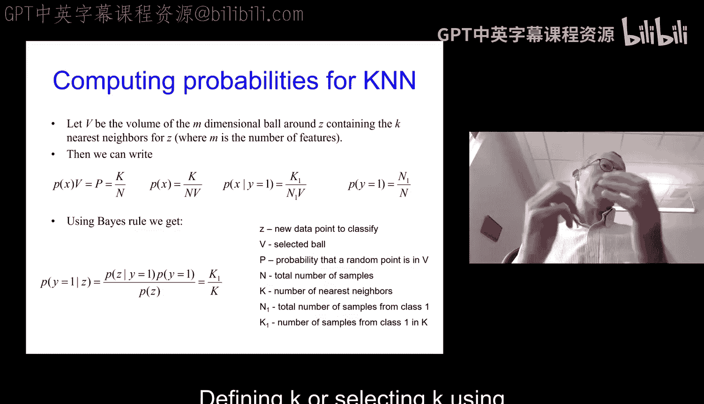
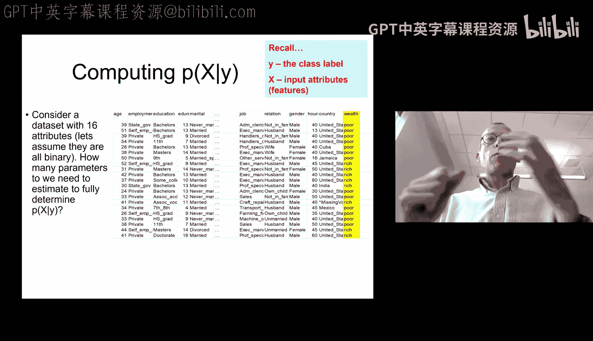
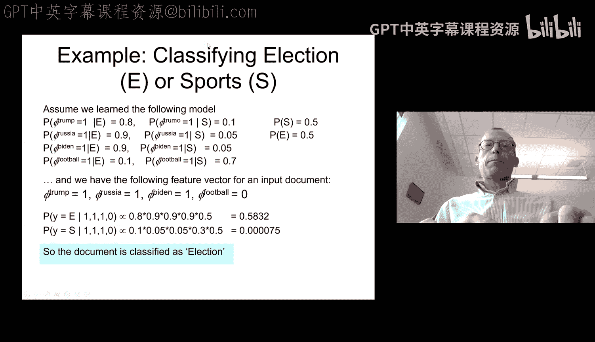

# CMU《机器学习导论（研究生）｜10-701 Introduction to Machine Learning 2020》中英字幕 p04 [04]10-701 Lecture 4 KNN Continued and Naive Bayes.zh_en [BV144SuB8ETp_p4]

Okay， welcome back， everybody。😊，Today， we are going to discuss。

We'll finish the discussion of Can nearest neighbors， we have one。

PepPoint remaining and then we'll move to discuss them。Another classification method， as we said。

 we are now talking about supervised method and within supervised method。

 we are talking about classification。So we are going to finish Ken Nas and move to another classifier which is called Na base and we'll discuss that as well。

 as always if you have questions or comment please either raise your hand or even better post to the chat and Daniel can you or is there anybody who will monitor the chat today？

My control manager yeah， okay， oh I guess one of the other is on the okay。Good， so。

Let's continue where we stopped last time。哦。

Just finish a minor point。Maybe not so minor about K nearest neighbors so I mentioned last kind that K nearest neighbor obviously is an instancebased classifier so it's not a probabilityistic classifier and it's not we don't call it a discriminative classifier and K nearest neighbor basically doesn't learn any model right we said that K is the hyperparameter that we need to determine but other than K there no more there is no other parameter associated with this model。

So we need to determine a distance function， but that's not considered a parameter。

 that's a decision。However， last time I ended up by saying that we can interpret or we can have a way of interpreting Can nearest' neighbor as an algorithm that like naE Be。

 which we'll talk about next， is actually trying to approximate。

The base decision rule the way it does it is very different from na base because it doesn't compute global probabilistic functions。

 but rather local probabilistic functions what do I mean by that so we talked last time about the fact that。

😡，If we look at the ball around the specific point that we are interested in。😡。

And we look at the K oh， let's put it this way， we define a ball around the point and I say a ball because this can be in any dimension depending on the feature space。

 but if we define a ball around the point that we' are interested in。

 such that this ball contains k instances， that's how we define the US neighbors。

 then we can denote the uniform probability， for example， at any point in this ball as P of x。😡，Okay。

 that's just the definition and when we multiply P of x by the volume of the ball。

 by the size of this area。We know that the probability of being in this location is k over n that's how we define the ball right so k over n equals p of x times v where v is the size of the ball v is some we said okay so let's call that P and last time I went through some it showed you some why this is indeed the case so let let's call this V and if that's the case then we know that basically p of x is equal to k over n v we just move V to the denominator。

😡，So this is proof for the probability of a specific value。

 or this is called the marginal probability， the probability that we will see a specific sample within that bowl at any location in the ball is K over n。

Okay， so this is just some value， we don't even know what V is。

 we know what k and N are K is the number of nearest neighbor were looking for n is the total number of samples。

 this is some value we defined， we don't really know what it is。😡。

Oh we didn't give a value for what it is Okay， so this is true for the probability of x。😡。

What is the probability？😮，For a value from class for sample from class1 to be in this ball okay so this is the probability of x conditioned on y equals1 well it's the same type of argument we know the size of the ball we know that within that size we have K1 which is the number of samples from class1 over n1 which is the total number of class1 and the volume is the same volume right because we didn't change the volume of p so the probability that a sample from class1 is in the ball is k1 over n1 well K1 is the number of samples from class1 in this ball that we define an n1 is the total number of samples from class1 okay this is again just once we define the ball we can just compute these probabilities based on the observations。

😡，And finally the probability of y equals one， the prior we know that it's just counting right so it's n1 over n that's how we count Okay。

 so now given a new point z so this is true for any ball defined by K enable now if we have a new point z right so that we don't know what it is we can use the same arguments to say that the probability of y equals one given z is using base P of z condition on y equals one。

😡，Which we have here， right， this is K1 over N1v。😡，P of y equals one。

 which we have here n1 over n and p of z， which you know x is just a generic name now we have a specific。

😡，Sample， P of Z is k over nv。😡，And if you put everything together， V cancels out。😡。

Most of the things cancel out， and we end up with K1 over K。😡，Again。

 what is the interpretation of K1 F O K， K1 is the number of samples from class 1 in V K is the total number of samples。

😡，In the book。What decision do we make we take let's say we have two classes we take the class that has the highest number right that's exactly the base decision rule right we said we take the one that has the highest the one with the highest number will also have the highest K1 over K because K is fixed so it's the same for all classes the difference is the size。

😡，So basically， what this means is that。If we believe the local probabilities that。We defined。

 or if we believe that indeed， of course we have to make assumptions that there is some uniform probability within a ball from being that class and we use the observed values to determine probabilities。

 then K1 over k is the base decision or that's the decision that we will come to if we want to use the base decision rule using the probabilities with and in that case it means that if K1 is bigger than if there's more samples from class1 within the K nearest table will select class1。

 if there's more samples from class2 will select class。Okay， so again， this is。😡。

A way to show that K&N actually does， or at least to some extent。😡。

Attempts to approximate the base decision rule， of course with very specific assumptions about local probabilities right we usually did not define local probabilities。

 but in this case we use it using local as if you have a question raised hand by Jared Jared you can unme。

😡，So I think you had just said maybe you said this vaccine。

 but I thought I've heard you say that K1 is the number of samples from class1 and V。

 is that correct or is it the number of samples from class1 and K？Yeah。

 so V is the ball surrounding Z？😡，Which contains case samples Okay， Okay。

 so it's basically the same thing。 It's the number of points from class one。😡。

Within the K nearest neighbor， but it's also the number of points from class one in V in the ball which is defined by k Okay。

 so they're the same the same thing in case Okay， thank you。😡，Okay。

 good so again this is this shouldn't affect this is more a theoretical justification。

 it doesn't affect anything about using the method right the method can be used even if we didn't define we didn't motivate it theoretically。

 but it just maybe gives you。😡，A better feeling about why Kenya's neighbor is something that walk。😡。

Why it makes sense to use the type of decision that Canium table does。

 It doesn't change in any way how you are going to use Can， Okay。

 because we are still going to use it。😡，Based on what we talked about just you know。

 defining K or selecting K using crossization and just doing analysis。

Okay good so this is it for can nearest neighbors again a very popular method we said the main I mean there a few downsides of course it doesn't generalize it uses on the incidences and the other downside it can take a long time especially if you have a lot of samples if you have hundreds of thousands or billion of samples as I said there are approximation methods that do fast can nearest neighbor estimates these are not guaranteed to give you the real can nearest neighbors because they are approximating but they will give you something pretty good。

So you can use that you can use a lot of different packages to compute that。Okay。

 so this is it for this part and now。😮，Now we are going to move。3。The next lecture。

 which is going to be on eighthth grade。

Okay， so naive based classifiers， as the link suggests right， we said the base rule。

 na basically naive based are another method that tries to approximate the base decision rule。😊。

And because it's。How to almost impossible to compute the valuess explicitly it's going to use some approximation methods to compute the probabilities that base decision rule requirements okay if we now map or if we try to associate naive base with a specific type then naive base is a generative model so na base why is it a generative model。

 I will talk at the end， but basically speaking we call it a generative model because once you learn the parameters of naV base。

You can generate a new data。Without looking at any of the inputs， once you have the parameters。

 you can basically generate new samples from the input by sampling and we'll get to that again。😡。

So this is why it's called the generative model， but again。

 more importantly naE base is trying to approximate the base decision rule。😡，With some you know。

 some。Or not without explicitly trying to infer the full probabilities， as you will see。Okay。

 so again， this is the best decision rule we said if we know how to compute these probabilities。

 we can get an almost optimal decision and the real problem with today's decision rule usually is computing this part here。

 of course P of x is also hard but usually we can ignore it because we just want the class that has the high probability and this is twofold classes but computing P of x given y。

😡，Is usually very challenging。 right， Again， what's the probability of an image。

 given that we know it's a cat， right， so， so。How can we define the probability of an image for a specific class There's so many possible values for pixels。

 so many settings， so many different cats， how can we actually even if we have lots and lots of data。

 how can we actually。Effectively learn such distributions， maybe those， you know。

 it's very hard to find a good distribution for that。So navebase has a simple way to solve it。

 the advantage of nabase is that it's very easy to compute， you don't need a lot of samples。

 the disadvantage is that it's based on very， very strong assumptions which in most cases do not hold the fact that they do not hold doesn't mean that the method is not good or doesn't work sometimes the method can work even if most of the underlying assumptions do not hold。

😡，But that's something to consider。So let me just give you an example of a big problem that trying to compute this P ofx given Y which is required。

 of course。😡，ForFor the base decision rule where that can become a problem right。

 so let's say we want to compute I don't know some。Some label giving some census data。

 so data about individuals， we know their age， their employment。😡。

And we know their education and their job。And so forth and so forth。😊。

And we know where they live and the goal is to determine whether they live above or below the or whether they will be above or below the poverty line。

 for example， because we want to help those that we think may fall below the poverty line or I don't know because of some other thing。

Okay， so this is not a huge classification problem in this case， we have 16 different。😡。

Values and one label 16 different features and one label。

 the values themselves are not continuous but they're also not binary right so so we have。

A different types of employer， employment， different types of education， of course。

 age can be can vary。And so forth and so forth so we have a lot of possible values for each feature and we have a lot of features and we may have data on millions of peoples right so so if we really collect census data we may have data on millions or even tens of millions of people so we have a lot of data。

But the problem is that even if we have a lot of data。😡。

TheIf we want to compute the probability of x and in this case x is a vector， so x is one line here。

 right？😡，Given a label poor rich。We still have huge。

 huge amounts of possible combinations of values right so x basically the probability of x and y means that for any possible combination of values that we can have in each of these entries we need to have a probability of what is the probability of these combination condition on the data and for that we need to see a lot of these combinations repeated several times now how many total combinations can we have that depends of course。

 on how many different values we can have for each of these attributes。😡。

But even if we have only two values right I mean and this is not the case。

 but even if we have only two attributes， two values and we have 16 attributes。

 it's already two to the power of 16 and if we have four then it's 4 to the power of 16 and in some cases we have  eight and 10 and so forth。

 so this can be huge amounts of combinations。😡，Right even if we only have 16 possible values。

 so we have 16 values but each can take multiple multiple 16 features but each can take multiple values。

 the number of combinations can be very very large and for example for pixels this is the same thing right even if we have only 255 values for pixels if we I don't know 256 by 256 image then the number of the total number of values we can have is 256 times 256 times 255 which is a very large number so we really need a lot of samples in order to be able to compute the problem。

So generally speaking， and this is called joint probability distribution right so this is the joint probability of this value and this value and this value and this money and this one。

😡，So General is taking computing actual values or trying to learn using MLE or any other value。😡。

Joint probability distributions is very， very hard because it requires lots and lots of data。😡。

Because the number of joints， the number of possible combinations is very， very low。😡。

That's a big problem for computing based food because。We really need to be able to and learn this。😡。

From lots of huge amounts of data。

So what can we do to overcome this or what's。😮，What's the way to reduce the complexity Any can knows or can think of a way to reduce the complexity of。

The joint。Settings or the joint probability distributions that we need to learn。Anybody wants to。Yes。

 so a lot of people mention， if I look at the chat。

 a lot of people mention basically what Naive B is doing， which is to assume independence。😡。

Absolutely correct and we'll get to that anybody knows of another way to reduce the joint probability distribution issue。

To make things without assuming full independence or even full conditional independence。

Anybody knows of methods that can do that。Yeah， feature selection， of course， we is。

 but let's say we want to use all the features， but we don't want to use the full distribution。😡。

Yeah now I'm looking for a very specific method like a name of a method PC again。

 all the methods people suggest that feature selection PC are very， very good。

 but they don't leave us in the original feature space。

 I'm asking if we want to use the original feature space。

 but we don't want to use the full dependence， but also not the full independence。😊。

Any way of doing this， yeah。Good， so so the answer I was looking for is again something we will cover in this class but we haven't gotten to。

 but you should at least know that it exists again you are not responsible for this inter process set to exam until we cover it。

 but generally speaking there is a method called based networks and a lot of other variants like hidden Markov models and Markr fields and other graphical models。

😡，And these models basically are an intermediate。😡，Between the full joint that we just explained。

 which requires a lot of parameters and usually we cannot really learn because we don't have enough data and the full independent or full conditional independent dependent which is what we are going to talk about next。

 which is good but as we said unrealistic because in most cases things are not independent or even not condition independent and a way to balance these two things is with a method called based network that willll get to later in the class okay you should know it exists but you don't need to know how it works but at least。

😡，You know， know about it and we'll get with Okay， so this is a。The problem that we are at。

 which is that。On the one hand， we want to use based decision rule on the other hand。😡。

We are worried about computing the joint because the joint is just too much to estimate。😡。

Using the data that we have， so what can we do？So one solution we said already is a bit more balancing act。

 but nave basedase has a very simple solution。😡，Which， as we said， is usually not correct。

 but still can walk in some cases。😡，The idea of life base is that。

Rather than computing the joint and this case condition on the class， we assume independence。😡。

Or conditional dependence on the class so basically if we take x。

 which is the entire row that I showed you in the previous slide。😡。

We can break it down into individual features， individual columns。

 and for each column we compute its own probability or basically we assume that the joint can be factored as a product of independent probabilities right and this is true is indeed all of the columns are independent of each other then this is true in practice as we said these things are not independent right if you look at this table for example。

😡，If someone is， I don't know， if someone is 15， then it's very unlikely that they will have a bachelor degree。

 regardless if they're rich or poor， right or they will be a master student。😡。

So these entries here are very dependent right if someone is a 10。

 then it's very unlikely that she or he will be buried right that he will have a job as I don't know。

As a professional or something right so there is even if you know even if you know the label there is still dependence between the entries in the state so assuming independence is not correct even conditional independence but it's an assumption we can make and sometimes this works even if the assumption is not。

Okay， so again， this is， but this is basically the idea of na base naF base tries to approximate the base decision rules。

 the challenge is how to compute P of x given y and naE base is saying I'm going to compute P of x given y by assuming independence。

😡，And taking the product of the marginalina of the specific values condition on the。Okay。

 so this is the solution that Na base gives。 Now， of course。

 this still doesn't solve our problem because we still need to compute the values of these probabilities。

But it makes our life much easier。😡，Okay， so if we believe this。

 then the next step is try to compute these individual probability。

 So what's the probability of age 140 condition on reach what's the probability of。😡。

I don't know being married condition on the fact that you're reach up to and so forth。

So these are still probabilities we need to estimate。

 but at least we don't need to estimate any joint。😡，Okay， once we believe this， then we can use。

 as we said， we can use a base rule and we use base rule by。😡。

And we use base rule by taking the al Maxs over VV is the label of the class given the。😡。

Given the input that we had and because we used base。

 we can say this is p of x given y times p of y divided by p of x and because p of x is the same for both classes and we are taking the out marks。

 basically this becomes P of xj given y which is the joint right facted into the individual components times the probability of y okay so again this is what we did and when we talked about base。

 the main difference。😡，That we now factor this。As a product of independent or conditionally independent probabil。

Okay， so this is the final。In probability， we need to determine。

The probability the joint probability effects given why the condition likelihood load that we need to determine and the real challenge or the values that we the goal of this the remaining issue is to find a parameter associated with this probability here。

 but again now we just need to compute the probability for each entry or for each future condition on the needle。

Okay， so again， it's important to realize that we don't assume independence between the features。

 we only assume conditional independence， so independence condition on the class label。😡。

And of course， we learn different parameters for the two classes， so we have a Theta 1 J J。

 let's say J is the fifth。😡，Feature， so let's say Jay is whether you're married or not。😡。

Okay so we learn one probability for whether you're married or not for class one， let's say poor。

 and we learn another probability for class two which is rich okay。

 so for each feature we learn two different probabilities。

 one for class one and one for class we need to learn it from the date。

The way we learn it is pretty simple， right， we use basically。Maximum likelihood estimation。

 but in this case the maximum likelihood estimation is separated by the two class。

 so now we want to learn the probability， let's say that someone is married condition on a class one which is let's say pool then we take all the roles in the table in which we are in class one。

😡，These are the samples that we look at and now we compute how many times we saw married and one divided by the total number that we saw。

😡，Samples in class one and this is the probability of xj equals one condition on class one again this is just MLE right but MLE conditioned or basically restricted to samples in class one we don't want to use the MLE to compute the probability of merit in the entire space that's not what we care about we only care about the distribution。

😡，For one specific class so we do it for class one where let's say for two。

 and then we do it again for class two， let's say reach and we have a separate probability for which and a separate probability for。

Okay so again computing it for binary and again in the problem set you will walk also on multinoial it's the same thing so if we have multiple options for this value for example education you can have a bachelor degree a master in high school so we have let's say four or five then again we can just compute it by counting but the counting is restricted is done separately for class one and for class and if we're three or four classes we can extend that to multiple classes as well so naEb can work with any number of classes。

😡，As long as you compute the probability separately for each of。😡，Okay。

 good so this is the AdL name base。😡，And if you have two classes。

 then the decision you will make is just computer probabilities， learner probabilities。

 now you get a new sample X。😡，Right so we get a new row when we want to predict whether this individual will be reach for Po。

 then we just lose the probabilities we learned to compute P of x given y。

 which is just the product of the individual values condition on y timesq of y and we do it for the two classes for reach and for po and we choose the one that leads to the higher value again we ignore P of x because we want to select the class with a higher probability。

😡，We don't necessarily care about the actual probability。

 we just want to choose the one that has that properly。😡，And the probability of the cost。

 we can compute using MLE as well， just count how many times we saw rich， how many times we saw poor。

 and this is the probability of the cost。😡，And as I said。

 this can be extended to multiclass classification with multivariate。Emily， as you were welcome。Okay。

 any questions， Daniel， anybody has any questions or we can move on none that have't already been answered unless you guys have more now。

No， no， everything is answered， I'm happy。Why does it jump， okay？Okay， so let's do an example。

 Hopefully this will make a sense once we do an example。

 the advantage of this example is that it will discuss， or we can discuss， first of all。

 how to use na base， but also this will give us some。诶诶。Well， let me discuss some issues related to。

 as I said to data representation， I already mentioned that data representation is a major issue。

In machine learning that we usually ignore， but in this case。

 we can talk about it when we talk about classification specific。

So let's say you know you are trying to classify text documents into one of two or three or four classes。

 let's say sports or election entertainment， whatever sorry sports， politics。

 entertainment and so forth so now you run into some article in the Washington Post that has this title and of course has a lot of text。

And you want to find the as you want to find the topic of this article， Of course， you know， for us。

 it's clear that this is an election article， but for an algorithm。

 the question is how would an algorithm。How will an algorithm be able to handle such？

Such a document and actually correctly infer the class for this document。

This is something that write text classification I mentioned it in the first lecture is something that we do all the time spendm filters do text classification。

 Google newss is trying to classify oh cluster I mean it's the same idea。

 cluster text into the same categories of course web sometimes tries to put things together based on the topic and so so text classification is a very important problem。

 a lot of other write searches and so forth are also something that we classify so this is very important topic a lot of people are interested in cluster classification for a lot of different applications。

😊，So the first question we need to ask ourselves and this is something that people have put a lot of work into and still people are working on。

 so we are going to discuss one option but there certainly certainly a lot of others is how do we encode the features？

😡，If I want to classify a document， the document is composed of words that are put together into sentences and then paragraphs。

 there's some headlines， there's images， how do I classify， or how do I not classify。

 but how do I represent。😡，This information to a computer。

The computer usually is hard for the computer to deal with words， certainly with sentences。

 paragraphs， how do you represent it to the computer？😡。

Usually the question in most cases is what information we can ignore or how can we basically summarize some of the information we are going to have a loss。

 but without a major loss。😡，What do I mean by that if we have a document we can treat it as a lot of algorithms do as something called the be of words what is a beg of words let's look at the document as the sum of all the words in the document obviously this is a summary of the document because it takes into account all the words in the document but it's a very lofty summary because it doesn't take into account the order of the words which was on the same sentence which words are in the same paragraph this may or may not be a good idea sometimes it's enough。

😡，And it's pretty as you will see， this is a pretty easy thing to represent or to encode numerically。

 but sometimes it's not enough because it might lose too much information about the order of the world okay for now we are going to use it but as I said the way to this is not a focus of this lecture how to represent documents but this idea of how to represent the data is very important thing I'm not going to this is not something will discuss too much in this class but this is something to keep in mind the fact that I'm going to use Be of wordss and a lot of people use it does not mean that it's the best representation for all of us right you have to understand that it loses a lot of information。

😡，Okay， so watch that but still assuming that let's assume that we are going at least give it a try。

 so what is the idea of a bag of world， a bag of World basically represents and that's why it's very efficient and nice way to represent the document。

😡，It doesn't matter which document you give me， how long the document is。

 what type of topic it covers， where it came from， from newspaper， from the Internet， from a。

 from a blog post， from Facebook， I don't know， I can always represent it with the fixed length vector。

 That's always good， right， Because we can easily learn classifiers if we have a fixed length vector。

 How do we do it， We start with a dictionary。We start with a dictionary of the English language。

 let's say that we have a dictionary with 10，000 old。😡，Okay。

 so we start with a vector with 10000 entries。 Each entry in our vector corresponds。😡。

To a in the dictionary， we have to construct the dictionary， so we have to select the award， but。😡。

Usually with 10000 words， we cover most of the world in the English language。😡。

We usually ignore the some you know these words that like and and E and D because they're appear in all of the documents。

 but if we want to find words that are， so these top words usually we ignore。

 but usually we can encode with 10，000 words， most of the frequently used words in range。Okay。

 so we have this vector and we have a way or we know what each entry represents and now when we have a new document。

😡，We create a new vector from that document and there's different ways of doing it。

 let's say we use a binary vector not you can use count one it's up to you to decide but let's say we just use a binary vector we put one in a specific location if that word appearss in the document so the vector is going to be very sparse because most wars do not appear in most documents but some wordss do appear for example in election we have the word Trump。

 we have the word Biden we have the word election maybe and so politics this can appear in the dictionary that we create。

😡，Okay， so each time we see a word in a dictionary， we put a one in the location for that word。😡。

And that's the vector that represents document this means that each document is represented by the same fixed or all documents are represented by a fixed length vector of zeros and ones ones correspond to wordss that appear in the document。

 the location of the word is fixed so if I have 10 different documents。😡，And all of them have。

 I don't know the value the 10th entry as one， I know that the same world appeared in all of these。😡。

Okay so this is one way to represent again as I said so you can do it as the binary vector you can do it as they count。

 so rather than saying the word appealed or not you say how many times it' appeal then you put a value let's say the word election appeal five times than you put five for election rather than just binary S or no it's up to you to decide whatever you feel more comfortable of course this depends on how much data you have binary vectors require usually relatively less parameters than count vectors which require more but it's really up to you。

😡，Okay， so so now once we do that， we throw away the document and we just use the vector to represent that document all the information we assume that all the information in the document is now captured in our vector。

 Here is an example right， so we take this。😡，Dicctionary of ours and we have the world 54 is Trump 55 is divided 56 is Russia I don't know。

 57 could be football I don't know and then we say okay， so we see。

Bideden and Trump in this document， but we don't see the word Russia。 So we put it。 Okay。

 so this is how we construct the vector and we do it for all of the world。

 So we end up with a vector that has。You know， 10，000 entries is of 100。Okay。

 so this is the fact we created until now we didn't use naBase at all。

 it's just a way to represent the inputs in the data。

 but now we can once we have this representation， we can go back to na basease。😡。

So now we want to classify documents， obviously right that's the goal our goal is to take some documents。

 transform them using。😡，This encoding scheme that we just discussed and then use that encoded。😡。

Or that transform Vokta to classify the documents into different categories， maybe sports。

 elections into them， and so forth。For this， of course， we need training data。😡。

We can't oh you know you can do it on custom but we are talking about classification so we have training data so training data means that we see some documents that the supervisor told us are elections。

 some documents that the supervisor told us are entertainment， some documents on sports and so forth。

 we take all the election documents。😡，And we learn parameters from there right that's what we do in the events we take all the sports documents and we learn parameters for them for example。

 we can compute what's the probability of Trump condition on election how many times the world tru or in how many documents。

😡，That our election document， we sold the wrong Trump and we can compute that as then one over N and we can do it for other words like Biden。

 Russia， Po， whatever you want。 So we compute it and then we compute the same thing for sport。

 How many times did we see the World Trump or Biden in sports document and we compute the probability of Trump given sports。

 entertainment and so。Okay and this is how we compute parameters for our model and finally we need to compute of course the probability of the class themselves and we just count how many times we have in our training data how many election documents do we have out of all the documents this is the prior right if we don't know anything this is the prior and again all of these are MLE calculations right this is MLE conditioned on the class so we just do it for documents from this class and this is MLE for the label because we use all the documents。

Okay， so this is a way to compute parameters maximum likelihood for our na based classifier assuming。

😡，That we are comfortable with the way we represented the document right so if we assume that we are okay with representing a document with a 10k with a 10。

000 words dictionary， then we can basically take all the documents and call them learn parameters and have a full live based model than。

And now let's talk about how we use it。😡，Okay， so let's say this is the example and let's say we have a document。

😡，That we want to classify as either election or sports Okay， these are the two classes。😡。

And we already learned models for these documents。 Okay， so， for example， we learned。

That the probability of seeing Trump in election document is 80% and maybe Russia 90% and football is only 10%。

 but on the other hand， the probability of seeing football in a sports document is 70%。

and we have 5050 chance of like in the training data we have 5050 chance of sports and energy so now we have so these are parameters we learn from the training data。

And now we have a new document， okay， we want to classify right that's the goal of classifiers right given a new document。

 how do we decide what is the label that we give to this document。😡，So if we get now a new document。

 we again encode it in the same way that we encoded all the training documents and we see that in the new dictionary。

 Trump is one， so we have the World Trump， we have the World Russia， we have the World Bi then。

 and we do not have the world football。😡，So what do we do？We compute the probability of why。😡。

By the probability of y equals E。😡，Which is the probabilityb selection document and the probabilityb support document will you do that by multiplying the probability of each of these condition on E times the prior right and the same thing for here So this one is the probability this is for Trump by then。

😡，R and the fact that so 0。9 here means that that's the probability of zero condition on election right the probability of one is 0。

1 and the probability of 0 is 0。9。😡，So this is the probability or this is the numerator。😡。

For P of y equals E。A condition on what we saw and this is the same for the sports right so here we take all the values here and here again we saw zero so we put 03 and times 0。

5 and this is the probability for sports and so we make a decision based on the values that we see that this document will be classified as an election we can also compute how confident we are by taking the ratio here that that's not a critical issue the important thing is that if we see these three wordss then we would four wordss basically I mean so we see three wordss in the document and one world don't we would classify as an election based on the parameters we are。

Okay， so this is84 a。

This is it for an A base for discrete distribution。

 so in this case we used multinoial or binomial distribution depending on how you want to encode your data multinomial either and the number of levels。

Any questions about this， anybody has any questions about base or how to use it for discrete or multinoial data。

Everybody seems to be okay， okay， good， so let me ask you a few questions if you turn to Piazza。😡。

I have a poll on live base。Let me open it up。And you should do so there are three questions。

Related to name base and working。Okay， so let's start。ロけな啲。Fish。

So the first question I asked you was about the number of parameterss that the naive base classifier has to we said already that one of the major challenges。

😡，With learning the full joint probability distribution is that we need to learn a lot of parameters。

 we need to learn our parameters because there's lots of possible combinations。😡。

And one advantage of na base is that。😡，And it requires us to estimate much for parameters because we only learn one parameter per feature class。

 so we don't need any combination of features。😡，So I asked you about a three class specification problem。

😊，With 10 binary features or 10 binary values for each of the samples。

And we asked how many total parameter values we need so in terms of knife base the parameters that we learn or the model that we learn is going to have one parameter for each feature for each class right because we said we need to learn how many times we see the world Biden or Trump in this document and how many say in sports and how many times we stayed in house right so for each one of these we need a parameter for each of the features we have10 features and three classes。

😡，This means that we need a total of 30 right so we learn it from one。

 so we learn how many times we see Biden。😡，In or Trump， in a document。

1 minus that is the probability for0。 So we don't need a different parameter for0。

 So we only need one parameter in a binary feature per class。 So we have in this case，30。

 But in addition， we need to learn two more parameter。😡，Again。

 the third is given because they have to sum to one of the probability of the different classes。😡。

So we have a probability for elections for sports and for health。

 it's really only two values that we need to learn if we know the probability of election in sport health is one minus the sum of these two probabilities。

😡，Okay， so the answer in this case is 30 for the features plus two for the classes。

 which is the second answer for 30。😡，And majority， a small majority。

 but a majority of you still was able to correctly determine that this is the end Okay， so this is。

Just a simple counting the second problem is actually the second question is actually more important and more。

I would say conceptually。Well， something that。Is more important in order to understand an E base and I'm very happy to see that most of the class。

😡，HeyGo， it's correct。 So so when I ask you here is。If I know that the probability of， let's say X。

 let's say X is。The probability of Russia okay， so the world Russia in a sports document and the probability of Russia in an election document Okay so let's say that I know that the probability of Russia doesn't appear in a sports document。

😡，Is let's say why zero is a sports and y1 is election。

 this is v0 and this is V1 what is the sum of v0 and V1 is there any relationship between the parameter we compute for a feature in one class and the parameter we compute for a feature in another class。

😡，And the answer in this case is four。There is no none of these have to guarantee they don't have to sum to one。

 they don't have to be less than one and they don't have to be more than one Why is that Because of course within a class and that's very important to understand the probability of Russia given an election document。

😡，Is one minus the probability of not seeing Russia in European document。

 so the probability of zero and the probability of one for the same class has to sum to one。😡。

But the probability of Russia in sports document and in election document are two independent things。

😡，It could be that Russia always appeals in election document and always appeals in sports document so it will be one and one and will sum to2 it could be that it doesn't appear in either of them so it could be zero and zero and will sum to0 it could be that it appearss in one unless less in the other and so forth so the probability that award appeals in one label or the probability of a feature condition on one class。

😡，Is not related to the probability of that feature condition on another class。

 We learn these two separately from separate samples。😡，Right。

 so so we separate the samples in the training set based on the labels that we are provided。

 We learned them separated from separate samples。 And so they can have。You know。

 it could be that there will be more than one， it could be that there will be less than one。

 it could be that will be exactly one we don't you know we can't tell based on。😡。

Based on the fact that it's the same just the fact that it's the same feature doesn't tell us anything about relationship。

😡，Again， the same feature for the same class。 Yes， the probability of Russia equals 0 and the probability of class the probability of Russia equals one for the same class that has to sum to one。

 But between two classes， that's。 Okay， so this is very important distinction in in in in。

In niceive space。Okay， so the answer in this case， as I said， is the last answer。Right。

The third question is a question we like to ask actually that's like one of the types of questions that we like to ask in problem sets。

 as you will see in the next problem set and also in exam。

 and these are questions that try to compare or contrast。

Two or more methods we learned in class so so far we learned only K and and Eb onm asking about those。

 but this question I think you will see it in the future extended to other classifiers for example logistic regression which we learn on decision trees and by the way there the answer could be very different but in this case we are talking about。

😡，Nive base and K so I'm asking you the following question I'm giving you a data set let's say with 10 values so I don't know whatever and now I'm taking the first value let's say the word Russia okay so I'm creating a dictionary with 10 values the first one is whether the word Russia appearss in the document or not and I'm just multi I'm just creating now a new vector with 11 values such that I repeat the value of the first entry twice so the value of the first and the 11th feature are exactly the same in all of the samples that you get and the question is would this change the classifier what do I mean by change the classifier when we say change the classifier that's actually something important because this will come up it means that there is at least one sample。

That can change the label if we change this setting okay， so you know。

 if we learn from a new feature vector it can change the output for at least one sample。

 although there could be cases where we will change the prediction。😡，Okay。

 and I'm asking whether this can be or what would happen to K andN or can this impact K andN and can this impact E base and again in this until now you only saw these two when we'll talk about others you will see that。

😡，It's not always the case， but in this case， the answer is actually three， which most of you。😡。

Note to most of you， but this is the question， the answer that got the most。

The most selection from you， why is that the case？In A base， we assume independence。

Right of the features condition on the class。  clearly。

 this assumption is violated when I copy one feature and put it twice， because obviously。

 even if I know the class， the first feature is not independent from the 11th feature。

 they are the same。 So they are definitely dependent。

 Now I'm learning a probability based on the first feature multiplying that by the probability I learned for the second for the third and the first and also multiplying it by the 11th feature。

 So the 11th feature contributes independently of the first feature， right。

 the first feature remains the probability remains exactly the same。

 It doesn't change based on the 11th feature。😡，In the 11 feature similarly。

 So this has an impact on the overall probability of a new sample。

It might not change the prediction for some samples。

 but it actually does it can change the predictions from other samples。😡。

So the answer from the E base is that this can have an impact on the outcome because this is a new probability。

 it doesn't change the value we assign to the first one。😡。

But it can change the overall value of the product。 So this is for na based What about K Na again。

 carrierius Na， it depends on how you design the distance function。

 but let's say we are using Euclidean distance， if we are using Euclidean distance。

 then if we have 10 features， each one has the same weight。😡，But if I copy the first one twice。

 then now the first one has twice the weight as or almost twice the weight， or actually。

 twice the weight of all other features， this will change who I consider to be my nearest neighbors。

😡，RightIf someone is very close to me in the first one， but maybe not so much in the others。

 if I just use one value for the first feature， maybe it won't be one of my Ken nearest neighbor。

 but if I multiply， or if I use it twice， it might be my neighbor I might decide that this is my neighbor so it can change who are my neighbors and if you changes words or all of my neighbors。

 it can change the prediction that I'm。😡，So in this case for both of them the answer is three for both of them if I copy the first or if I use the same sample twice sorry if I use the same feature。

 the first feature twice and that's true for the other feature obviously first it' just arbitrary this can change the outcome as I said keep this in mind we will talk about other classifiers well this does not necessarily hold but for nave based and K nearest neighbor this whole okay good and I saw that a lot of questions but I assume that Daniel was able to answer them Yes of most of them have been answered to just came in recently someone said。

What does it mean in the naive base model if adding a redundant feature changes other parameters can you clarify right so in the na base does not change that's what I said that adding here doesn't feature does not change the other parameters the overall product does change because you multiply by another probability so that could change but the value of the other part doesn't change but still the classification decision can change because we multiply by another product let's say the probability based on feature one is very low then maybe if I only edit once I still pick this class but if I multiply it twice suddenly I move to predict the other class this could happen because I'm multiply so that's what I mean the second thing about Euclidean distance。

Again， so Euclidean distance， when I say Euclidean distance itself of course does not affect the weight。

 but if you compute the Euclidean distance from the same feature twice。

 then this feature has twice the weight right because Euclidean distance is sum over the distance over the individual features and now we are computing it twice for one feature then it increases the weight of that specific feature and that would change the of that sample。

😡，Okay， so let's go back to and again， you know， I always say about these。

 I should have said if you were correct in the solution that you selected， great， I mean。

 you may be either you know naEBase or you were very quickly able to grasp。😡。

Some of the concept of nab for most people， including myself。

 it's very hard to grasp this concept very quickly。

 so you might need to take some time to go over the lecture afterwards and understand it and get more familiar with this the reason I'm doing this qui is not to test you and to tell you that if you got it wrong you're no that's absolutely not the case I mean I'm doing it because it gives me an opportunity to discuss some important aspect as I just did and it gives me also an opportunity to break the class a bit because the class is one hour and 20 minutes I want to have a break if you got the answer correct great if you didn't get it correct don't worry at all I mean as long as you take the time to go after the class over the answer and understand why the correct answer the correct answer you're fine don't worry it's not easy to understand you right after I explain something exactly the so don't feel bad if you got it wrong I have no expectation that's why we also don't grade them。

That are not the quizzes or exams that's completely separate once we get to the exam。

 you will have a lot of time to review and go over the material。😡，So again。

 don't feel bad if you got it wrong I mean feel good if you got it right。

 I mean some people are very quick to grasp， but others are not quick。

 but they might grasp very well after taking some time so again。😡，No heart feeling for hopefully。

 nobody feels bad if they got it wrong。 Again， my goal is to break the class。 Why like， I mean。

 and it's a good way I can give you quizzes on completely unrelated things。 But you know。

 and it's also a good way for me to emphasize some。 But that's the only goal。

Not to make you feel good or bad about so you have a quick question from Xiao Tong。

 she raised her hand。Hi Professor so I wonder， could you please clarify again of the naive bias when adding a redundant feature it does not change other parameters。

 I think it's because for example， like PY does not change。

 but P class condition on y maybe equals to zero does change is that a case。No， so again， redundant。

 let's see。😡。

Maybe I can do this quickly。So let's say we want to compute p of x1 equals zero condition on y equals1 right this is the probability that let's say Russia does not appear in the document right if I now have 11 let's say I have 10 values or 11 values or 15 values it doesn't matter for x1 x1 just counts how many times。

We saw y equals 1。 That's fixed， right， It count how many times we saw x1 equals 0 with that and it' computed。

 Now， if I want to compute P of x 11， which never occurred before。😡，This will have some value。

 but this is not affecting x1 at all。 X1 just cares about its own presence and the number of samples we have the number of samples doesn't change don't we just add the point value to each sample。

 but the samples doesn't change， the labels do not change Everything stays the same from X1 points。😡。

The only thing that changes is now we add XLF。😡，Now， in the sum of everything。

 we multiply everything。 So now we have the probability of this， times， this， times， this。

 time this time this before we didn't multiply by this， because we multiply by this。

 This can change the overall prediction we give for a specific sample。

 but it's not going to change the probability for a specific sample。😡，Yeah， thank you。

 that's pretty clear。Okay。Great， so let's go back to our slides and discuss。S don。

And discuss some other aspects so naVBase until now I presented it as we discussed it in the context of discrete distributions binomial。

 multinoial， but na basease can also be applied to continuous distributions。

And specifically one example， or one very useful and widely used example is applying naive basease or using naive basease。

😡，In Gaussian distributions。😡，Now remember， the whole idea of na base is to assume that things are conditionally independent when you condition on the class。

 how can we use it when we。😡，When we use non discrete distributions。

 basically when we use some continuous distributions， so for example。

 in Gaussian mixture sorry in Gaussian knife base or in Gaussian distributions。😡。

We also have parameters that look at relationships between features， right。

 What are these parameters。 These parameters are the covaris。😡，So in Gaussian distributions。

 we have a mean for each feature， this is x。😡，Distributed as a Gaussian with mean and。

Convariance matrix， let's say x is the set of features。Okay， so we have。

Let's say height and weight right so we want to compute the probability of height and weight for students in this class right we have class one is let's say male and class two is female and so forth so that's the probability So we have a weight vector sorry we have a mean vector and we have a covariance matrix where the covariance matrix has under diagonal the variance for each of the different features let's say the weight and the height and of the aagonal is something called covariance is the relationship between these two features if we assuming dependence the only difference。

Between。A based decision rule andive baseball。😡，Gauussian is that the of diagonal elements are now going to be zero。

 basically we are going to assume dependent， so if things are independent。

 their covariances are always zero。😡，That's true for the other round is not true。

 but this is true so if two things are independent the covariance is zero if that's the case。

 then the covariance matrix for N base or for a Gaussian base is going to be just values on the diagonal and the values on the diagonal are going to be the variances So again we rather than compute relationship between features as we did in the。

😡，Joint， we are just computing the mean and the variance for each feature。

 And that's enough for doing the classification。Okay。

 so this is the assumption right that we basically sample from the distribution class and then we generate the inputs one at a time without taking into account whatever other features we are so each feature is assumed to be aousustly distributed features with its own values without any relationship to the other features so it has a mean and it has a variance and that's it。

And then we can use the same assumption as na base right so this is basically the probability of X given y is this is just the regular Gaussian na base where this is the covari matrix。

But if we want to use the naive based assumption。😡，We can just take it as a product of x given y。

 and this becomes the product of the Gaussian probability for each。😡，Feature。

4 h class so we have a mean for class1 and a mean for class2 and we have a variance for class one and a variance for class two as we did before with the probabilities okay so now the probabilities defined by two values。

 the mean and the varianceance but we don't need to compute or we are not going to compute e covariance matrix that looks at the relationship right so this is the full base Gaussian base basically if we don't use the E assumption if we don't use independent。

 we need to use the covariance matrix but covariance matrix can be very big basically covariance matrix is proraotic。

😡，right squared in the number of samples so if we want to remove reduce the number of features the number of parameters we can just do the gausian aase so again the same idea assuming independent condition of the model but now rather than computing different probabilities we now compute a different mean variance for each of the features but rather than that it's the same and again we take the product in order to compute the joint condition of the cost we just take the product of the individual of the marginal condition。

😡，Okay， so this is the idea of Gausian na base， again。

 very similar to naive base in discrete squ case， the only difference is that we have slightly different parameters or we have different parameters depending on。

😡，And as before， right， we have one probability for each feature in each class。

 in this case we also have separate mean and variances each for each feature in each class and they are not related。

😡，So the mean for， I don't know， the mean for height in the male and the male for height in the female are completely different things now not we don't assume any relationship。

😡，And again this can be done by MLE computing Gaussian MLEs and going you're doing it anyway in the first problem set but basically computing the probability of MLE is just counting so it's the mean for class one so this is the number of times we saw samples in class one let's say the number of males and this is the variance observed variance is class one for each so again the MLE is basically the same as the general MLE but now restricted to samples from that class。

 so you compute separately false class1 separately or class two if you have five classes you can do it for each classes。

An example， I mean， this is something that people use a lot， just as an example in biology。😊，有点听。

There are different ways to come up with distributions。

 this or biology is undergoing also itself some changes in technology。

 but some technologies basically generate Gaussian like data。

 some technologies generate discreted data and one thing that people are interested in is using technologies that look at the levels。

And again， this class is not on biology but I'm giving it as an example because this is something people actually use so there are technologies that can measure the levels of genes。

 the level of certain elements inside your cell and tell you just numerical value so this gene is 2。

5 this gene is 5。5 and so on and now one thing one way to use them is to use them to predict whether someone has cancer or not so you take some cells out of someone's body and then you can measure the level of genes and it turns out that time genes are much more present in cancer cells and some genes are present in healthy cells so if that's the case then you can build the classifier right you can take a lot of cancer cells or a lot of separate samples with cancer cells compute the mean and the variance for each gene in cancer cells。

 the mean the variance of each gene in healthy cells and build the classifier based on these two distributions okay so this is something that people have done。

This is just an example right though so they took roughly in this case it's roughly 50 genes。

 these are each row here。😡，Each row here is the gene， it's a specific specific value measure。

 each column here is an individual。😡，And these individuals were divided into two groups。

 one is one type of cancer another is another type of cancer and the colon code here means whether it's high or low so there is actually so this is just a color coding of a numerical body so maybe strong red is 5。

5 and strong blue is minus 3。4 or something it doesn't matter and now we basically compute a probability for each gene and each class so this is。

😡，The first gene in the first class， and this is the first gene in the second class。😡。

The second gene in the second class and the second gene so in the first class and the second gene in the second class you can see differences right。

 it's clear there are differences in means between these genes and also between I mean all of the genes in the two classes right these are very high and these are a very high in this class and low in this class and vice versa so you can build a classifier based on that right you can just compute the mean and the variance for each gene in each class。

And when a new samples comes in， you measure the value of all these genes。 So basically。

 you get a new column。And then you can compute the probability of whether this things from class one or from class two。

😡，And you can look at the log ratio， you can look at the higher value and in most cases this works very well。

 So basically if you compute the class。Or the class that has the highest higher probability and I'm plotting this on the log scale just so that we have some reasonable numbers but this is the log ratio。

 then for most of them you get the right class using Gaussian。😡，Using Gaussian Ab。 So this is。

 of course， naive because we compute a probability for each。G each gene on its own。

 We are not trying to compute any covari matrixs。 We are just computing covaris。

 but it works very well。 And in this case， it only makes one mistake。

 So all of these are in the first class and all of these are in the second class。

 And here you can make it makes one mistake， which can happen but。

But anyway the important thing is not so much the application or the fact that this works well in biology。

 the important thing is that you can basically compute these parameters。

 you don't need a lot of samples right in this case we don't have a lot of samples maybe I think concerned the order of 30 or 40 which is not enough if you have 50 square parameters but if you only have 50 times two parameters that's not so bad and you can compute these probabilities for the two classes and make the prediction。

And this is basically something that people are actually using。

 so this is not a theoretical example or even。😡，A research product this is there are companies out there that basically manufacture and market these type of tests。

 for example， in this case， they're looking at 250 rather than 50 genes that I' shown you different of course different companies have different panels。

 these are these are called panels and they use different technologies so I'm not saying。In fact。

In practice， I think they are not really using Gaussian A base， at least in the past。

 some of them use the port vector machines which we'll get to maybe today they use something else。

 but in general this type of predictions， this type of using continuous values to make predictions is something that。

You know it's commercially viable and commercially used and also something you can do for any any data right so the important thing is that you can use na based not just for discrete distributions but also for other distributions and criminal constant distributions。

Okay， so this is the so far we've talked about a na base and how it can be implemented。😡。

A few caveats and that's going to be basically it for us so of course。

The assumption of knife base are wrong。 Okay， we need to realize that， right， as I said。

 if I duplicate the first feature and put it in the second place or in the third place。

 it's clearly not independent。So let's say I take the first feature。

 I duplicate it and put it in the 11th position。😡，The first and 11 feature are clearly not independent。

 even when we condition on the class。 So this is important you have to realize that it's a major shortcoming of nabase and in practice。

 nab works well， but it's not the top performing classifier mainly because in real life。

 things are highly dependent and naE base cannot handle it whereas other classifiers， for example。

 decision trees or any extension of decision trees can handle it and again， in neural networks。

 it really depends on how you construct。So that's a major shortcoming。AndAs we said。

 there's a way to overcome that， one is to learn the full joint， but we don't want to do it。

 it's too expensive， but another is to take an intermediate approach that doesn't assume full independence and doesn't assume full dependence and this is called based network and we' oh other graphical models and we'll get to that later in the class。

😡，The other thing is true for any maximum likelihood estimation problem。

 but certainly two for a base， and this is the issue of not enough samples。😡。

To estimate parameters right so for example， in this case， I have this evaluation in table。😡。

And I want to compute what's the probability of s equals1 a n equals 1 condition on evaluation being2。

😡，Okay so this is the second evaluation unfortunately we only have one or maybe very few entries for this and we only saw one value so the probability of one is going to be one and the probability of zero is going to be zero the problem is once you have a zero in your product。

😡，It doesn't matter what all the other features， right once you have a feature that has a zero probability。

 then the entire product is going to be zero。😡，And that's dangerous because it could be that all the other features are pointing in the direction of class one。

 But there's just one feature that you haven't seen a lot。

 and maybe this will give you a zero a value。 So the solution in this case is。First of all。

 you can use， I mean the idea is to use something similar or not the same because we' are not using math。

 but it's similar to the idea we used in map and this is based on something called pseudo counts。😡。

So count means that even though we did not see。😮，Something we add one to each feature even before we see anything or two or three or whatever。

 okay so when we count how many times we saw a Russia in a sports document。

 we put at least one even if we didn't see it at all。

 we put at least one and this way the probability of Russia in a sport document will never be zero。😡。

You can put two， you can put three depending on how confident you are and this way you won't have a zero so if everything else points to that。

 then this individual feature that you didn't see might not ruin everything because maybe we never saw Russia but suddenly we see a a paper a soccer document that discusses some Russian thing。

😡，Okay， so this could lead to saying zero just because the training set but if we put this pseudo account if we had one。

 this wouldn't happen okay so this is something to keep in mind that's true generally for MLE。

 but it's specifically a problem in classification because we take the product of a lot of things。😡。

Okay， so that's it phone na base。You already have a naive based question in the first problem set。

 so hopefully now you feel better or you feel uncomfortable walking on it。

And next time we will discuss another supervised learning method called decisionion plan。

And basically that's。